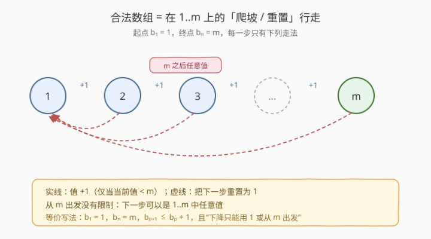
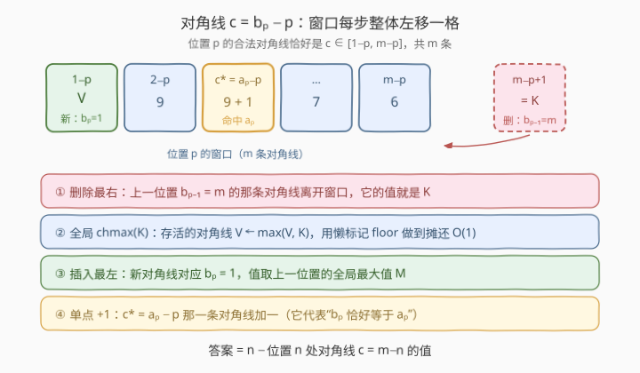
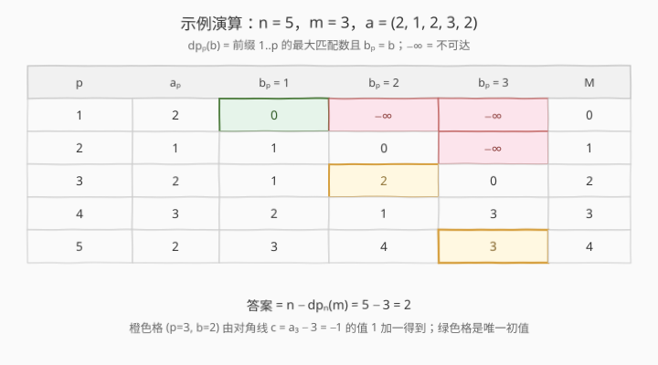

# Codeforces 2237F 粉刷数组 题解

## 1. 题目概述

- **标题 / 题号**：粉刷数组（Codeforces 2237F，英文名 Paint the Array）
- **链接**：https://codeforces.com/problemset/problem/2237/F
- **来源**：Order Capital Round 2 (Codeforces Round 1104, Div. 1 + Div. 2) · Problem F（UTC 2026-06-18）
- **难度**：2400（2500 分，题面标注 *2400）
- **限制**：时间 2 s / 内存 256 MB
- **标签**：数据结构、动态规划、贪心

**题意**：给定长度 $n$ 的数组与固定整数 $m$。一次**涂色操作**是：选起点 $l\in[1,n-m+1]$，把区间 $[l,l+m-1]$ 从左到右依次涂上 $1,2,\dots,m$；后涂的颜色覆盖先涂的。若存在一串操作（可以重复涂同一区间），使得**每个位置至少被涂一次**且最终数组恰为 $a$，就称 $a$ 合法。一次**修改**可以把某个 $a_i$ 改成 $[1,m]$ 内任意整数。求把 $a$ 变成合法数组所需的最少修改次数。

**约束**：

- $1\le t\le 10^4$，$\sum n\le 5\times 10^5$；
- $1\le m\le n\le 5\times 10^5$，$1\le a_i\le m$；
- 每组都要在近似 $O(n)$ 内解决，$O(nm)$ 的 DP 在 $m=5\times10^5$ 时不可行。

## 2. 示例与观察
官方样例（输入 / 输出原样，共 15 组）：

```text
输入：
15
5 3
1 2 3 2 3
4 3
1 2 2 3
5 3
2 1 2 3 2
5 3
2 2 2 2 2
5 4
1 1 3 4 1
6 3
1 1 1 2 1 1
8 5
1 2 1 2 3 4 5 1
5 3
2 3 1 1 2
8 4
1 2 3 2 3 2 3 4
4 4
4 3 2 1
5 1
1 1 1 1 1
7 3
3 3 3 2 1 1 1
10 3
1 2 3 1 2 2 3 1 2 3
7 3
1 3 2 3 2 1 2
10 4
1 4 3 3 2 3 4 4 2 2

输出：
0
1
2
3
2
2
1
4
2
4
0
4
1
3
4
```

逐组给出一个最优目标数组 $b^*$（即"最少修改"的一个见证，它一定满足第 3 节的行走刻画）：

| # | $n,m$ | $a$ | 答案 | 一个最优的 $b^*$ |
|---|-------|-----|------|-------------------|
| 1 | 5,3 | 1 2 3 2 3 | 0 | 1 2 3 2 3（已经合法） |
| 2 | 4,3 | 1 2 2 3 | 1 | 1 1 2 3 |
| 3 | 5,3 | 2 1 2 3 2 | 2 | 1 1 2 3 3 |
| 4 | 5,3 | 2 2 2 2 2 | 3 | 1 2 1 2 3 |
| 5 | 5,4 | 1 1 3 4 1 | 2 | 1 2 3 4 4 |
| 6 | 6,3 | 1 1 1 2 1 1 | 2 | 1 1 1 2 3 3 |
| 7 | 8,5 | 1 2 1 2 3 4 5 1 | 1 | 1 2 1 2 3 4 5 5 |
| 8 | 5,3 | 2 3 1 1 2 | 4 | 1 1 1 2 3 |
| 9 | 8,4 | 1 2 3 2 3 2 3 4 | 2 | 1 2 3 1 1 2 3 4 |
| 10 | 4,4 | 4 3 2 1 | 4 | 1 2 3 4（$m=n$ 时唯一合法） |
| 11 | 5,1 | 1 1 1 1 1 | 0 | 1 1 1 1 1（$m=1$ 恒合法） |
| 12 | 7,3 | 3 3 3 2 1 1 1 | 4 | 1 2 3 2 1 2 3 |
| 13 | 10,3 | 1 2 3 1 2 2 3 1 2 3 | 1 | 1 2 3 1 1 2 3 1 2 3 |
| 14 | 7,3 | 1 3 2 3 2 1 2 | 3 | 1 1 2 3 2 3 3 |
| 15 | 10,4 | 1 4 3 3 2 3 4 4 2 2 | 4 | 1 2 3 1 2 3 4 4 3 4 |

## 3. 解题思路

### 3.1 暴力思路

最直接的做法是把「涂色」当状态搜索：状态是（当前数组，已涂集合），转移是选一个区间涂一次。状态数是 $(m+1)^n\cdot 2^n$，$n=5\times10^5$ 时毫无希望；即使只判断单个数组是否合法，也要枚举 $2^{n}$ 级别的操作顺序。

真正的问题是：**合法数组长什么样？** 只要拿到一个可判定的刻画，"最少修改"就变成「在刻画空间里做带权 DP」。这正是本题的路线。

### 3.2 核心观察：合法数组 = 在 $1..m$ 上「爬坡 / 重置」的行走



对合法数组 $b$，令 $s(p)=p-b_p+1$：它表示**位置 $p$ 最后一次被涂时，那次操作的区间起点**（因为起点为 $s$ 的区间在 $p$ 处涂的正是 $p-s+1$）。于是

$$1\le s(p)\le n-m+1,\qquad p-m+1\le s(p)\le p .$$

所有覆盖 $p$ 的其它操作都必须**早于**这次操作。由此得到三条结构性质：

- **$s$ 单调不降**。若 $p<q$ 而 $s(p)>s(q)$，那么两次操作的区间都同时覆盖 $p$ 与 $q$：$p$ 的最后一次是 $s(p)$ 要求它更晚，$q$ 的最后一次是 $s(q)$ 又要求它更晚，矛盾。
- **端点固定**：位置 $1$ 只可能被起点 $1$ 的区间覆盖，故 $b_1=1$；位置 $n$ 只可能被起点 $n-m+1$ 的区间覆盖，故 $b_n=m$。
- **下降规则**：若 $b_{p+1}\le b_p$（即 $s(p+1)>s(p)$）且 $b_{p+1}\ge 2$，则必有 $b_p=m$。否则两个区间会同时覆盖 $p$ 与 $p+1$，再次互要求"对方更晚"。

把 $s$ 单调不降翻译回 $b$：$b_{p+1}\le b_p+1$。于是得到极其简洁的刻画：

> $b$ 合法 $\iff$ $b_1=1$，$b_n=m$，且每一步只有两种走法：当前值 $v<m$ 时下一步是 $v+1$ 或 $1$；当前值 $v=m$ 时下一步是 $[1,m]$ 中任意值。

也就是说，$b$ 是一条在 $1..m$ 上、"爬坡到 $m$ 或半途重置为 $1$"的行走序列。第 5 节给出严格的必要性与充分性证明（充分性证明约束图无环）。

### 3.3 算法流程：对角线 DP + 懒 floor



先写一个"按值"的 DP：$f_p(v)$ 表示只考虑前 $p$ 位、且强制 $b_p=v$ 时**最多能保留多少个 $a_i$**（即匹配数），答案就是 $n-f_n(m)$。转移直接照抄上面的走法：

$$f_p(1)=[a_p=1]+\max_{u=1}^{m}f_{p-1}(u),\qquad
f_p(v)=[a_p=v]+\max\bigl(f_{p-1}(v-1),\,f_{p-1}(m)\bigr)\quad(2\le v\le m).$$

这是 $O(nm)$。注意它很像「整体右移一格 + 与一个常数取 max」，于是换到**对角线**坐标：令 $c=v-p$（即 $c=b_p-p$），每条对角线在位置 $p$ 仍然只能取 $m$ 个值 $c\in[1-p,\,m-p]$。记 $V_p(c)=f_p(p+c)$，有

$$V_p(c)=[c=a_p-p]+\max\bigl(V_{p-1}(c),\,K_p\bigr)\quad(c\ne 1-p),\qquad
V_p(1-p)=[a_p=1]+M_{p-1},$$

其中 $K_p=V_{p-1}(m-p+1)$ 是**刚刚离开窗口**的那条对角线（它正对应 $b_{p-1}=m$，即"可以从 $m$ 跳到任意值"），$M_{p-1}=\max_c V_{p-1}(c)$ 是上一位置的全局最大值（$b_p=1$ 可以从任意值重置过来）。每一步恰好做四件事：

1. 读出（并删除）最右对角线 $c=m-p+1$ 的值，作为 $K$；
2. 对所有存活对角线做 $\text{chmax}(K)$；
3. 在最左插入新对角线 $c=1-p$，值取上一位置的全局最大 $M$；
4. 单点加一：命中 $a_p$ 的那条对角线 $c^*=a_p-p$ 的值加 $1$。

关键性质是 **$K$ 关于 $p$ 单调不降**（$V_{p}(m-p)$ 只会因为"多一位匹配"而变大），因此 $\text{chmax}$ 是一个**单调抬升的全局下界**：

- 维护懒标记 $\text{floor}$（所有存活对角线的值都 $\ge\text{floor}$），$\text{chmax}(K)$ 只更新 $\text{floor}=\max(\text{floor},K)$，$O(1)$；
- 维护桶 $\text{cnt}[v]$ = 当前值恰为 $v$ 的对角线条数，$\text{chmax}$ 时把 $[\text{floor},K)$ 的桶并进 $K$。由于 floor 单调，每个桶只会被并一次，**总复杂度摊还 $O(n)$**；
- 全局最大值 $M$ 用 $\text{cnt}$ 维护：点加可能让 $M$ 加一，否则向下扫过空的桶。$M$ 的上升总量 $O(n)$，故下扫也是摊还 $O(n)$。

最终答案是 $n-V_n(m-n)$（$c=m-n$ 正是"末位等于 $m$"那条对角线），整体 $O(n)$。

### 3.4 示例演算



取 $n=5,m=3,a=(2,1,2,3,2)$。逐位计算 $f_p(v)$（$-\infty$ 表示该状态不可达）：

| $p$ | $a_p$ | $b_p=1$ | $b_p=2$ | $b_p=3$ | $M$ |
|-----|-------|---------|---------|---------|-----|
| 1 | 2 | 0 | $-\infty$ | $-\infty$ | 0 |
| 2 | 1 | 1 | 0 | $-\infty$ | 1 |
| 3 | 2 | 1 | 2 | 0 | 2 |
| 4 | 3 | 2 | 1 | 3 | 3 |
| 5 | 2 | 3 | 4 | 3 | 4 |

第 $p=3$ 行的 $f_3(2)=2$ 来自对角线 $c=a_3-3=-1$：该对角线在 $p=2$ 时值为 $1$（对应 $b_2=1$），本步加一得到 $2$（对应 $b_3=2$），正是"从 $1$ 爬坡到 $2$"。最终 $f_5(3)=3$，最多保留 3 位，答案 $5-3=2$；对应的最优数组是 $b^*=(1,1,2,3,3)$，它确实是合法行走，且只有第 1、5 位与 $a$ 不同。

## 4. 算法细节

1. **下标平移**：$c$ 取值 $[1-n,\,m-1]$，统一加偏移 $\text{off}=n+2$ 存进数组；窗口端点恰好是 $1-p$ 与 $m-p$，每步只动两端，不必开 $m$ 个状态。
2. **四步顺序不能乱**：先读被删对角线的值 $K$，再删除；删除**之前**的全局最大 $M$ 才是插入用的值（被删那条也可能是全局最大）。插入的值恒 $\ge K$，所以插入不必再被 $\text{chmax}$ 一次。
3. **懒 floor 与"不可达"要区分**：$\text{floor}$ 初值为 $-1$（表示"还没有任何一次从 $m$ 出发的机会"），此时值 $-1$ 的格子是**不可达**而不是"值为 $0$"。把两者混在一起（例如令 floor 初值为 $0$）会让 $c^*$ 落在不可达格子时凭空造出匹配，样例 10（$m=n$）立刻出错。
4. **首次 $\text{chmax}$ 的补齐**：一旦出现真实的 $K\ge0$，窗口内所有"不可达"格子都变成可达且值为 $K$；用一个计数器 $\text{nCounted}$ 记录当前被桶统计的格子数，把这批格子一次性并进 $\text{cnt}[K]$ 即可。
5. **点加的边界**：$c^*=a_p-p$ 恒落在窗口内，但它可能不可达（floor 仍是 $-1$ 时）；代码中用 `raw[cs] >= 0` 或"懒标记已设置"判断可达性，不可达时**什么都不做**（C++ 里变量名取 `flo`，避免与 `std::floor` 冲突）。
6. **$M$ 的维护**：点加命中当前最大值时 $M$ 加一；否则 `while (cnt[M] == 0) M--`。因为 $M$ 每步最多 $+1$，下扫总量被上升量摊还，总计 $O(n)$。
7. **桶的合并写法**：`for (v = floor; v < K; v++) s += cnt[v], cnt[v] = 0;` 再 `cnt[K] += s`。floor 单调，这个循环的总迭代次数不超过 $n$。

## 5. 正确性证明

记 $s(p)=p-b_p+1$（与对角线 $c=b_p-p$ 满足 $s=1-c$，故 $s$ 不降 $\iff$ $c$ 不增）。

**引理 1（$s$ 单调不降）**：合法数组必满足 $s(1)\le s(2)\le\cdots\le s(n)$。

**证明**：反设存在 $p<q$ 使 $s(p)>s(q)$。由 $s(p)\le p$、$s(q)\ge q-m+1$ 得 $s(q)<s(p)\le p<q\le s(q)+m-1$，故位置 $p$ 落在区间 $[s(q),s(q)+m-1]$ 内，位置 $q$ 落在 $[s(p),s(p)+m-1]$ 内：两次操作都同时覆盖 $p$ 与 $q$。但 $p$ 的最后一次操作是 $s(p)$，故 $s(q)$ 更早；$q$ 的最后一次操作是 $s(q)$，故 $s(p)$ 更早，矛盾。∎

**引理 2（端点与下降规则）**：合法数组必满足 $b_1=1$、$b_n=m$；且若 $b_{p+1}\le b_p$ 与 $b_{p+1}\ge2$ 同时成立，则 $b_p=m$。

**证明**：覆盖位置 $1$ 的区间起点只能是 $1$，故 $b_1=1$；覆盖位置 $n$ 的区间起点只能是 $n-m+1$，故 $b_n=m$。再设 $b_{p+1}\le b_p$，则 $s(p+1)\ge s(p)+1$，即 $s(p)\ne s(p+1)$。若 $b_{p+1}\ge2$，则 $s(p+1)\le p$，于是起点 $s(p+1)$ 的区间覆盖 $p$，得 $s(p+1)$ 早于 $s(p)$。若还有 $b_p<m$，则 $s(p)+m-1\ge p+1$，起点 $s(p)$ 的区间覆盖 $p+1$，得 $s(p)$ 早于 $s(p+1)$，矛盾。故 $b_p=m$。∎

**引理 3（充分性）**：若 $b$ 满足 $b_1=1$、$b_n=m$、$b_{p+1}\le b_p+1$，以及引理 2 的下降规则，则 $b$ 合法。

**证明**：取 $S=\{s(p)\}$ 为操作集合，只需证明"约束图无环"：图中 $x\to y$ 表示操作 $x$ 必须早于 $y$，即存在位置 $p$ 使 $y=s(p)$ 且 $x\ne y$ 覆盖 $p$。按 $s$ 递增把 $b$ 切成若干**爬坡段**（$s$ 相同的极大连续段）：第 $j$ 段占据位置 $[f_j,l_j]$，操作起点 $a_j$，且 $a_1<a_2<\cdots<a_k$，$a_j\le f_j$、$l_j\le a_j+m-1$。"$x$ 覆盖 $p$"等价于 $x\in[p-m+1,p]$，于是

$$x=a_i \text{ 必须早于 } a_j \iff \exists p\in[f_j,l_j],\ a_i\in[p-m+1,p]\iff a_i\in[f_j-m+1,\,l_j].$$

取任一有向环中**下标最大**的段 $K$。它必有一条环内入边 $a_y\to a_K$ $(y<K)$ 与一条出边 $a_K\to a_x$ $(x<K)$。分两种情形：

- 第 $K$ 段是"半截"的（$a_K<f_K$，即 $b_{f_K}\ge2$）：由下降规则，上一段必须在最右端取到 $m$，即 $l_{K-1}=a_{K-1}+m-1$。又 $l_{K-1}=f_K-1$，故 $a_{K-1}=f_K-m$；而 $y<K$ 给出 $a_y\le a_{K-1}=f_K-m<f_K-m+1$，与入边条件 $a_y\ge f_K-m+1$ 矛盾。
- 第 $K$ 段是"完整"的（$a_K=f_K$）：出边条件 $a_K\in[f_x-m+1,l_x]$ 给出 $f_K\le l_x$；但 $x<K$ 意味着第 $x$ 段整体在第 $K$ 段左侧，$l_x<f_K$，矛盾。

两种情形都不可能，故约束图无环，按任意拓扑序涂色即可得到 $b$（位置 $p$ 的最后一次操作恰为 $s(p)$，而每个位置都被 $s(p)$ 覆盖）。∎

**定理 1（合法数组的刻画）**：$b$ 合法 $\iff$ $b_1=1$、$b_n=m$、对所有 $p$ 有 $b_{p+1}\le b_p+1$，且 $b_{p+1}\le b_p$ 时必有 $b_{p+1}=1$ 或 $b_p=m$。

**证明**：必要性由引理 1、2（$b_{p+1}\le b_p+1$ 即 $s$ 不降）；充分性由引理 3。∎

**定理 2（DP 正确性）**：按 3.3 的转移得到的 $f_n(m)$ 等于所有合法数组中与 $a$ 相同位置数的最大值。

**证明**：对 $p$ 归纳。$p=1$ 只有 $b_1=1$ 一种走法。设 $f_{p-1}$ 正确，则 $b_p=1$ 的前驱可以是任意 $u$、$b_p=v\ge2$ 的前驱只能是 $v-1$ 或 $m$（定理 1 的走法），故转移枚举了全部合法前驱且不漏；对角线重标号 $c=v-p$ 只是坐标变换，四步操作与转移一一对应；懒 $\text{floor}$ 等价于对全局 $\text{chmax}$，桶与 $M$ 只用于快速取最大值，不改变任何状态值。因此 $f_n(m)$ 正确，答案 $n-f_n(m)$ 即最少修改数。∎

## 6. 复杂度分析

- **时间**：每个位置做 $O(1)$ 次摊还操作（桶合并、$M$ 下扫的总量都被单调量摊还），单组 $O(n)$；总计 $O(\sum n)\le 5\times10^5$ 级别的基本操作。
- **空间**：对角线数组 $O(n+m)$、桶 $O(n)$，单组约 $2(n+m)$ 个 `int`，在最坏情况下约 8 MB，远低于 256 MB；多测逐个释放即可。
- **对照时限**：最大数据（$n=m=5\times10^5$、随机 $a$）实测 C++ 约 0.06 s、CPython3 约 0.5 s，距 2 s 有 4 倍以上余量；$10^4$ 组小数据（$\sum n=5\times10^5$）实测同样在 0.05 s / 0.4 s 量级。Python 读入务必用 `sys.stdin.buffer.read()` 一次性读完，否则 $10^4$ 组的 I/O 就会超时。
- **核对**：15 组官方样例逐条通过；与"枚举所有合法数组、取最小 Hamming 距离"的暴力在 $n\le 7$ 的 $1.27\times 10^6$ 组输入上完全一致，另与 $O(nm)$ 的朴素 DP 在 $3\times10^4$ 组随机数据（$n\le 14$）上对拍通过。

## 7. 参考代码

### C++17

```cpp
#include <bits/stdc++.h>
using namespace std;

int main() {
    int T;
    if (scanf("%d", &T) != 1) return 0;
    while (T--) {
        int n, m;
        scanf("%d %d", &n, &m);
        vector<int> a(n);
        for (int i = 0; i < n; i++) scanf("%d", &a[i]);

        // 对角线 c = b_p - p，窗口在位置 p 是 [1-p, m-p]，恰好 m 条。
        const int off = n + 2;
        vector<int> raw(n + m + 5, -1);   // -1 表示不可达 / 已删除
        vector<int> cnt(n + 3, 0);        // cnt[v] = 当前值为 v 的对角线条数
        int v1 = (a[0] == 1) ? 1 : 0;     // 唯一的初值：b_1 = 1
        raw[off] = v1; cnt[v1] = 1;
        int flo = -1;      // 懒标记：所有存活对角线的值都 >= flo（-1 表示还没设置）
        int M = v1;        // 当前全局最大值
        int nCounted = 1;  // 被桶统计的存活对角线数（只在 flo < 0 时有意义）

        for (int p = 2; p <= n; p++) {
            int cdel = m - p + 1;                    // 离开窗口：b_{p-1} = m 的那条
            int r = raw[cdel + off];
            int K = (r >= 0) ? max(r, flo) : flo;    // 它的值 = 从 m 重新起步的 base
            // 1) 删除
            if (r >= 0) { cnt[max(r, flo)]--; raw[cdel + off] = -1; nCounted--; }
            else if (flo >= 0) { cnt[flo]--; nCounted--; }
            // 2) 全局 chmax(K)：等价于抬升懒标记，并把低位桶并到 K
            if (K > flo) {
                int lo = (flo >= 0) ? flo : 0, s = 0;
                for (int v = lo; v < K; v++) { s += cnt[v]; cnt[v] = 0; }
                if (flo < 0) s += (m - 1 - nCounted);  // 不可达格子此刻全部变为可达
                cnt[K] += s;
                flo = K; nCounted = m - 1;
            }
            // 3) 插入 c = 1-p（b_p = 1），前驱可取任意值，故值为上一位置的全局最大
            raw[1 - p + off] = M; cnt[M]++; nCounted++;
            // 4) 命中 a_p 的那条对角线 +1
            int cs = a[p - 1] - p;
            int r2 = raw[cs + off];
            if (r2 >= 0 || flo >= 0) {
                int old = max(r2, flo);
                cnt[old]--;
                int t = old + 1;
                raw[cs + off] = t; cnt[t]++;
                if (t > M) M = t;
            }
            while (M > 0 && cnt[M] == 0) M--;
        }
        // 末位必须等于 m，即对角线 c = m-n
        int val = max(raw[m - n + off], flo);
        printf("%d\n", n - val);
    }
    return 0;
}
```

### Python3

```python
import sys


def main() -> None:
    data = list(map(int, sys.stdin.buffer.read().split()))
    t = data[0]
    pos = 1
    out = []
    for _ in range(t):
        n, m = data[pos], data[pos + 1]
        pos += 2
        a = data[pos:pos + n]
        pos += n

        off = n + 2
        raw = [-1] * (n + m + 5)      # -1 = 不可达 / 已删除
        cnt = [0] * (n + 3)           # cnt[v] = 当前值为 v 的对角线条数
        v1 = 1 if a[0] == 1 else 0
        raw[off] = v1
        cnt[v1] = 1
        flo = -1                      # 懒标记：还没设置过
        M = v1                        # 全局最大值
        nCounted = 1

        for p in range(2, n + 1):
            cdel = m - p + 1
            r = raw[cdel + off]
            K = (r if r >= flo else flo) if r >= 0 else flo
            if r >= 0:
                cnt[r if r >= flo else flo] -= 1
                raw[cdel + off] = -1
                nCounted -= 1
            elif flo >= 0:
                cnt[flo] -= 1
                nCounted -= 1
            if K > flo:
                lo = flo if flo >= 0 else 0
                s = 0
                for v in range(lo, K):
                    s += cnt[v]
                    cnt[v] = 0
                if flo < 0:
                    s += m - 1 - nCounted
                cnt[K] += s
                flo = K
                nCounted = m - 1
            raw[1 - p + off] = M
            cnt[M] += 1
            nCounted += 1
            cs = a[p - 1] - p
            r2 = raw[cs + off]
            if r2 >= 0 or flo >= 0:
                old = r2 if r2 >= flo else flo
                cnt[old] -= 1
                nt = old + 1
                raw[cs + off] = nt
                cnt[nt] += 1
                if nt > M:
                    M = nt
            while M > 0 and cnt[M] == 0:
                M -= 1
        last = raw[m - n + off]
        out.append(str(n - (last if last >= flo else flo)))
    sys.stdout.write("\n".join(out) + "\n")


main()
```

## 8. 边界情况与易错点

1. **$m=1$**：只有一种涂色操作（涂一个格子为 $1$），任意数组都合法，答案恒为 $0$。程序里 $m=1$ 时窗口只剩一条对角线 $c=1-p$，每步都命中，$f_n(1)=n$，输出 $0$，无需特判。
2. **$m=n$**：唯一合法数组是 $1,2,\dots,n$，答案就是 $a$ 与它的不同位数。此时 $K$ 永远不可达，$\text{floor}$ 一直是 $-1$——这正是"floor 不能用 $0$ 初始化"的关键测例（样例 10：$[4,3,2,1]$ 应输出 4，若 floor 初值为 0 会错成 3）。
3. **$n=1$**：$m=1$、$a_1=1$，循环体不进入，输出 $1-\text{raw}[\text{off}]=0$，正确。
4. **下降规则的"两条出口"**：$b_{p+1}\le b_p$ 并不总是允许（例如 $m=3$ 时 $2\to2$ 非法），只有 $b_p=m$ 才能随便落；把转移写成"$\max(f_{p-1}(v-1), f_{p-1}(m))$"而不是"$\max(f_{p-1}(1..v-1))$"，否则会把非法的 $2\to2$ 放进来。
5. **删除与插入的顺序**：插入用的 $M$ 必须是**删除之前**的全局最大值（被删的那条可能正是唯一的最大者）；插入的值恒 $\ge K$，所以插入后不必再被 $\text{chmax}$ 覆盖。
6. **不可达与 0 要分开**：$\text{floor}=-1$ 表示"从未有过从 $m$ 出发的机会"，此时很多窗口内格子是不可达的；把它们的值当成 $0$ 会让 $c^*=a_p-p$ 处凭空 $+1$，导致答案偏小。
7. **$M$ 的下扫**：`while (M > 0 && cnt[M] == 0) M--;` 不能写成 `if`，一次删除可能连续清空多个高位桶；但也不能在点加让 $M$ 增大后立刻下扫，必须先判 `t > M`。
8. **多测内存**：$\sum n\le 5\times10^5$，但单组 $n+m$ 可到 $10^6$，`raw` 开 $n+m+5$；用 `vector` 每组重新分配最省心，注意不要在循环外复用未清零的桶。

## 9. 验证记录

- **编译环境与命令**：`clang++ -std=c++17 -O2`（本机无 GNU g++，配 `codeforces/tools/include/bits/stdc++.h` 兼容头；正文代码只用标准库，可原样提交 GNU C++17）；Python 侧为 `Python 3.9.6`。
- **官方样例**：1 / 1 通过（按 Codeforces 标准 checker 的 token 比对，忽略空白与大小写）。
- **复核状态**：audited（2026-11-19 统一回归：编译 + 官方样例；写作期的随机对拍与暴力未重跑）。

## 相关题目与扩展

- [Codeforces 2237E. Permutation Commutation](https://codeforces.com/problemset/problem/2237/E)：同场数据结构 + 贪心题，同为"先刻画可达结构、再线性扫描"的套路。
- [Codeforces 2237H. Slime and Queries](https://codeforces.com/problemset/problem/2237/H)：同场压轴，树上 + 数据结构，可对照本题"把全局 chmax 折成懒标记"的思想。
- [Codeforces 2237I1. DBFS Order (Easy Version)](https://codeforces.com/problemset/problem/2237/I1) 与 [I2. DBFS Order (Hard Version)](https://codeforces.com/problemset/problem/2237/I2)：同一道题的简单 / 困难两版，做法与复杂度要求不同，适合练习"弱化版先跑通、再加结构"。
- [Codeforces 1313C2. Skyscrapers (hard version)](https://codeforces.com/problemset/problem/1313/C2)：同样是"先把合法形状刻画成单调结构，再用单调栈/DP 求最小代价"，可与本题的行走刻画对照。
- [Codeforces 1799D. Hot Start Up](https://codeforces.com/problemset/problem/1799/D)：状态压缩到"上一位置取什么值"的 DP，转移同样是"接续或重启"，思路上与本题的 $f_{p-1}(v-1)$ 与 $f_{p-1}(m)$ 两支一致。

**延伸思考**：如果把"最少修改次数"换成"输出任意一个最优数组"，只要在 $O(nm)$ 的 DP 上存前驱回溯即可，本题的摊还结构也可以改成"每个桶记录一个代表对角线"来还原方案。若把操作改成"每次涂 $1,2,\dots,m$ 但允许反向（$m,\dots,1$）"，则行走在两端都可能重置，刻画要改成双向爬坡，DP 多一个"当前方向"状态。若把"每个位置至少涂一次"换成"每个位置恰好涂 $k$ 次"，合法性不再只由最后一次操作决定，问题会退化成带计数约束的构造。另一个自然变体是询问"最少的**操作次数**使 $a$ 合法"：此时需要贪心地复用区间，答案与 $\max_p\,\lceil\cdot\rceil$ 型下界有关，值得单独推导。
