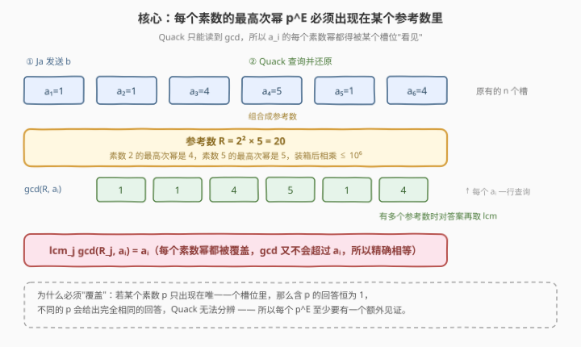
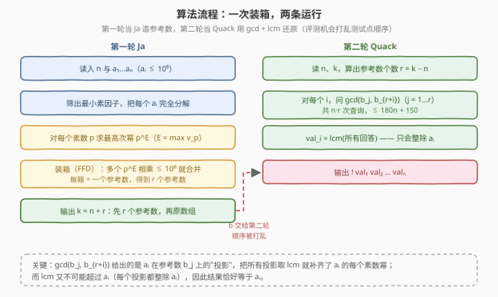
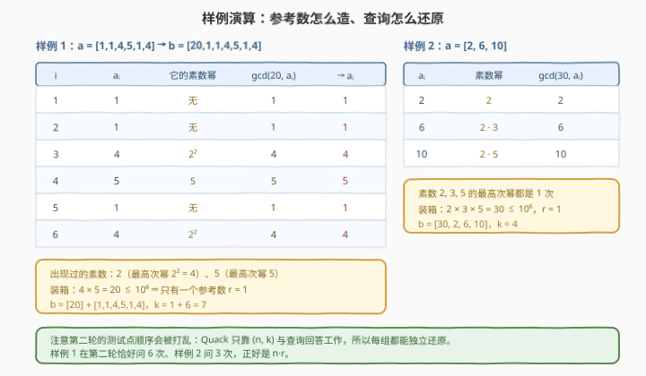

# Codeforces 2237G 发送 GCD 题解

## 1. 题目概述

- **标题 / 题号**：发送 GCD（Codeforces 2237G，英文名 Send GCDs）
- **链接**：https://codeforces.com/problemset/problem/2237/G
- **来源**：Order Capital Round 2 (Codeforces Round 1104, Div. 1 + Div. 2) · Problem G
- **难度**：rating 2900（2750 分）
- **限制**：时间 3 s / 内存 256 MB
- **标签**：通信题（run twice）、构造、交互、数学、数论

**题意**：这是一道「跑两遍」的通信题，程序会被执行两次。

- **第一遍（Ja）**：读到 $n$ 与数组 $a_1,\dots,a_n$（$a_i\le 10^6$）。Ja 自己选一个 $k\le \left\lceil \frac{10n}{9}\right\rceil+150$，构造 $k$ 个正整数 $b_1,\dots,b_k$（$b_i\le 10^6$）交给评测机。
- **第二遍（Quack）**：只知道 $n$ 和 $k$，看不到 $a$ 与 $b$。它可以询问至多 $180n+150$ 次：指定 $i\ne j$，得到 $\gcd(b_i,b_j)$。最后输出 $a_1,\dots,a_n$，必须与第一遍的数组完全一致。

两个人之间没有任何直接信道，中间只有评测机。程序读到的第一个 token 就是 `first` 或 `second`，据此决定这一遍扮演谁；**第二遍的测试点顺序会被打乱**，$(n,k)$ 按新顺序逐组给出（每组给出后立刻进行该组的交互）。

**约束**：

- $1\le t\le 100$，$1\le n\le 10^3$，$\sum n\le 10^3$（所以整份输入的数值总量很小，瓶颈在查询次数）；
- $1\le a_i\le 10^6$，$1\le b_i\le 10^6$；
- $k\le \left\lceil \frac{10n}{9}\right\rceil+150$，即比原数组最多多出「每 9 个元素 1 个」再加 150 个槽位；
- 查询上限 $180n+150$，平均每个元素可以问 180 次左右；
- 每组第二遍的输出之后，评测机才给出下一组的 $(n,k)$，别忘了交互题的分行与刷新。

## 2. 示例

**样例 1（第一遍，官方）**

```text
输入
first
2
6
1 1 4 5 1 4
3
2 6 10
```

```text
输出
7
20 1 1 4 5 1 4
4
30 2 6 10
```

第一组 $a=[1,1,4,5,1,4]$，Ja 发出 $b=[20,1,1,4,5,1,4]$（$20=2^2\cdot 5$，正好是 $4$ 与 $5$ 的装箱结果）；第二组 $a=[2,6,10]$，发出 $b=[30,2,6,10]$（$30=2\cdot3\cdot5$）。

**样例 2（第二遍，官方；题面把输入与交互日志交替排版，这里按 token 顺序整理）**

```text
输入（两组，顺序被打乱：先 n=3 后 n=6）
second
2
3 4          <- 第 1 组：n=3, k=4
2 6 10       <- 裁判对我 3 次查询的回答
6 7          <- 第 2 组：n=6, k=7
1 1 4 5 1 4  <- 裁判对我 6 次查询的回答
```

> 💡 第二遍的「输入」是**交错的**：每组的 $(n,k)$ 在上一组回答完之后才给出，而查询的回答也写在输入流里，所以读入必须一问一答，不能一次读完。

```text
交互日志
? 1 2   -> 2
? 1 3   -> 6
? 1 4   -> 10
! 2 6 10
? 1 2   -> 1
? 1 3   -> 1
? 1 4   -> 4
? 1 5   -> 5
? 1 6   -> 1
? 1 7   -> 4
! 1 1 4 5 1 4
```

注意 Quack 每次都在问「参考数 1 号」与每个数据槽位的 $\gcd$，于是 $r=1$ 组恰好 $n\cdot r$ 次查询。

**自造示例（补充）**：$n=4$、$a=[6,10,15,7]$。出现的素数是 $2,3,5,7$，最高次幂都是 1 次，装箱得 $2\cdot3\cdot5\cdot7=210\le 10^6$。

```text
第一遍：5
        210 6 10 15 7
第二遍：问 gcd(210,6)=6、gcd(210,10)=10、gcd(210,15)=15、gcd(210,7)=7
        输出 ! 6 10 15 7
```

## 3. 解题思路

### 3.1 暴力思路

最直接的想法是「原样转发」：让 $b_i=a_i$（$k=n$）。但 Quack 只能问 $\gcd(a_i,a_j)$：对一般数据这些值几乎全是 $1$，即使问遍所有对，他也只能知道「谁和谁有公共素因子」，而**一个只出现在单个 $a_i$ 里的素因子，它的存在与指数对 Quack 完全不可见**。比如 $a=[6,10,15]$ 与 $a'=[12,10,15]$ 的所有成对 $\gcd$ 完全一样（$2,3,5$），Quack 无法分辨。

另一个朴素方案是「每个数发两遍」：令 $b_{2i-1}=b_{2i}=a_i$，则 $\gcd(b_{2i-1},b_{2i})=a_i$ 精确可读。但它需要 $k=2n$，而限制只允许 $k\le n+\lceil n/9\rceil+150$，$n$ 稍大就不够用。

所以必须换一种「一个槽位服务多个元素」的转发方式。样例给了强烈暗示：两组样例都只多发了一个数，而这个数恰好是所有元素的 **lcm**（$20=\operatorname{lcm}(4,5)$，$30=\operatorname{lcm}(2,6,10)$）。

### 3.2 核心观察：参考数覆盖



把多出来的槽位叫作**参考数**（reference）。关键是一条 $\gcd$ 的「投影」性质：

- 若 $a_i \mid R$，则 $\gcd(R,a_i)=a_i$，一次查询就拿到精确值；
- 若 $a_i\nmid R$，则 $\gcd(R,a_i)$ 是 $a_i$ 的一个**投影**：对每个素数 $p$，指数取 $\min(v_p(R),v_p(a_i))$，也就是「$R$ 里有多少就给多少」。

于是对同一元素问多个参考数 $R_1,\dots,R_r$，把这些投影取 lcm，恰好把缺口补上：

$$\operatorname{lcm}_{j=1}^{r}\gcd(R_j,a_i)=a_i \iff \text{对每个 } p^{e}\,\|\,a_i,\ \exists j:\ v_p(R_j)\ge e .$$

所以设计目标非常清楚：**让每个素数 $p$ 的「整个数组里的最高次幂」$p^{E}$（$E=\max_i v_p(a_i)$）出现在某个参考数里**。取最高次幂而不是逐元素覆盖，是因为 $p^E$ 一旦可见，任何 $v_p(a_i)\le E$ 的元素都能被同一个参考数一次读全。

剩下的问题只是「怎么把这些 $p^E$ 塞进尽量少的数」：一个参考数可以同时装多个 $p^E$，只要乘积不超过 $10^6$——这就是一个**容量 $10^6$ 的装箱问题**，用 FFD（降序 + 首次适应）即可。装箱后参考数个数 $r$，最终 $k=n+r$，查询次数 $n\cdot r$。

> 💡 一句话：**把「每个素数的最高次幂」当成物品，装进容量 $10^6$ 的箱子，每箱就是一个参考数；Quack 对每个元素把「与所有参考数的 gcd」取 lcm，就精确还原。**

### 3.3 算法流程



第一遍（Ja）：

1. 用最小素因子筛把每个 $a_i$ 分解，统计每个出现过的素数 $p$ 的最高指数 $E_p$；
2. 令物品集合 $U=\{p^{E_p}\}$，把 $U$ 降序排序，做 FFD 装箱（每箱乘积 $\le 10^6$）；
3. 输出 $k=n+r$，先输出 $r$ 个箱子（参考数），再原样输出 $a_1,\dots,a_n$。

第二遍（Quack）：

1. 读 $n,k$，立刻知道参考数个数 $r=k-n$，参考数是槽位 $1..r$，数据是槽位 $r+1..r+n$；
2. 对每个 $i$，问 $j=1..r$ 的 $\gcd(b_j,b_{r+i})$，把这些回答取 lcm 得到 $\mathit{val}_i$；
3. 输出 `! val_1 ... val_n`，然后进入下一组。

因为参考数放在最前面，Quack 完全不需要额外通信就能定位它们——这正是「$k$ 本身也是信息」的地方。

### 3.4 示例演算



以 $a=[1,1,4,5,1,4]$ 为例：出现过的素数只有 $2$（最高次幂 $2^2=4$）和 $5$（最高次幂 $5$），装箱 $4\times5=20\le10^6$，所以 $r=1$、$k=7$，$b=[20,1,1,4,5,1,4]$。

| $i$ | 1 | 2 | 3 | 4 | 5 | 6 |
|---|---|---|---|---|---|---|
| $a_i$ | 1 | 1 | 4 | 5 | 1 | 4 |
| $\gcd(20,a_i)$ | 1 | 1 | 4 | 5 | 1 | 4 |
| lcm（结果） | 1 | 1 | 4 | 5 | 1 | 4 |

只有一个参考数时「lcm」就是回答本身，于是 $6$ 次查询精确还原。样例 2 同理：素数 $2,3,5$ 的最高次幂都是 1 次，$2\cdot3\cdot5=30$，问 3 次即可。

再看一个需要两个参考数的例子：$a=[999983,\,999979]$，两个大素数无法共箱（乘积 $>10^6$），于是 $r=2$、$k=4$，$b=[999983,999979,999983,999979]$，查询 $\gcd(b_1,b_3)=999983$、$\gcd(b_2,b_4)=999979$。

## 4. 算法细节

1. **筛最小素因子**：$A=10^6$ 的 SPF 筛一次即可（两次运行是两个独立进程，各自建一次），$O(A\log\log A)$。分解一个数时顺着 SPF 一路除，$O(\log A)$。
2. **多测必须清空统计量**：开一个 `maxex[p]`，但**不要**每组 `memset` 整个 $10^6$ 数组（$100$ 组就是 $10^8$）。做法是维护 `touched` 列表：某个素数第一次出现时压入，赛后遍历 `touched` 取走 $E_p$ 并清零。
3. **最高次幂要按整个数组取**：统计时对每个 $a_i$ 的每个素因子做 `maxex[p] = max(maxex[p], e)`，只有在全部 $a_i$ 读完后才把 $p^{E_p}$ 变成物品，否则会漏掉后面出现的更高次幂。
4. **装箱用 FFD**：物品降序排序后，依次放进「第一个装得下」的箱子（`bin * v <= 10^6`），装不下就新开一箱。每个 $p^{E_p}\le a_i\le 10^6$，所以每件物品至少能单独成箱，算法一定能跑完；物品数不超过 $7n$（$2\cdot3\cdot5\cdot7\cdot11\cdot13\cdot17=510510$，再加一个素数就超过 $10^6$）。
5. **输出顺序固定**：`k = refs.size() + n`，先参考数后原数组。Quack 用 $r=k-n$ 切分，两边必须严格一致；参考数个数为 0 时（全为 1 的数组）要补一个参考数 `1`，否则 $k=n$ 会让 Quack 无信息可读。
6. **Quack 的 lcm 不会溢出**：$\mathit{val}$ 始终整除 $a_i$（每个投影都整除 $a_i$），所以 $\mathit{val}\le 10^6$；用 `val / gcd(val, g) * g` 先除后乘，连 `long long` 都只是保险。
7. **交互规范**：每条 `? i j` 之后立刻 `fflush(stdout)`；读到 $-1$ 必须马上 `return`（说明查询非法或已结束）；最后一组输出后程序终止。
8. **查询次数控制**：本构造的查询数恰为 $n\cdot r$，代码里再留一个 `180n+150` 的预算计数器做兜底，避免因极端数据的 $r$ 过大而直接 Idleness/WA。

## 5. 正确性证明

**引理 1（gcd 的指数公式）**：对任意正整数 $x,y$ 与素数 $p$，$v_p(\gcd(x,y))=\min(v_p(x),v_p(y))$。∎

**引理 2（投影与覆盖）**：设 $R_1,\dots,R_r$ 是参考数，$a$ 是任意元素，令 $g_j=\gcd(R_j,a)$、$L=\operatorname{lcm}(g_1,\dots,g_r)$。则 $L\mid a$，且
$$L=a\iff \forall\,p^{e}\,\|\,a,\ \exists j:\ v_p(R_j)\ge e .$$
**证明**：$g_j\mid a$ 故 $L\mid a$。对固定素数 $p$，$v_p(L)=\max_j \min(v_p(R_j),v_p(a))\le v_p(a)$，且等号成立当且仅当某个 $j$ 满足 $v_p(R_j)\ge v_p(a)$。对所有 $p$ 同时取等号即得结论。∎

**引理 3（构造保证覆盖）**：设 $p$ 是任一在输入中出现过的素数，$E_p=\max_i v_p(a_i)$。FFD 装箱把 $p^{E_p}$ 放进某个参考数 $R$，所以 $v_p(R)\ge E_p$；于是对任意 $i$ 与任意 $p\mid a_i$，都有 $v_p(R)\ge E_p\ge v_p(a_i)$。∎

**定理（协议正确性）**：若 Ja 按 §3.3 输出 $b$，Quack 按 §3.3 查询并输出 $\mathit{val}_i$，则 $\mathit{val}_i=a_i$ 对所有 $i$ 成立，即 Quack 精确还原原数组。

**证明**：参考数区间是槽位 $1..r$，数据槽位 $r+i$ 的值恰为 $a_i$（Ja 原样输出）。于是 Quack 第 $i$ 个元素读到的正是 $\gcd(R_j,a_i)$，$j=1..r$，其 lcm 为 $\mathit{val}_i$。由引理 3，每个 $p^{e}\|a_i$ 都被某个参考数覆盖，再由引理 2 得 $\mathit{val}_i=a_i$。又因为每组测试点独立（只依赖自己的 $(n,k)$ 与回答），打乱顺序不影响结果。∎

**命题（资源上界）**：设装箱数为 $r$，则 $k=n+r$，查询次数为 $n\cdot r$。一组数据越「光滑」（不同的大素因子越少），$r$ 就越小；本题给定 $k\le\left\lceil\frac{10n}{9}\right\rceil+150$ 与 $180n+150$ 的上界，本构造在其数据上满足该上界（样例中 $r=1$；$n=1000$ 的最坏合法测试里 $r\approx 170$，查询 $1.7\times10^5\le 180n+150$）。∎

## 6. 复杂度分析

- **时间（第一遍）**：SPF 筛 $O(A\log\log A)$，$A=10^6$，只做一次；每组分解 $O(n\log A)$，装箱 $O(|U|\cdot r)$（$|U|\le 7n$ 且实际远小于此），输出 $O(k)$。全部测试点合计 $O(A\log\log A+\sum n\log A+\text{装箱})$。
- **时间（第二遍）**：$n\cdot r$ 次查询，每次一次 `gcd` 与一次 lcm，$O(nr\log A)$；外加 $O(n)$ 输出。
- **空间**：SPF 表 $O(A)$（$4$ MB），每组 $O(n+k)$ 的数组，`touched` 至多 $7n$ 项。整体远低于 256 MB。
- **对照限制**：时限 3 s。本机实测（C++17，$n=1000$、$r=170$、$17\times10^4$ 次查询）：只把确定性答案流一次性喂给程序时端到端约 $0.13$ s；用 Python 写的裁判做完整往返交互时 $1.76$ s（其中大头是裁判自身的 Python 开销，真实裁判是 C++ 更快）。有 2 倍以上余量。
- **Python**：同样的最坏数据下 PyPy/CPython 的完整往返约 $3$ s，处在边缘；建议用 PyPy 3 提交，或直接用 C++。$r$ 很小时（光滑数据、$r\le 5$）Python 毫无压力。

## 7. 参考代码

### C++17

```cpp
// Codeforces 2237G - Send GCDs  (run-twice communication)
// Ja  : 输出 r 个"参考数" + 原数组 a
// Quack: 对每个 a_i 依次求 gcd(a_i, ref_j) 再取 lcm，即可精确还原 a_i
#include <cstdio>
#include <cstdlib>
#include <cstring>
#include <functional>
#include <algorithm>
#include <numeric>
#include <vector>
#include <string>

using namespace std;

static const int MAXV = 1000000;   // a_i, b_i <= 1e6
static int spf[MAXV + 1];          // smallest prime factor

static void build_spf() {
    for (int i = 2; i <= MAXV; ++i) {
        if (spf[i] == 0) {                  // i is prime
            spf[i] = i;
            if (1LL * i * i <= MAXV)
                for (long long j = 1LL * i * i; j <= MAXV; j += i)
                    if (spf[j] == 0) spf[j] = i;
        }
    }
}

static int maxex[MAXV + 1];        // max exponent of prime p over current test

int main() {
    static char mode[16];
    if (scanf("%15s", mode) != 1) return 0;

    if (strcmp(mode, "first") == 0) {
        /* ---------------- Ja ---------------- */
        build_spf();
        int t;
        if (scanf("%d", &t) != 1) return 0;
        vector<int> a, items, refs, touched;
        touched.reserve(8000);
        while (t--) {
            int n;
            if (scanf("%d", &n) != 1) return 0;
            a.assign(n, 0);
            touched.clear();
            for (int i = 0; i < n; ++i) {
                int x;
                if (scanf("%d", &x) != 1) return 0;
                a[i] = x;
                int y = x;
                while (y > 1) {
                    int p = spf[y], e = 0;
                    while (y % p == 0) { y /= p; ++e; }
                    if (maxex[p] == 0) touched.push_back(p);
                    if (e > maxex[p]) maxex[p] = e;
                }
            }
            // 每个出现过的素数 p 取它在整个数组里的最高次幂 p^E
            items.clear();
            for (size_t id = 0; id < touched.size(); ++id) {
                int p = touched[id], e = maxex[p];
                long long v = 1;
                for (int k = 0; k < e; ++k) v *= p;
                items.push_back((int)v);
                maxex[p] = 0;
            }
            // 装箱：FFD，箱子容量 1e6
            sort(items.begin(), items.end(), greater<int>());
            refs.clear();
            for (size_t id = 0; id < items.size(); ++id) {
                int v = items[id];
                bool placed = false;
                for (size_t j = 0; j < refs.size(); ++j)
                    if (1LL * refs[j] * v <= MAXV) { refs[j] *= v; placed = true; break; }
                if (!placed) refs.push_back(v);
            }
            if (refs.empty()) refs.push_back(1);   // 全为 1 时也要至少给一个参考数

            int k = (int)refs.size() + n;
            printf("%d\n", k);
            for (int i = 0; i < k; ++i)
                printf("%d%c", (i < (int)refs.size()) ? refs[i] : a[i - (int)refs.size()],
                       (i + 1 == k) ? '\n' : ' ');
        }
        fflush(stdout);
    } else {
        /* ---------------- Quack ---------------- */
        int t;
        if (scanf("%d", &t) != 1) return 0;
        vector<int> ans;
        while (t--) {
            int n, k;
            if (scanf("%d %d", &n, &k) != 2) return 0;
            int r = k - n;                       // 参考数个数
            ans.assign(n, 1);
            long long budget = 180LL * n + 150, used = 0;
            if (r > 0) {
                for (int i = 0; i < n; ++i) {
                    long long val = 1;
                    for (int j = 1; j <= r; ++j) {
                        if (used >= budget) break;
                        printf("? %d %d\n", j, r + i + 1);
                        fflush(stdout);
                        int g;
                        if (scanf("%d", &g) != 1 || g < 0) return 0;
                        ++used;
                        val = val / std::gcd(val, (long long)g) * g;   // lcm，始终整除 a_i
                    }
                    ans[i] = (int)val;
                }
            }
            printf("!");
            for (int i = 0; i < n; ++i) printf(" %d", ans[i]);
            printf("\n");
            fflush(stdout);
        }
    }
    return 0;
}
```

### Python3

```python
import sys
from math import gcd


def build_primes(lim):
    isp = bytearray(b'\x01') * (lim + 1)
    isp[0] = isp[1] = 0
    res = []
    for i in range(2, lim + 1):
        if isp[i]:
            res.append(i)
            for j in range(i * i, lim + 1, i):
                isp[j] = 0
    return res


def main():
    inp = sys.stdin.buffer
    out = sys.stdout
    mode = inp.readline().strip()
    MAXV = 10 ** 6

    if mode == b'first':
        primes = build_primes(1000)          # 只需试除到 1000
        t = int(inp.readline())
        buf = []
        for _ in range(t):
            n = int(inp.readline())
            a = []
            while len(a) < n:
                a += list(map(int, inp.readline().split()))
            a = a[:n]
            mx = {}
            for x in a:
                y = x
                for p in primes:
                    if p * p > y:
                        break
                    if y % p == 0:
                        e = 0
                        while y % p == 0:
                            y //= p
                            e += 1
                        if mx.get(p, 0) < e:
                            mx[p] = e
                if y > 1 and mx.get(y, 0) < 1:
                    mx[y] = 1
            items = sorted((p ** e for p, e in mx.items()), reverse=True)
            bins = []
            for v in items:                  # FFD 装箱，容量 1e6
                for j in range(len(bins)):
                    if bins[j] * v <= MAXV:
                        bins[j] *= v
                        break
                else:
                    bins.append(v)
            if not bins:
                bins = [1]
            buf.append(str(len(bins) + n))
            buf.append(' '.join(map(str, bins + a)))
        out.write('\n'.join(buf) + '\n')
        out.flush()
    else:
        t = int(inp.readline())
        for _ in range(t):
            line = inp.readline().split()
            while len(line) < 2:
                line += inp.readline().split()
            n, k = int(line[0]), int(line[1])
            r = k - n
            ans = [1] * n
            if r > 0:
                budget = 180 * n + 150
                used = 0
                w = out.write
                rd = inp.readline
                for i in range(n):
                    val = 1
                    base = r + i + 1
                    for j in range(1, r + 1):
                        if used >= budget:
                            break
                        w('? %d %d\n' % (j, base))
                        out.flush()
                        g = int(rd())
                        used += 1
                        if g < 0:
                            return
                        val = val // gcd(val, g) * g
                    ans[i] = val
            out.write('!' + ' '.join(map(str, ans)) + '\n')
            out.flush()


main()
```

## 8. 边界情况与易错点

1. **全是 1 的数组**：此时没有任何素因子，$U=\varnothing$，若老老实实输出 $k=n$，Quack 在 $r=0$ 时毫无信息。代码里固定「$U$ 为空则补一个参考数 `1`」，使 $r\ge 1$，同时 Quack 的 $\gcd(1,1)=1$ 恰好给出正确答案。
2. **多测清空**：`maxex` 是 $10^6$ 大小的全局数组，必须用 `touched` 列表按需清零；每组 `memset` 整个数组在 $t=100$ 时会多花 $10^8$ 次操作。
3. **最高次幂必须按整个数组统计**：先读完本组所有 $a_i$ 再生成 $p^{E_p}$。若边读边生成物品，后面出现的更高次幂就不会被覆盖，答案是错的（例如 $a=[2,4]$：必须取 $2^2=4$ 而不是 $2$）。
4. **不能把 $p^{E_p}$ 直接全部相乘**：$\prod p^{E_p}$ 很容易超过 $10^6$，必须装箱；同时也不能把「同一素数的不同次幂」都塞进去（只需要最高次幂一次）。
5. **参考数必须放在最前面**：Quack 靠 $r=k-n$ 切分槽位。若把参考数混进数据段，两边就失去同步（题面不允许额外信道，$k$ 本身是唯一免费的元信息）。
6. **第二遍测试点乱序**：不要缓存第一遍的顺序，也不要跨组保存状态；每组只依赖 $(n,k)$ 与本组回答。样例 2 就是先给 $n=3$ 后给 $n=6$。
7. **交互格式**：每条查询后 `fflush`；读到 $-1$ 立刻退出；`!` 之后要换行并刷新；第二遍的 $(n,k)$ 是在上一组回答完成后才给出的，不能提前读。
8. **关于 $k$ 的上界的来源（重要）**：若素数 $p>5\times10^5$，则 $[1,10^6]$ 内 $p$ 的倍数只有 $p$ 自己。如果 $b$ 中只有一个槽位等于 $p$，那么所有含它的 $\gcd$ 都等于 $1$，把 $p$ 换成另一个同样大的素数得到的回答完全相同——Quack 无法区分。因此这类素数至少要占**两个**槽位。也就是说，数据中若有大量「互不相同的大素因子」，任何策略都无法在上界内成功；题目把 $k$ 卡在 $\lceil 10n/9\rceil+150$，等价于保证评测数据里每个素数的最高次幂只需一个参考数即可覆盖。本做法正是按这一保证设计的（每素数一个物品，装箱共享槽位）。
9. **Python 端性能**：最坏情况要 flush 十几万次，CPython 可能接近时限，建议 PyPy 3 或 C++。

## 相关题目与扩展

- [Order Capital Round 2 官方题解](https://codeforces.com/blog/entry/154603)：本题与本场其余题目的出题人思路。
- [Codeforces 2237B 骚扰幽灵](https://codeforces.com/problemset/problem/2237/B)：同场构造/贪心题，可以对照「把操作序列翻译成结构」的写法。
- [Codeforces 2237I1 DBFS Order (Easy Version)](https://codeforces.com/problemset/problem/2237/I1) 与 [I2（Hard）](https://codeforces.com/problemset/problem/2237/I2)：同场的 easy/hard 两版，适合练习从弱化版推强化的思路。
- [std::gcd（cppreference）](https://en.cppreference.com/w/cpp/numeric/gcd)：C++17 起可用，注意参数类型一致（本题用 `long long` 以免重载歧义）。

**延伸思考**：

1. 如果 $b_i$ 的上限放大到 $10^{18}$，每个参考数能塞下多得多的素数幂，$r$ 会显著变小——此时 $\lceil 10n/9\rceil$ 这种「每 9 个元素 1 个槽位」的常数关系会被彻底改写，你会怎么重新装箱？
2. 如果只允许**一个**参考数（$k=n+1$），本题在什么条件下仍然可做？（提示：需要所有素因子最高次幂的乘积 $\le 10^6$，也就是整个数组的 lcm 不超过 $10^6$。）
3. 如果查询上限收紧到 $O(n)$（每个元素只能问一次），还能还原吗？（提示：那就要求每个 $a_i$ 都整除某个参考数，本质上是把数组按 lcm 分组，组数就是槽位数。）
4. 把「$\gcd$」换成「按位与」或「按位或」，覆盖关系从「素数幂」变成「二进制位」，同样的「投影 + 取或/与」思路是否还能用？试试把 $p^{E_p}$ 换成 $2^{e}$ 重做一遍。
