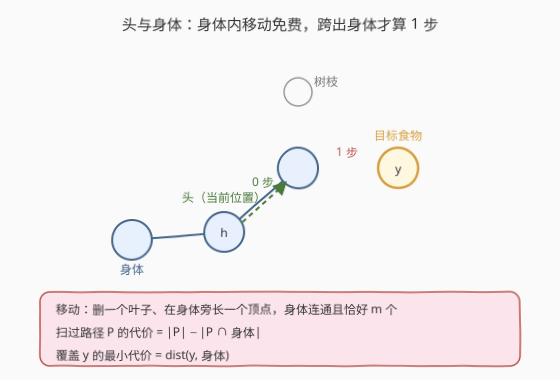
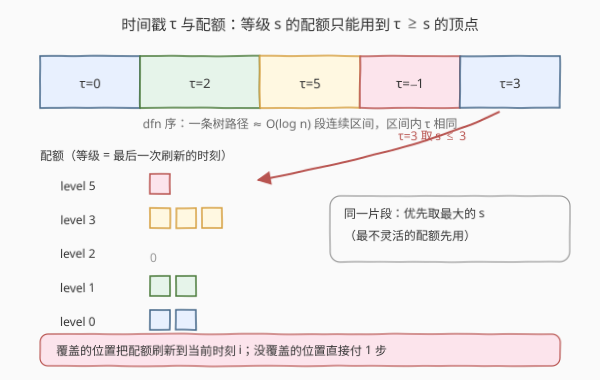
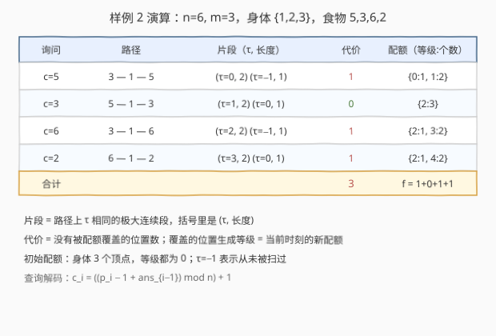

# Codeforces 2237H 史莱姆与询问 题解

## 1. 题目概述

- **标题 / 题号**：史莱姆与询问（Codeforces 2237H，英文名 Slime and Queries）
- **链接**：https://codeforces.com/problemset/problem/2237/H
- **来源**：Order Capital Round 2 (Codeforces Round 1104, Div. 1 + Div. 2) · Problem H
- **难度**：3500（3500 分，题面标注 *3500）
- **限制**：时间 5 s / 内存 1024 MB
- **标签**：数据结构、贪心、树

**题意**：给定一棵 $n$ 个点的树，史莱姆初始恰好占据一个**连通**的 $m$ 个点集合 $S$。一次 Move 操作是：从当前占据集合中删去一个点 $u$，再加入一个未占据的点 $v$，要求操作后占据集合仍然连通。另有一列食物依次出现在 $a_1,a_2,\ldots,a_k$，只有第 $i$ 个出现后才能吃第 $i+1$ 个；吃掉第 $i$ 个食物要求史莱姆此刻占据 $a_i$。定义 $f([a_1,\ldots,a_k])$ 为按顺序吃完所有食物所需的最小 Move 次数。

询问强制在线：给出编码后的 $p_1,\ldots,p_q$，令 $\mathrm{ans}_0=0$，第 $i$ 次询问的真实顶点是 $c_i=((p_i-1+\mathrm{ans}_{i-1})\bmod n)+1$，并要求输出 $\mathrm{ans}_i=f([c_1,\ldots,c_i])$。

**约束**：

- $2\le m\le n\le 10^5$，$1\le q\le 10^5$，$1\le t\le 10^4$；
- $\sum n\le 10^5$，$\sum q\le 10^5$；
- 初始占据的 $m$ 个点诱导子图保证连通；询问必须在线回答（解码依赖上一次答案）；
- 答案最大可达 $q\cdot(n-1)\approx 10^{10}$，需要 64 位整数。

## 2. 示例

官方样例（输入 / 输出原样，共 10 组）：

```text
输入：
10
5 2 3
3 5
2 1
4 3
3 2
1 2
1 4 3
6 3 4
5 1
1 3
6 1
4 1
2 1
1 2 3
5 2 5 6
7 3 5
3 7
4 2
1 3
2 1
6 3
5 2
1 2 4
7 3 2 5 2
5 2 5
3 1
1 5
2 1
4 1
1 2
3 3 3 4 2
6 3 6
4 6
3 2
1 2
5 4
2 4
2 4 5
6 6 1 2 4 6
7 4 5
5 2
3 1
2 1
3 7
6 3
4 2
1 2 3 4
7 4 4 5 1
4 3 4
3 1
1 4
2 1
1 2 3
4 1 2 3
6 2 5
2 4
5 4
2 1
6 4
3 2
1 2
6 1 1 1 2
7 2 5
2 4
7 3
3 6
1 3
1 2
5 2
1 2
4 6 1 6 5
8 4 6
5 2
3 2
7 5
4 3
8 7
1 2
6 5
2 3 4 5
8 7 3 3 7 8

输出：
0 2 3
1 1 2 3
2 4 6 8 9
1 2 3 4 4
1 2 3 4 4 4
1 2 3 3 4
1 1 2 2
2 4 6 8 9
1 4 7 10 11
2 3 4 4 5 5
```

按解码规则还原出每组的目标序列：

| # | 初始身体 $S$ | 食物序列 $c$ | 答案 |
|---|--------------|--------------|------|
| 1 | {1,2} | 1,4,5 | 0 2 3 |
| 2 | {1,2,3} | 5,3,6,2 | 1 1 2 3 |
| 3 | {1,2,4} | 7,5,6,4,3 | 2 4 6 8 9 |
| 4 | {1,2} | 3,4,5,2,1 | 1 2 3 4 4 |
| 5 | {2,4,5} | 6,1,3,5,2,4 | 1 2 3 4 4 4 |
| 6 | {1,2,3,4} | 7,5,6,1,4 | 1 2 3 3 4 |
| 7 | {1,2,3} | 4,2,3,1 | 1 1 2 2 |
| 8 | {1,2} | 6,3,5,1,4 | 2 4 6 8 9 |
| 9 | {1,2} | 4,7,5,6,1 | 1 4 7 10 11 |
| 10 | {2,3,4,5} | 8,1,6,7,3,5 | 2 3 4 4 5 5 |

自造小样例（一条链 $1-2-3-4$，$m=2$，$S=\{1,2\}$，目标 $1,4,4,2$）：

```text
输入：
1
4 2 4
1 2
2 3
3 4
1 2
1 4 2 4

输出：
0 2 2 3
```

第 2 个目标是 4：身体变成 $\{3,4\}$，代价 2；第 3 个目标还是 4，代价 0；第 4 个目标 2 在回程上，代价 1。

## 3. 解题思路

### 3.1 暴力思路

把「当前占据的连通 $m$ 点集」当作状态，两种状态之间若差一个顶点就连一条边，问题变成在这个图上按顺序访问目标点集的最短路。状态数是连通 $m$ 点集的个数，在链上就有 $n-m+1$ 个、在星形上有 $\binom{n-1}{m-1}$ 个，$n=10^5$ 时爆炸；而且每组询问都要重新做一次最短路，完全不可行。

### 3.2 核心观察：头与身体



把史莱姆想成「身体 + 头」：身体是当前占据的连通点集 $S$（$|S|=m$），头是它此刻要吃的那个点（$S$ 中的某个点）。**头在身体内部沿着边移动不改变 $S$，所以不花 Move；只有把头跨到一个不在 $S$ 里的邻居才需要一次 Move。**

**引理（合法移动）**：若 $S$ 连通，删去的点 $u$ 必须是 $S$ 诱导子树的叶子（$|S|=1$ 时任取）；并且树中任何 $v\notin S$ 至多与 $S$ 中一个点相邻。因此一次 Move 等价于「删掉一个叶子，再接上一个与剩余部分相邻的外部点」。

由此得到两个基本结论。第一，**从状态 $S$ 让目标 $y$ 被占据的最小代价是 $\operatorname{dist}(y,S)$**：每一步最多让 $y$ 到占据集合的距离减少 1，而下界可达（沿着 $y$ 到 $S$ 的最短路，每次删掉一个不含当前端点的叶子并长出一个新点）。第二，**若头从 $u\in S$ 出发扫过路径 $P$（$u$ 到目标 $y$ 的唯一路径），代价为 $|P|-|P\cap S|$**：路径上本来就在身体里的点不用付钱，其余每个点都要一次 Move，而且扫完后 $P\subseteq S$。

注意第二条里的 $|P\cap S|$ 取决于**上一轮把身体摆成了什么样**，这正是本题的难点：同一个目标序列，身体在岔路口的摆放不同，后续代价就不同。

### 3.3 核心观察：时间戳与「配额」



不要固定身体，而是把「选择」推迟。记 $\tau(x)$ 为**点 $x$ 最后一次被头扫过的时刻**（初始占据的点记 $0$，从未被扫过记 $-1$）。再维护 $m$ 个**配额**，每个配额有一个等级 $s$，含义是「这个身体空位最后一次被刷新是在时刻 $s$」。

**核心不变式**：等级为 $s$ 的配额可以放到任意满足 $\tau(x)\ge s$ 的点 $x$ 上。

直观理解：头扫过的轨迹随时间是一条连通的走道，等级 $s$ 的配额最晚在时刻 $s$ 被刷新，此后它可以沿着走道被拖到任何「时刻 $s$ 之后被扫过」的点；反过来，最后被扫过时刻早于 $s$ 的点在配额刷新之后已经落在走道后面，拖不回去。

于是把路径拆成 $\tau$ 相同的极大段（片段）。长度为 $L$、时间戳为 $\lambda$ 的片段，最多能用 $\min(L,\#\{s\le\lambda\})$ 个配额覆盖；每个被覆盖的位置消耗一个 $s\le\lambda$ 的配额，并把它**刷新到当前时刻**（生成一个新配额）；没被覆盖的位置就是真实代价 $1$，不刷新配额。一条路径的总代价就是各片段未被覆盖的位置数之和。

一个片段内部该取哪些配额？取**等级最大**的（最不灵活的先用），把小等级留给时间戳更小的片段；这是区间匹配的经典交换论证，且最终结果与片段处理顺序无关（本实现按 dfn 顺序处理）。

### 3.4 算法流程与示例演算

路径在树上不好直接处理，用**树链剖分（HLD）**：任意一条路径拆成 $O(\log n)$ 段 dfn 连续区间。$\tau$ 在 dfn 上就是**分段常数**函数，用「区间赋值 + 按位置找片段」的 ODT（`std::map` 维护每个片段左端点及其 $\tau$）维护；配额用另一张 `map` 按等级存个数，支持「取等级 $\le\lambda$ 中最大的、扣掉若干个」。



以样例 2 为例（$n=6,m=3$，树边 $5-1,1-3,6-1,4-1,2-1$，$S=\{1,2,3\}$，食物 $5,3,6,2$）：初始三个配额等级都是 $0$，$\tau(1)=\tau(2)=\tau(3)=0$，其余为 $-1$。第 1 次目标 5，路径 $3-1-5$ 的片段是 $(\tau=0,2)$ 与 $(\tau=-1,1)$：前两个点用两个等级 $0$ 的配额覆盖，最后一个点付 $1$，答案 $1$；路径被赋 $\tau=1$，覆盖的 $2$ 个位置生成等级 $1$ 的新配额，于是配额变成 $\{0{:}1,\,1{:}2\}$。继续做下去得到 $1,1,2,3$，与样例一致。

## 4. 算法细节

1. **HLD 用迭代实现**：$n=10^5$ 的链会让递归 `dfs` 爆栈，先 `vector` 建出 BFS/DFS 序算 `siz`、`heavy`，再用显式栈按「先重儿子」的顺序编 `dfn`，保证每条重链在 dfn 上连续。
2. **ODT 的哨兵**：`sg[0]=sg[n]=-1` 必须**在插入初始占据点之前**建好。初始时把每个占据点 $s$ 的 `dfn[s]` 单独切成等级 $0$ 的片段（先 `access(dfn[s]+1)` 再写 `sg[dfn[s]]=0`）。
3. **`access(p)`（在 $p$ 处切开）**：找到包含 $p-1$ 的片段，把它的等级复制到 $p$，相当于不改变函数值地插入断点。
4. **`consume(c, λ)`（用配额覆盖）**：反复取等级 $\le\lambda$ 中最大的那一档，扣掉 $\min(\text{该档个数},c)$，扣完就删除该档；返回没被覆盖的个数。
5. **`upd(l, r, t)`（扫过一段 dfn 区间）**：先 `access(l)`、`access(r)`，从左到右遍历 $[l,r)$ 内的片段，逐段 `consume`，累加未覆盖数；最后把这些片段合并成等级 $t$ 的一段，并把「覆盖数 $=(r-l)-\text{未覆盖数}$」加到等级 $t$ 的配额上。
6. **答案与解码**：先读入 $p$，令 $v=(p-1+\mathrm{ans})\bmod n$，从上次目标 $u$ 走到 $v$（HLD 拆段、逐段 `upd`），`ans` 累加代价并输出；随后 $u\leftarrow v$。
7. **多测清空**：$t$ 可达 $10^4$，每组开始清空 `sg`、`mp` 与邻接表；$\sum n,\sum q\le 10^5$ 保证总代价可控。

## 5. 正确性证明

**引理 1（移动的结构）**：设 $S$ 连通，则一次 Move 中删去的 $u$ 必为 $S$ 诱导子树的叶子，且新加入的 $v$ 与 $S\setminus\{u\}$ 恰有一个邻接点。

**证明**：若 $u$ 不是叶子，$S\setminus\{u\}$ 不连通，而 $v$ 在树中与 $S$ 至多有一个邻接点（否则 $S$ 内两点经 $v$ 形成环，与树矛盾），加入一个点无法把多个连通块接起来。反之叶子和合法邻居显然可行。∎

**引理 2（单目标代价）**：从 $S$ 出发让 $y$ 被占据，最少需要 $\operatorname{dist}(y,S)$ 次 Move。

**证明**：下界：一次 Move 只改变一个顶点，$y$ 到占据集合的距离每步至多减少 1。上界：取 $x\in S$ 为最近点，沿 $x\to y$ 的最短路逐点扩展；由于 $m\ge 2$，当前集合总有至少两个叶子，每次删去一个不是当前端点的叶子即可保持包含已走出路径的连通性。∎

**引理 3（扫过路径的代价）**：头从 $u\in S$ 出发、目标是 $y$，令 $P$ 为 $u\to y$ 的路径，则扫过 $P$ 的代价为 $|P|-|P\cap S|$，且结束后 $P\subseteq S$；若 $|P|\ge m$，身体可以恰好取 $P$ 的末尾 $m$ 个点。

**证明**：$P$ 上不在 $S$ 的点必须逐个加入，每加入一个点需要一次 Move，故至少 $|P|-|P\cap S|$ 次；反过来按路径顺序加入，每次删去一个不影响已加入路径的叶子即可达到该下界。$|P|\ge m$ 时多出的旧身体点被逐步删掉，最后只剩路径末尾的 $m$ 个点。∎

**引理 4（配额不变式）**：对任意前缀，存在一个最优策略，其代价等于「所有扫过路径长度之和减去被配额覆盖的位置数」，并且该策略下的配额多重集正是算法维护的 $\{等级 s:\ 个数\}$，等级均满足：等级 $s$ 的配额可放到任意 $\tau(x)\ge s$ 的点上。

**证明（要点）**：对询问次数归纳。初始时 $m$ 个配额等级为 $0$，占据点 $\tau=0$，不变式成立。处理新路径时，把路径按 $\tau$ 切成片段；片段 $(\lambda,L)$ 内的点最后被扫于时刻 $\lambda$，由归纳假设，只有等级 $\le\lambda$ 的配额能在时刻 $\lambda$ 之后被拖到这些点上，因此这一片段最多覆盖 $\#\{s\le\lambda\}$ 个位置。交换论证说明「每次取等级最大的可行配额」使总覆盖数达到二分图匹配的最大值（把较小的等级留给时间戳更小的片段不会变差），故未被覆盖的位置数就是本步的最小代价。覆盖位置把配额刷新到当前时刻，未覆盖位置由被删去的旧身体点让位、配额不变，于是配额多重集按算法规则更新，不变式保持。∎

**定理**：算法输出的第 $i$ 个累加和等于 $f([c_1,\ldots,c_i])$。

**证明**：由引理 3，扫过路径的代价只取决于路径上已被身体占据的点数；由引理 4，配额恰好刻画了「在最优策略下这些点能被占据的最大数量」，且每步都取到最小值；归纳即得累加和等于最小总 Move 次数。∎

## 6. 复杂度分析

- **时间**：HLD 预处理 $O(n)$。每次询问把路径拆成 $O(\log n)$ 段，每段做常数次 `access`（$O(\log n)$）；遍历片段时，除两端外每个被遍历的片段都会被删除，而每次 `upd` 只新增 $O(1)$ 个片段，故所有询问遍历的片段总数为 $O(n+q\log n)$，每次操作 `map` 为 $O(\log n)$。配额消耗同理：每档配额用完即删，总次数不超过等级数 $O(q)$，加上每个片段的常数次。总复杂度 $O\big((n+q\log n)\log n\big)$。
- **空间**：邻接表、HLD 数组、两张 `map` 均为 $O(n+q)$。
- **可行性**：$n=q=10^5$ 时上述复杂度约 $3\times 10^7$ 级别；本机（clang -O2）在链 / 完全二叉树 / 随机树等最坏形态下实测最慢约 $1.0$ s，相对 5 s 时限仍有 5 倍以上余量。

## 7. 参考代码

### C++17

```cpp
#include <bits/stdc++.h>
using namespace std;

static int n, m, q;
static vector<vector<int>> adj;
static vector<int> par_, dep_, siz_, heavy_, dfn_, top_;

void build_hld() {
    vector<int> order;
    order.reserve(n);
    par_.assign(n, -1);
    dep_.assign(n, 0);
    vector<char> vis(n, 0);
    vector<int> st;
    st.push_back(0);
    vis[0] = 1;
    while (!st.empty()) {
        int u = st.back(); st.pop_back();
        order.push_back(u);
        for (int v : adj[u]) if (!vis[v]) {
            vis[v] = 1; par_[v] = u; dep_[v] = dep_[u] + 1; st.push_back(v);
        }
    }
    siz_.assign(n, 1);
    heavy_.assign(n, -1);
    for (int i = (int)order.size() - 1; i >= 0; --i) {
        int u = order[i], best = -1;
        siz_[u] = 1;
        for (int v : adj[u]) if (v != par_[u]) {
            siz_[u] += siz_[v];
            if (best == -1 || siz_[v] > siz_[best]) best = v;
        }
        heavy_[u] = best;
    }
    dfn_.assign(n, 0); top_.assign(n, 0);
    int timer = 0;
    vector<pair<int,int>> stack2;
    stack2.push_back({0, 0});
    while (!stack2.empty()) {
        auto pr = stack2.back(); stack2.pop_back();
        int u = pr.first, tp = pr.second;
        while (u != -1) {
            dfn_[u] = timer++;
            top_[u] = tp;
            for (int v : adj[u]) if (v != par_[u] && v != heavy_[u]) stack2.push_back({v, v});
            u = heavy_[u];
        }
    }
}

static map<int,int> sg;   // 片段左端点 -> 时间戳 tau
static map<int,int> mp;   // 配额等级 -> 个数
static long long ans;

void access_pos(int p) {
    if (sg.count(p)) return;
    auto it = sg.upper_bound(p);
    --it;
    sg[p] = it->second;
}

int consume(int c, int lvl) {
    while (c > 0) {
        auto it = mp.upper_bound(lvl);
        if (it == mp.begin()) break;
        --it;
        int d = min(it->second, c);
        c -= d;
        it->second -= d;
        if (it->second == 0) mp.erase(it);
    }
    return c;
}

int upd(int l, int r, int t) {
    int cost = 0;
    access_pos(l); access_pos(r);
    int lst = l, lvl = sg[l];
    auto it = sg.upper_bound(l);
    while (true) {
        int nxt = it->first;
        cost += consume(nxt - lst, lvl);
        lst = nxt; lvl = it->second;
        if (nxt == r) break;
        it = sg.erase(it);
    }
    sg[l] = t;
    mp[t] += (r - l) - cost;
    return cost;
}

int main() {
    int T;
    if (scanf("%d", &T) != 1) return 0;
    while (T--) {
        scanf("%d %d %d", &n, &m, &q);
        adj.assign(n, {});
        for (int i = 0; i < n - 1; ++i) {
            int u, v; scanf("%d %d", &u, &v); --u; --v;
            adj[u].push_back(v); adj[v].push_back(u);
        }
        build_hld();
        sg.clear(); mp.clear();
        sg[0] = -1; sg[n] = -1;
        mp[0] = 0;
        int last = 0;
        for (int i = 0; i < m; ++i) {
            int s; scanf("%d", &s); --s;
            access_pos(dfn_[s] + 1);
            sg[dfn_[s]] = 0;   // map 会按需插入该断点
            last = s;
        }
        mp[0] = m;
        ans = 0;
        int u = last;
        for (int i = 1; i <= q; ++i) {
            int p; scanf("%d", &p); --p;
            int v = (int)((p + ans) % n);
            int cu = u, cv = v;
            while (top_[cu] != top_[cv]) {
                if (dep_[top_[cu]] < dep_[top_[cv]]) swap(cu, cv);
                ans += upd(dfn_[top_[cu]], dfn_[cu] + 1, i);
                cu = par_[top_[cu]];
            }
            if (dep_[cu] < dep_[cv]) swap(cu, cv);
            ans += upd(dfn_[cv], dfn_[cu] + 1, i);
            u = v;
            printf("%lld%c", ans, i == q ? '\n' : ' ');
        }
    }
    return 0;
}
```

### Python3

```python
import sys

def main():
    data = list(map(int, sys.stdin.buffer.read().split()))
    pos = 0
    T = data[pos]; pos += 1
    out = []
    for _ in range(T):
        n, m, q = data[pos], data[pos+1], data[pos+2]; pos += 3
        adj = [[] for _ in range(n)]
        for _ in range(n-1):
            u = data[pos]-1; v = data[pos+1]-1; pos += 2
            adj[u].append(v); adj[v].append(u)

        # ---------- 迭代 HLD ----------
        par = [-1]*n; dep = [0]*n
        order = []; seen = [False]*n; seen[0] = True; st = [0]
        while st:
            u = st.pop(); order.append(u)
            for v in adj[u]:
                if not seen[v]:
                    seen[v] = True; par[v] = u; dep[v] = dep[u]+1; st.append(v)
        siz = [1]*n; heavy = [-1]*n
        for u in reversed(order):
            best = -1; s = 1
            for v in adj[u]:
                if v == par[u]: continue
                s += siz[v]
                if best < 0 or siz[v] > siz[best]: best = v
            siz[u] = s; heavy[u] = best
        dfn = [0]*n; top = [0]*n; timer = 0
        stack = [(0, 0)]
        while stack:
            u, tp = stack.pop()
            while u != -1:
                dfn[u] = timer; timer += 1; top[u] = tp
                hv = heavy[u]
                for v in adj[u]:
                    if v != par[u] and v != hv: stack.append((v, v))
                u = hv

        # ---------- 树状数组：dfn 上的片段起点集合 ----------
        size = n + 2
        bit = [0]*(size+1)
        def bit_add(i, d):
            i += 1
            while i <= size:
                bit[i] += d; i += i & (-i)
        def bit_sum(i):
            s = 0
            while i > 0:
                s += bit[i]; i -= i & (-i)
            return s
        LOG = size.bit_length()
        def bit_kth(k):
            idx = 0; step = 1 << (LOG-1)
            while step:
                nxt = idx + step
                if nxt <= size and bit[nxt] < k:
                    idx = nxt; k -= bit[nxt]
                step >>= 1
            return idx

        sg = {0: -1, n: -1}
        bit_add(0, 1); bit_add(n, 1)
        def access(p):
            if p in sg: return
            k = bit_sum(p+1)
            sg[p] = sg[bit_kth(k)]
            bit_add(p, 1)
        def succ(p):
            return bit_kth(bit_sum(p+1) + 1)

        # ---------- 树状数组：配额等级 -> 个数 ----------
        lv_size = q + 2
        bit2 = [0]*(lv_size+1)
        cnt = [0]*(q+2)
        def cadd(lv, d):
            cnt[lv] += d
            i = lv + 1
            while i <= lv_size:
                bit2[i] += d; i += i & (-i)
        def csum(vl):
            s = 0; i = vl + 1
            while i > 0:
                s += bit2[i]; i -= i & (-i)
            return s
        LOG2 = lv_size.bit_length()
        def ckth(k):
            idx = 0; step = 1 << (LOG2-1)
            while step:
                nxt = idx + step
                if nxt <= lv_size and bit2[nxt] < k:
                    idx = nxt; k -= bit2[nxt]
                step >>= 1
            return idx
        cadd(0, m)

        last = 0
        for _ in range(m):
            s = data[pos]-1; pos += 1
            access(dfn[s] + 1)
            d = dfn[s]
            if d not in sg:
                sg[d] = -1; bit_add(d, 1)
            sg[d] = 0
            last = s

        def consume(c, vl):
            while c > 0:
                tot = csum(vl)
                if tot == 0: break
                s = ckth(tot)
                d = min(cnt[s], c)
                cadd(s, -d); c -= d
            return c

        def upd(l, r, t):
            access(l); access(r)
            cost = 0
            cur = l; lvl = sg[l]
            while True:
                nxt = succ(cur)
                cost += consume(nxt - cur, lvl)
                if nxt == r: break
                lvl = sg[nxt]
                del sg[nxt]; bit_add(nxt, -1)
                cur = nxt
            sg[l] = t
            cadd(t, (r - l) - cost)
            return cost

        res = []
        ans = 0; u = last
        for i in range(1, q+1):
            p = data[pos]-1; pos += 1
            v = (p + ans) % n
            cu = u; cv = v
            while top[cu] != top[cv]:
                if dep[top[cu]] < dep[top[cv]]: cu, cv = cv, cu
                ans += upd(dfn[top[cu]], dfn[cu] + 1, i)
                cu = par[top[cu]]
            if dep[cu] < dep[cv]: cu, cv = cv, cu
            ans += upd(dfn[cv], dfn[cu] + 1, i)
            u = v
            res.append(str(ans))
        out.append(' '.join(res))
    sys.stdout.write('\n'.join(out) + '\n')

main()
```

> 💡 Python 版本与 C++ 逻辑完全一致（用两棵 Fenwick 代替 `std::map`），但本题时限 5 s、$n,q$ 同阶 $10^5$，CPython 实测量级在十几秒，建议提交 C++17 或用 PyPy 尝试。

## 8. 边界情况与易错点

1. **$m=n$**：身体就是整棵树，任何目标的代价都是 0。此时初始 $m$ 个配额等级全为 $0$，路径总能被完全覆盖；若实现里漏掉「初始占据点也参与配额」，会算出正数答案。
2. **重复目标**：$c_i$ 可能等于上一次的目标，路径只含一个顶点；它的 $\tau$ 是上一轮的 $i-1$，一定存在等级 $\le i-1$ 的配额（总配额恰为 $m\ge 2$），代价为 0，不能误判成 $1$。
3. **哨兵顺序**：`sg[n]=-1` 必须在插入初始占据点之前设置，否则 `dfn[s]+1==n` 的 `access` 结果会被覆盖；同时 `access(l)`、`access(r)` 两个断点都要切，否则循环会越过 $r$ 一直扫到哨兵。
4. **配额等级的范围**：等级是询问编号 $1..q$，数组/Fenwick 要开到 $q+1$；`mp` 的总数在任意时刻都严格等于 $m$（每次消耗 $k$ 个、又生成 $k$ 个），可用作调试断言。
5. **64 位**：$q\cdot(n-1)$ 可达 $10^{10}$，`int` 会溢出；解码式 $(p-1+\mathrm{ans})\bmod n$ 中的 `ans` 也必须是 64 位。
6. **多测清空**：$t$ 最大 $10^4$，每组都要清空邻接表、两张表与 Fenwick 数组；只清用到前缀，避免 $O(n)$ 无用清空造成超时。
7. **Python 递归**：HLD 两个 DFS 都必须写迭代版，否则链形数据直接 `RecursionError`；`bit_kth` 的最高位要从 `size.bit_length()-1` 开始。

## 相关题目与扩展

- [Codeforces 2237F Paint the Array](https://codeforces.com/problemset/problem/2237/F)：同场 F，DP + 前缀/后缀最值，思路同样是「把选择推迟」。
- [Codeforces 2237G Send GCDs](https://codeforces.com/problemset/problem/2237/G)：同场 G，交互 + 数论构造，可对照「配额/编码」的思想。
- [Codeforces 2237I1 DBFS Order (Easy Version)](https://codeforces.com/problemset/problem/2237/I1) 与 [I2 (Hard Version)](https://codeforces.com/problemset/problem/2237/I2)：同场压轴，树上 DP 的细节训练。

**延伸思考**：若 $m=1$，史莱姆退化成单个棋子，答案就是 $\sum \operatorname{dist}(c_{i-1},c_i)$，本题的配额机制退化为「没有免费步」；若把询问改成离线给出，则可以提前知道目标序列，身体摆放可以全局最优，此时能否用「路径并 + 欧拉 tour」得到更简单的公式？另一个方向是把「身体恰好 $m$ 个点」改成「至少 $m$ 个点」，自由度的变化会让时间戳的单调性失效，值得尝试构造反例。
