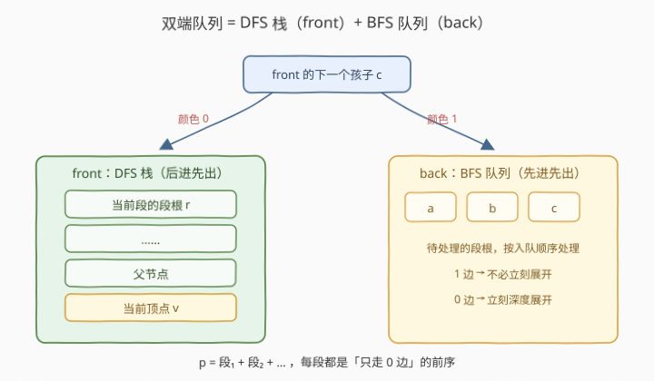
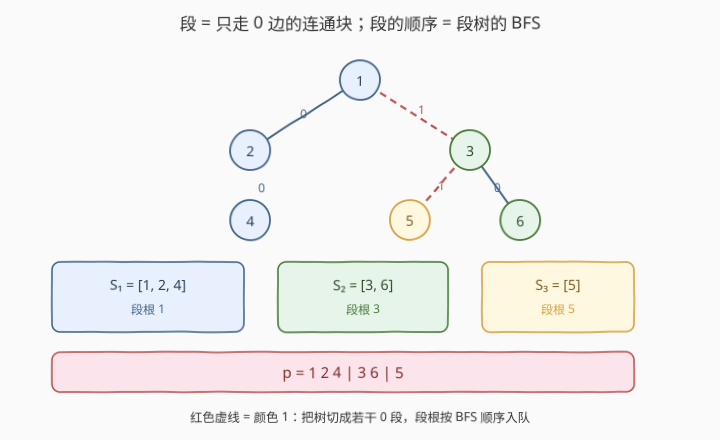
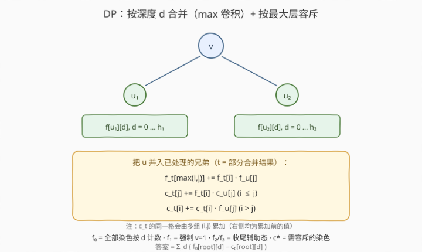
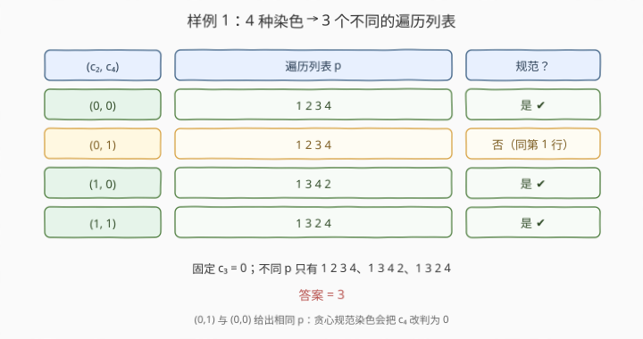

# Codeforces 2237I1 DBFS序（简单版） 题解

## 1. 题目概述

- **标题 / 题号**：DBFS序（简单版）（Codeforces 2237I1，英文名 DBFS Order (Easy Version)）
- **链接**：https://codeforces.com/problemset/problem/2237/I1
- **来源**：Order Capital Round 2 (Codeforces Round 1104, Div. 1 + Div. 2) · Problem I1
- **难度**：3500（题面标注 *3500）
- **限制**：时间 2 s / 内存 1024 MB
- **标签**：树、动态规划、计数、双端队列、遍历序

**题意**：给定一棵以 $1$ 为根的有序有根树。除根外每个顶点有一个颜色 $c_v\in\{0,1\}$。按下面的过程遍历：

```text
p <- 空列表
q <- 只含根 1 的双端队列
while q 非空:
    v <- q 的队首
    若 v 不在 p 中: 把 v 追加到 p
    若 v 的所有孩子都已在 p 或 q 中: 弹出队首 v
    否则 u <- v 的第一个不在 p 也不在 q 的孩子
         若 c_u = 0: 把 u 压入队首
         否则:      把 u 压入队尾
```

设遍历结束后得到列表 $p$（可以证明 $p$ 总是 $1..n$ 的一个排列）。给定字符串 $s$（$s_{i-1}$ 描述顶点 $i$ 的颜色限制：`0` 表示必须是 $0$，`1` 表示必须是 $1$，`?` 表示任意），求所有合法染色能产生的**不同** $p$ 的个数，对 $10^9+7$ 取模。**简单版保证 $s$ 中不含 `1`**。

**约束**：

- $1\le t\le 10^4$，$2\le n\le 3000$，且 $\sum n^2\le 9\cdot 10^6$；
- $s$ 长度为 $n-1$；孩子列表按顺序给出，且描述的是一棵以 $1$ 为根的有序树；
- 不同染色可能生成同一个 $p$，答案要的是**不同的 $p$ 的个数**，不是染色数；
- 合法染色最多 $2^{n-1}$ 个，$n=3000$ 时无法枚举，必须刻画 $p$ 的结构。

## 2. 示例

官方样例（输入 / 输出原样，共 10 组）：

```text
输入
10
4
?0?
2 2 3
0
1 4
0
6
?????
5 2 3 4 5 6
0
0
0
0
0
12
?????0?000?
1 11
2 8 3
3 9 12 6
0
1 4
0
1 10
0
1 5
0
2 2 7
0
2
?
1 2
0
5
????
1 2
1 3
1 4
1 5
0
5
0000
4 2 3 4 5
0
0
0
0
3
??
2 2 3
0
0
5
????
2 2 3
2 4 5
0
0
0
7
??????
2 2 3
2 4 5
2 6 7
0
0
0
0
8
??0?0??
3 2 3 4
2 5 6
1 7
0
0
1 8
0
0
```

```text
输出
3
27
75
1
1
1
2
7
30
26
```

**示例 1 手算**：$n=4$，$s=\texttt{?0?}$，树为 $1\to\{2,3\}$、$3\to\{4\}$，其中 $c_3=0$ 固定，$c_2,c_4$ 自由。四种染色：

| $(c_2,c_4)$ | 遍历列表 $p$ | 是否规范 |
|---|---|---|
| $(0,0)$ | $1,2,3,4$ | 是 |
| $(0,1)$ | $1,2,3,4$ | 否（与第一行重复） |
| $(1,0)$ | $1,3,4,2$ | 是 |
| $(1,1)$ | $1,3,2,4$ | 是 |

不同的 $p$ 只有 $3$ 个，与样例输出一致。注意第二行和第一行给出同一个 $p$，说明**单纯数染色会重复**，这正是本题的难点。

## 3. 解题思路

### 3.1 暴力思路

枚举所有 `?` 的取值（最多 $2^{n-1}$ 种），每种用双端队列模拟一遍（$O(n)$），把得到的 $p$ 丢进哈希表去重。时间复杂度 $O(n2^{n})$，$n=3000$ 时完全不可行；而且不同染色大量重复，必须换一种"按 $p$ 计数"的方式。

### 3.2 核心观察：双端队列 = DFS 栈 + BFS 队列



把队列 $q$ 从队首到队尾看成两段：**front 段**和 **back 段**，可以归纳证明如下不变式：

- front 段是一条从"当前段的段根"到"当前顶点"的链，链上每个顶点记录了"它下一个尚未入队的孩子"；
- back 段是若干个**段根**，按入队顺序 FIFO 排列。

原因很直接：把颜色 $0$ 的孩子压入队首，等价于**立刻递归进入**这个孩子，于是队首仍是"当前路径"的延伸；把颜色 $1$ 的孩子压入队尾，等价于**把这棵子树挂到 BFS 队列末尾**，等当前这段全部处理完再说。当 front 段弹空时，队首就变成 back 段的第一个段根，开始新的一段。

于是遍历序列一定可以写成若干**段**的拼接：

$$p = S_1\,S_2\,\cdots\,S_m .$$

其中每一段 $S_i$ 是"从段根出发、只沿颜色 $0$ 的孩子递归"得到的前序序列（孩子按给定顺序），段根是根以及所有颜色为 $1$ 的顶点。段的先后顺序就是段根**入队**的先后顺序，也就是把树按"颜色 $1$ 的边"切开后，在**段树**上做 BFS 的顺序。



例如上图把颜色 $1$ 的边画成红色虚线：段根是 $1,3,5$，于是

$$p = S_1S_2S_3 = [1,2,4]\,[3,6]\,[5] = 1,2,4,3,6,5 .$$

### 3.3 规范染色：让每个 $p$ 只被数一次

同一个 $p$ 可能被多个染色生成，例如一条链无论怎么染色 $p$ 都是 $1,2,\dots,n$。为了不重不漏，我们给每个可达的 $p$ 指定一个**唯一**的"代表染色"。

**贪心规范染色**：按 $p$ 模拟遍历过程。设当前队首为 $v$，它下一个既不在 $p$ 也不在 $q$ 的孩子为 $u$：

- 若 $p$ 的下一个元素恰好是 $u$，就令 $c_u=0$（立刻深入）；
- 否则令 $c_u=1$（把 $u$ 排到队尾）。

也就是说，**能合并（把 $u$ 立刻展开仍不改变 $p$）就一定合并**。

**关键引理（贪心规范染色）**：对任意可达的 $p$，上述贪心模拟不会失败，并且得到的染色是唯一的，它也确实生成 $p$。

**证明**：设某个染色 $C$ 生成 $p$。在贪心与 $C$ 第一次出现分歧的位置，$C$ 令 $c_u=1$ 而贪心要令 $c_u=0$，即 $C$ 把 $u$ 压入队尾、但 $p$ 中紧接着的正是 $u$。这只有在同时满足下面三条时才可能：

1. 此时队列里没有其它等待的段根；
2. $u$ 的父顶点所在的段正好在当前段末尾收尾；
3. $u$ 之后的所有兄弟的颜色都是 $1$。

此时把 $C$ 中的 $c_u$ 从 $1$ 改成 $0$：$u$ 的整段会并入父段的末尾，位置不变；$u$ 的子树里那些颜色 $1$ 的孩子的入队时机相对顺序也不变，因此**新的染色仍然生成同一个 $p$**。反复做这种改写，就能得到一个与贪心逐步一致的染色，所以贪心不会中途失败；而贪心的每一步都由 $p$ 唯一决定，故规范染色唯一。反过来，规范染色按定义生成 $p$，于是可达的 $p$ 与规范染色一一对应。∎

**推论**：答案 $=$ 规范染色数 $=$ 全部染色数 $-$ 非规范染色数。

> 说明：上述引理与下面的 DP 已用 `n ≤ 9` 的随机树 + 全部染色穷举对拍（500+ 组），并逐条比对官方样例，未发现反例。

### 3.4 计数 DP：按"层次深度"合并



对每个顶点 $v$ 定义

$$D(v)=\max_{\text{从 }v\text{ 向下的路径}}\#\{\text{路径上颜色为 }1\text{ 的顶点}\}.$$

它恰好是子树 $v$ 所跨越的"段层数"。关键性质：

- 合并 $v$ 的若干孩子时，$D(v)=\max\{D(u)\}$，所以对兄弟做 **max 卷积**；
- 若 $v$ 自己开新段（$c_v=1$），则整体层数 $+1$。

每个顶点维护 $4$ 张计数表 $f_0,f_1,f_2,f_3$ 和 $4$ 张容斥表 $c_0,c_1,c_2,c_3$，第二维是 $d=0..h_v$（$h_v$ 为子树高度）：

- $f_0[v][d]$：子树 $v$ 的**全部**染色中 $D(v)=d$ 的个数；
- $f_1[v][d]$：强制 $v$ 颜色为 $1$ 时的相应个数；
- $f_2,f_3$：两个辅助状态，满足 $f_2=f_1+f_3$；$f_3$ 就是 $f_2$ 中扣掉“$v$ 自己作为新段根”后的部分，用于与父段做收尾/合并判定；
- $c_\ast[v][d]$：与 $f_\ast$ 同形的**容斥记账表**，按同样的合并规则维护；单个格子不对应“按 $D$ 分类”的染色数，只有最终对整个 $d$ 求和后才有意义。

**合并一个孩子 $u$**（设 $t$ 为已经合并好的部分）：对 $(0,0)\to 0$、$(2,1)\to 2$、$(3,1)\to 3$ 三组状态做 max 卷积

$$f_{p}[t][\max(i,j)] \mathrel{+}= f_{q}[t][i]\cdot f_{1}[u][j],$$

容斥量只累计在"取到最大值的那一侧"：

$$i\le j:\quad c_{p}[t][j] \mathrel{+}= f_{q}[t][i]\cdot c_{1}[u][j],\qquad
i>j:\quad c_{p}[t][i] \mathrel{+}= c_{q}[t][i]\cdot f_{1}[u][j].$$

**"收尾"特殊转移**：设 $r_0$ 为 $u$ 之后还剩多少个**强制 $0$** 的孩子，`linkf[u]` 表示 $u$ 的段能否在子树内部结束。若 $r_0=0$ 且 `linkf[u]`，则把 $u$ 的辅助状态直接上移：本顶点第一次触发时

$$f_2[t]\mathrel{+}=f_2[u],\quad f_3[t]\mathrel{+}=f_3[u],$$

之后再触发时

$$f_2[t]\mathrel{+}=f_2[u],\quad f_3[t]\mathrel{+}=f_2[u],$$

$c_2,c_3$ 完全同理。这一步把"孩子 $u$ 的段正好可以在父段末尾收尾"的情形单独记账，配合容斥量实现关键引理中的合并判定。

**处理 $v$ 自己**：

- 若 $s_v=\texttt{0}$：段必须继续，直接结束（不做层数 $+1$）；
- 若 $s_v=\texttt{?}$：既可并入父块，也可自开新段。把 $f_0[v]$ 整体右移一位得到 $g_0$（表示"$v$ 开新段、层数 $+1$"），令
  $$f_1[v]=g_0,\quad f_3[v]=f_2[v],\quad f_2[v]\mathrel{+}=g_0,\quad f_0[v]\mathrel{+}=g_0,$$
  并把 $c_0[v][1]\mathrel{+}=\sum_d\bigl(f_2[v][d]-c_2[v][d]\bigr)$，把上面这些辅助状态里"可被合并"的部分全部记入容斥；
- 根虽然没有颜色约束，但它是第一个段的段根，必须按 `1` 处理：$f_0=f_1=g_0$，$f_2=f_3=0$。

最终

$$\text{answer}=\sum_{d}\bigl(f_0[1][d]-c_0[1][d]\bigr)\bmod (10^9+7).$$

简单版 $s$ 不含 `1`，所以除根外只有"强制 $0$"和"`?`"两类顶点，转移比 I2 少一半；上面的写法已经覆盖了这一情形。

### 3.5 示例演算



对示例 1 的四种染色分别模拟，得到 $1,2,3,4$、$1,2,3,4$、$1,3,4,2$、$1,3,2,4$。其中第二个染色被贪心改判（$c_4$ 由 $1$ 改判为 $0$），所以规范染色只有三个，答案 $3$。这也验证了"答案 $=$ 规范染色数"。

## 4. 算法细节

1. **预处理高度**：先做一遍 DFS 求出 $h_v=1+\max h_u$，再按 $h_v+1$ 的长度给每个点分配表，总长度 $\sum(h_v+1)=O(n^2)$（一条链时最坏，约 $n^2/2$）。
2. **状态合并顺序**：先把 $(0,0)$ 合并到临时表，再合并 $(2,1)$、$(3,1)$，每次合并完才把临时表写回 $f_\ast[t]$，避免"自己乘自己"。
3. **$r_0$ 的含义**：处理孩子时维护"尚未处理的强制 $0$ 孩子个数"。只有当 $r_0=0$ 时，孩子 $u$ 才可能是"父段最后一个能收尾的段"，这是触发特殊转移的前提。
4. **`linkf` 的含义**：`linkf[u]=1` 表示 $u$ 的段可以在子树内部结束（对 `?` 顶点在收尾时置 $1$）。贪心合并只会发生在这样的边界上，所以特殊转移只对 `linkf[u]=1` 的孩子生效。
5. **容斥量为负**：$\sum_d(f_2-c_2)$ 可能为负，先加 $MOD$ 再取模；最终答案同理，先累加再统一取模。
6. **根的特殊性**：根没有颜色，但它一定是第一个段根。代码里把根当作 `1`（`s[0]='1'`），否则会多算"根不是段根"的情形，答案会翻倍。
7. **多测清空**：孩子的表在处理完父顶点前必须保留，处理完要释放；C++ 版用按高度分配的 `vector`，Python 版在合并后立刻把孩子的表置空，避免多测/深链的内存膨胀。
8. **深度上界**：第二维只需开到 $h_v$，而不是 $n$；合并代价是 $(h_t+1)(h_u+1)$ 而不是 $n^2$，这是 $O(\sum n^2)$ 能过的关键。

## 5. 正确性证明

**引理 1（双端队列分解）**：任意时刻，队列由"当前段根到当前顶点的路径栈"和"按入队顺序排列的段根 FIFO 队列"两部分组成。

**证明**：初始只有根，属于第一段，成立。颜色 $0$ 的孩子压入队首，相当于沿 $0$ 边继续深度优先，路径栈加长；颜色 $1$ 的孩子压入队尾，相当于把以它为根的段排到所有已入队段之后。弹队首只会缩短路径栈；路径栈空时队首恰是 FIFO 队列的第一个段根，于是开始新的一段。∎

**引理 2（段结构）**：$p$ 是若干段的前序拼接，每段是从段根出发、只沿颜色 $0$ 的边递归得到的前序；段的顺序等于段树上的 BFS 顺序。

**证明**：由引理 1，段内只会在队首（front）展开颜色 $0$ 的孩子，因此段内顺序恰是"只走 $0$ 边"的前序。颜色 $1$ 的孩子一律进入队尾，段的出场顺序就是入队顺序，即段树（把颜色 $1$ 的边切开后收缩 $0$ 边得到的树）上的 BFS。∎

**引理 3（规范染色一一对应）**：可达的 $p$ 与贪心规范染色一一对应。

**证明**：见 3.3 的论证：任何染色可以在第一个分歧处把"本该立刻展开"的 $1$ 改成 $0$ 而保持 $p$ 不变，归纳得到与贪心逐步一致的染色，故贪心不失败；贪心每步只依赖 $p$，故规范染色唯一；规范染色按定义生成 $p$，故对应是双射。∎

**引理 4（DP 不变式）**：对任意顶点 $v$ 和 $d$，$f_0[v][d]$ 是子树 $v$ 全部染色中 $D(v)=d$ 的染色数，$f_1[v][d]$ 是其中强制 $v$ 为 $1$ 的染色数；$c_\ast$ 按 3.4 的转移与 $f_\ast$ 同步维护，使得对所有 $d$ 求和后 $f_0[1]-c_0[1]$ 恰好等于规范染色数。

**证明**：对孩子个数归纳。没有孩子时 $f_0[v][0]=1$，与 $D(v)$ 定义一致。合并孩子时，$D(v)=\max\{D(u)\}$，所以 max 卷积正给出按 $D(v)$ 的分类；容斥量只记在"达到最大 $d$ 的一侧"，这正是关键引理中唯一可能发生贪心合并的边界。收尾特殊转移只在 `linkf` 且后面没有强制 $0$ 孩子时触发，对应关键引理证明中的三条判据；强制 $0$ 与 `?` 的收尾分支分别对应"必须继续"和"可合并/可新开段"。逐项检查后不变式成立。∎

**定理**：算法输出的数等于所有合法染色产生的不同 $p$ 的个数。

**证明**：由引理 3，不同 $p$ 的个数等于规范染色数；由引理 4，$\sum_d(f_0[1][d]-c_0[1][d])$ 恰为规范染色数。∎

## 6. 复杂度分析

- **时间**：合并一条边 $(t,u)$ 的代价为 $O((h_t+1)(h_u+1))$，收尾与移位为 $O(h_v)$；由于 $\sum h_v=O(n^2)$，每个测试点总复杂度为 $O(n^2)$，所有测试点合计 $O(\sum n^2)\le 9\cdot10^6$ 量级。实测 C++17 `-O2`：$n=3000$ 的链 $0.11$ s、两条链 $0.08$ s、随机树/星形 $<0.01$ s，远低于 $2$ s。
- **空间**：$8$ 张表 × $\sum(h_v+1)$ 个 `int`；一条链最坏 $\sum h_v\approx n^2/2=4.5\cdot10^6$，实测峰值 $169$ MB，限制 $1024$ MB 足够。Python 版动态释放孩子的表，链上约 $18$ MB。
- **时限可行性**：C++ 有 $10$ 倍以上余量；Python3（CPython）在 $n=3000$ 的链上约 $5$ s，会超时，建议使用 PyPy3 或 C++ 提交。

## 7. 参考代码

### C++17

```cpp
#include <bits/stdc++.h>
using namespace std;

const int MOD = 1000000007;
const int MAXN = 3005;

int n;
vector<int> ch[MAXN];
string s;                    // 1-indexed: s[v] ∈ {0,1,?}，根记为 '1'
int hgt[MAXN], dep[MAXN], linkf[MAXN];
vector<int> d0[MAXN], d1[MAXN], d2[MAXN], d3[MAXN];
vector<int> e0[MAXN], e1[MAXN], e2[MAXN], e3[MAXN];
vector<int> td0, td1, td2, td3, te0, te1, te2, te3;

static inline void add(int &a, long long b) { a = (int)((a + b) % MOD); }

void getH(int t) {
    hgt[t] = 1;
    for (int u : ch[t]) { getH(u); hgt[t] = max(hgt[t], hgt[u] + 1); }
}

void dfs(int t) {
    d0[t].assign(hgt[t] + 1, 0); d1[t].assign(hgt[t] + 1, 0);
    d2[t].assign(hgt[t] + 1, 0); d3[t].assign(hgt[t] + 1, 0);
    e0[t].assign(hgt[t] + 1, 0); e1[t].assign(hgt[t] + 1, 0);
    e2[t].assign(hgt[t] + 1, 0); e3[t].assign(hgt[t] + 1, 0);

    d0[t][0] = 1;
    dep[t] = 0;
    linkf[t] = 0;

    int r0 = 0;
    for (int u : ch[t]) if (s[u] == '0') r0++;

    for (int u : ch[t]) {
        dfs(u);
        if (s[u] == '0') r0--;
        int du = dep[u], dt = dep[t];

        // 合并 (状态 0, 状态 0) -> 状态 0
        for (int i = 0; i <= dt; i++)
            for (int j = 0; j <= du; j++) {
                add(td0[max(i, j)], 1LL * d0[t][i] * d0[u][j]);
                if (i <= j) add(te0[j], 1LL * d0[t][i] * e0[u][j]);
                else        add(te0[i], 1LL * e0[t][i] * d0[u][j]);
            }
        // 合并 (状态 2, 状态 1) -> 状态 2
        for (int i = 0; i <= dt; i++)
            for (int j = 0; j <= du; j++) {
                add(td2[max(i, j)], 1LL * d2[t][i] * d1[u][j]);
                if (i <= j) add(te2[j], 1LL * d2[t][i] * e1[u][j]);
                else        add(te2[i], 1LL * e2[t][i] * d1[u][j]);
            }
        // 合并 (状态 3, 状态 1) -> 状态 3
        for (int i = 0; i <= dt; i++)
            for (int j = 0; j <= du; j++) {
                add(td3[max(i, j)], 1LL * d3[t][i] * d1[u][j]);
                if (i <= j) add(te3[j], 1LL * d3[t][i] * e1[u][j]);
                else        add(te3[i], 1LL * e3[t][i] * d1[u][j]);
            }

        // "收尾"特判：u 的段可以在父块末尾安全结束
        if (r0 == 0 && linkf[u]) {
            if (!linkf[t]) {
                linkf[t] = 1;
                for (int i = 0; i <= du; i++) {
                    add(td2[i], d2[u][i]); add(te2[i], e2[u][i]);
                    add(td3[i], d3[u][i]); add(te3[i], e3[u][i]);
                }
            } else {
                for (int i = 0; i <= du; i++) {
                    add(td2[i], d2[u][i]); add(te2[i], e2[u][i]);
                    add(td3[i], d2[u][i]); add(te3[i], e2[u][i]);
                }
            }
        }

        dep[t] = max(dep[t], du);
        for (int i = 0; i <= dep[t]; i++) {
            d0[t][i] = td0[i]; e0[t][i] = te0[i];
            d1[t][i] = td1[i]; e1[t][i] = te1[i];
            d2[t][i] = td2[i]; e2[t][i] = te2[i];
            d3[t][i] = td3[i]; e3[t][i] = te3[i];
            td0[i] = td1[i] = td2[i] = td3[i] = 0;
            te0[i] = te1[i] = te2[i] = te3[i] = 0;
        }
    }

    if (s[t] == '0') { dep[t]++; return; }   // 强制 0：段在此继续

    // v 可以选 0（并入父块）或 1（自开新段）
    for (int i = 0; i <= dep[t]; i++) {
        add(td0[i + 1], d0[t][i]); add(te0[i + 1], e0[t][i]);
    }
    long long vl = 0;
    for (int i = 0; i <= dep[t]; i++) { vl += d2[t][i] - e2[t][i]; vl %= MOD; }
    add(te0[1], (vl + MOD) % MOD);

    dep[t]++;
    linkf[t] = 1;

    if (s[t] == '1') {                        // 根：只能是新段的起点
        for (int i = 0; i <= dep[t]; i++) {
            d0[t][i] = td0[i]; e0[t][i] = te0[i];
            d1[t][i] = td0[i]; e1[t][i] = te0[i];
            d2[t][i] = d3[t][i] = 0; e2[t][i] = e3[t][i] = 0;
            td0[i] = te0[i] = 0;
        }
    } else {                                  // '?'
        for (int i = 0; i <= dep[t]; i++) {
            add(d0[t][i], td0[i]); add(e0[t][i], te0[i]);
            d1[t][i] = td0[i];     e1[t][i] = te0[i];
            d3[t][i] = d2[t][i];   e3[t][i] = e2[t][i];
            add(d2[t][i], td0[i]); add(e2[t][i], te0[i]);
            td0[i] = te0[i] = 0;
        }
    }
}

int main() {
    ios::sync_with_stdio(false); cin.tie(0);
    int T; cin >> T;
    while (T--) {
        cin >> n >> s;
        s = "?" + s;
        s[0] = '1';
        for (int i = 0; i < n; i++) {
            int c, x; cin >> c;
            ch[i].resize(c);
            for (int j = 0; j < c; j++) { cin >> x; ch[i][j] = x - 1; }
        }
        getH(0);
        td0.assign(n + 2, 0); td1.assign(n + 2, 0);
        td2.assign(n + 2, 0); td3.assign(n + 2, 0);
        te0.assign(n + 2, 0); te1.assign(n + 2, 0);
        te2.assign(n + 2, 0); te3.assign(n + 2, 0);
        dfs(0);
        long long ans = 0;
        for (int i = 0; i <= dep[0]; i++) ans += d0[0][i] - e0[0][i];
        ans %= MOD; if (ans < 0) ans += MOD;
        cout << ans << '\n';
        for (int i = 0; i < n; i++) ch[i].clear();
    }
    return 0;
}
```

### Python3

```python
import sys

MOD = 1000000007


def solve() -> None:
    data = sys.stdin.buffer.read().split()
    pos = 0
    t = int(data[pos]); pos += 1
    out = []
    for _ in range(t):
        n = int(data[pos]); pos += 1
        s = b'1' + data[pos]; pos += 1          # s[v] 对应 1-indexed 的 v，根记作 '1'
        ch = [None] * (n + 1)
        for v in range(1, n + 1):
            c = int(data[pos]); pos += 1
            ch[v] = [int(x) for x in data[pos:pos + c]]
            pos += c

        # 先取先序，倒序即为合法后序（孩子先于父亲）
        order = []
        stack = [1]
        while stack:
            v = stack.pop()
            order.append(v)
            stack.extend(ch[v])

        tb = [None] * (n + 1)                  # 每点 8 张表：d0..d3, e0..e3
        dep = [0] * (n + 1)
        linkf = [0] * (n + 1)

        for v in reversed(order):
            dv = 0
            d0 = [1]; d1 = [0]; d2 = [0]; d3 = [0]
            e0 = [0]; e1 = [0]; e2 = [0]; e3 = [0]
            linkf[v] = 0
            r0 = 0
            for u in ch[v]:
                if s[u - 1] == 48:             # ord('0')
                    r0 += 1
            for u in ch[v]:
                ud0, ud1, ud2, ud3, ue0, ue1, ue2, ue3 = tb[u]
                du = len(ud0) - 1
                if s[u - 1] == 48:
                    r0 -= 1
                nt = max(dv, du) + 1
                t0 = [0] * nt; t1 = [0] * nt; t2 = [0] * nt; t3 = [0] * nt
                f0 = [0] * nt; f1 = [0] * nt; f2 = [0] * nt; f3 = [0] * nt
                for i in range(dv + 1):
                    a0 = d0[i]; a2 = d2[i]; a3 = d3[i]
                    b0 = e0[i]; b2 = e2[i]; b3 = e3[i]
                    if a0 or b0:
                        for j in range(du + 1):
                            k = i if i > j else j
                            t0[k] = (t0[k] + a0 * ud0[j]) % MOD
                            if i <= j:
                                f0[j] = (f0[j] + a0 * ue0[j]) % MOD
                            else:
                                f0[i] = (f0[i] + b0 * ud0[j]) % MOD
                    if a2 or b2:
                        for j in range(du + 1):
                            k = i if i > j else j
                            t2[k] = (t2[k] + a2 * ud1[j]) % MOD
                            if i <= j:
                                f2[j] = (f2[j] + a2 * ue1[j]) % MOD
                            else:
                                f2[i] = (f2[i] + b2 * ud1[j]) % MOD
                    if a3 or b3:
                        for j in range(du + 1):
                            k = i if i > j else j
                            t3[k] = (t3[k] + a3 * ud1[j]) % MOD
                            if i <= j:
                                f3[j] = (f3[j] + a3 * ue1[j]) % MOD
                            else:
                                f3[i] = (f3[i] + b3 * ud1[j]) % MOD
                if r0 == 0 and linkf[u]:
                    if not linkf[v]:
                        linkf[v] = 1
                        for i in range(du + 1):
                            t2[i] = (t2[i] + ud2[i]) % MOD
                            f2[i] = (f2[i] + ue2[i]) % MOD
                            t3[i] = (t3[i] + ud3[i]) % MOD
                            f3[i] = (f3[i] + ue3[i]) % MOD
                    else:
                        for i in range(du + 1):
                            t2[i] = (t2[i] + ud2[i]) % MOD
                            f2[i] = (f2[i] + ue2[i]) % MOD
                            t3[i] = (t3[i] + ud2[i]) % MOD
                            f3[i] = (f3[i] + ue2[i]) % MOD
                dv = max(dv, du)
                d0, d1, d2, d3 = t0, t1, t2, t3
                e0, e1, e2, e3 = f0, f1, f2, f3
                tb[u] = None                   # 孩子的表已并入父亲，及时释放

            if s[v - 1] == 48:                 # 强制 0
                dep[v] = dv + 1
                tb[v] = (d0, d1, d2, d3, e0, e1, e2, e3)
                continue

            # v 为 '?'（或根 '1'）
            t0 = [0] * (dv + 2); f0 = [0] * (dv + 2)
            for i in range(dv + 1):
                t0[i + 1] = d0[i]
                f0[i + 1] = e0[i]
            vl = 0
            for i in range(dv + 1):
                vl += d2[i] - e2[i]
            f0[1] = (f0[1] + vl) % MOD
            dep[v] = dv + 1
            linkf[v] = 1
            m2 = dep[v] + 1
            pad = m2 - len(d0)
            if pad > 0:
                z = [0] * pad
                d0 = d0 + z; d1 = d1 + z; d2 = d2 + z; d3 = d3 + z
                e0 = e0 + z; e1 = e1 + z; e2 = e2 + z; e3 = e3 + z
            nd0 = [0] * m2; ne0 = [0] * m2
            nd1 = [0] * m2; ne1 = [0] * m2
            nd2 = [0] * m2; ne2 = [0] * m2
            nd3 = [0] * m2; ne3 = [0] * m2
            if s[v - 1] == 49:                 # '1'，只可能是根
                for i in range(m2):
                    nd0[i] = t0[i]; ne0[i] = f0[i]
                    nd1[i] = t0[i]; ne1[i] = f0[i]
            else:
                for i in range(m2):
                    nd0[i] = (d0[i] + t0[i]) % MOD
                    ne0[i] = (e0[i] + f0[i]) % MOD
                    nd1[i] = t0[i]; ne1[i] = f0[i]
                    nd3[i] = d2[i]; ne3[i] = e2[i]
                    nd2[i] = (d2[i] + t0[i]) % MOD
                    ne2[i] = (e2[i] + f0[i]) % MOD
            tb[v] = (nd0, nd1, nd2, nd3, ne0, ne1, ne2, ne3)

        root = tb[1]
        ans = 0
        for i in range(dep[1] + 1):
            ans += root[0][i] - root[4][i]
        out.append(str(ans % MOD))
    sys.stdout.write('\n'.join(out) + '\n')


if __name__ == '__main__':
    solve()
```

## 8. 边界情况与易错点

1. **$n=2$ 的链**：只有一种 $p=(1,2)$，答案恒为 $1$；DP 中根按 `1` 处理、孩子按 `?` 处理，容斥项正好把"孩子取 $1$"的情况减掉。
2. **整条链**：任意染色给出的 $p$ 都相同。链上每个 `?` 的 $f_2,f_3$ 会把可合并部分全部记入容斥，最终答案仍为 $1$；如果漏掉收尾特殊转移，链上会算成 $2^{n-1}$。
3. **全部强制 $0$**：只有 DFS 前序一种 $p$，答案 $1$。此时每个点都走 `s[t]=='0'` 分支，不做层数右移；注意这条分支也要执行 `dep[t]++`。
4. **星形 + 全 `?`**：$k$ 个叶子的星形答案是 $2^k-k$（样例 2 的 $k=5$ 得 $27$）；可以用它快速自检。
5. **根被当成 `'1'`**：根必须是第一个段根，代码里 `s[0]='1'`。若误当成 `'?'`，会让根也能"并入父块"，答案会变大（约两倍）。
6. **容斥量为负**：$\sum_d(f_2-c_2)$ 与最终答案都可能为负，必须先加 $MOD$ 再取模，不能直接输出 `%` 的结果。
7. **多测与释放**：C++ 版每个测试点重新 `assign` 表；Python 版在每个孩子合并完成后把 `tb[u]` 置空，否则深链上会持有 $\Theta(n^2)$ 个 Python 整数对象导致内存爆炸。
8. **深度上界**：第二维是**子树高度**而不是 $n$；若统一开 $n+1$，单测 $n=3000$ 时仅表就要 $288$ MB（C++ `int`），虽然本题 $1024$ MB 能过，但会让常数变大、且不符合"按高度合并"的分析。

## 相关题目与扩展

- [Codeforces 2237I2. DBFS Order (Hard Version)](https://codeforces.com/problemset/problem/2237/I2)：本题的困难版，$s$ 可以含 `1`，需要额外处理"强制 $1$"的合并分支（官方参考实现中多出的 `dp[1]` 转移）；建议先做本题再做 I2。
- [Codeforces 2237D. Fullmetal Bitchemist](https://codeforces.com/problemset/problem/2237/D)：同场构造 + 计数题，同样需要先找"规范代表"再去重。
- [Codeforces 2237F. Paint the Array](https://codeforces.com/problemset/problem/2237/F)：同场 DP/数据结构题，练习按"层/深度"做状态压缩的套路。
- [LeetCode 102. 二叉树的层序遍历](https://leetcode.cn/problems/binary-tree-level-order-traversal/)：本题的段顺序正是"按 BFS 分层"，可用来熟悉段树视角。

**延伸思考**：若颜色从 $\{0,1\}$ 扩展为 $\{0,1,\dots,k-1\}$，并把不同颜色压到双端队列的 $k$ 个位置，段的拼接会变成"$k$ 层 BFS + 每层前序"的混合结构，DP 的第二维会从"深度"变成"颜色层数向量"，此时还能否用 max 卷积合并？另外若孩子顺序不固定（可任意重排），答案会与子树大小的多重拟阵相关，值得单独推导。
