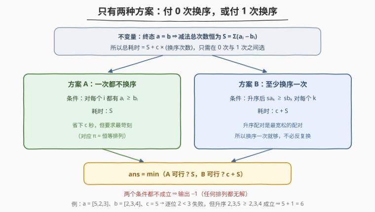
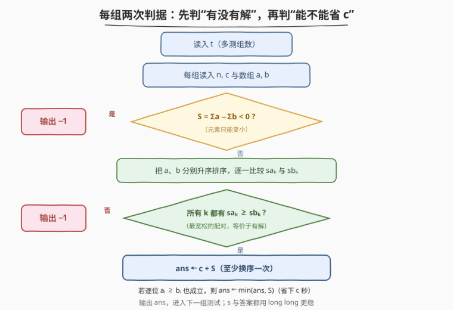
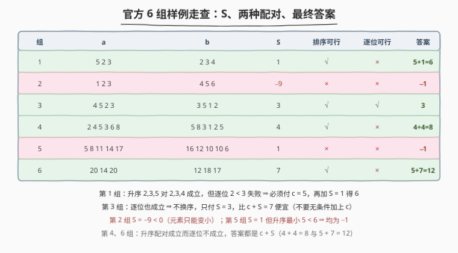

# Codeforces 2238A 帕皮鲁斯的另一道谜题 题解

## 1. 题目概述

- **标题 / 题号**：帕皮鲁斯的另一道谜题（Codeforces 2238A，英文名 Another Puzzle from Papyrus）
- **链接**：https://codeforces.com/problemset/problem/2238/A
- **来源**：Codeforces Round 1106 (Div. 2) · Problem A（UTC 2026-06-28）
- **难度**：800（$\ast 800$）
- **限制**：时间 1 s / 内存 256 MB
- **标签**：贪心、数学、排序（官方标签：greedy, math, sortings）

**题意**：给定长度为 $n$ 的数组 $a,b$ 与常数 $c$，可以任意多次、任意交错地执行下面两种操作：

1. 选一个下标 $i$，令 $a_i \leftarrow a_i - 1$，耗时 $1$ 秒；
2. 把 $a$ 的全部元素**任意重排**（即对 $a$ 施加任意一个排列），耗时 $c$ 秒。

问把 $a$ 变成 $b$（要求逐位相等，即 $a_i = b_i$）所需的最短总秒数；若不可能，输出 $-1$。

**约束**：

- 多测，$1 \le t \le 500$
- $1 \le n, c \le 100$，$1 \le a_i, b_i \le 100$
- 减法只能让元素**变小**，永远无法把元素变大
- 值域很小，但正解与值域无关，每组只需 $O(n \log n)$

## 2. 示例与观察
官方样例（输入 / 输出原样，题面里的空行只是排版）：

```text
输入：
6
3 5
5 2 3
2 3 4
3 3
1 2 3
4 5 6
4 4
4 5 2 3
3 5 1 2
6 4
2 4 5 3 6 8
5 8 3 1 2 5
5 11
5 8 11 14 17
16 12 10 10 6
3 5
20 14 20
12 18 17

输出：
6
-1
3
8
-1
12
```

补一组自造样例，覆盖「总和相等但必须换序」「不换序最省」「一次都不用做」「总量不够」：

```text
输入：
4
2 5
1 2
2 1
2 2
2 3
1 1
3 100
3 3 3
3 3 3
2 7
1 1
2 2

输出：
5
3
0
-1
```

第 1 组 $a=[1,2],b=[2,1]$：减法总量 $S=0$，但逐位不行，只能换序，答案恰好是 $c=5$——这是最容易写错的一组。

## 3. 解题思路

### 3.1 暴力思路

把「重排」看成对 $a$ 施加一个排列 $\pi$。任何方案都可以规整成：先做一次重排（或不做），再把 $a_{\pi(i)}$ 逐位减到 $b_i$。于是可以枚举全部 $n!$ 个排列：

$$\text{cost}(\pi) = [\pi \ne \mathrm{id}] \cdot c + \sum_{i=1}^{n}\bigl(a_{\pi(i)} - b_i\bigr), \qquad \text{要求 } a_{\pi(i)} \ge b_i \ \ \forall i$$

这个穷举**是对的**（见 §5 引理 1 与引理 3），但 $n=100$ 时 $n!$ 是天文数字。不过上式本身已经泄露了答案：求和项

$$\sum_{i=1}^{n}\bigl(a_{\pi(i)} - b_i\bigr) = \sum_i a_i - \sum_i b_i = S$$

与 $\pi$ **完全无关**！也就是说，不管怎么重排，减法总量都是同一个数，$\text{cost}(\pi)$ 只可能取两个值：$S$ 与 $c + S$。

### 3.2 核心观察：减法总量固定，只需比较「要不要换序」



**观察一（总量固定）**：终态必须是 $b$，所以 $\sum a$ 必须从初值降到 $\sum b$。操作 1 每次让总和减 $1$，操作 2 不改变总和。故任何合法方案**恰好**做 $S = \sum(a_i - b_i)$ 次减一。若 $S < 0$，无解。

**观察二（换序次数只需考虑 0 和 1）**：既然减法次数恒定，总耗时就是 $S + c \cdot k$，$k$ 为重排次数。而重排只是重新排列同一个多重集，做两次不比做一次多出任何能力，所以 $k \in \{0,1\}$ 就覆盖了全部可能。

**观察三（升序配对最宽松）**：$k=1$ 时选哪个排列最优？答案是**把 $a$ 和 $b$ 都升序，然后逐一配对**。这是「同一多重集里最小的对最小的」的经典结论，它同时最有可能满足 $a \ge b$，且不改变减法总量。于是判据分裂成两条：

$$\text{ans} = \begin{cases} S, & \text{逐位 } a_i \ge b_i \text{ 成立（不必换序）} \\[3pt] c + S, & \text{仅升序配对成立（必须换序一次）} \\[3pt] -1, & \text{升序配对也不成立（任何排列都无解）} \end{cases}$$

其中 $sa, sb$ 为 $a, b$ 的升序版本。两条都不成立时输出 $-1$。注意**两个判据都得算**：只算第一条会把有解的样例 1 判成 $-1$；只算第二条会在样例 3 上多付一个 $c$。

> 💡 一句话记忆：**答案只有三个候选值**——$S$、$c+S$、$-1$。

### 3.3 算法流程



对每组数据：

1. 累加 $S = \sum(a_i - b_i)$。若 $S < 0$，输出 $-1$，本组结束；
2. 把 $a,b$ 的副本分别升序排序得 $sa,sb$。若存在 $k$ 使 $sa_k < sb_k$，输出 $-1$，本组结束；
3. 令 $ans = c + S$；
4. 若对所有 $i$ 有 $a_i \ge b_i$，则 $ans = \min(ans, S)$；
5. 输出 $ans$，进入下一组。

第 2 步的排序是整道题唯一的非平凡操作，第 4 步的逐位检查可以在读入后立刻做（也可以与第 1 步合并成一次循环）。

### 3.4 示例演算



| 组 | $a$ | $b$ | $S$ | 升序配对可行 | 逐位可行 | 答案 |
|----|-----|-----|-----|--------------|----------|------|
| 1 | 5 2 3 | 2 3 4 | 1 | 是（2,3,5 vs 2,3,4） | 否（$2<3$） | $5+1=6$ |
| 2 | 1 2 3 | 4 5 6 | $-9$ | 否 | 否 | $-1$ |
| 3 | 4 5 2 3 | 3 5 1 2 | 3 | 是 | 是 | $3$ |
| 4 | 2 4 5 3 6 8 | 5 8 3 1 2 5 | 4 | 是 | 否 | $4+4=8$ |
| 5 | 5 8 11 14 17 | 16 12 10 10 6 | 1 | 否（$5<6$） | 否 | $-1$ |
| 6 | 20 14 20 | 12 18 17 | 7 | 是（14,20,20 vs 12,17,18） | 否（$14<18$） | $5+7=12$ |

第 1 组正是题面 Note 的走法：重排成 $[2,3,5]$ 后只减 $1$ 次，总代价 $5+1=6$。第 3 组 $S=3 < c+S=7$，说明**能省则省**。第 5 组 $S=1 \ge 0$，但升序后最小的 $5 < 6$，连最宽松的配对都失败，故无解——这就是「只看总和够不够」会踩的坑。

## 4. 算法细节

1. **三个候选值**：代码结构直接照抄判定顺序——先令 $\text{ans} = c + S$，再尝试用 $S$ 覆盖，最后才 `continue` 输出 $-1$，分支最少。
2. **必须排序比较**：$sa_k \ge sb_k$ 要升序对升序。若一边升序一边降序，会把「可行」判成「不可行」。
3. **逐位判据用原数组**：第 4 步用的是原始的 $a_i \ge b_i$，不能对排序后的数组再判一次（那样两条判据就重复了）。
4. **提前退出**：$S<0$ 时直接输出 $-1$，省掉后面的排序；排序失败时同理。多测下这两个 `continue` 能减少无谓工作。
5. **整数范围**：$|S| \le 100 \times 99 = 9900$，`int` 足够；但统一用 `long long` 累加 $S$ 与答案，换题面数据范围也不会翻车。
6. **答案可能是 0**：$a=b$ 时答案为 $0$（一次操作都不做），不能把 $0$ 当成「无解」的哨兵值。
7. **多测重置**：每题重新声明 `vector`，不要复用上一组的排序结果；用 `cin >> t` 后逐组读入即可，不需要额外清空。
8. **I/O**：C++ 关同步 + `'\n'`；Python 用 `sys.stdin.buffer.read().split()` 一次读完，$t=500$ 组也只有约 $10^5$ 个整数。

## 5. 正确性证明

**引理 1（减法次数恒定）**：任何把 $a$ 变成 $b$ 的操作序列，其操作 1 的执行次数恰为 $S = \sum(a_i - b_i)$。

**证明**：操作 1 使 $\sum a$ 恰好减少 $1$，操作 2 不改变 $\sum a$。设执行了 $m$ 次操作 1、$k$ 次操作 2，则终态 $\sum b = \sum a - m$，故 $m = \sum a - \sum b = S$；若 $S<0$ 则 $m$ 需为负数，不可能。∎

**引理 2（升序配对最宽松）**：若存在排列 $\pi$ 使 $a_{\pi(i)} \ge b_i$ 对所有 $i$ 成立，则把 $a,b$ 各自升序后得到的 $sa_k, sb_k$ 也满足 $sa_k \ge sb_k$ 对所有 $k$ 成立。

**证明**：记 $sb_1 \le sb_2 \le \dots \le sb_n$。反设存在 $k$ 使 $sa_k < sb_k$。令 $T = \{\,i : b_i \ge sb_k\,\}$，由升序性 $T$ 恰是 $b$ 中最大的 $n-k+1$ 个元素所在的下标集，故 $|T| = n-k+1$。对每个 $i \in T$ 有 $a_{\pi(i)} \ge b_i \ge sb_k$，而 $\pi$ 是双射，这 $n-k+1$ 个 $a$ 的元素互不相同，因此 $a$ 中**至少**有 $n-k+1$ 个元素 $\ge sb_k$。另一方面 $sa_k < sb_k$ 且 $sa$ 升序，故 $sa_1,\dots,sa_k$ 全部 $< sb_k$，即 $a$ 中**至多**有 $n-k$ 个元素 $\ge sb_k$。两者矛盾。∎

**引理 3（两个上界都可达）**：(a) 若对每个 $i$ 有 $a_i \ge b_i$，则存在代价恰为 $S$ 的方案；(b) 若对每个 $k$ 有 $sa_k \ge sb_k$，则存在代价恰为 $c+S$ 的方案。

**证明**：(a) 不换序，对每个 $i$ 做 $a_i - b_i$ 次操作 1，总次数 $\sum(a_i-b_i) = S$，代价 $S$。(b) 先花 $c$ 秒把 $a$ 重排成升序，此时第 $k$ 位是 $sa_k$；再把 $b$ 视作升序排列 $sb$（配对顺序可任意，只需 $sa_k \ge sb_k$ 保证每位都够减），做 $S$ 次操作 1 即可。代价 $c + S$。∎

**定理**：算法输出的值等于最小总耗时；无解时输出 $-1$。

**证明**：设最优方案做了 $k$ 次操作 2，且其有效配对为排列 $\pi$（$k=0$ 时 $\pi = \mathrm{id}$）。由引理 1，其代价为 $S + k \cdot c \ge S + [\pi \ne \mathrm{id}] \cdot c$。

- 若该方案可行且 $k = 0$，则逐位 $a_i \ge b_i$，算法给出 $S$，由引理 3(a) 该值可达，故最优。
- 若 $k \ge 1$，代价 $\ge S + c$；又因方案可行，存在满足 $a_{\pi(i)} \ge b_i$ 的排列，由引理 2 得升序配对可行，由引理 3(b) 知 $S+c$ 可达，故最优。
- 若升序配对不可行，由引理 2 的逆否命题知任何排列都不可行，算法输出 $-1$ 正确；若 $S<0$，由引理 1 无解，同样正确。∎

## 6. 复杂度分析

- **时间**：每组一次求和 $O(n)$、两次排序 $O(n \log n)$、两次线性比较 $O(n)$，合计 $O(n \log n)$；总体 $O(t \cdot n \log n) \le 500 \times 100 \times 7 \approx 3.5 \times 10^5$ 次比较。
- **空间**：$O(n)$，只存 $a, b$ 与它们的排序副本（$4n$ 个 `int`），与 $t$ 无关。
- **对照时限**：按最大约束 $t=500, n=100$ 造数据实测（含进程启动，5 次取中位数），C++ 约 70–75 ms——其中大部分是本机 Apple clang + libc++ 的 `cin` 读入开销（同一算法改用 `scanf` 读入后约 $7$ ms；CF 评测机用 GNU libstdc++，关同步的 `cin` 与 `scanf` 同量级），相对 $1$ s 时限余量在 $100$ 倍以上。Python3 约 $32$ ms，同样远低于 $1$ s。

## 7. 参考代码

### C++17

```cpp
#include <bits/stdc++.h>
using namespace std;

int main() {
    ios::sync_with_stdio(false);
    cin.tie(nullptr);

    int t;
    if (!(cin >> t)) return 0;              // 空输入防护
    while (t--) {
        int n, c;
        cin >> n >> c;
        vector<int> a(n), b(n);
        for (int &x : a) cin >> x;
        for (int &x : b) cin >> x;

        // 只要最终 a == b，总减法次数就被钉死为 sum(a) - sum(b)
        long long S = 0;
        bool okNo = true;                   // 完全不换序是否可行
        for (int i = 0; i < n; ++i) {
            S += (long long)a[i] - b[i];
            if (a[i] < b[i]) okNo = false;
        }
        if (S < 0) { cout << -1 << '\n'; continue; }

        // 升序配对是“最宽松”的配对：可行 <=> 存在某个排列可行
        vector<int> sa = a, sb = b;
        sort(sa.begin(), sa.end());
        sort(sb.begin(), sb.end());
        bool okAny = true;
        for (int i = 0; i < n; ++i)
            if (sa[i] < sb[i]) { okAny = false; break; }
        if (!okAny) { cout << -1 << '\n'; continue; }

        long long ans = (long long)c + S;   // 至少换序一次
        if (okNo) ans = min(ans, S);        // 一次都不换，省下 c 秒
        cout << ans << '\n';
    }
    return 0;
}
```

### Python3

```python
import sys


def main() -> None:
    data = list(map(int, sys.stdin.buffer.read().split()))
    if not data:                                # 空输入防护
        return
    pos = 0
    t = data[pos]
    pos += 1
    out = []
    for _ in range(t):
        n, c = data[pos], data[pos + 1]
        pos += 2
        a = data[pos:pos + n]
        pos += n
        b = data[pos:pos + n]
        pos += n

        # 最终 a == b 时，总减法次数恒为 sum(a) - sum(b)
        s = sum(a) - sum(b)
        if s < 0:
            out.append("-1")
            continue

        # 升序配对是“最宽松”的配对
        if any(x < y for x, y in zip(sorted(a), sorted(b))):
            out.append("-1")
            continue

        ans = c + s                             # 换序至少一次
        if all(x >= y for x, y in zip(a, b)):   # 完全不换序也可行
            ans = min(ans, s)
        out.append(str(ans))

    sys.stdout.write("\n".join(out) + "\n")


main()
```

## 8. 边界情况与易错点

1. **$S=0$ 但要换序**：如 $a=[1,2], b=[2,1], c=5$，答案是 $c=5$ 而不是 $0$。这是本题最容易丢掉的一组，因为「总和已经相等」会诱导人直接输出 $0$。
2. **$S<0$ 直接 $-1$**：$a=[1,1], b=[2,2]$ 无解；元素只能变小，总和不够就没救，与 $c$ 无关。
3. **$S\ge 0$ 但升序配对失败**：样例 5（$a$ 总和 $55$，$b$ 总和 $54$，但最小的 $5<6$）说明「总和够」是必要不充分条件。
4. **不能只用逐位判据判无解**：样例 1 逐位失败却有解，必须用排序判据决定 $-1$。
5. **不能只用排序判据算答案**：那样每组都会多付 $c$，样例 3 会从 $3$ 变成 $7$。
6. **$n=1$**：退化为 $a_1 \ge b_1$ 时输出 $a_1-b_1$，否则 $-1$；排序与逐位判据此时完全一致，代码无需特判。
7. **$a=b$**：答案是 $0$（一次操作都不做），注意别把 $0$ 与「无解」混为一谈。
8. **$c$ 与 $S$ 都取上界**：$c=100$、$|S|$ 最大 $9900$，答案上界为 $c+S=10000$，`long long`/Python 都不会溢出；但若把 $S$ 写成 `int` 后再参与更大的乘法，换题面范围就有风险。
9. **多测的输入位置**：每组固定读 $2 + 2n$ 个整数，Python 版用指针 `pos` 推进，避免一行一读被空行干扰。

## 9. 验证记录

- **编译环境与命令**：`clang++ -std=c++17 -O2`（本机无 GNU g++，配 `codeforces/tools/include/bits/stdc++.h` 兼容头；正文代码只用标准库，可原样提交 GNU C++17）；Python 侧为 `Python 3.9.6`。
- **官方样例**：1 / 1 通过（按 Codeforces 标准 checker 的 token 比对，忽略空白与大小写）。
- **复核状态**：audited（2026-11-19 统一回归：编译 + 官方样例；写作期的随机对拍与暴力未重跑）。

## 相关题目与扩展

- [LeetCode 455. 分发饼干](https://leetcode.cn/problems/assign-cookies/)：排序后贪心配对，与本题引理 2「升序对升序最宽松」是同一个结论。
- [LeetCode 881. 救生艇](https://leetcode.cn/problems/boats-to-save-people/)：排序 + 双指针的配对判定，思路同源。
- [Codeforces 1399A Remove Smallest](https://codeforces.com/problemset/problem/1399/A)：排序后只看相邻差的判定题，同为「排序 + 一个判据」的签到套路。
- [Codeforces 230A Dragons](https://codeforces.com/problemset/problem/230/A)：排序后按顺序模拟可行性，是本题「先排序再线性判定」的原型。
- [Codeforces 1462A Favorite Sequence](https://codeforces.com/problemset/problem/1462/A)：双端取数的重排小模拟，可对照「重排」类操作的建模方式。

**延伸思考**：

1. **单价不同的减法**：若把下标 $i$ 处减 $1$ 的代价改成 $w_i$，则总代价变成 $\sum_i w_i \bigl(a_{\pi(i)} - b_i\bigr)$，与排列有关，升序配对不再最优，问题升级为带权最小匹配（匈牙利算法 $O(n^3)$ 或最小费用流）。
2. **换序代价随次数递增**：若第 $k$ 次重排要 $c \cdot k$ 秒，结论不变（仍然只用 $0$ 或 $1$ 次）；但若第一次很贵、之后免费，则「先重排再多次小改」也不会更优，因为总量恒定。
3. **允许加法**：若操作 1 改成 $a_i \leftarrow a_i \pm 1$ 且代价都为 $1$，则总代价变成 $\sum |a_{\pi(i)} - b_i|$，升序配对**仍然**最优（同一套交换论证），答案变成 $\min\{\sum|a_i-b_i|,\ c + \sum|sa_k - sb_k|\}$。
4. **多数组版本**：若有 $m$ 个数组要一起变成 $b$、重排一次对全部生效，则每组仍需一次排序判据，$k$ 依然只有 $0/1$，直接对 $m$ 组各算一次即可。
