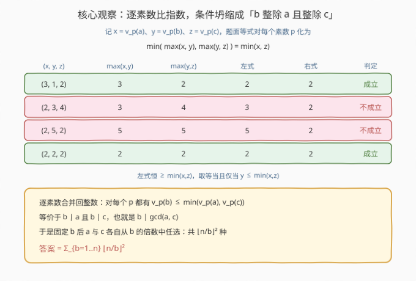
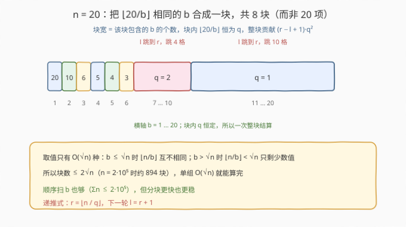
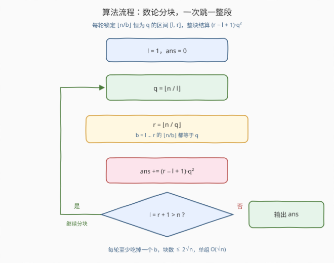
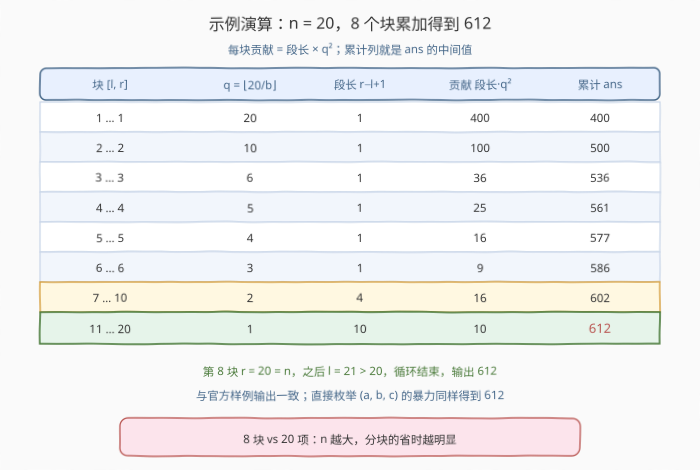

# Codeforces 2238B 绯红三元组 题解

## 1. 题目概述

- **标题 / 题号**：绯红三元组（Codeforces 2238B，英文名 Crimson Triples）
- **链接**：https://codeforces.com/problemset/problem/2238/B
- **来源**：Codeforces Round 1106 (Div. 2) · Problem B
- **难度**：900（Div. 2 第二题）
- **限制**：时间 1 s / 内存 256 MB
- **标签**：数学、数论、计数、数论分块（官方标签：dp, math, number theory）

**题意**：有 $n$ 只眼睛，编号 $1 \sim n$。一次攻击选择**有序三元组** $(a,b,c)$（三个数可以相同，取值都在 $[1,n]$ 内）。称它**绯红（crimson）**，当且仅当

$$\gcd\bigl(\operatorname{lcm}(a,b),\ \operatorname{lcm}(b,c)\bigr) = \gcd(a,c)$$

求绯红三元组的个数。$(a_1,b_1,c_1)$ 与 $(a_2,b_2,c_2)$ 只要有一位不同就算不同方案。

**约束**：

- $1 \le t \le 1000$
- $1 \le n \le 2 \times 10^5$，且所有测试的 $n$ 之和 $\le 2 \times 10^5$
- 答案量级：$n = 2\times10^5$ 时为 $65795150349 \approx 6.58\times10^{10}$，**超过 32 位整数**
- 直接按定义算 $\operatorname{lcm}(a,b)$ 会得到 $4\times10^{10}$ 量级的中间量，枚举三元组不可行

> 💡 一句话本质：等式两边逐素数比指数后，条件坍缩成「$b$ 整除 $a$ 且整除 $c$」，于是答案就是 $\sum_{b=1}^{n}\lfloor n/b\rfloor^2$。

## 2. 示例与观察
官方样例（输入 / 输出原样）：

```text
输入
3
1
2
20

输出
1
5
612
```

官方对前两组的解释：$n=1$ 只有 $(1,1,1)$；$n=2$ 有 $(1,1,1)$、$(1,1,2)$、$(2,1,1)$、$(2,1,2)$、$(2,2,2)$ 共 $5$ 组。

自造小样例（本文补充，用于手算核对）：

```text
输入
3
3
4
5

输出
11
22
32
```

手算 $n=3$：$b=1$ 时 $a,c$ 各有 $3$ 种选法 $9$ 组；$b=2$ 时只有 $a,c \in \{2\}$ 共 $1$ 组；$b=3$ 时同样 $1$ 组。合计 $9+1+1=11$。$n=4,5$ 类似：$16+4+1+1=22$，$25+4+1+1+1=32$。

再补一组最大边界（非官方，输出为本题程序实算）：

```text
输入
1
200000

输出
65795150349
```

## 3. 解题思路

### 3.1 暴力思路

枚举全部 $n^3$ 个三元组，每组用两次 `gcd` 加两次 `lcm` 判定：$n = 2\times10^5$ 时是 $8\times10^{15}$ 组，完全不可行；即便 $n \le 500$ 也只有 $1.25\times10^8$ 组，且 `lcm` 还需处理 $4\times10^{10}$ 量级的中间值，容易溢出。必须把条件化简成可计数的不等式。

### 3.2 核心观察：逐素数比指数，条件变成整除



对任意素数 $p$，记 $x = v_p(a)$、$y = v_p(b)$、$z = v_p(c)$（$v_p$ 为素因子指数）。由 $\gcd$ 取最小指数、$\operatorname{lcm}$ 取最大指数：

$$v_p\bigl(\text{左式}\bigr) = \min\bigl(\max(x,y),\ \max(y,z)\bigr), \qquad v_p\bigl(\text{右式}\bigr) = \min(x,z)$$

两个正整数相等 $\iff$ 对**每个**素数指数都相等，所以问题化成：对所有 $p$，

$$\min\bigl(\max(x,y),\ \max(y,z)\bigr) = \min(x,z)$$

**断言**：这个等式成立 $\iff$ $y \le \min(x,z)$。

- 若 $y \le \min(x,z)$，则 $\max(x,y)=x$、$\max(y,z)=z$，左式为 $\min(x,z)$，成立。
- 若 $y > \min(x,z)$，不妨设 $x \le z$（关于 $x,z$ 对称），则 $y > x$。若 $y \le z$，左式 $=\min(y,z)=y > x$；若 $y > z$，左式 $=\min(y,y)=y > x$。两种情形左式都严格大于 $\min(x,z)=x$，不成立。

于是条件逐素数等价于「$v_p(b) \le v_p(a)$ 且 $v_p(b) \le v_p(c)$」，合并回整数即

$$b \mid a \quad\text{且}\quad b \mid c \iff b \mid \gcd(a,c)$$

> 💡 关键收益：不再需要任何 $\gcd/\operatorname{lcm}$ 计算，只需数「$b$ 的倍数」。

### 3.3 算法流程：固定 $b$，再按 $\lfloor n/b\rfloor$ 分块



**固定 $b$**：$[1,n]$ 中 $b$ 的倍数恰有 $\lfloor n/b\rfloor$ 个，$a$ 与 $c$ 的选取互相独立，故该 $b$ 贡献 $\lfloor n/b\rfloor^2$。答案

$$\text{ans} = \sum_{b=1}^{n} \left\lfloor \frac{n}{b} \right\rfloor^{2}$$

**按值分块**：$\lfloor n/b\rfloor$ 只有 $O(\sqrt n)$ 种取值。设当前块起点 $l$、值 $q = \lfloor n/l \rfloor$，则块尾 $r = \lfloor n/q \rfloor$，块内每个 $b$ 的 $\lfloor n/b\rfloor$ 都等于 $q$，整块贡献 $(r-l+1)\cdot q^2$，然后令 $l = r+1$。



直接顺序扫 $b=1..n$ 也对（总量 $\sum n \le 2\times10^5$，在 1 s 内绰绰有余），但分块是标准的 $O(\sqrt n)$ 模板，代码几乎一样长，且对更大的 $n$ 依然有效。

### 3.4 示例演算



$n = 20$ 时共 $8$ 块：

| 块 $[l,r]$ | $q=\lfloor 20/b\rfloor$ | 段长 | 贡献 | 累计 |
|---|---|---|---|---|
| $[1,1]$ | 20 | 1 | 400 | 400 |
| $[2,2]$ | 10 | 1 | 100 | 500 |
| $[3,3]$ | 6 | 1 | 36 | 536 |
| $[4,4]$ | 5 | 1 | 25 | 561 |
| $[5,5]$ | 4 | 1 | 16 | 577 |
| $[6,6]$ | 3 | 1 | 9 | 586 |
| $[7,10]$ | 2 | 4 | 16 | 602 |
| $[11,20]$ | 1 | 10 | 10 | 612 |

结果 $612$，与官方输出一致。最后一块的 $r = 20 = n$，下一轮 $l = 21 > 20$，循环结束。

## 4. 算法细节

1. **不要在代码里算 $\gcd/\operatorname{lcm}$**：$a,b \le 2\times10^5$ 时 $\operatorname{lcm}$ 可达 $4\times10^{10}$，超出 `int`；而且判定不必要，整除刻画已经精确等价。
2. **块尾公式**：`r = n / q` 中 $q = n/l$ 恒 $\ge 1$（因为 $l \le n$），所以不会出现除以 $0$。本轮处理完必须用 $r+1$ 推进，不能写 $l++$，否则退化成 $O(n)$。
3. **块贡献用乘法而不是循环**：块内 $q$ 相同，贡献是 $(r-l+1)\cdot q^2$。注意 $(r-l+1)\cdot q \le n$（块内每个 $b$ 都满足 $q \le n/b$），故乘积不超过 $n^2 = 4\times10^{10}$，**必须用 64 位**，但不会溢出 `long long`。
4. **答案上界**：$\sum_{b\le n}\lfloor n/b\rfloor^2 \approx n^2\pi^2/6$，$n=2\times10^5$ 时约 $6.58\times10^{10}$，`int` 会溢出，C++ 用 `long long`，Python 无此问题。
5. **多测**：每组独立做分块，复杂度按 $\sum \sqrt{n_i}$ 累加；$t \le 1000$、$\sum n_i \le 2\times10^5$ 时最坏（均分）约 $1000\times 2\sqrt{200} \approx 2.8\times10^4$ 轮，几乎不耗时。
6. **顺序版本**：若写成 `for (b = 1; b <= n; b++) ans += (n/b)*(n/b);`，总量为 $\sum n_i \le 2\times10^5$，也稳过；两种写法可互为对拍。
7. **读入**：$t \le 1000$，`scanf`/`read().split()` 足够，无需手写快读。

## 5. 正确性证明

**引理 1（逐素数相等）**：对正整数 $u,v$，$u=v \iff$ 对每个素数 $p$ 都有 $v_p(u)=v_p(v)$。

**证明**：唯一分解定理。若所有指数相同则两数相同；若 $u \ne v$，则某素数指数不同或某素数只出现在一边（另一边指数为 $0$），指数向量不同。∎

**引理 2（指数层等价）**：设 $x,y,z$ 为非负整数，则 $\min(\max(x,y),\max(y,z)) = \min(x,z)$ 当且仅当 $y \le \min(x,z)$。

**证明**：
($\Leftarrow$) 若 $y \le \min(x,z)$，则 $\max(x,y)=x$、$\max(y,z)=z$，左式 $=\min(x,z)$，相等。
($\Rightarrow$) 反设 $y > \min(x,z)$。由关于 $x,z$ 的对称性可设 $x \le z$，于是 $y > x$。若 $y \le z$，左式 $=\min(y,z)=y > x=\min(x,z)$；若 $y > z$，左式 $=\min(y,y)=y>z \ge x$。两种情况下左式都大于右式，矛盾。∎

**引理 3（整数层等价）**：题面等式成立 $\iff b \mid a$ 且 $b \mid c$。

**证明**：由引理 1，等式成立 $\iff$ 对每个素数 $p$，$\min(\max(v_p(a),v_p(b)),\max(v_p(b),v_p(c))) = \min(v_p(a),v_p(c))$。由引理 2 这等价于 $v_p(b) \le \min(v_p(a),v_p(c))$，即 $v_p(b) \le v_p(a)$ 且 $v_p(b) \le v_p(c)$ 对所有 $p$ 成立，这又等价于 $b \mid a$ 且 $b \mid c$。∎

**引理 4（单块计数）**：$[1,n]$ 中是 $b$ 的倍数的整数恰有 $\lfloor n/b \rfloor$ 个。

**证明**：它们是 $b,2b,\dots,kb$，其中 $k b \le n < (k+1)b$，故 $k = \lfloor n/b \rfloor$。∎

**引理 5（分块正确且不重不漏）**：设 $q = \lfloor n/l \rfloor \ge 1$，$r = \lfloor n/q \rfloor$。则对 $b \in [l,r]$ 有 $\lfloor n/b \rfloor = q$，且 $\lfloor n/(r+1) \rfloor < q$。

**证明**：由 $r = \lfloor n/q \rfloor$ 得 $q r \le n < q(r+1)$。对 $b \in [l,r]$：一方面 $b \ge l \Rightarrow n/b \le n/l \Rightarrow \lfloor n/b\rfloor \le q$；另一方面 $b \le r \Rightarrow n/b \ge n/r \ge q \Rightarrow \lfloor n/b\rfloor \ge q$。故相等。对 $b = r+1 > r$：由 $n < q(r+1)$ 得 $n/(r+1) < q$，故 $\lfloor n/(r+1)\rfloor \le q-1 < q$。∎

**定理**：算法输出的数等于绯红三元组的个数。

**证明**：由引理 3，绯红三元组就是满足 $b \mid a,\ b \mid c$ 的 $(a,b,c)$。对每个固定的 $b$，由引理 4，$a$ 有 $\lfloor n/b\rfloor$ 种取法、$c$ 也有 $\lfloor n/b\rfloor$ 种取法且二者互不约束，故该 $b$ 恰贡献 $\lfloor n/b\rfloor^2$ 组，不同 $b$ 的三元组互不相同（$b$ 位不同）。按 $b$ 求和即得 $\sum_{b=1}^n \lfloor n/b\rfloor^2$，这是精确值而非近似。算法由引理 5 把这 $n$ 项划分成若干不相交的块，每块用 $(r-l+1)q^2$ 一次性算对块内所有项，$l$ 以 $r+1$ 推进直到超过 $n$，覆盖 $b=1..n$ 且不重复，故输出等于上述和。∎

## 6. 复杂度分析

- **时间**：单组 $O(\sqrt n)$。块数不超过 $2\sqrt n$（$b \le \sqrt n$ 时 $\lfloor n/b\rfloor$ 逐点不同，$b > \sqrt n$ 时 $\lfloor n/b\rfloor < \sqrt n$ 只有 $\sqrt n$ 种值），每块 $O(1)$。全部测试合计 $O\bigl(\sum \sqrt{n_i}\bigr)$：在 $t \le 1000$、$\sum n_i \le 2\times10^5$ 下最坏（均分）约 $1000\times 2\sqrt{200} \approx 2.8\times10^4$ 次块操作。实测单组 $n=2\times10^5$ 约 $3$ ms，$t=1000$ 且 $\sum n = 2\times10^5$ 约 $2$ ms，相对 1 s 时限有数百倍余量。
- **空间**：$O(1)$ 额外空间（只存 $n$、$l$、$r$、$q$、`ans`），与 $n$ 无关。
- **对照时限**：即使退化成顺序 $O(n)$ 版本，$\sum n \le 2\times10^5$ 也在 $1$ s 内轻松通过。

## 7. 参考代码

### C++17

```cpp
#include <cstdio>

int main() {
    int t;
    if (scanf("%d", &t) != 1) return 0;
    while (t--) {
        long long n;
        scanf("%lld", &n);
        // ans = sum_{b=1..n} floor(n/b)^2，把 floor(n/b) 相同的 b 合成一块
        long long ans = 0;
        for (long long l = 1, r; l <= n; l = r + 1) {
            long long q = n / l;   // 块内所有 b 的 floor(n/b) 都等于 q
            r = n / q;             // 本块右端点
            ans += (r - l + 1) * q * q;
        }
        printf("%lld\n", ans);
    }
    return 0;
}
```

### Python3

```python
import sys


def main() -> None:
    data = sys.stdin.buffer.read().split()
    if not data:
        return
    t = int(data[0])
    out = []
    for i in range(1, t + 1):
        n = int(data[i])
        ans = 0
        l = 1
        while l <= n:
            q = n // l          # 块内 floor(n/b) 恒为 q
            r = n // q          # 本块右端点
            ans += (r - l + 1) * q * q
            l = r + 1
        out.append(str(ans))
    sys.stdout.write("\n".join(out) + "\n")


main()
```

## 8. 边界情况与易错点

1. **$n = 1$**：循环只有一块 $l=r=1,\ q=1$，输出 $1$，对应唯一三元组 $(1,1,1)$，不要特判成 $0$。
2. **`int` 溢出**：$q^2$ 可达 $4\times10^{10}$，累计到 $6.58\times10^{10}$，`(r-l+1)*q*q` 在 32 位下必然溢出；C++ 全程 `long long`，Python 天然安全。
3. **块推进写错**：必须 `l = r + 1`；写成 `l++` 虽不会死循环，但退化为 $O(n)$，失去分块意义，也容易在块结算处重复累加。
4. **块尾公式方向写反**：`r = n / q` 中 $q$ 必须是 `n / l`（当前块的商），写成 `n / r` 会死循环或漏块。
5. **空输入 / 多测换行**：Python 用 `read().split()` 一次性读入，避免行尾空白导致 `int('')` 报错；C++ 用 `scanf` 自动跳过空白。
6. **把条件误推成 $a \mid c$ 或 $a = c$**：只需 $b$ 同时整除 $a$、$c$，$a$ 与 $c$ 之间没有任何约束（样例 $(1,1,2)$、$(2,1,1)$ 都在计数中）。
7. **误以为 $b$ 必须互不相同**：$b$ 可以取任意值，每个 $b$ 独立贡献，直接相加即可，无需容斥。

## 9. 验证记录

- **编译环境与命令**：`clang++ -std=c++17 -O2`（本机无 GNU g++，配 `codeforces/tools/include/bits/stdc++.h` 兼容头；正文代码只用标准库，可原样提交 GNU C++17）；Python 侧为 `Python 3.9.6`。
- **官方样例**：1 / 1 通过（按 Codeforces 标准 checker 的 token 比对，忽略空白与大小写）。
- **复核状态**：audited（2026-11-19 统一回归：编译 + 官方样例；写作期的随机对拍与暴力未重跑）。

## 相关题目与扩展

- [Codeforces 2238B Crimson Triples](https://codeforces.com/problemset/problem/2238/B)：本题，官方 editorial 见 [Round 1106 Tutorial](https://codeforces.com/blog/entry/154829)。
- [Luogu P2261 [CQOI2007] 余数求和](https://www.luogu.com.cn/problem/P2261)：数论分块的模板题，核心技巧与本篇 §3.3 完全一致（$\sum \lfloor n/i\rfloor$ 整块跳跃）。
- [LeetCode 2427. 公因子的数目](https://leetcode.cn/problems/number-of-common-factors/)：数 $b \mid \gcd(a,c)$ 的个数，与本题的整除刻画同源，可作热身。

**延伸思考**：

1. **改成求和而不是计数**：若要求 $\sum \operatorname{lcm}(a,c)$ 或带权版本，$\sum_{b}$ 的整数层结构不变，但内层要换成对倍数的求和，可用莫比乌斯反演把 $O(n\log n)$ 压到 $O(n)$。
2. **$n$ 放大到 $10^{12}$**：上面的分块写法**完全不用改**，仍是 $O(\sqrt n)$；这体现了「按 $\lfloor n/b\rfloor$ 的取值跳块」比「预处理 $1..n$」更强的扩展性。
3. **四元组版本**：若条件改为 $\gcd(\operatorname{lcm}(a,b),\operatorname{lcm}(b,d))=\gcd(a,d)$ 且 $c$ 自由，则答案变成 $n\sum_b \lfloor n/b\rfloor^2$，逐素数分析不变。
4. **计数而非固定 $b$**：若改成「求满足条件的无序三元组 $\{a,b,c\}$」，需要用 Burnside 或按相等关系分类去重，是本题的直接进阶。
