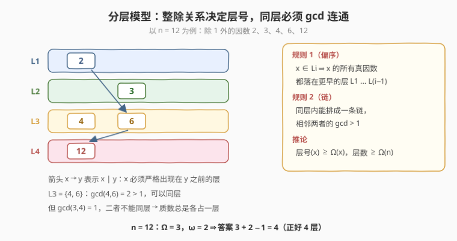
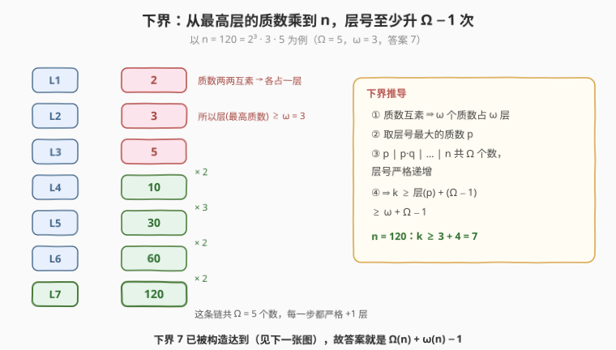
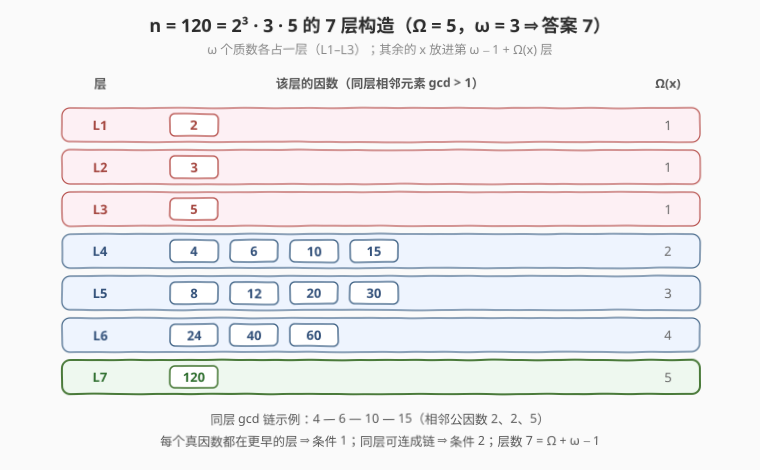

# Codeforces 2238D 强攻荒坂塔 题解

## 1. 题目概述

- **标题 / 题号**：强攻荒坂塔（Codeforces 2238D，英文名 Storming Arasaka）
- **链接**：https://codeforces.com/problemset/problem/2238/D
- **来源**：Codeforces Round 1106 (Div. 2) · Problem D
- **难度**：1500（$\ast 1500$）
- **限制**：时间 2 s / 内存 256 MB
- **标签**：贪心、数学、数论（官方标签：greedy, math, number theory）

**题意**：给定 $n$。取出 $n$ 的**所有正因数，但去掉 $1$**（$n$ 本身保留），把它们划分成若干非空层 $L_1,L_2,\dots,L_k$。称一个划分是好的，如果：

1. 对任意 $x\in L_i$，$x$ 的所有因数中除 $1$ 与 $x$ 以外的那些，只能落在 $L_1,\dots,L_{i-1}$；
2. 每一层内的数可以排成一条链，使链上**相邻**两个数的 $\gcd>1$（不要求两两互质）。

密码长度就是层数 $k$，要求 $k$ **最小**。多测。

**约束**：

- $1\le t\le 10^4$，$2\le n\le 10^6$；
- 下文证明答案是 $\Omega(n)+\omega(n)-1$，$n\le10^6$ 时最大为 $20$（$786432=2^{18}\cdot3$），`int` 足够。

> 💡 一句话本质：**答案 $=\Omega(n)+\omega(n)-1$**，$\Omega$ 是质因数个数（计重数），$\omega$ 是不同质数个数。分层只是表象，真正的下界来自「互素的两个质数不能同层」。

## 2. 示例

官方样例（输入 / 输出原样）：

```text
输入：
8
2
4
8
16
32
67
120
33
输出：
1
2
3
4
5
1
7
3
```

官方说明只解释了 $n=2^k$ 的情形：因数 $2^1,\dots,2^k$ 两两 $\gcd>1$，但整除关系逼着它们各占一层，故答案 $=k=\Omega(n)$。

补三组自造样例（非官方），专门覆盖「互素障碍」：

```text
输入：
3
12
36
210
输出：
4
5
7
```

- $12=2^2\cdot3$：$\Omega=3,\omega=2\Rightarrow 4$，分层 $\{2\},\{3\},\{4,6\},\{12\}$。
- $36=2^2\cdot3^2$：$\Omega=4,\omega=2\Rightarrow 5$，分层 $\{2\},\{3\},\{4,6,9\},\{12,18\},\{36\}$。
- $210=2\cdot3\cdot5\cdot7$：$\Omega=4,\omega=4\Rightarrow 7$，四个质数只能各占一层。

## 3. 解题思路

### 3.1 暴力思路

$n\le10^6$ 时 $\tau(n)\le240$，但要枚举的是「把 $\tau(n)-1$ 个因数分成若干层」的所有方案，量级是第二类 Stirling 数；每检验一次还得判每层能否连成链（哈密顿路径，NP 难）。$n=720720$ 有 240 个因数，暴力完全不可行。

所以正确顺序是：先在 $n\le130$ 的范围里写暴力求真实最小层数，观察出闭式 $f(n)=\Omega(n)+\omega(n)-1$，再证明它。

### 3.2 核心观察：层号是整除偏序的秩，互素是额外的障碍



把「$y\mid x$ 且 $y\ne1,x$」看作偏序，条件 1 恰好是要求**层号沿这个偏序严格递增**：

$$y\mid x,\quad y\ne1,\ x\ne y\ \Longrightarrow\ \text{层}(y)<\text{层}(x)$$

于是最自然的层号就是 $\Omega(x)$（$x$ 的质因数个数，计重数）——它本身就是该偏序的一个秩函数。**若只有条件 1，$\Omega(n)$ 层就够**（把 $\Omega$ 值相同的数放一层）。

**条件 2 是额外障碍**。一层的两个元素只有在 $\gcd>1$ 时才允许相邻；反过来，若某个质数 $p$ 与别的数同层，链上 $p$ 必有一个邻元素 $z$，$\gcd(p,z)>1$ 强制 $p\mid z$，即 $z$ 是 $p$ 的倍数，这与条件 1 冲突。所以：

> **每个质数都必须独占一层**，$\omega(n)$ 个质数就吃掉 $\omega(n)$ 个层。

「层号 $\ge\Omega$」叠上「$\omega$ 个质数各占一层」，答案从 $\Omega$ 被抬到 $\Omega+\omega-1$。

### 3.3 下界与构造：$k=\Omega+\omega-1$



**下界**。把 $n$ 的 $\omega$ 个质数按层号排成 $a_1<a_2<\dots<a_\omega$（互不相同，故 $a_\omega\ge\omega$）。取层号最大的那个质数 $p$，从它出发每次乘一个质因子直到 $n$：

$$p=d_1\mid d_2\mid\cdots\mid d_\Omega=n$$

共 $\Omega=\Omega(n)$ 个数，每一步都是**真因数**关系。由条件 1 层号至少 $+1$，于是

$$k=\text{层}(n)\ \ge\ \text{层}(d_1)+(\Omega-1)=a_\omega+\Omega-1\ \ge\ \Omega+\omega-1 .$$

**构造**（说明上界能取到）。把 $\omega$ 个质数各放一层 $L_1,\dots,L_\omega$，剩下的因数按 $\Omega$ 归堆：

$$L_{\omega-1+j}=\{\,x\mid n:\ \Omega(x)=j\,\},\qquad j=2,3,\dots,\Omega .$$

层数正好 $\omega+(\Omega-1)=\Omega+\omega-1$。条件 1 直接成立（真因数的 $\Omega$ 更小、质数的层号 $\le\omega$）；质数层是单元素，条件 2 只需证同一 $\Omega$ 的因数能连成链 —— 见 §5 引理 4：把某个质数 $p$ 拆出来，被 $p$ 整除的部分随便排（都有公因子 $p$），不被 $p$ 整除的部分递归处理，再用「差一个质因子」的数做接缝。

### 3.4 示例演算：$n=120$



$120=2^3\cdot3\cdot5$，$\Omega=3+1+1=5$，$\omega=3$，答案 $5+3-1=7$。

| 层 | 元素 | $\Omega$ |
|----|------|----------|
| L1 | 2 | 1 |
| L2 | 3 | 1 |
| L3 | 5 | 1 |
| L4 | 4, 6, 10, 15 | 2 |
| L5 | 8, 12, 20, 30 | 3 |
| L6 | 24, 40, 60 | 4 |
| L7 | 120 | 5 |

验证：L4 中 $4-6-10-15$ 的相邻公因数为 $2,2,5$；L5 中 $8-12-20-30$ 为 $4,4,10$；L6 中 $24-40-60$ 为 $8,20$。每个元素的真因数都严格在更早的层（如 $60$ 的真因数 $2,3,4,5,6,10,12,15,20,30$ 全在 L1–L5）。7 层恰好等于下界，故最优。

## 4. 算法细节

1. **闭式**：$\text{ans}(n)=\Omega(n)+\omega(n)-1$。只需对 $n$ 做质因数分解，**不用真的构造分层**。
2. **分解方式（C++）**：筛出 $[1,10^6]$ 的**最小质因子** `spf[]`（$O(N\log\log N)$）；每次用 `spf[n]` 取一个质因子并连续除尽，单次 $O(\Omega(n))\le19$ 次除法。
3. **多测复用**：$t\le10^4$，筛表只建一次、所有询问共用；若每题重筛就是 $10^{10}$ 级别，必超时。
4. **$\Omega$ 与 $\omega$ 分开计**：每取到一个**新**质数 $\omega\leftarrow\omega+1$；此后每除一次 $\Omega\leftarrow\Omega+1$。两者都从 $0$ 起，最后输出 $\Omega+\omega-1$。
5. **上界估计**：$n\le10^6$ 时 $\Omega\le19$（$2^{19}=524288$）、$\omega\le7$（$2\cdot3\cdot5\cdot7\cdot11\cdot13\cdot17=510510$），答案 $\le19+7-1$；实际最大值是 $20$（$n=786432$），`int` 足够，不需要 `long long`。
6. **Python 策略**：不建 $10^6$ 的筛，只试除 $\le1000$ 的 $168$ 个质数，剩余 $>1$ 的部分必为质数；单组 $\le168$ 次取模，$10^4$ 组约 $1.7\times10^6$ 次运算。
7. **等价写法**：也可用线性筛一次性递推 $\Omega,\omega$（`om[i]=om[i/spf[i]]+1`、`dw[i]=dw[i/spf[i]]+(i/spf[i])%spf[i]!=0`），预处理 $O(N)$ 后每组 $O(1)$；本题两种写法都能过。

## 5. 正确性证明

**引理 1**（质数独占一层）：若 $p$ 是 $n$ 的质因数，则 $p$ 所在层只含 $p$ 一个数。

**证明**：设 $p$ 与别的数同层，取该层满足条件 2 的链。若 $p$ 在链上有邻元素 $z$，则 $\gcd(p,z)>1$，$p$ 为质数故 $p\mid z$，即 $z$ 是 $p$ 的倍数且与 $p$ 同层；由 $p\ne1$、$p\ne z$，这与条件 1 矛盾。若 $p$ 在链上没有邻元素，则链只有 $p$ 一个元素，不可能覆盖整层。两种情形都矛盾。∎

**引理 2**（整除 $\Rightarrow$ 更早）：若 $y\mid x$，$y\ne1$，$y\ne x$，则 $\text{层}(y)<\text{层}(x)$。

**证明**：这是条件 1 的直接改写。∎

**引理 3**（层号 $\ge\Omega$）：对任意 $x\mid n$，$x>1$，有 $\text{层}(x)\ge\Omega(x)$。

**证明**：写 $x$ 的一条长度 $\Omega(x)$ 的整除链 $d_1\mid d_2\mid\cdots\mid d_{\Omega(x)}=x$，其中 $d_1$ 取质数、每步乘一个质因子，故 $d_i\ne1$ 且 $d_i\ne d_{i+1}$。由引理 2 层号严格递增，而层号 $\ge1$，故 $\text{层}(x)\ge1+(\Omega(x)-1)=\Omega(x)$。∎

**引理 4**（同 $\Omega$ 可链化）：$2\le j\le\Omega(n)$ 时，$S_j=\{x\mid n:\Omega(x)=j\}$ 能排成一条链，使相邻两数 $\gcd>1$；且对任意指定的 $b\in S_j$，可令 $b$ 排在链尾。

**证明**：对 $\omega(n)$ 归纳。$\omega=1$ 时 $S_j=\{p^j\}$ 是单元素链，成立。

设 $\omega\ge2$。取 $b$ 的某个质因子 $p$，记 $M'$ 为去掉 $p$ 后剩下的 $\omega-1$ 个质数（共 $\Omega'$ 个因子），令 $A=\{x\in S_j: p\nmid x\}=S_j(M')$、$B=S_j\setminus A$（都被 $p$ 整除）。$B$ 中任两数都有公因子 $p$，故 $B$ 任意顺序都是合法链，把 $b$ 排在 $B$ 的末尾即可。若 $A=\varnothing$ 则已构造完毕；否则 $j\le\Omega'$，由归纳假设 $A$ 存在链，设其末元素为 $a$。因 $\Omega(a)=j\ge2$，取 $a$ 的一个质因子 $q$ 后 $a/q$ 仍含质因子，于是

$$u=\frac{a}{q}\cdot p$$

满足 $\Omega(u)=j$、$u$ 被 $p$ 整除（故 $u\in B$），且 $\gcd(a,u)>1$（$a/q$ 的质因子同时整除 $a$ 与 $u$）。把 $A$ 的链、$u$、$B\setminus\{u,b\}$ 的任意顺序、$b$ 依次拼接：段内相邻合法，接缝 $a\!-\!u$ 的 $\gcd>1$，$u$ 与 $B$ 中任何数都有公因子 $p$，结尾是 $b$。∎

**定理 1**（下界）：任何好划分的层数 $k\ge\Omega(n)+\omega(n)-1$。

**证明**：由引理 2，$n$ 的所有真因数层号都小于 $\text{层}(n)$，故 $k=\text{层}(n)$。设 $n$ 的 $\omega=\omega(n)$ 个质数的层号为 $a_1<\dots<a_\omega$（引理 1 保证互不相同），则 $a_\omega\ge\omega$。取层号最大的质数 $p$ 及整除链 $p=d_1\mid\cdots\mid d_\Omega=n$，由引理 2 层号严格递增，故

$$k=\text{层}(n)\ge\text{层}(d_1)+\Omega-1=a_\omega+\Omega-1\ge\omega+\Omega-1 .$$

**定理 2**（上界）：存在恰好 $\Omega(n)+\omega(n)-1$ 层的好划分。

**证明**：取 §3.3 的构造。层数为 $\omega+(\Omega-1)$；每个 $x>1$ 或本身是质数、或恰属于唯一的 $S_{\Omega(x)}$，故是一个划分。条件 1：设 $y$ 是 $x$ 的真因数。若 $y$ 是质数，则 $\text{层}(y)\le\omega<\omega-1+\Omega(x)=\text{层}(x)$（此时 $\Omega(x)\ge2$）；否则 $\text{层}(y)=\omega-1+\Omega(y)\le\omega-1+\Omega(x)-1<\text{层}(x)$。条件 2：质数层单元素，$S_j$ 由引理 4 可链化。∎

**定理 3**：最小层数恰为 $\Omega(n)+\omega(n)-1$。

**证明**：定理 1 给下界，定理 2 给出达到下界的构造。∎

**实现层面的校验**（本题只需输出层数，但构造正确性仍被实际验证过）：

- 把 §3.3 的构造写成程序（按引理 4 的递归顺序真的生成每层的链），对 $n\in[2,10^6]$ **全枚举**，外加 3000 个随机 $n$ 抽样，逐一检查「层是划分 / 条件 1 / 同层相邻 $\gcd>1$」，全部通过；
- 另写独立暴力：枚举全部分层方案并做哈密顿路径判定，求出 $n\le168$ 的**真实最小层数**，与 $\Omega(n)+\omega(n)-1$ 逐一对拍，$167$ 组全部一致。

## 6. 复杂度分析

- **时间**：C++ 预处理最小质因子筛 $O(N\log\log N)$（$N=10^6$，一次性开销约 $5$ ms）；每组询问 $O(\Omega(n))\le O(\log n)$ 次除法。总计 $O(N\log\log N+t\log n)$。实测 $t=10^4$ 且取值全为「多因子 + 大质数」混合时，含筛总耗时约 **7 ms**，相对 2 s 时限有 $\ge250$ 倍余量。
- **空间**：`spf` 为 $10^6+1$ 个 `int`，约 4 MB；其余只有常数级变量。$O(N)$，远低于 256 MB。
- **Python**：单组 $O(\pi(\sqrt n))\le168$ 次取模，$t=10^4$ 实测约 $50$ ms（全为质数的最坏输入约 $120$ ms），CPython 可直接通过；若评测机极慢，建议交 C++ 或 PyPy。

## 7. 参考代码

### C++17

```cpp
#include <bits/stdc++.h>
using namespace std;

static const int MAXN = 1000000;

int main() {
    // spf[i] = i 的最小质因子（筛一次，所有询问共用）
    vector<int> spf(MAXN + 1);
    for (int i = 0; i <= MAXN; i++) spf[i] = i;
    for (int i = 2; (long long)i * i <= MAXN; i++)
        if (spf[i] == i)
            for (long long j = (long long)i * i; j <= MAXN; j += i)
                if (spf[j] == j) spf[j] = (int)i;

    int t;
    scanf("%d", &t);
    while (t--) {
        int n;
        scanf("%d", &n);
        int cnt = 0;   // Omega(n)：质因数个数（计重数）
        int dis = 0;   // omega(n)：不同质数个数
        while (n > 1) {
            int p = spf[n];
            dis++;
            while (n % p == 0) { n /= p; cnt++; }
        }
        printf("%d\n", cnt + dis - 1);
    }
    return 0;
}
```

### Python3

```python
import sys


def primes_upto(limit):
    sieve = bytearray([1]) * (limit + 1)
    sieve[0:2] = b"\x00\x00"
    for i in range(2, int(limit ** 0.5) + 1):
        if sieve[i]:
            sieve[i * i::i] = b"\x00" * len(range(i * i, limit + 1, i))
    return [i for i in range(2, limit + 1) if sieve[i]]


SMALL_PRIMES = primes_upto(1000)          # sqrt(10^6) = 1000


def layer_count(n):
    """Omega(n) + omega(n) - 1"""
    cnt = 0                                # Omega：计重数
    dis = 0                                # omega：不重复
    m = n
    for p in SMALL_PRIMES:
        if p * p > m:
            break
        if m % p == 0:
            dis += 1
            while m % p == 0:
                m //= p
                cnt += 1
    if m > 1:                              # 剩下的必是质数
        dis += 1
        cnt += 1
    return cnt + dis - 1


def main():
    data = sys.stdin.buffer.read().split()
    t = int(data[0])
    out = []
    for i in range(1, t + 1):
        out.append(str(layer_count(int(data[i]))))
    sys.stdout.write("\n".join(out) + "\n")


if __name__ == "__main__":
    main()
```

## 8. 边界情况与易错点

1. **$n$ 本身在集合里**：题面强调 the divisor equal to $n$ is considered。漏掉 $n$ 会让答案少 $1$（$n$ 永远独占最后一层，因为它的所有真因数都更早）。
2. **$1$ 不在集合里**：既不为 $1$ 留层，也不把 $1$ 计入 $\Omega/\omega$；单元素层 $L=\{n\}$ 在 $n$ 为质数时就是全部。
3. **$\Omega$ 与 $\omega$ 别混**：$8=2^3$ 时 $\Omega=3,\omega=1$，答案 $3$；$12=2^2\cdot3$ 时 $\Omega=3,\omega=2$，答案 $4$。把 $\Omega$ 误写成 $\omega$，官方样例 $2,4,8,16,32$ 会全错。
4. **$n$ 为质数（含大质数）**：$\Omega=\omega=1$，答案 $1$；试除循环里 `p*p > m` 提前退出后要补上 `m > 1` 的那一支，否则大质数会算成 $0$。
5. **多测不要重复筛**：$t=10^4$，每题重筛到 $10^6$ 必然 TLE；筛表在 `main` 里建一次。Python 侧同理，质数表是模块级常量。
6. **数组边界与读入**：`spf` 至少开到 $10^6+1$，否则 $n=10^6$ 越界；`scanf` 读入、`%d` 输出足够（答案 $\le20$）。
7. **分解时别覆盖原值**：`while (n % p == 0) n /= p;` 会把 $n$ 除掉，若之后还要用原始 $n$ 需先存副本（本题不需要，但改写成「构造分层」版本时要注意）。

## 相关题目与扩展

- [Codeforces 1165D Almost All Divisors](https://codeforces.com/problemset/problem/1165/D)：同样围绕「一个数的（几乎）全部因数」做文章，考因数集合与质因数分解的互相还原。
- [Codeforces 1445C Division](https://codeforces.com/problemset/problem/1445/C)：靠比较质因子的**指数**决定整除关系，与本题用 $\Omega$ 给整除偏序定秩是同一视角。
- [Codeforces 2238B Crimson Triples](https://codeforces.com/problemset/problem/2238/B)：同场题，同样是把 $\gcd$ 条件翻译成质因子层面的计数。

**延伸思考**：

1. 若把条件 2 从「链上相邻 $\gcd>1$」加强为「层内两两 $\gcd>1$」，答案会变成多少？此时每层是一个「互不互素」的集合，质数仍然独占一层，但 $S_j$ 一般不再能整层放下，需要更细的划分（可以用最大团覆盖/贪心对着构造猜）。
2. 若要求输出具体分层方案（构造题版本），直接输出 §3.3 的分层即可，复杂度 $O(\tau(n)\cdot\omega(n))$，用引理 4 的递归顺序保证条件 2。
3. 若 $n$ 放大到 $10^{18}$，把筛法换成 Pollard–Rho 分解后答案依然是 $\Omega+\omega-1$——闭式只依赖分解结果，与 $n$ 的大小无关。
