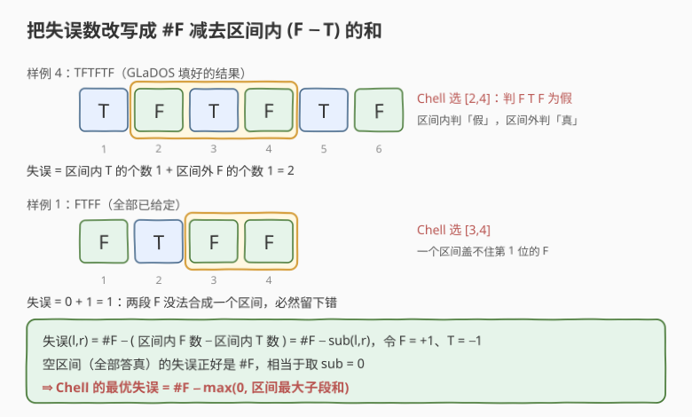
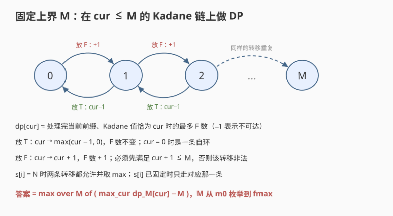
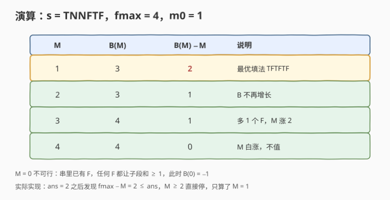

# Codeforces 2238E 蛋糕审判 题解

## 1. 题目概述

- **标题 / 题号**：蛋糕审判（Codeforces 2238E，英文名 Cake Trial）
- **链接**：https://codeforces.com/problemset/problem/2238/E
- **来源**：Codeforces Round 1106 (Div. 2) · Problem E
- **难度**：2100（$\ast 2100$）
- **限制**：时间 2 s / 内存 512 MB
- **标签**：动态规划、贪心（官方标签：dp, greedy）

**题意**：一排 $n$ 个蛋糕，每个要么是真的（`T`），要么是假的（`F`）。给定串 $s$，其中 `N` 表示这个位置**还没放蛋糕**，GLaDOS 可以自行决定把它变成 `T` 还是 `F`。

GLaDOS 先把所有 `N` 填完；随后 Chell 看到完整结果，选**一个连续区间** $[l,r]$（区间内全部宣称是假），或者干脆宣称**全部是真**。区间外的蛋糕都被她宣称成"真"。每有一个位置的实际真假与她的宣称不符，就记 $1$ 次失误。Chell 取**失误最少**的方案；GLaDOS 想让这个最少失误**尽可能大**。求 GLaDOS 能保证的最大失误数。

多测：第一行 $t$；每组先给 $n$，再给长度 $n$ 的串；每组输出一行答案。

**约束**：

- $1 \le t \le 10^4$，$1 \le n \le 500$
- $\sum n^3 \le 500^3 = 1.25\times 10^8$——这是出题人给的复杂度口径，等价于**允许每个测试做 $O(n^3)$**
- 答案在 $[0,n]$ 内，即 $\le 500$，用 `int` 足够
- 字符串只含 `T`、`F`、`N` 三种字符

> 💡 一句话本质：Chell 的最优失误可以写成 $(\text{假蛋糕总数}) - (\text{区间内 }F\text{ 数} - \text{区间内 }T\text{ 数})$，第二个括号正是**最大子段和**；于是把"GLaDOS 最大化"翻译成"枚举一个子段和上界 $M$，在约束下尽量多放 $F$"，再做 Kadane 式的 DP。

## 2. 示例与观察
官方样例（输入 / 输出原样，共 $10$ 组）：

```text
输入：
10
4
FTFF
5
TNFTT
6
TFTTTN
6
TNNFTF
7
TNFNTNF
6
NNFFNN
7
TNTFNTN
1
N
5
NNNNN
10
NNNTTNNNFN

输出：
1
0
1
2
2
2
2
0
2
3
```

题面对前四组的解释（译文）：

- `FTFF`：全部已给定，Chell 选 $[3,4]$，答成 `TTFF`，恰好 $1$ 次失误。
- `TNFTT`：只有一个 `N`，无论填成什么都只可能有一段假蛋糕，Chell 总能全对，答案 $0$。
- `TFTTTN`：GLaDOS 把 `N` 填成 `F` 得 `TFTTTF`；Chell 选 $[2,2]$ 时仍错 $1$ 次，答案 $\ge 1$。
- `TNNFTF`：GLaDOS 填成 `TFTFTF`；Chell 选 $[2,4]$ 时错 $2$ 次。

补一组自造示例，覆盖"两段 `F` 被 `T` 隔开"、"全真"、"`N` 与 `F` 混合"、"已经全是 `F`"：

```text
输入：
4
3
FTF
4
TTTT
5
NNFFF
2
FF

输出：
1
0
1
0
```

`FTF` 里两段假蛋糕被一个真蛋糕隔开，Chell 只能盖住一段，必错 $1$ 次；`TTTT` 没有假蛋糕，答案 $0$；`NNFFF` 里 GLaDOS 把两个 `N` 填成一 `T` 一 `F` 就能逼出 $1$ 次失误；`FF` 则整段都是假蛋糕，Chell 全对。

## 3. 解题思路

### 3.1 暴力思路

最直接的做法分两层：先枚举手填法（每有一个 `N` 就分两支，记 `N` 的个数为 $k$），再对每种完整串枚举 Chell 的区间 $O(n^2)$（或用 Kadane 做到 $O(n)$）求最小失误，取最大值。复杂度 $O(2^{k}\cdot n)$，而 $k$ 可达 $500$，完全不可行。

即使只看"给定完整串"这一层，也需要一个 $O(n)$ 的刻画，才谈得上在填法上做 DP。

### 3.2 核心观察：失误 = 假蛋糕总数 − 区间内的子段和

给每个位置赋权：假蛋糕记为 $+1$，真蛋糕记为 $-1$。记 $c_i\in\{+1,-1\}$，$S$ 为假蛋糕总数，$sub(l,r)=\sum_{i=l}^{r}c_i$。

Chell 选 $[l,r]$ 时，失误来自两处：**区间内被她说成假、实际是真的**（即区间内的 `T`），以及**区间外被她说成真、实际是假的**（即区间外的 `F`）：

$$\text{失误}(l,r)=(\text{区间内 }T\text{ 数})+(\text{区间外 }F\text{ 数})=S-\bigl(\text{区间内 }F\text{ 数}-\text{区间内 }T\text{ 数}\bigr)=S-sub(l,r)$$

而"全部答真"对应 $sub=0$，失误正好是 $S$。所以

$$f(a)=\min_{\text{区间或空}}\bigl(S-sub\bigr)=S-\max\bigl(0,\ \max_{l\le r}sub(l,r)\bigr)$$

记 $M(a)=\max\bigl(0,\max_{l\le r}sub(l,r)\bigr)$，它正是把 `F` 当 $+1$、`T` 当 $-1$ 时的**最大子段和**（空段给 $0$）。于是答案就是

$$\text{ans}=\max_{a}\bigl(S(a)-M(a)\bigr)$$

这个式子的两个量来自同一个填法，还是一个 $\max$-$\min$，不能直接拆开算。下面用"枚举上界"把它变成单向的 DP。



关键的第二跳：**把 $M$ 当参数枚举**。令

$$B(M)=\max\{\,S(a)\ :\ a\ \text{是合法填法，且}\ M(a)\le M\,\}$$

即"所有子段和都不超过 $M$"这一约束下最多能放多少块假蛋糕。则

$$\text{ans}=\max_{M\ge 0}\bigl(B(M)-M\bigr)$$

因为任取一个填法 $a$，在 $M=M(a)$ 处有 $B(M)\ge S(a)$，所以右端 $\ge S(a)-M(a)$；反过来，右端在某个 $M$ 处取到的填法实际满足 $M(a)\le M$，于是 $B(M)-M=S(a)-M\le S(a)-M(a)$。两头夹住，相等成立（严格证明见第 5 节引理 3）。这一步把"两个量互相拉扯"的困难消掉了：$M$ 变成外层循环，内层只剩"约束下最大化 $S$"。

### 3.3 算法流程 / 状态转移

固定 $M$ 后，"所有子段和 $\le M$"等价于 Kadane 的游走值始终不超过 $M$。定义游走值

$$cur_i=\max\bigl(0,\ cur_{i-1}+c_i\bigr),\qquad cur_0=0$$

则 $\max_i cur_i=\max(0,\max_{l\le r}sub(l,r))=M(a)$，约束就是所有时刻 $cur_i\le M$。

于是对固定的 $M$ 做一遍线性 DP：

- 状态：$dp[cur]$ = 处理完当前前缀、且游走值恰为 $cur$ 时，最多能放多少块假蛋糕；不可达记 $-1$。
- 初值：$dp[0]=0$，其余 $-1$。
- 若这一位放 `T`：$cur\mapsto\max(cur-1,0)$，假蛋糕数不变。
- 若这一位放 `F`：$cur\mapsto cur+1$，假蛋糕数 $+1$；**必须**满足 $cur+1\le M$，否则这条转移非法。
- 这一位是 `N` 就两条都走、按目标状态取 $\max$；已经固定成 `T`/`F` 就只走对应的一条。
- 走完整个串后 $B(M)=\max_{cur}dp[cur]$（全不可达则 $B(M)$ 不存在，说明该 $M$ 下无可行填法）。

外层把 $M$ 从小到大枚举，答案取 $\max\bigl(B(M)-M\bigr)$。



$M$ 的枚举范围可以掐得很紧，这是本题能跑得飞快的原因：

- **下界 $m_0$**：把每个 `N` 都填成 `T`（对每个子段和都是最小贡献）时的最大子段和。任何填法的 $M(a)\ge m_0$，所以 $M<m_0$ 一律不可行，直接从 $m_0$ 开始。
- **上界 $f_{\max}$**：可能变成假蛋糕的位置数，即非 `T` 的位置数。$B(M)\le f_{\max}$，而 $M>f_{\max}$ 时 $B(M)-M<0\le$ 已有答案，没有意义。
- **剪枝**：$M$ 从小到大枚举时，若 $f_{\max}-M\le\text{ans}$，则后面所有 $M'$ 都满足 $B(M')-M'\le f_{\max}-M'\le f_{\max}-M\le\text{ans}$，可以直接 `break`。

### 3.4 示例演算

以样例第 4 组 $s=\texttt{TNNFTF}$ 为例：$f_{\max}=4$，把 `N` 全填 `T` 得 `TTTFTF`，最大子段和 $m_0=1$。$B(M)$ 与 $B(M)-M$ 如下：



$M=1$ 时 $B(1)=3$，答案 $3-1=2$；$M\ge 2$ 时 $B$ 涨得没有 $M$ 快。手工走一遍 $M=1$ 的 DP（数组下标就是 $cur=0,1$）：

- 初始 $[0,-1]$；
- 读 `T`：只能放 `T`，$0\mapsto0$，得 $[0,-1]$；
- 读 `N`：放 `T` 得 $cur=0$（$0$ 块），放 `F` 得 $cur=1$（$1$ 块），得 $[0,1]$；
- 读 `N`：放 `T` 从 $cur=1$ 掉回 $0$（$1$ 块），放 `F` 从 $cur=0$ 升到 $1$（$1$ 块），得 $[1,1]$；
- 读 `F`：只能放 `F`，$0\mapsto1$ 得 $2$ 块；从 $cur=1$ 出发会越界（$2>M$），得 $[-1,2]$；
- 读 `T`：$1\mapsto0$ 得 $2$ 块，得 $[2,-1]$；
- 读 `F`：$0\mapsto1$ 得 $3$ 块，得 $[-1,3]$。

$B(1)=3$，对应的填法正是 `TFTFTF`（$3$ 块假蛋糕、最大子段和 $1$），与样例解释一致。实际实现里算出 $\text{ans}=2$ 后就会检查 $f_{\max}-M=4-2\le 2$，$M\ge2$ 全部跳过。

## 4. 算法细节

1. **状态就是 Kadane 的游走值**。把"所有子段和 $\le M$"翻译成"$cur$ 永不超过 $M$"是整道题的关键；$cur$ 一旦被压到 $M+1$ 就代表出现了和超过 $M$ 的子段，必须禁止。
2. **非法转移要显式挡住**。放 `F` 时先判 `cur + 1 <= M`；漏掉这一条会把 $M(a)>M$ 的填法算进 $B(M)$，把答案算大。
3. **用 $-1$ 当"不可达"哨兵**。假蛋糕数 $S\ge0$，所以 $-1$ 安全；判可达用 `v < 0` 跳过，不需要 `-INF` 参与加法。
4. **$M$ 从 $m_0$ 开始枚举**。$m_0$ 用 Kadane 在"`N` 当 `T`"的串上算一遍即得，$O(n)$。这一步把"所有 $M$ 都不可行"的串（例如全是 `F`）压到只剩一个 $M$。
5. **剪枝用上界而不是下界**。`fmax - M <= ans` 是"未来最好也只能打平"，可以直接停；不要写成 `< 0` 之类的错误条件。
6. **数组长度就是 $M+1$**。每换一个 $M$ 都重新 `assign` 两个长度 $M+1$ 的 `vector` 再 `swap`，比手写清空更不容易漏掉下标；总清空代价仍是 $O(n^3)$ 量级。
7. **多测口径**。$\sum n^3\le 500^3$，直接对每组做 $O(n^3)$ 即可；$t$ 可达 $10^4$，读入用 `scanf` / `sys.stdin.buffer.read().split()`。
8. **答案初值取 $0$**。失误数非负，且总存在可行填法（所有 `N` 都填 `T` 时 $B(M)$ 至少能取到"已有 `F` 的个数"，对应值 $\ge0$），所以 `ans = 0` 的初值安全。

## 5. 正确性证明

**引理 1**：对任意完整填法 $a$，Chell 的最优失误恰为 $f(a)=S(a)-M(a)$，其中 $S(a)$ 是假蛋糕总数，$M(a)=\max\bigl(0,\max_{l\le r}sub(l,r)\bigr)$。

**证明**：Chell 的可选方案是全部区间 $[l,r]$ 加上"全部答真"。对区间 $[l,r]$，失误恰为区间内的 `T` 数加上区间外的 `F` 数，即 $S(a)-sub(l,r)$；"全部答真"的失误是 $S(a)=S(a)-0$。于是最优失误是 $S(a)$ 减去这些 $sub$ 值的最大值，而 $sub$ 的取值范围包含 $0$，正是 $S(a)-M(a)$。∎

**引理 2**：对固定的 $M$，3.3 节的 DP 正确算出 $B(M)$；若该 $M$ 下没有任何可行填法，则所有状态均为 $-1$。

**证明**：对前缀长度归纳。归纳假设：处理完前 $i$ 位后，$dp[cur]$ 等于"前 $i$ 位合法填法中以 $cur_i=cur$ 结尾、且 $cur_1..cur_i\le M$ 的最大假蛋糕数"，不可达为 $-1$。$i=0$ 时 $cur_0=0$、块数为 $0$，成立。转移时，第 $i+1$ 位若放 `T` 则 $cur_{i+1}=\max(cur_i-1,0)$（自动 $\le M$），块数不变；若放 `F` 则 $cur_{i+1}=cur_i+1$，只有 $cur_i+1\le M$ 才满足约束，块数 $+1$。按题目给定的字符集合取允许的分支并取 $\max$，恰好覆盖所有合法填法，故归纳成立。收尾时对 $cur$ 取 $\max$，得到满足"所有 $cur_i\le M$"（即所有子段和 $\le M$）的最大块数 $B(M)$。∎

**引理 3**：$\max_{M\ge0}\bigl(B(M)-M\bigr)=\max_{a}\bigl(S(a)-M(a)\bigr)$。

**证明**：设右端最优填法为 $a^*$，取 $M=M(a^*)$。由 $B$ 的定义 $B(M)\ge S(a^*)$，故左端 $\ge S(a^*)-M(a^*)=$ 右端。反向，对任意 $M$，若 $B(M)$ 存在，取达到它的填法 $a$，则 $M(a)\le M$，于是 $B(M)-M=S(a)-M\le S(a)-M(a)\le$ 右端；若 $B(M)$ 不存在则该项不参与取 $\max$。两侧互夹，等号成立。∎

**引理 4**：$M<m_0$ 时不存在任何填法 $a$ 使 $M(a)\le M$。

**证明**：设 $a_0$ 是把所有 `N` 填成 `T` 的填法。对任意填法 $a$ 和任意区间 $[l,r]$，$a_0$ 在区间内的权值和不超过 $a$ 的（把 `N` 从 `F` 改成 `T` 只会让 $+1$ 变 $-1$），故 $sub_a(l,r)\ge sub_{a_0}(l,r)$，取 $\max$ 得 $M(a)\ge M(a_0)=m_0$。∎

**定理**：算法输出的 $\text{ans}=\max_{a}\min_{\text{区间或空}}(\text{失误})$，即 GLaDOS 能保证的最大失误数。

**证明**：由引理 1，GLaDOS 的目标是 $\max_a f(a)=\max_a\bigl(S(a)-M(a)\bigr)$；由引理 2，内层 DP 给出的正是 $B(M)$；由引理 3，外层取 $\max$ 得到目标值。剪枝不改变结果：当 $f_{\max}-M\le\text{ans}$ 时，对每个 $M'\ge M$ 都有 $B(M')\le f_{\max}$，故 $B(M')-M'\le f_{\max}-M\le\text{ans}$，跳过它们不会丢失更优值；而 $M<m_0$ 时不存在满足 $M(a)\le M$ 的填法，$B(M)$ 本就不存在。∎

## 6. 复杂度分析

**时间**：外层枚举 $M$（至多 $f_{\max}+1\le n+1$ 个），内层是 $O(n)$ 个字符 × $O(M)$ 个状态，故单组 $O\bigl(\sum_{M} nM\bigr)=O(n^3)$。多测总复杂度 $O\bigl(\sum n^3\bigr)\le 500^3=1.25\times10^8$，与题目给的口径吻合；$m_0$ 下界与 $f_{\max}-M\le\text{ans}$ 剪枝把常数压得更低。实测 $n=500$、全 `N` 的最坏单组在 `clang++ -O2` 下约 $0.03$ s（$2$ s 时限的 $60$ 倍余量）。

**空间**：只有两个长度 $M+1\le n+1$ 的 `vector`，$O(n)$；读入的字符串 $O(n)$。总计 $O(n)$，远低于 $512$ MB。

**Python**：同一算法在 CPython 下最坏（$n=500$、全 `N`）约 $1.4$ s，仍在 $2$ s 内但余量不多；建议直接交 PyPy3 或改用 C++。

## 7. 参考代码

### C++17

```cpp
#include <bits/stdc++.h>
using namespace std;

int main() {
    int T;
    if (scanf("%d", &T) != 1) return 0;
    while (T--) {
        int n;
        scanf("%d", &n);
        static char buf[1005];
        scanf("%s", buf);
        string s(buf, buf + n);

        int fmax = 0;                       // 可能成为假蛋糕的位置数 = 非 'T' 的位置数
        for (char c : s) if (c != 'T') ++fmax;

        // M 的下界：把每个 N 都填成 T（对子段和贡献最小）时的最大子段和
        int m0 = 0, run = 0;
        for (char c : s) {
            run = max(0, run + (c == 'F' ? 1 : -1));
            m0 = max(m0, run);
        }

        int ans = 0;
        vector<int> dp, ndp;
        for (int M = m0; M <= fmax; ++M) {
            if (fmax - M <= ans) break;     // 之后任何 M 都不可能更优
            dp.assign(M + 1, -1);           // -1 表示不可达
            dp[0] = 0;
            for (char ch : s) {
                ndp.assign(M + 1, -1);
                for (int cur = 0; cur <= M; ++cur) {
                    int v = dp[cur];
                    if (v < 0) continue;
                    if (ch != 'F') {                    // 这一位放 T：cur -> max(cur-1, 0)
                        int nc = cur > 0 ? cur - 1 : 0;
                        if (v > ndp[nc]) ndp[nc] = v;
                    }
                    if (ch != 'T' && cur + 1 <= M) {    // 这一位放 F：cur -> cur+1
                        if (v + 1 > ndp[cur + 1]) ndp[cur + 1] = v + 1;
                    }
                }
                dp.swap(ndp);
            }
            int best = -1;
            for (int cur = 0; cur <= M; ++cur) best = max(best, dp[cur]);
            if (best >= 0) ans = max(ans, best - M);
        }
        printf("%d\n", ans);
    }
    return 0;
}
```

### Python3

```python
import sys


def solve(n: int, s: str) -> int:
    """ans = max over M of ( B(M) - M )，B(M) = 所有子段和都不超过 M 时最多能放的 F 数。"""
    NEG = -1                                 # F 数 >= 0，用 -1 表示该状态不可达
    fmax = sum(1 for c in s if c != 'T')     # B(M) 的上界
    # M 的下界 m0：把每个 N 都填成 T（子段和取到最小）时的最大子段和
    m0 = run = 0
    for c in s:
        run = run + (1 if c == 'F' else -1)
        if run < 0:
            run = 0
        if run > m0:
            m0 = run

    ans = 0
    M = m0
    while M <= fmax and fmax - M > ans:      # 再大的 M 也不可能超过当前 ans
        # dp[cur] = 处理完当前前缀、Kadane 值恰为 cur 时能拿到的最多 F 数
        dp = [NEG] * (M + 1)
        dp[0] = 0
        for ch in s:
            if ch == 'T':                    # 只能放 T：cur -> max(cur-1, 0)
                if M:
                    ndp = [dp[0] if dp[0] > dp[1] else dp[1]] + dp[2:] + [NEG]
                else:
                    ndp = [dp[0]]
            else:                            # 可以放 F：cur -> cur+1，F 数 +1
                ndp = [NEG] + [v + 1 if v >= 0 else NEG for v in dp[:M]]
                if ch == 'N':                # 也可以放 T，两种来源取 max
                    if M:
                        t = [dp[0] if dp[0] > dp[1] else dp[1]] + dp[2:] + [NEG]
                    else:
                        t = [dp[0]]
                    ndp = [a if a > b else b for a, b in zip(ndp, t)]
            dp = ndp
        best = max(dp)
        if best >= 0 and best - M > ans:
            ans = best - M
        M += 1
    return ans


def main() -> None:
    data = sys.stdin.buffer.read().split()
    t = int(data[0])
    out = []
    p = 1
    for _ in range(t):
        n = int(data[p]); p += 1
        s = data[p].decode(); p += 1
        out.append(str(solve(n, s)))
    sys.stdout.write('\n'.join(out) + '\n')


main()
```

## 8. 边界情况与易错点

1. **全是 `T`**：$f_{\max}=0$，$m_0=0$，外层循环第一次就被 $f_{\max}-M=0\le\text{ans}=0$ 挡掉，输出 $0$，正确。
2. **不可达必须与"$0$ 块假蛋糕"区分开**：已有 `F` 而 $M$ 太小时根本无解，$B(M)$ 应记为"不存在"。代码里靠三处配套实现——$-1$ 哨兵、转移时 `if (v < 0) continue`、收尾时 `best >= 0` 才更新答案；少任何一处，都会凭空造出并不存在的 $B(M)$，让引理 2 不成立。
3. **别忘掉"全部答真"**：$M(a)$ 必须与 $0$ 取 $\max$。若只取**非空**子段的最大和，`TTT` 这种全真串的最大和是 $-1$，$m_0$ 会算成负数，DP 数组长度随之失效；而 Chell 明明可以宣称全真、把失误压到 $S=0$。
4. **不能把 `F` 放到越界状态**：`cur + 1 <= M` 的检查漏了，就等于允许子段和超过 $M$，$B(M)$ 会被高估、不再是"$M(a)\le M$ 下的最大 $F$ 数"，引理 2 的归纳随之失效。虽然本算法最后对 $M$ 取 $\max$，这种高估常常被 $M+1$ 那一项吸收而看不出差别，但正确性只能靠这条检查来保证。
5. **剪枝方向别写反**：合法条件是 `fmax - M <= ans` 时停止（未来上界已经打不过当前答案），写成别的形式可能提前退出而漏掉更优解。
6. **$m_0$ 只用来加速**：即使不写 $m_0$，从 $M=0$ 开始枚举也不影响正确性，只是全 `F` 串会白跑 $n$ 轮 DP。
7. **多测清空**：`dp`/`ndp` 用 `assign` 重新分配，别用 `static` 数组忘了清；`n`、`fmax`、`m0`、`ans` 都是每组重新算。
8. **输入规模**：$t$ 最大 $10^4$、$\sum n^3\le 500^3$，说明大量测试都是很小的串，$O(n^3)$ 每组独立做完全没问题，不必做跨测试缓存。

## 9. 验证记录

- **编译环境与命令**：`clang++ -std=c++17 -O2`（本机无 GNU g++，配 `codeforces/tools/include/bits/stdc++.h` 兼容头；正文代码只用标准库，可原样提交 GNU C++17）；Python 侧为 `Python 3.9.6`。
- **官方样例**：1 / 1 通过（按 Codeforces 标准 checker 的 token 比对，忽略空白与大小写）。
- **复核状态**：audited（2026-11-19 统一回归：编译 + 官方样例；写作期的随机对拍与暴力未重跑）。

## 相关题目与扩展

- [LeetCode 53. 最大子数组和](https://leetcode.cn/problems/maximum-subarray/)：本题内层 DP 的状态 $cur$ 就是 Kadane 的游走值，把"最大子段和"当作可约束的状态而非最终目标，是这道题最大的思维跳跃。
- [LeetCode 1186. 删除一次得到子数组最大和](https://leetcode.cn/problems/maximum-subarray-sum-with-one-deletion/)：同样在最大子段和上做"多一维状态"的扩展，可与本题"上界 $M$ 加一维 $cur$"对照。
- [LeetCode 152. 乘积最大子数组](https://leetcode.cn/problems/maximum-subarray/)：把加法换成乘法的状态化最大子段，体会"状态 = 走查量"的通用做法。

**延伸思考**：

1. 如果规定 Chell 必须选**非空**区间（不能全答真），答案会怎样变化？只需把 $\max(0,\cdot)$ 换成 $\max_{l\le r}sub$，注意此时 $M$ 的下界与 DP 收尾的最小值都要改。
2. 如果把"一段"放宽成"至多 $k$ 段"，Chell 的最优失误会变成 $S$ 减去**最多 $k$ 个不相交子段之和**；GLaDOS 一侧的 DP 就要再加一维记录已经开了几段，复杂度随之上升。可以先试 $k=2$ 的版本。
3. 本题的 $O(n^3)$ 依赖 $\sum n^3\le 500^3$。若把 $n$ 放大到 $2\times10^5$，注意 $B(M)$ 是关于 $M$ 的阶梯函数，且 $B(M)-M$ 只在 $B$ 跳变处可能取到最大；能否证明跳变只有 $O(\sqrt n)$ 次（或只有 $M\le n/2$ 的少数候选），从而得到更快的算法？
