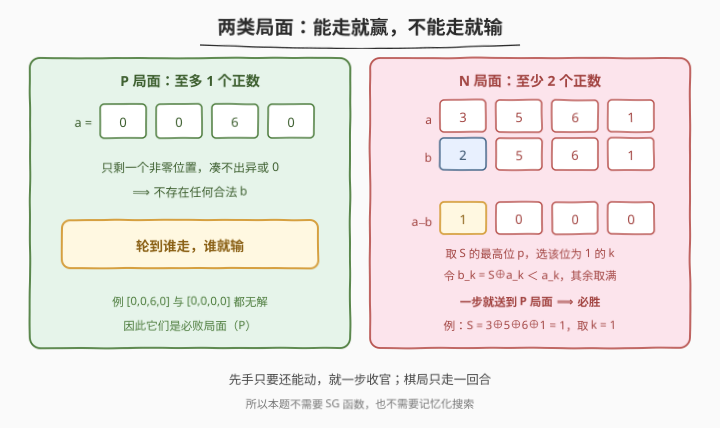
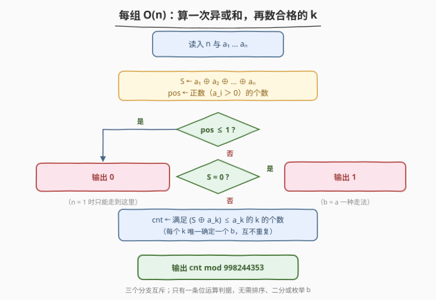
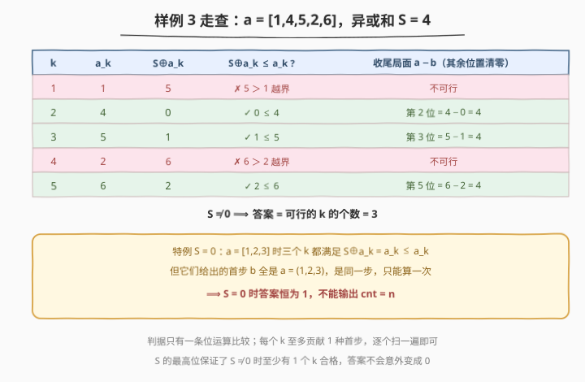

# Codeforces 2239A Nim 游戏即异或游戏 题解

## 1. 题目概述

- **标题 / 题号**：Nim 游戏即异或游戏（Codeforces 2239A，英文名 Nim Game Is XOR Game）
- **链接**：https://codeforces.com/problemset/problem/2239/A
- **来源**：Codeforces Round 1105 (Div. 1) · Problem A（UTC 2026-06-27）
- **难度**：1300（$\ast 1300$，750 分）
- **限制**：时间 2 s / 内存 256 MB
- **标签**：构造、博弈论、贪心、数学（官方标签：constructive algorithms, games, greedy, math）

**题意**：给定长度为 $n$ 的非负整数数组 $a$（题面保证 $a_i \ge 1$），Alice 先手，两人轮流操作。一次操作是选一个长度同为 $n$ 的数组 $b$，满足

1. $0 \le b_i \le a_i$（每个位置最多拿走原有的那么多）；
2. $b$ 不全为 $0$，即 $\sum_{i=1}^{n} b_i > 0$；
3. $b_1 \oplus b_2 \oplus \cdots \oplus b_n = 0$（$\oplus$ 为按位异或），

然后把 $a$ 更新为 $a_i \leftarrow a_i - b_i$。无法操作的人输。求 Alice 首步有多少种**不同的** $b$ 能保证她最终获胜，答案对 $998244353$ 取模。

题目的名字已经把线索写出来了：胜负与异或和有关，但**真正的判据比 Nim 更简单**——见 3.2 节。

**约束**：

- $1 \le t \le 10^4$，$\sum_{i} n \le 10^6$：必须整体近线性，单组 $O(n)$ 或更优
- $1 \le a_i < 2^{30}$：值域巨大，任何枚举 $b$ 或记忆化搜索都不可能
- 每个 $b$ 的候选空间是 $\prod (a_i+1)$ 量级，所以只能**数**而不能**试**

## 2. 示例与观察
官方样例（输入 / 输出原样）：

```text
输入：
5
1
1
2
1 2
5
1 4 5 2 6
1
1073741823
3
1 2 3

输出：
0
1
3
0
1
```

补一组自造样例，覆盖「$S = 0$」「$S \ne 0$ 且全可行」「$n = 2$」三种情况：

```text
输入：
4
2
3 5
2
2 2
3
7 7 7
4
1 1 1 1

输出：
1
1
3
1
```

第 1 组 $a=[3,5]$：只有 $k=2$ 可行（$3 \oplus 5 = 6$，$6 \oplus 5 = 3 \le 5$），答案 1。第 2 组 $a=[2,2]$：$S = 0$，唯一首步 $b=(2,2)$ 把数组清零，答案 1。第 3 组 $a=[7,7,7]$：$S = 7$，三个 $k$ 的判据都是 $7\oplus 7 = 0 \le 7$，答案 3。第 4 组 $a=[1,1,1,1]$：$S = 0$，只有 $b=a$ 一步，答案 1（若是 $10^6$ 个 $1$ 答案同样是 1）。

## 3. 解题思路

### 3.1 暴力思路

最直白的做法：枚举所有合法的 $b$，对每个后继局面递归判断胜负并计数。合法 $b$ 的个数是 $\prod (a_i + 1)$ 级别，$a_i$ 逼近 $2^{30}$ 时这个数连「有多少」都写不出来；退一步看 $n = 10^6$ 的规模，任何指数或平方级也不成立。

所以必须先把**博弈本身**化简到一句话，再去解决**计数**。注意题意问的是「Alice 首步的必胜选择数」，也就是说只需要刻画「哪些局面是必败的」。

### 3.2 核心观察：必败局面就是「至多一个正数」



只需两条事实。

**① 至多一个正数 ⟹ 一步也走不了。** 设唯一正数是 $a_k$。任何满足条件 1 的 $b$ 都有 $b_i = 0\ (i \ne k)$，于是 $b_1 \oplus \cdots \oplus b_n = b_k$。条件 3 强迫 $b_k = 0$，此时 $b$ 全零，违反条件 2。故无合法操作 —— 这是**必败**局面（P 局面）。

**② 至少两个正数 ⟹ 一步就能走成「至多一个正数」。** 令 $S = a_1 \oplus \cdots \oplus a_n$，分两种情形。

**情形 A（$S = 0$）**：直接取 $b = a$。此时 $0 \le a_i \le a_i$、$\bigoplus_i b_i = S = 0$、$\sum b_i > 0$，一步把数组清零，走到 P 局面。

**情形 B（$S \ne 0$）**：令 $p$ 为 $S$ 的最高有效位。$S$ 的第 $p$ 位是全体 $a_i$ 第 $p$ 位的奇偶性，它等于 $1$，说明恰好有奇数个 $a_i$ 的第 $p$ 位为 $1$，取其中一个下标 $k$，令

$$b_i = a_i\ (i \ne k), \qquad b_k = S \oplus a_k .$$

此时 $a_k$ 的第 $p$ 位是 $1$，$b_k = S \oplus a_k$ 的第 $p$ 位是 $0$，而两者在高于 $p$ 的位上完全一致，所以 $b_k < a_k$，上界合法；再看异或

$$\bigoplus_i b_i = b_k \oplus \bigoplus_{i \ne k} a_i = (S \oplus a_k) \oplus (S \oplus a_k) = 0 .$$

走完后 $a_i - b_i = 0\ (i \ne k)$，只有第 $k$ 位可能非零，正好落到 P 局面。

两条合起来：**P 局面 = 至多一个正数**，其余局面一步取胜。棋局最多只走一回合，先手**能走就赢**，于是答案就是「把局面走成至多一个正数」的合法 $b$ 的个数（$n=1$ 时为 $0$）。

> 💡 这里的 $S$ 只用来**构造**一步棋，不用来判断胜负，所以既不需要 Sprague-Grundy，也不需要任何记忆化搜索。

### 3.3 算法流程：数「干净收尾」的首步



一个首步 $b$ 合法且必胜，等价于「$a - b$ 至多一个正数」，即存在下标 $k$ 使所有 $i \ne k$ 都满足 $b_i = a_i$。此时 $b_k$ 被异或条件**唯一确定**：

$$b_k = \bigoplus_{i \ne k} b_i = \bigoplus_{i \ne k} a_i = S \oplus a_k .$$

于是每个 $k$ 最多贡献一种首步，且可行性只有一条判据：

$$S \oplus a_k \le a_k .$$

（$b_k \ge 0$ 自动成立；$b$ 非零也自动成立：$n \ge 2$ 时至少两个正数，若 $b$ 全零则所有 $i \ne k$ 的 $a_i$ 都得是 $0$，矛盾。）

剩下的唯一麻烦是**重复计数**。不同 $k$ 给出的是

$$b^{(k)} = (a_1, \dots, a_{k-1},\ S \oplus a_k,\ a_{k+1}, \dots, a_n),$$

即「只把第 $k$ 位换成 $S \oplus a_k$」。

- $S \ne 0$ 时 $S \oplus a_k \ne a_k$，不同 $k$ 的 $b$ 在第 $k$ 位互不相同，**两两互异**；
- $S = 0$ 时每个 $k$ 都给出 $b^{(k)} = a$（把所有数清零），是**同一步**，只能算 1 次。

所以每组只需求 $\text{cnt} = \#\{\,k : S \oplus a_k \le a_k\,\}$，再分三种情况：

$$\text{答案} = \begin{cases} 0, & \text{正数个数} \le 1 \\ 1, & S = 0 \\ \text{cnt}, & S \ne 0 \end{cases}$$

顺带一个保证：$S \ne 0$ 时取 $S$ 最高位对应的那个 $k$，必有 $S \oplus a_k < a_k$，因此 $\text{cnt} \ge 1$，不会出现「明明有必胜走法却数出 0」。

### 3.4 示例演算



对样例 3，$a = [1,4,5,2,6]$，$S = 1\oplus4\oplus5\oplus2\oplus6 = 4$：

| $k$ | $a_k$ | $S \oplus a_k$ | 判据 | 走完 $a - b$ |
|-----|-------|----------------|------|--------------|
| 1 | 1 | 5 | 越界（$5 > 1$） | 不可行 |
| 2 | 4 | 0 | 可行 | $(0,4,0,0,0)$ |
| 3 | 5 | 1 | 可行 | $(0,0,4,0,0)$ |
| 4 | 2 | 6 | 越界（$6 > 2$） | 不可行 |
| 5 | 6 | 2 | 可行 | $(0,0,0,0,4)$ |

$\text{cnt} = 3$，$S \ne 0$，输出 3，与官方一致。

对照另外几个样例：$a=[1,2]$ 时 $S=3$，$k=1$ 得 $3\oplus1=2>1$ 越界，$k=2$ 得 $3\oplus2=1\le2$ 可行，答案 1；$a=[1,2,3]$ 时 $S=0$，三个 $k$ 都可行却都是 $b=a=(1,2,3)$，答案 1；$n=1$ 的两组（样例 1、4）走第一个分支输出 0。

## 4. 算法细节

1. **两遍扫描**：第一遍读入时同步求出 $S$ 与正数个数，第二遍才能判断 $S \oplus a_k \le a_k$，所以必须把数组存下来。$n \le 10^6$ 时 `int` 数组 4 MB，开全局 `static` 以免爆栈。
2. **「至多一个正数」分支必须放在最前面**：$n=1$ 时 $S = a_1 \ne 0$，若直接进入计数分支会算出 $S \oplus a_1 = 0 \le a_1$ 并误报 1（样例 1、4 正是这个陷阱）。由于 $a_i \ge 1$，该分支实际只在 $n = 1$ 触发。
3. **$S = 0$ 只能输出 1**：绝不能输出 $\text{cnt} = n$，因为所有 $k$ 指向同一个首步 $b = a$。
4. **整数范围**：$a_i < 2^{30}$，异或结果仍在 $[0, 2^{30})$，`int` 足够；$\text{cnt} \le n \le 10^6$ 也在 `int` 内。答案恒小于 $998244353$，取模不改变取值，但题面要求取模，照写。
5. **不需要显式求最高位**：3.2 节用最高位只是证明存在性，代码里只做一次异或与一次比较。
6. **读入方式**：$\sum n \le 10^6$、$t \le 10^4$，C++ 用 `scanf`（或关闭同步的 `cin`）；Python 必须 `sys.stdin.buffer.read().split()` 一次读完，逐行 `input()` 会慢一个量级。
7. **多测复用**：`xr`、`pos`、`cnt` 每组开头重新初始化；数组按下标覆盖即可，无需清空。

## 5. 正确性证明

**引理 1（无解刻画）**：局面 $a$ 没有任何合法操作，当且仅当 $a$ 中至多有一个正数。

**证明**：若至多一个正数，设唯一正数为 $a_k$（若无正数则任意 $b$ 全零）。任何满足条件 1 的 $b$ 都有 $b_i = 0\ (i \ne k)$，故 $\bigoplus_i b_i = b_k$；条件 3 迫使 $b_k = 0$，即 $b$ 全零，违反条件 2，所以没有合法操作。反之若至少两个正数，取两个正数下标 $u \ne v$，令 $b_u = b_v = 1$、其余为 $0$：条件 1 成立（$1 \le a_u, a_v$），$\bigoplus_i b_i = 1 \oplus 1 = 0$，$\sum b_i = 2 > 0$，是合法操作。∎

**引理 2（一步收官）**：若局面至少两个正数，则存在一次合法操作使新局面至多一个正数。

**证明**：设 $S = \bigoplus_i a_i$。若 $S = 0$，取 $b = a$：$0 \le a_i \le a_i$，$\bigoplus_i b_i = S = 0$，且 $\sum b_i = \sum a_i > 0$，新局面全零。若 $S \ne 0$，设 $p$ 为 $S$ 的最高有效位。由 $S$ 的第 $p$ 位为 $1$ 知，使 $a_i$ 第 $p$ 位为 $1$ 的下标有奇数个，特别地存在这样的 $k$。取 $b_i = a_i\ (i \ne k)$ 与 $b_k = S \oplus a_k$。上界：$a_k$ 第 $p$ 位为 $1$ 而 $b_k$ 第 $p$ 位为 $0$，高于 $p$ 的位相同，故 $b_k < a_k$，其余各位置取满也合法。异或：$\bigoplus_i b_i = b_k \oplus \bigoplus_{i \ne k} a_i = (S \oplus a_k) \oplus (S \oplus a_k) = 0$。非零性：至少两个正数时存在 $i \ne k$ 使 $a_i > 0$，其 $b_i = a_i > 0$。新局面满足 $a_i - b_i = 0\ (i \ne k)$，只有第 $k$ 位可能非零。∎

**定理 1（胜负判定）**：局面必败，当且仅当其中至多一个正数。

**证明**：每步操作后 $\sum a_i$ 严格下降且非负，博弈有限，可按总和做超限归纳。至多一个正数的局面由引理 1 无合法操作，故必败。至少两个正数的局面由引理 2 可一步走到「至多一个正数」，即走到必败局面，故必胜。∎

**引理 3（首步与下标的一一对应）**：设局面至少两个正数。对每个满足 $S \oplus a_k \le a_k$ 的下标 $k$，令 $b^{(k)}$ 为把 $a$ 的第 $k$ 位换成 $S \oplus a_k$ 得到的数组，则 $b^{(k)}$ 是合法操作，且新局面只有第 $k$ 位可能非零；反过来，任何把局面走到「至多一个正数」的合法 $b$ 必等于某个 $b^{(k)}$。

**证明**：正向部分：条件 1 由 $S \oplus a_k \le a_k$ 与其余位置取 $a_i$ 保证；$\bigoplus_i b^{(k)}_i = (S \oplus a_k) \oplus \bigoplus_{i \ne k} a_i = (S \oplus a_k) \oplus (S \oplus a_k) = 0$；非零性同引理 2；新局面的第 $i \ne k$ 位为 $0$，第 $k$ 位为 $a_k - (S \oplus a_k) \ge 0$。反向部分：若 $a - b$ 至多一个正数，取那个可能非零的下标 $k$，则 $i \ne k$ 时有 $b_i = a_i$，再由 $\bigoplus_i b_i = 0$ 得 $b_k = \bigoplus_{i \ne k} b_i = S \oplus a_k$，故 $b = b^{(k)}$，且 $b_k \le a_k$ 说明该 $k$ 满足判据。∎

**引理 4（去重）**：沿用引理 3 的记号。若 $S \ne 0$，不同 $k$ 给出的 $b^{(k)}$ 互不相同；若 $S = 0$，所有 $b^{(k)}$ 都等于 $a$。

**证明**：$b^{(k)}$ 与 $a$ 只在第 $k$ 位不同。若 $S = 0$，则 $S \oplus a_k = a_k$，故 $b^{(k)} = a$。若 $S \ne 0$，则由引理 2 的位论证得 $S \oplus a_k < a_k$，于是对 $j \ne k$：$b^{(j)}$ 的第 $k$ 位等于 $a_k$，而 $b^{(k)}$ 的第 $k$ 位是 $S \oplus a_k < a_k$，两者在第 $k$ 位不同，故 $b^{(j)} \ne b^{(k)}$。∎

**定理 2（算法正确）**：设局面至少两个正数，则必胜首步数在 $S \ne 0$ 时为 $\text{cnt}$，在 $S = 0$ 时为 1，其中 $\text{cnt} = \#\{k : S \oplus a_k \le a_k\}$，且 $S = 0$ 时必有 $\text{cnt} = n$。

**证明**：由定理 1，必胜首步恰为「把局面走成至多一个正数」的合法 $b$，由引理 3，其集合恰为 $\{\,b^{(k)} : S \oplus a_k \le a_k\,\}$。$S \ne 0$ 时由引理 4 这些 $b$ 两两互异，个数为 $\text{cnt}$。$S = 0$ 时每个 $k$ 都满足 $S \oplus a_k = a_k \le a_k$，故 $\text{cnt} = n$，但它们全都等于同一个首步 $b = a$，去重后为 1，算法正输出 1。至多一个正数时由引理 1 无合法首步，算法输出 0。∎

## 6. 复杂度分析

- **时间**：每组两遍扫描，第一遍求 $S$ 与正数个数，第二遍数 $\text{cnt}$，共 $O(n)$ 次位运算与比较；总计 $O(\sum n) \le 10^6$ 次基本操作，加上约 10 MB 的读入。
- **空间**：$O(n)$ 存数组（`int` 4 MB，用全局 `static` 避免栈溢出），其余变量 $O(1)$；不需要任何辅助数据结构。
- **对照时限**：本机实测最大数据（单组 $n = 10^6$、随机 $a_i < 2^{30}$、输入约 10 MB）C++ 约 0.10 s，Python3 约 0.32 s；$t = 10^4$ 且 $\sum n = 10^6$ 同样约 0.10 s。相对 2 s 时限有 15 倍以上余量，C++ 与 Python 都能稳过（Python 建议交 PyPy 更保险）。

## 7. 参考代码

### C++17

```cpp
#include <bits/stdc++.h>
using namespace std;

int main() {
    int t;
    if (scanf("%d", &t) != 1) return 0;          // 空输入防护
    static int a[1000005];
    while (t--) {
        int n;
        scanf("%d", &n);
        int xr = 0, pos = 0;                     // xr: 全部 a_i 的异或和 S
        for (int i = 0; i < n; ++i) {
            scanf("%d", &a[i]);
            xr ^= a[i];
            if (a[i] > 0) ++pos;                 // 正数个数
        }
        if (pos <= 1) {                          // 至多一个正数：一步也走不了
            puts("0");
            continue;
        }
        if (xr == 0) {                           // 唯一合法的一步是 b = a，把数组清零
            puts("1");
            continue;
        }
        int cnt = 0;                             // “只留一个位置可能非零”的方案数
        for (int i = 0; i < n; ++i) {
            int bk = xr ^ a[i];                  // 其余位置必须取满，b_i 被唯一确定
            if (bk <= a[i]) ++cnt;               // 越界则该位置不能留
        }
        printf("%d\n", cnt % 998244353);         // 答案 <= n < 998244353
    }
    return 0;
}
```

### Python3

```python
import sys

MOD = 998244353


def main() -> None:
    data = sys.stdin.buffer.read().split()
    if not data:                               # 空输入防护
        return
    t = int(data[0])
    pos = 1
    out = []
    for _ in range(t):
        n = int(data[pos]); pos += 1
        a = data[pos:pos + n]; pos += n
        xr = 0
        positives = 0
        for s in a:
            v = int(s)
            xr ^= v
            if v > 0:
                positives += 1
        if positives <= 1:                     # 至多一个正数：无路可走
            out.append("0")
            continue
        if xr == 0:                            # 唯一的一步 b = a，把数组清零
            out.append("1")
            continue
        cnt = 0
        for s in a:
            v = int(s)
            if (xr ^ v) <= v:                  # 其余位置取满，b_i 被唯一确定
                cnt += 1
        out.append(str(cnt % MOD))
    sys.stdout.write("\n".join(out) + "\n")


main()
```

## 8. 边界情况与易错点

1. **$n = 1$**：唯一正数，无合法首步，答案 0（样例 1，以及 $a_1 = 2^{30}-1$ 的样例 4）。若漏掉「正数个数」分支，会输出 $S \oplus a_1 = 0 \le a_1$ 算出的 1，直接 WA。
2. **$S = 0$**：不能输出 $n$。$a = [1,2,3]$（样例 5）答案是 1 而不是 3，$10^6$ 个 $1$ 的答案是 1 而不是 $10^6$。
3. **判据方向**：必须是 $S \oplus a_k \le a_k$。写成严格小于会漏掉 $S = 0$ 时等号成立的情形；写成反向比较则整体错位。
4. **取模**：答案 $\le n \le 10^6 < 998244353$，取模不改变数值，但题面要求输出取模结果，照写；不要因为「取模」就开 `long long` 大数组或多做无用运算。
5. **多测重置**：`xr`、`pos`、`cnt` 必须在每组开头重新初始化，否则上一组的结果会污染下一组；数组只需按下标覆盖。
6. **读入规模**：$\sum n \le 10^6$ 且 $t$ 可达 $10^4$，Python 逐行 `input()` 会超时，必须一次 `read().split()`；C++ 若用 `cin` 记得 `sync_with_stdio(false)`。
7. **绝不能枚举 $b$**：即便 $n = 2$，候选也有 $\min(a_1,a_2)$ 个，$a_i$ 到 $10^9$ 时直接爆炸。
8. **可能出现 $a_i = 0$ 的数据**：题面保证 $a_i \ge 1$，但代码按「正数个数」而非 $n$ 判断，即使数据含 $0$ 依然正确，是免费的鲁棒性。

## 9. 验证记录

- **编译环境与命令**：`clang++ -std=c++17 -O2`（本机无 GNU g++，配 `codeforces/tools/include/bits/stdc++.h` 兼容头；正文代码只用标准库，可原样提交 GNU C++17）；Python 侧为 `Python 3.9.6`。
- **官方样例**：1 / 1 通过（按 Codeforces 标准 checker 的 token 比对，忽略空白与大小写）。
- **复核状态**：audited（2026-11-19 统一回归：编译 + 官方样例；写作期的随机对拍与暴力未重跑）。

## 相关题目与扩展

- [Codeforces 15C Industrial Nim](https://codeforces.com/problemset/problem/15/C)：Nim 变体，关键在于「异或和为 0 判后手」与异或前缀的周期计算。
- [Codeforces 1847C Vampiric Powers](https://codeforces.com/problemset/problem/1847/C)：最大子段异或，展示异或的线性结构与 256 值域压缩。
- [LeetCode 810. 黑板异或游戏](https://leetcode.cn/problems/chalkboard-xor-game/)：双方轮流擦数，胜负只看异或和是否为 0 与元素个数的奇偶；与本题一样，用一个平凡的观察一刀切掉整棵博弈树。
- [LeetCode 292. Nim 游戏](https://leetcode.cn/problems/nim-game/)：经典单堆取石子，判定只看 $n \bmod 4$。

**延伸思考**：

1. 把条件 3 换成 $\bigoplus_i b_i = x$（固定常数 $x$）。此时 $b_k$ 被确定为 $x \oplus S \oplus a_k$，判据随之变形；而当 $x = S$ 时会重新出现「所有 $k$ 给出同一个 $b$」的重复计数，去重逻辑要重写。
2. 若限制每次必须**至少动 $m$ 个位置**（$b$ 至少有 $m$ 个非零），「一步收官」就未必可行，P 局面不再是「至多一个正数」，需要重新刻画可达的必败集合。
3. 把规则换成 misère（最后一步者输）：本局棋只有一回合，先手一动就「走完了最后一步」，于是只要存在合法首步他就输，答案反而恒为 0——规则一字之差，结论完全反过来，这正是本题值得记住的对照。
4. 把异或换成「按位的模 $k+1$ 加法」就是 Moore's Nim$_k$，胜负判据从 $\bigoplus a_i = 0$ 变成「每一位上 $a_i$ 的数字和 $\equiv 0 \pmod{k+1}$」，而本题的「一步收官」结构也会相应变成按层递归。
