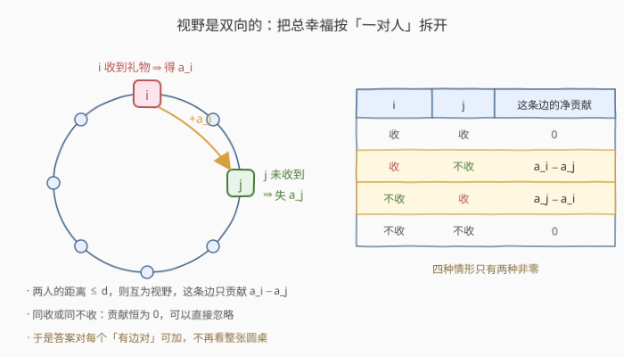
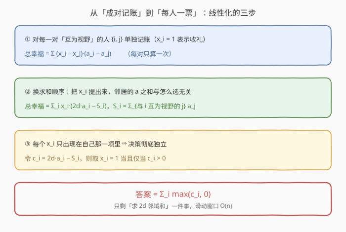
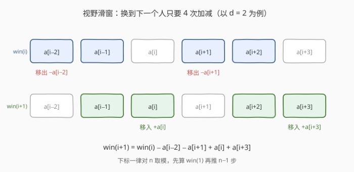
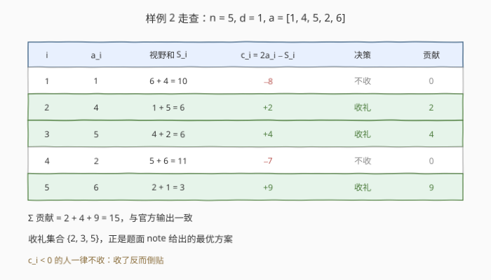

# Codeforces 2239B 抉择恐惧症 题解

## 1. 题目概述

- **标题 / 题号**：抉择恐惧症（Codeforces 2239B，英文名 Decidophobia）
- **链接**：https://codeforces.com/problemset/problem/2239/B
- **来源**：Codeforces Round 1105 (Div. 1) · Problem B
- **难度**：rating 1600（Div. 1 的 B 题，1000 分）
- **限制**：时间 2 s / 内存 256 MB
- **标签**：贪心、数学、滑动窗口、双指针（官方标签另含排序，见文末延伸）

**题意**：$n$ 个人围着圆桌坐成一圈，顺时针编号 $1 \sim n$。第 $i$ 个人有一个体重 $a_i$，所有人共享同一个视野半径 $d$：第 $i$ 个人的视野是「从他出发顺时针 $d$ 个人 + 逆时针 $d$ 个人」，共 $2d$ 人，不含他自己。

你要决定每个人是否发一份礼物（发不发随意，没有数量限制）。设 $S$ 为收到礼物的人集合，则：

- 若 $i \in S$，他视野内有 $x$ 个人**没有**收到礼物，他获得 $x \cdot a_i$ 的幸福；
- 若 $i \notin S$，他视野内有 $x$ 个人**收到**了礼物，他获得 $-x \cdot a_i$ 的幸福。

求所有人的幸福之和的最大值。

**约束**：

- $1 \le t \le 10^4$，$3 \le n \le 2 \cdot 10^5$，$1 \le d < \frac{n}{2}$，$1 \le a_i \le 10^8$；
- $\sum n \le 10^6$，所以每组必须做到均摊 $O(n)$；
- 答案量级可达 $10^{18}$，C++ 必须用 `long long`。

**关键结构**：$d < n/2$ 保证了「顺时针 $d$ 人」与「逆时针 $d$ 人」互不重叠、也不含自己，于是每个人的视野**恰好**是 $2d$ 个不同的人，且「$j$ 在 $i$ 的视野里」与「$i$ 在 $j$ 的视野里」互为充要条件——视野关系是无向的。

## 2. 示例

```text
输入
5
3 1
1 2 3
5 1
1 4 5 2 6
6 2
1 1 4 5 1 4
10 2
230 24 3 42 432 234 934 2389 333 444
3 1
100000000 100000000 100000000

输出
3
15
26
8590
0
```

第 1 组：只给 3 号（$a_3 = 3$）发礼物，他得 $(3-2)+(3-1)=3$，其余两人各被扣掉 1 和 2，总量正好 $3$。第 2 组：题面 note 给出的最优方案是给 2、3、5 发礼物，答案 $15$，3.4 节逐步验算。第 5 组：三人等重，任何分配下收礼者所得与未收者所失严格抵消，答案为 $0$——注意**不能输出负数**。

## 3. 解题思路

### 3.1 暴力思路

最直接的做法是枚举送礼集合：共 $2^n$ 种，每种花 $O(nd)$ 计算总幸福，总复杂度 $O(2^n n d)$。$n$ 到 $2 \cdot 10^5$ 时完全不可行。

退一步的 DP 也不行：每个人的幸福同时依赖「自己收不收」和「视野内每个人的收/不收」，状态维度是 $2^{2d}$ 级别的，直接爆炸。想要线性做法，必须找到一种**把总和拆成互不耦合的项**的方式。

### 3.2 核心观察：视野是双向的，只需对每一对「有边的人」记账



记 $x_i \in \{0,1\}$ 表示第 $i$ 人是否收到礼物，并记 $j \sim i$ 表示 $j$ 在 $i$ 的视野内。把第 $i$ 个人的幸福单独写开：

$$
\text{happiness}_i
= a_i\left[x_i \sum_{j \sim i}(1-x_j) \; - \; (1-x_i)\sum_{j \sim i} x_j\right]
= a_i \sum_{j \sim i} (x_i - x_j)
$$

第二个等号只是把括号展开、合并同类项：$x_i(1-x_j) - (1-x_i)x_j = x_i - x_i x_j - x_j + x_i x_j = x_i - x_j$。

现在对所有人求和，并把「有序对 $(i,j)$」重排成「无序对 $\{i,j\}$」。因为视野关系无向，每一对相邻的人会以 $(i,j)$ 和 $(j,i)$ 两种顺序各出现一次：

$$
\sum_i \sum_{j \sim i} a_i (x_i - x_j)
= \sum_{\{i,j\}\ \text{相邻}} \Big[ a_i(x_i - x_j) + a_j(x_j - x_i) \Big]
= \sum_{\{i,j\}\ \text{相邻}} (a_i - a_j)(x_i - x_j)
$$

逐一看这四种情形：

| $i$ | $j$ | 这条边的净贡献 |
|-----|-----|----------------|
| 收 | 收 | $0$ |
| 不收 | 不收 | $0$ |
| 收 | 不收 | $a_i - a_j$ |
| 不收 | 收 | $a_j - a_i$ |

也就是说：**一条视野边只在「两端状态不同」时有贡献，且贡献恒等于「收礼者的 $a$ 减去未收礼者的 $a$」**。至于圆桌怎么绕、谁和谁隔了几个人，全都不重要了——重要的只有边。

### 3.3 算法流程：把二次型摊平成「每人一票」



上面的对被求和看起来仍是「两个人一起决定」的量，但注意一个关键事实：**边的集合是由图（也就是 $n, d$）定死的，与我们的选择无关**。于是可以把求和顺序换回来，把每个 $x_i$ 单独提出来：

$$
\sum_i a_i \sum_{j \sim i}(x_i - x_j)
= \sum_i a_i \left(2d\, x_i - \sum_{j \sim i} x_j\right)
= \sum_i 2d\, a_i x_i - \sum_i \sum_{j \sim i} a_i x_j
$$

最后那一项里，求和指标可以互换：把每条边上的 $a_i x_j$ 归到 $x_j$ 名下，即 $\sum_i \sum_{j \sim i} a_i x_j = \sum_j x_j \sum_{i \sim j} a_i$（这一步只用到「边集由输入固定、与 $x$ 无关」）。重新命名为 $i$ 后：

$$
\text{ans} = \sum_{i=1}^{n} x_i \cdot c_i,
\qquad
c_i = 2d\, a_i - S_i,
\qquad
S_i = \sum_{j \sim i} a_j
$$

$c_i$ 只依赖输入，不依赖任何 $x$。所以每个人的决策**彻底独立**：$x_i = 1$ 当且仅当 $c_i > 0$，答案是

$$
\text{ans} = \sum_{i=1}^{n} \max(c_i, 0)
$$

其中 $S_i$ 就是「$i$ 的 $2d$ 个视野邻居的体重之和」，用环形滑动窗口求即可。



先花 $O(d)$ 算出 $S_1 = \sum_{k=1}^{d}\left(a_{1+k} + a_{1-k}\right)$（下标对 $n$ 取模），然后

$$
S_{i+1} = S_i - a_{i+1} - a_{i-d} + a_{i+d+1} + a_{i}
$$

四个被加减的下标全部对 $n$ 取模。当 $n$ 为奇数、$d = \frac{n-1}{2}$ 时，会撞上 $2d+1 = n$ 的巧合：此时 $i+d+1 \equiv i-d \pmod n$ 是**同一个人**，加一次减一次正好抵消——公式自动正确，不需要特判。

### 3.4 示例演算



取第 2 组 $n = 5$、$d = 1$、$a = [1,4,5,2,6]$。此时 $S_i = a_{i-1} + a_{i+1}$（模 $5$），$c_i = 2a_i - S_i$：

| $i$ | $a_i$ | 视野和 $S_i$ | $c_i = 2a_i - S_i$ | 决策 | 贡献 |
|-----|-------|--------------|--------------------|------|------|
| 1 | 1 | $6+4=10$ | $-8$ | 不收 | 0 |
| 2 | 4 | $1+5=6$ | $2$ | 收礼 | 2 |
| 3 | 5 | $4+2=6$ | $4$ | 收礼 | 4 |
| 4 | 2 | $5+6=11$ | $-7$ | 不收 | 0 |
| 5 | 6 | $2+1=3$ | $9$ | 收礼 | 9 |

$\sum \max(c_i,0) = 2+4+9 = 15$，与输出一致；收礼集合 $\{2,3,5\}$ 也正好是题面 note 给出的最优方案。

其余样例同理：第 1 组 $c = [-3, 0, 3] \Rightarrow 3$；第 3 组（$d = 2$，$c_i = 4a_i - S_i$）$c = [-6, -10, 8, 10, -10, 8] \Rightarrow 26$；第 4 组 $c = [116, -623, -716, -525, 515, -2861, 348, 7611, -2665, -1200]$，正项和 $116+515+348+7611 = 8590$；第 5 组 $c = [0,0,0] \Rightarrow 0$。$d = 2$ 时每人有 $4$ 个邻居，手算漏一个就全盘错。

## 4. 算法细节

1. **初始窗口**：$S_1$ 用 $k = 1 \dots d$ 累加 $a_k$ 与 $a_{(n-k) \bmod n}$，共 $2d$ 项，$O(d)$。
2. **更新时机**：每个 $i$ 先用**当前** $S_i$ 算 $c_i$ 并累加，再做滑窗更新；顺序颠倒会用到下一人的窗口。
3. **取模**：C++ 里 `(i - d) % n` 可能为负，写成 `((i - d) % n + n) % n`；Python 的 `%` 天然返回非负，直接 `(i-d) % n` 即可。
4. **`2d` 不是 `d`**：视野人数是 $2d$，$c_i = 2d \cdot a_i - S_i$；把系数写成 $d$ 是最常见的手滑。
5. **不用排序**：官方标签里有 sorting，但本解法不需要；每人只取自己的正收益，$O(n)$ 一遍扫完。
6. **溢出控制**：单个 $c_i$ 最大 $2 \cdot 10^5 \cdot 10^8 = 2 \cdot 10^{13}$，总和 $\le 10^{18}$，`long long`（上限 $9.2 \cdot 10^{18}$）安全；Python 无此问题。
7. **多测**：`vector<long long> a(n)` 在每组内部重新构造，不留跨组状态；答案 `ans` 每组从 $0$ 开始。
8. **输入规模**：$\sum n \le 10^6$ 且 $t \le 10^4$，C++ 关同步或直接用 `scanf`，Python 用 `sys.stdin.buffer.read().split()` 一次读完。

## 5. 正确性证明

**引理 1（逐人展开）**：对任意 $x \in \{0,1\}^n$，第 $i$ 人的幸福为 $a_i \sum_{j \sim i}(x_i - x_j)$。

**证明**：若 $x_i = 1$，题面给的是 $a_i \cdot \#\{j \sim i : x_j = 0\} = a_i \sum_{j \sim i}(1 - x_j) = a_i \sum_{j \sim i}(x_i - x_j)$；若 $x_i = 0$，题面给的是 $-a_i \cdot \#\{j \sim i : x_j = 1\} = -a_i \sum_{j \sim i} x_j = a_i \sum_{j \sim i}(x_i - x_j)$。两式合起来正是统一表达式。∎

**引理 2（成对归并）**：总幸福 $= \sum_{\{i,j\}\ \text{相邻}} (a_i - a_j)(x_i - x_j)$，其中求和遍历所有「互为视野」的无序对。

**证明**：由引理 1 求和得 $\sum_i \sum_{j \sim i} a_i(x_i - x_j)$。视野关系对称（$j \sim i \iff i \sim j$），故每个无序对 $\{i,j\}$ 恰贡献两项 $a_i(x_i - x_j)$ 与 $a_j(x_j - x_i)$，相加得 $(a_i - a_j)(x_i - x_j)$；不相邻的对不出现。∎

**引理 3（线性化）**：总幸福 $= \sum_i x_i c_i$，其中 $c_i = 2d\,a_i - S_i$ 与 $x$ 无关。

**证明**：由引理 2，总幸福 $= \sum_i a_i \sum_{j \sim i}(x_i - x_j)$。由题设 $d < n/2$，每个 $i$ 的邻居恰有 $2d$ 个，故 $\sum_{j\sim i} x_i = 2d\,x_i$，于是总幸福 $= \sum_i 2d\,a_i x_i - \sum_i\sum_{j\sim i} a_i x_j$。对第二项交换求和次序（把每条边上的 $a_i x_j$ 归到 $x_j$ 名下，这一步只依赖边集固定）：$\sum_i \sum_{j \sim i} a_i x_j = \sum_j x_j \sum_{i \sim j} a_i$，即得 $\sum_i x_i(2d\,a_i - S_i)$。∎

**引理 4（逐点最优）**：对任意 $x \in \{0,1\}^n$ 有 $\sum_i x_i c_i \le \sum_i \max(c_i,0)$，且取 $x_i = [\,c_i > 0\,]$ 时等号成立。

**证明**：每一项独立，$x_i c_i \le \max(c_i,0)$（$c_i > 0$ 时右边取 $c_i$，$c_i \le 0$ 时右边取 $0 \ge x_i c_i$），求和即得上界；当 $c_i > 0$ 取 $x_i = 1$ 得 $c_i$，当 $c_i \le 0$ 取 $x_i = 0$ 得 $0$，所有项同时取到上界，故等号可达。∎

**定理**：算法输出的 $\sum_i \max(c_i, 0)$ 即为总幸福的最大值。

**证明**：由引理 3，任何方案的幸福都等于 $\sum_i x_i c_i$，由引理 4 不超过 $\sum_i \max(c_i,0)$；而取收礼集合 $S = \{i : c_i > 0\}$ 时总幸福恰等于该值，故它既是上界又可取到，即最大值。算法对每个 $i$ 用滑窗得到的 $S_i$ 计算 $c_i$、累加正的 $c_i$，与定理给出的表达式逐项一致。∎

## 6. 复杂度分析

- **时间**：每组先 $O(d)$ 求 $S_1$，再 $O(n)$ 滑窗 $n$ 次，共 $O(n + d) = O(n)$；总计 $O(\sum n) \le 10^6$ 次加减，与 $t$ 无关。
- **空间**：存当前组数组 $O(n)$，辅助变量 $O(1)$；最坏 $n = 2 \cdot 10^5$ 时约 $1.6$ MB。
- **实测**：构造 $\sum n = 10^6$（$t = 5$，每组 $n = 2 \cdot 10^5$、$d = 99999$）的最大数据，C++ 约 $80$ ms（余量 $20$ 倍以上）、Python3 约 $500$ ms（余量约 $4$ 倍，含读入）；本机为 Apple Silicon，线上评测机偏慢，Python 仍建议交 PyPy3。
- **答案规模实测**：高低交替（$a$ 取 $10^8$ 与 $1$）且 $d$ 取最大时答案逼近 $10^{18}$，仍在 `long long` 范围内。

## 7. 参考代码

### C++17

```cpp
#include <bits/stdc++.h>
using namespace std;

int main() {
    int T;
    if (scanf("%d", &T) != 1) return 0;
    while (T--) {
        int n, d;
        scanf("%d %d", &n, &d);
        vector<long long> a(n);
        for (int i = 0; i < n; i++) scanf("%lld", &a[i]);

        // S_1：人 0 的 2d 个视野邻居的体重和
        long long win = 0;
        for (int k = 1; k <= d; k++) {
            win += a[k];
            win += a[(n - k) % n];
        }

        long long ans = 0;
        for (int i = 0; i < n; i++) {
            // c_i = 2d * a_i - S_i：把人 i 变成"收礼者"的边际收益
            long long c = 2LL * d * a[i] - win;
            if (c > 0) ans += c;

            // 视野从 i 滑到 i+1：移出 a[i+1]、a[i-d]，移入 a[i]、a[i+d+1]
            int addCW  = (i + d + 1) % n;
            int delCW  = (i + 1) % n;
            int addCCW = i;
            int delCCW = ((i - d) % n + n) % n;
            win += a[addCW] + a[addCCW] - a[delCW] - a[delCCW];
        }
        printf("%lld\n", ans);
    }
    return 0;
}
```

### Python3

```python
import sys


def main() -> None:
    data = sys.stdin.buffer.read().split()
    if not data:
        return
    t = int(data[0])
    pos = 1
    out = []
    for _ in range(t):
        n = int(data[pos])
        d = int(data[pos + 1])
        pos += 2
        a = list(map(int, data[pos:pos + n]))
        pos += n

        # 人 0 的视野和：顺时针 d 人 + 逆时针 d 人
        win = 0
        for k in range(1, d + 1):
            win += a[k] + a[n - k]

        ans = 0
        two_d = 2 * d
        for i in range(n):
            c = two_d * a[i] - win      # 边际收益 c_i
            if c > 0:
                ans += c
            # 视野从 i 滑到 i+1（Python 的 % 天然非负）
            win += a[(i + d + 1) % n] + a[i] - a[(i + 1) % n] - a[(i - d) % n]

        out.append(str(ans))

    sys.stdout.write("\n".join(out) + "\n")


if __name__ == "__main__":
    main()
```

## 8. 边界情况与易错点

1. **$n = 3, d = 1$**：此时 $2d + 1 = n$，滑窗的「移出 $a_{i-d}$」与「移入 $a_{i+d+1}$」指向同一个人，加减自动抵消。写代码时不要为此加特判，加了反而容易写错。$n$ 为任意奇数且 $d = \frac{n-1}{2}$ 都会触发该情形。
2. **$d$ 取到上界**：$n = 2 \cdot 10^5$ 时 $d$ 最大为 $99999$，每人视野覆盖 $199998$ 人（只漏掉自己和正对面那一个），初始窗口累加量最大，注意别把初始化的 $O(d)$ 写成 $O(nd)$。
3. **答案可能为 $0$**：全部 $a_i$ 相等时所有 $c_i = 0$，答案是 $0$。用 `ans = 0` 起手累加正值即可，绝不能取「所有 $c_i$ 之和」或输出负数。
4. **$c_i = 0$ 的人**：收不收都一样，`max(c_i, 0)` 自动给出 $0$，不需要额外判断。
5. **负下标取模**：C++ 的 `%` 对负数返回负值，`a[(i-d) % n]` 会越界；必须 `((i - d) % n + n) % n`。Python 无此问题但 C++ 迁移时最容易踩。
6. **系数是 $2d$**：$c_i = 2d\,a_i - S_i$，且 $S_i$ 也只含 $2d$ 项；两者项数必须一致，写成 $d$ 会直接把样例算错。
7. **`int` 溢出**：$2d\,a_i$ 达到 $2 \cdot 10^{13}$，用 `int` 立刻溢出；`win`、`c`、`ans` 一律 `long long`。
8. **多测 I/O**：$\sum n = 10^6$、$t = 10^4$，C++ 用 `scanf`/关同步的 `cin`，Python 必须整块读入，逐行 `input()` 在高数据量下会明显变慢。

## 相关题目与扩展

- [Codeforces 2239A. Nim Game Is XOR Game](https://codeforces.com/problemset/problem/2239/A)：同场 A 题，构造 + 博弈，可作为本场的配套练习。
- [Codeforces 1324F. Maximum White Subtree](https://codeforces.com/problemset/problem/1324/F)：同样是「把全图的总量拆成每个点自己的贡献，再独立决策」，把本题的成对拆解搬到树上。
- [LeetCode 918. 环形子数组的最大和](https://leetcode.cn/problems/maximum-sum-circular-subarray/)：环形数组上做滑窗/前后缀时的经典易错点（下标取模、跨环拼接），与本题的环形窗口处理同源。

**延伸思考**：

1. **限定礼物数量**：若要求恰好（或至多）$k$ 人收礼，由引理 3 总幸福仍是 $\sum_i x_i c_i$，只需取 $c_i$ 最大的 $k$ 个（只取正的），排序后 $O(n \log n)$。这大概就是官方标签里 sorting 的来源——原题不限制数量，所以排序可以省掉。
2. **视野不对称**：若 $i$ 只能看见顺时针 $d$ 人（有向图），引理 2 的「成对抵消」不再适用，但引理 3 里那步「换求和次序」仍然成立——每条边只被计入一次，$x_i$ 依旧只出现一次，线性性没有丢。此时 $c_i = d\,a_i - S'_i$，$S'_i$ 变成「能看见 $i$ 的那些人的 $a$ 之和」（即 $a_{i-1},\dots,a_{i-d}$ 的窗口），仍可 $O(n)$ 滑窗。可见本题难的不是「对称」，而是「边集与决策无关」这一事实。
3. **允许 $a_i$ 为负**：$\max(c_i,0)$ 的推导不依赖 $a_i > 0$。注意「全员不发」永远是一种合法方案且总幸福为 $0$，故答案恒 $\ge 0$；这也解释了样例 5 的输出为什么是 $0$ 而不是某个负数。
4. **贡献视角的迁移**：本题的核心手法——「把两两之间的交互，按点重新归并成与决策无关的系数」——在费用流建模、树上最大权独立集、以及各类「每个人有收益也有外部性」的贪心题中反复出现，值得作为模板记住。
