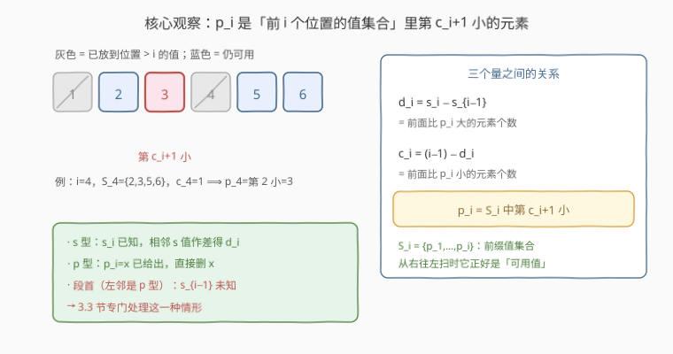
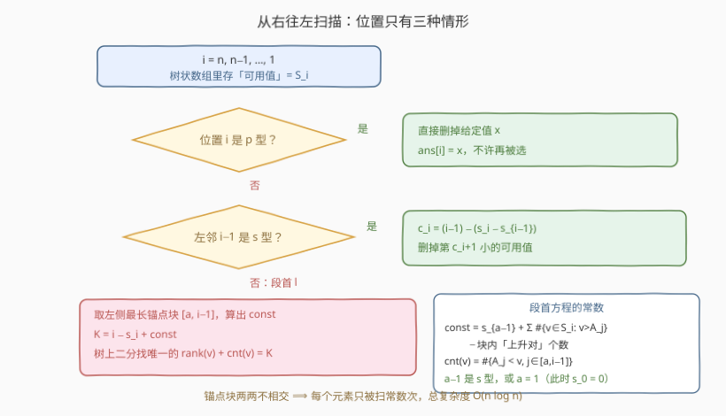
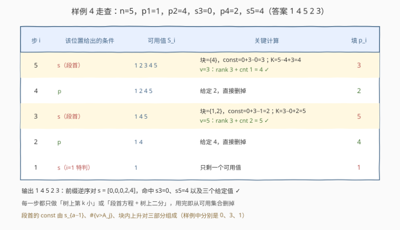

# Codeforces 2239C 重生 题解

## 1. 题目概述

- **标题 / 题号**：重生（Codeforces 2239C，英文名 Revival）
- **链接**：https://codeforces.com/problemset/problem/2239/C
- **来源**：Codeforces Round 1105 (Div. 1) · Problem C
- **难度**：rating 2200（Div. 1 的 C 题，1500 分）
- **限制**：时间 2.5 s / 内存 256 MB
- **标签**：二分查找、数据结构、数学、双指针（官方标签）

**题意**：给定 $n$，对每个位置 $i$ 只给**一条**信息：要么直接给出值 $p_i = x$，要么给出前缀逆序对数 $s_i = x$（$s_i$ 为 $p_1,\dots,p_i$ 中的逆序对数）。要求还原出那个（保证存在的）排列 $p$。

**约束**：

- $1 \le t \le 10^4$，$1 \le n \le 2\cdot 10^5$，$\sum n \le 2\cdot 10^5$；
- s 型位置满足 $0 \le x \le \frac{i(i-1)}{2}$，最大约 $2\cdot 10^{10}$，C++ 必须用 `long long` 存；
- 每个位置恰好给一种信息：p 型给"值"，s 型给"前缀逆序对"，两类信息必须互相配合才能还原。

> 💡 先记三个量，后面一直用：$s_0 = 0$，$d_i = s_i - s_{i-1}$ 是「前面比 $p_i$ 大的元素个数」，$c_i = (i-1)-d_i$ 是「前面比 $p_i$ 小的元素个数」。

## 2. 示例与观察
```text
输入
5
3
p 1
p 2
p 3
3
s 0
s 1
s 2
3
p 1
s 0
p 2
5
p 1
p 4
s 0
p 2
s 4
6
s 0
s 1
s 3
s 6
s 10
s 15

输出
1 2 3
3 1 2
1 3 2
1 4 5 2 3
6 5 4 3 2 1
```

第 2 组：$d_2 = 1-0 = 1$ 要求 $p_2$ 前面恰有 1 个比它大；$d_3 = 2-1 = 1$ 同理，唯一解是 $\{3,1,2\}$。第 3 组：$p_1=1$、$p_3=2$ 已定，只剩 $p_2=3$，且 $s_2=0$ 自然成立。第 4 组：$p_3$ 只能取 5（见 3.4 节完整走查）。第 5 组：$s_i = \frac{i(i-1)}{2}$ 说明每个新元素都小于前面所有元素，故为严格递减。

## 3. 解题思路

### 3.1 暴力思路

最直接的想法是逐位置枚举可用值，$n!$ 级别，$n=2\cdot 10^5$ 时毫无希望。退一步：从 $s_i$ 的定义出发，$s_i$ 是前缀逆序对数，$d_i$ 是第 $i$ 步的"增量"，本来 $d_i$ 的每个取值都合法（$0\le d_i\le i-1$），若全枚举也是指数级。

真正的困难在信息形态：p 型位置给的是**值**，s 型位置给的是**计数**，两者必须先换算到同一个维度上。

**关键一步**：如果能知道每个位置的 $c_i$（前面比它小的个数），问题立刻变成教科书题——$d_i$ 就是逆序表（inversion sequence），从右往左逐位还原即可。所以整道题就是"如何把两种输入都化成 $c_i$"。

### 3.2 核心观察：前缀值集合里，第 c_i+1 小就是 p_i



记 $S_i = \{p_1,p_2,\dots,p_i\}$（前 $i$ 个位置用掉的值的集合）。在 $S_i$ 中比 $p_i$ 小的元素只能来自前缀 $p_1,\dots,p_{i-1}$，个数恰好是 $c_i$。于是：

$$\operatorname{rank}_{S_i}(p_i) = c_i + 1$$

这个改写极其好用——它把"值"换成了"秩"。于是有了**从右往左**的构造：

1. 维护"尚未被安放的值"集合，初始为 $\{1,\dots,n\}$；
2. 倒序处理 $i=n,n-1,\dots,1$：此刻集合里剩下的正好是 $S_i$（因为位置 $>i$ 的值都已被取走），而 $p_i$ 就是其中第 $c_i+1$ 小，取走它。

用树状数组维护可用值，一次"树上第 $k$ 小"是 $O(\log n)$，整体 $O(n\log n)$。

接下来只剩下"$c_i$ 从哪来"：

- **p 型位置**：$p_i = x$ 直接给出，取走 $x$ 即可，根本不需要 $c_i$；
- **s 型位置**：$d_i = s_i - s_{i-1}$。若 $i-1$ 也是 s 型，两个 $s$ 值都已知，$c_i = (i-1)-d_i$ 立刻可得；
- **段首**（s 型且左邻 $i-1$ 是 p 型）：$s_{i-1}$ 既不是输入、也不一定能从左边推出来，这就是本题**唯一**的技术难点。

### 3.3 唯一难点：段首缺失的 s 值由「锚点块」反解



设段首为 $l$（$s_l$ 是输入）。取 $l$ 左侧**最长**的连续 p 型块 $[a,l-1]$，把这些位置的值记为 $A_j = p_j$。由「最长」的定义，$a=1$ 或位置 $a-1$ 是 s 型，两种情况都有 $s_{a-1}$ 已知（$s_0=0$）。

对块内任意 $j$：倒序处理到 $j$ 时，集合里是 $S_j$，而

$$S_j = S_l \setminus \{A_{j+1},\dots,A_{l-1}\} \setminus \{p_l\}$$

（位置 $j+1,\dots,l-1$ 全是 p 型且值已知，位置 $l$ 的值 $p_l$ 正是要求的）。所以

$$d_j = \#\{v\in S_j : v > A_j\} = U_j - [\,p_l > A_j\,]$$

$$U_j = \#\{v\in S_l: v>A_j\} - \#\{t: j<t\le l-1,\ A_t > A_j\}$$

链式相加 $s_{l-1} = s_{a-1} + \sum_{j=a}^{l-1} d_j$，被减掉的 $[\,p_l>A_j\,]$ 汇总成一个对 $p_l$ 单调的计数：

$$s_{l-1} = \text{const} - \operatorname{cnt}(p_l),\qquad \operatorname{cnt}(v) = \#\{j\in[a,l-1]: A_j < v\}$$

$$\text{const} = s_{a-1} + \sum_{j=a}^{l-1} U_j$$

这里 $\text{const}$ 完全由输入和 $S_l$ 决定、可以现算；其中 $\sum_j \#\{t: A_t>A_j\}$ 就是"块内上升对"的个数（位置递增、值也递增的对），等于 $\binom{\text{块长}}{2}$ 减去块内逆序对数，用一次归并排序即可。

再把 $c_l+1 = l-d_l = l-s_l+s_{l-1}$ 代进去，配合 3.2 的秩公式，得到一个**关于 $p_l$ 的方程**：

$$\operatorname{rank}_{S_l}(v) + \operatorname{cnt}(v) = K,\qquad K = l - s_l + \text{const}$$

左边 $f(v)=\operatorname{rank}_{S_l}(v)+\operatorname{cnt}(v)$ 在可用值上**严格单增**（$v$ 变大时秩至少 +1，$\operatorname{cnt}$ 不减），所以满足等式的 $v$ 唯一，二分即可。

**一次树上二分**：把块内元素在树状数组上的权值临时 $+1$（它们位于位置 $\le l-1$，倒序处理到 $l$ 时还没被取走，因此一定还在可用集合里），于是

$$f(v) = 1 + \sum_{u<v} w(u),\qquad w(u) = 1 + [\,u \text{ 在块内}\,]$$

所以只需找"权值前缀和达到 $K-1$ 的那个位置"，用树状数组的倍增下降一次 $O(\log n)$ 定位，取出 $v$ 后把临时加权撤销。

块与块之间互不相交（它们被 s 型位置隔开），故所有段首的总代价仍是 $O(n\log n)$。

### 3.4 示例演算



样例 4：$n=5$，$p_1=1,\ p_2=4,\ s_3=0,\ p_4=2,\ s_5=4$。初始可用值 $\{1,2,3,4,5\}$，从 $i=5$ 倒着走：

1. $i=5$：段首，左侧最长 p 型块是 $[4,4]$（$A_4=2$），$a=4$，$s_{a-1}=s_3=0$。$\text{const}=0+\#\{v>2\}-0=3$，$K=5-4+3=4$。候选 $v=3$：$\operatorname{rank}=3$，$\operatorname{cnt}=\#\{2<3\}=1$，$3+1=4$ ✓，取 $p_5=3$。
2. $i=4$：p 型，删掉给定值 $2$，可用值剩 $\{1,4,5\}$。
3. $i=3$：段首，块是 $[1,2]$（$A_1=1,A_2=4$），$a=1$，$s_0=0$。$\text{const}=0+(\#\{v>1\}+\#\{v>4\})-1=0+(2+1)-1=2$，$K=3-0+2=5$。候选 $v=5$：$\operatorname{rank}=3$，$\operatorname{cnt}=2$，$3+2=5$ ✓，取 $p_3=5$。
4. $i=2$：p 型，删掉 $4$，剩 $\{1\}$；$i=1$ 是 s 型且 $s_1$ 恒为 $0$，只剩一个值 $1$。

输出 $1\ 4\ 5\ 2\ 3$，前缀逆序对为 $[0,0,0,2,4]$，与 $s_3=0$、$s_5=4$ 及三个给定值全部吻合。

## 4. 算法细节

1. **三个必备操作**：树状数组的前缀和、第 $k$ 小（等价于"最大的 $p$ 使 $\text{sum}(p)\le k-1$"再加一）、以及按权值前缀和做倍增下降；倍增起点取 $\le n$ 的最大 $2$ 的幂，避免越界。
2. **$c_i$ 的两种来源**：相邻两个 s 型用 $s_i-s_{i-1}$；段首用 3.3 的方程。合法输入保证 $0\le c_i\le i-1$，即第 $k=c_i+1$ 小一定落在 $[1,|S|]$ 内，所以代码里不必额外夹取。
3. **$\text{const}$ 三项分别怎么算**：$s_{a-1}$ 直接读（$a=1$ 时取 0，千万不要读越界的 `val[0]`）；$\#\{v\in S_l: v>A_j\} = l - \text{sum}(A_j)$（此刻 $|S_l| = l$）；"块内上升对"用归并排序数出块内逆序对再减。
4. **临时加权与撤销**：块内元素此刻一定还在可用集合里（位置 $\le l-1$ 尚未处理），所以 $+1$ 是安全的；取到 $v$ 后必须先撤销加权，再删 $v$，否则后续第 $k$ 小全错。
5. **$64$ 位**：$s$ 最大约 $2\cdot10^{10}$，$K$、$\text{const}$、$\sum_j$ 都会超过 `int`；树状数组内部只存"个数/权值"，用 `int` 足够，但二分的目标值要用 `long long`。
6. **预处理段首**：从左往右扫一遍填 `blockStart[i]`（仅当 $i$ 是段首时有效），总 $O(n)$；不要在每个段首现场向左回扫，那样最坏 $O(n^2)$。
7. **多测**：每组重建树状数组（$O(n)$ 建树），总代价 $O(\sum n)$；`t` 可达 $10^4$，输入用 `scanf` 或整块读入。
8. **顺序**：倒序循环里先判断 p 型分支，再判断 $i=1$，再判断"左邻是 s 型"，最后才是段首；漏掉 $i=1$ 会访问 `typ[0]`。

## 5. 正确性证明

先固定一个合法解 $P$（题面保证存在），下面证明算法**逐位**重构出 $P$。

**引理 1（秩 = $c_i+1$）**：对任意合法排列与任意 $i$，$p_i$ 是 $S_i=\{p_1,\dots,p_i\}$ 中第 $c_i+1$ 小的元素。

**证明**：$S_i$ 中比 $p_i$ 小的元素只能来自 $p_1,\dots,p_{i-1}$，其个数按定义正是 $c_i$，故 $p_i$ 在 $S_i$ 中的秩为 $c_i+1$。∎

**引理 2（段首方程）**：设 $l$ 为段首，$[a,l-1]$ 为其左侧最长连续 p 型块，按 3.3 定义 $\text{const}$ 与 $\operatorname{cnt}$，并令 $K = l-s_l+\text{const}$。则 $P_l$ 满足 $\operatorname{rank}_{S_l}(P_l)+\operatorname{cnt}(P_l)=K$。

**证明**：块内位置全为 p 型，故 $S_j=S_l\setminus\{A_{j+1},\dots,A_{l-1}\}\setminus\{p_l\}$，于是 $d_j=\#\{v\in S_j:v>A_j\}=U_j-[\,p_l>A_j\,]$。对 $j=a,\dots,l-1$ 求和并用 $s_{l-1}=s_{a-1}+\sum_j d_j$，得 $s_{l-1}=\text{const}-\operatorname{cnt}(p_l)$。再由 $c_l+1=l-d_l=l-s_l+s_{l-1}$ 得 $c_l+1=l-s_l+\text{const}-\operatorname{cnt}(p_l)=K-\operatorname{cnt}(p_l)$，结合引理 1 即得。∎

**引理 3（解唯一）**：在可用值集合 $S_l$ 上，$f(v)=\operatorname{rank}_{S_l}(v)+\operatorname{cnt}(v)$ 严格单调递增，故引理 2 的方程至多一个解。

**证明**：设 $v<v'$ 为 $S_l$ 中相邻的两个可用值，则 $\operatorname{rank}_{S_l}(v')=\operatorname{rank}_{S_l}(v)+1$，而 $\operatorname{cnt}(v')\ge\operatorname{cnt}(v)$，故 $f(v')>f(v)$。∎

**定理**：算法输出的排列等于 $P$，因而合法。

**证明**：记 $S_i^P = \{P_1,\dots,P_i\}$。对 $i$ 从 $n$ 到 $1$ 归纳，归纳假设为"进入第 $i$ 步时，树状数组里的可用集合恰是 $S_i^P$，且已填位置与 $P$ 一致"。$i=n$ 时可用集合为 $\{1,\dots,n\}=S_n^P$，成立。归纳步：

1. 若 $i$ 是 p 型，输入给出 $P_i=x$，算法取走 $x$，删后集合为 $S_{i-1}^P$；
2. 若 $i$ 是 s 型且 $i-1$ 是 s 型，$c_i$ 由两个输入值算出，引理 1 说明"第 $c_i+1$ 小"正是 $P_i$；
3. 若 $i$ 是段首，引理 2 说明 $P_i$ 是方程的解，引理 3 说明解唯一，故算法取到的就是 $P_i$。

三种情形都取走 $P_i$ 且只取走它，删后可用集合为 $S_{i-1}^P$，归纳成立。∎

**推论**：满足输入的合法排列唯一（算法是确定性的，而任意合法解都会被它逐位重构出来）。

## 6. 复杂度分析

- **时间**：每个位置一次树上第 $k$ 小或一次树上二分，$O(\log n)$；每个段首还要扫一遍自己的锚点块并做归并排序，块两两不相交，合计 $O(n\log n)$。故单组 $O(n\log n)$，总计 $O\big((\sum n)\log n\big)$，$n=2\cdot10^5$ 时约 $10^7$ 量级的基本操作。
- **空间**：树状数组、`typ`、`val`、`ans`、`blockStart` 各 $O(n)$，归并排序的辅助数组 $O(n)$；最坏约 $6$ MB，远小于 256 MB。
- **实测**（Apple Silicon，clang `-O2`）：$n=2\cdot10^5$ 时"全 s""全 p""交替""两两交替""前半 p""块长 6""随机 50/50"等形态均为 $0.04\sim0.07$ s，相对 2.5 s 时限有 35 倍以上余量；Python3 同规模 $1.0\sim1.4$ s（含读入），仍在时限内，但线上评测机偏慢，建议交 PyPy3 或 C++。
- **答案量级**：输出是排列本身，元素不超过 $n$；只有中间量 $s$、$K$、$\text{const}$ 是 $O(n^2)$ 量级，注意 `long long`。

## 7. 参考代码

### C++17

```cpp
#include <bits/stdc++.h>
using namespace std;

// 值域 1..n 的树状数组：前缀和、第 k 小、按「权值前缀和」二分
struct BIT {
    int n, hb;
    vector<int> t;
    void init(int n_) {
        n = n_; t.assign(n + 1, 0);
        hb = 1;
        while ((hb << 1) <= n) hb <<= 1;
    }
    void add(int i, int v) {
        for (; i <= n; i += i & -i) t[i] += v;
    }
    int sum(int i) const {                       // 1..i 的和
        int s = 0;
        for (; i > 0; i -= i & -i) s += t[i];
        return s;
    }
    int lower(int target) const {                // 最大的 p 使 sum(p) <= target
        int p = 0, acc = 0;
        for (int pw = hb; pw; pw >>= 1)
            if (p + pw <= n && acc + t[p + pw] <= target) { p += pw; acc += t[p]; }
        return p;
    }
};

// 归并排序统计逆序对（a 会被就地排序）
long long countInv(vector<int>& a, vector<int>& tmp, int l, int r) {
    if (r - l <= 1) return 0;
    int m = (l + r) >> 1;
    long long res = countInv(a, tmp, l, m) + countInv(a, tmp, m, r);
    int x = l, y = m, k = l;
    while (x < m && y < r) {
        if (a[x] <= a[y]) tmp[k++] = a[x++];
        else { res += m - x; tmp[k++] = a[y++]; }
    }
    while (x < m) tmp[k++] = a[x++];
    while (y < r) tmp[k++] = a[y++];
    for (int q = l; q < r; q++) a[q] = tmp[q];
    return res;
}

int main() {
    int T;
    if (scanf("%d", &T) != 1) return 0;
    while (T--) {
        int n;
        scanf("%d", &n);
        vector<char> typ(n + 1);        // 'p'：给了值；'s'：给了前缀逆序对
        vector<long long> val(n + 1);
        for (int i = 1; i <= n; i++) {
            char c[8];
            long long x;
            scanf("%s %lld", c, &x);
            typ[i] = c[0];
            val[i] = x;
        }

        // 段首 i（s 型且左邻是 p 型）：求出它左侧最长连续 p 型块的下标 a
        vector<int> blockStart(n + 1, 0);
        for (int i = 2; i <= n; i++) {
            if (typ[i] == 's' && typ[i - 1] == 'p') {
                int a = i - 1;
                while (a - 1 >= 1 && typ[a - 1] == 'p') a--;
                blockStart[i] = a;
            }
        }

        BIT bit;
        bit.init(n);
        for (int v = 1; v <= n; v++) bit.add(v, 1);   // 初始全部值可用

        vector<int> ans(n + 1), seq, tmp;
        for (int i = n; i >= 1; i--) {
            if (typ[i] == 'p') {                       // 情形 1：直接删掉给定值
                int x = (int)val[i];
                bit.add(x, -1);
                ans[i] = x;
            } else if (i == 1) {                       // s_1 恒为 0，只剩一个值
                int v = bit.lower(0) + 1;
                bit.add(v, -1);
                ans[1] = v;
            } else if (typ[i - 1] == 's') {            // 情形 2：两个 s 值都已知
                long long d = val[i] - val[i - 1];     // d_i
                long long k = (long long)i - d;        // c_i + 1
                int v = bit.lower((int)(k - 1)) + 1;
                bit.add(v, -1);
                ans[i] = v;
            } else {                                   // 情形 3：段首，用锚点块方程
                int a = blockStart[i];
                long long constv = (a == 1 ? 0 : val[a - 1]);          // s_{a-1}
                seq.clear();
                for (int j = a; j <= i - 1; j++) {
                    constv += (long long)i - bit.sum((int)val[j]);     // #{v in S_i : v > A_j}
                    seq.push_back((int)val[j]);
                }
                int len = (int)seq.size();
                tmp.assign(len, 0);
                long long inv = countInv(seq, tmp, 0, len);
                constv -= (long long)len * (len - 1) / 2 - inv;        // 减去块内上升对
                long long K = (long long)i - val[i] + constv;
                for (int j = a; j <= i - 1; j++) bit.add((int)val[j], 1);   // 块内元素临时加权
                int v = bit.lower((int)(K - 1)) + 1;
                for (int j = a; j <= i - 1; j++) bit.add((int)val[j], -1);  // 撤销临时加权
                bit.add(v, -1);
                ans[i] = v;
            }
        }
        for (int i = 1; i <= n; i++) printf("%d%c", ans[i], i == n ? '\n' : ' ');
    }
    return 0;
}
```

### Python3

```python
import sys


def main() -> None:
    data = sys.stdin.buffer.read().split()
    t = int(data[0])
    pos = 1
    out = []
    for _ in range(t):
        n = int(data[pos]); pos += 1
        typ = bytearray(n + 1)          # 1 = p（给了值），0 = s（给了前缀逆序对）
        val = [0] * (n + 1)
        for i in range(1, n + 1):
            typ[i] = 1 if data[pos] == b'p' else 0
            val[i] = int(data[pos + 1])
            pos += 2

        # 段首 i：左侧最长连续 p 型块的起点 a
        block_start = [0] * (n + 1)
        for i in range(2, n + 1):
            if typ[i] == 0 and typ[i - 1] == 1:
                a = i - 1
                while a > 1 and typ[a - 1] == 1:
                    a -= 1
                block_start[i] = a

        # 树状数组（值域 1..n），O(n) 建树
        tree = [0] * (n + 1)
        for v in range(1, n + 1):
            tree[v] += 1
            j = v + (v & -v)
            if j <= n:
                tree[j] += tree[v]
        hb = 1
        while (hb << 1) <= n:
            hb <<= 1

        def add(i, d):
            while i <= n:
                tree[i] += d
                i += i & -i

        def prefix(i):
            s = 0
            while i > 0:
                s += tree[i]
                i -= i & -i
            return s

        def lower(target):             # 最大的 p 使 prefix(p) <= target
            p = acc = 0
            pw = hb
            while pw:
                if p + pw <= n and acc + tree[p + pw] <= target:
                    p += pw
                    acc += tree[p]
                pw >>= 1
            return p

        ans = [0] * (n + 1)
        for i in range(n, 0, -1):
            if typ[i]:                              # 情形 1：p 型，直接删给定值
                v = val[i]
            elif i == 1:                            # s_1 恒为 0，只剩一个值
                v = lower(0) + 1
            elif typ[i - 1] == 0:                   # 情形 2：两个 s 值都已知
                v = lower(i - (val[i] - val[i - 1]) - 1) + 1
            else:                                   # 情形 3：段首，锚点块方程
                a = block_start[i]
                const = 0 if a == 1 else val[a - 1]
                seq = []
                for j in range(a, i):
                    const += i - prefix(val[j])
                    seq.append(val[j])
                L = len(seq)
                inv = 0
                if L > 1:                           # 归并排序数逆序对
                    tmp = [0] * L
                    width = 1
                    while width < L:
                        for lo in range(0, L, 2 * width):
                            mid = min(lo + width, L)
                            hi = min(lo + 2 * width, L)
                            x, y, k = lo, mid, lo
                            while x < mid and y < hi:
                                if seq[x] <= seq[y]:
                                    tmp[k] = seq[x]; x += 1
                                else:
                                    tmp[k] = seq[y]; y += 1
                                    inv += mid - x
                                k += 1
                            while x < mid:
                                tmp[k] = seq[x]; x += 1; k += 1
                            while y < hi:
                                tmp[k] = seq[y]; y += 1; k += 1
                        seq, tmp = tmp, seq
                        width <<= 1
                const -= L * (L - 1) // 2 - inv     # 减去块内「上升对」个数
                K = i - val[i] + const
                for j in range(a, i):
                    add(val[j], 1)                  # 块内元素临时加权
                v = lower(K - 1) + 1
                for j in range(a, i):
                    add(val[j], -1)                 # 撤销临时加权
            add(v, -1)
            ans[i] = v
        out.append(' '.join(map(str, ans[1:])))
    sys.stdout.write('\n'.join(out) + '\n')


main()
```

## 8. 边界情况与易错点

1. **$n=1$ 与位置 1 是 s 型**：$s_1$ 恒等于 $0$，这一条不提供任何信息，答案就是剩下的唯一值。代码里必须先判 `i == 1`，否则会去查 `typ[0]`（越界）或误用未定义的 $s_0$。
2. **段首块回溯到 $a=1$**：此时用 $s_0=0$，不能读 `val[0]`（C++ 里是 0 号下标、Python 里是最后一个元素，都会静默出错）。
3. **要的是"上升对"不是"逆序对"**：$\text{const}$ 里减的是满足 $j<t$ 且 $A_t>A_j$ 的对数（等于块内总对数减逆序对）。若图省事直接减逆序对，$\text{const}$ 会偏 $\binom{\text{块长}}{2}-2\cdot\text{逆序对}$；在样例 4 的 $i=3$ 上 $K$ 会从 5 变成 6，树上二分把位置推到 $n+1$ 直接越界崩溃。
4. **$K$ 与 $\text{const}$ 可能到 $O(n^2)$ 量级**：$\text{const}$ 里含 $s$ 值，$K$ 也跟着变大；树上二分的 target、$\text{const}$、$K$ 一律 `long long`，别只把 $s$ 存成 `long long` 就在中间用 `int` 算。
5. **临时加权必须撤销**：段首分支里对块内元素 $+1$ 后，一定要在删 $v$ 之前还原，否则之后所有前缀和/第 $k$ 小全部偏移。
6. **第 $k$ 小的边界**：$k=c_i+1$ 在合法输入下满足 $1\le k\le i=|S|$，倍增下降不会跑到 $n+1$；本代码依赖题面「保证有解」这一条，若要给非法输入兜底，可先把 $k$ 夹到 $[1,|S|]$。
7. **多测清空**：树状数组、`blockStart`、`seq` 都按当前 $n$ 重建；不要用全局数组残留上一组状态（$\sum n\le 2\cdot10^5$，重建总代价仍线性）。
8. **读入格式**：字符 `p`/`s` 与整数之间是空格，C++ 用 `scanf("%s %lld")` 最省心；若用 `%c` 会把换行读进来。Python 用 `sys.stdin.buffer.read().split()` 一次切分，天然跳过空白。

## 9. 验证记录

- **编译环境与命令**：`clang++ -std=c++17 -O2`（本机无 GNU g++，配 `codeforces/tools/include/bits/stdc++.h` 兼容头；正文代码只用标准库，可原样提交 GNU C++17）；Python 侧为 `Python 3.9.6`。
- **官方样例**：1 / 1 通过（按 Codeforces 标准 checker 的 token 比对，忽略空白与大小写）。
- **复核状态**：audited（2026-11-19 统一回归：编译 + 官方样例；写作期的随机对拍与暴力未重跑）。

## 相关题目与扩展

- [Codeforces 1208D Restore Permutation](https://codeforces.com/problemset/problem/1208/D)：给"每个位置之前所有比它小的值之和"，同样是倒序 + 树状数组第 $k$ 小，是本题 3.2 节那步的直接前身。
- [Codeforces 2239B Decidophobia](https://codeforces.com/problemset/problem/2239/B)：同场 B 题，把两两交互拆成逐点收益的贪心，可作热身。
- [LeetCode 315. 计算右侧小于当前元素的个数](https://leetcode.cn/problems/count-of-smaller-numbers-after-self/)：树状数组/归并排序数"右侧更小元素"，正是本题统计块内对数用的工具。

**延伸思考**：

1. **信息冗余时判合法性**：若某些位置同时给出 $p_i$ 和 $s_i$，本题的方程会变成"过定"约束，可以直接逐位校验并输出非法——这套"秩 + 段首方程"的框架天然支持校验。
2. **放开"每个位置必给一条信息"**：本文证明了合法解唯一，所以不存在"多解取字典序最小"的问题；但若允许某些位置什么都不给（只给一部分 $p_i$ 与 $s_i$），自由度立刻出现，此时需要在倒序构造里为每个位置选尽可能小的可行值，并配合同一套秩条件做可行性判定。
3. **换一种前缀信息**：把 $s_i$（前缀逆序对）换成"后缀逆序对"或"左侧比它大的元素之和"，只需把引理 1 里的 $S_i$ 换成对应方向（前缀值集合 / 后缀值集合），段首方程的推导结构完全不变——这说明本题真正的难点不是"逆序对"，而是"用右侧已知的绝对值去反解左侧缺失的计数"。
