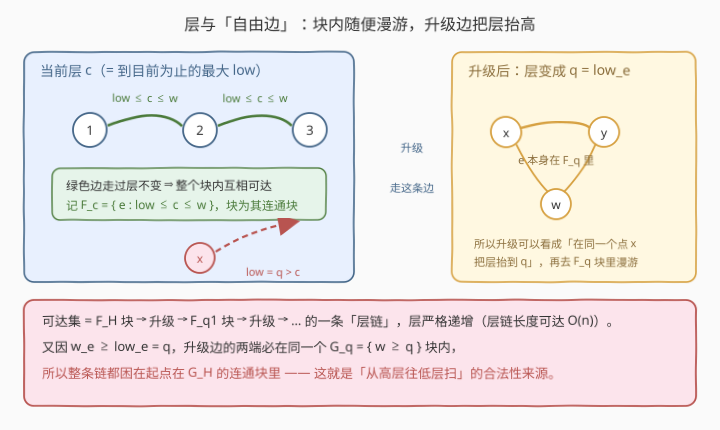
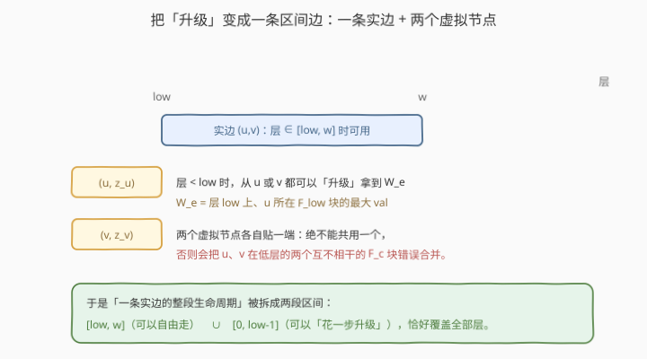
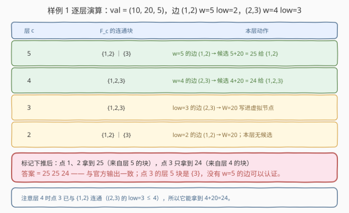

# Codeforces 2239E 世界的终结 题解

## 1. 题目概述

- **标题 / 题号**：世界的终结（Codeforces 2239E，英文名 The end of this world,）
- **链接**：https://codeforces.com/problemset/problem/2239/E
- **来源**：Codeforces Round 1105 (Div. 1) · Problem E
- **难度**：rating 3300（Div. 1 的 E 题，2750 分）
- **限制**：时间 5 s / 内存 1024 MB
- **标签**：图论、可撤销并查集（rollback DSU）、线段树 / 分治、数据结构

**题意**：给定无向图，点 $i$ 有权 $\mathrm{val}_i$，边 $e=(u,v)$ 有容量 $w_e$ 与下限 $\mathrm{low}_e$（保证 $w_e\ge \mathrm{low}_e$）。从 $s$ 出发前你可以任取非负整数 $h_{start}$ 作为状态 $h$；在点 $u$ 处，当且仅当 $w_e\ge h$ 时能走边 $e$，走过去后 $h\leftarrow \max(h,\mathrm{low}_e)$。游走至少走一条边，可以停在任意点 $t$，得分为 $\mathrm{val}_t+h_{start}$。对每个 $s=1\dots n$ 求最大得分；若从 $s$ 一条边都走不了输出 $-1$。

**约束**：

- $1\le t\le 10^4$，$1\le n\le 5\cdot 10^5$，$0\le m\le 5\cdot 10^5$，$\sum n,\sum m\le 5\cdot 10^5$；
- $1\le \mathrm{val}_i\le 10^9$，$1\le \mathrm{low}_e\le w_e\le 10^9$，无自环，可有重边、可不连通；
- 得分最大可达 $2\cdot 10^{9}$，C++ 用 `long long`（`int` 恰好溢出）。

**朴素视角的困难之处**：$h$ 只增不减，同一个点在不同 $h$ 下能做的事完全不同，状态是 $(点,h)$ 的二维；而 $h_{start}$ 又要你自由挑选，枚举量爆炸。

## 2. 示例

官方样例（一个输入含 9 组数据）：

```text
输入
9
3 2
10 20 5
1 2 5 2
2 3 4 3
2 1
100 10
1 2 10 5
2 0
50 50
1 0
114514
4 1
1 2 3 4
3 4 2 1
3 2
1 4 1
1 3 4 1
1 2 2 1
3 2
10 3 2
2 3 4 4
2 1 3 2
3 2
5 2 2
3 2 4 4
1 3 5 5
5 9
857147200 381798978 633421584 956726892 315899900
2 1 883474754 795831571
2 4 657281748 375466725
1 3 666641114 444218918
2 3 901861650 790895313
3 2 613790652 96876004
2 5 852725279 216601090
3 4 500240642 193633892
2 5 210434355 130646156
3 2 457018372 279005896

输出
25 25 24
110 110
-1 -1
-1
-1 -1 6 6
6 6 6
13 13 7
10 9 10
1740621954 1740621954 1740621954 1614008640 1709872479
```

第 5 组演示了「原地往返」：从点 4 走边 $(3,4)$ 到 3 再原路返回，取 $h_{start}=2$，得 $\mathrm{val}_4+2=6$。第 7 组点 3 只能拿到 7：它先走 $(2,3)$ 会把层抬到 4，此后 $w=3$ 的边 $(1,2)$ 再也走不动了。

## 3. 解题思路

### 3.1 暴力思路

固定 $s$，把 $h_{start}=H$ 也固定，则在 $(点,h)$ 状态图上 BFS 即可，单次 $O(n+m)$ 个状态（$h$ 只会取到 $\{\mathrm{low}\}$ 里的值）。$H$ 有 $O(m)$ 种、$s$ 有 $n$ 种，总复杂度 $O(nm(n+m))$ 量级，完全不可行。

### 3.2 核心观察：分数只由「终点值 + 全程最小容量」决定

设游走的边依次为 $e_1,\dots,e_k$，记前缀最大下限 $P_i=\max_{j<i}\mathrm{low}_{e_j}$。走到第 $i$ 步前的状态恰为 $h=\max(H,P_i)$，故「$w_{e_i}\ge h$」等价于

$$H\le w_{e_i}\quad\text{且}\quad P_i\le w_{e_i}\qquad(\forall i).$$

前者只约束 $H$，后者只约束边序列本身。于是：

- **自相容**：称序列自相容，若 $\forall i,\ \max_{j<i}\mathrm{low}_{e_j}\le w_{e_i}$（这是 $H=0$ 时的可行性，与 $H$ 无关）；
- 自相容的游走对任意 $H\le\min_i w_{e_i}$ 都可行，**因此最优取 $H=\min_i w_{e_i}$**，得分 $=\mathrm{val}_t+\min_i w_{e_i}$。

这把「挑 $H$」彻底消掉了：$\mathrm{ans}(s)=\max\{\mathrm{val}_t+\min_e w_e\}$，只需在自相容游走上取最大。



再换个角度。把当前状态叫**层** $c$，则边分两类：

- **自由边**（$\mathrm{low}_e\le c\le w_e$）：走过去层不变，所以块 $F_c=\{e:\mathrm{low}_e\le c\le w_e\}$ 的整个连通块内可以任意漫游、互相到达；
- **升级边**（$\mathrm{low}_e=q>c$）：走过去层跳到 $q$。又因 $w_e\ge q$，这条边本身就在 $F_q$ 里，于是「升级」可以等价成**在同一个端点把层抬到 $q$**，随后在 $F_q$ 块里漫游。

于是可达集是一条**层链**：$F_H$ 块 → 升级到 $q_1$ → $F_{q_1}$ 块 → 升级到 $q_2$ → …，层严格递增。链可以很长（例如 $w_e=\mathrm{low}_e=i$ 的阶梯图，需要 $O(n)$ 次升级），所以不能只考虑「至多一次升级」。

关键一点：因为 $F_q\subseteq G_q=\{e:w_e\ge q\}$，而 $G_q$ 随 $q$ 增大而变小，整条层链始终困在**起点所在的 $G_H$ 连通块**内 —— 这正是可以「按层从高到低扫」的合法性来源。

### 3.3 算法流程：虚拟节点 + 线段树 + 可撤销 DSU

记 $V(C,c)$ 为层 $c$ 上块 $C$ 的「块内可达最大 $\mathrm{val}$」（含更高层升级带回来的值）。层从高到低处理，则升级只会指向**已经算过的更高层**，天然构成拓扑序。

把「一次升级」物化成**虚拟节点**：对边 $e=(u,v)$，在 $u$ 和 $v$ 各挂一个虚拟节点 $z_u,z_v$，其值 $W_e$ 在层 $\mathrm{low}_e$ 上定为「$u$ 所在块的最大 $\mathrm{val}$」（此时 $u,v$ 同块，所以两端取值相同）。让 $u\!-\!z_u$、$v\!-\!z_v$ 这两条虚拟边只在层 $<\mathrm{low}_e$ 时存在，于是「层 $c$ 上的块最大值」自动把升级值算进去了。



**候选的认证**：设起始层为 $H$、$C$ 为 $F_H$ 中 $s$ 的块。若 $C$ 内有一条 $w_e=H$ 的边，则 $s$ 在 $F_H$ 内走到它、走一步（或往返）就把最小容量压到了 $H$，得分 $H+V(C,H)$ 可达；反过来任何游走的最小容量 $H^*$ 一定由某条 $w_{e^*}=H^*$ 的边取到，而 $e^*$ 必在 $s$ 的 $F_{H^*}$ 块内（见引理 4）。所以只需在每层 $c$，对每条 $w_e=c$ 的边所在块打上候选 $c+(\text{块最大 val})$，既不会漏、也不会凭空造出达不到的分数。

**离线化「按层扫」**：把出现的所有 $\mathrm{low},w$ 去重排序成 $K\le 2m$ 个层。实边 $e$ 活跃区间是 $[\mathrm{idx}(\mathrm{low}_e),\mathrm{idx}(w_e)]$，两条虚拟边活跃区间是 $[0,\mathrm{idx}(\mathrm{low}_e)-1]$。用线段树做区间分解，每条边挂到 $O(\log K)$ 个结点上；再从右往左（高层→低层）DFS 这棵线段树，配一个**可撤销 DSU** 维护 $F_c$ 的块。


到叶子（层 $c$）时做两件事：先对 $\mathrm{low}_e=c$ 的边把 $W_e$ 写进两个虚拟节点（此刻它们还孤立，因为虚拟边只挂在更低的结点上）；再对 $w_e=c$ 的边把候选 $c+(\text{根上的块最大值})$ 打进该块的**标记**。

标记的语义是「对整块所有点都成立的候选值」。回滚一个 $\mathrm{union}$（块 $C=A\cup B$）时，把 $C$ 的标记同时下推给 $A,B$；新合并出的块标记清成 $-\infty$ —— 绝不能取 $A,B$ 标记的 $\max$，否则会把只属于一边的候选泄漏给另一边。DFS 结束后每个点自己手里的标记即为答案。

### 3.4 示例演算

样例 1：$\mathrm{val}=(10,20,5)$，边 $(1,2)$ 是 $w=5,\mathrm{low}=2$，边 $(2,3)$ 是 $w=4,\mathrm{low}=3$，层取 $\{2,3,4,5\}$。



层 5 时 $F_5$ 只有 $(1,2)$，块 $\{1,2\}$ 最大 $\mathrm{val}=20$，$w=5$ 的边认证候选 $25$；层 4 时 $(2,3)$ 的 $\mathrm{low}=3\le 4$ 也进来了，块 $\{1,2,3\}$ 认证候选 $4+20=24$。点 3 在层 5 是孤点、无 $w=5$ 的边可认证，于是只拿到 24，答案 $25\ 25\ 24$。

## 4. 算法细节

1. **层的粒度**：只要取所有出现过的 $\mathrm{low},w$ 即可。相邻两层之间没有任何边的可用性发生变化，而候选的层一定是某个 $w$，升级的层一定是某个 $\mathrm{low}$，所以不会漏解。
2. **区间分解与内存**：$K\le 2m$，线段树用 `base = 2^ceil(log2 K)` 的迭代编号；每条边的区间分解成 $O(\log K)$ 个结点后用 CSR（先计数、再前缀和、再填充）压成一维数组，$n=m=5\cdot10^5$ 时约 $3\cdot 10^{7}$ 个条目。
3. **可撤销 DSU**：按大小合并、**不做路径压缩**（路径压缩无法回滚）。每条 union 记录 $(rb,ra,\text{旧 size},\text{旧块最大值},\text{旧标记})$，DFS 退出结点时逆序撤销；块深度 $O(\log (n+m))$。
4. **块最大值**：真实点初值 $\mathrm{val}$，虚拟节点初值 $-\infty$（在层 $\mathrm{low}_e$ 上才被赋成 $W_e$，而它的虚拟边只出现在更低的层，所以 union 时值一定已就绪）。
5. **虚拟节点必须每端一个**：若一条边只建一个虚拟节点并把 $u,z,v$ 都连起来，等价于在低层把 $u,v$ 的 $F_c$ 块强行合并，会把不可达的点算进来。
6. **叶子上的顺序**：先算 $W_e$（此时虚拟节点孤立，不污染任何块），再打候选；反过来的话 $W_e$ 会读到不该有的值。
7. **标记与回滚的配合**：块级标记只在「合并后被回滚」时下推，等价于把「合并期间该块收到的所有候选」分发给两个子块；这是本题唯一需要额外维护的信息。

## 5. 正确性证明

**引理 1（可行性判据）**：边序列 $e_1..e_k$ 在初始状态 $H$ 下可行，当且仅当它自相容且 $H\le\min_i w_{e_i}$。
**证明**：第 $i$ 步前状态为 $\max(H,P_i)$，要求 $\max(H,P_i)\le w_{e_i}$，即 $H\le w_{e_i}$ 且 $P_i\le w_{e_i}$，对所有 $i$ 同时成立即为所述两条件。∎

**引理 2（块内漫游 + 升级）**：层 $c$ 上，$F_c$ 的同一连通块内任意两点互相可达且层不变；若块内某点 $x$ 有邻边 $\mathrm{low}_e=q>c$，则可走到 $e$ 的另一端并把层抬到 $q$，之后只能在 $x$ 的 $F_q$ 块内活动。
**证明**：$F_c$ 中的边满足 $\mathrm{low}\le c$，走过去 $\max(c,\mathrm{low})=c$ 层不变，故块内可自由漫游。升级边走完层为 $\max(c,q)=q$；又 $w_e\ge q$ 说明 $e\in F_q$，故两端同属一个 $F_q$ 块，此后所有可用边都必须满足 $w\ge q$，即困在该 $F_q$ 块内。∎

**引理 3（升级值可加）**：设 $W_e$ 是层 $\mathrm{low}_e$ 上 $e$ 的端点所在块的最大 $\mathrm{val}$。则任何在层 $c<\mathrm{low}_e$ 时到达 $e$ 某一端点的游走，都能额外取得 $W_e$，且不需要付出额外代价。
**证明**：由引理 2，从层 $c$ 可以升级到 $q=\mathrm{low}_e$ 并进入该 $F_q$ 块，再到块内取得 $W_e$；升级只依赖「到达端点」这一事实，与到达方式无关。∎

**引理 4（最小容量边落在起始块内）**：设自相容游走的最小容量为 $H^*$，$e^*$ 是一条 $w_{e^*}=H^*$ 的边。则游走在走到 $e^*$ 之前层恒为 $H^*$，且 $e^*$ 与起点 $s$ 同属一个 $F_{H^*}$ 块。
**证明**：层从 $H^*$ 出发单调不减；走到 $e^*$ 前的层必须满足 $\le w_{e^*}=H^*$，故恒等于 $H^*$。于是这段前缀的每条边都满足 $\mathrm{low}\le H^*\le w$，全部属于 $F_{H^*}$，从而 $s$ 与 $e^*$ 在同一个 $F_{H^*}$ 块里。∎

**引理 5（候选可达）**：若 $s$ 的 $F_H$ 块 $C$ 内存在 $w_e=H$ 的边，则得分 $H+\max_{v\in C}\mathrm{val}_v$ 可达（其中「块内最大 val」按引理 3 的升级值一并计入）。
**证明**：由引理 2，$s$ 在 $F_H$ 内走到 $e$ 的端点并走这条边（或往返一次），至少用了一条边，全程 $w\ge H$ 而 $\min w=H$；再由引理 3 把块内（含升级带来的）最大 $\mathrm{val}$ 取到。∎

**定理**：算法输出恰为 $\mathrm{ans}(s)=\max_{H}\,(H+V(s,H))$。
**证明**：分三步。
（1）*块值的含义*：层从高到低处理，升级只会引用已算好的更高层；虚拟节点把「层 $\mathrm{low}_e$ 上的块值」原样搬到层 $<\mathrm{low}_e$ 的块里，因此叶子处 $F_c$ 块的最大值恰好等于 $V(C,c)$（引理 2、3 + 对层数的归纳）。
（2）*每个候选都可达*：候选 $c+V(C,c)$ 只在块内有 $w_e=c$ 的边时打出，由引理 5 可达，故算法输出不超过 $\mathrm{ans}(s)$。
（3）*每个游走都被覆盖*：任取自相容游走（终点 $t$），其最小容量 $H^*$ 由引理 4 在 $s$ 的 $F_{H^*}$ 块 $C^*$ 内留下一条 $w=H^*$ 的边，故算法在该层打过候选 $H^*+V(C^*,H^*)\ge H^*+\mathrm{val}_t$，即得分不低于该游走。综上两边相等。∎

## 6. 复杂度分析

- **时间**：$K\le 2m$；每条边（含两条虚拟边）在线段树上是 $O(\log K)$ 个结点，共 $O(m\log m)$ 次并查集操作，每次 `find` $O(\log (n+m))$，总计 $O(m\log m\log(n+m))$；DFS 遍历 $O(K)$ 个结点。
- **空间**：CSR 的区间条目 $O(m\log m)$，加上 DSU 的 $O(n+m)$ 与层级数组，总计 $O(n+m\log m)$。
- **实测**：本机 $n=m=5\cdot10^5$ 的随机数据（值域 $10^9$）C++ 约 **1.1 ~ 1.2 s / 265 MB**，$t=10^4$ 的小数据合计 0.2 s；时限 5 s、内存 1024 MB，余量 4 倍以上。
- **Python**：同数据 CPython 约 30 s（瓶颈是 $O(m\log m)$ 次 DSU 操作），只会 TLE；建议交 C++，或 PyPy3（本机实测 $n=m=5\cdot10^4$ 约 2.7 s，满数据仍偏紧）。

## 7. 参考代码

### C++17

```cpp
#include <bits/stdc++.h>
using namespace std;
typedef long long ll;
static const ll NEG = LLONG_MIN / 4;

int n, m;
vector<ll> val, LV;                  // LV: 压缩后的层
vector<int> eu, ev;
vector<ll> elo, ew;
int N;                               // DSU 点数 = n + 2m
vector<int> par, szn;
vector<ll> mxv, tg;                  // 块最大 val / 块级候选标记
struct Rec { int rb, ra, osz; ll omx, otg; };
vector<Rec> hist;

static inline int findr(int x) { while (par[x] != x) x = par[x]; return x; }
static inline void uni(int a, int b) {
    int ra = findr(a), rb = findr(b);
    if (ra == rb) return;
    if (szn[ra] < szn[rb]) swap(ra, rb);
    hist.push_back({rb, ra, szn[ra], mxv[ra], tg[ra]});
    par[rb] = ra; szn[ra] += szn[rb];
    if (mxv[rb] > mxv[ra]) mxv[ra] = mxv[rb];
    tg[ra] = NEG;                    // 新块：不继承任何一侧的候选
}
static inline void undoOne() {
    Rec r = hist.back(); hist.pop_back();
    ll TC = tg[r.ra];                // 该块在生命周期内收到的所有候选
    par[r.rb] = r.rb; szn[r.ra] = r.osz; mxv[r.ra] = r.omx;
    tg[r.ra] = r.otg > TC ? r.otg : TC;
    if (TC > tg[r.rb]) tg[r.rb] = TC;
}

int K, base;
vector<int> candStart, candEnt, loStart, loList, wStart, wList;

template <class F> static inline void decompose(int l, int r, F fn) {
    int L = l + base, R = r + base + 1;
    while (L < R) {
        if (L & 1) fn(L++);
        if (R & 1) fn(--R);
        L >>= 1; R >>= 1;
    }
}

void dfs(int node, int l, int r) {
    int mark = (int)hist.size();
    for (int t = candStart[node]; t < candStart[node + 1]; t++) {
        int e = candEnt[t], id = e >> 2, kd = e & 3;
        if (kd == 0)      uni(eu[id], ev[id]);          // 实边
        else if (kd == 1) uni(eu[id], n + 2 * id);      // 贴 u 的虚拟边
        else              uni(ev[id], n + 2 * id + 1);  // 贴 v 的虚拟边
    }
    if (l == r) {
        if (l < K) {
            ll lev = LV[l];
            for (int t = loStart[l]; t < loStart[l + 1]; t++) {
                int id = loList[t];
                ll W = mxv[findr(eu[id])];
                mxv[n + 2 * id] = W;
                mxv[n + 2 * id + 1] = W;
            }
            for (int t = wStart[l]; t < wStart[l + 1]; t++) {
                int id = wList[t];
                int rt = findr(eu[id]);
                ll cnd = lev + mxv[rt];
                if (cnd > tg[rt]) tg[rt] = cnd;
            }
        }
    } else {
        int mid = (l + r) >> 1;
        dfs(node * 2 + 1, mid + 1, r);   // 先高层
        dfs(node * 2, l, mid);           // 再低层
    }
    while ((int)hist.size() > mark) undoOne();
}

int main() {
    int T;
    if (scanf("%d", &T) != 1) return 0;
    while (T--) {
        scanf("%d %d", &n, &m);
        val.assign(n, 0);
        for (int i = 0; i < n; i++) scanf("%lld", &val[i]);
        eu.assign(m, 0); ev.assign(m, 0); elo.assign(m, 0); ew.assign(m, 0);
        vector<ll> levels; levels.reserve(2 * m + 1);
        for (int i = 0; i < m; i++) {
            int u, v; ll w, lo;
            scanf("%d %d %lld %lld", &u, &v, &w, &lo);
            --u; --v;
            eu[i] = u; ev[i] = v; ew[i] = w; elo[i] = lo;
            levels.push_back(w); levels.push_back(lo);
        }
        if (m == 0) {
            for (int i = 0; i < n; i++) printf("%d%c", -1, i + 1 == n ? '\n' : ' ');
            continue;
        }
        sort(levels.begin(), levels.end());
        levels.erase(unique(levels.begin(), levels.end()), levels.end());
        K = (int)levels.size(); LV = levels;
        vector<int> loi(m), wii(m);
        for (int i = 0; i < m; i++) {
            loi[i] = int(lower_bound(LV.begin(), LV.end(), elo[i]) - LV.begin());
            wii[i] = int(lower_bound(LV.begin(), LV.end(), ew[i]) - LV.begin());
        }
        base = 1; while (base < K) base <<= 1;
        int tnodes = base * 2;
        vector<int> cnt(tnodes + 1, 0);
        auto bump = [&](int nd) { cnt[nd]++; };
        for (int i = 0; i < m; i++) {
            decompose(loi[i], wii[i], bump);
            if (loi[i] > 0) { decompose(0, loi[i] - 1, bump); decompose(0, loi[i] - 1, bump); }
        }
        candStart.assign(tnodes + 2, 0);
        for (int i = 0; i < tnodes; i++) candStart[i + 1] = candStart[i] + cnt[i];
        candEnt.assign(candStart[tnodes], 0);
        vector<int> ptr(candStart.begin(), candStart.begin() + tnodes);
        auto put = [&](int nd, int code) { candEnt[ptr[nd]++] = code; };
        for (int i = 0; i < m; i++) {
            decompose(loi[i], wii[i], [&](int nd) { put(nd, (i << 2) | 0); });
            if (loi[i] > 0) {
                decompose(0, loi[i] - 1, [&](int nd) { put(nd, (i << 2) | 1); });
                decompose(0, loi[i] - 1, [&](int nd) { put(nd, (i << 2) | 2); });
            }
        }
        vector<int> lc(K + 1, 0), wc(K + 1, 0);
        for (int i = 0; i < m; i++) { lc[loi[i] + 1]++; wc[wii[i] + 1]++; }
        for (int i = 0; i < K; i++) { lc[i + 1] += lc[i]; wc[i + 1] += wc[i]; }
        loStart.assign(lc.begin(), lc.end());
        wStart.assign(wc.begin(), wc.end());
        loList.assign(m, 0); wList.assign(m, 0);
        {
            vector<int> pl(loStart.begin(), loStart.begin() + K);
            vector<int> pw(wStart.begin(), wStart.begin() + K);
            for (int i = 0; i < m; i++) { loList[pl[loi[i]]++] = i; wList[pw[wii[i]]++] = i; }
        }
        N = n + 2 * m;
        par.resize(N); szn.assign(N, 1); mxv.assign(N, NEG); tg.assign(N, NEG);
        for (int i = 0; i < N; i++) par[i] = i;
        for (int i = 0; i < n; i++) mxv[i] = val[i];
        hist.clear(); hist.reserve(1024);
        dfs(1, 0, base - 1);
        for (int i = 0; i < n; i++) {
            ll a = tg[i];
            printf("%lld%c", a <= NEG / 2 ? -1LL : a, i + 1 == n ? '\n' : ' ');
        }
    }
    return 0;
}
```

### Python3

思路与 C++ 完全一致（可作对拍参照）；同规模下 CPython 会 TLE，正式提交建议用 C++ 或 PyPy3。

```python
import sys

NEG = -(1 << 62)


def solve_case(n, m, val, E):
    if m == 0:
        return [-1] * n
    eu = [0] * m
    ev = [0] * m
    elo = [0] * m
    ew = [0] * m
    levels = []
    for i in range(m):
        u, v, w, lo = E[i]
        eu[i], ev[i], ew[i], elo[i] = u, v, w, lo
        levels.append(w)
        levels.append(lo)
    levels = sorted(set(levels))
    K = len(levels)
    pos = {v: i for i, v in enumerate(levels)}
    loi = [pos[x] for x in elo]
    wii = [pos[x] for x in ew]

    base = 1
    while base < K:
        base <<= 1
    tnodes = base * 2
    cnt = [0] * (tnodes + 1)

    def decompose_count(l, r):
        L, R = l + base, r + base + 1
        while L < R:
            if L & 1:
                cnt[L] += 1
                L += 1
            if R & 1:
                R -= 1
                cnt[R] += 1
            L >>= 1
            R >>= 1

    for i in range(m):
        decompose_count(loi[i], wii[i])
        if loi[i] > 0:
            decompose_count(0, loi[i] - 1)
            decompose_count(0, loi[i] - 1)

    start = [0] * (tnodes + 2)
    s = 0
    for i in range(tnodes):
        start[i] = s
        s += cnt[i]
    start[tnodes] = start[tnodes + 1] = s
    ent = [0] * s
    ptr = start[:tnodes]

    def put(l, r, code):
        L, R = l + base, r + base + 1
        while L < R:
            if L & 1:
                ent[ptr[L]] = code
                ptr[L] += 1
                L += 1
            if R & 1:
                R -= 1
                ent[ptr[R]] = code
                ptr[R] += 1
            L >>= 1
            R >>= 1

    for i in range(m):
        put(loi[i], wii[i], i << 2)
        if loi[i] > 0:
            put(0, loi[i] - 1, (i << 2) | 1)
            put(0, loi[i] - 1, (i << 2) | 2)

    byLow = [[] for _ in range(K)]
    byW = [[] for _ in range(K)]
    for i in range(m):
        byLow[loi[i]].append(i)
        byW[wii[i]].append(i)

    N = n + 2 * m
    par = list(range(N))
    sz = [1] * N
    mx = [NEG] * N
    for i in range(n):
        mx[i] = val[i]
    tg = [NEG] * N
    hist = []

    def find(x):
        while par[x] != x:
            x = par[x]
        return x

    def union(a, b):
        ra, rb = find(a), find(b)
        if ra == rb:
            return
        if sz[ra] < sz[rb]:
            ra, rb = rb, ra
        hist.append((rb, ra, sz[ra], mx[ra], tg[ra]))
        par[rb] = ra
        sz[ra] += sz[rb]
        if mx[rb] > mx[ra]:
            mx[ra] = mx[rb]
        tg[ra] = NEG

    sys.setrecursionlimit(1 << 20)

    def dfs(node, l, r):
        mark = len(hist)
        for t in range(start[node], start[node + 1]):
            e = ent[t]
            i, kd = e >> 2, e & 3
            if kd == 0:
                union(eu[i], ev[i])
            elif kd == 1:
                union(eu[i], n + 2 * i)
            else:
                union(ev[i], n + 2 * i + 1)
        if l == r:
            if l < K:
                lev = levels[l]
                for i in byLow[l]:
                    W = mx[find(eu[i])]
                    mx[n + 2 * i] = W
                    mx[n + 2 * i + 1] = W
                for i in byW[l]:
                    rt = find(eu[i])
                    cnd = lev + mx[rt]
                    if cnd > tg[rt]:
                        tg[rt] = cnd
        else:
            mid = (l + r) >> 1
            if mid + 1 <= K - 1:
                dfs(node * 2 + 1, mid + 1, r)
            dfs(node * 2, l, mid)
        while len(hist) > mark:
            rb, ra, osz, omx, otg = hist.pop()
            TC = tg[ra]
            par[rb] = rb
            sz[ra] = osz
            mx[ra] = omx
            tg[ra] = otg if otg > TC else TC
            if TC > tg[rb]:
                tg[rb] = TC

    dfs(1, 0, base - 1)
    return [-1 if tg[i] <= NEG // 2 else tg[i] for i in range(n)]


def main():
    data = sys.stdin.buffer.read().split()
    p = 0
    T = int(data[p]); p += 1
    res = []
    for _ in range(T):
        n = int(data[p]); m = int(data[p + 1]); p += 2
        val = [int(x) for x in data[p:p + n]]; p += n
        E = []
        for _ in range(m):
            u = int(data[p]) - 1; v = int(data[p + 1]) - 1
            w = int(data[p + 2]); lo = int(data[p + 3]); p += 4
            E.append((u, v, w, lo))
        res.append(" ".join(map(str, solve_case(n, m, val, E))))
    sys.stdout.write("\n".join(res) + "\n")


main()
```

## 8. 边界情况与易错点

1. **$m=0$**：所有答案都是 $-1$；$n=1$ 同理。不要输出 $0$ 或 $\mathrm{val}_s$（题目要求至少走一条边）。
2. **多测清空**：$\sum n,\sum m\le 5\cdot 10^5$ 但 $t$ 可达 $10^4$，每组都要重建 `candStart/candEnt/loStart/...`，不能跨用例复用。
3. **虚拟边的空区间**：当 $\mathrm{low}_e$ 就是最小层时，$[0,\mathrm{idx}(\mathrm{low}_e)-1]$ 为空，必须判 `loi[i] > 0`，否则区间分解会访问负下标。
4. **虚拟节点必须每端一个**：共用一个会把 $u,v$ 在低层的两个 $F_c$ 块错误合并，是本题最隐蔽的错误（样例基本测不出来，务必用随机对拍）。
5. **叶子上先算 $W_e$ 再打候选**：顺序反了会读到还没赋值的虚拟节点，或者把当前层的候选算进 $W_e$。
6. **标记不能在做 union 时取两边的 $\max$**：那会把只属于 $A$ 的候选带给 $B$ 的点，答案偏高；正确做法是新块标记置 $-\infty$，回滚时下推。
7. **不可达判定**：标记初值为 $-\infty$（用 `NEG`），最后若仍 $\le \text{NEG}/2$ 输出 $-1$；直接用 $0$ 当哨兵会和真实答案 $0$ 混淆（虽然 $\mathrm{val}\ge1$ 时答案 $\ge2$，但没有边时必须是 $-1$）。
8. **溢出**：$h_{start}\le 10^9$、$\mathrm{val}\le 10^9$，答案上界 $2\cdot 10^9$ 超过 `int`；C++ 全程 `long long`。

## 相关题目与扩展

- [Codeforces 2239D. Hunting the Beast](https://codeforces.com/problemset/problem/2239/D)：同场 D 题，组合计数 + DP，适合作为本场的配套练习。
- [Codeforces 1706E. Qpwoeirut and Vertices](https://codeforces.com/problemset/problem/1706/E)：Kruskal 重构树的标准题，和本题「层从高到低合并」的思想同源。
- [Codeforces 891C. Envy](https://codeforces.com/problemset/problem/891/C)：用可撤销 DSU 判定「某些边能否同时出现在某棵最小生成树上」，回滚技巧与本题几乎相同。
- [Codeforces 1213G. Path Queries](https://codeforces.com/problemset/problem/1213/G)：按边权阈值离线加边回答点对询问，是本题「按层扫 + DSU」的简化版。
- [LeetCode 1697. 检查边长度限制的路径是否存在](https://leetcode.cn/problems/checking-existence-of-edge-length-limited-paths/)：离线排序 + 并查集的入门对照。

**延伸思考**：

1. **把终点值换成终点所在块的最大值**：若题目改成「$\mathrm{val}_t$ 取整条游走经过的点的最大权」，则升级链上每一段都能贡献，只需把「块最大值」改成「块历史最值」，DSU 的标记机制不用变。
2. **有向图版本**：升级边变成单向，块内不再对称，「$u,v$ 同块」不再自动成立，虚拟节点要按方向拆成两类；这个问题会从「无向连通块」退化成「强连通分量 + DAG 上的最长路」，复杂度仍可做到 $O(m\log m)$。
3. **只问单点**：若只问一个 $s$，不必建整棵线段树 —— 从 $s$ 出发按层递增做「块扩张 + 升级」即可（等价于在 $G_H$ 块内做带权并查集），单次 $O((n+m)\alpha)$；本题要问全部 $n$ 个，才需要把「每层一块」的离线结构搭出来。
4. **为什么不能只考虑一次升级**：$w_e=\mathrm{low}_e=i$ 的阶梯图（$v_{i-1}\!-\!v_i$）中，从 $v_0$ 出发必须连续升级 $O(n)$ 次才能走到 $v_n$，所以「枚举一次升级」的写法一定会挂在这种数据上。
