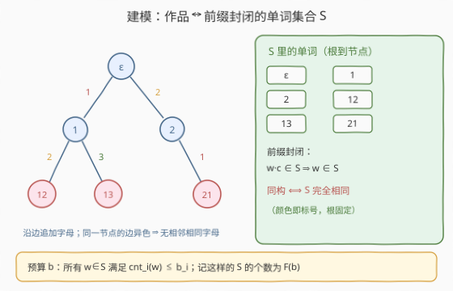
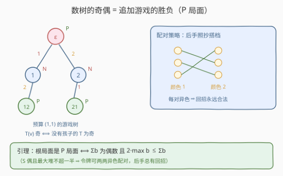
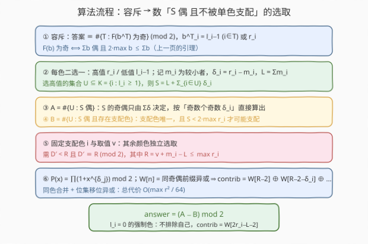
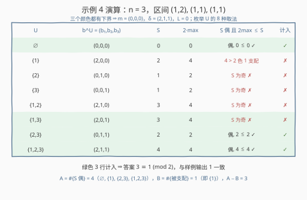

# Codeforces 2239F 多彩作品 题解

## 1. 题目概述

- **标题 / 题号**：多彩作品（Codeforces 2239F，英文名 Colorful Works）
- **链接**：https://codeforces.com/problemset/problem/2239/F
- **来源**：Codeforces Round 1105 (Div. 1) · Problem F
- **难度**：rating 3500（Div. 1 的 F 题，3500 分）
- **限制**：时间 5 s / 内存 256 MB
- **标签**：动态规划、多项式（GF(2) 上的背包/卷积）、博弈论、实现

**题意**：有 $n$ 种颜色，颜色 $i$ 带约束区间 $[l_i,r_i]$。一张「作品」是一棵**有根树**，每条边染成 $n$ 种颜色之一。称它**多彩**，若：

1. 任意两条**共顶点**的边颜色不同（题面写作：对任意 $u,v,w$，只要 $(u,v)$ 与 $(v,w)$ 都是边，二者颜色就不同）；
2. 对每个颜色 $i$，设 $d(u,i)$ 为 $u$ 到根路径上颜色 $i$ 的边数，则 $\max_u d(u,i)\in[l_i,r_i]$。

两张作品同构，当且仅当点数相同且存在保持根、保持边、保持边颜色的双射。求**两两不同构**的多彩作品最多能选多少个（即同构类总数），输出它对 $\mathbf 2$ 取模的结果——只要答案的奇偶性。

**约束**：

- $1\le t\le 10^4$，$1\le n\le 2\cdot 10^6$，$\sum n\le 2\cdot 10^6$；
- $0\le l_i\le r_i\le 2\cdot 10^5$，$r_i\ge 1$；
- 记 $m=\max_i r_i$，则 $\sum m\le 2\cdot 10^5$。这条是复杂度的钥匙：允许 $O(m^2/64)$ 级别，但不允许任何依赖 $n$ 平方的做法（$n$ 可比 $m$ 大一个量级）。

## 2. 示例与观察
```text
输入
4
2
0 1
0 1
2
1 1
1 1
3
0 2
0 1
0 1
3
1 2
1 1
1 1

输出
1
0
1
1
```

第 1 组：两色都是 $[0,1]$，合法树恰 $9$ 棵（题面 note 逐一列出），奇，输出 $1$。第 2 组：两色都必须出现且至多一次，恰 $6$ 棵，输出 $0$。第 3、4 组合法树分别为 $17069$ 与 $17041$ 棵，均奇，输出 $1$。可见答案与具体棵数无关，只与奇偶有关——这正是突破口。

**自造示例 5（补充，用于验证 $n=1$）**：

```text
输入
1
1
0 1

输出
0
```

只有一种颜色时条件 1 使树最多深 $1$：合法树只有「单点」与「根接一条该色边」共 $2$ 棵，偶数，输出 $0$。

## 3. 解题思路

### 3.1 暴力思路

按同构类数树：树规模随深度指数增长（各色用量之和可达 $O(nm)$），连枚举都做不到；对每个颜色枚举「是否触碰下界」又要 $2^n$ 次。即使写出预算为 $b$ 的方案数递推，数值也会大到存不下，更别说对 $2^n$ 种预算逐个求。所以必须走**取模 2** 的路线：把「数数」换成「判奇偶」。

### 3.2 核心观察：作品 ↔ 单词集合，奇偶 ↔ 游戏胜负



**（1）作品就是一棵「颜色单词」树。** 根记为空串 $\varepsilon$；若节点 $u$ 对应单词 $w$、边 $(u,v)$ 染颜色 $c$，则 $v$ 对应 $w\cdot c$（末尾追加字母）。条件 1 恰是「单词里没有相邻相同字母」；树连通无环保证不同节点单词不同、每个节点的所有前缀都是其祖先。于是

$$\{\text{多彩作品}\}\big/\text{同构}\;\longleftrightarrow\;\bigl\{S:\ S\ \text{非空、前缀封闭、单词内相邻字母不同}\bigr\},$$

其中前缀封闭指 $w\cdot c\in S\Rightarrow w\in S$。反向操作：「父亲 = 去掉末字母」即可还原唯一一棵满足条件 1 的树；颜色是边的标号，故同构类与 $S$ 一一对应。条件 2 变成

$$\max_{w\in S}\mathrm{cnt}_i(w)\in[l_i,r_i],$$

$\mathrm{cnt}_i(w)$ 为字母 $i$ 在 $w$ 中出现次数；它沿前缀单调不减，故最大值在**极大单词**（叶子）上取到。

**（2）下界用容斥消掉。** 上界就是「给颜色 $i$ 预算 $r_i$」；下界 $\max<l_i$ 等价于 $\max\le l_i-1$。对「哪些颜色违反下界」容斥：

$$\text{答案}=\sum_{T\subseteq[1,n]}(-1)^{|T|}F\bigl(b^T\bigr),\qquad b^T_i=\begin{cases}l_i-1,&i\in T,\\ r_i,&i\notin T,\end{cases}$$

其中 $F(b)$ 是「所有 $w\in S$ 满足 $\mathrm{cnt}_i(w)\le b_i$」的前缀封闭集合个数；某个 $b^T_i<0$（即 $l_i=0$ 且 $i\in T$）时该项为 $0$。模 2 下 $(-1)^{|T|}\equiv1$，故

$$\text{答案}\equiv\#\bigl\{T:\ F(b^T)\ \text{为奇数}\bigr\}\pmod 2.$$



**（3）$F(b)$ 的奇偶性 = 一个游戏的胜负。** 对节点 $v$ 记 $T(v)$ 为以其为根的子树方案数，则

$$T(v)=\prod_{c\in\mathrm{ch}(v)}\bigl(1+T(c)\bigr),$$

因为每个可用颜色 $c$ 要么不长出这条边（$1$ 种），要么长出边并接上 $c$ 的子树（$T(c)$ 种）。模 2 后只剩一件事：

$$T(v)\ \text{为奇}\iff\text{所有孩子 }T(c)\ \text{都为偶}.$$

把「往当前单词末尾追加一个颜色 $c$（$c\ne$ 末字母且 $c$ 还有预算）」看成一步棋、不能走者输，上式正是「$v$ 是先手必败（P）局面」的定义：P $\iff$ 所有一步都到 N。对树高归纳得

$$F(b)\ \text{为奇}\iff\text{以 }b\text{ 为初始预算的追加游戏先手必败}.$$

记局面 $(\mathbf r,x)$：$\mathbf r$ 为各色剩余预算，$x$ 为本回合被禁止的颜色（根局面无禁止，视 $r_x=0$）。令 $S=\sum_i r_i$、$M=\max_i r_i$，则

$$(\mathbf r,x)\ \text{是 P 局面}\iff\bigl(S\ \text{偶}\wedge 2M\le S\bigr)\ \vee\ \bigl(r_x>S-r_x\bigr).$$

直觉：若 $S$ 偶且最大堆不超过一半，就把 $S$ 枚令牌两两配对、每对异色（$M\le S/2$ 时可贪心构造），后手照抄搭档即可；若冻结堆严格过半，任何招法都只能让它继续坐大，先手必败。完整分情况见第 5 节。根局面没有第二项，于是得到**本题最关键的判定**：

$$F(b)\ \text{为奇}\iff\sum_i b_i\ \text{为偶}\ \wedge\ 2\max_i b_i\le\sum_i b_i.$$

### 3.3 算法流程：从「数树」到「数选取」



每个颜色只有两种取值，于是把答案改写成**数选取**：

$$m_i=\begin{cases}l_i-1,&l_i\ge1,\\ r_i,&l_i=0,\end{cases}\qquad\delta_i=r_i-m_i\ (\ge0),\qquad L=\sum_i m_i,\qquad K=\{i:l_i\ge1\}.$$

设 $U\subseteq K$ 为「取高值」的颜色集合，则总和 $S=L+\sum_{i\in U}\delta_i$，答案

$$=\#\Bigl\{U\subseteq K:\ S\ \text{偶}\ \wedge\ 2\max_i b_i\le S\Bigr\}\bmod 2 .$$

- **$A=\#\{U:S\text{ 偶}\}$**：$S$ 的奇偶只由 $\sum_{i\in U}\delta_i$ 决定。若 $K$ 中存在奇数 $\delta_i$，则恰一半子集使 $S$ 偶：$|K|\ge2$ 时 $A\equiv0$，$|K|=1$ 时 $A=1$；若所有 $\delta_i$ 为偶，则 $S$ 的奇偶被 $L$ 钉死：$|K|\ge1$ 时 $A=2^{|K|}\equiv0$，$|K|=0$ 时 $A=[L\text{ 偶}]$。
- **$B=\#\{U:S\text{ 偶}\ \wedge\ \exists i:2b_i>S\}$**：若 $2b_i>S$ 与 $2b_j>S$ 同时成立则 $b_i+b_j>S$，矛盾——**支配色唯一**；又 $b_i\le m$ 给出 $S<2m$，故这类 $U$ 的 $\delta$ 和很小。
- 答案 $=(A-B)\bmod2$。

对支配色 $i$ 的每个取值 $v\in\{m_i\,(l_i\ge1),\ r_i\}$，其余颜色独立选取；记其余颜色取高值贡献的 $\delta$ 和为 $D'$，则「$i$ 以 $v$ 支配」$\iff$

$$D'<R:=v+m_i-L\quad\text{且}\quad D'\equiv R\pmod2 .$$

令

$$P(x)=\prod_{j\in K}\bigl(1+x^{\delta_j}\bigr)\bmod2,\qquad W[n]=\bigoplus_{s\le n,\ s\equiv n\!\!\pmod2}\bigl[x^s\bigr]P .$$

$P$ 的系数给出子集和的奇偶分布，$W$ 是「同奇偶前缀异或」；又 $R\le v\le m$，只需保留 $0..m$ 次项。排除颜色 $i$ 自己相当于除以 $(1+x^{\delta_i})$，在 GF(2) 上就是沿步长 $\delta_i$ 的前缀和，故

$$\mathrm{contrib}_i(v)=W[R-2]\oplus W[R-2-\delta_i]\oplus W[R-2-2\delta_i]\oplus\cdots\qquad(\text{下标}<0\text{ 取 }0).$$

$l_i=0$ 的**强制色**不排除自己，直接取 $W[2r_i-L-2]$。全部异或起来即得 $B$。实现上：同 $\delta$ 用 $(1+x^d)^c=\prod_{b}(1+x^{d2^b})$ 合并（$b$ 取 $c$ 的二进制位），再用 64 位字位集做「左移异或」，$W$ 由 $\log m$ 轮 $W\mathrel{\oplus}=W\ll2^k$ 得到。

### 3.4 示例演算



第 4 组（$n=3$，区间 $(1,2),(1,1),(1,1)$）：三色都有下界，$m=(0,0,0)$、$\delta=(2,1,1)$、$L=0$。把 $U$ 的 $8$ 种取法代入「$S$ 偶且 $2\max\le S$」：

- $U=\varnothing$：$b=(0,0,0)$，$S=0$，计入；
- $U=\{1\}$：$b=(2,0,0)$，$S=2$，$2\max=4>2$，被颜色 $1$ 支配，不计入；
- $U=\{2\},\{3\},\{1,2\},\{1,3\}$：$S$ 为奇，不计入；
- $U=\{2,3\}$：$b=(0,1,1)$，$S=2$，$2\max=2\le2$，计入；
- $U=\{1,2,3\}$：$b=(2,1,1)$，$S=4$，$2\max=4\le4$，计入。

共 $3$ 种，$3\equiv1\pmod2$，输出 $1$。用 $A-B$ 复核：$S$ 偶的选取为 $\varnothing,\{1\},\{2,3\},\{1,2,3\}$，$A=4$；其中只有 $\{1\}$ 被支配，$B=1$；$A-B=3$，同样得 $1$。

其余三组：第 1 组 $K=\varnothing$、$L=2$，$A=[L\text{ 偶}]=1$，各强制色 $2r_i-L=0\not>0$ 使 $B=0$，答案 $1$；第 2 组 $|K|=2$ 且 $\delta=(1,1)$ 的奇数个数不为 $0$，故 $A=[|K|=1]=0$，$B=0$，答案 $0$；第 3 组 $K=\varnothing$、$L=4$，$A=1$，各强制色 $2r_i-L\le0$，$B=0$，答案 $1$。四组全部吻合。

## 4. 算法细节

1. **只在同构类上计数**：同构类与单词集合 $S$ 一一对应，既不必关心节点编号，也不会重复计数。
2. **两种取值与 $\delta$**：$l_i\ge1$ 时取值为 $m_i=l_i-1$ 与 $r_i$，$\delta_i=r_i-l_i+1\ge1$；$l_i=0$ 时只有 $r_i$，令 $\delta_i=0$ 且**不并入** $K$。$\delta_i=0$ 决不能进多项式——GF(2) 下 $1+x^0=0$，整条多项式会被清零。
3. **$A$ 的三种情况**：$|K|=0$ 时 $A=[L\text{ 偶}]$；$|K|\ge1$ 且 $K$ 内奇数 $\delta$ 个数为 $0$ 时 $A\equiv0$；否则 $A=[|K|=1]$。不要统一写成 $2^{|K|-1}$（$|K|=0$ 会变成负指数）。
4. **$B$ 的步数**：每个颜色至多试两个 $v$，先判 $R>0$（$R\le0$ 直接跳过，这也保证 $R\le m$），再按步长 $\delta_i$ 降序异或 $W$。总步数 $O(n+m)$：步数 $R/\delta_i$ 衡量该色「压过其余最小值之和」的程度，至多极少数颜色能取到大步数。
5. **位集与截断**：因子按移位从小到大处理，每个因子是「左移 + 异或 + 掩码」，掩码必须做，否则高位垃圾会在后续轮的左移里落回低位。
6. **$W$ 的构造**：$W[n]=P[n]\oplus W[n-2]$，即依次 $W\mathrel{\oplus}=W\ll2,\ W\mathrel{\oplus}=W\ll4,\dots$，共 $O(\log m)$ 轮，每轮截断到 $m$ 位。
7. **读入与内存**：输入可达 $2\cdot10^6$ 行，需 `fread` 级快读；每组只存 $l_i,r_i$（`int`），$L,R$ 用 `long long`（$L$ 可达 $4\cdot10^{11}$）；`cnt` 数组按当前 $M=m+2$ 重开即可，由 $\sum m$ 约束保证总开销。
8. **输出**：只输出 $(A-B)\ \&\ 1$；注意 C++ 里负数右移/取模的差异，最稳妥是先保证 $A,B\in\{0,1\}$ 再异或。

## 5. 正确性证明

**引理 1**：多彩作品的同构类与「非空、前缀封闭、相邻字母不同」的单词集合 $S$ 一一对应。

**证明**：作品给出 $S$：节点取「到根的颜色序列」；条件 1 说明同一节点的两条边颜色，故序列无相邻相同字母，且树连通无环使映射为单射，每个单词的前缀都在 $S$ 中。反之给定 $S$，以「去掉末字母」为父指针、末字母为边色，得到满足条件 1 的作品；两种构造互逆，且同构 $\iff$ 单词集合相同。∎

**引理 2**：$T(v)=\prod_{c\in\mathrm{ch}(v)}(1+T(c))$，且模 2 下 $T(v)$ 为奇 $\iff$ 所有孩子 $T(c)$ 为偶。

**证明**：孩子颜色两两不同、且都不同于父边颜色，故彼此独立；每个候选颜色有「不长边」与「长边接子树」共 $1+T(c)$ 种，相乘即得。模 2 下乘积为奇 $\iff$ 每个因子为奇 $\iff$ 每个 $T(c)$ 为偶。∎

**引理 3**：局面 $(\mathbf r,x)$ 是 P 局面 $\iff$ $\bigl(S\text{ 偶}\wedge2M\le S\bigr)\vee\bigl(r_x>S-r_x\bigr)$，其中 $S=\sum r_i,\ M=\max r_i$。

**证明**：对 $S$ 归纳，称两条件为 (I)、(II)。

1. (I) 成立时，把 $S$ 枚令牌两两配对且每对异色（$M\le S/2$ 时贪心构造：每次取最大两堆各出一枚）。后手总取对手刚取令牌的搭档：搭档颜色必不同，回招永远合法，而游戏有限，故先手先无路可走，(I) 成立即 P。
2. (II) 成立时（$2r_x>S$），一步只能动 $i\ne x$，动后 $S'=S-1$、冻结堆为 $i$ 且剩 $r_i-1$。对 (I)：$S$ 偶则 $S'$ 奇；$S$ 奇则 $2M'\ge2r_x\ge S+1>S'$——均不成立。对 (II)：需 $2r_i>S+1$，但那时 $r_i\ge\frac{S+3}{2}$、$r_x\ge\frac{S+1}{2}$，相加得 $r_i+r_x\ge S+2>S$，矛盾。故所有招法都到 N，本局面是 P。
3. (I)(II) 都不成立。若 $2M\le S$（此时 $S$ 必奇）：取任一合法堆（若无合法堆则 $r_x=S$，使 (II) 成立，矛盾），动后 $S'$ 偶、$2M'\le2M\le S-1=S'$，(I) 成立。若 $2M>S$：唯一支配堆 $d$，且 $d\ne x$（否则 $r_x=M>S-r_x$ 使 (II) 成立）。动 $d$ 后 $S'=S-1$：当 $S$ 奇且 $2d=S+1$ 时 $2(d-1)=S-1=S'$、$2(S-d)=S-1\le S'$，(I) 成立；其余情形（$S$ 奇且 $2d\ge S+3$，或 $S$ 偶从而 $2d\ge S+2$）都有 $2d>S+1$，即 $d-1>S'-(d-1)$，(II) 成立。∎

**定理 1**：$F(b)$ 为奇 $\iff$ $\sum_i b_i$ 为偶且 $2\max_i b_i\le\sum_i b_i$。

**证明**：根局面无禁止颜色，视 $r_x=0$ 则 (II) 化为 $0>S$，恒假，只剩 (I)；再由引理 2，$F(b)$ 为奇 $\iff$ 根为 P 局面。∎

**引理 4**：至多一个 $i$ 满足 $2b_i>S$；且此时 $S<2\max_i r_i$。

**证明**：若 $2b_i>S$ 且 $2b_j>S\ (i\ne j)$，相加得 $b_i+b_j>S$，与 $b_i+b_j\le S$ 矛盾。又 $b_i\le r_i\le m$，故 $S<2b_i\le2m$。∎

**引理 5**：对固定支配色 $i$ 与取值 $v$，「$i$ 以 $v$ 支配」$\iff D'<R$ 且 $D'\equiv R\pmod2$，其中 $D'$ 是其余颜色取高值贡献的 $\delta$ 和，$R=v+m_i-L$。

**证明**：其余颜色之和为 $L-m_i+D'$，故 $S=v+L-m_i+D'$。「$S$ 偶」$\iff D'\equiv L+v+m_i\equiv v-L+m_i=R\pmod2$（二者差 $2L$）；「$v>S-v$」$\iff D'<v-L+m_i=R$。∎

**定理 2**：算法输出恰为答案对 $2$ 取模。

**证明**：由引理 1、定理 1，答案 $\equiv\#\{U:S\text{ 偶}\wedge2\max b\le S\}\pmod2$。$A$ 精确统计「$S$ 偶」的选取（按 $\delta$ 奇偶分类）。由引理 4，被排除的只有「$S$ 偶且存在支配色」者，支配色唯一，故 $B$ 按「支配色 $\times$ 取值」不重不漏地统计它们（判定式由引理 5 给出）。$P$ 的 $x^t$ 系数是「$\delta$ 和 $=t$ 的选取数」的奇偶，$W$ 是其同奇偶前缀异或，步长写法正好对应「排除颜色 $i$ 后」的奇数前缀和；强制色不排除自己，直接查 $W$。因此 $A-B$ 与真实计数同奇偶。∎

## 6. 复杂度分析

- **时间**：每个测试 $O\bigl(n+m^2/64+(m/64)\log m\bigr)$。多项式最多 $m$ 个因子，每个对 $m/64$ 个字做一次移位异或；$W$ 是 $O((m/64)\log m)$；$B$ 的步长求和 $O(n+m)$。$\sum m\le2\cdot10^5$ 保证最坏总量约 $3\times10^8$ 次 64 位运算；实测最坏数据（$2\cdot10^5$ 个互不相同的 $\delta$）约 $0.25$ s（Apple M1，clang -O2），对 5 s 有十几倍以上余量。
- **空间**：每组 $O(n+m)$，$n$ 个 `int` 存区间、$O(m/64)$ 字存位集；$n=2\cdot10^6$ 时约 $16$ MB，远低于 256 MB。
- **对比**：Python 版用大整数当位集，逻辑相同但常数更差（同样数据约 1.6 s，Codeforces 机器上更慢），最大数据可能 TLE，建议提交 C++；PyPy 的大整数运算反而更慢，可用作小数据对拍。

## 7. 参考代码

### C++17

```cpp
#include <bits/stdc++.h>
using namespace std;
typedef long long ll;
typedef unsigned long long ull;

static char ibuf[1 << 16];
static int ipos = 0, ilen = 0;
static inline char gc() {
    if (ipos == ilen) { ilen = (int)fread(ibuf, 1, sizeof ibuf, stdin); ipos = 0; if (ilen <= 0) return 0; }
    return ibuf[ipos++];
}
static inline ll readInt() {
    char c = gc();
    while (c < '0' || c > '9') { if (!c) return 0; c = gc(); }
    ll x = 0;
    while (c >= '0' && c <= '9') { x = x * 10 + (c - '0'); c = gc(); }
    return x;
}

int main() {
    ll t = readInt();
    string out; out.reserve((size_t)t * 2 + 4);
    vector<int> Lv, Rv, cnt;
    vector<ull> P, Wp;
    while (t--) {
        ll n = readInt();
        Lv.resize(n); Rv.resize(n);
        int mx = 0;
        for (int i = 0; i < n; i++) {
            int a = (int)readInt(), b = (int)readInt();
            Lv[i] = a; Rv[i] = b; if (b > mx) mx = b;
        }
        int M = mx + 2;                              // 只需 0..M 次项
        ll L = 0; int k = 0, oddcnt = 0;
        cnt.assign(M + 2, 0);
        for (int i = 0; i < n; i++) {
            int h = Rv[i];
            int mm = (Lv[i] >= 1) ? (Lv[i] - 1) : h; // 最小值
            L += mm;
            if (Lv[i] >= 1) { k++; int d = h - mm; if (d & 1) oddcnt++; cnt[d]++; }
        }
        int A;
        if (k == 0) A = (L % 2 == 0) ? 1 : 0;
        else if (oddcnt == 0) A = 0;
        else A = (k == 1) ? 1 : 0;

        int nw = (M >> 6) + 2;
        P.assign(nw, 0); P[0] = 1;                   // P(x)=prod(1+x^delta) mod 2
        for (int d = 1; d <= M; d++) {
            int c = cnt[d];
            if (!c) continue;
            if (c & 1) {                             // 乘 (1+x^d)
                int ws = d >> 6, bs = d & 63;
                if (bs == 0) { for (int j = nw - 1; j >= ws; j--) P[j] ^= P[j - ws]; }
                else { for (int j = nw - 1; j >= ws; j--) { ull v = P[j - ws] << bs; if (j - ws - 1 >= 0) v |= P[j - ws - 1] >> (64 - bs); P[j] ^= v; } }
            }
            int half = c >> 1;                       // (1+x^d)^{2c}=(1+x^{2d})^{c}
            if (half && 2 * (ll)d <= M) cnt[2 * d] += half;
        }
        { int hi = M >> 6, rem = M & 63; if (rem < 63) P[hi] &= ((1ULL << (rem + 1)) - 1); for (int j = hi + 1; j < nw; j++) P[j] = 0; }

        Wp = P;                                      // W[n]=XOR_{s<=n,s=n(2)}P[s]
        for (int step = 2; step <= M + 2; step <<= 1) {
            int ws = step >> 6, bs = step & 63;
            if (bs == 0) { for (int j = nw - 1; j >= ws; j--) Wp[j] ^= Wp[j - ws]; }
            else { for (int j = nw - 1; j >= ws; j--) { ull v = Wp[j - ws] << bs; if (j - ws - 1 >= 0) v |= Wp[j - ws - 1] >> (64 - bs); Wp[j] ^= v; } }
        }

        int B = 0;
        for (int i = 0; i < n; i++) {
            int h = Rv[i];
            if (Lv[i] >= 1) {
                int mm = Lv[i] - 1, dd = h - mm;
                ll R = (ll)mm + mm - L;              // 取低值
                if (R > 0) { int y = (int)R - 2, acc = 0; for (; y >= 0; y -= dd) acc ^= (int)((Wp[y >> 6] >> (y & 63)) & 1ULL); B ^= acc; }
                R = (ll)h + mm - L;                  // 取高值
                if (R > 0) { int y = (int)R - 2, acc = 0; for (; y >= 0; y -= dd) acc ^= (int)((Wp[y >> 6] >> (y & 63)) & 1ULL); B ^= acc; }
            } else {
                ll R = (ll)h + h - L;                // 强制色：不排除自己
                if (R > 0) { int y = (int)R - 2; if (y >= 0) B ^= (int)((Wp[y >> 6] >> (y & 63)) & 1ULL); }
            }
        }
        out.push_back((char)('0' + ((A - B) & 1)));
        out.push_back('\n');
    }
    fwrite(out.data(), 1, out.size(), stdout);
    return 0;
}
```

### Python3

```python
import sys

def main():
    data = sys.stdin.buffer.read().split()
    pos = 0
    t = int(data[pos]); pos += 1
    out = []
    for _ in range(t):
        n = int(data[pos]); pos += 1
        ls = [0] * n
        rs = [0] * n
        mx = 0
        for i in range(n):
            ls[i] = int(data[pos]); rs[i] = int(data[pos + 1]); pos += 2
            if rs[i] > mx:
                mx = rs[i]
        M = mx + 2
        L = 0; k = 0; odd = 0
        cnt = {}
        for i in range(n):
            h = rs[i]; l = ls[i]
            mm = l - 1 if l >= 1 else h
            L += mm
            if l >= 1:
                k += 1
                d = h - mm
                if d & 1:
                    odd += 1
                cnt[d] = cnt.get(d, 0) + 1
        if k == 0:
            A = 1 if L % 2 == 0 else 0
        elif odd == 0:
            A = 0
        else:
            A = 1 if k == 1 else 0

        # P(x) = prod (1+x^d) mod 2，用大整数当位集，只保留 0..M 位
        P = 1
        mask = (1 << (M + 1)) - 1
        d = 1
        while d <= M:
            c = cnt.get(d, 0)
            if c:
                if c & 1:
                    P = (P ^ (P << d)) & mask
                half = c >> 1
                nd = d << 1
                if half and nd <= M:
                    cnt[nd] = cnt.get(nd, 0) + half
            d += 1
        # W[n] = 同奇偶前缀异或
        W = P
        step = 2
        while step <= M + 2:
            W = (W ^ (W << step)) & mask
            step <<= 1
        Wb = W.to_bytes((M >> 3) + 2, 'little')

        B = 0
        for i in range(n):
            h = rs[i]; l = ls[i]
            if l >= 1:
                mm = l - 1
                dd = h - mm
                for v in (mm, h):
                    R = v + mm - L
                    if R > 0:
                        y = R - 2; acc = 0
                        while y >= 0:
                            acc ^= (Wb[y >> 3] >> (y & 7)) & 1
                            y -= dd
                        B ^= acc
            else:
                R = h + h - L
                if R > 0:
                    y = R - 2
                    if y >= 0:
                        B ^= (Wb[y >> 3] >> (y & 7)) & 1
        out.append(str((A - B) & 1))
    sys.stdout.write("\n".join(out) + "\n")

main()
```

## 8. 边界情况与易错点

1. **$l_i=0$ 的颜色**：低值 $-1$ 不存在，只能取 $r_i$，也不能进入容斥集合 $T$；代码里用 $\delta_i=0$ 且不并入 $K$ 表示。若把 $\delta_i=0$ 塞进多项式，GF(2) 下 $1+x^0=0$ 会把整条多项式清零。
2. **$|K|=0$ 的 $A$**：此时 $A=[L\text{ 偶}]$；$|K|\ge1$ 且奇数 $\delta$ 个数为 $0$ 时 $A\equiv0$。不要统一套 $2^{|K|-1}$。
3. **强制色的 $R$**：$R=2r_i-L$，直接查 $W[R-2]$；若误用步长写法（$\delta_i=0$）会死循环。
4. **$R\le0$**：意味「其余颜色的最小和已 $\ge v$」，该取值不可能支配任何选取，必须跳过；否则下标为负会读错字。
5. **位集截断**：多项式与 $W$ 都必须把 $>m$ 的位清零；只左移不清高位，高位垃圾会在后续轮落回低位，答案随机出错。
6. **$L$ 的范围**：$L\le n\cdot\max r_i\le4\cdot10^{11}$，必须 64 位；$R$ 先用 64 位比较、再确认 $\le m+2$ 才转 `int`。
7. **多测**：$t$ 可达 $10^4$，$\sum n\le2\cdot10^6$、$\sum m\le2\cdot10^5$；`cnt` 按当前 $M$ 重开，别每组开固定 $2\cdot10^5$ 的数组。
8. **输出的语义**：答案是同构类数对 2 取模，不是棵树本身；样例 3、4 的合法树都超过一万棵，说明必须走奇偶路线。

## 9. 验证记录

- **编译环境与命令**：`clang++ -std=c++17 -O2`（本机无 GNU g++，配 `codeforces/tools/include/bits/stdc++.h` 兼容头；正文代码只用标准库，可原样提交 GNU C++17）；Python 侧为 `Python 3.9.6`。
- **官方样例**：1 / 1 通过（按 Codeforces 标准 checker 的 token 比对，忽略空白与大小写）。
- **复核状态**：audited（2026-11-19 统一回归：编译 + 官方样例；写作期的随机对拍与暴力未重跑）。

## 相关题目与扩展

- [Codeforces 2239A Nim Game Is XOR Game](https://codeforces.com/problemset/problem/2239/A)：同场签到，同样是「把博弈结论压成一句判定」，可对照 3.2 节。
- [Codeforces 2239D Hunting the Beast](https://codeforces.com/problemset/problem/2239/D)：同场组合计数，可对比「先建模成集合、再容斥」的套路。
- [LeetCode 292. Nim 游戏](https://leetcode.com/problems/nim-game/)：入门级「奇偶即胜负」，与引理 3 的配对策略同源。
- [Codeforces 993E Nikita and Order Statistics](https://codeforces.com/problemset/problem/993/E)：经典卷积计数，可对照「子集和奇偶分布 = GF(2) 多项式系数」的视角。

**延伸思考**：

1. 把「模 2」换成「模 $p$」或求具体棵数：建模与容斥仍成立，但「奇偶 = P 局面」的坍缩消失，必须真正做母函数运算，难度显著上升。
2. 若条件 1 放宽为「距离不超过 2 的边也不同色」，单词约束变成「最近两步颜色都不重复」，追加游戏的 P 局面判定要重做——试着找新的不变量。
3. 若每种颜色都必须使用，即把 $l_i=0$ 改成 $l_i=1$：下界容斥的对偶形式（强制某色不出现）仍可用，但 $K$ 变成全体颜色，$A,B$ 的规模各提高一档，可以检验你是否真的理解了 $\delta$ 与 $L$ 的配合。
