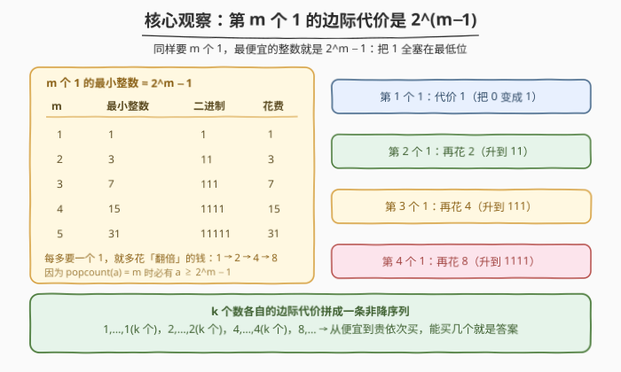
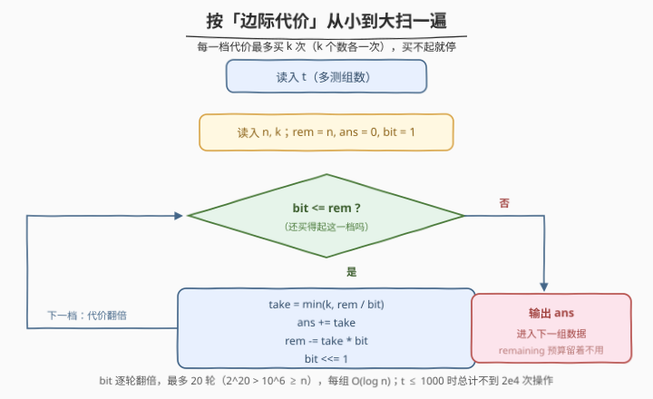
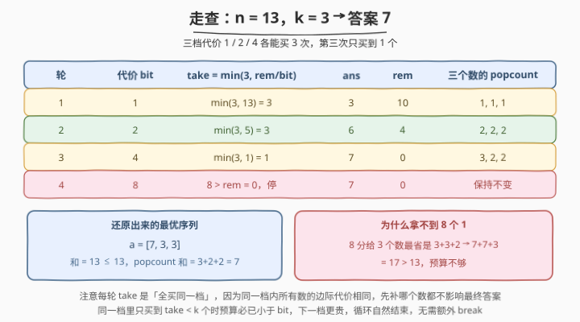

# Codeforces 2240A 另一个 Popcount 问题 题解

## 1. 题目概述

- **标题 / 题号**：另一个 Popcount 问题（Codeforces 2240A，英文名 Another Popcount Problem）
- **链接**：https://codeforces.com/problemset/problem/2240/A
- **来源**：Codeforces Round 1105 (Div. 2) · Problem A（UTC 2026-06-27）
- **难度**：800（500 分，题面标注 *800）
- **限制**：时间 1 s / 内存 256 MB
- **标签**：贪心

**题意**：给定两个整数 $n$ 与 $k$。要求构造一个由 $k$ 个**非负整数**组成的序列 $a_1, a_2, \ldots, a_k$，满足

$$\sum_{i=1}^{k} a_i \le n,$$

并使**二进制中 $1$ 的个数之和** $\sum_{i=1}^{k} \operatorname{popcount}(a_i)$ 尽可能大。只需输出这个最大值（不需要输出序列本身）。多测：第一行 $t$，之后每组一行 $n, k$，每组输出一行答案。

**约束**：

- $1 \le t \le 10^3$，组数不多但也不小，每组必须接近 $O(\log n)$；
- $1 \le n, k \le 10^6$，答案 $\le n \le 10^6$，`int` 足够，但乘法建议用 64 位；
- $a_i$ 可以为 $0$（不消耗总和、也不贡献 $1$），因此「用满 $k$ 个数」不是必须的；
- $\sum a_i \le n$ 是**不等式**，允许剩下预算不用——这一点决定了贪心必须能「买不起就停」。

## 2. 示例与观察
官方样例（输入 / 输出原样）：

```text
输入：
6
2 1
3 1
6 2
14142 137205
1000000 100
1000000 1000000

输出：
1
2
4
14142
1322
1000000
```

题面 Note 给出的构造：

- $n=2, k=1$：取 $a=[1]$ 或 $a=[2]$，两种都只贡献 $1$ 个 $1$；
- $n=3, k=1$：取 $a=[3]=(11)_2$，贡献 $2$ 个 $1$，比 $2$ 更划算；
- $n=6, k=2$：取 $a=[3,3]$，和 $3+3=6 \le 6$，总数 $2+2=4$。

补一组自造样例，覆盖「预算刚好卡在 $2^m-1$」「$k$ 远大于 $n$」「$k=1$」三种边界：

```text
输入：
4
13 3
7 1
100 100000

输出：
7
3
100
```

第 1 组取 $a=[7,3,3]$，和 $13$，$1$ 的个数 $3+2+2=7$（本文 3.4 节的走查题）；第 2 组 $7=(111)_2$ 一步吃满；第 3 组因为 $k \ge n$，直接放 $n$ 个 $1$，答案就是 $n$。

## 3. 解题思路

### 3.1 暴力思路

最直白的做法是 DP：$f[i][j]$ 表示「用 $i$ 个数、总和不超过 $j$」时的最大 popcount 和，转移枚举第 $i$ 个数取 $a \in [0, j]$：

$$f[i][j] = \max_{0 \le a \le j}\bigl(\operatorname{popcount}(a) + f[i-1][j-a]\bigr).$$

单组复杂度 $O(k n^2)$，在 $n=k=10^6$ 时是 $10^{18}$ 级别，完全不可行。即便只求答案不构造序列，状态数也已经有 $k \cdot n = 10^{12}$。

不过这个 DP 很有价值：它说明**答案只与「每个数拿到几个 $1$」有关**，与具体数值无关。顺着这个想法往下推，就能把 DP 压成一行贪心。

### 3.2 核心观察：第 $m$ 个 $1$ 的边际代价是 $2^{m-1}$



**关键事实**：一个数若含 $m$ 个 $1$，它最小能取多少？答案是 $2^m-1$——把这 $m$ 个 $1$ 全部塞在最低的 $m$ 位上（$1, 11, 111, 1111 \ldots$）。任意别的摆法只是把某些 $1$ 往高位挪，只会更贵：

$$a \ge 2^{\operatorname{popcount}(a)} - 1.$$

于是原问题等价于：选 $m_1, \ldots, m_k \ge 0$，满足 $\sum (2^{m_i}-1) \le n$，最大化 $\sum m_i$。

再看「单价」：让某个数的 popcount 从 $m-1$ 涨到 $m$，花费从 $2^{m-1}-1$ 涨到 $2^m-1$，**边际代价正好是 $2^{m-1}$**。也就是说，每个数都是一条阶梯：

$$\underbrace{1}_{\text{第 1 个 1}},\ \underbrace{2}_{\text{第 2 个}},\ \underbrace{4}_{\text{第 3 个}},\ \underbrace{8}_{\text{第 4 个}},\ \ldots$$

共 $k$ 条阶梯，每条的边际代价序列都是 $1, 2, 4, 8, \ldots$。把所有阶梯的台阶倒在一起排序，得到

$$1,\ldots,1\ (k\text{ 个}),\ 2,\ldots,2\ (k\text{ 个}),\ 4,\ldots,4\ (k\text{ 个}),\ 8,\ldots$$

这是一条**非降**序列。只要从最便宜的开始买，买到买不起为止，买到的个数就是答案——这就是贪心。

> 💡 直觉对照：$k \ge n$ 时答案显然就是 $n$（放 $n$ 个 $1$，每个花 $1$）。这正说明「便宜的 $1$」优先级最高，而 $2^{m}-1$ 的形状只是把 $m$ 个便宜 $1$ 打包进同一个数。

### 3.3 算法流程



对每组 $n,k$：

1. 令 `rem = n`（剩余预算）、`ans = 0`（已买到的 $1$ 的个数）、`bit = 1`（当前档的单价）；
2. 当 `bit <= rem` 时循环：
   - `take = min(k, rem / bit)`：这一档最多能买几个（每档至多 $k$ 个，因为只有 $k$ 个数，各能升一档）；
   - `ans += take`；
   - `rem -= take * bit`；
   - `bit <<= 1`：进入下一档（单价翻倍）；
3. 循环结束，输出 `ans`。

**为什么同一档里「一次买完」是安全的**：同一档内所有台阶的代价相同，先补哪个数都不改变总花费，因此这一档能买几个就买几个，不需要回头。

**为什么循环一定结束**：`bit` 每轮翻倍，而 `rem` 单调不增；一旦 `take < k`，就有 `rem < bit`，下一轮 `bit` 翻倍后必然大于 `rem`，循环自然退出。最多约 $20$ 轮（$2^{20} > 10^6$）。

### 3.4 示例演算



以 $n = 13,\ k = 3$ 为例：

| 轮 | 单价 `bit` | `take = min(3, rem/bit)` | `ans` | `rem` | 三个数的 popcount |
|----|-----------|--------------------------|-------|-------|-------------------|
| 1 | 1 | $\min(3, 13) = 3$ | 3 | 10 | 1, 1, 1 |
| 2 | 2 | $\min(3, 5) = 3$ | 6 | 4 | 2, 2, 2 |
| 3 | 4 | $\min(3, 1) = 1$ | 7 | 0 | 3, 2, 2 |
| 4 | 8 | $8 > rem = 0$，停 | 7 | 0 | 不变 |

把三个数各升到 popcount $2$ 花了 $13-10=3$、$10-4=6$，一共 $9$；剩下 $4$ 只够给一个数升到 $3$。还原出 $a = [7,3,3]$，和 $13$，popcount 和 $3+2+2=7$。

再检验「$8$ 个 $1$ 为什么不现实」：最优分摊是 $3+3+2$，至少要 $7+7+3=17 > 13$，预算不够。这也解释了为什么贪心在最后一档「只买到 $1$ 个」就停了——剩下的钱买不起任何一档了。

## 4. 算法细节

1. **每档不是无条件买 $k$ 个**：`take = min(k, rem / bit)`。`rem / bit` 是向下取整的「买得起几个」，`k` 是「最多有几个数能升这一档」，两者取小。
2. **`take * bit` 不会溢出**：因为 `take ≤ rem / bit`，所以 `take * bit ≤ rem ≤ 10^6`，`int` 也够；但为省心，代码统一用 `long long`。
3. **循环条件写 `bit <= rem` 而不是 `bit <= n`**：用 `n` 会多跑若干轮空转（`rem` 早已不够），虽然不影响答案，但让「买不起就停」的语义更直观。
4. **不要真的构造序列**：题目只要最大值，`ans` 就是台阶数，等于 $\sum m_i$。构造 `a_i = 2^{m_i}-1` 只在证明与自查时需要。
5. **每档最多只能买 $k$ 个**：这一点最容易漏。若写成 `take = rem / bit`，$n=13,k=1$ 会在第一档直接买满 $13$ 个并输出 $13$，可 popcount 为 $13$ 的数至少是 $2^{13}-1=8191$，比预算 $13$ 大两个数量级以上，荒谬立现。
6. **多测重置**：`rem`、`ans`、`bit` 三个变量全部在每组内部重新初始化，不跨组污染。
7. **I/O**：C++ 关同步并用 `'\n'`；Python 用 `sys.stdin.buffer.read().split()` 一次读完，再顺序切片，避免 $10^3$ 次 `input()` 的开销。
8. **答案上界**：$\sum m_i \le \sum a_i \le n \le 10^6$（因为 $2^{m_i}-1 \ge m_i$），所以输出不会超过 $10^6$，与样例最后一行 $1000000$ 一致。

## 5. 正确性证明

**引理 1（$m$ 个 $1$ 的最小整数）**：若 $\operatorname{popcount}(a) = m$，则 $a \ge 2^m - 1$；且取 $a = 2^m - 1$ 时等号成立。

**证明**：设 $a$ 的 $m$ 个置位分别在第 $p_1 < p_2 < \cdots < p_m$ 位，则 $a = \sum_{i=1}^{m} 2^{p_i}$。由于 $p_i \ge i-1$（$m$ 个互不相同的非负整数的最小可能取值就是 $0,1,\ldots,m-1$），有

$$a = \sum_{i=1}^{m} 2^{p_i} \ge \sum_{i=1}^{m} 2^{i-1} = 2^m - 1.$$

而 $2^m-1$ 的二进制恰为 $\underbrace{11\cdots1}_{m}$，popcount 为 $m$，等号可达。∎

**引理 2（问题等价于选「台阶数」）**：总 popcount 能达到 $P$ 当且仅当存在非负整数 $m_1,\ldots,m_k$，使得 $\sum m_i = P$ 且 $\sum (2^{m_i}-1) \le n$。

**证明**：
（$\Rightarrow$）若序列 $a$ 的总 popcount 为 $P$，令 $m_i = \operatorname{popcount}(a_i)$，则 $\sum m_i = P$，且由引理 1 有 $2^{m_i}-1 \le a_i$，故 $\sum(2^{m_i}-1) \le \sum a_i \le n$。
（$\Leftarrow$）给定满足条件的 $m_i$，取 $a_i = 2^{m_i}-1$。由引理 1，$\operatorname{popcount}(a_i) = m_i$，总 popcount 为 $P$，且 $\sum a_i = \sum(2^{m_i}-1) \le n$，是合法序列。∎

**引理 3（贪心取的台阶集合合法）**：把每档单价 $2^{j}$ 复制 $k$ 份、按升序排成序列 $c_1 \le c_2 \le \cdots$，则对任意 $p$，前 $p$ 个元素可以分配给 $k$ 个数，使每个数拿到的是自己阶梯的前缀。

**证明**：序列按单价分档，每档恰 $k$ 份；把第 $j$ 档（单价 $2^{j-1}$，$j \ge 1$）的 $k$ 份按编号分给第 $i$ 个数（$i = 1..k$）。于是一个数若被分到第 $1$ 档至第 $m$ 档，它拿到的单价恰为 $1, 2, 4, \ldots, 2^{m-1}$，正是自己阶梯的前缀，台阶数 $m$ 也就是它被分到的份数。∎

**引理 4（贪心最优）**：记 $g$ 为贪心买到的台阶数，则任何合法解的台阶总数不超过 $g$。

**证明**：设某个合法解给第 $i$ 个数分配 $m_i$ 个台阶，总台阶数 $P = \sum m_i$，总花费 $\sum(2^{m_i}-1) \le n$。把这 $P$ 个台阶按单价列出，第 $i$ 个数的台阶单价恰为 $1, 2, \ldots, 2^{m_i-1}$。因此这 $P$ 个单价是多重集 $\{c_j\}$ 中 $P$ 个互不相同的元素，其和 $\ge$ 最小的 $P$ 个元素之和 $\sum_{j=1}^{P} c_j$（后者正是贪心的取法）。于是 $\sum_{j=1}^{P} c_j \le \sum(2^{m_i}-1) \le n$；而 $g$ 是满足 $\sum_{j=1}^{g} c_j \le n$ 的最大下标，故 $P \le g$。∎

**定理**：算法输出的 `ans` 就是题目所求的最大总 popcount。

**证明**：由引理 3，贪心取的前 $g$ 个台阶对应一个合法配置（每个数取 $a_i = 2^{m_i}-1$），其总 popcount 为 $g$，故最优值 $\ge g$；由引理 4，任何合法解的总 popcount $\le g$，故最优值 $\le g$。两者夹逼得最优值 $= g$，即算法输出。∎

## 6. 复杂度分析

- **时间**：每组循环次数为 $\lceil \log_2 (n+1) \rceil \le 20$（因为 `bit` 每轮翻倍且 `bit <= rem <= n <= 10^6`），每次 $O(1)$，故单组 $O(\log n)$，总计 $O(t \log n) \le 2 \times 10^4$ 次基本运算，远小于 $10^8$ 量级。
- **空间**：$O(1)$。只有 `rem`、`ans`、`bit` 三个整型变量，与 $n,k,t$ 均无关；Python 版额外用了 $O(t)$ 的输出列表，可以忽略。
- **对照时限**：以 $t = 1000$ 且每组取最大约束（$n = 10^6$，$k$ 取 $1$ 与 $10^6$ 混合）实测，C++（clang++ -O2）约 $5$ ms，Python3 约 $18$ ms，距 $1$ s 时限有 $50$ 倍以上余量。本题 Python 无需 PyPy 也能稳过；若时限被压到 $0.1$ s，仍建议用 C++ 或 PyPy 提交。

## 7. 参考代码

### C++17

```cpp
#include <bits/stdc++.h>
using namespace std;

int main() {
    ios::sync_with_stdio(false);
    cin.tie(nullptr);

    int t;
    if (!(cin >> t)) return 0;              // 空输入防护
    while (t--) {
        long long n, k;
        cin >> n >> k;

        // 每个数的 popcount 从 m-1 提到 m，边际代价是 2^(m-1)。
        // k 个数的边际代价合在一起是：k 个 1、k 个 2、k 个 4、k 个 8 …
        // 从便宜到贵依次买，买不起就停，买到的个数即答案。
        long long rem = n, ans = 0;
        for (long long bit = 1; bit <= rem; bit <<= 1) {
            long long take = min(k, rem / bit);   // 这一档最多买 k 个，且要买得起
            ans += take;
            rem -= take * bit;
        }
        cout << ans << '\n';
    }
    return 0;
}
```

### Python3

```python
import sys


def solve(n: int, k: int) -> int:
    """从最便宜的边际代价开始买：每档（1,2,4,8,…）最多 k 个。"""
    rem, ans, bit = n, 0, 1
    while bit <= rem:
        take = min(k, rem // bit)
        ans += take
        rem -= take * bit
        bit <<= 1
    return ans


def main() -> None:
    data = sys.stdin.buffer.read().split()
    if not data:                            # 空输入防护
        return
    t = int(data[0])
    out = []
    for i in range(t):
        n = int(data[1 + 2 * i])
        k = int(data[2 + 2 * i])
        out.append(str(solve(n, k)))
    sys.stdout.write("\n".join(out) + "\n")


main()
```

## 8. 边界情况与易错点

1. **`take` 忘了对 $k$ 取小**：这是本题唯一的「坑」。$k=1$ 时一个数只能沿自己的阶梯走，$n=13$ 的答案是 $3$（取 $7=(111)_2$）而不是 $13$；必须写 `min(k, rem / bit)`。
2. **$k \ge n$**：此时第一档就能买满 $n$ 个（`rem / 1 = n ≤ k`），答案直接为 $n$，之后 `rem = 0` 循环立即结束。样例最后一行 $n=k=10^6$ 正是这种情况。
3. **$n=1$**：$bit=1 \le 1$，`take = min(k,1) = 1`，答案 $1$；不要因为 $k$ 很大就误以为需要循环很多轮。
4. **`bit` 的溢出与死循环**：`bit` 每轮翻倍，若写成 `while (true)` 并在 `rem = 0` 时继续 `take = 0`，就会一直空转到 `bit` 溢出（有符号移位溢出属未定义行为）。用 `bit <= rem` 作为条件最稳。
5. **把 `rem/bit` 写成 `(rem - bit)/bit + 1`**：两者等价但后者在 `rem < bit` 时仍会被 `min` 挡住，容易在改循环条件时出错；直接用整除更简洁。
6. **误以为要输出序列**：题面只要最大值，任何多余输出都会 WA。若真要构造，就取 $a_i = 2^{m_i}-1$，其中 $m_i$ 是第 $i$ 个数被分到的台阶数。
7. **用 `int` 做 `take * bit`**：本例其实不会溢出（乘积 $\le$ `rem`），但如果把约束放大到 $10^{18}$ 就会溢出，`long long` 是更安全的习惯。
8. **多测忘记重置**：三个变量必须在组内初始化；若定义在 `while (t--)` 外面会串组。
9. **Python 的 `min(k, rem // bit)`**：`//` 是向下取整，正好对应「买得起几个」；写成 `/` 会得到浮点，`rem` 变成浮点后 `bit` 比较仍然对，但最终 `ans` 会变成浮点数，输出格式就错了。

## 9. 验证记录

- **编译环境与命令**：`clang++ -std=c++17 -O2`（本机无 GNU g++，配 `codeforces/tools/include/bits/stdc++.h` 兼容头；正文代码只用标准库，可原样提交 GNU C++17）；Python 侧为 `Python 3.9.6`。
- **官方样例**：1 / 1 通过（按 Codeforces 标准 checker 的 token 比对，忽略空白与大小写）。
- **复核状态**：audited（2026-11-19 统一回归：编译 + 官方样例；写作期的随机对拍与暴力未重跑）。

## 相关题目与扩展

- [Codeforces 1550A Find The Array](https://codeforces.com/problemset/problem/1550/A)：最少需要几个数，使「相邻差的和」等于 $s$；增量代价是 $1,3,5,7,\ldots$，同样是「按代价从小到大买到买不起为止」的贪心，可与本题对照看模板。
- [Codeforces 1352A Sum of Round Numbers](https://codeforces.com/problemset/problem/1352/A)：把 $n$ 拆成若干个「末尾全 $0$」的数之和，本质是按二进制/十进制位拆分权重，是 popcount 视角的十进制版本。
- [Codeforces 1475A Odd Divisor](https://codeforces.com/problemset/problem/1475/A)：判断 $n$ 是否有大于 $1$ 的奇因子，结论只取决于 $n$ 是否为 $2$ 的幂，与本题「最低位优先」的位视角同源。
- [LeetCode 1356. 根据数字二进制下 1 的数目排序](https://leetcode.cn/problems/sort-integers-by-the-number-of-1-bits/)：popcount 的直接应用，适合练 `__builtin_popcount`。
- [LeetCode 322. 零钱兑换](https://leetcode.cn/problems/coin-change/)：一般硬币系统要 DP；而本题的单价是 $2$ 的幂（且带「每档最多 $k$ 份」的容量限制），恰好满足贪心条件，两者的差别正是「单价序列是否已排好序且可用前缀」。

**延伸思考**：

1. **加上上界**：若题目额外给出 $a_i \le b_i$，则每个数的阶梯在第 $\lfloor \log_2(b_i+1) \rfloor$ 档被封顶，贪心要改成「带容量上限的排序取法」，或对每档二分能买几个，复杂度仍是 $O(k \log n)$ 级别。
2. **换成最大化和**：若目标是最大化 $\sum a_i$ 且要求总 popcount 恰为 $P$，则每档必须买满才能保证数值最大——这与本题方向相反，答案变成「尽量把 $1$ 往高位堆」，即 $P$ 个 $1$ 单调地塞进尽量少的数里。
3. **权重版本**：若把 popcount 换成「第 $m$ 个 $1$ 值 $w_m$」，只要 $w_m$ 相对代价 $2^{m-1}$ 的比值单调不增，贪心仍然正确；一旦比值不单调（例如某些高位权重特别大），就必须回到 DP 或背包。
4. **反向问题**：给定总和上限 $n$，问「最少用几个数」能拿到 $P$ 个 $1$——这就是把本题的贪心倒过来做，等价于对 $P$ 求最小代价 $\min \sum(2^{m_i}-1)$，用「尽量均分」的结论可以 $O(1)$ 算出。
