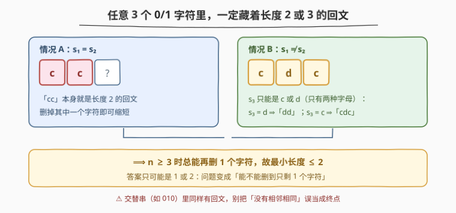
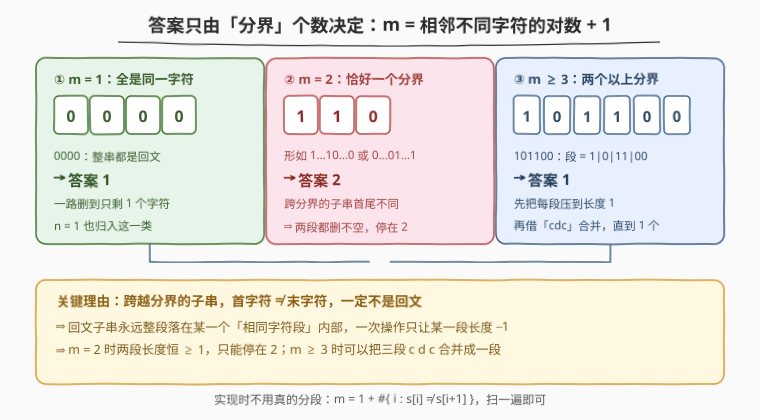
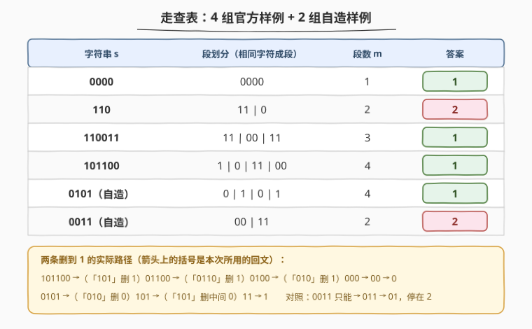

# Codeforces 2241C 回文删除 题解

## 1. 题目概述

- **标题 / 题号**：回文删除（Codeforces 2241C，英文名 RemovevomeR）
- **链接**：https://codeforces.com/problemset/problem/2241/C
- **来源**：Codeforces Round 1107 (Div. 3) · Problem C
- **难度**：1000（$*1000$）
- **限制**：时间 1 s / 内存 256 MB
- **标签**：贪心、字符串、回文（官方标签：greedy）

**题意**：给定只含 `0` 和 `1` 的串 $s$。一次操作：先选一个**长度至少为 2 的回文子串**，再从该子串中**恰好删掉一个字符**，剩下的字符按原顺序拼接成新串。操作可以做任意多次（也可以一次不做），求最终串**最小可能的长度**。

多测：第一行 $t$；每组两行——第一行 $n$，第二行为长度 $n$ 的 `01` 串；每组输出一行答案。

**约束**：

- $1\le t\le 100$
- $1\le n\le 100$
- $s$ 的每个字符是 `0` 或 `1`

## 2. 示例

官方样例（输入 / 输出原样）：

```text
输入：
4
4
0000
3
110
6
110011
6
101100
输出：
1
2
1
1
```

官方第 1 组：`0000 → 000 → 00 → 0`；第 2 组：`110 →（从 11 里删掉一个 1）10`，而 `10` 已没有长度 $\ge 2$ 的回文子串，只能停在 2。

再补一组自造样例（非官方）：

```text
输入：
5
1
0
4
0101
4
0011
3
010
4
1110
输出：
1
1
2
1
2
```

第 2 组 `0101` 是交替串、没有相邻相同字符，却仍然能删到 1：`0101 →（选回文 010，删首字符 0）101 →（选 101，删中间的 0）11 → 1`。第 3 组 `0011` 形如「一段 0 + 一段 1」，无论怎么删都卡在 2 —— 这正是本文要刻画的唯一「坏情况」。

## 3. 解题思路

### 3.1 暴力思路

最直接的做法是从 $s$ 出发做 BFS：每步枚举所有长度 $\ge 2$ 的回文子串，再枚举其中被删的字符，把新串入队。状态数上限是 $2^n$，$n=100$ 时完全不可行；枚举操作序列更不可能。

就算退一步写「能删就删」的贪心也不行，因为**先删哪个字符会改变结局**：`0110` 整串本来就是回文，随手删掉首字符 `0` 得到 `110`，而 `110` 已经卡死在长度 2；正确做法是删掉中间的某个 `1`：`0110 → 010 →（删中间的 1）00 → 0`，答案是 1。所以必须找到「什么时候能删到 1、什么时候只能停在 2」的判别条件。

### 3.2 核心观察：答案只可能是 1 或 2，且只有「恰好一个分界」才是 2



**为什么答案 $\le 2$**：看任意 3 个连续字符 $a,b,c$。若 $a=b$ 或 $b=c$，就有一段长度 2 的回文；否则 $a\ne b,\ b\ne c$，而字母表只有 `0`/`1` 两种，只能 $a=c$，于是 $abc$ 是长度 3 的回文。也就是说**长度 $\ge 3$ 的串永远还有东西可删**，反复操作一定能压到长度 $\le 2$。因此答案与 $n$ 无关，只会是 1 或 2（$n=1$ 时是 1）。

**为什么分界个数决定一切**：把 $s$ 切成若干个「相同字符的极大连续段」（run），记段数为 $m$，则

$$m = 1 + \#\{\,i : s_i\ne s_{i+1}\,\}.$$

关键的一点是：**任何跨越分界的子串都不是回文**。跨段子串必形如 $c^{i}d^{j}$（$c\ne d$，$i,j\ge 1$），长度 $\ge 2$ 时首字符 $c$ 与末字符 $d$ 不同，回文的首末字符必须相同，矛盾。于是

> **回文子串永远整段落在某一个 run 内部**，一次操作只是让**某一个 run 的长度减 1**。

由此三种情况立刻分明（见下图）：

- $m=1$（全是同一字符）：整串都是回文，一路删到 1 个，答案 $1$；
- $m=2$（形如 `0…01…1` 或 `1…10…0`）：只能在某一段内部删，而某段要清空必须删掉它的最后一个字符 —— 这个字符不在任何长度 $\ge 2$ 的回文里，删不掉。于是两段长度恒 $\ge 1$，答案恰为 $2$；
- $m\ge 3$：可以靠「三段 $cdc$ 合并」把段数一路压下去，最终删到 1 个（构造见 3.3）。



所以最终判据只有一行：

$$\text{ans} = \begin{cases} 2, & \#\{i: s_i\ne s_{i+1}\} = 1\\ 1, & \text{否则}\end{cases}$$

### 3.3 算法流程与 $m\ge 3$ 的构造

```
for each test:
    读入 n, s;  cnt ← 0
    for i ← 0 .. n-2:  if s[i] ≠ s[i+1]:  cnt ← cnt + 1
    输出 cnt == 1 ? 2 : 1
```

$m\ge 3$ 时「一定能删到 1」的构造性证明（也是官方样例 `101100` 的实际走法）：

1. **段压缩**：某个 run 长度 $\ge 2$ 时，它内部有 `cc` 这个长度 2 回文，可以随时删掉一个字符。于是可以把**每个 run 都压到长度 1**，得到一个长度 $m$ 的交替串 $T$。
2. **偶数长度先砍一位**：若 $|T|$ 为偶数，取末三个字符，它们是 $y\,x\,y$（相隔 2 位必相同），这是回文，删掉最后一个字符，得到长度 $|T|-1$（奇数）的交替串。
3. **奇数长度每次减 2**：若 $|T|\ge 3$ 为奇数，头三个字符是 $c\,d\,c$ 回文，删掉中间的 $d$，前两段就并成一个 `cc`（长度 2），再把它压缩回长度 1，交替串长度从 $m$ 变成 $m-2$。重复 2、3 直到只剩 1 个字符。

整个过程长度严格递减且不会卡住，因此 $m\ge 3$ 时答案必为 1。

### 3.4 示例演算



| 字符串 $s$ | 段划分 | $m$ | 相邻不等对数 | 答案 |
|---|---|---|---|---|
| `0000` | `0000` | 1 | 0 | 1 |
| `110` | `11｜0` | 2 | 1 | 2 |
| `110011` | `11｜00｜11` | 3 | 2 | 1 |
| `101100` | `1｜0｜11｜00` | 4 | 3 | 1 |
| `0101`（自造） | `0｜1｜0｜1` | 4 | 3 | 1 |
| `0011`（自造） | `00｜11` | 2 | 1 | 2 |

两条删到 1 的实际路径（括号里是本次选用的回文）：

- `101100 →（101 删一个 1）01100 →（0110 删一个 1）0100 →（010 删一个 1）000 → 00 → 0`
- `0101 →（010 删首字符 0）101 →（101 删中间 0）11 → 1`

对照 `0011`：它只有两段，任何操作都只在 `00` 或 `11` 内部删，`0011 → 011 → 01`，最后 `01` 已经没有长度 $\ge 2$ 的回文，停在 2。这与「$m=2$ 卡死」完全一致。

## 4. 算法细节

1. **不要真的分段，更不要真的模拟**：$m=1+\#\{i:s_i\ne s_{i+1}\}$，一次线性扫描即可；模拟删除的状态空间是指数级的，而且贪心选法会给出错误答案（`0110` 反例）。
2. **判据别写反**：输出 2 的**唯一**条件是「相邻不等对数**恰好等于 1**」。写成「存在分界就输出 2」会把 `0011`、`101100` 之类全判错；写成「没有相邻相同就输出 $n$」会把 `0101` 判成 4。
3. **下标边界**：循环写 `for (int i = 0; i + 1 < n; ++i)`，$n=1$ 时循环体不执行、`cnt = 0`，直接输出 1，不会越界访问 `s[1]`。
4. **多测清零**：`cnt` 定义为每组内部变量（或每组开头置 0）。$t\le 100$，一旦把 `cnt` 提到循环外累加，从第二组起全错。
5. **读入方式**：$n$ 与 $s$ 在样例里分两行，但空白分隔，`cin >> n >> s` 最稳；**不要**混用 `getline`（会读到上一行残留的空行，导致后面全部错位）。
6. **Python 细节**：`sys.stdin.buffer.read().split()` 一次读完最省事；此时 `s` 是 `bytes`，`s[i] != s[i+1]` 比较的是两个 `int`，无需解码。
7. **数值与 I/O**：答案只有 1 或 2，`cnt ≤ 99`，全用 `int`，无溢出也无需取模；总长度 $\sum n\le 10^4$，任何读写方式都够，照例加 `ios::sync_with_stdio(false)` 与 `cin.tie(nullptr)`。

## 5. 正确性证明

**引理 1（短回文必存在）**：任何长度 $\ge 3$ 的 `01` 串都含有长度为 2 或 3 的回文子串。

**证明**：取前三个字符 $a,b,c$。若 $a=b$，`ab` 是长度 2 回文；若 $b=c$，`bc` 是长度 2 回文；否则 $a\ne b$ 且 $b\ne c$，字母表只有两种字符，必有 $a=c$，于是 $abc$ 满足首末相同、中间任意，是长度 3 回文。∎

**推论 1（答案上界）**：答案 $\le 2$；且 $n=1$ 时答案为 1。

**证明**：$n\ge 3$ 时由引理 1 存在长度 $\ge 2$ 的回文子串，可删 1 个字符，长度减 1 后若仍 $\ge 3$ 继续删，直至长度 $\le 2$。$n=1$ 时无长度 $\ge 2$ 的子串，答案 1。∎

**引理 2（回文整段落在 run 内）**：若 $s=c^{a}d^{b}$（$a,b\ge 1$，$c\ne d$），则 $s$ 的每个长度 $\ge 2$ 的回文子串都完全落在某个 run 内。

**证明**：反设某回文子串跨过分界，则它形如 $c^{i}d^{j}$（$i,j\ge 1$）。其长度 $\ge 2$，首字符为 $c$、末字符为 $d$，而 $c\ne d$，与回文要求首末相同矛盾。∎

**引理 3（$m=2$ 时答案为 2）**：若 $s=c^{a}d^{b}$（$a,b\ge 1$，$c\ne d$），则任何操作序列后串仍形如 $c^{a'}d^{b'}$ 且 $a',b'\ge 1$，故最终长度 $\ge 2$；又可达 2，故答案为 2。

**证明**：由引理 2，每次操作只在某一个 run 内部删一个字符，故串始终形如 $c^{a'}d^{b'}$ 且 $a'+b'$ 递减。若某次操作后某段变成 0，说明被删的是该段的最后一个字符；但该字符所在的回文子串长度 $\ge 2$，由引理 2 必整体落在这一段内，而这一段只剩 1 个字符，容纳不下长度 $\ge 2$ 的子串，矛盾。所以 $a',b'\ge 1$ 恒成立，长度 $\ge 2$。另一方面，把两段分别删到长度 1 即得长度 2，故答案为 2。∎

**引理 4（$m\ge 3$ 时答案为 1）**：若 $s$ 至少 3 段，则可归约到长度 1。

**证明**：按 3.3 的构造。① run 长度 $\ge 2$ 时其内部含 `cc` 长度 2 回文，可删一字符，故能把每段压到长度 1，得长度 $m$ 的交替串 $T$（每步合法）。② $|T|$ 为偶数时，末三字符为 $yxy$（相隔 2 位字符相同），是回文，删末字符后得奇数长交替串。③ $|T|\ge 3$ 为奇数时，头三字符 $cdc$ 是回文，删中间字符 $d$ 后前两段并为 `cc`（长度 2），再删其中一个 $c$ 压回长度 1，交替串长度减 2。每轮长度严格减 1 或减 2 且步骤合法，重复执行必终止于长度 1。∎

**定理**：算法输出等于最小可能长度。

**证明**：设 $k=\#\{i:s_i\ne s_{i+1}\}$，则 $m=k+1$。若 $k=1$ 则 $m=2$，由引理 3 答案为 2，算法输出 2；若 $k\ne1$，则 $m=1$（全同，一路删到 1）或 $m\ge3$（引理 4 可到 1），答案为 1，算法输出 1。由推论 1 答案只可能是 1 或 2，故算法输出恰为最小值。∎

## 6. 复杂度分析

- **时间**：每组一次线性扫描 $O(n)$，总计 $O(\sum n)\le 10^4$ 次比较，$1$ s 时限下是微秒级。
- **空间**：只需存字符串 $O(n)$；除字符串外仅一个计数器，$O(1)$ 额外空间。
- **实测**：本机 Apple clang `-O2`，$t=100$、$n=100$（全交替串，每组都比满 99 次）20 次取最小，连进程启动共约 $4.2$ ms；Python3 约 $19$ ms。算法本体不到 $0.1$ ms，相对 $1$ s 有百倍以上余量。

## 7. 参考代码

### C++17

```cpp
#include <bits/stdc++.h>
using namespace std;

int main() {
    ios::sync_with_stdio(false);
    cin.tie(nullptr);

    int t;
    if (!(cin >> t)) return 0;                 // 空输入防护
    while (t--) {
        int n;
        string s;
        cin >> n >> s;
        int cnt = 0;                           // 相邻不同字符的对数 = 段数 - 1
        for (int i = 0; i + 1 < n; ++i)
            if (s[i] != s[i + 1]) ++cnt;
        cout << (cnt == 1 ? 2 : 1) << '\n';    // 唯一卡在 2 的情形
    }
    return 0;
}
```

### Python3

```python
import sys


def main() -> None:
    data = sys.stdin.buffer.read().split()
    if not data:                               # 空输入防护
        return
    t = int(data[0])
    p = 1
    out = []
    for _ in range(t):
        n = int(data[p])
        s = data[p + 1]                        # bytes，下标取出的是 int
        p += 2
        cnt = 0
        for i in range(n - 1):
            if s[i] != s[i + 1]:
                cnt += 1
        out.append("2" if cnt == 1 else "1")
    sys.stdout.write("\n".join(out) + "\n")


main()
```

## 8. 边界情况与易错点

1. **交替串不是终点**：`0101` 没有相邻相同字符，但 `010`、`101` 都是长度 3 回文，答案是 1 而不是 4。只看「相邻相同」会漏掉长度 3 的回文。
2. **只有恰好一个分界才是 2**：`01`、`10`、`0011`、`1100`、`1110` 都是 2；而 `0110`（两段边界、共 3 段）是 1，用「有分界 → 2」会错。
3. **$n=1$**：没有长度 $\ge 2$ 的子串，答案恒为 1，且循环条件必须写成 `i + 1 < n` 以免越界。
4. **多测重置**：`cnt` 必须在每组开头清零；放到循环外累加会让第 2 组之后全部报错。
5. **读入错位**：`cin >> n >> s` 与 `getline` 混用时会读到空行，导致第 2 组开始 `n`/`s` 全错。统一用 `>>`（C++）或 `split()`（Python）。
6. **不要写贪心模拟**：`0110` 删首字符得 `110` 卡在 2，删中间 `1` 却能到 1，说明「任选一个可删字符」是错的，必须用本文判据。

## 相关题目与扩展

- [Codeforces 1138A Sushi for Two](https://codeforces.com/problemset/problem/1138/A)：同样只关心「每个相同字符 run 的长度」，run 分析的最短入门题。
- [Codeforces 600C Make Palindrome](https://codeforces.com/problemset/problem/600/C)：用字符计数构造回文，与本题「回文只受字符配对约束」同源。
- [LeetCode 5. 最长回文子串](https://leetcode.cn/problems/longest-palindromic-substring/)：回文子串本身的判定与求解。
- [LeetCode 125. 验证回文串](https://leetcode.cn/problems/valid-palindrome/)：双指针判回文，本题的「首末字符必须相同」正是该判据。

**延伸思考**：

1. **字母表扩到 3 种字符**：结论立刻失效。`012012…` 这类串相邻字符不同、相隔 2 位也不同，于是长度 2 与长度 3 的回文都不存在，而任何长度 $\ge 2$ 的回文都含长度 2 或 3 的回文中心，所以它**一个可删的回文子串都没有**，答案就是 $n$。此时题目从 1000 分的结论题变成真正的搜索/DP 题。
2. **要求输出字典序最小的最短终串**：答案长度仍是 1 或 2，但 $m\ge3$ 时要沿 3.3 的构造实际走一遍，并且终串字符可以选 `0` 或 `1`（取决于删到最后留下的段），需要额外记录路径。
3. **只允许删回文子串的正中间字符**（即只允许奇数长度回文）：长度 2 的回文失去作用，段压缩这一步不再合法，本文「run 内部可任意减 1」的核心不变量直接崩塌，答案是另一套结构。
4. **改成求最少操作次数**：由于每次操作恰好删掉 1 个字符，操作次数 $=n-\text{最终长度}$，故最少次数就是 $n-\text{ans}$（$\text{ans}\in\{1,2\}$），不需要额外计算 —— 这类「不变量是长度差」的题目可以直接套用本文结论。
