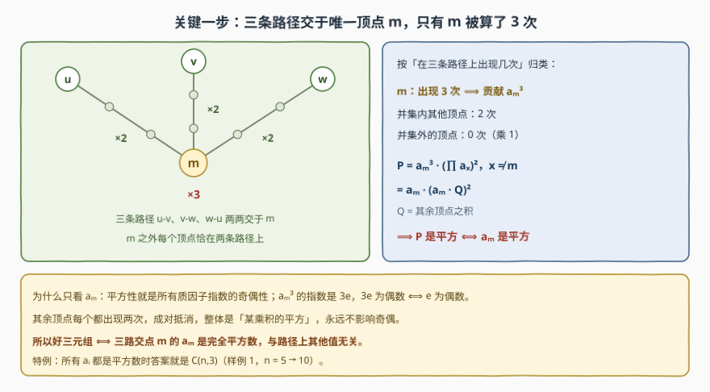
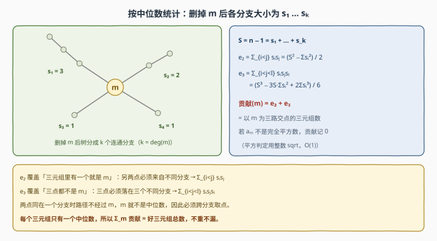
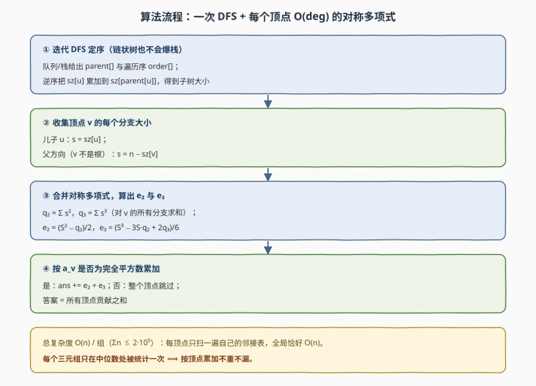
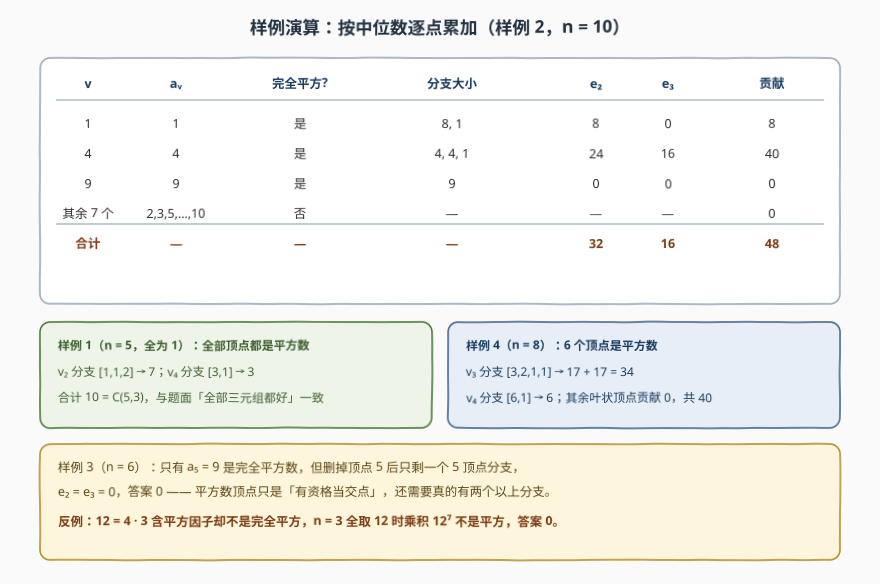

# Codeforces 2241E 公平与平方 题解

## 1. 题目概述

- **标题 / 题号**：公平与平方（Codeforces 2241E，英文名 Fair and Square）
- **链接**：https://codeforces.com/problemset/problem/2241/E
- **来源**：Codeforces Round 1107 (Div. 3) · Problem E
- **难度**：1600（$\ast 1600$）
- **限制**：时间 3 s / 内存 256 MB
- **标签**：组合数学、树、数学、数论（官方标签：combinatorics, dp, graphs, math, number theory, trees）

**题意**：给定一棵 $n$ 个顶点的树，顶点 $i$ 上写着整数 $a_i$。对任意两个**不同**的顶点 $u,v$，记 $p(u,v)$ 为 $u$ 到 $v$ 的唯一简单路径上**所有顶点**（含两端）权值之积。

一个由三个**不同**顶点组成的无序三元组 $\{u,v,w\}$ 称为「好的」，当且仅当

$$p(u,v)\cdot p(v,w)\cdot p(w,u)$$

是完全平方数。求好三元组的个数。

多测：第一行 $t$；每组先给 $n$，第二行 $n$ 个 $a_i$，接下来 $n-1$ 行是边。每组输出一行答案。

**约束**：

- $1 \le t \le 10^4$，$3 \le n \le 2\cdot 10^5$，$\sum n \le 2\cdot 10^5$
- $1 \le a_i \le 10^6$：值很小，但**乘积会爆炸**（最坏 $2\cdot 10^5$ 个 $10^6$ 连乘，量级 $10^{1.2\times10^6}$），所以绝不能真的把乘积算出来
- 答案最大为 $\binom{2\cdot 10^5}{3} = 1333313333400000 \approx 1.33\times 10^{15}$，必须用 `long long`
- 3 s 时限比较宽松，$O(n\log n)$ 也能过；但本题存在一个很干净的 $O(n)$ 做法

> 💡 一句话本质：三条路径两两的交点 $m$ 在乘积里**恰好出现 3 次**，其他顶点都出现 **2 次**，所以乘积是平方 $\iff$ **交点上的 $a_m$ 本身是完全平方数**；于是问题变成「按三路交点统计三元组」。

## 2. 示例与观察
官方样例（输入 / 输出原样）：

```text
输入：
4
5
1 1 1 1 1
1 2
2 3
2 4
4 5
10
1 2 3 4 5 6 7 8 9 10
1 3
2 6
6 7
5 4
8 3
3 4
4 6
9 1
10 2
6
12 6 3 18 9 2
3 4
4 5
2 6
6 1
4 2
8
3 16 9 1 8 16 4 9
2 1
3 1
4 3
3 5
6 3
4 7
8 1
输出：
10
48
0
40
```

第 1 组所有 $a_i=1$，每个三元组都好，答案 $\binom{5}{3}=10$（题面把这 10 组全部列了出来）。第 2 组答案是 $48$，题面只举了其中一组 $\{2,5,8\}$ 作例子。第 3 组里唯一的平方数是 $a_5=9$，但顶点 5 是叶子，删掉它只剩一个连通块，所以答案 $0$。第 4 组有 6 个顶点是平方数，答案 $40$。

再补一组自造样例（非官方），覆盖「中位数是平方数 / 不是平方数 / 只有平方因子」「星形 / 链形」等情形：

```text
输入：
6
3
3 9 3
1 2
2 3
4
4 4 7 9
2 1
2 3
2 4
3
12 12 12
1 2
2 3
5
1 1 1 1 1
1 2
3 4
2 4
4 5
4
3 16 9 2
1 2
2 3
3 4
5
6 8 10 15 21
1 2
2 3
3 4
4 5
输出：
1
4
0
10
4
0
```

逐组说明：

- 第 1 组链 `3 - 9 - 3`：三路交点是中间的 $9$（完全平方数），乘积 $3^2\cdot 9^3\cdot 3^2=59049=243^2$，答案 1。
- 第 2 组星形，中心 $a_2=4$ 是平方数，任意三个顶点组成的 4 个三元组交点都是中心，答案 4。
- 第 3 组三个 $12$：$12=2^2\cdot 3$，乘积 $12^7=2^{14}\cdot 3^7$，质因子 $3$ 的指数 7 是奇数，答案 0 —— **12 含平方因子但不是完全平方数**，这正是最容易踩的坑。
- 第 4 组是「链 1-2-4-3 再挂 5」，全为 1，答案仍是 $\binom{5}{3}=10$。
- 第 5 组链 `3 - 16 - 9 - 2`：两个平方数顶点 $2,3$，各自贡献 2，答案 4。
- 第 6 组全是非平方数，答案 0。

## 3. 解题思路

### 3.1 暴力思路

最直接的做法是枚举所有 $\binom{n}{3}$ 个三元组，对每组用 BFS 求出三条路径、把路径上的 $a$ 全乘起来，再判是否完全平方。$n=2\cdot 10^5$ 时三元组数约 $1.33\times 10^{15}$，连「读一遍」都不可能；而且**乘积本身存不下**（最坏 $10^{1.2\times10^6}$），就算只做一次查询，也必须靠高精度数。

暴力的唯一出路是只保留「质因子指数的奇偶」：每个 $a_i$ 换成一个平方自由核（squarefree kernel），乘积是平方 $\iff$ 核的乘积为 1。但即使如此，逐三元组仍然是 $O(n^3)$ 组。

所以必须找出**结构**：乘积里每个顶点被算了几次。

### 3.2 核心观察一：三条路径交于唯一顶点 $m$，$m$ 出现 3 次、其余出现 2 次



对三元组 $\{u,v,w\}$，看三条路径 $P_{uv},P_{vw},P_{wu}$。树中任意两条路径的交仍是一条路径，而这三条路径两两相交，可以证明它们**有且只有一个公共顶点**，记作 $m$（就是三个顶点的「三路交点」，也叫中位数）。

> **引理**：$m$ 存在且唯一。取 $P_{uv}$ 上离 $w$ 最近的点 $m$，则 $w$ 到 $u$、$w$ 到 $v$ 的路径都从 $m$ 接入 $P_{uv}$，故 $m\in P_{uv}\cap P_{vw}\cap P_{wu}$；唯一性由「两两交」直接得到：若 $m'\ne m$ 也在三条路径上，则 $m'\in P_{uv}\cap P_{vw}=P_{mv}$ 且 $m'\in P_{uv}\cap P_{wu}=P_{mu}$，于是 $m'=m$。

把树按 $m$ 切开：删掉 $m$ 后，$u,v,w$ 必落在**三个不同的连通块**里（否则 $m$ 不会同时出现在三条路径上）。于是三条路径就是三条「臂」$m\to u$、$m\to v$、$m\to w$ 两两组合，除 $m$ 外**三条臂互不相交**。数每个顶点在 $P_{uv}\cdot P_{vw}\cdot P_{wu}$ 里被乘的次数：

- $m$：三条路径都含它 → **3 次**；
- 落在某条臂上（$u,v,w$ 自己也算臂的端点）的顶点：它在两条路径里（例如 $m\to u$ 上的点，在 $P_{uv}$ 和 $P_{wu}$ 里）→ **2 次**；
- 三条臂之外的顶点：一条路径也不含 → **0 次**（乘 1）。

记三条臂上除 $m$ 外所有顶点的权值之积为 $Q$，就有

$$p(u,v)\,p(v,w)\,p(w,u)=a_m^{3}\cdot Q^{2}.$$

### 3.3 核心观察二：乘积是平方 $\iff$ 交点上的 $a_m$ 是平方

由 $P=a_m^3Q^2$ 看每个素数的指数：把素数 $q$ 在 $a_m$ 中的指数记为 $e_q$，则

$$v_q\!\left(P\right)=3e_q+2v_q(Q).$$

右边第二项是偶数，所以 $v_q(P)$ 为偶 $\iff 3e_q$ 为偶 $\iff e_q$ 为偶。对所有 $q$ 成立，即

$$P\text{ 是完全平方}\iff a_m\text{ 是完全平方}.$$

注意这里 $a_m$ 的**指数是 3 不是 1**：$3e$ 为偶 $\iff e$ 为偶，所以判据仍然是「$a_m$ 本身是完全平方」，而不是「$a_m$ 的某个因子是平方」。同时也说明：**臂上其他顶点怎么取值完全无所谓**，只要交点上的值合格。

### 3.4 核心观察三：按「以 $m$ 为交点」统计三元组



现在问题只剩：对每个**满足 $a_m$ 是完全平方数**的顶点 $m$，数出以 $m$ 为三路交点的三元组个数，全部加起来。

删掉 $m$ 后，树分成 $k$ 个连通块，大小记为 $s_1,\dots,s_k$（$k=\deg(m)$，注意 $S=\sum s_i=n-1$）。三元组以 $m$ 为交点，等价于：

- 三个顶点来自**三个不同的连通块**；或
- 其中一个顶点就是 $m$，另外两个来自**两个不同的连通块**。

（只要有两点同处一个连通块，它们之间的路径就绕开了 $m$，$m$ 便不在三条路径的交上。）

于是以 $m$ 为交点的三元组数为

$$e_2+e_3,\qquad e_2=\sum_{i<j}s_is_j,\qquad e_3=\sum_{i<j<\ell}s_is_js_\ell .$$

直接按 $s_i$ 逐对枚举是 $O(\deg^2)$，全树会退化到 $O(n^2)$（菊花图）。用对称多项式（牛顿恒等式）可以 $O(\deg)$ 算出：

$$e_2=\frac{S^2-\sum s_i^2}{2},\qquad e_3=\frac{S^3-3S\sum s_i^2+2\sum s_i^3}{6}.$$

**每个三元组的三路交点唯一**，所以按 $m$ 累加不重不漏：

$$\text{ans}=\sum_{m:\ a_m\text{ 为完全平方}} \left(e_2(m)+e_3(m)\right).$$

### 3.5 算法流程



```
for each test:
    读入 n, a[], 建邻接表
    # ① 迭代 DFS 求 BFS 序与父指针（避免链状树递归爆栈）
    parent[0] = -2 ; order = [0]
    for v in order:                      # 迭代中追加，等价于 BFS
        for u in adj[v]:
            if parent[u] == -1: parent[u] = v ; order.append(u)
    # ② 逆序累加子树大小
    sz[v] = 1
    for v in reversed(order[1:]): sz[parent[v]] += sz[v]
    # ③ 逐点累加
    S = n - 1 ; ans = 0
    for v in 0 .. n-1:
        if a[v] 不是完全平方数: continue
        q2 = q3 = 0
        for u in adj[v]:
            s = (parent[u] == v) ? sz[u] : n - sz[v]     # 儿子方向 / 父方向
            q2 += s*s ; q3 += s*s*s
        ans += (S*S - q2)/2 + (S*S*S - 3*S*q2 + 2*q3)/6
    输出 ans
```

第 ③ 步里每个顶点只扫一遍自己的邻接表，全树每条边被看两次，总计 $O(n)$。

### 3.6 示例演算



以样例 2（$n=10$，$a=1\ldots 10$，树为 `9-1-3-4-6-2-10`，另有 `8-3`、`5-4`、`7-6`）为例，平方数顶点是 $a_1=1,\ a_4=4,\ a_9=9$：

| 顶点 $m$ | $a_m$ | 删掉 $m$ 后的分支大小 | $e_2$ | $e_3$ | 贡献 |
|---|---|---|---|---|---|
| 1 | 1 | $8,\ 1$ | $8$ | $0$ | $8$ |
| 4 | 4 | $4,\ 4,\ 1$ | $1\cdot4+1\cdot4+4\cdot4=24$ | $1\cdot4\cdot4=16$ | $40$ |
| 9 | 9 | $9$ | $0$ | $0$ | $0$ |
| 其余 7 个顶点 | $2,3,5,6,7,8,10$ | 非平方数，跳过 | — | — | $0$ |
| **合计** | | | | | $\mathbf{48}$ |

顶点 9 虽然权值是平方数，但它是叶子，删掉后只剩一个连通块，$e_2=e_3=0$ —— **平方数只是「有资格当交点」，还得真的有两个以上分支**。

再看样例 1（$n=5$，全为 1，树边为 `1-2, 2-3, 2-4, 4-5`）：$m=2$ 的分支是 $1,1,2$，贡献 $e_2=1+2+2=5$、$e_3=2$，共 7；$m=4$ 的分支是 $3,1$，贡献 $e_2=3$；其余顶点都是叶子，贡献 0。合计 $7+3=10=\binom{5}{3}$。

样例 4 对应 $34+6=40$：$m=3$（$a=9$）的分支 $3,2,1,1$ 给出 $e_2=17,\ e_3=17$；$m=4$（$a=1$）的分支 $6,1$ 给出 $e_2=6$；另外四个平方数顶点（$2,6,7,8$）都是叶子，贡献 0。

## 4. 算法细节

1. **判平方用整数开方**：$a_i\le 10^6$，C++ 里 `(int)sqrt((double)x)` 后把 `r` 上下校正一两步即可；Python 直接用 `math.isqrt`。不要写成 `sqrt(x)*sqrt(x)==x` 这类浮点比较（$10^6$ 以内一般也对，但换到 $10^{18}$ 就会错）。
2. **不要质因数分解**：判据只需要「$a_m$ 是不是完全平方」，$O(1)$ 判断就够；筛出 $10^6$ 以内的最小质因子再分解是多余的（只有在「交点条件涉及多个顶点」的变种里才需要）。
3. **「含平方因子」≠「完全平方」**：$12=2^2\cdot3$、$18=2\cdot3^2$ 都不是平方数。判据来自 $3e$ 为偶 $\iff e$ 为偶，要求**每个**质因子的指数都是偶数。
4. **递归 DFS 会爆栈**：$n=2\cdot10^5$ 的链会让 C++ 的递归栈直接崩，必须写迭代版（BFS 序 + 逆序累加）。
5. **别漏掉「父方向」这块**：$v$ 不是根时，删掉 $v$ 的分支里有一块是 $n-sz[v]$；漏掉它会把样例 1 之类算小。根的父指针设成 $-2$ 之类的哨兵，用 `if (parent[v] >= 0)` 区分。
6. **答案必须 `long long`**：单个三元组贡献 1，但总数可达 $1.33\times10^{15}$；中间量 $S^3\approx 8\times10^{15}$、$3S\sum s_i^2\le 2.4\times10^{16}$，都在 int64 内，但 `int` 一定溢出。
7. **两个除法都是整除**：$S^2-\sum s_i^2$ 必为偶数；$S^3-3S\sum s_i^2+2\sum s_i^3=6e_3$ 是 6 的倍数（牛顿恒等式），所以整数除法不需要额外处理。
8. **多测清零**：每组重建 `g/parent/sz/order`，`ans` 置 0。$\sum n\le 2\cdot10^5$ 保证总工作量仍是线性的。
9. **读入量**：约 $6\times 10^5$ 个整数（$\sum n$ 个权值 + $2\sum(n-1)$ 个端点），`scanf` 足够（实测含读入 0.04 s 内）；Python 用 `sys.stdin.buffer.read().split()` 一次性读。别混用 `getline`。
10. **边界 $n=3$**：每个顶点最多 2 个分支，$e_3$ 恒为 0（三项组合为空），答案只可能来自 $e_2$，此时判据退化为「中间那个顶点的 $a$ 是平方数」。

## 5. 正确性证明

**引理 1（三路交点存在且唯一）**：对任意三个不同顶点 $u,v,w$，三条路径 $P_{uv},P_{vw},P_{wu}$ 恰有一个公共顶点。

**证明**：设 $m$ 是 $P_{uv}$ 上离 $w$ 最近的顶点（树上最近点唯一）。$w$ 到 $u$、$w$ 到 $v$ 的路径都在 $m$ 处接入 $P_{uv}$，故 $m$ 在三条路径上，存在性得证。若 $m'\ne m$ 也在三条路径上，则 $m'\in P_{uv}\cap P_{vw}=P_{vm}$ 且 $m'\in P_{uv}\cap P_{wu}=P_{um}$，于是 $m'$ 同时在 $m\to v$ 和 $m\to u$ 上，只能 $m'=m$，矛盾。∎

**引理 2（次数表）**：在上面的记号下，$P=p(u,v)p(v,w)p(w,u)$ 中 $m$ 出现 3 次；落在三条臂上但 $\ne m$ 的顶点恰好出现 2 次；其余顶点出现 0 次。

**证明**：三条臂 $P_{mu},P_{mv},P_{mw}$ 除 $m$ 外两两不交（否则两条臂除 $m$ 外还有公共点，与树上两点间路径唯一矛盾，会形成环）。$m$ 属于三条路径。任取臂 $P_{mu}$ 上的 $x\ne m$：$x$ 在 $P_{uv}$ 与 $P_{wu}$ 上，不在 $P_{vw}$ 上，故出现 2 次；对称地，$v,w$ 方向同理。不在三条臂上的顶点不属于任何一条路径，出现 0 次。∎

**引理 3（平方判据）**：$P$ 是完全平方数 $\iff a_m$ 是完全平方数。

**证明**：由引理 2，$P=a_m^3Q^2$（$Q$ 为臂上除 $m$ 外顶点权值之积）。对任意素数 $q$，$v_q(P)=3v_q(a_m)+2v_q(Q)$，其奇偶性与 $v_q(a_m)$ 相同（因为 $3$ 是奇数）。于是 $P$ 为平方 $\iff$ 所有 $v_q(a_m)$ 为偶 $\iff a_m$ 为平方。∎

**引理 4（计数正确）**：以 $m$ 为三路交点的三元组数恰为 $e_2+e_3$。

**证明**：三元组以 $m$ 为交点 $\iff$ $m$ 同时位于三条路径上 $\iff$ 去掉 $m$ 后，任意两个顶点都不在同一连通块（若 $u,v$ 同块，则 $P_{uv}$ 不过 $m$）。于是要么三点分处三个不同块（$e_3$ 种），要么其中一点是 $m$ 而另两点分处两个不同块（$e_2$ 种，先选两点所在块再各取一点）。两类互斥且覆盖全部。∎

**定理**：算法输出等于好三元组数。

**证明**：每个三元组由引理 1 有唯一交点 $m$，由引理 3 它好 $\iff a_m$ 为平方，由引理 4 它在 $m$ 处被计入恰好一次；算法对所有 $a_m$ 为平方的 $m$ 累加 $e_2+e_3$，故不漏不多。∎

## 6. 复杂度分析

- **时间**：每组一次迭代 DFS 求序（$O(n)$）与逆序累加（$O(n)$）；第 ③ 步对每个顶点扫一遍邻接表，合计 $O(n)$。总 $O(\sum n)\le 2\cdot 10^5$ 次基本操作，判平方是 $O(1)$。
- **空间**：邻接表 $O(n)$、`parent/sz/order` 各 $O(n)$，共 $O(n)$；单次测试 $n=2\cdot10^5$ 时约十几 MB，远低于 256 MB。
- **实测**（本机 Apple clang 21 `-O2`，Python 3.9；含读入，`/usr/bin/time -p` 取 real，$n=2\cdot10^5$）：
  - C++：链 0.03 s、菊花 0.02 s、随机树 0.04 s（全 1 时答案 $1333313333400000$）；
  - Python 3：0.27–0.31 s（CF 上用 PyPy 更快）；相对 3 s 时限余量很大。
- **验证**：官方样例 4 组与 6 组自造样例全部吻合；与「枚举三元组 + 大整数乘积」的按定义暴力对拍 1440 组随机小树（$n\le 12$，含链/星/随机形、平方数密集与稀疏两种值域），0 处不一致；与独立的 $O(n^2)$ 实现（逐点 DFS 求分支 + 逐三元组求路径交集）对拍 120 组 $n\le 55$，0 处不一致；$n=2\cdot10^5$ 的链/菊花/随机树三种大测上 C++ 与 Python 输出完全一致。

## 7. 参考代码

### C++17

```cpp
#include <bits/stdc++.h>
using namespace std;

// a_i <= 1e6：整数开方后校正，避免浮点误差
static inline bool isSquare(int x) {
    int r = (int)sqrt((double)x);
    while (r > 0 && r * r > x) --r;
    while ((r + 1) * (r + 1) <= x) ++r;
    return r * r == x;
}

int main() {
    int t;
    if (scanf("%d", &t) != 1) return 0;              // 空输入防护
    while (t--) {
        int n;
        scanf("%d", &n);
        vector<int> a(n);
        for (int i = 0; i < n; ++i) scanf("%d", &a[i]);

        vector<vector<int>> g(n);
        for (int i = 1; i < n; ++i) {
            int u, v;
            scanf("%d %d", &u, &v);
            --u; --v;
            g[u].push_back(v);
            g[v].push_back(u);
        }

        // ① 迭代 DFS（链状树递归会爆栈）：求 BFS 序与父指针
        vector<int> parent(n, -1), order;
        order.reserve(n);
        parent[0] = -2;                              // -2 表示根，没有父方向
        order.push_back(0);
        for (size_t i = 0; i < order.size(); ++i) {
            int v = order[i];
            for (int u : g[v])
                if (parent[u] == -1) {
                    parent[u] = v;
                    order.push_back(u);
                }
        }

        // ② 逆序累加子树大小
        vector<int> sz(n, 1);
        for (int i = n - 1; i >= 1; --i) {
            int v = order[i];
            sz[parent[v]] += sz[v];
        }

        // ③ 逐点累加：S = n-1
        const long long S = n - 1;
        long long ans = 0;
        for (int v = 0; v < n; ++v) {
            if (!isSquare(a[v])) continue;           // 交点上的值必须是完全平方数
            long long q2 = 0, q3 = 0;
            for (int u : g[v]) {
                if (u == parent[v]) continue;        // 父方向单独处理
                long long s = sz[u];
                q2 += s * s;
                q3 += s * s * s;
            }
            if (parent[v] >= 0) {                    // v 不是根：父方向那块大小 n - sz[v]
                long long s = n - sz[v];
                q2 += s * s;
                q3 += s * s * s;
            }
            long long e2 = (S * S - q2) / 2;                        // m + 两个不同分支
            long long e3 = (S * S * S - 3 * S * q2 + 2 * q3) / 6;   // 三个不同分支
            ans += e2 + e3;
        }
        printf("%lld\n", ans);
    }
    return 0;
}
```

### Python3

```python
import sys
from math import isqrt


def main() -> None:
    data = sys.stdin.buffer.read().split()
    if not data:                                  # 空输入防护
        return
    pos = 0
    t = int(data[pos]); pos += 1
    out = []
    for _ in range(t):
        n = int(data[pos]); pos += 1
        a = [int(x) for x in data[pos:pos + n]]; pos += n

        g = [[] for _ in range(n)]
        for _ in range(n - 1):
            u = int(data[pos]) - 1
            v = int(data[pos + 1]) - 1
            pos += 2
            g[u].append(v)
            g[v].append(u)

        # ① 迭代 DFS 定序（链状树也不会爆栈）
        parent = [-1] * n
        parent[0] = -2
        order = [0]
        for v in order:                            # 迭代中 append，等价于 BFS
            for u in g[v]:
                if parent[u] == -1:
                    parent[u] = v
                    order.append(u)

        # ② 逆序累加子树大小
        sz = [1] * n
        for i in range(n - 1, 0, -1):
            v = order[i]
            sz[parent[v]] += sz[v]

        # ③ 逐点累加
        S = n - 1
        S2, S3 = S * S, S * S * S
        ans = 0
        for v in range(n):
            r = isqrt(a[v])
            if r * r != a[v]:
                continue                           # 交点上的值必须是完全平方数
            q2 = q3 = 0
            for u in g[v]:
                s = sz[u] if parent[u] == v else n - sz[v]   # 儿子方向 / 父方向
                q2 += s * s
                q3 += s * s * s
            ans += (S2 - q2) // 2 + (S3 - 3 * S * q2 + 2 * q3) // 6
        out.append(str(ans))
    sys.stdout.write("\n".join(out) + "\n")


main()
```

## 8. 边界情况与易错点

1. **只判「交点上的值」**：很多人第一反应是对每条路径做质因子奇偶向量的合并（DSU / 点分治），其实路径上的顶点两两配对抵消，只剩交点上的 $a_m^3$，判据立刻变成 $O(1)$ 的判平方。
2. **指数是 3 不是 1**：正确形式是 $a_m^{3}Q^{2}$，要看的是 $3e$ 的奇偶；由于 $3$ 是奇数，结论恰好仍是「$a_m$ 是完全平方」。误记成 $a_mQ^2$（指数 1）结论不变，若误记成 $a_m^{2}Q^{2}$ 就会得出「永远是好三元组」的错误结论 —— 形式必须写对。
3. **「含平方因子」不是平方**：$12=4\cdot3$ 只是含平方因子；判据要求全部质因子指数为偶。自造样例第 3 组就是反例。
4. **叶子顶点贡献恒 0**：叶子删掉后只有一个分支，$e_2=e_3=0$。所以「平方数顶点很多」不等于「答案很大」，还要看它在树里的位置。
5. **$e_2$、$e_3$ 的公式别写错**：$e_3$ 的系数是 $(-3, 2)$，即 $S^3-3S\sum s_i^2+2\sum s_i^3$；漏掉 $2\sum s_i^3$ 或写成 $+3S\sum s_i^2$ 都会错。
6. **父方向分支**：根没有父方向；非根要加上 $n-sz[v]$。用 `parent[0] = -2` 之类的哨兵可以少写分支。
7. **迭代代替递归**：链状 $2\cdot 10^5$ 的树递归 DFS 直接爆栈（CF 上表现为 RE）。
8. **`long long` 与输出**：答案最大 $1.33\times 10^{15}$，`printf("%lld")`；中间量 `S*S*S` 必须用 64 位。
9. **多测重建**：`order`、`parent`、`sz`、邻接表都要每组重建；$t$ 可达 $10^4$，但 $\sum n$ 有上界，别写成每组 $O(n)$ 初始化一个 $10^6$ 的数组。
10. **$n=3$**：$e_3$ 的三项组合为空（最多两个分支），答案只由 $e_2$ 决定，此时「中间顶点是平方数」就是全部判据。

## 9. 验证记录

- **编译环境与命令**：`clang++ -std=c++17 -O2`（本机无 GNU g++，配 `codeforces/tools/include/bits/stdc++.h` 兼容头；正文代码只用标准库，可原样提交 GNU C++17）；Python 侧为 `Python 3.9.6`。
- **官方样例**：1 / 1 通过（按 Codeforces 标准 checker 的 token 比对，忽略空白与大小写）。
- **复核状态**：audited（2026-11-19 统一回归：编译 + 官方样例；写作期的随机对拍与暴力未重跑）。

## 相关题目与扩展

- [Codeforces 1101D GCD Counting](https://codeforces.com/problemset/problem/1101/D)：路径 GCD 与质因子，同样是「把路径上的值按因子分类」的树上计数。
- [Codeforces 161D Distance in Tree](https://codeforces.com/problemset/problem/161/D)：点分治入门的树上「距离恰为 $k$ 的点对」计数，可与本题的「按顶点合并分支」对照。
- [LeetCode 2867. Count Valid Paths in a Tree](https://leetcode.cn/problems/count-valid-paths-in-a-tree/)：路径上质数计数的树上计数，思路与「只看路径上的某类顶点」一脉相承。
- [LeetCode 1519. Number of Nodes in the Sub-Tree With the Same Label](https://leetcode.cn/problems/number-of-nodes-in-the-sub-tree-with-the-same-label/)：子树统计的基础题，本题的 `sz` 与迭代 DFS 就从这里来。

**延伸思考**：

1. **换成「完全 $k$ 次方」**：$P=a_m^3Q^2$。$k=2$ 时因为 $3\equiv1\pmod 2$，条件恰好只落在 $m$ 上；$k\ge3$ 时 $a_m^3Q^2$ 是 $k$ 次方不再只由 $a_m$ 决定，必须维护路径上质因子指数向量的和，问题立刻变难（类似 1101D 的结构）。
2. **点权修改**：注意到每个顶点的贡献 $e_2+e_3$ 只取决于**树形**，与权值无关；权值只决定「这个顶点是否计入」。于是单点修改可以 $O(1)$ 更新答案（预处理所有顶点的 $e_2+e_3$），不需要任何数据结构。
3. **要输出所有好三元组**：按交点 $m$ 分组后，在分支之间做组合枚举即可，代价 $O(\text{答案})$；若只输出前 $K$ 组，可以按分支大小排序后截断。
4. **加权版本**：若要求「好三元组的权值和」（例如 $\sum w_u w_v w_w$），把 $e_2,e_3$ 换成加权对称多项式即可，结构与复杂度完全不变。
5. **$a_i$ 上界放大到 $10^{18}$**：判平方改用整数牛顿迭代（`isqrt`）仍然 $O(\log a)$；若还要判「$P$ 在模意义下是平方」，则要换二次剩余，本题的「交点唯一」这一结构依然成立。
