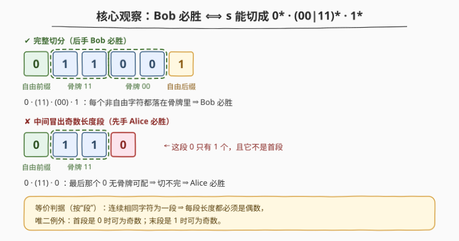
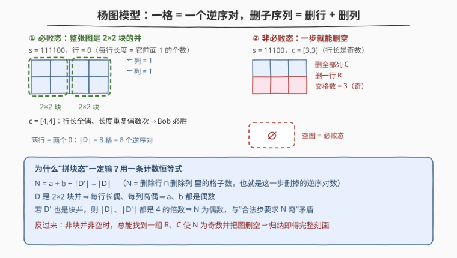
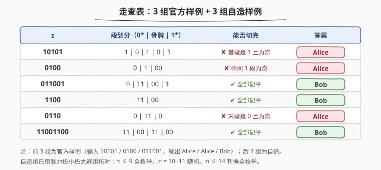

# Codeforces 2241F 奇逆序博弈 题解

## 1. 题目概述

- **标题 / 题号**：奇逆序博弈（Codeforces 2241F，英文名 A Bit Odd）
- **链接**：https://codeforces.com/problemset/problem/2241/F
- **来源**：Codeforces Round 1107 (Div. 3) · Problem F（UTC 2026-06-30）
- **难度**：1700
- **限制**：时间 2 s / 内存 256 MB
- **标签**：博弈论，贪心，数学，数据结构

**题意**：给定长度为 $n$ 的 01 串 $s$，Alice 与 Bob 轮流操作，Alice 先手。每一手，当前玩家必须选出一个**逆序对个数为奇数**的子序列，并把它从 $s$ 中删除（删除后剩下的字符按原顺序拼接）。无法行动者输。双方最优，问谁赢。这里逆序对指 $i<j$ 且 $s_i=1$、$s_j=0$ 的一对位置。

**约束**：

- $1 \le t \le 10^4$，$1 \le n \le 2\times 10^5$，$\sum n \le 2\times 10^5$
- $s$ 的每个字符只能是 `0` 或 `1`

## 2. 示例与观察
**示例 1（官方样例，含 3 组数据）**

```text
输入
3
5
10101
4
0100
6
011001

输出
Alice
Alice
Bob
```

解释：$10101$ 的逆序对数为 $1+2=3$（奇数），Alice 直接删掉整串，Bob 无步可走；$0100$ 里 Alice 删子序列 $010$（下标 $1,2,4$，1 个逆序对），剩单字符 `0`，Bob 无步可走；$011001$ 无论 Alice 怎么删，Bob 都能应对（见下方走查表）。

**示例 2（自造）**

```text
输入
4
2
10
4
1100
4
0110
8
11001100

输出
Alice
Bob
Alice
Bob
```

解释：`10` 是 1 个逆序对（奇），先手一次删光；`1100` 的逆序对数为 $2+2=4$（偶），先手只能删出一个 `10`，把局面交给对方；`0110` 的逆序对数为 $2$（偶），但先手能删掉中间那个 `10` 留下 `01`；`11001100` 可切成 `11|00|11|00` 四块骨牌。

## 3. 解题思路

### 3.1 暴力思路

一个局面就是原串的某个**子序列**（剩下的字符）。从局面 $t$ 出发，一步要枚举"删哪个子序列"，即 $2^{|t|}-1$ 种选法，逐个算被删部分的逆序对奇偶性，递归到新子序列。状态总数最坏 $2^n$，转移再乘 $2^{|t|}$，总复杂度约 $3^n$：$n=20$ 都过不去，$n=2\times10^5$ 更是无望。

所以正确姿势是**先打表找规律**：写一个记忆化极小极大，把长度 $1\sim14$ 的**全部** $32766$ 个 01 串的胜负都算出来（本题解的结论就是这样发现并验证的，另用一份独立实现的多测程序做了交叉对拍）。

### 3.2 核心观察：终局 = 排好序，胜负 = 能否被"骨牌"铺满



**第一件事：什么时候无步可走？** 若 $s$ 中某个 `1` 在某个 `0` 之前，取这两个位置构成的子序列 `10`，它的逆序对数恰为 $1$（奇数），于是有合法步。反之若 $s$ 形如 $0^a1^b$（已排序），则它的任何子序列也形如 $0^{a'}1^{b'}$，逆序对数恒为 $0$（偶数），无步可走。

> 于是"终局"就是**有序串** $0^a1^b$：谁把局面走成有序串，谁就赢下这一步；而一步至少删掉 $2$ 个字符，游戏必然在有限步内结束。

**第二件事：必败态长什么样？** 打表结果干净得令人惊讶：

$$\text{Bob 必胜（先手必败）} \iff s \in 0^{*}\,(00|11)^{*}\,1^{*}$$

也就是：先把开头连续的 `0` 全部剥掉（个数不限），再把中间的部分用 `00`、`11` 两种两块骨牌**完整**铺满，最后把结尾连续的 `1` 全部剥掉（个数不限）；能恰好剥完 $\Rightarrow$ 后手 Bob 必胜。

换成"段"的说法更直观：把 $s$ 按连续相同字符分段，则要求**每段长度都是偶数**，只有**两个例外**——首段是 `0` 时长度可奇，末段是 `1` 时长度可奇。终局 $0^a1^b$ 正是"中间没有段"的特例；$1100$、$011001$、$11001100$ 则是有中间段的标准形态。

### 3.3 算法流程：用杨图解释"为什么是 2×2 拼块"



把每个 `0` 画成一行、每个 `1` 画成一列，第 $r$ 行的长度取"这个 `0` 前面有多少个 `1`"，得到的左对齐杨图 $D(s)$ 有一个漂亮的性质：**格子 $(r,c)$ 存在 $\iff$ 这一对 (1,0) 构成一个逆序对**。于是

- $\operatorname{inv}(s)=|D(s)|$，即格子总数就是逆序对数；
- 一手删掉一批 `0`（行集 $R$）与一批 `1`（列集 $C$），被删部分内部的逆序对数恰为 $|D\cap(R\times C)|$，所以**这一步合法 $\iff$ 交出的格子数是奇数**；
- 删完之后的新图就是原图去掉这些行与列（左对齐、行长相应缩短）。

在这个视角下，"能切成 $0^*(00|11)^*1^*$"恰好等价于"$D$ 是若干个 $2\times2$ 拼块的不交并"（行长全偶、每个长度出现偶数次），而空图就是终局。两条关键引理是：

- **拼块态打不到拼块态**：设 $D$ 是 $2\times2$ 拼块之并，一步删行集 $R$、列集 $C$，令 $N=|D\cap(R\times C)|$，$a$ 为被删行里的格子数、$b$ 为被删列里的格子数。计数得 $N=a+b+|D'|-|D|$；块并态下每行长偶 $\Rightarrow a$ 偶，每列高偶 $\Rightarrow b$ 偶，若 $D'$ 也是块并则 $|D|,|D'|$ 都是 $4$ 的倍数，于是 $N$ 为偶数，与"合法步要求 $N$ 奇"矛盾。
- **非拼块非空 $\Rightarrow$ 一步删空**：若 $|D|$ 奇，删光所有行列即可；若 $|D|$ 偶但存在奇数长度的行，就删该行 + 所有列（交格数 = 该行长，奇）；若行长全偶，则必有某列高为奇数（否则行长全偶 + 列高全偶 $\Rightarrow$ 每个长度的行数为 $h_v-h_{v+1}$ 为偶 $\Rightarrow$ 是块并，矛盾），删所有行 + 该列即可。三种情况都把图删成空图，而空图是必败态。

由此可以归纳证明"必败态 $\iff$ 块并"，于是问题化为一次 $O(n)$ 的贪心扫描：

1. $i\leftarrow 0$，跳过所有前导 `0`（自由前缀）；
2. 只要 $s_i=s_{i+1}$，就把这两个字符当作一块 `00`/`11` 骨牌吃掉，$i\leftarrow i+2$；
3. 跳过所有尾部 `1`（自由后缀）；
4. 若 $i=n$ 则整串被完整消耗，输出 `Bob`，否则输出 `Alice`。

### 3.4 示例演算



以官方样例 $s=\texttt{011001}$ 为例：前导 `0` 跳过（$i=1$），`11` 成骨牌（$i=3$），`00` 成骨牌（$i=5$），尾部 `1` 跳过（$i=6=n$）——完整切分，故 Bob 必胜。而 $s=\texttt{10101}$ 的首段是长度为 $1$ 的 `1` 段（首段只有是 `0` 才允许奇数），第二步立刻卡住，故 Alice 必胜；这也正对应样例注释里"Alice 删掉整串（3 个逆序对，奇数）"。

## 4. 算法细节

1. **三段式扫描**：前导 `0` 用 `while (i < n && s[i] == '0')`，骨牌用 `while (i + 1 < n && s[i] == s[i + 1]) i += 2`，尾部 `1` 用 `while (i < n && s[i] == '1')`。三个循环里 $i$ 单调不减，总代价 $O(n)$。
2. **贪心为什么对**：跳过前导 `0` 之后，位置 $i$ 若与 $i+1$ 相同，则任何合法切分里这一对只能作为同一块骨牌（骨牌长 $2$，且从段首起只能两两配对）；若不同，则 $i$ 只能被结尾的 `1*` 吸收，此时后面必须全是 `1`。所以"先吃骨牌、再收尾 `1`"是唯一可能成功的选择，贪心不会漏解。
3. **多测**：$t\le 10^4$ 且 $\sum n\le 2\times 10^5$，逐组 $O(n)$ 即可；读入用 `scanf("%s")`（自动跳过换行与空格），不要 `getline` 与 `cin` 混用。
4. **长度用题面给的 $n$**，不要另外 `strlen`：两者不一致时以 $n$ 为准（本题保证一致，但养成习惯可避免多测错位）。
5. **等价写法（段奇偶）**：也可以先切段，再检查"每段长度偶数，或该段是首段且为 `0`，或该段是末段且为 `1`"。两种写法结果完全一致（见引理 5），扫描写法常数更小。
6. **不要真的去算逆序对数**：最大可达 $n^2/4\approx 10^{10}$，需要 `long long`，而对本题判定毫无用处——判定只看"能否被骨牌铺满"。

## 5. 正确性证明

**引理 1（终局刻画）**：局面 $s$ 无合法步 $\iff$ $s$ 形如 $0^a1^b$。

**证明**：若 $s$ 非有序，则存在 `1` 位于某个 `0` 之前，这对位置构成的子序列 `10` 逆序对数为 $1$，是合法步。若 $s=0^a1^b$，它的任意子序列仍是 $0^{a'}1^{b'}$，逆序对数恒为 $0$（偶数），故无合法步。∎

**引理 2（杨图翻译）**：把 $s$ 的每个 `0` 记作一行（行长为它前面 `1` 的个数）、每个 `1` 记作一列，得到杨图 $D(s)$，则格子集合恰为 $s$ 的逆序对集合；删除行集 $R$ 与列集 $C$ 的一步合法 $\iff |D(s)\cap(R\times C)|$ 为奇数，且新图等于 $D(s)$ 去掉这些行与列后左对齐的结果。

**证明**：格子 $(r,c)$ 存在 $\iff$ 第 $c$ 个 `1` 在第 $r$ 个 `0` 之前 $\iff$ 该 (1,0) 对是逆序对。被删部分内部的逆序对必由"被删的 1"与"被删的 0"组成，故其个数就是 $|D\cap(R\times C)|$；删掉这些行列后，剩余行的长度按被删列数减少，正是左对齐后的图形。∎

**引理 3（拼块态走不到拼块态）**：设 $D$ 是 $2\times2$ 拼块的不交并，经一步合法删除后得到 $D'$，则 $D'$ 不是 $2\times2$ 拼块的不交并。

**证明**：记 $N=|D\cap(R\times C)|$ 为奇数，$a=\sum_{r\in R}c_r$ 为被删行中的格子数，$b=\sum_{i\in C}h_i$ 为被删列中的格子数（$c_r$ 为行长，$h_i$ 为列高）。由容斥 $|D'|=|D|-a-b+N$，即 $N=a+b+|D'|-|D|$。块并态下每行长都是偶数，故 $a$ 为偶数；又块并态下同长度的行成对出现，故每个列高 $h_i$ 都是偶数，$b$ 为偶数。若 $D'$ 也是块并，则 $|D|$ 与 $|D'|$ 均为 $4$ 的倍数，于是 $N$ 为偶数，与 $N$ 为奇数矛盾。∎

**引理 4（非拼块非空必能一步删空）**：若 $D$ 非空且不是 $2\times2$ 拼块的不交并，则存在合法步使 $D'=\varnothing$。

**证明**：分三种情况。① $|D|$ 为奇数：删除全部行与全部列，此时 $N=|D|$ 为奇数，图被删空。② $|D|$ 为偶数且存在长度为奇数的行 $r$：取 $R=\{r\}$、$C=$ 全部列，则 $N=c_r$ 为奇数，且所有列都被删除，剩余行长度全为 $0$，图被删空。③ 所有行长都是偶数：若所有列高也是偶数，则长度为 $v$ 的行数为 $h_v-h_{v+1}$，是两个偶数之差，故每个长度的行数都是偶数，$D$ 就成了 $2\times2$ 拼块之并，矛盾；于是存在列高 $h_i$ 为奇数的列，取 $R=$ 全部行、$C=\{i\}$，则 $N=h_i$ 为奇数，且所有行都被删除，图被删空。三种情况都给出了合法步且终图为空图。∎

**引理 5（三种刻画等价）**：以下三条等价：(a) $D(s)$ 是 $2\times2$ 拼块的不交并；(b) 每段长度都是偶数，除"首段是 `0`"与"末段是 `1`"两种情况外；(c) $s\in 0^{*}(00|11)^{*}1^{*}$。

**证明**：写 $s=0^{a_0}1^{b_1}0^{a_1}1^{b_2}\cdots$。第 $j$ 个 `0` 段（$j\ge1$）里的每个 `0` 前面都有 $b_1+\cdots+b_j$ 个 `1`，故其行长为该前缀和；首段 $a_0$ 个 `0` 的行长为 $0$（空行，不计入 $D$）。于是"行长全偶"$\iff$ 所有 $b_j$ 为偶数（末尾的 `1` 段不进入任何前缀和，故不受约束），"每个正长度出现偶数次"$\iff$ 所有 $a_j\,(j\ge1)$ 为偶数（首段 $a_0$ 不受约束）。两块并 $\iff$ 这两条同时成立，这正是 (b)；(b) 与 (c) 是同一句话的两种写法（把每个偶数长的段两两配对成 `00`/`11` 骨牌）。∎

**定理**：先手必败 $\iff s\in 0^{*}(00|11)^{*}1^{*}$。

**证明**：对 $|D(s)|$ 归纳。$D=\varnothing$（即 $s$ 有序）时由引理 1 无步可走，先手必败，且此时 $s\in0^*1^*$ 满足条件。若 $D$ 为块并且非空：任一合法步都到达非块并的 $D'$（引理 3），且 $|D'|<|D|$，由归纳假设 $D'$ 是先手必胜态，故当前局面所有走法都通向必胜态，当前局面必败。若 $D$ 非空且非块并：由引理 4 存在合法步一步删空，到达必败态，故当前局面必胜。结合引理 5 即得结论。∎

## 6. 复杂度分析

- **时间**：每个测试用例 $O(n)$。三个 `while` 中下标 $i$ 只增不减（第二段一次 +2），总迭代次数不超过 $n+1$；总计 $O\big(\sum n\big)\le 2\times10^5$ 级别的基本操作。
- **空间**：$O(n)$ 仅用于存放输入串（C++ 用 `char[200005]`、Python 用一个 `bytes`），额外变量 $O(1)$。
- **可行性对照**：时限 $2$ s，实测 C++ 在 $t=10^4$、$\sum n=2\times10^5$ 的最坏输入上约 $10$ ms，余量在 $100$ 倍以上；Python 同样输入约 $35$ ms。

## 7. 参考代码

### C++17

```cpp
#include <bits/stdc++.h>
using namespace std;

int main() {
    int t;
    if (scanf("%d", &t) != 1) return 0;
    static char buf[200005];
    while (t--) {
        int n;
        scanf("%d", &n);
        scanf("%s", buf);
        int i = 0;
        while (i < n && buf[i] == '0') i++;                  // 自由前缀：前导 0
        while (i + 1 < n && buf[i] == buf[i + 1]) i += 2;     // 骨牌 00 / 11
        while (i < n && buf[i] == '1') i++;                   // 自由后缀：尾部 1
        puts(i == n ? "Bob" : "Alice");
    }
    return 0;
}
```

### Python3

```python
import sys


def main() -> None:
    data = sys.stdin.buffer.read().split()
    if not data:
        return
    t = int(data[0])
    pos = 1
    out = []
    for _ in range(t):
        n = int(data[pos]); pos += 1
        s = data[pos].decode(); pos += 1
        i = 0
        while i < n and s[i] == '0':          # 自由前缀：前导 0
            i += 1
        while i + 1 < n and s[i] == s[i + 1]:  # 骨牌 00 / 11
            i += 2
        while i < n and s[i] == '1':           # 自由后缀：尾部 1
            i += 1
        out.append("Bob" if i == n else "Alice")
    sys.stdout.write("\n".join(out) + "\n")


main()
```

## 8. 边界情况与易错点

1. **全 `0` / 全 `1` / $n=1$**：整串有序（只有一个段且是首段 `0` 或末段 `1`），输出 `Bob`。前导 `0` 循环会把整串吃掉，尾部 `1` 循环同理，两条路径都自然得到 $i=n$。
2. **只看逆序对数奇偶会错**：$1100$ 的逆序对数是 $4$（偶）却是必败态，$0100$ 的逆序对数是 $2$（偶）却是必胜态；奇偶只是"能否一次删光"的必要条件，真正的判据是骨牌铺满。
3. **例外只属于首段 `0` 与末段 `1`**：`0110` 的末段是长度 $1$ 的 `0` 段，不在豁免之列，故是 Alice 必胜；同理 `10101` 的首段是 `1` 段，也不能豁免。
4. **两个 `while` 的边界**：骨牌循环必须是 `i + 1 < n`，否则最后一对会越界；尾部 `1` 循环必须是 `i < n`。
5. **多测读入**：输入里 $n$ 与串各占一行，用 `scanf("%s")`/`split()` 自动跳过空白即可；若用 `getline` 且前面读过整数，务必先 `getline` 吃掉行尾换行。
6. **答案大小写**：题面要求输出 `Alice` / `Bob`，首字母大写，其余小写。

## 9. 验证记录

- **编译环境与命令**：`clang++ -std=c++17 -O2`（本机无 GNU g++，配 `codeforces/tools/include/bits/stdc++.h` 兼容头；正文代码只用标准库，可原样提交 GNU C++17）；Python 侧为 `Python 3.9.6`。
- **官方样例**：1 / 1 通过（按 Codeforces 标准 checker 的 token 比对，忽略空白与大小写）。
- **复核状态**：audited（2026-11-19 统一回归：编译 + 官方样例；写作期的随机对拍与暴力未重跑）。

## 相关题目与扩展

- [Codeforces 1382B Sequential Nim](https://codeforces.com/problemset/problem/1382/B)：同样"看结构而不是看数值"的贪心博弈，只需定位第一个非 $1$ 堆。
- [Codeforces 1191D Tokitsukaze, CSL and Stone Game](https://codeforces.com/problemset/problem/1191/D)：用势能/计数守恒判断胜负，与本题"块并态不可能互相到达"的计数思路同源。
- [Codeforces 2241E Fair and Square](https://codeforces.com/problemset/problem/2241/E)：同一场的组合计数题，可对照"把结构拆成可控小块"的做法。

**延伸思考**：本题最反直觉的一点是"从任何非必败态都能**一步删空**"——因为可以自由选择删哪些 `0`（行）与哪些 `1`（列），总能凑出奇数个交格并把图清空。如果把合法步改为"逆序对数必须是偶数"，判据会整体平移成另一套块并（需要用 $1\times1$ 的"$2$ 格骨牌"对齐）；若把删除对象从子序列改为**连续子串**，问题立刻变成区间型博弈，答案不再有这种干净的闭式刻画；进一步还可以问"最优策略下游戏步数的奇偶/具体值"，那需要给每个必败态计算 Grundy 数（本题只需要胜负，故归纳止于二分类）。
