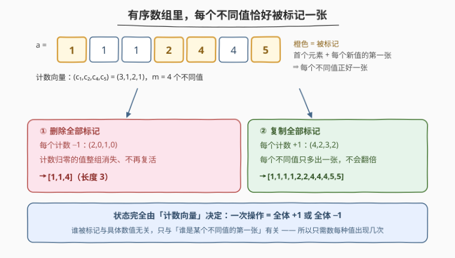
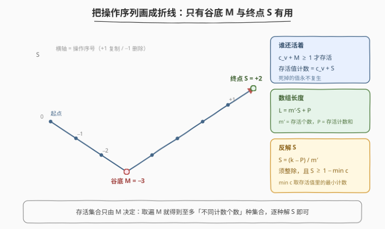
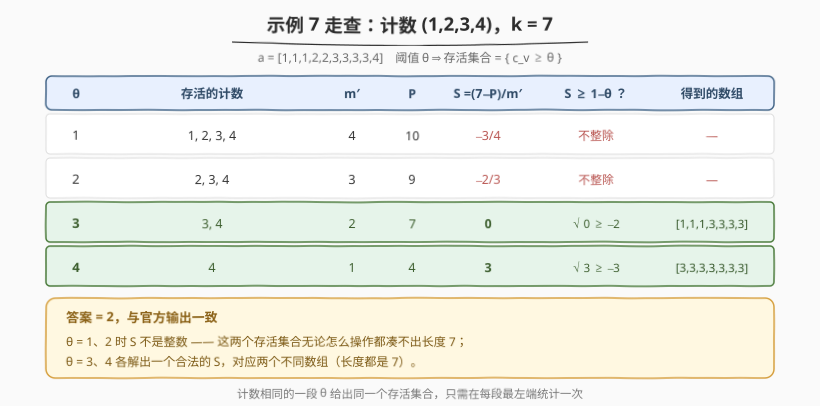

# Codeforces 2242C 不稳定元素 题解

## 1. 题目概述

- **标题 / 题号**：不稳定元素（Codeforces 2242C，英文名 Unstable Elements）
- **链接**：https://codeforces.com/problemset/problem/2242/C
- **来源**：Educational Codeforces Round 192 (Rated for Div. 2) · Problem C
- **难度**：1300（$\ast 1300$）
- **限制**：时间 2 s / 内存 512 MB
- **标签**：暴力、数据结构、实现、排序、双指针（官方标签：brute force, data structures, implementation, sortings, two pointers）

**题意**：给定**单调不降**的数组 $a_1\le a_2\le\cdots\le a_n$，可任意多次执行：① 标记第一个元素以及所有满足 $a_i\ne a_{i-1}$ 的元素（即每个不同值的第一张）；② 二者择一——**删除**全部被标记元素，或把每个被标记元素**复制**一份（一张变两张）；之后标记清空。数组一旦变空就不许再操作。称 $b$ 可达，若它可由 $a$ 经若干次操作得到，求**长度恰为 $k$ 的可达数组个数**。

多测：第一行 $t$；每组两行——第一行 $n,k$，第二行 $n$ 个已排序整数；每组输出一行答案。

**约束**：

- $1\le t\le 10^4$，且 $\sum n\le 3\cdot 10^5$
- $1\le n,k\le 3\cdot 10^5$
- $1\le a_1\le a_2\le\cdots\le a_n\le n$
- 答案保证在 32 位有符号整数范围内

## 2. 示例

官方样例（输入 / 输出原样）：

```text
输入：
10
1 5
1
4 5
1 1 2 2
3 1
1 1 1
4 8
1 2 3 4
8 6
1 1 1 2 2 2 2 2
6 3
1 1 2 2 3 3
10 7
1 1 1 2 2 3 3 3 3 4
12 5
1 1 1 1 2 2 2 3 3 4 4 4
6 5
1 1 2 2 3 3
3 1
1 2 2
输出：
1
0
1
1
2
1
2
1
0
1
```

再补一组自造样例（非官方，`|` 表示换行）：输入 `3 | 5 1 / 1 2 2 2 2 | 7 7 / 1 1 2 2 3 3 3 | 7 6 / 1 1 1 2 4 4 5`，输出 `1 2 1`。第 1 组计数 $(1,4)$：只能"删掉那个只出现一次的值"才落到长度 1；第 2 组计数 $(2,2,3)$、$k=7$：$\theta=2$ 原地不动得 $[1,1,2,2,3,3,3]$，$\theta=3$ 先删到 $[3,3,3]$ 再复制 4 次得 $[3,3,3,3,3,3,3]$——**$k=n$ 也不一定只有一个答案**。

## 3. 解题思路

### 3.1 暴力思路

最直接的做法是从 $a$ 出发 BFS：每步尝试删除 / 复制，把新数组丢进集合。但状态空间**无限**——一直复制，长度就没有上界，BFS 停不下来；限制步数也没用，凑出长度 $k$ 可能要先复制再删除（或反之），步数上界无法估计；枚举操作序列更不可行（$T$ 步有 $2^T$ 种）。必须换一种压缩表示，把无穷多状态压成有限个等价类。

### 3.2 核心观察：状态只由「每个不同值的计数」决定



$a$ 有序，每个不同值占据一段连续区间，而 $a_i\ne a_{i-1}$ 命中的正是**每段的第一张**，再加首元素（正好是第一段的段首），于是：

> **被标记的元素 = 每个不同值的第一张，恰好 $m$ 张**（$m$ 为不同值个数）。**删除** = 每个计数 $-1$（归零的段整段消失）；**复制** = 每个计数 $+1$（每个不同值只多一张，不是整段翻倍）。

所以数组等价于计数向量 $(c_1,\dots,c_m)$，一次操作就是**所有存活计数同时 $+1$ 或同时 $-1$**；消失的值不可能复活，因为复制只作用于还存在的段。

### 3.3 算法流程：折线模型 + 枚举存活集合



把操作序列记成 $\pm1$ 折线（复制 $=+1$，删除 $=-1$），令

$$\text{第 }t\text{ 步后的净值 }S_t=\sum_{i=1}^{t}(\pm1),\qquad M_t=\min_{0\le t'\le t}S_{t'}\ (\le0)$$

**引理（存活判据）**：第 $t$ 步后值 $v$ 存活 $\iff c_v+M_t\ge 1$，且存活时计数为 $c_v+S_t$。直觉：存活段计数同步增减，故计数就是 $c_v+S_t$；它在第一次变成 $0$ 的那步被整段删除，"从未变成 $0$"等价于最小前缀也够大。

于是**整个数组只由 $(M,S)$ 决定**：

- 存活集合 $=\{v: c_v\ge 1-M\}$，即所有计数 $\ge\theta$ 的值，其中 $\theta=1-M\in[1,\max_v c_v]$；
- 长度 $L=\sum_{c_v\ge\theta}(c_v+S)=m'\cdot S+P$，$m',P$ 为存活值的个数与计数和。

反过来，任何 $S\ge 1-\mu$（$\mu$ 为存活集合里的最小计数）都能实现：先连续删除到 $M=1-\mu$，再连续复制到 $S$；数组始终非空（$\mu$ 那段一直活到最后）。

于是算法：① 扫游程得到各不同值的出现次数，升序排序；② 从右往左枚举后缀左端 $j$（**计数相同的一段只取最左端**，否则同一集合会被数多次）；③ 解 $S=(k-P)/m'$，能整除且 $S\ge1-\theta$ 则答案 $+1$。

### 3.4 示例演算



以官方第 7 组 $a=[1,1,1,2,2,3,3,3,3,4]$（计数 $(1,2,3,4)$）、$k=7$ 为例：

| $\theta$ | 存活计数 | $m'$ | $P$ | $S=(7-P)/m'$ | $S\ge1-\theta$ | 得到的数组 |
|---|---|---|---|---|---|---|
| 1 | 1,2,3,4 | 4 | 10 | $-3/4$ | — | 不整除，✗ |
| 2 | 2,3,4 | 3 | 9 | $-2/3$ | — | 不整除，✗ |
| 3 | 3,4 | 2 | 7 | $0$ | $0\ge-2$ ✓ | $[1,1,1,3,3,3,3]$ |
| 4 | 4 | 1 | 4 | $3$ | $3\ge-3$ ✓ | $[3,3,3,3,3,3,3]$ |

答案 $2$，与官方输出一致。再验证第 5 组（计数 $(3,5)$，$k=6$）：$\theta=3$ 得 $S=-1\ge-2$（数组 $[1,1,2,2,2,2]$），$\theta=5$ 得 $S=1\ge-4$（数组 $[2,2,2,2,2,2]$），答案 $2$。可见同一个 $k$ 能由**不同的存活集合配不同的 $S$** 分别凑出，这就是答案可以大于 1 的原因。

## 4. 算法细节

1. **游程计数**：输入已排序，扫一遍得到各段长度即可，$O(n)$，不要用 `map`。
2. **只枚举"不同计数"的后缀**：从右往左累加后缀和，遇到 $c_j=c_{j-1}$ 必须跳过（两者对应同一个集合 $\{c_v\ge c_j\}$）；$P$ 即后缀和，$m'=m-j$，$O(1)$ 维护。
3. **整除与负余数**：$num=k-P$ 可能为负。C++ 中 $-4\bmod 3=-1\ne0$，所以直接判 `num % m == 0` 就是对的；**不要**加 `num >= 0`，$S$ 允许为负（整体删除）。
4. **下界比较**：$1-\theta$ 与 $S$ 都用 `long long`（$\theta\le3\cdot10^5$）；答案 $\le$ 不同计数的个数 $\le n$，`int` 足够，但 $P$、$k-P$、$S$ 用 64 位更省心。
5. **多测清空**：计数 `vector` 每组重建、答案每组清零；$t=10^4$ 时全靠这点保证组间独立。
6. **I/O**：$\sum n\le3\cdot10^5$，`sync_with_stdio(false)` + `cin.tie(nullptr)` 足够；追求极致可换 `fread` 快读（算法本体只有毫秒级）。

## 5. 正确性证明

**引理 1（标记集合）**：任一时刻数组仍有序，被标记的元素恰为每个不同值的第一张，共 $m$ 张。

**证明**：每段首元素满足 $a_i\ne a_{i-1}$，段内其余元素都等于左邻；首元素被单独标记，而它正是第一段的段首。故每段恰有一张被标记。∎

**引理 2（操作语义）**：一次操作使每个存活值计数同时 $+1$ 或同时 $-1$；归零的值整段消失且不再重现。

**证明**：由引理 1，删除即每段去掉首张、复制即每段首张多复制一张，各段同步变化；消失的值不在数组中，而之后只标记"数组内每段的首张"，故不会复活。∎

**引理 3（存活判据）**：设前缀和为 $S_t$、最小前缀和为 $M_t$，则第 $t$ 步后 $v$ 存活 $\iff c_v+M_t\ge1$，存活时计数为 $c_v+S_t$。

**证明**：对 $t$ 归纳。若 $v$ 在前 $t-1$ 步后存活，由归纳假设计数为 $c_v+S_{t-1}$；第 $t$ 步全体 $\pm1$ 后为 $c_v+S_t$，为 $0$ 则该段消失。"某步后为 $0$"等价于存在 $t'\le t$ 使 $c_v+S_{t'}=0$，即 $M_t=-c_v$；不消失即对所有 $t'\le t$ 有 $c_v+S_{t'}\ge1$，即 $c_v+M_t\ge1$。∎

**引理 4（可实现性）**：对任意 $S\ge1-\mu$（$\mu$ 为存活集合的最小计数），存在序列使终点 $S$、谷底 $M=1-\mu$。

**证明**：先做 $1-\mu$ 次删除，再做 $S-(1-\mu)\ge0$ 次复制。删除时每段同步 $-1$，计数为 $\mu$ 的段在第 $1-\mu$ 步后归零消失、其余段仍 $\ge1$，数组始终非空；复制阶段长度只增。故谷底 $1-\mu$、终点 $S$。∎

**引理 5（唯一性）**：数组由「存活集合 + $S$」唯一确定，不同的（集合, $S$）给出不同数组。

**证明**：数组的值集合就是存活集合，每个值的计数是 $c_v+S$；反之由任一存活值可反解 $S=\text{计数}-c_v$，映射可逆。∎

**定理**：算法输出的数值等于长度恰为 $k$ 的可达数组个数。

**证明**：（不重）由引理 3、5，每个可达数组对应唯一的（存活集合, $S$）；算法对每个集合只统计一次（同计数阈值被合并），故不会重复计数。（不漏）任取长度 $k$ 的可达数组，其存活集合为 $\{v:c_v\ge1-M\}$ 且 $M\ge1-\max_v c_v$，故必等于某个 $\{c_v\ge\theta\}$（$\theta\in[1,\max_v c_v]$），即 $c$ 排序后的某个后缀；其长度 $m'S+P=k$ 唯一确定 $S$，而由引理 3 这些值都存活，必有 $S\ge1-\mu$，两个检查都通过。（正确）反之若某集合与 $S$ 通过两个检查，由引理 4 可真正构造出该数组，长度恰为 $m'S+P=k$，故它确实可达。∎

**推论**：若元素两两不同（计数全为 $1$），答案为 $1\iff n\mid k$（且 $k\ge n$），否则为 $0$；一般情形答案不超过不同计数的个数。

## 6. 复杂度分析

- **时间**：游程计数 $O(n)$，对 $m$ 个计数排序 $O(m\log m)$，后缀枚举 $O(m)$，总计 $O(n\log n)$，$\sum n\le3\cdot10^5$，常数极小。
- **空间**：只需计数向量 $O(m)\le O(n)$，可以不存原数组（边读边分段）。
- **实测**：$n=3\cdot10^5$ 单组最坏数据（大量不同计数）在本机 clang `-O2` 下约 $0.24$ s、Python3 约 $0.16$ s；其中 $0.24$ s 几乎全是 `cin` 解析——换 `fread` 快读后算法本体仅约 $2$ ms。距 $2$ s 时限有 $8$ 倍以上余量。

## 7. 参考代码

### C++17

```cpp
#include <bits/stdc++.h>
using namespace std;

int main() {
    ios::sync_with_stdio(false);
    cin.tie(nullptr);
    int t;
    if (!(cin >> t)) return 0;                 // 空输入防护
    while (t--) {
        int n; long long k;
        cin >> n >> k;
        vector<int> c;                         // 每个不同值的出现次数
        int prev = -1, x;
        for (int i = 0; i < n; ++i) {
            cin >> x;
            if (i == 0 || x != prev) c.push_back(1);
            else ++c.back();
            prev = x;
        }
        sort(c.begin(), c.end());
        int m = (int)c.size();
        long long suf = 0;                     // 后缀计数和 P
        int ans = 0;
        for (int j = m - 1; j >= 0; --j) {
            suf += c[j];
            if (j > 0 && c[j] == c[j - 1]) continue;   // 同一阈值只取最左端
            long long cnt = m - j;                      // 存活值个数 m'
            long long num = k - suf;                    // 需要 num = m' * S
            if (num % cnt) continue;                    // 不能整除
            if (num / cnt >= 1LL - c[j]) ++ans;         // S 允许为负
        }
        cout << ans << '\n';
    }
    return 0;
}
```

### Python3

```python
import sys


def main() -> None:
    data = sys.stdin.buffer.read().split()
    if not data:                                  # 空输入防护
        return
    t = int(data[0]); p = 1; out = []
    for _ in range(t):
        n = int(data[p]); k = int(data[p + 1]); p += 2
        a = data[p:p + n]; p += n
        c = [1]                                   # 游程：每个不同值的出现次数
        for i in range(1, n):
            if a[i] == a[i - 1]:
                c[-1] += 1
            else:
                c.append(1)
        c.sort()
        m = len(c); suf = 0; ans = 0
        for j in range(m - 1, -1, -1):
            suf += c[j]
            if j > 0 and c[j] == c[j - 1]:
                continue                          # 同一阈值只取最左端
            cnt = m - j                           # 存活值个数 m'
            num = k - suf
            if num % cnt:
                continue
            if num // cnt >= 1 - c[j]:            # S 允许为负
                ans += 1
        out.append(str(ans))
    sys.stdout.write("\n".join(out) + "\n")


main()
```

## 8. 边界情况与易错点

1. **$S$ 必须允许为负**：只保留 $S\ge1-\theta$ 这一条下界。若写成 $S\ge0$，官方样例第 3、5、10 组全部算错（它们的答案都来自"整体删到只剩一种值"）。
2. **相同计数必须合并**：计数 $(2,2,3)$ 时逐个后缀统计会把 $\{2,2,3\}$ 数两次；判据是 `j == 0 || c[j] != c[j-1]`。
3. **最小计数为 $1$ 时下界最紧**：含全部值的集合 $\mu=1$，要求 $S\ge0$，即 $k\ge n$ 且 $k\equiv n\pmod m$；想要更短的数组必须换成更小的存活集合。例如 $a=[1,1,2,2]$、$k=5$ 答案为 $0$（$S=1/2$ 不整除），而 $a=[1,2,2,2,2]$、$k=1$ 答案为 $1$（$\theta=4$，$S=-3\ge-3$）。
4. **$n=1$**：计数为 $(1)$，任何 $k\ge1$ 都有 $S=k-1\ge0$，答案恒为 $1$（一路复制），即官方样例第 1 组。
5. **$k$ 极大**（$3\cdot10^5$）：$S$ 可达 $3\cdot10^5$，用 `long long`；且**绝不能真的模拟操作**，步数与数组长度都会爆。
6. **多测清零**：计数向量、`suf`、`ans` 每组重新初始化，否则上一组的 `suf` 会污染下一组。

## 相关题目与扩展

- [Codeforces 1138A Sushi for Two](https://codeforces.com/problemset/problem/1138/A)：只关心「每段连续相同元素的长度」，是游程分析的最短入门题。
- [LeetCode 443. 压缩字符串](https://leetcode.cn/problems/string-compression/)：把数组压成（值, 计数）序列，与本题「用计数向量刻画状态」同源。
- [LeetCode 53. 最大子序和](https://leetcode.cn/problems/maximum-subarray/)：前缀和折线的极值视角，与本题「谷底 $M$、终点 $S$」是同一套语言。

**延伸思考**：

1. **要输出所有可达数组**：个数最多为不同计数的种数，但对每个集合都要铺开 $O(k)$ 长度，总输出可达 $O(nk)$，需按段直接构造而不模拟操作。
2. **数组不有序时**（官方讨论区有此问）：相同值不连续会被拆成多段，标记集合变成「每个连续块的首张」，状态是"按连续块划分的计数向量"，删除还会让相邻同值块合并——折线模型失效，难度陡增。
3. **若允许只删除一部分标记**：状态从一维折线退化为真正的 $m$ 维向量，"全体同步 $\pm1$"的结构消失，需另找不变量。
