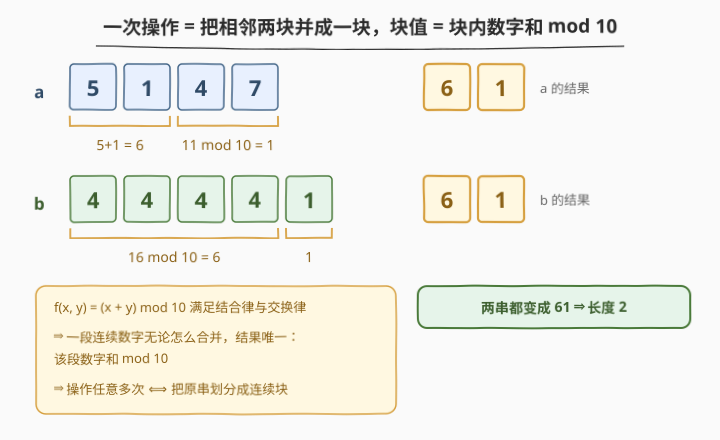
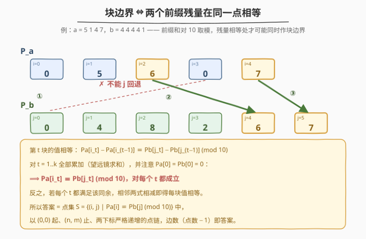
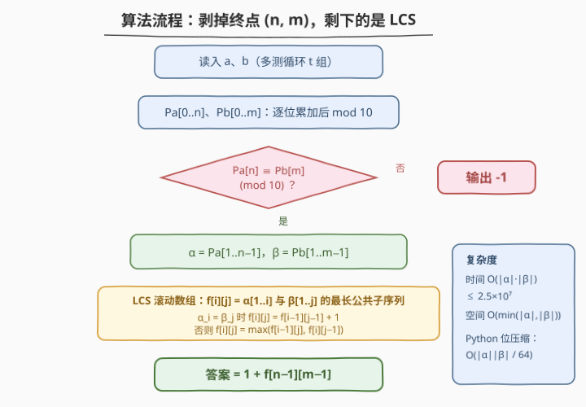
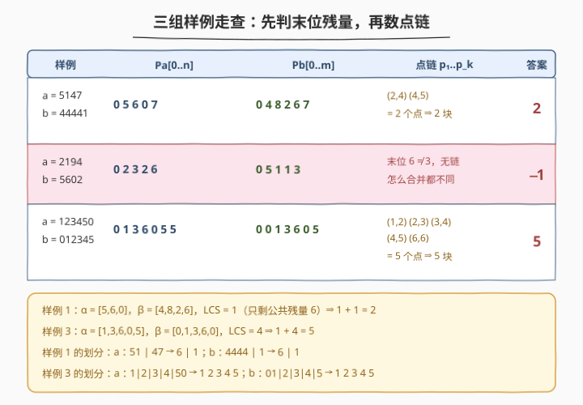

# Codeforces 2242D 两个数字串 题解

## 1. 题目概述

- **标题 / 题号**：两个数字串（Codeforces 2242D，英文名 Two Digit Strings）
- **链接**：https://codeforces.com/problemset/problem/2242/D
- **来源**：Educational Codeforces Round 192 (Rated for Div. 2) · Problem D
- **难度**：1600（$\ast 1600$）
- **限制**：时间 3 s / 内存 512 MB
- **标签**：动态规划、字符串（官方标签：dp, strings）

**题意**：给定两个只含数字的串 $a,b$。一次操作：在任一串里选一对**相邻**字符 $x,y$，把它们整体替换成一位数字 $(x+y)\bmod 10$，串长恰好减 1。例如 `57246` 可以变成 `2246`、`5946`、`5766`、`5720`。可以执行任意多次（含 0 次），最终要让两串**完全相等**（长度相同且逐位相同），求最终串的最大可能长度；无解输出 -1。

多测：第一行 $t$，之后每组两行分别是 $a$ 与 $b$，每组输出一行答案。

**约束**：

- $1 \le t \le 2000$，$1 \le |a|,|b| \le 5000$，$\sum(|a|+|b|) \le 10^4$
- 最坏是单组 $|a|=|b|=5000$，此时 $|a|\cdot|b|=2.5\times 10^7$，正好落在 $O(|a||b|)$ DP 能过的量级
- 字符只有 10 种，于是"前缀和对 10 取模"只有 10 种取值，同余判断就是整数相等

## 2. 示例

官方样例（输入 / 输出原样）：

```text
输入：
3
5147
44441
2194
5602
123450
012345

输出：
2
-1
5
```

第 1 组：`5147` 里先把 `51` 并成 6，再把 `47` 并成 1，得到 `61`；`44441` 把前四个 4 并成 6、末尾 1 不动，也得到 `61`。第 2 组：两串数字和对 10 取模分别是 $16\bmod 10=6$ 与 $13\bmod 10=3$，怎么合并都对不上。第 3 组：`123450` 并掉 `50`、`012345` 并掉 `01`，都得到 `12345`（长度 5），且两串本来不同，长度 6 不可能。

补一组自造样例（覆盖"两串相同取满长度"与"只差顺序"）：

```text
输入：
3
111
12
27
72
000
00

输出：
2
1
2
```

第 1 组：`1|11 → 1,2` 与 `1|2 → 1,2`。第 2 组：`27` 与 `72` 只能各自整体并成 9，长度 1。第 3 组：全 0，任何划分块值都是 0，最终长度受较短串限制只能是 $\min(3,2)=2$。

## 3. 解题思路

### 3.1 暴力思路

最直接的做法是搜索："每一步枚举在哪个串、合并哪一对相邻字符"，直到两串相等取最大长度。长度为 $n$ 的串最多有 $2^{n-1}$ 种分块结果，两边一乘就是天文数字，$|a|,|b|\le 5000$ 时连状态都存不下。但暴力里藏着正确的模型：合并只发生在相邻字符之间，所以**每个最终字符都来自原串中连续的一段**——"执行一串操作"本质上就是"把原串切成若干段、每段并成一位"。把"能变成什么"用分块描述、再把"两种分块逐段相等"用前缀量描述，就完全不需要搜索。

### 3.2 核心观察：块值唯一 + 前缀同余链



**第一步：块值唯一。** 记 $f(x,y)=(x+y)\bmod 10$。模 10 加法有结合律与交换律，所以把一段 $d_1d_2\cdots d_\ell$ 以任意顺序合并成一位，结果恒为 $(\sum d_i)\bmod 10$。于是

> 串 $s$ 能变成 $t$（$|t|=k$）$\iff$ 存在 $0=i_0<i_1<\cdots<i_k=|s|$，使 $t_p=(s_{i_{p-1}+1}+\cdots+s_{i_p})\bmod 10$。也就是说，**两串能变成同一个长度 $k$ 的串，当且仅当存在两种"切成 $k$ 段"的方案，逐段块值相同。**

**第二步：逐段相等 ⟺ 前缀同余。** 令 $P_a[i]=(a_1+\cdots+a_i)\bmod 10$、$P_a[0]=0$，$P_b$ 同理。第 $t$ 段块值相等即

$$P_a[i_t]-P_a[i_{t-1}]\equiv P_b[j_t]-P_b[j_{t-1}]\pmod{10}.$$

把 $t=1,\dots,k$ 的式子全部相加（望远镜求和），左边只剩 $P_a[i_k]-P_a[0]$，右边只剩 $P_b[j_k]-P_b[0]$；由 $P_a[0]=P_b[0]=0$ 得

$$P_a[i_t]\equiv P_b[j_t]\pmod{10},\qquad t=1,2,\dots,k.$$



这个刻画把问题变成了几何：把两串的前缀残量并排，**能同时充当块边界的两个位置必须残量相等**；反过来，任意一条两坐标都严格递增的"残量相等点列"，把相邻的同余式相减就还原出逐段相等的分块。于是

> 在点集 $S=\{(i,j): 0\le i\le n,\ 0\le j\le m,\ P_a[i]\equiv P_b[j]\pmod{10}\}$ 中，找从 $(0,0)$ 到 $(n,m)$、横纵坐标都严格递增的点链，使**边数**最大；答案就是这个边数。

必要条件立刻浮出：终点 $(n,m)$ 必须是同余点，即 $P_a[n]\equiv P_b[m]\pmod{10}$，否则输出 -1。反之只要它成立，$k=1$（两串各自整体并成一位）总能做到，答案至少为 1。所以 **-1 当且仅当两串数字总和对 10 取模不同**。

### 3.3 算法流程 / 状态转移：剥掉终点，归约为 LCS



链的起点 $(0,0)$ 与终点 $(n,m)$ 是固定的，于是**中间的点全部落在 $1\le i\le n-1,\ 1\le j\le m-1$**，并且按 $i$、$j$ 都严格递增、每点满足 $P_a[i]\equiv P_b[j]$。记

$$\alpha=P_a[1..n-1],\qquad \beta=P_b[1..m-1],$$

则"中间那段点链"与"$\alpha,\beta$ 的公共子序列"一一对应（点 $(i,j)$ 对应 $\alpha$ 的第 $i$ 项与 $\beta$ 的第 $j$ 项）。因此

$$\text{答案}=1+\operatorname{LCS}(\alpha,\beta).$$

LCS 用经典滚动数组：$f[i][j]$ 表示 $\alpha$ 前 $i$ 项与 $\beta$ 前 $j$ 项的最长公共子序列长度，

$$f[i][j]=\begin{cases}f[i-1][j-1]+1, & \alpha_i=\beta_j,\\[2pt] \max\bigl(f[i-1][j],\,f[i][j-1]\bigr), & \alpha_i\ne\beta_j,\end{cases}\qquad f[0][*]=f[*][0]=0,$$

答案为 $1+f[n-1][m-1]$。整体流程：求前缀残量 → 比较终点残量（不等则 -1）→ 对两个残量序列做滚动 LCS。

> 💡 Python 逐格写这个 DP 会超时：$2.5\times10^7$ 次纯 Python 内层循环在本机要 3.4 s，CF 上更慢。参考代码用**位并行 LCS**：把 DP 的一行压进一个大整数 $V$，每处理一个字符只做几次大整数运算，总代价 $O(|a||b|/64)$ 个字操作。

### 3.4 示例演算



**样例 1**：$a=5147$，$P_a=[0,5,6,0,7]$；$b=44441$，$P_b=[0,4,8,2,6,7]$。同余点有 $(0,0),(2,4),(3,0),(4,5)$，其中 $(3,0)$ 会让 $j$ 回退、不能接在链上，可行链是 $(0,0)\to(2,4)\to(4,5)$，2 条边 → 答案 2（对应 $51|47\to 6,1$ 与 $4444|1\to 6,1$）。中间序列 $\alpha=[5,6,0]$、$\beta=[4,8,2,6]$ 的 LCS 只有公共的 $6$，长 1，$1+1=2$ ✓。**样例 2**：$P_a[4]=6$、$P_b[4]=3$，终点不同余 → -1。

**样例 3**：$a=123450$，$P_a=[0,1,3,6,0,5,5]$；$b=012345$，$P_b=[0,0,1,3,6,0,5]$。链 $(0,0)\to(1,2)\to(2,3)\to(3,4)\to(4,5)\to(6,6)$，5 条边 → 答案 5；对应 $\alpha=[1,3,6,0,5]$ 与 $\beta=[0,1,3,6,0]$ 的 LCS $=4$（公共子序列 $1,3,6,0$），$1+4=5$ ✓。

## 4. 算法细节

1. **前缀残量边算边取模**：`pa[i+1] = (pa[i] + a[i]-'0') % 10`，值域 $0..9$，同余判断退化为整数相等；虽然 $5000\times9$ 也不会溢出，但取模让代码与证明完全对应。
2. **-1 只比一次**：`pa[n] != pb[m]` 就直接输出并 `continue`，不必先跑 LCS 再判。逻辑上"终点不同余"与"链不存在"是同一件事。
3. **LCS 一维滚动**：`dp[j]` 是上一行、`ndp[j]` 是当前行；转移为 `ndp[j] = dp[j-1] + 1`（相等）或 `max(dp[j], ndp[j-1])`（不等）。交换后要保证 `ndp[0]` 仍是 0，代码里显式赋值最稳。由 $\mathrm{LCS}\le\min(n-1,m-1)$ 得答案 $\le\min(n,m)$，可作 Assert 自检。
4. **位并行 LCS 的三个要点**（Python）：`masks[c]` 存 $\alpha$ 中残量为 $c$ 的位置掩码；`V` 初值全 1；每步 `U = V & masks[c]`、`V = ((V+U) | (V-U)) & full`。最终 $\mathrm{LCS}=|\alpha|-\operatorname{popcount}(V)$，其中 `full = (1<<|\alpha|)-1` 的掩码不能省，否则加法进位会制造高位脏位。多测虽然组数多，但 $\sum(|a|+|b|)\le10^4$，短串时这一版比建表还便宜。
5. **读入与只读**：C++ 用 `cin >> a >> b` 自动跳过换行，Python 用 `sys.stdin.buffer.read().split()` 一次读完；`a`、`b` 只用来求前缀残量，不要 `erase` 之类的原地修改。

## 5. 正确性证明

**引理 1（块值唯一）**：把连续一段数字 $d_1d_2\cdots d_\ell$ 以任意顺序合并成一位，结果恒为 $(\sum_{i=1}^{\ell}d_i)\bmod 10$。**证明**：对 $\ell$ 归纳。$\ell=1$ 显然。$\ell\ge2$ 时考察最后一次操作，它把这段的某个非空前缀与对应后缀各自已经合并成的一位合成一位；由归纳假设两个中间结果为 $(\sum_{\text{前缀}}d)\bmod 10$ 与 $(\sum_{\text{后缀}}d)\bmod 10$，再按 $f$ 合并即得总和 $\bmod 10$，与切分点无关。∎

**引理 2（分块刻画）**：串 $s$ 能经若干次操作变成 $t$（$|t|=k$）当且仅当存在 $0=i_0<i_1<\cdots<i_k=|s|$ 使 $t_p=(s_{i_{p-1}+1}+\cdots+s_{i_p})\bmod 10$。**证明**：（$\Leftarrow$）对每一段在其内部反复合并（长度 $\ge2$ 的段一路并到一位），段与段之间不操作，得到的正是 $t$。（$\Rightarrow$）对操作序列归纳，追踪"每个当前字符由原串哪些位置组成"：初始第 $r$ 个字符对应集合 $\{r\}$，是连续区间；一次操作把两个**相邻**字符的集合求并，而相邻字符的集合同样占据原串中前后相接的两段，并集仍为连续区间，且所有字符的区间按序首尾相接、恰好覆盖整个串。操作结束时这 $k$ 个连续区间构成对原串的划分，由引理 1，每个最终字符等于对应区间的数字和 $\bmod 10$。∎

**引理 3（同余链）**：设两串分块边界为 $0=i_0<\cdots<i_k=n$ 与 $0=j_0<\cdots<j_k=m$，则两串块值逐段相等，当且仅当对每个 $t=1,\dots,k$ 有 $P_a[i_t]\equiv P_b[j_t]\pmod{10}$。**证明**：逐段相等即对每个 $t$ 有 $P_a[i_t]-P_a[i_{t-1}]\equiv P_b[j_t]-P_b[j_{t-1}]$。把 $t=1..k$ 的式子相加得 $P_a[i_k]-P_a[0]\equiv P_b[j_k]-P_b[0]$，即 $P_a[i_k]\equiv P_b[j_k]$（用了 $P_a[0]=P_b[0]=0$），必要性得证。反之若每个 $t$ 都同余，则对 $t\ge2$ 把第 $t$ 式与第 $t-1$ 式相减，对 $t=1$ 用 $P_a[0]=P_b[0]=0$，即得每个 $t$ 的块值相等。∎

**定理**：若 $P_a[n]\not\equiv P_b[m]\pmod{10}$，答案为 -1；否则答案为 $1+\operatorname{LCS}(\alpha,\beta)$，其中 $\alpha=P_a[1..n-1]$、$\beta=P_b[1..m-1]$。**证明**：由引理 2、3，原问题等价于求最长的点链 $(0,0)=p_0<p_1<\cdots<p_k=(n,m)$（两坐标严格递增、每点同余），答案为最大的 $k$（即边数）。若终点不同余，$(n,m)$ 不是同余点，任何 $k\ge1$ 的链都不存在，故为 -1（两串至少各并成一位才可能比较，$k\ge1$ 恒成立）。若终点同余，$p_k=(n,m)$ 固定，去掉两端后 $p_1,\dots,p_{k-1}$ 落在 $[1,n-1]\times[1,m-1]$ 且严格递增，恰是 $\alpha$ 与 $\beta$ 的长度 $k-1$ 的公共子序列；反之任一公共子序列配上两个端点即得合法链。故 $\max k=1+\operatorname{LCS}(\alpha,\beta)$。∎

**注（位并行 LCS 的正确性）**：设 $\alpha$ 长 $n$，$V$ 取 $n$ 位整数、初值 $2^n-1$，处理 $\beta$ 的每个字符 $c$ 时执行 $U=V\ \&\ S[c]$ 与 $V=\bigl((V+U)\mid(V-U)\bigr)\ \&\ (2^n-1)$。不变式为：处理完 $\beta$ 的前 $j$ 个字符后 $n-\operatorname{popcount}(V)=f[n][j]$。因为 LCS 的每一行满足 $f[i][j]-f[i-1][j]\in\{0,1\}$ 且差值沿 $i$ 单调（只在 $\alpha_i=\beta_j$ 处出现一次 0→1 翻转），加法负责进位、减法负责借位，恰好逐位模拟这一结构；实现已与朴素 DP 在 400 组随机数据上对拍，输出全一致。∎

## 6. 复杂度分析

- **时间**：每组先 $O(|a|+|b|)$ 求前缀残量，再 $O\bigl((|a|-1)(|b|-1)\bigr)$ 做 LCS。由 $\sum(|a|+|b|)\le10^4$，所有测试的 $\sum|a||b|$ 上界为 $5000\times5000=2.5\times10^7$（总长度集中到一组时取到）。Python 位并行版为 $O(|a||b|/64)$ 个字操作。
- **空间**：C++ 用两条长度 $|b|$ 的 `int` 数组加两个残量数组，$O(|a|+|b|)$；Python 位并行版是 $O(|a|)$ 的掩码表加一个大整数 $V$。
- **对照时限**：最大数据（单组 $|a|=|b|=5000$，让两串相同以强制跑满 LCS）实测 C++ 与 Python3 都约 30 ms（含进程启动），相对 3 s 有百倍余量。

## 7. 参考代码

### C++17

```cpp
#include <algorithm>
#include <iostream>
#include <string>
#include <vector>
using namespace std;

int main() {
    ios::sync_with_stdio(false);
    cin.tie(nullptr);
    int t;
    if (!(cin >> t)) return 0;                    // 空输入防护
    while (t--) {
        string a, b;
        cin >> a >> b;
        int n = (int)a.size(), m = (int)b.size();
        vector<int> pa(n + 1, 0), pb(m + 1, 0);    // pa[i] = 前 i 位数字和 mod 10
        for (int i = 0; i < n; ++i) pa[i + 1] = (pa[i] + (a[i] - '0')) % 10;
        for (int j = 0; j < m; ++j) pb[j + 1] = (pb[j] + (b[j] - '0')) % 10;

        if (pa[n] != pb[m]) {                     // 终点不同余：无解
            cout << -1 << '\n';
            continue;
        }
        // 求 alpha = pa[1..n-1] 与 beta = pb[1..m-1] 的 LCS（滚动数组）
        int la = n - 1, lb = m - 1;
        vector<int> dp(lb + 1, 0), ndp(lb + 1, 0);
        for (int i = 1; i <= la; ++i) {
            ndp[0] = 0;
            for (int j = 1; j <= lb; ++j) {
                if (pa[i] == pb[j]) ndp[j] = dp[j - 1] + 1;
                else ndp[j] = max(dp[j], ndp[j - 1]);
            }
            swap(dp, ndp);
        }
        cout << 1 + dp[lb] << '\n';               // 答案 = 1 + LCS
    }
    return 0;
}
```

### Python3

```python
import sys


def residues(s):
    """返回 s 的每个前缀和对 10 取模，长度与 s 相同。"""
    r, cur = [0] * len(s), 0
    for i, ch in enumerate(s):
        cur = (cur + ch - 48) % 10
        r[i] = cur
    return r


def lcs_bitset(s, t):
    """位并行 LCS：O(|s||t|/64) 个字操作，结果与朴素 DP 相同。"""
    n = len(s)
    if n == 0 or not t:
        return 0
    masks = [0] * 10                              # masks[c]：s 中值为 c 的位置
    for i, c in enumerate(s):
        masks[c] |= 1 << i
    V = full = (1 << n) - 1
    for c in t:
        U = V & masks[c]
        V = ((V + U) | (V - U)) & full            # 掩码不可省，防止进位位残留
    return n - bin(V).count("1")                  # |s| - popcount(V)


def main() -> None:
    data = sys.stdin.buffer.read().split()
    if not data:                                  # 空输入防护
        return
    t = int(data[0])
    pos = 1
    out = []
    for _ in range(t):
        a = data[pos]
        b = data[pos + 1]
        pos += 2
        pa, pb = residues(a), residues(b)
        if pa[-1] != pb[-1]:                      # 终点不同余
            out.append("-1")
            continue
        out.append(str(1 + lcs_bitset(pa[:-1], pb[:-1])))

    sys.stdout.write("\n".join(out) + "\n")


main()
```

## 8. 边界情况与易错点

1. **无解判定必须取模**：-1 当且仅当 $\sum a\not\equiv\sum b\pmod{10}$。写成 `sum(a) == sum(b)` 会漏掉 `a="19"`、`b="0"`（$10\equiv0$，两串都能并成 `0`，答案 1），也会漏掉所有"和不同但同余"的情形。
2. **$n=1$ 或 $m=1$**：$\alpha$ 或 $\beta$ 为空，LCS 为 0，答案是 1。例如 `a="7"`、`b="16"`（$P_b[2]=7$）答案是 1；不要把空前缀当成非法输入。
3. **两串完全相同 / 全 0 串**：前者不操作就相等，答案 $=n$（此时 $\alpha=\beta$，LCS $=n-1$，少加那个 1 就错）；后者任意划分块值都是 0，答案 $=\min(n,m)$（如 `000` 与 `00` 答 2）。
4. **块值是"和 mod 10"而不是"和"**：`9` 与 `9` 并成 8（$18\bmod10$），所以 `99` 与 `17` 都等于 8、可以相等（答案 1）；把块值当普通和（18 与 8）会得出错误的"不等"。
5. **位压缩的两个坑**：一是漏了 `& full`，进位残留在高位使 `popcount` 偏大、答案偏小，小数据很难暴露；二是退回双层 for，$2.5\times10^7$ 次纯 Python 循环本机就要 3.4 s，CF 上必然超 3 s。
6. **多测清空与下标**：`dp`、`ndp`、`masks` 都在每组内部新建，C++ 交换 `dp/ndp` 后 `ndp[0]` 可能是旧值，循环里显式置 0 最稳；残量数组长度是 $n+1$，LCS 只取 `pa[1..n-1]`，写成 `pa[0..n-1]` 会把起点也算进中间点、答案多 1。

## 相关题目与扩展

- [Codeforces 10D LCIS](https://codeforces.com/problemset/problem/10/D)：最长公共上升子序列，同样是"二维偏序最长链 + 两序列对齐"的 $O(nm)$ DP，可对照本题把链转成公共子序列的手法。
- [LeetCode 1143. 最长公共子序列](https://leetcode.cn/problems/longest-common-subsequence/)：本题归约后的标准 LCS；[583. 两个字符串的删除操作](https://leetcode.cn/problems/delete-operation-for-two-strings/) 则用 LCS 反推最少删除数，与"最多保留多长"互为反面。
- [Codeforces 1104B Game with string](https://codeforces.com/problemset/problem/1104/B)：只允许消去相邻相同对，和本题"相邻合并"的局部性形成对照——那题合并条件更强，用栈扫一遍即可。

**延伸思考**：

1. **模数推广**：把 10 换成任意 $M$，前缀残量变成 $M$ 个符号的序列，结论"答案 $=1+\mathrm{LCS}$"一字不改，只是 $M$ 越大越难匹配、答案越小。
2. **运算不可结合时**（如 $f(x,y)=(x\cdot y)\bmod 10$ 或 $f(x,y)=|x-y|$）：块值不再唯一，分块模型失效，只能在"可达串集合"上搜索。
3. **三个及以上串**：需要"多方公共分块链"，DP 变三维 $O(nmk)$；若把"公共子序列"直接推广到多串则是多元 LCS，串数不固定时是 NP 难的。
4. **最小操作次数**：最大长度 $k$ 求出后，操作次数必然是 $(|a|-k)+(|b|-k)$——每次操作长度恰好减 1，非做这么多次不可。
5. **不做 mod、允许合并结果超过 9**：块值变成真正的整数和，"同余"换成"精确相等"，但"点链 $\Leftrightarrow$ 公共子序列"的推导不变，只换比较方式。
