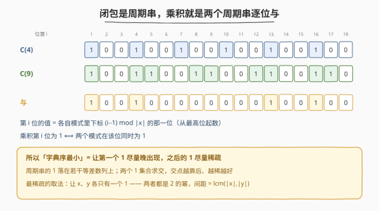
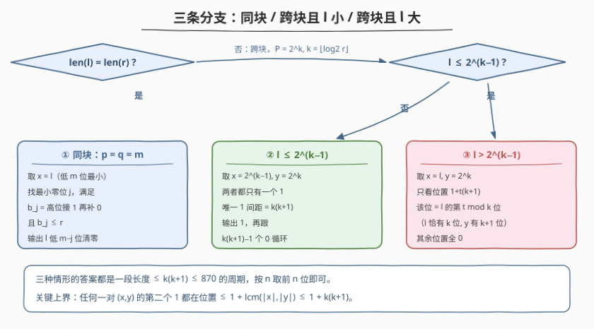
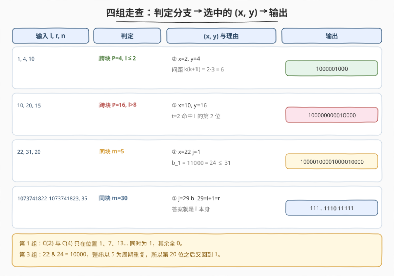

# Codeforces 2242E 闭包乘积 题解

## 1. 题目概述

- **标题 / 题号**：闭包乘积（Codeforces 2242E，英文名 Product of Closures）
- **链接**：https://codeforces.com/problemset/problem/2242/E
- **来源**：Educational Codeforces Round 192 (Rated for Div. 2) · Problem E
- **难度**：2200（$\ast 2200$）
- **限制**：时间 2 s / 内存 512 MB
- **标签**：位运算、暴力、构造、贪心、实现、数学、数论（官方标签：bitmasks, brute force, constructive algorithms, greedy, implementation, math, number theory）

**题意**：对正整数 $x$，把它的二进制表示（无前导零）无限次自拼接得到无限 01 串，称为 $x$ 的**闭包** $C(x)$。例如 $C(1)=1111\ldots$、$C(4)=100100100\ldots$、$C(9)=100110011\ldots$。两个闭包的**乘积** $C(x)\mathop{\&}C(y)$ 是逐位与得到的无限串。给定 $l,r,n$，在 $l\le x<y\le r$ 中选一对，让乘积的**字典序最小**，输出这个乘积的前 $n$ 位。

**约束**：

- $1\le t\le 1000$ 组测试；每组 $1\le l<r<2^{30}$，$1\le n\le 1000$。
- 记 $p=|x|$、$q=|y|$（二进制长度，均 $\le 30$），则乘积以 $\operatorname{lcm}(p,q)$ 为周期，而 $\operatorname{lcm}(p,q)\le 29\cdot 30=870$。也就是说**整条无限串都由至多 870 位完全决定**，这是"只输出前 $n$ 位"却能做精确比较的根源。
- 值域到 $10^9$，对数对枚举不可能；必须按二进制位/周期刻画。

## 2. 示例与观察
官方样例（输入 / 输出原样）：

```text
输入：
3
1 4 10
1073741822 1073741823 35
10 20 15

输出：
1000001000
11111111111111111111111111111011111
100000000010000
```

- **样例 1**：$[1,4]$ 中取 $(x,y)=(2,4)$：$C(2)=101010\ldots$、$C(4)=100100\ldots$，相与后只在位置 $1,7,13,\ldots$ 为 $1$，间距 $\operatorname{lcm}(2,3)=6$。
- **样例 2**：区间只有两个数，只能取 $(l,r)$；$r=2^{30}-1$ 各位全 $1$，故乘积就是 $C(l)$，而 $l=2^{30}-2=11\ldots110$（$29$ 个 $1$ 后接一个 $0$），前 $35$ 位 = $29$ 个 $1$、一个 $0$、再 $5$ 个 $1$。
- **样例 3**：最优取 $(10,16)$：$C(10)=1010\ldots$、$C(16)=10000\ldots$，只在位置 $1+t\cdot 5$ 可能为 $1$；$t=0$ 取 $l$ 第 $0$ 位 $=1$，$t=1$ 取第 $1$ 位 $=0$，$t=2$ 取第 $2$ 位 $=1$，所以位置 $11$ 也是 $1$。

自造样例（覆盖"同块单点零位"与"小 $l$ 跨块"）：

```text
输入：
3
22 31 20
5 6 12
1 32 12

输出：
10000100001000010000
100100100100
100000000000
```

第 1 组同块，（22，24）得 $22\mathop{\&}24=10110\mathop{\&}11000=10000$；第 2 组只有一对，$5\mathop{\&}6=101\mathop{\&}110=100$；第 3 组 $l$ 很小，取 $(16,32)$，只留位置 $1$ 与 $31$。

## 3. 解题思路

### 3.1 暴力思路

枚举所有 $l\le x<y\le r$ 的对，每对把两个周期串前 $\operatorname{lcm}(p,q)$ 位相与，再按无限串比较。单对代价 $O(870)$，总代价 $O\bigl((r-l)^2\cdot 870\bigr)$。$r-l$ 可达 $10^9$，这一层就爆掉了——瓶颈在于"候选对太多"，而不是"比较太慢"。所以要想办法把候选对压到 $O(1)$ 个。

### 3.2 核心观察：闭包是周期串，乘积是"1 集合求交"



把 $x$ 的模式（$x$ 的二进制串，长度 $p$）记作 $X$，下标从最高位起 $0$-based，$Z_x=\{i:X_i=1\}$。于是

$$C(x)\text{ 的第 }i\text{ 位}=1\iff (i-1)\bmod p\in Z_x .$$

因此乘积的 $1$ 位置集合是

$$S=(Z_x+p\mathbb{N})\cap(Z_y+q\mathbb{N}),$$

每个元素再加 $1$ 变成 $1$-based 位置。特别地 $0\in Z_x\cap Z_y$，所以位置 $1$ 恒为 $1$，且 $S$ 必含 $\operatorname{lcm}(p,q)$ 的所有倍数。

**比较法则**：两个乘积谁先"暴露"出第二个 $1$ 谁就更大。具体地，若 $S\cap[2,M]=\varnothing$ 而 $T\cap[2,M]\neq\varnothing$，则在两串相同的前缀之后 $S$ 给出 $0$、$T$ 给出 $1$，故 $S$ 更小。于是目标变成两件事：**把第二个 $1$ 尽量推后**，**把之后的 $1$ 尽量取稀**。

推后的天花板来自上面那条：第二个 $1$ 的位置 $\le 1+\operatorname{lcm}(p,q)$。而"最稀"的达成方式就是让两个模式都只有一个 $1$，即 $x,y$ 都是 $2$ 的幂，此时 $S=\operatorname{lcm}(p,q)\cdot\mathbb{N}$，一个周期内只有开头那个 $1$。

### 3.3 算法流程：三条分支



设 $m=\lvert l\rvert$、$K=\lvert r\rvert$（二进制长度）。

**情形 A：$m=K$**（$l,r$ 在同一个 $[2^{m-1},2^m)$ 块里）。此时区间内所有数都是 $m$ 位，$p=q=m$，乘积就是 $x\mathop{\&}y$ 这 $m$ 位无限循环，问题退化为"最小化 $x\mathop{\&}y$"。

以下记 $l_j$ 为 $l$ 的模式中下标 $j$（自最高位起 $0$-based）的那一位。

固定 $x=l$（下一节引理 2 说明可以这样假设）。对 $y>l$，设 $j$ 是 $l$ 与 $y$ 首个不同的位（自最高位起）：必有 $l_j=0$、$y_j=1$，$j$ 之上两者相同。于是 $l\mathop{\&}y$ 在 $j$ 之上等于 $l$ 的那些位、在 $j$ 处为 $0$、在 $j$ 之下随便——想让 $j$ 之下的与为 $0$，取最小可行

$$b_j=\Big\lfloor \frac{l}{2^{\,m-j}}\Big\rfloor\cdot 2^{\,m-j}+2^{\,m-1-j}.$$

若 $b_j\le r$ 就可行（$b_j>l$ 自动成立），此时答案模式 $=\Big\lfloor l/2^{\,m-j}\Big\rfloor\cdot 2^{\,m-j}$，即**把 $l$ 的低 $m-j$ 位清零**。$j$ 越靠高位答案越小，所以取**最小的可行 $j$**。

**情形 B：$m<K$**。令 $k=K-1$、$P=2^k$，则 $P\le r<2P$。

- **B1：$l\le 2^{k-1}$**。取 $x=2^{k-1}$、$y=2^k$：两者都只有一个 $1$，间距 $\operatorname{lcm}(k,k+1)=k(k+1)$ 恰好顶到天花板，一个周期内又只有开头一个 $1$，因此最优。答案只在位置 $\equiv 1\pmod{k(k+1)}$ 处为 $1$。
- **B2：$l>2^{k-1}$**。此时 $2^{k-1}<l<P$，可取 $x$ 全是 $k$ 位。$y$ 取 $P=2^k$（同长度里 $1$ 最少，其 $1$ 集合最小），并且取 $x=l$（低 $k-1$ 位最小）。因为 $k+1\equiv 1\pmod k$，位置 $1+t(k+1)$ 上的值就是 $l$ 的第 $(t\bmod k)$ 位，其余位置全 $0$。

### 3.4 示例演算



- $l=1,r=4$：跨块，$P=4$、$k=2$，$l\le 2$ 走 B1，周期 $2\cdot 3=6$，$1$ 只在位置 $1,7,13,\ldots$ → 前 $10$ 位 `1000001000`。
- $l=10,r=20$：跨块，$P=16$、$k=4$，$l=10>8$ 走 B2，取 $(10,16)$；位置 $1+5t$ 上取 $l=1010$ 的第 $t\bmod 4$ 位：$t=0\to1$、$t=1\to0$、$t=2\to1$，所以位置 $11$ 也是 $1$ → `100000000010000`。
- $l=22,r=31$：同块 $m=5$，$l=10110$；最小可行 $j=1$（第 $2$ 高位是 $0$），$b_1=11000=24\le 31$，答案模式 $10000$，以 $5$ 为周期 → `10000100001000010000`。
- $l=2^{30}-2,r=2^{30}-1$：同块 $m=30$；$l$ 只有最后一个 $0$ 位，$j=29$、$b_{29}=l+1=r$，答案就是 $l$ 本身：$29$ 个 $1$、一个 $0$，再循环。

## 4. 算法细节

1. **分支判定**：用二进制长度（C++ 里 `64 - __builtin_clzll(v)`，Python 里 `v.bit_length()`）。长度相同只可能是同块；长度不同则 $k=K-1$，$P=2^k$。
2. **情形 A 的 $j$ 一定存在**：取 $j_0$ 为 $l$ 最靠右的 $0$ 位，此时低位全是 $1$，$b_{j_0}=l+1\le r$ 必然成立，所以从小到大扫一定能扫到可行解，不需要额外兜底。
3. **$b_j$ 的位运算写法**：`cleared = (l >> (m-j)) << (m-j)` 把低 $m-j$ 位清零，`bmin = cleared | (1LL << (m-1-j))` 再把第 $j$ 位置 $1$，答案模式就是 `cleared`。移位量 $m-j\ge 1$、$m-1-j\ge 0$，都不会是负数。
4. **周期化输出**：三种情形的周期分别是 $m$、$k(k+1)$、$k(k+1)$，都 $\le 870$；输出第 $i$ 位（$0$-based）时用 $i\bmod \text{period}$ 取对应模式，$n$ 可能大于周期，不能只算一个周期就截断。
5. **情形 B2 的取位**：位置 $i=1+t(k+1)$（$i$ 为 $1$-based）对应 $l$ 的第 $(t\bmod k)$ 位，落到位值上是 `(l >> (k-1-(t%k))) & 1`；$t=0$ 给出最高位 $1$，正好是乘积的首位。
6. **输出量**：$\sum n\le 10^6$ 字符，C++ 关同步流后直接 `cout << string`，Python 用列表 join 一次写出，避免逐字符 `print`。

## 5. 正确性证明

**引理 1（周期与 $1$ 集合）**：$C(x)$ 的第 $i$ 位（$1$-based）等于 $X$ 的第 $(i-1)\bmod p$ 位；$C(x)\mathop{\&}C(y)$ 的 $1$ 位置集合为 $S=(Z_x+p\mathbb{N})\cap(Z_y+q\mathbb{N})$ 平移 $1$，且以 $L=\operatorname{lcm}(p,q)$ 为周期。**证明**：自拼接的定义直接给出第 $i$ 位对应模式下标 $(i-1)\bmod p$；逐位与即两个条件同时成立，故 $1$ 集合是交集。$L$ 既是 $p$ 又是 $q$ 的倍数，平移 $L$ 位后两个模式都回到原位，故乘积周期整除 $L$，进而 $S$ 由 $[1,L]$ 内的位完全决定。∎

**引理 2（同块情形取 $x=l$ 且 $j^*$ 最优）**：设 $m=|l|=|r|$，令 $j^*=\min\{j\in[1,m-1]:l_j=0,\ b_j\le r\}$、$R^*=\big\lfloor l/2^{m-j^*}\big\rfloor 2^{m-j^*}$。则对任意 $l\le a<b\le r$ 有 $a\mathop{\&}b\ge R^*$。**证明**：$j^*$ 存在见算法细节 2（$j_0$ 可行），且 $R^*=l\mathop{\&}b_{j^*}$ 确实被取到。任取一对，记 $R=a\mathop{\&}b$、$z$ 为 $R$ 第一位为 $0$ 的下标，则 $i<z$ 时 $a_i=b_i=1$。
若存在 $i<z$ 使 $l_i=0$，则 $R_i=1$，而 $R^*_i=l_i$（$i<j^*$）或 $R^*_i=0$（$i\ge j^*$），两种情形都是 $0$，故 $R>R^*$。
否则 $l$ 在 $z$ 之前全为 $1$。若还 $l_z=1$，则任何 $\ge l$ 且前 $z$ 位与 $l$ 相同的数在第 $z$ 位必须为 $1$（否则严格小于 $l$），与 $R_z=0$ 矛盾，故 $l_z=0$。
于是 $R$ 与 $R^*$ 在 $z$ 之前都是 $1$、在 $z$ 处都是 $0$：若 $z<j^*$，$R^*$ 在 $z$ 之后全 $0$，故 $R\ge R^*$；若 $z>j^*$，则 $R_{j^*}=1>R^*_{j^*}=0$，$R>R^*$；若 $z=j^*$，$R^*$ 在 $z$ 之后全 $0$，仍有 $R\ge R^*$。∎

**引理 3（第二个 $1$ 的天花板）**：对任意一对，乘积的第二个 $1$ 的位置 $\le 1+\operatorname{lcm}(p,q)$，且 $p,q\le K$、$p\neq q$ 时 $\operatorname{lcm}(p,q)\le k(k+1)$（$k=K-1$）。**证明**：$0\in Z_x\cap Z_y$，故 $0$ 与 $\operatorname{lcm}(p,q)$ 都属于 $S$，后者给出位置 $1+\operatorname{lcm}(p,q)$ 上的 $1$。又 $\operatorname{lcm}(p,q)\le pq$，而 $p,q$ 是 $[1,K]$ 中两个不同的数，乘积最大为 $k\cdot(k+1)$；$p=q$ 时 $\operatorname{lcm}=p\le K\le k(k+1)$（$k\ge1$）。∎

**引理 4（B1 最优）**：若 $m<K$ 且 $l\le 2^{k-1}$，则 $(2^{k-1},2^k)$ 的乘积字典序最小（下称参照串）。**证明**：该对合法，两个模式都只有一个 $1$，故 $S=k(k+1)\mathbb{N}$，即位置 $1+t\cdot k(k+1)$ 上为 $1$、其余为 $0$，且由引理 3 达到天花板。任取另一对，它的第二个 $1$ 若在位置 $<1+k(k+1)$，则两串在位置 $1$ 之后到该位置之前都是 $0$（参照串在 $1+k(k+1)$ 之前全 $0$），该位置参照串是 $0$、对方是 $1$，故参照串更小；若也在位置 $1+k(k+1)$，则之后参照串每处都是 $0$，对方任何额外的 $1$ 都会让它变大。故参照串 $\le$ 一切。∎

**引理 5（B2 最优）**：若 $m<K$ 且 $l>2^{k-1}$，则 $(l,2^k)$ 的乘积字典序最小。**证明**：此时 $l\in(2^{k-1},2^k)$，所以 $|l|=k$，且区间内每个 $x<P$ 都是 $k$ 位。
（i）若 $|y|=k+1$，则 $Z_y\supseteq\{0\}$，从而 $S_{x,y}\supseteq S_{x,P}$，即取 $y=P$ 时 $1$ 集合最小，由引理 1 的刻画，$1$ 集合是子集的那串更小。
（ii）若 $|y|=k$，则 $p=q=k$，$S=(Z_x\cap Z_y)+k\mathbb{N}$ 平移 $1$，含 $0$，故第二个 $1$ 的位置 $\le 1+k\le k+1$；而 $k\ge2$（$k=1$ 会逼出 $l>1$ 且 $|l|=1$，矛盾），参照串在位置 $2..k+1$ 全为 $0$，故参照串更小。
（iii）在 $y=P$、$|x|=k$ 中，非零位只在 $1+t(k+1)$，其值 $=X$ 的第 $(t\bmod k)$ 位；$t=1..k-1$ 依次读出 $x$ 的低 $k-1$ 位（高位在前），故要字典序最小就要 $x$ 的低 $k-1$ 位最小，即 $x=l$。∎

**定理**：按情形 A / B1 / B2 输出前 $n$ 位即为所求。**证明**：$m=K$ 与 $m<K$ 穷尽了所有输入；情形 A 由引理 2 给出同块最优；情形 B 中 $l\le 2^{k-1}$ 由引理 4、$l>2^{k-1}$ 由引理 5 给出最优。三种情形都给出了乘积的完整周期（长度 $\le 870$），而由引理 1，前 $n$ 位由周期唯一确定，故输出正确。∎

## 6. 复杂度分析

- **时间**：每组只做 $O(\log r)$ 的位运算判定，然后输出 $n$ 个字符，$O(n)$。总时间 $O\bigl(\sum n\bigr)\le 10^6$，实测 $1000$ 组 $\times\,1000$ 位：C++ 约 $18$ ms、Python3 约 $130$ ms（含 I/O），相对 $2$ s 有十倍以上余量。
- **空间**：除输出串外只用若干整型变量，$O(1)$；即使用字符串缓存输出也只有 $O(n)$。
- **对照时限**：瓶颈是输出量而非计算，C++ 与 Python3 都很轻松，无需 PyPy 也安全。

## 7. 参考代码

### C++17

```cpp
#include <bits/stdc++.h>
using namespace std;

static string solve(long long l, long long r, int n) {
    int bl = 64 - __builtin_clzll(l);   // |l|
    int br = 64 - __builtin_clzll(r);   // |r|
    string out;
    out.reserve(n);
    if (bl == br) {                     // 情形 A：同块，p = q = m
        int m = bl;
        long long pat = 0;
        for (int j = 1; j <= m - 1; j++) {          // 最小的可行零位 j
            int bitpos = m - 1 - j;                 // 该位对应的位权下标
            if (((l >> bitpos) & 1LL) == 0) {
                long long cleared = (l >> (m - j)) << (m - j);
                long long bmin = cleared | (1LL << bitpos);
                if (bmin <= r) { pat = cleared; break; }
            }
        }
        for (int i = 0; i < n; i++) {               // 以 m 为周期循环
            int idx = i % m;
            out.push_back(((pat >> (m - 1 - idx)) & 1LL) ? '1' : '0');
        }
    } else {                            // 情形 B：跨块，P = 2^k
        int k = br - 1;
        long long P = 1LL << k;
        if (l <= (P >> 1)) {            // B1：x = 2^(k-1), y = 2^k
            long long L = 1LL * k * (k + 1);
            for (int i = 0; i < n; i++) out.push_back((i % L == 0) ? '1' : '0');
        } else {                        // B2：x = l, y = 2^k
            int q = k + 1;
            for (int i = 0; i < n; i++) {
                if (i % q == 0) {
                    int t = i / q;                  // i = t*(k+1) 即位置 1+t*(k+1)
                    int idx = t % k;                // k+1 ≡ 1 (mod k)
                    out.push_back(((l >> (k - 1 - idx)) & 1LL) ? '1' : '0');
                } else {
                    out.push_back('0');
                }
            }
        }
    }
    return out;
}

int main() {
    ios::sync_with_stdio(false);
    cin.tie(nullptr);
    int T;
    if (!(cin >> T)) return 0;          // 空输入防护
    while (T--) {
        long long l, r; int n;
        cin >> l >> r >> n;
        cout << solve(l, r, n) << '\n';
    }
    return 0;
}
```

### Python3

```python
import sys


def solve(l, r, n):
    bl, br = l.bit_length(), r.bit_length()
    if bl == br:                                    # 情形 A：同块
        m, pat = bl, 0
        for j in range(1, m):
            bitpos = m - 1 - j
            if ((l >> bitpos) & 1) == 0:
                cleared = (l >> (m - j)) << (m - j)
                if cleared | (1 << bitpos) <= r:
                    pat = cleared
                    break
        return ''.join('1' if (pat >> (m - 1 - (i % m))) & 1 else '0'
                       for i in range(n))
    k = br - 1                                      # 情形 B：跨块
    P = 1 << k
    if l <= P >> 1:                                 # B1
        L = k * (k + 1)
        return ''.join('1' if i % L == 0 else '0' for i in range(n))
    q, res = k + 1, []                              # B2
    for i in range(n):
        if i % q == 0:
            idx = (i // q) % k
            res.append('1' if (l >> (k - 1 - idx)) & 1 else '0')
        else:
            res.append('0')
    return ''.join(res)


def main():
    data = sys.stdin.buffer.read().split()
    if not data:                                    # 空输入防护
        return
    t, p, out = int(data[0]), 1, []
    for _ in range(t):
        l, r, n = int(data[p]), int(data[p + 1]), int(data[p + 2])
        p += 3
        out.append(solve(l, r, n))
    sys.stdout.write('\n'.join(out) + '\n')


main()
```

## 8. 边界情况与易错点

1. **$l=1,r=2$**：跨块，$k=1$、$P=2$、$l\le1$，走 B1，周期 $1\cdot2=2$，答案是 `101010…`。B1 的结论对 $k=1$ 同样成立，不要给 B1 加 $k\ge2$ 的特判（只有 B2 的证明需要 $k\ge2$）。
2. **情形 A 要找"最小的可行 $j$"，不是"第一个 $0$ 位"**：如 $l=22,r=31$，$j=1$ 的 $b_1=24\le31$ 可行；但若 $r=23$ 则 $b_1=24>23$ 不可行，必须退到更低的零位（本题数据保证最靠右的 $0$ 位一定可行）。漏掉可行性检查会输出超过 $r$ 的 $y$。
3. **$r$ 恰是 $2$ 的幂**：$r=P$ 时 $l<P$，B1/B2 都在 $P$ 处合法（$y=r$ 允许）。$l=P/2$ 归 B1，$l=P/2+1$ 归 B2，恰好差在第 $k-1$ 位上，判定用 `l <= P>>1` 不要写成 `<`。
4. **$r-l=1$ 且同块**：只有一对，答案必须等于 $l\mathop{\&}(l+1)$ 的 $m$ 位循环（如 $5,6\to100$、$1073741822,1073741823\to$ 该 30 位模式），此时 $j$ 唯一，扫到即 `break`。
5. **$n$ 可以大于周期**：$n\le1000$ 而最小周期可能只有 $2$（如 $l=1,r=2$），必须对周期取模循环，不能"算到周期结束就停"。
6. **移位与溢出**：$r<2^{30}$，`1LL << k` 与 `l >> (m-j)` 都在 `long long` 内安全；但 Python 版 `i // q` 与 `i % q` 要一致（都基于同一个 $q=k+1$），写错成 `i % k` 会把位置对应关系整体错位。

## 9. 验证记录

- **编译环境与命令**：`clang++ -std=c++17 -O2`（本机无 GNU g++，配 `codeforces/tools/include/bits/stdc++.h` 兼容头；正文代码只用标准库，可原样提交 GNU C++17）；Python 侧为 `Python 3.9.6`。
- **官方样例**：1 / 1 通过（按 Codeforces 标准 checker 的 token 比对，忽略空白与大小写）。
- **复核状态**：audited（2026-11-19 统一回归：编译 + 官方样例；写作期的随机对拍与暴力未重跑）。

## 相关题目与扩展

- [LeetCode 201. 数字范围按位与](https://leetcode.cn/problems/bitwise-and-of-numbers-range/)：区间上按位与的公共前缀刻画，与本题"同块时只和最高不同位有关"的推导完全同源。
- [Codeforces 1554C Mikasa](https://codeforces.com/problemset/problem/1554/C)：在 $[0,m]$ 上做位贪心构造，可对照本题"从最高位往下判定可行性"的手法。
- [Codeforces 1851F Lisa and the Martians](https://codeforces.com/problemset/problem/1851/F)：按位与的最大化 + 补一位 $x$ 的构造，与本题"用 $2$ 的幂把与压稀"互为镜像。

**延伸思考**：

1. **改成求字典序最大**：把比较法则反过来，"第一个 $1$ 尽量早、之后尽量密"，此时 $x=y$ 不允许，最优会贴着 $r$ 取（如 $r$ 全 $1$ 时用 $(r-1,r)$），推导结构相似但分支全变。
2. **把与换成或**：$1$ 集合变成并集，最小化仍倾向让两个集合都稀疏（$2$ 的幂依旧强势），但并集远比交集稠，"第一个 $1$ 尽量晚"与"之后尽量稀"的权衡关系变了，需要重新推一遍分支。
3. **限制 $|x-y|\le K$**：情形 A 的 $b_j$ 上界由 $r$ 变成 $\min(r,l+K)$，"最小可行 $j$"要重算，可以按 $K$ 的二进制长度再分一层。
4. **允许 $x=y$**：乘积变成 $C(x)$ 本身，问题化为"区间内取 $1$ 最稀的模式"，即取最小的 $2$ 的幂或最接近它的数，判定退化但思路一致。
5. **长度上限更大（如 $2^{100}$）**：结论形式不变，只是周期上界从 $870$ 变成 $O(\log^2 V)$，输出量仍由 $n$ 控制。
