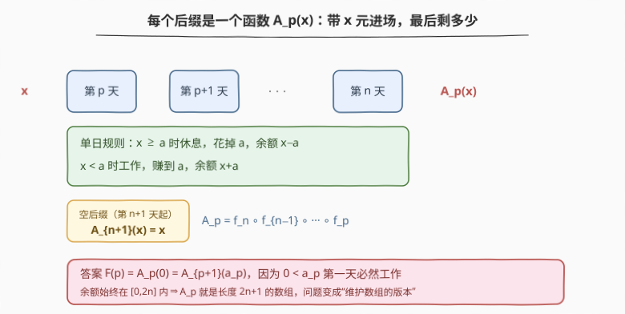
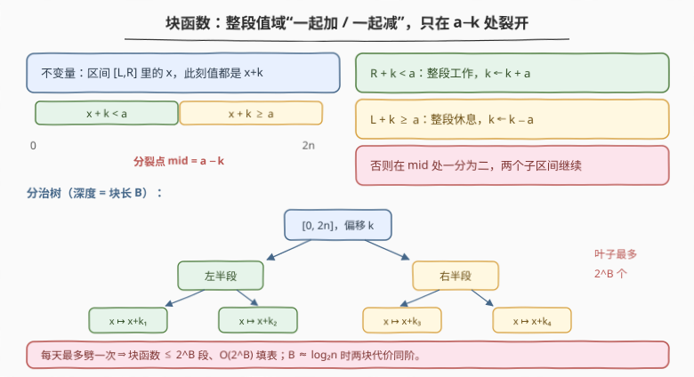
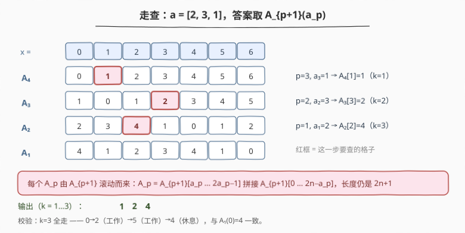

# Codeforces 2242F 暑假 题解

## 1. 题目概述

- **标题 / 题号**：暑假（Codeforces 2242F，英文名 Summer Vacation）
- **链接**：https://codeforces.com/problemset/problem/2242/F
- **来源**：Educational Codeforces Round 192 (Rated for Div. 2) · Problem F
- **难度**：2800（$\ast 2800$）
- **限制**：时间 1.5 s / 内存 1024 MB
- **标签**：数据结构、动态规划、概率与期望、树（官方标签：data structures, dp, probabilities, trees）

**题意**：假期共 $n$ 天，第 $i$ 天 Monocarp 有 $a_i$ 分钟的**空闲**，他会在这一天把空闲时间**整天**地用于“休息”或“工作”，不能一天里两样都做。出发时他有 $0$ 元。第 $i$ 天开始时若手上有 $\ge a_i$ 元，他就休息并**花掉** $a_i$ 元（每分钟 $1$ 元）；否则他工作并**赚到** $a_i$ 元。他只在最后 $k$ 天待在首都（第 $n-k+1$ 天到达）。对每个 $k=1,\dots,n$，求假期结束时他手上的钱数。

**约束**：

- $1\le n\le 10^{5}$，$1\le a_i\le n$；单组数据，无多测。
- 关键隐含范围：余额**永远**落在 $[0,\,2n]$ 里。因为“休息”只会把钱变少，“工作”发生在余额 $<a_i$ 时、结束后余额 $<2a_i\le 2n$。
- 直接对每个后缀模拟是 $O(n^2)\approx 10^{10}$，必须想办法把“对每个起点重算一遍”摊销掉。

## 2. 示例

**样例 1**

```text
输入：
6
6 6 1 1 6 6

输出：
6 0 1 0 4 0
```

逐 $k$ 手算（$0\to$ 表示当天工作，$\to 0$ 表示当天休息）：$k=1$：$0\to 6$；$k=2$：$0\to6\to0$；$k=3$：$0\to1\to7\to1$；$k=4$：$0\to1\to0\to6\to0$；$k=5$：$0\to6\to5\to4\to10\to4$；$k=6$：$0\to6\to0\to1\to0\to6\to0$。

**样例 2**

```text
输入：
14
3 13 11 12 10 11 10 7 8 14 11 14 8 2

输出：
2 6 4 15 7 15 16 6 7 7 9 8 11 16
```

**样例 3**

```text
输入：
10
1 2 3 4 5 6 7 8 9 10

输出：
10 19 7 16 4 13 1 10 16 1
```

自造样例（与 §3.4 的走查图同一组数据，标注为自造）：

```text
输入：
3
2 3 1

输出：
1 2 4
```

$k=1$：$0<a_3=1$ 工作得 $1$；$k=2$：$0\to3\to2$；$k=3$：$0\to2\to5\to4$（$5\ge1$ 把 $1$ 花掉）。

## 3. 解题思路

### 3.1 暴力思路

对每个起点 $p=n-k+1$ 从 $0$ 元开始，逐天按规则模拟到第 $n$ 天，$O(k)$ 一次，总计 $O(n^2)=10^{10}$ 次运算，远超 1.5 s。瓶颈在于 **$n$ 个起点各自重走了长后缀**：后缀 $p$ 与后缀 $p+1$ 只差第一天，但没有现成的“把第一天的效果补上去”的办法。

### 3.2 核心观察：把后缀看成“值域上的函数”



定义单日变换

$$f_s(x)=\begin{cases}x-a_s,& x\ge a_s\ \text{（休息）},\\[2pt] x+a_s,& x<a_s\ \text{（工作）}.\end{cases}$$

再令 $A_p=f_n\circ f_{n-1}\circ\cdots\circ f_p$，并规定 $A_{n+1}(x)=x$（空后缀什么都不做）。于是 $A_p(x)$ 的含义正是“**第 $p$ 天带着 $x$ 元出发，假期结束时剩多少**”，且

$$A_p=A_{p+1}\circ f_p .$$

我们要的答案是 $A_p(0)$。注意 $a_p\ge1>0$，第 $p$ 天开始时余额为 $0<a_p$，他**必然工作**，所以

$$\boxed{\,F(p)=A_p(0)=A_{p+1}(a_p)\,}$$

也就是说，只要我们能“查询 $A_{p+1}$ 在 $a_p$ 处的值”，同时把 $A_{p+1}$ 更新成 $A_p$，就能从 $p=n$ 倒着把 $n$ 个答案全部拿到。

由 §1 的范围分析，所有余额都在 $[0,2n]$ 内，所以**每个 $A_p$ 都可以看成一个长度为 $2n+1$ 的数组**（下标是进入余额，值是结束余额）：$A_{n+1}=[0,1,\dots,2n]$。而

$$A_p(x)=A_{p+1}\bigl(f_p(x)\bigr)=\begin{cases}A_{p+1}(x+a_p),&x<a_p,\\ A_{p+1}(x-a_p),&x\ge a_p,\end{cases}$$

说明 $A_p$ 这个数组由 $A_{p+1}$ 的两段**拼接**而成（一段取中间、一段取前缀）。若直接照做，每次拼一个长 $2n+1$ 的数组，还是 $O(n^2)$——但“数组版本”这个视角把问题变成了**只做块内维护**的样子，下面用分块把拼接次数压到 $n/B$。

### 3.3 算法流程：对“天”分块 + 对“值域”分治



**第一步：块函数。** 取块长 $B$，把天按 $[0,B),[B,2B),\dots$ 分块。对块 $[l,r)$ 定义它的**块函数**

$$F(x)=\text{从第 }l\text{ 天带 }x\text{ 元出发，走完 }l..r-1\text{ 天后的余额}.$$

**关键性质**：$F$ 一定是**分段**的、每段形如 $x\mapsto x+k$，且段数 $\le 2^{B}$。理由是对天数归纳：处理到第 $s$ 天时，某个值域区间 $[L,R]$ 内的所有 $x$ 目前的余额都写成 $x+k$，那么

- 若 $R+k<a_s$：整段都“$<a_s$”，全都工作 $\Rightarrow k\leftarrow k+a_s$；
- 若 $L+k\ge a_s$：整段都“$\ge a_s$”，全都休息 $\Rightarrow k\leftarrow k-a_s$；
- 否则（$L+k<a_s\le R+k$）：在 $\text{mid}=a_s-k$ 处裂成两段，左边 $k\leftarrow k+a_s$、右边 $k\leftarrow k-a_s$，继续递归。

第 $s$ 天最多让段数翻倍，故深度 $B$ 的递归总共只访问 $O(2^B)$ 个结点（第 $d$ 层最多 $2^d$ 个），一趟就能把整张 $F[0..2n]$ 填好。

**第二步：滚动答案。** 维护数组 $v$：处理完块 $[l,r)$ 后，$v_i$（$i<r$）表示“从第 $i$ 天出发、走完 $i..r-1$ 天的余额”。每进入一个新块：

1. 用上面的分治求出块函数 $F$（$O(2^B)$）；
2. 块内的起点 $i\in[l,r)$：直接 $O(B)$ 暴力算出来（块内起点此刻还没被任何块更新过）；
3. 已经“走到块首”的起点 $i<l$：一条语句 $v_i\leftarrow F[v_i]$ 就把整个块一次性作用上去。

块处理到末尾时 $r=n$，$v_i$ 就是后缀 $i..n-1$ 的答案，输出时 $k=n-i$，即把 $v$ 倒序打印。

### 3.4 示例演算



取 $n=3$、$a=[2,3,1]$，此时 $2n=6$。从 $A_4=[0,1,2,3,4,5,6]$ 往前滚：

- $A_3=A_4[1..1]\Vert A_4[0..5]=[1,0,1,2,3,4,5]$，答案 $F(3)=A_4[1]=1$（$k=1$）；
- $A_2=A_3[3..5]\Vert A_3[0..3]=[2,3,4,1,0,1,2]$，答案 $F(2)=A_3[3]=2$（$k=2$）；
- $A_1=A_2[2..3]\Vert A_2[0..4]=[4,1,2,3,4,1,0]$，答案 $F(1)=A_2[2]=4$（$k=3$）。

输出 1 2 4，与暴力一致。注意图中红框永远是“下一步要查的那一格”，而每次滚动正好是“切中间一段拼到最前面”。

## 4. 算法细节

1. **值域只用 $[0,2n]$**：一天结束时余额 $<2n$，但从 $[0,2n]$ 出发的查询要能读到 $x+a_p\le 2n$ 的位置，所以数组长度取 $2n+1$ 最省事。
2. **分治区间永不为空**：裂开时由 $L+k<a_s\le R+k$ 可得 $L<\text{mid}\le R$，两个子区间都非空；递归只有“天数用尽”这一种收尾，不需要额外的空区间判断。
3. **块长的选择**：总代价 = $O\bigl(n^2/B\bigr)$（第 3 步的更新，$\sum_{j}jB\approx n^2/2B$）$+\,O\bigl((n/B)\cdot 2^B\bigr)$（块函数）$+\,O(nB)$（第 2 步块内暴力）。取 $B\approx\log_2 n$ 时前两项同阶，约 $O(n^2/\log n)$；代码里按这个代价模型自动挑 $B$（$n=10^5$ 时得 $B=13$），并强制 $2^B\le 4n$ 以免第三项反过来变大。
4. **更新顺序**：先算 $F$，再算块内暴力值，最后才用 $F$ 更新 $i<l$ 的旧答案。块内暴力只依赖 $a[l..r-1]$，与旧答案无关，所以顺序没有耦合。
5. **输出顺序**：$v_i$ 对应 $k=n-i$，必须倒序输出；$k=1$ 对应 $i=n-1$（只看最后一天），容易写反。
6. **空间**：只开 $F$（$2n+1$ 个 int）与 $v$（$n$ 个 int），$O(n)$ 内存；递归深度等于块长 $B$，无爆栈风险。

## 5. 正确性证明

**引理 1（值域封闭）**：从任意 $x\in[0,2n]$ 出发，任何一天结束后余额仍在 $[0,2n]$ 内。**证明**：若当天余额 $x\ge a_s$，结束后为 $x-a_s\in[0,2n]$；若 $x<a_s$，结束后为 $x+a_s<2a_s\le 2n$ 且 $\ge 0$。∎

**引理 2（函数表示）**：设 $A_{n+1}=\mathrm{id}$、$A_p=f_n\circ\cdots\circ f_p$，则 $A_p(x)$ 等于“第 $p$ 天带 $x$ 元出发，假期结束时的余额”。**证明**：对 $p$ 从 $n$ 到 $1$ 归纳。$p=n+1$ 时余额就是 $x$；设 $A_{p+1}$ 正确，则第 $p$ 天把 $x$ 变成 $f_p(x)$，之后由 $A_{p+1}$ 决定，故 $A_p=A_{p+1}\circ f_p$ 正确。∎

**引理 3（答案位置）**：$F(p)=A_{p+1}(a_p)$。**证明**：$a_p\ge1$，故第 $p$ 天余额 $0<a_p$，他工作、余额变为 $a_p$，此后恰是 $A_{p+1}(a_p)$。∎

**引理 4（块函数分治正确）**：设对每个 $x\in[L,R]$，进入第 $d$ 天前的余额都是 $x+k$，则过程 `buildBlock(L,R,k,d,r)` 为每个 $x$ 写入正确的 $F[x]$（走完 $d..r-1$ 天后的余额）。**证明**：对 $d$ 归纳。$d=r$ 时余额就是 $x+k$，写回正确。$d<r$ 时：若 $R+k<a_d$，区间内所有人都满足“余额 $<a_d$”，全都工作，故等价于从第 $d+1$ 天带 $x+(k+a_d)$ 出发；若 $L+k\ge a_d$ 同理全都休息；否则区间被 $\text{mid}=a_d-k$ 切成“余额 $<a_d$”与“余额 $\ge a_d$”两半，分别对应两种转移，且由 $L<\text{mid}\le R$ 两半非空、恰好覆盖 $[L,R]$。三种情况都化归到更靠后的天，归纳成立。∎

**引理 5（$v$ 的不变量）**：处理完块 $[l,r)$ 后，对每个 $i<r$ 有 $v_i=$ 从第 $i$ 天带 $0$ 元出发走完 $i..r-1$ 天后的余额。**证明**：对块归纳。初始无块时 $v$ 未定义，第一个块 $l=0$ 只有第 2 步、直接暴力，显然成立。设上一块结束时 $[0,l)$ 满足不变量。新块中 $i\in[l,r)$ 由第 2 步暴力得到，正确；$i<l$ 时旧值是从 $i$ 走到 $l-1$ 的余额，再由引理 4 的 $F$ 作用一次，恰好等于从 $i$ 走到 $r-1$ 的余额。∎

**定理**：算法输出的第 $k$ 个数等于“只在最后 $k$ 天待在首都”时的余额。**证明**：最后一个块处理完后 $r=n$，由引理 5，$v_i$ 就是从第 $i$ 天带 $0$ 元走到第 $n-1$ 天的余额；而“最后 $k$ 天”即起点 $i=n-k$，输出按 $k=1..n$ 打印 $v_{n-1},v_{n-2},\dots,v_0$，与题目要求的顺序一致。∎

## 6. 复杂度分析

- **时间**：块函数 $O\bigl((n/B)\cdot 2^B\bigr)$，旧答案更新 $O\bigl(n^2/B\bigr)$（第 $j$ 块更新 $jB$ 个），块内暴力 $O(nB)$。取 $B=\lceil\log_2 n\rceil$ 得 $O(n^2/\log n)$；$n=10^5$ 时约 $4\sim 5\times10^{8}$ 次最朴素的数组操作。
- **空间**：$F$ 长 $2n+1$、$v$ 长 $n$，共 $O(n)$ 个 int，约 $1.2$ MB；递归深度为 $B$。
- **实测**：C++17（$B=13$）在 $n=10^5$ 上随机/递增/递减/全相同/全 $1$/van der Corput 等 10 组数据中最慢 $0.27$ s（随机 $0.22$ s），相对 1.5 s 有 5 倍以上余量；Python3 同一算法用列表 + 迭代栈实现，$n=10^5$ 约 $6\sim12$ s（数据相关），**建议用 PyPy 提交，或直接交 C++**。

## 7. 参考代码

### C++17

```cpp
#include <bits/stdc++.h>
using namespace std;

int n, N;                     // N = 2n：余额恒在 [0,N]
vector<int> a, F, v;

// 块函数：区间 [L,R] 里每个 x 此刻的值都是 x+k，把第 day..r-1 天全部作用上去
void buildBlock(int L, int R, int k, int day, int r) {
    if (day == r) {                            // 块走完：这一段就是 x |-> x+k
        for (int x = L; x <= R; x++) F[x] = x + k;
        return;
    }
    int av = a[day];
    if (R + k < av)        buildBlock(L, R, k + av, day + 1, r);  // 整段都 < av：全体工作
    else if (L + k >= av)  buildBlock(L, R, k - av, day + 1, r);  // 整段都 >= av：全体休息
    else {                                                        // 在 mid 处裂成两段
        int mid = av - k;                      // x < mid 的人工作，x >= mid 的人休息
        buildBlock(L, mid - 1, k + av, day + 1, r);
        buildBlock(mid, R, k - av, day + 1, r);
    }
}

int main() {
    scanf("%d", &n);
    a.resize(n);
    for (int i = 0; i < n; i++) scanf("%d", &a[i]);
    N = 2 * n;
    F.assign(N + 1, 0);
    v.assign(n, 0);

    // 块长：在 n^2/(2B) 与 (n/B)*2^B 之间取平衡，同时保证 2^B = O(n)
    int B = 1; long double best = 1e100L;
    for (int b = 1; b <= 20; b++) {
        if ((1LL << b) > 4LL * n + 4) break;
        long double cost = (long double)n * n / (2.0L * b)
                         + (long double)n / b * (long double)(1LL << b);
        if (cost < best) { best = cost; B = b; }
    }

    for (int l = 0; l < n; l += B) {
        int r = min(n, l + B);
        buildBlock(0, N, 0, l, r);                     // 1) 求块函数
        for (int i = l; i < r; i++) {                  // 2) 块内起点：直接暴力
            int bal = 0;
            for (int j = i; j < r; j++) bal = (bal >= a[j]) ? bal - a[j] : bal + a[j];
            v[i] = bal;
        }
        for (int i = 0; i < l; i++) v[i] = F[v[i]];     // 3) 已完成的答案过一遍块函数
    }
    for (int k = 1; k <= n; k++) printf("%d%c", v[n - k], k == n ? '\n' : ' ');
    return 0;
}
```

### Python3

```python
import sys

def main():
    data = sys.stdin.buffer.read().split()
    if not data:
        return
    n = int(data[0])
    a = list(map(int, data[1:1 + n]))
    N = 2 * n
    F = [0] * (N + 1)
    v = [0] * n

    # 块长：平衡 O(n^2/(2B)) 的答案更新与 O(2^B) 的块函数
    B = max(1, min(n, int(round((0.2 * n) ** 0.5))))

    for l in range(0, n, B):
        r = min(n, l + B)
        stack = [(0, N, 0, l)]          # (L, R, 偏移 k, 当前天)
        while stack:
            L, R, k, day = stack.pop()
            if day == r:
                F[L:R + 1] = range(L + k, R + k + 1)
                continue
            av = a[day]
            if R + k < av:
                stack.append((L, R, k + av, day + 1))
            elif L + k >= av:
                stack.append((L, R, k - av, day + 1))
            else:
                mid = av - k
                stack.append((mid, R, k - av, day + 1))
                stack.append((L, mid - 1, k + av, day + 1))
        for i in range(l, r):           # 块内起点：暴力
            bal = 0
            for j in range(i, r):
                aj = a[j]
                bal = bal - aj if bal >= aj else bal + aj
            v[i] = bal
        if l:                           # 已完成的答案过一遍块函数
            v[:l] = [F[x] for x in v[:l]]

    sys.stdout.write(' '.join(map(str, reversed(v))) + '\n')

main()
```

## 8. 边界情况与易错点

1. **输出顺序**：$k=1$ 是“只看最后一天”，对应 $v_{n-1}$。存的是 $v_i$（后缀起点），打印必须倒序，否则整份输出镜像。
2. **$n=1$**：只有一天，答案恒为 $a_1$；块长至少要取 $1$，且 $r=\min(n,\,l+B)$ 不能越过 $n$。
3. **$a_i=n$**：单天就可能把余额顶到 $2n$，$F$ 的下标上界取 $2n$ 才安全；若只开 $2n$ 个位置（下标到 $2n-1$）会越界。
4. **余额为 $0$ 的“平局”**：规则是 $x\ge a_s$ 才休息，$x=0$ 时一定工作；分治里的判据必须严格写成 $x+k<a_s$ 与 $x+k\ge a_s$，用 $\le$ / $>$ 会把 $x=a_s$ 的边界分错。
5. **块长过大**：$2^B$ 不能随 $n$ 无脑放大，否则若某天每个区间都裂开，块函数退化成 $O(n)$ 每天、总代价反超；代码用 $2^B\le 4n$ 兜底。
6. **块内暴力的起点**：$i\in[l,r)$ 计算的是“从 $0$ 走到 $r-1$”，必须从 $0$ 开始而不是沿用 $v_{l}$（后者是“从 $l$ 出发”，起点不同）。
7. **单组数据**：本题没有 $t$ 组测试，不要写多测循环；读入失败时直接退出即可。

## 相关题目与扩展

- [Codeforces 2242F 官方题解](https://codeforces.com/blog/entry/155047)：同一场的 Tutorial，可对照“分块 + 值域分治”的写法。
- [Codeforces 380C Sereja and Brackets](https://codeforces.com/problemset/problem/380/C)：把一段区间的行为压成小函数再合并，是“块函数/区间合成”的入门形态。
- [Codeforces 750E New Year and Old Subsequence](https://codeforces.com/problemset/problem/750/E)：线段树上每个结点存一个小矩阵，合并即“函数复合”，和本题的 $A_p=A_{p+1}\circ f_p$ 是同一思路。
- [Codeforces 1114F Please, another Queries on Array?](https://codeforces.com/problemset/problem/1114/F)：分块/线段树维护可合并信息，适合练“块内暴力 + 块间懒标记”的常数优化。

**延伸思考**：

1. 本题的 $2n$ 值域来自 $a_i\le n$。若 $a_i$ 开到 $10^{18}$，值域分治就失效了；此时可以把 $A_p$ 看成“一段段 $x+k$ 的分段函数序列”，用**可持久化平衡树（rope）**维护：$A_p$ 由 $A_{p+1}$ 的 $[a_p,2a_p-1]$ 与 $[0,\,2n-a_p]$ 两段拼接（中间那段被复制一次），单次 $O(\log n)$，总 $O(n\log n)$，值域多大都不怕。
2. 若把“每个 $k$ 都要问”改成“多次询问某个区间 $[l,r]$ 的最终余额”，可以把 $f$ 的复合做成线段树，单次询问 $O(\log n)$ 个块函数叠起来，代价回到 $O(\log n\cdot K)$（$K$ 是段数）。
3. 若 $a_i$ 带修改，块函数 $F$ 只需重算所在块，块外答案仍要整体重扫——于是“分块 + 定期重构”的复杂度变成 $O\bigl(q\sqrt{n}\bigr)$ 量级，可作为动态版本练习。
