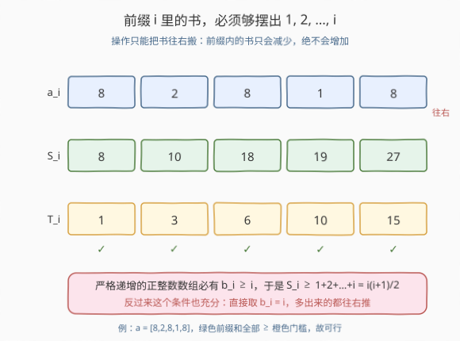
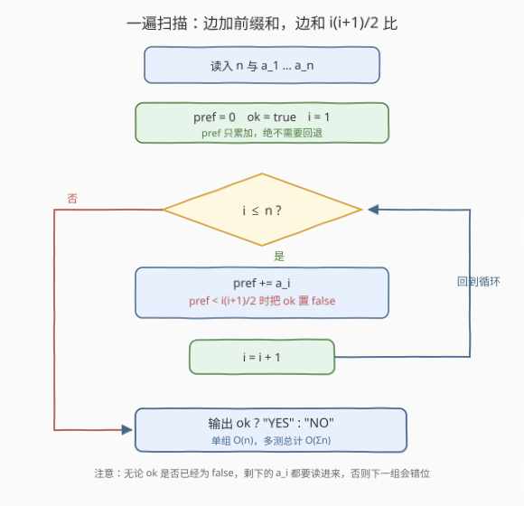
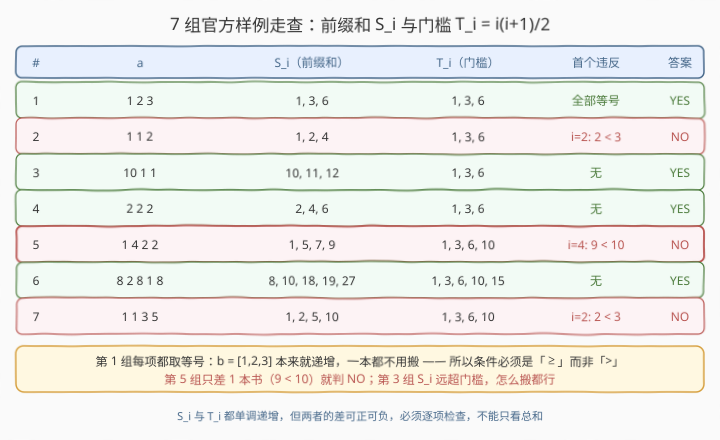

# Codeforces 2244B 尼基塔与书堆 题解

## 1. 题目概述

- **标题 / 题号**：尼基塔与书堆（Codeforces 2244B，英文名 Nikita and Books）
- **链接**：https://codeforces.com/problemset/problem/2244/B
- **来源**：Codeforces Round 1109 (Div. 3) · Problem B
- **难度**：$800$
- **限制**：时间 1 s / 内存 256 MB
- **标签**：贪心、数学、前缀和（官方标签：greedy, math, sortings；实际不需要排序，只用到前缀和的单调性）

**题意**：$n$ 堆书排成一行，第 $i$ 堆有 $a_i$ 本。一次操作只能做一件事：选一个下标 $i<n$ 且 $a_i>1$，从第 $i$ 堆顶部取 $1$ 本放到第 $i+1$ 堆顶部，即 $a_i \leftarrow a_i-1$、$a_{i+1} \leftarrow a_{i+1}+1$。操作可以做任意多次（含 $0$ 次），问能否把数组变成**严格递增**（$a_1<a_2<\cdots<a_n$）。多测：第一行 $t$，每组先 $n$、再 $a_1,\dots,a_n$，每组输出 `YES` / `NO`。

> 💡 一句话抓住本质：书**只能往右走**，所以任意前缀里的书数只减不增，而严格递增的数组又要求前缀里至少有 $1+2+\cdots+i$ 本——两个约束一碰，答案就出来了。

**约束**：

- $1 \le t \le 10^{4}$
- $1 \le n \le 2\times 10^{5}$，且 $\sum n \le 2\times 10^{5}$
- $1 \le a_i \le 10^{9}$
- 书的总数可达 $2\times 10^{14}$，超过 `int`，前缀和必须用 `long long`

## 2. 示例

官方样例（输入 / 输出原样，共 $7$ 组）：

```text
输入
7
3
1 2 3
3
1 1 2
3
10 1 1
3
2 2 2
4
1 4 2 2
5
8 2 8 1 8
4
1 1 3 5

输出
YES
NO
YES
YES
NO
YES
NO
```

补 $4$ 组自造样例（覆盖 $n=1$、两堆互堵、以及「余量要层层转手」）：

```text
输入
4
1
5
2
1 1
2
10 1
4
4 1 1 10

输出
YES
NO
YES
YES
```

第一组 $n=1$ 天然递增；第二组两堆都是 $1$，没有任何堆能吐书，数组永远是 `1 1`；第三组把 $9$ 本都推给第 $2$ 堆，得到 `1 10`；第四组前缀和 $4,5,6,16$ 对门槛 $1,3,6,10$ 全部达标，且余量要先交给第 $2$ 堆、再由它转给第 $3$ 堆。

## 3. 解题思路

### 3.1 暴力思路

把当前数组当成状态做 BFS，每步枚举所有 $a_i>1$ 的下标转移，看能否搜到严格递增的状态。因为书只往右走，状态图是 DAG、不会死循环，但**状态数等于「把 $S=\sum a_i$ 本书分成 $n$ 堆」的方案数**，约为 $\binom{S-1}{n-1}$：$n=2$、$S=2\times10^{14}$ 时就有 $10^{14}$ 级别个状态，完全不可行。即便把 $a_i$ 限制在 $5$ 以内、$n=5$，也已有上万状态，只够用来对拍。

还有一个非常诱人的错误直觉：**只看总和够不够 $1+2+\cdots+n$**。反例是 $a=[1,1,10^{9}]$：总和远超 $6$，但第 $2$ 堆只有 $1$ 本、第 $1$ 堆的书最多只能补到第 $2$ 堆，第 $3$ 堆永远等不到书，无解。所以「总量」不够精细，得看**每个前缀**。

### 3.2 核心观察：前缀和是一份「容量预算」



记初始前缀和

$$S_i = a_1+a_2+\cdots+a_i,\qquad T_i = 1+2+\cdots+i = \frac{i(i+1)}{2}.$$

**第一步：前缀和只会减少。** 一次操作把 $1$ 本从第 $j$ 堆移到第 $j+1$ 堆。对固定的前缀 $i$ 来说：若 $j<i$，这本书只是在前缀内部挪窝，$S_i$ 不变；若 $j=i$，书从第 $i$ 堆流到第 $i+1$ 堆、离开前缀，$S_i$ 减 $1$；若 $j>i$，跟前缀没关系。于是终态 $S_i^{\text{终}} = S_i - x_i$，其中 $x_i \ge 0$ 是跨过边界 $i \to i+1$ 的净流出量。

**第二步：终态前缀和不能太小。** 终态 $b$ 严格递增且 $b_j \ge 1$，于是 $b_1 \ge 1$、$b_2 \ge 2$、……、$b_j \ge j$，求和得

$$S_i^{\text{终}} = \sum_{j\le i} b_j \ \ge\ \sum_{j\le i} j = T_i.$$

两边一夹就得到**必要条件** $S_i \ge T_i$（对每个 $i$）。

**第三步：这个条件也充分。** 让每堆都卡在下界 $b_j = j$，多余的往右推：取 $x_i = S_i - T_i \ge 0$ 为跨过第 $i$ 条边界往右推的书数。由

$$a_i + x_{i-1} = \big(S_i - S_{i-1}\big) + \big(S_{i-1} - T_{i-1}\big) = S_i - T_{i-1} = i + x_i \ \ge\ i$$

可知第 $i$ 堆开始被处理时手里至少有 $i$ 本，推走 $x_i$ 本后正好剩 $i$ 本，即 $b_i = i$。最后一堆推不动，收到全部富余后 $b_n = a_n + x_{n-1} = S_n - T_{n-1} = n + x_n \ge n > n-1$，严格递增成立。

> 💡 结论：**答案为 YES 当且仅当对每个 $i=1..n$ 都有 $S_i \ge \frac{i(i+1)}{2}$。** 注意是「$\ge$」不是「$>$」：$a=[1,2,3]$ 每项都取等号，本来就递增，一本都不用搬。

### 3.3 算法流程：一边读一边累加



每组测试只需要两个变量，甚至不用存数组：

1. `pref = 0`，`ok = true`；
2. 对 $i = 1..n$：读入 $a_i$，`pref += a_i`，若 `pref < i*(i+1)/2` 则 `ok = false`；
3. 输出 `ok ? "YES" : "NO"`。

**注意**：即使 `ok` 已经是 `false`，本组剩下的 $a_i$ 也**必须读完**，否则下一组会从错误的位置开始解析（见 §4、§8）。$\sum n \le 2\times10^5$，读完整组毫无负担。

### 3.4 示例演算



| # | $a$ | 前缀和 $S_i$ | 门槛 $T_i$ | 首个违反 | 答案 |
|---|-----|--------------|------------|----------|------|
| 1 | `1 2 3` | 1, 3, 6 | 1, 3, 6 | 无（全部等号） | `YES` |
| 2 | `1 1 2` | 1, 2, 4 | 1, 3, 6 | $i=2$：$2<3$ | `NO` |
| 3 | `10 1 1` | 10, 11, 12 | 1, 3, 6 | 无 | `YES` |
| 4 | `2 2 2` | 2, 4, 6 | 1, 3, 6 | 无 | `YES` |
| 5 | `1 4 2 2` | 1, 5, 7, 9 | 1, 3, 6, 10 | $i=4$：$9<10$ | `NO` |
| 6 | `8 2 8 1 8` | 8, 10, 18, 19, 27 | 1, 3, 6, 10, 15 | 无 | `YES` |
| 7 | `1 1 3 5` | 1, 2, 5, 10 | 1, 3, 6, 10 | $i=2$：$2<3$ | `NO` |

第 $5$ 组最能说明「差一点」：只差 $1$ 本书就够 $T_4 = 10$，即便前三个前缀都达标也照样无解。第 $6$ 组给出实际构造 $x=(7,7,12,9)$，终态 $b = (1,2,3,4,17)$。第 $4$ 组 $a=[2,2,2]$ 的总和恰好等于 $T_3 = 6$：$S=(2,4,6)$、$T=(1,3,6)$，搬法为 `2 2 2 → 1 3 2 → 1 2 3`。

## 4. 算法细节

1. **门槛别溢出**：$T_i$ 在 $i=2\times10^5$ 时约 $2\times10^{10}$，超出 `int`，必须写 `1LL * i * (i + 1) / 2`；若写成 `i * (i + 1) / 2` 会先溢出再赋值，直接 WA。
2. **前缀和用 `long long`**：$S_n \le 2\times10^{5}\times10^{9} = 2\times10^{14}$，`int` 装不下。Python 无此问题。
3. **多测的两个纪律**：一是 `pref`、`ok` 每组开头重置；二是 `ok` 变为 `false` 后仍要把本组 $n$ 个数读完——若想提前退出，必须先把剩余数字读掉（例如再跑一个空转 `for`），否则读入流错位，后续所有组全错。
4. **等号合法**：判定条件是 `pref < T_i` 才置失败，即要求 $S_i \ge T_i$。若误写成 `<=`（要求严格大于），样例第 $1$ 组 `1 2 3` 会输出 `NO`。
5. **不要数组**：边读边累加即可，额外空间 $O(1)$；这点在 $t=10^4$、$\sum n$ 卡满时能省掉反复分配的开销。
6. **1-indexed 对齐**：$b_j \ge j$ 的推导是从「第 $1$ 堆至少 $1$ 本」开始的，所以循环必须从 $i=1$ 到 $n$，$T_i$ 才与 $i$ 对应；若从 $0$ 开始数就会整体偏移一位。
7. **I/O**：C++ 先调用 `std::ios::sync_with_stdio(false)` 与 `cin.tie(nullptr)`；Python 用 `sys.stdin.buffer.read().split()` 一次读完再按下标推进，比逐行 `input()` 快数倍。另外本机（Apple clang + libc++）`cin` 提取整数偏慢（$2\times10^5$ 个数约 $0.32$ s），换成 `scanf` 只要 $0.01$ s；Codeforces 的 GNU libstdc++ 上 `cin` 关同步约 $10\sim30$ ms，两种写法都能过，本文给的是 `cin` 版。

## 5. 正确性证明

**引理 1（前缀和单调不增）**：任意合法操作序列执行完毕后，对每个 $i\in[1,n]$ 都有 $S_i^{\text{终}} \le S_i$。

**证明**：只需看单次操作的影响。操作把 $1$ 本从 $j$ 移到 $j+1$（$j<n$）：若 $j<i$，两端都在前缀 $[1,i]$ 内，$S_i$ 不变；若 $j=i$，第 $i$ 堆的书流出前缀，$S_i$ 减少 $1$；若 $j>i$，两端都在前缀外，$S_i$ 不变。三种情况都不增加，故整个序列执行完后 $S_i^{\text{终}} \le S_i$。∎

**引理 2（递增正整数序列的下界）**：若 $b_1<b_2<\cdots<b_n$ 且 $b_j \ge 1$，则 $b_j \ge j$，且对每个 $i$ 有 $\sum_{j\le i} b_j \ge T_i$。

**证明**：对 $j$ 归纳。$b_1 \ge 1$；若 $b_{j-1} \ge j-1$，由严格递增 $b_j \ge b_{j-1}+1 \ge j$。于是 $\sum_{j\le i} b_j \ge \sum_{j\le i} j = T_i$。∎

**引理 3（必要性）**：若存在合法操作序列使数组严格递增，则初始数组对每个 $i$ 满足 $S_i \ge T_i$。

**证明**：设终态为 $b$。由引理 2，$S_i^{\text{终}} = \sum_{j\le i} b_j \ge T_i$；由引理 1，$S_i^{\text{终}} \le S_i$。两者串联得 $S_i \ge T_i$。∎

**引理 4（充分性，构造正确）**：若对所有 $i$ 有 $S_i \ge T_i$，则令 $x_i = S_i - T_i \ge 0$（$i=1..n-1$），从左到右依次把第 $i$ 堆的 $x_i$ 本书推到第 $i+1$ 堆，该过程合法，且终态为 $b_i = i$（$i<n$）、$b_n = n + x_n$，严格递增。

**证明**：先算第 $i$ 堆被处理时持有的书量：$a_i + x_{i-1} = (S_i - S_{i-1}) + (S_{i-1} - T_{i-1}) = S_i - T_{i-1}$，而 $S_i = T_i + x_i$、$T_i - T_{i-1} = i$，故为 $i + x_i$。推书的第 $k$ 次操作（$k = 0,1,\dots,x_i-1$）前持有 $i + x_i - k \ge i + 1 \ge 2 > 1$，满足题面「$a_i>1$」的前提；推完 $x_i$ 次后剩 $i \ge 1$ 本。最后一堆收到 $x_{n-1}$ 本后为 $b_n = a_n + x_{n-1} = S_n - T_{n-1} = n + x_n \ge n$。于是 $b = (1,2,\dots,n-1,n+x_n)$，前 $n-1$ 项严格递增且 $b_{n-1} = n-1 < n \le b_n$，全部为正整数。∎

**定理**：算法输出 `YES` 当且仅当能把数组变成严格递增。

**证明**：算法输出 `YES` 恰好等价于「对所有 $i$，$S_i \ge T_i$」（扫描时逐项检查）。若可行，则由引理 3 该条件成立，算法输出 `YES`；若该条件成立，则由引理 4 给出合法的操作序列，确实可行，算法也输出 `YES`。两个方向都成立。∎

## 6. 复杂度分析

- **时间**：每组恰好扫描一遍、每次 $O(1)$ 算术运算，$O(n)$；多测总计 $O\left(\sum n\right) \le 2\times10^{5}$ 次操作，而读入本身就有 $\Omega\left(\sum n\right)$ 的下界，因此该复杂度已是**最优**。
- **空间**：额外 $O(1)$（只有 `pref`、`ok` 与循环变量）；不保存数组，也不做任何排序。
- **实测**（本机，$t=1$、$n=2\times10^{5}$、$a_i=10^{9}$）：C++ `cin` 版约 $0.32$ s、`scanf` 版约 $0.01$ s（差额全是 libc++ 的整数提取开销），Python 约 $0.10$ s；$t=10^{4}$、每组 $n=20$ 的满载多测同样在 $0.33$ s / $0.01$ s 量级。相对 $1$ s 时限，最慢的 `cin` 版也留有约 $3$ 倍余量，其余余量在 $30$ 倍以上。

## 7. 参考代码

### C++17

```cpp
#include <iostream>
using namespace std;

int main() {
    ios::sync_with_stdio(false);   // 关同步，2e5 个数读入更快
    cin.tie(nullptr);

    int t;
    if (!(cin >> t)) return 0;     // 空输入直接退出
    while (t--) {
        int n;
        cin >> n;
        long long pref = 0;        // 前缀和最大 2e14，必须 long long
        bool ok = true;
        for (int i = 1; i <= n; ++i) {
            long long a;
            cin >> a;              // 无论 ok 如何都要读完，否则下一组错位
            pref += a;
            // 门槛 T_i = 1+2+...+i = i(i+1)/2，写成 long long 防止溢出
            if (ok && pref < 1LL * i * (i + 1) / 2) ok = false;
        }
        cout << (ok ? "YES\n" : "NO\n");
    }
    return 0;
}
```

### Python3

```python
import sys


def main() -> None:
    data = sys.stdin.buffer.read().split()
    if not data:
        return
    pos = 0
    t = int(data[pos]); pos += 1
    out = []
    for _ in range(t):
        n = int(data[pos]); pos += 1
        pref = 0
        ok = True
        for i in range(1, n + 1):
            pref += int(data[pos]); pos += 1
            # Python 整数无溢出，T_i 直接算
            if ok and pref < i * (i + 1) // 2:
                ok = False
        out.append("YES" if ok else "NO")
    sys.stdout.write("\n".join(out) + "\n")


main()
```

## 8. 边界情况与易错点

1. **$n=1$**：只有一个堆，严格递增的定义天然满足，必输出 `YES`。公式在 $i=1$ 处要求 $a_1 \ge 1$，恒成立，所以不需要特判——但如果你把循环写成 $i=0..n-1$，门槛会错位成 $0$，逻辑就乱了。
2. **全 $1$ 且 $n \ge 2$**：没有任何堆满足 $a_i>1$，一步都动不了，答案必为 `NO`。此时 $S_n = n$ 而 $T_n \approx n^{2}/2$，差距随 $n$ 平方增长，所以 $2\times10^{5}$ 个 $1$ 的用例会稳定判 `NO`。
3. **$a_i$ 全为 $10^{9}$**：$S_n$ 达到 $2\times10^{14}$，`int` 溢出会变成负数、导致误判为 `NO`；`long long` 下安全。
4. **等号处的 `>=` 与 `>`**（样例第 $1$、$5$ 组）：判定必须是「$S_i \ge T_i$ 才继续」，即只有 `pref < T_i` 才置失败。写成 `pref <= T_i`（要求严格大于）会把 `1 2 3` 这种「每项取等号」的合法用例判成 `NO`；而完全不查前缀、只看总和，又会让 `1 4 2 2`（$9<10$）漏判。
5. **输入空白不敏感**：数组可能跨行、也可能有多个连续空格，用 `cin >>` 或 `split()` 这类「按 token 读」的方式天然安全；若改成先 `getline` 再切分单行，就会在「$n$ 与数组换行写法不一致」的数据上直接崩掉。
6. **输出量与输出方式**：大小写任意，但每组必须独立成行；$t=10^4$ 时 C++ 用 `'\n'` 而非 `endl`（后者每次都 flush），Python 用 `join` 一次性写出，避免上万次系统调用的抖动。
7. **空输入**：本地对拍喂空文件时 `if (!(cin >> t)) return 0;`、`if not data: return` 可避免未定义行为。

## 相关题目与扩展

- [Codeforces 2244A. Iskander and Drawings](https://codeforces.com/problemset/problem/2244/A)：同场 A 题，同样是「先推出一个闭式结论，再线性扫描」的签到节奏。
- [Codeforces 2244C. Stepan and Permutation](https://codeforces.com/problemset/problem/2244/C)：同场 C 题，构造 + 贪心，思路都是「先把目标定成最紧的下界，再检查剩余量够不够」。
- [LeetCode 1827. 最少操作使数组递增](https://leetcode.cn/problems/minimum-operations-to-make-the-array-increasing/)：只能做 $+1$ 的单侧版本，答案是一遍扫描累加 $\max(0, b_{i-1}+1-a_i)$，可视为本题「只有右边界、没有搬运」的退化情形。
- [LeetCode 945. 使数组唯一的最小增量](https://leetcode.cn/problems/minimum-increment-to-make-array-unique/)：目标从「严格递增」换成「两两不同」，排序后逐个抬高的贪心仍然有效。
- [LeetCode 2141. 同时运行 N 台电脑的最长时间](https://leetcode.cn/problems/maximum-running-time-of-n-computers/)：也是「总量预算 + 逐项上限」的判定结构，和本题的 $S_i$ 与 $T_i$ 对照很像。

**延伸思考**：

1. **最小操作次数**：本题只问可行性。若问最少搬几本，就不能照抄 $b_i = i$——$a=[2,3]$ 已经递增，$0$ 步即可，而卡到下界反而要搬 $1$ 步。注意总操作数等于 $\sum_{i<n} x_i = \sum_{i<n}\left(S_i - S_i^{\text{终}}\right)$，所以「最少步数」等价于「在 $b$ 严格递增、$b_j\ge1$、且每个前缀 $S_i^{\text{终}}\le S_i$ 的约束下最大化 $\sum_{j} (n-j)\,b_j$」，是一个带前缀容量约束的 DP/贪心，比本题难一档（我用 BFS 对拍确认过「卡下界」在步数意义下不是最优）。
2. **允许双向搬运**：若操作也能把书从 $i+1$ 挪到 $i$，任何「总和相同且每堆 $\ge 1$」的配置都可沿路径接力到达，答案退化成单纯的 $S_n \ge T_n$，前缀条件全部消失。
3. **改成公差 $d$ 的等差数列**：要求 $a_{i+1} \ge a_i + d$（$d \ge 1$）时，下界变成 $b_j \ge 1 + (j-1)d$，门槛相应变为 $T_i = i + \frac{i(i-1)}{2}d$，其余推导一字不改。
4. **每堆有容量上限 $c_i$**：此时「多余的往右推」可能推不动（右堆装不下），充分性证明失效，需要额外的可行性判定，问题会显著变难。
