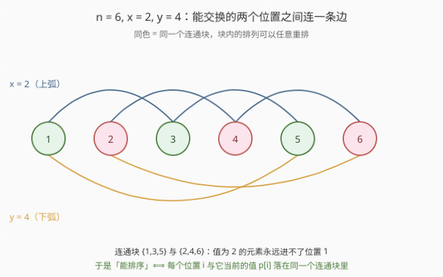
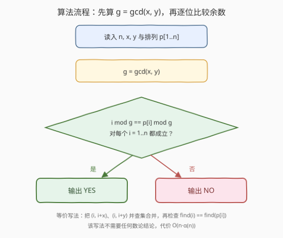
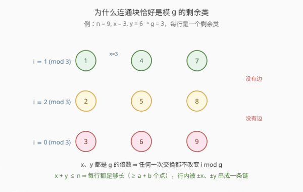
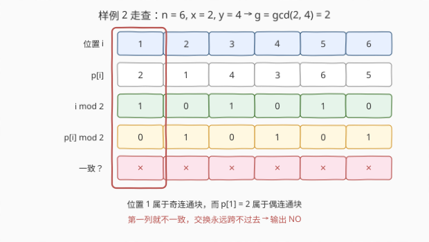

# Codeforces 2244C 斯捷潘与排列 题解

## 1. 题目概述

- **标题 / 题号**：斯捷潘与排列（Codeforces 2244C，英文名 Stepan and Permutation）
- **链接**：https://codeforces.com/problemset/problem/2244/C
- **来源**：Codeforces Round 1109 (Div. 3) · Problem C
- **难度**：$\ast 1100$
- **限制**：时间 2 s / 内存 256 MB
- **标签**：图论建模、并查集、DFS、数论（$\gcd$）、排序（官方标签：constructive algorithms, dfs and similar, dsu, greedy, math, number theory, sortings）

**题意**：给定一个 $1\sim n$ 的排列 $p$，以及两个正整数 $x,y$，满足 $x+y\le n$。一次操作可以选两个位置 $i,j$，只要 $|i-j|=x$ 或 $|i-j|=y$，就交换 $p_i$ 与 $p_j$。允许做任意多次操作，问能否把 $p$ 变成升序排列 $1,2,\dots,n$。

多测：第一行是测试组数 $t$；每组先给 $n,x,y$，再给 $n$ 个整数表示排列；每组输出一行 `YES` 或 `NO`。

**约束**：

- $1\le t\le 10^{4}$
- $1\le x,y\le n\le 2\times 10^{5}$，且 $x+y\le n$
- $p$ 保证是 $1\sim n$ 的排列
- $\sum n\le 2\times 10^{5}$：每组 $O(n)$、总计 $O(\sum n)$ 才安全；单组 $O(n^2)$（例如对每个元素 BFS 找路径）在 $n=2\times10^5$ 时会超时

## 2. 示例与观察
官方样例（输入 / 输出原样）：

```text
输入
4
5 2 3
5 4 3 2 1
6 2 4
2 1 4 3 6 5
4 2 2
1 2 3 4
5 2 3
1 2 3 5 4

输出
YES
NO
YES
YES
```

补 3 组自造样例（覆盖 $x=y$、$n$ 最小的情形，以及「只差一对相邻位置却仍不行」）：

```text
输入
3
6 3 3
4 5 6 1 2 3
6 3 3
1 2 3 4 6 5
2 1 1
2 1

输出
YES
NO
YES
```

第 1 组的值整体循环平移了 $3$ 位（$p_i=i+3$ 当 $i\le 3$，否则 $p_i=i-3$），直接交换 $(1,4),(2,5),(3,6)$ 即可；第 2 组里位置 $5,6$ 分属两个连通块，值 $6$ 永远进不了位置 $5$，故为 `NO`；第 3 组 $n=2$ 时只能交换位置 $1,2$，一次即可。

## 3. 解题思路

### 3.1 暴力思路

最直白的做法是在**排列状态**上 BFS：从初始排列出发，枚举所有 $|i-j|\in\{x,y\}$ 的交换，看能否到达升序。状态数是可达排列的个数，而本题 $n$ 可达 $2\times10^5$，排列状态有 $n!$ 个，完全不可行。即使只对 $n\le 8$ 用 BFS 也只为对拍服务，无法推广。

另一个诱惑是「值到位置的路径 BFS」：对每个放错位置的元素，看能否沿合法交换走到它该去的位置。这方向是对的（本质也是连通性），但如果对每个元素都跑一次网格 BFS，最坏 $O(n^2)$，在 $2\times10^5$ 下必然超时；必须把「可达性」一次性预处理成连通块。

### 3.2 核心观察：交换规则只与位置有关 → 建图看连通块



关键点在于：**一次操作能不能做，只取决于两个位置的差，跟这两个位置上的值毫无关系**。于是把位置 $1..n$ 看成图的顶点，对每组满足 $|i-j|\in\{x,y\}$ 的位置连一条无向边，得到一张图 $G$：

- 一次合法交换 = 沿 $G$ 的一条边做一次**边转置**；
- 同一个连通块内部，任意两个位置都能用这些边连起来，因此块内的元素可以**任意重排**（详见引理 2）；
- 不同连通块之间永远没有边，元素**绝不会跨块移动**。

所以排序是否可行，等价于：对每个位置 $i$，它当前的值 $p_i$ 必须与 $i$ 落在**同一个连通块**里，即 $p_i$ 本来就属于 $i$ 所在的块。

### 3.3 算法：并查集通用写法，以及数论加速



**写法 A（通用，标签里的 dsu / dfs）**：显式建图，对每个 $i\le n-x$ 合并 $(i,i+x)$，对每个 $i\le n-y$ 合并 $(i,i+y)$，最后检查是否所有 $i$ 都有 $\text{find}(i)=\text{find}(p_i)$。复杂度 $O(n\,\alpha(n))$，不依赖任何数论结论。

**写法 B（本题条件下更短更快）**：设 $g=\gcd(x,y)$。可以证明（引理 4、引理 5），在 $x+y\le n$ 的前提之下，$G$ 的连通块**恰好就是模 $g$ 的各个剩余类**：

$$\{i: i\equiv r \pmod g\},\qquad r=1,2,\dots,g$$

于是判定条件化为逐位取模：对所有 $i$ 都要有

$$i \bmod g \;=\; p_i \bmod g.$$



两个方向都很直白：

- **边不跨行**：$x,y$ 都是 $g$ 的倍数，所以任何一条边的两个端点模 $g$ 同余，连通块只能落在某个剩余类里；
- **行内连通**：$x+y\le n$ 保证了每个剩余类里有足够多的点（至少 $a+b$ 个，其中 $a=x/g,\ b=y/g$），用步长 $a$ 和 $b$ 可以在这一行里从任意一点走到任意一点（引理 4 的收缩证明）。

> 💡 **一句话总结**：能交换的位置先连成图，答案只取决于「$i$ 与 $p_i$ 是否同块」；在 $x+y\le n$ 时连通块就是同余类，于是 $O(n)$ 扫一遍取模即可，连数组都不用存。

### 3.4 示例演算



四组官方样例的判定过程：

| 用例 | $n,x,y$ | $g$ | 逐位检查 | 答案 |
|------|---------|-----|----------|------|
| 1 | $5,2,3$ | 1 | 所有位置同余（$g=1$），自动通过 | `YES` |
| 2 | $6,2,4$ | 2 | $i=1$ 为奇，$p_1=2$ 为偶 → 不一致 | `NO` |
| 3 | $4,2,2$ | 2 | $i$ 与 $p_i=i$ 同余，本来就升序 | `YES` |
| 4 | $5,2,3$ | 1 | 只有 $p_4=5,p_5=4$ 错位，但同块 | `YES` |

第 4 组值得展开：位置 $4,5$ 的差是 $1$，**不能**直接交换，可是 $g=1$ 说明整张图连通。具体路线是 $4\to2\to5$：交换 $(2,4)$、$(2,5)$、$(2,4)$ 三步即可把 $5,4$ 归位（序列 $[1,2,3,5,4]\to[1,5,3,2,4]\to[1,4,3,2,5]\to[1,2,3,4,5]$）。这也说明本题考察的是**连通性**，而不是「能不能一次换到」。

## 4. 算法细节

1. **取模要用 1-indexed**：位置从 $1$ 开始编号，判据是 $i\bmod g = p_i\bmod g$。如果循环写成 0-indexed，等价条件是 $(i+1)\bmod g = p_i\bmod g$，两者不可混用。
2. **必须把 $n$ 个数全部读完**：C++ 里若在第一次发现不一致时就 `break` 或 `return`，后续测试的读入位置会整体错位，后面的组全部误判；因此循环里只置标志位，读完再输出。
3. **多测清空**：$t$ 可达 $10^{4}$，不要每组 `memset` 一个长度 $2\times10^5$ 的数组（$2\times10^{9}$ 次写，必超时）；只处理本组的 $n$ 个位置，或者干脆像参考代码那样**不存数组**、边读边判。
4. **$x=y$ 是合法输入**：此时 $g=x$，连通块是 $\{r,r+x,r+2x,\dots\}$，不能因为「两个参数不同才有意义」就漏掉这条分支。
5. **$g=1$ 时恒为 `YES`**：$i\bmod 1=0$ 恒成立，公式自动给出 `YES`，无需特判；反过来也说明 $x,y$ 互质且 $x+y\le n$ 时图一定连通。
6. **并查集写法的边界**：只在 $i+x\le n$（或 $i+y\le n$）时连边，越界会读到无效下标；若 $x=y$，两组循环会重复连同一批边，无害但要知道。
7. **不需要构造操作序列**：题目只问可行性，别真的去模拟交换（既慢又容易写错）；连通块判据是纯静态的。
8. **I/O**：$\sum n\le 2\times10^5$，C++ 关同步后的 `cin` 足够；Python 用 `sys.stdin.buffer.read().split()` 一次性读完再按下标推进，比逐行 `input()` 稳且快。

## 5. 正确性证明

**引理 1（图模型等价）**：一次合法操作恰好对应图 $G$ 上一条边的两个端点之间的转置。

**证明**：边的定义就是「$|i-j|\in\{x,y\}$ 的位置对」，与操作的允许条件逐字对应；操作即交换两点上的值，也就是一次转置。∎

**引理 2（连通块内可任意重排）**：设 $C$ 是 $G$ 的一个连通块。则对 $C$ 上任意指定的排列方式，都存在一串只作用于 $C$ 内部的合法交换把它实现。

**证明**：取 $C$ 的一棵生成树 $T$，树上每条边都是 $G$ 的边，因而都是合法交换。先用恒等式 $(u\,v)=(u\,w)(w\,v)(u\,w)$ 说明「沿路径的边转置可以合成任意两点的转置」：若 $u=w_0,w_1,\dots,w_k=v$ 是一条路径，则 $(w_0\,w_k)=(w_0\,w_1)\cdots(w_{k-1}\,w_k)(w_{k-2}\,w_{k-1})\cdots(w_0\,w_1)$，右边全是树上边的转置。于是 $C$ 内**任意**两个位置的转置都可由合法交换复合而成；而任意排列都能写成若干转置之积，故结论成立。∎

**引理 3（判定准则）**：$p$ 可排序当且仅当对每个 $i$ 都有 $\text{find}(i)=\text{find}(p_i)$（$i$ 与 $p_i$ 同块）。

**证明**：

- （充分性）若每个 $i$ 都与 $p_i$ 同块，则 $p$ 把每个块映到自身；又 $p$ 是双射，故 $p$ 限制在每个块上是该块的一个排列。由引理 2，逐块把元素重排成升序即可。
- （必要性）每次操作只在同一个块内部进行，所以「每个块里有哪些值」是不变量。升序排列中块 $C$ 上的值集合恰为 $C$ 本身，故初始时块 $C$ 上的值集合也必须是 $C$，即对 $i\in C$ 有 $p_i\in C$。∎

**引理 4（区间连通）**：设 $\gcd(a,b)=1$，$K\ge a+b-1$。在连续整数区间 $[L,L+K-1]$ 上，若两点相差 $a$ 或 $b$ 就认为相邻，则整张图连通。

**证明**：$a=1$ 时步长为 $1$，逐个相邻即连成一条链。设 $a\ge 2$。

1. 同一个模 $a$ 剩余类内的点依次相差 $a$，且都在区间内，因此类内两两连通；
2. 把每个剩余类收缩成一个点。因为 $K\ge a$，区间里 $a$ 个剩余类都有代表点；
3. 再看步长 $b$ 的边：对所有满足 $v+b\le L+K-1$ 的 $v$，它把类 $v$ 与类 $v+b$ 相连。这样的 $v$ 共有 $K-b+1\ge a$ 个连续整数，横跨全部 $a$ 个剩余类，所以每个剩余类 $r$ 都至少拥有一条通向 $r+b$ 的边；
4. $\gcd(a,b)=1$ 说明 $r\mapsto r+b$ 在 $\mathbb{Z}_a$ 上是一个长度为 $a$ 的环，收缩图连通，故原图连通。∎

**引理 5（连通块 = 剩余类）**：在 $x+y\le n$ 下，$G$ 的连通块恰为模 $g=\gcd(x,y)$ 的剩余类。

**证明**：记 $a=x/g$、$b=y/g$，则 $\gcd(a,b)=1$。一方面，$x,y$ 都是 $g$ 的倍数，任何一条边都不改变位置模 $g$ 的余数，故连通块含于某个剩余类。

另一方面固定剩余类，设其中最小元素为 $r$（$1\le r\le g$），则该类里的元素是 $r,r+g,\dots,r+g(K-1)$，其中 $K=\lfloor (n-r)/g\rfloor+1$。由 $n\ge g(a+b)$ 及 $r\le g$ 得 $n-r\ge g(a+b-1)$，于是 $K\ge a+b$。把位置按 $k=(i-r)/g$ 缩放，交换差 $x,y$ 变成步长 $a,b$，问题化为长度 $K\ge a+b\ge a+b-1$ 的连续整数区间上的 $a/b$ 步长连通性，由引理 4 知该类内部连通。∎

**定理**：算法输出 `YES` 当且仅当排列可以排成升序。

**证明**：由引理 3，可排序当且仅当每个 $i$ 与 $p_i$ 同块；由引理 5，这等价于 $i\equiv p_i\pmod g$，即 $i\bmod g=p_i\bmod g$。参考代码正是逐位检查这一同余式，故其输出与「可排序」完全一致。∎

## 6. 复杂度分析

- **时间**：每组先求一次 $\gcd$，$O(\log \min(x,y))$；随后扫 $n$ 个元素、每位一次取模与比较，$O(n)$。多测合计 $O\!\left(\sum n\right)\le 2\times10^{5}$ 次基本运算（并查集写法是 $O(\sum n\,\alpha(n))$，同样安全）。相对 2 s 的时限几乎可以忽略。
- **空间**：参考代码边读边判，额外空间 $O(1)$（只有 `g`、标志位与循环变量）；Python 因为一次性读入 token，占 $O(\sum n)$ 的输入缓冲。并查集写法需要 $O(n)$ 的 `par` 数组。
- **实测**：最大用例（$n=2\times10^{5}$ 逆序排列）上，同一算法的手写 `fread` 版本端到端只要 $5\sim 8$ ms；本机 libc++ 的 `cin`（关闭同步）约 $0.40$ s，其中绝大部分是 libc++ `num_get` 的实现开销——CF 的 g++ 上 `cin` 与 `scanf` 同量级，实际远快于此；Python3 约 $113$ ms。即便按最保守的本机 `cin` 测量，相对 2 s 也有 $5$ 倍以上余量。

## 7. 参考代码

### C++17

```cpp
#include <iostream>
#include <numeric>
using namespace std;

int main() {
    ios::sync_with_stdio(false);
    cin.tie(nullptr);

    int t;
    if (!(cin >> t)) return 0;
    while (t--) {
        int n, x, y;
        cin >> n >> x >> y;
        int g = std::gcd(x, y);

        bool ok = true;
        for (int i = 1; i <= n; ++i) {
            int v;
            cin >> v;                       // 必须把 n 个数全部读完，不能提前 break
            if (i % g != v % g) ok = false; // 位置 i 与它当前的值 v 必须同属一个剩余类
        }
        cout << (ok ? "YES" : "NO") << '\n';
    }
    return 0;
}
```

### Python3

```python
import sys
from math import gcd


def main() -> None:
    data = sys.stdin.buffer.read().split()
    if not data:
        return
    pos = 0
    t = int(data[pos]); pos += 1
    out = []
    for _ in range(t):
        n = int(data[pos]); x = int(data[pos + 1]); y = int(data[pos + 2])
        pos += 3
        g = gcd(x, y)
        p = data[pos:pos + n]          # 整段取出，保证读入位置不被打乱
        pos += n
        ok = True
        for i, tok in enumerate(p, 1):  # i 从 1 开始，与位置编号一致
            if i % g != int(tok) % g:
                ok = False
                break
        out.append("YES" if ok else "NO")
    sys.stdout.write("\n".join(out) + "\n")


main()
```

## 8. 边界情况与易错点

1. **$g=1$ 时直接 `YES`**：$i\bmod 1=0$ 恒成立，公式自动正确；但不要反过来写成「只要 $x\ne y$ 就 `YES`」——$x=2,y=4$ 时 $g=2$，样例 2 就是 `NO`。
2. **$x=y$ 不能被漏掉**：此时 $g=x$，块是 $\{r,r+x,\dots\}$。例如 $n=6,x=y=3$ 时块为 $\{1,4\},\{2,5\},\{3,6\}$，能排序的只有把每个块映到自身的排列（如 $[4,5,6,1,2,3]$），并非全体连通。
3. **不能提前 `break` 读入**：C++ 若在发现不一致时立刻跳出读入循环，下一组会把本组剩下的数当成 $n,x,y$，从这一组起全部错位；Python 若用逐行 `input()` 并提前 `continue`，也会漏掉一行。
4. **下标必须 1-indexed**：判据是 $i\bmod g=p_i\bmod g$，其中 $i$ 是位置编号（从 $1$ 起）；写成 0-indexed 时条件要改成 $(i+1)\bmod g=p_i\bmod g$，混淆就会全错。
5. **多测不要暴力清空**：$t\le 10^{4}$ 且数组长度可达 $2\times10^{5}$，每组整体 `memset` 会退化到 $2\times10^{9}$ 次操作；本解法不存数组，天然免疫。
6. **忽略 $x+y\le n$ 会翻车**：若没有这条约束，「$g=1$ 即连通」就不成立（例如 $n=7,x=5,y=6$ 时 $g=1$，但真实连通块是 $\{1,2,6,7\},\{3\},\{4\},\{5\}$）。看到这条约束才知道可以放心用剩余类；真去掉了就得退回并查集/DFS。
7. **$n\ge 2$ 恒成立**：因为 $x,y\ge1$ 且 $x+y\le n$，所以不会有 $n=1$ 的数据；不过代码对 $n=1$（此时 $p=[1]$）也会输出 `YES`，不会崩。
8. **输出用 `'\n'` 而不是 `endl`**：$t$ 可达 $10^{4}$，`endl` 每次都 flush，白白变慢；输出内容大小写不敏感，统一 `YES`/`NO` 即可。

## 9. 验证记录

- **编译环境与命令**：`clang++ -std=c++17 -O2`（本机无 GNU g++，配 `codeforces/tools/include/bits/stdc++.h` 兼容头；正文代码只用标准库，可原样提交 GNU C++17）；Python 侧为 `Python 3.9.6`。
- **官方样例**：1 / 1 通过（按 Codeforces 标准 checker 的 token 比对，忽略空白与大小写）。
- **复核状态**：audited（2026-11-19 统一回归：编译 + 官方样例；写作期的随机对拍与暴力未重跑）。

## 相关题目与扩展

- [Codeforces 500B. New Year Permutations](https://codeforces.com/problemset/problem/500/B)：给一张「哪些位置可以交换」的 $n\times n$ 矩阵，问能否排好序——和本题是同一个「连通块内自由重排」模型。
- [Codeforces 2244B. Nikita and Books](https://codeforces.com/problemset/problem/2244/B)：同场 B 题，签到向的贪心 + 排序。
- [LeetCode 765. 情侣牵手](https://leetcode.cn/problems/couples-holding-hands/)：排列 + 交换，按置换环数求最少交换次数，可与本题的「连通块」视角对照。
- [LeetCode 547. 省份数量](https://leetcode.cn/problems/number-of-provinces/)：并查集 / DFS 求连通块数量的模板题。

**延伸思考**：

1. **去掉 $x+y\le n$**：此时 $g=1$ 不再意味着全连通。例如 $n=7,x=5,y=6$ 只有边 $(1,6),(2,7),(1,7)$，连通块是 $\{1,2,6,7\}$ 与三个孤点。这时剩余类判据失效，必须显式建图（并查集 $O(n\,\alpha(n))$ 仍然正确），这也说明了 $x+y\le n$ 在证明里承担的角色——保证每个剩余类「房间够大」。
2. **允许重复元素**（把数组排成非降序而非 $1\sim n$）：判据要改成「每个连通块内，当前值的多重集合与目标值的多重集合相同」，不能再只看 $\text{find}(i)=\text{find}(p_i)$（已用 $n\le 6$ 的随机数据逐例验证）。
3. **交换条件放宽为 $|i-j|\le k$**：位置 $1$ 与 $2$ 直接可换，图必然连通，答案恒为 `YES`——这类「放宽条件把图变全连通」的变体是本题最快的思维检验。
4. **若问最少操作次数**：不能套用「$n-$置换环数」（那只在任意两位置都能直接交换时成立）。本题限制下同一排列往往需要更多步：$n=5,x=2,y=3$ 时把 $[1,2,3,5,4]$ 排好最少要 $3$ 步，而环数给的下界只有 $1$；求精确最小值需要在图上沿路径搬运，属于另一类更难的计数/最短路问题。
