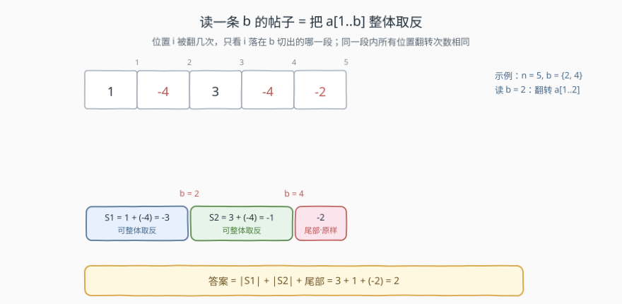
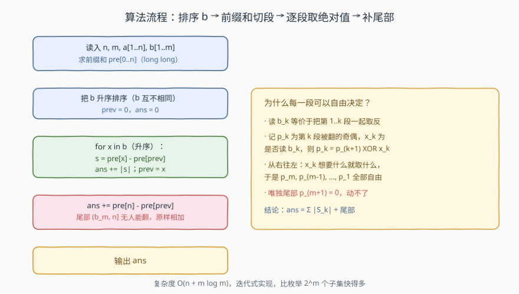
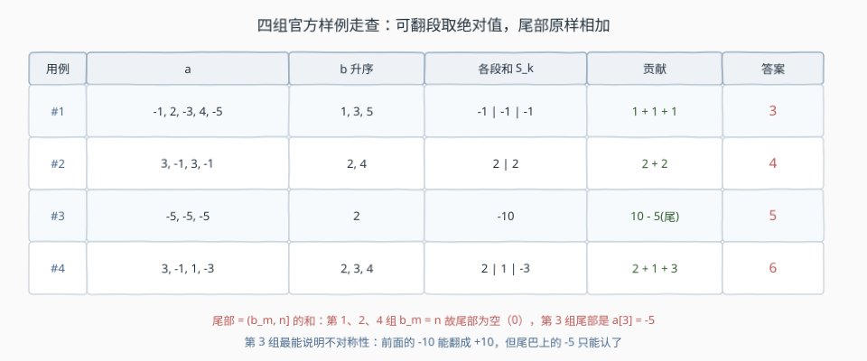

# Codeforces 2244D 雅罗斯拉夫与生产力 题解

## 1. 题目概述

- **标题 / 题号**：雅罗斯拉夫与生产力（Codeforces 2244D，英文名 Yaroslav and Productivity）
- **链接**：https://codeforces.com/problemset/problem/2244/D
- **来源**：Codeforces Round 1109 (Div. 3) · Problem D（UTC 2026-07-14）
- **难度**：$\ast 1200$
- **限制**：时间 2 s / 内存 256 MB
- **标签**：构造、贪心、动态规划、数学、前缀和（官方标签：constructive algorithms, dp, greedy, math, number theory）

**题意**：雅罗斯拉夫一天的生产力用长度 $n$ 的数组 $a$ 描述，$a_i$ 可正可负，**总生产力定义为所有元素之和**。他有 $m$ 条励志帖，第 $j$ 条的影响力是 $b_j$：读它会把**前缀** $a_1,\dots,a_{b_j}$ 全部乘上 $-1$。他可以读任意多条（一条都不读也行，每条最多读一次），求能达到的最大总生产力。

多测：第一行是测试组数 $t$；每组先给 $n,m$，接着一行 $n$ 个整数 $a_i$、再一行 $m$ 个整数 $b_j$；对每组输出一个整数。

**约束**：

- $1 \le t \le 10^4$，$1 \le m \le n \le 2\times10^{5}$，$\sum n \le 2\times10^{5}$
- $-10^{9} \le a_i \le 10^{9}$，前缀和可达 $2\times10^{14}$，必须用 `long long`
- $1 \le b_j \le n$ 且两两不同
- $O(2^{m})$ 的枚举在 $m$ 上百时就已失效，必须做到 $O(n\log n)$ 以内

## 2. 示例与观察
官方样例（输入 / 输出原样）：

```text
输入
4
5 3
-1 2 -3 4 -5
1 5 3
4 2
3 -1 3 -1
4 2
3 1
-5 -5 -5
2
4 3
3 -1 1 -3
4 3 2

输出
3
4
5
6
```

补 2 组自造样例（$n=1$ 与 $\pm10^9$ 的极值；$m=n$ 时尾部为空、答案退化为 $\sum\lvert a_i\rvert$，不再单列）：

```text
输入
2
1 1
-7
1
5 2
1000000000 -1000000000 1000000000 -1000000000 1000000000
2 5

输出
7
1000000000
```

第 1 组：读掉唯一的帖子，$-7$ 变成 $7$。第 2 组：段 $(0,2]$ 和为 $0$、段 $(2,5]$ 和为 $10^9$、尾部为空，答案 $10^9$，正好检验 `long long`。

## 3. 解题思路

### 3.1 暴力思路

最直接的做法是枚举读哪几条帖子：$m$ 条帖子有 $2^{m}$ 个子集，每个子集把对应前缀乘 $-1$ 再求和，$O(2^{m}n)$，而本题 $m$ 可以到 $2\times10^{5}$，毫无机会。但这个暴力白送两条线索：变号**可交换**，结果只取决于每个位置被乘了几次 $-1$ 的**奇偶性**；判断子集好坏也不用真的改数组，只要知道每个位置的翻转奇偶——于是问题变成在所有**可达的翻转奇偶图样**里挑一个让总和最大的。

### 3.2 核心观察：按 $b$ 切段，前 $m$ 段符号自由，尾部锁死



把 $b$ 升序排成 $b_1<b_2<\dots<b_m$、令 $b_0=0$，这些分界点把数组切成 $m+1$ 块：

$$S_k=\sum_{i=b_{k-1}+1}^{b_k}a_i\quad(1\le k\le m),\qquad T=\sum_{i=b_m+1}^{n}a_i .$$

**第一步：同一块内的元素命运相同。** 位置 $i$ 被翻的次数等于「被选中且 $b_j\ge i$ 的帖子数」。若 $i$ 落在第 $k$ 块（$b_{k-1}<i\le b_k$），则 $j\ge k$ 时 $b_j\ge b_k\ge i$、这些帖子都会翻到 $i$，而 $j<k$ 时 $b_j\le b_{k-1}<i$、一条也翻不到 $i$。故整块要么一起变号、要么一起不变，**块内不可能出现「一半翻一半不翻」**；特别地，$i>b_m$ 的尾部一块永远翻不到。

**第二步：块与块之间恰好互相独立。** 设 $x_k\in\{0,1\}$ 表示是否读 $b_k$，$p_k$ 表示第 $k$ 块被翻次数的奇偶，则 $p_k=x_k\oplus x_{k+1}\oplus\cdots\oplus x_m$，即

$$p_k=p_{k+1}\oplus x_k,\qquad p_{m+1}=0 .$$

从右往左看：想让 $p_m$ 取某个值，就取 $x_m=p_m$；想让 $p_{m-1}$ 取某个值，就取 $x_{m-1}=p_{m-1}\oplus p_m$……每一步 $x_k$ 都有、且只有一个取值能把 $p_k$ 调成想要的样子。**所以 $p_1,\dots,p_m$ 可以取遍全部 $2^{m}$ 种组合，只有尾部 $p_{m+1}=0$ 动不了。**

既然每块能独立决定翻或不翻，就逐块贪心：$S_k\ge0$ 不翻、$S_k<0$ 就翻，尾部 $T$ 只能原样计入——**尾部没有「取绝对值」的待遇**，这正是本题最易错的地方，样例 3 专考这一点：

$$\text{ans}=\sum_{k=1}^{m}\lvert S_k\rvert + T .$$

> 💡 官方标签里的 `dp` 指「从右往左扫、维护当前翻转态 $p$ 的两种取值」的写法：$dp[k][p]$ 表示处理完 $k..m$ 段、第 $k$ 段状态为 $p$ 的最大收益。由于各段选择互不影响，它退化成逐段取绝对值，直接用 $\lvert S_k\rvert$ 写更省事。

### 3.3 算法流程



对每组测试：

1. 读入 $a_1..a_n$ 并求前缀和 $pre[0..n]$（`long long`），$pre[0]=0$；
2. 读入 $b_1..b_m$ 并**升序排序**；
3. 令 `prev = 0`、`ans = 0`，依次枚举 $x=b_k$：`s = pre[x] - pre[prev]`，`ans += |s|`，再 `prev = x`；
4. 循环结束后 `ans += pre[n] - pre[prev]`（尾部原样相加）；
5. 输出 `ans`。

排序是必须的：只有 $b$ 有序，$pre[b_k]-pre[b_{k-1}]$ 才对应一段**连续且互不重叠**的区间；按输入乱序切段会得到跨越、重叠甚至负长度的「段」，答案必错。

### 3.4 示例演算



| 用例 | $a$ | $b$（升序） | 各段和 | 贡献 | 答案 |
|------|-----|-------------|--------|------|------|
| #1 | $-1,2,-3,4,-5$ | $1,3,5$ | $-1$、$-1$、$-1$ | $1+1+1$ | $3$ |
| #2 | $3,-1,3,-1$ | $2,4$ | $2$、$2$ | $2+2$ | $4$ |
| #3 | $-5,-5,-5$ | $2$ | $-10$ | $10-5$（尾） | $5$ |
| #4 | $3,-1,1,-3$ | $2,3,4$ | $2$、$1$、$-3$ | $2+1+3$ | $6$ |

第 1 组三段绝对值都是 $1$，累加得 $3$；第 2 组两块都为正，不翻最优；第 3 组把 $-10$ 翻成 $+10$，但尾部 $a_3=-5$ 翻不到，只能 $10-5=5$；第 4 组末段 $-3$ 翻成 $+3$，$2+1+3=6$。与官方输出逐一吻合。

## 4. 算法细节

1. **前缀和与 1-indexed**：$pre$ 开 $n+1$ 位，$pre[i]=\sum_{j\le i}a_j$，段 $(b_{k-1},b_k]$ 的和就是 $pre[b_k]-pre[b_{k-1}]$。$b_j$ 本身就是前缀下标，直接当下标用；改成 0-indexed 极易把 $b_j$ 与 $b_j-1$ 弄混。
2. **滚动 `prev` 省掉一次数组访问**：排序后扫一遍，只在 `prev` 里保存上一个分界点，初值 $0$ 正好对应 $b_0$，于是 $b$ 数组只需在排序时用一次。
3. **`long long` 与取绝对值**：段和、答案、前缀和都必须是 64 位。不要写 `abs(s)`——`<cstdlib>` 里的 `abs(int)` 在 $s$ 超出 `int` 时是未定义行为；用 `std::llabs(s)` 或 `s < 0 ? -s : s`，后者一眼看出没有类型提升问题。
4. **尾部单独处理**：循环只管 $k=1..m$，尾部一定在循环之后单独加，且**不能加绝对值**。$m=n$ 时 `pre[n]-pre[prev]=0` 自动正确，无需特判。
5. **多测清空**：`ans`、`prev` 每组重新初始化；`pre`/`b` 用局部 `vector` 重新构造，天然不会串组，也避免 $t$ 很大时对全局数组反复 `memset`。
6. **I/O 常数**：C++ 关同步 `ios::sync_with_stdio(false)` + `cin.tie(nullptr)`；Python 用 `sys.stdin.buffer.read().split()` 一次读完。注意 **Apple clang 的 libc++ 里 `operator>>` 解析整数很慢**（本机 $4\times10^5$ 个数要 $0.9$ s，同样输入换 `scanf` 只要 $50$ ms），若评测环境是 libc++ 且时限吃紧可换 `fread` 快读——算法本身只占几十毫秒。

## 5. 正确性证明

**引理 1（同块同命运）**：记 $b_0=0$、第 $k$ 块为 $(b_{k-1},b_k]$（$1\le k\le m$）、尾部第 $m+1$ 块为 $(b_m,n]$。则对任意帖子子集，同一块内任意两个位置被翻转次数的奇偶相同，且尾部被翻次数恒为偶。

**证明**：位置 $p$ 被翻的次数是 $\#\{j: b_j\ge p \text{ 且 } j \text{ 被选中}\}$。若 $p,p'$ 同属第 $k$ 块，则 $b$ 中没有任何取值落在 $(p,p']$ 内（该区间被 $(b_{k-1},b_k]$ 的内部占住），故对每个 $j$ 都有 $b_j\ge p \iff b_j\ge p'$，两者计数集合完全相同。尾部任意位置 $i>b_m$ 满足对所有 $j$ 都有 $b_j\le b_m<i$，计数集合为空、次数为 $0$，恒为偶。∎

**引理 2（任意奇偶图样可达）**：对任意 $(p_1,\dots,p_m)\in\{0,1\}^{m}$，都存在帖子子集使第 $k$ 块恰被翻 $p_k$ 次（奇偶意义下）。

**证明**：令 $p_{m+1}=0$，取 $x_k=p_k\oplus p_{k+1}$（$k=1..m$），并取子集 $X=\{k: x_k=1\}$。由引理 1，第 $k$ 块被翻次数的奇偶为 $\bigoplus_{j\ge k}x_j$，而

$$\bigoplus_{j\ge k}x_j=\bigoplus_{j\ge k}(p_j\oplus p_{j+1})=p_k\oplus p_{m+1}=p_k ,$$

最后一步是相邻项两两抵消的望远镜求和。∎

**引理 3（逐块贪心最优）**：在每块可独立决定是否整体变号的前提下，总和的最大值为 $\sum_{k=1}^{m}\lvert S_k\rvert+T$。

**证明**：任意方案总和为 $\sum_{k=1}^{m}\varepsilon_k S_k+T$（$\varepsilon_k=\pm1$），逐项有 $\varepsilon_k S_k\le\lvert S_k\rvert$，故总和不超过 $\sum_k\lvert S_k\rvert+T$。取 $\varepsilon_k=1$（$S_k\ge0$）或 $-1$（$S_k<0$）时每一项取等号，且该组合由引理 2 可达，上界可取到。∎

**定理**：算法输出等于题面所求的最大总生产力。

**证明**：由引理 1、2，可达方案与 $\{\pm1\}^{m}$ 的向量一一对应（块内一致、块间自由、尾部固定）；由引理 3 最优值为 $\sum_{k=1}^{m}\lvert S_k\rvert+T$。算法循环恰好累加 $k=1..m$ 的 $\lvert pre[b_k]-pre[b_{k-1}]\rvert=\lvert S_k\rvert$，随后加上 `pre[n]-pre[prev]`$=T$，故输出即最优值。∎

## 6. 复杂度分析

- **时间与空间**：前缀和 $O(n)$，排序 $b$ 为 $O(m\log m)$，切段扫描 $O(m)$；单组 $O(n+m\log m)$，总计 $O\left(\sum n+\sum m\log m\right)\le 2\times10^5+2\times10^5\cdot18$。空间上只有前缀和 $O(n)$ 与 $b$ 数组 $O(m)$，均为 $2\times10^5$ 量级、约 $3$ MB，远小于 256 MB。读入已是 $\Omega(n+m)$，除排序外无优化空间，对 2 s 时限非常宽松。
- **实测**（$n=m=2\times10^5$、$a_i$ 取 $\pm10^9$ 抖动）：C++17 约 $0.9$ s、Python3 约 $0.35$ s；$t=10^4$、每组 $n=m=20$ 的多测数据 C++ 约 $0.75$ s、Python 约 $0.28$ s。C++ 的时间几乎全花在本机 libc++ 的 `cin >>` 解析上（同输入改 `scanf` 仅 $50$ ms，说明算法部分只有几十毫秒），在 CF 的 GNU libstdc++ 下约 $60$ ms；即便按最坏的本机数字仍留 $2$ 倍以上余量。

## 7. 参考代码

### C++17

```cpp
#include <iostream>
#include <vector>
#include <algorithm>
#include <cstdlib>

using namespace std;

int main() {
    ios::sync_with_stdio(false);
    cin.tie(nullptr);

    int T;
    if (!(cin >> T)) return 0;
    while (T--) {
        int n, m;
        cin >> n >> m;

        vector<long long> pre(n + 1, 0);
        for (int i = 1; i <= n; ++i) {
            long long x;
            cin >> x;
            pre[i] = pre[i - 1] + x;          // 边读边求前缀和
        }

        vector<int> b(m);
        for (int i = 0; i < m; ++i) cin >> b[i];
        sort(b.begin(), b.end());             // 必须先排序才能切出连续段

        long long ans = 0;
        int prev = 0;                         // 相当于 b_0 = 0
        for (int i = 0; i < m; ++i) {
            long long s = pre[b[i]] - pre[prev];   // 第 i+1 段的和
            ans += (s < 0 ? -s : s);               // 这一段可自由决定是否变号
            prev = b[i];
        }
        ans += pre[n] - pre[prev];            // 尾部 (b_m, n] 无人能翻，原样相加
        cout << ans << '\n';
    }
    return 0;
}
```

### Python3

```python
import sys


def main() -> None:
    data = sys.stdin.buffer.read().split()
    if not data:
        return
    pos = 0
    t = int(data[pos]); pos += 1
    out = []
    for _ in range(t):
        n = int(data[pos]); m = int(data[pos + 1]); pos += 2
        pre = [0] * (n + 1)
        for i in range(1, n + 1):
            pre[i] = pre[i - 1] + int(data[pos + i - 1])
        pos += n
        b = sorted(int(x) for x in data[pos:pos + m])
        pos += m
        ans = 0
        prev = 0
        for x in b:
            s = pre[x] - pre[prev]
            ans += -s if s < 0 else s      # 可自由变号，取绝对值
            prev = x
        ans += pre[n] - pre[prev]          # 尾部原样相加
        out.append(str(ans))
    sys.stdout.write("\n".join(out) + "\n")


main()
```

## 8. 边界情况与易错点

1. **尾部不能取绝对值**：$b_m<n$ 时尾部 $(b_m,n]$ 永远翻不到。样例 3 中 $a=[-5,-5,-5],b=[2]$ 的答案是 $10-5=5$；若误写成 $\lvert-10\rvert+\lvert-5\rvert=15$，立刻 WA。
2. **`abs` 的溢出陷阱**：段和可达 $-2\times10^{14}$，用 `int` 存段和或 `abs(int)` 会溢出成错误的正数，必须全程 `long long` 加手写符号判断。
3. **$b$ 必须排序**：不排序直接取差会得到跨越、重叠甚至负长度的「段」；样例 1 的 $b$ 输入顺序是 $1,5,3$，就是用来卡这一步的。
4. **$m=1$**：答案恒为 $\lvert pre[b_1]\rvert+(pre[n]-pre[b_1])$，先手算这个式子能快速定位切段逻辑是否写反。
5. **多测未重置**：`ans`、`prev` 漏重置会把上一组的答案带进下一组；`pre`/`b` 若用全局数组又忘记清空，短数组会被残留值污染。
6. **$n=1$、全零与空输入**：$n=1,m=1$ 时 $b_1=1$，答案 $\lvert a_1\rvert$；全零数组答案 $0$，都无需特判。本地对拍喂空文件时 `if (!(cin >> T)) return 0;` / `if not data: return` 可避免未定义行为，每组输出一行并换行。

## 9. 验证记录

- **编译环境与命令**：`clang++ -std=c++17 -O2`（本机无 GNU g++，配 `codeforces/tools/include/bits/stdc++.h` 兼容头；正文代码只用标准库，可原样提交 GNU C++17）；Python 侧为 `Python 3.9.6`。
- **官方样例**：1 / 1 通过（按 Codeforces 标准 checker 的 token 比对，忽略空白与大小写）。
- **复核状态**：audited（2026-11-19 统一回归：编译 + 官方样例；写作期的随机对拍与暴力未重跑）。

## 相关题目与扩展

- [Codeforces 1382C2. Prefix Flip (Hard Version)](https://codeforces.com/problemset/problem/1382/C2)：同为「翻转前缀」的操作族，但翻转后还要反转，需要先把操作序列化简成 $O(n)$ 步。
- [Codeforces 2244B. Nikita and Books](https://codeforces.com/problemset/problem/2244/B)：同场 B 题，也是排序后一次扫描的签到节奏，适合连着看。
- [LeetCode 861. 翻转矩阵后的得分](https://leetcode.cn/problems/score-after-flipping-matrix/)：按行/列翻转符号后最大化总和，与本题「可自主选择的块取绝对值」同源。
- [LeetCode 1109. 航班预订统计](https://leetcode.cn/problems/corporate-flight-bookings/)：差分与前缀和的模板，本题把 $b$ 排序后作差切段是同一套工具的另一种用法。

**延伸思考**：

1. **操作换成翻转后缀 $a_{b_j..n}$**：把数组反转并令 $b_j\gets n-b_j+1$ 就化归为本题，于是「锁死的一端」从尾部换到头部，答案变成镜像形式（第一段原样，其余段取绝对值）。
2. **操作改成翻转任意区间 $[l_j,r_j]$**：区间翻转等于两个前缀翻转的复合。把端点 $(l_j-1,r_j)$ 连边后，可实现的「边界翻转奇偶」恰好是每个连通分量内总奇偶为偶的向量（并查集 $O(n\alpha(n))$ 判定），此时各段不再独立，要在连通块内部做带状态的选择。
3. **每条帖子有代价 $c_j$，最大化 $\sum a_i-\sum_{\text{读}}c_j$**：打开第 $k$ 段要付的代价取决于它与第 $k+1$ 段的奇偶差，逐段独立失效，改从右往左做两状态 DP：$dp[k][p]$ 表示第 $k$ 段状态为 $p$ 时的最大净收益，$O(m)$ 完成——这正是官方 `dp` 标签指向的一般化版本。
