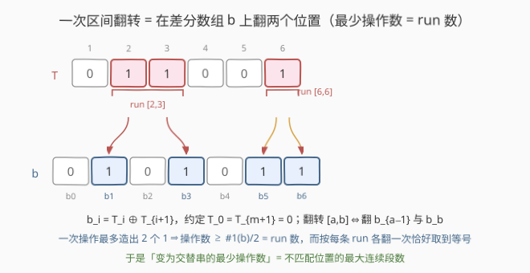
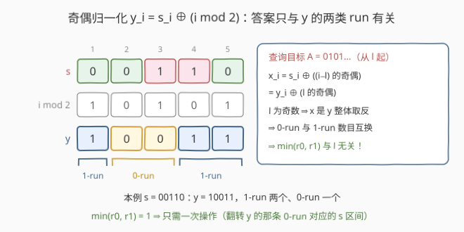
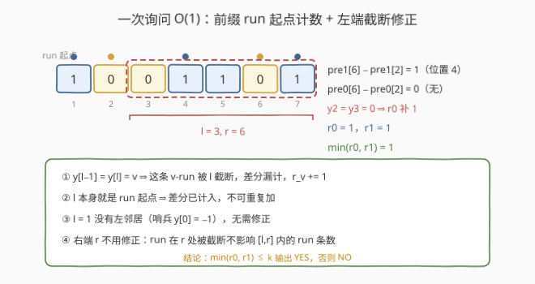
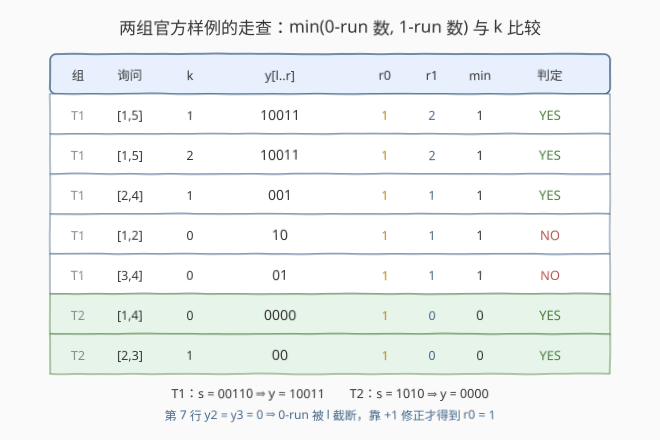

# Codeforces 2244E 玛莎与彩灯 题解

## 1. 题目概述

- **标题 / 题号**：玛莎与彩灯（Codeforces 2244E，英文名 Masha and the Garland）
- **链接**：https://codeforces.com/problemset/problem/2244/E
- **来源**：Codeforces Round 1109 (Div. 3) · Problem E
- **难度**：$\ast 1400$
- **限制**：时间 2 s / 内存 256 MB
- **标签**：数据结构、动态规划、贪心、实现、数学、数论、字符串（官方标签：data structures, dp, greedy, implementation, math, number theory, strings）

**题意**：给定长度 $n$ 的 01 串 $s$。一次操作是**选一个连续子段，把其中所有位取反**；相邻位两两不同的串称「美丽」（如 `0101`、`1010`），否则不美丽（如 `0110`）。共 $q$ 次询问，每次给 $l,r,k$，问能否用**至多** $k$ 次操作把子串 $s[l..r]$ 变成美丽串；询问相互独立，彩灯本身不会被修改。

多测：第一行 $t$；每组先给 $n,q$ 与串 $s$，再给 $q$ 行 $l\ r\ k$，逐行输出 `YES` / `NO`。

**约束**：$1 \le t \le 10^{4}$，$1 \le n, q \le 2\times 10^{5}$，$\sum n,\sum q \le 2\times 10^{5}$，$1 \le l \le r \le n$，$0 \le k \le n$。

## 2. 示例与观察
官方样例（输入 / 输出原样）：

```text
输入
2
5 5
00110
1 5 1
1 5 2
2 4 1
1 2 0
3 4 0
4 2
1010
1 4 0
2 3 1

输出
YES
YES
YES
NO
NO
YES
YES
```

第 1 组 $s=$ `00110` 的 $y=$ `10011`：$0$-run 一条、$1$-run 两条，故 $[1,5]$ 最少 $1$ 次操作、$k=1,2$ 都行，而 $[1,2]$、$[3,4]$ 各有两条 run、$\min=1$ 且 $k=0$ 故 NO；第 2 组 `1010` 已交替（$y=$ `0000`，$\min=0$），$k=0$ 也 YES。

## 3. 解题思路

### 3.1 暴力思路

每次询问独立：长度 $m$ 的美丽串只有两种（以 0 或 1 开头），枚举目标后求最少区间翻转次数，朴素要 BFS 或区间 DP，单次 $O(m^3)$；即使已知「最少次数 = 错配位置的连续段数」，逐位扫也是 $O(m)$，最坏整场 $O(nq)=4\times10^{10}$，必然 TLE。要做的只有两件事：把答案化成只依赖**两类连续段条数**的量，再用前缀和做到 $O(1)$ 询问。

### 3.2 核心观察：奇偶归一化 + 两类 run

**（a）两个候选目标互补。** 长度 $m$ 的美丽串只能是 $A=0101\ldots$ 或 $B=1010\ldots$，且 $B_i=1-A_i$；若与 $A$ 的错配指示为 $x$（$x_i=1$ 表示第 $i$ 位要改），则与 $B$ 的错配指示恰为 $1-x$。

**（b）固定目标下，最少操作数 = 错配位置的极大连续段数（run 数）。** 一次区间翻转等价于在差分数组上翻两个端点：每条错配段整体翻一次即达目标（上界），而每个「边界 $1$」都要被翻奇数次、一次操作最多照顾两个（下界）。于是 $\mathrm{ans}(l,r)=\min\{\text{runs}(x),\text{runs}(1-x)\}$，即 $x$ 中 $0$-run 与 $1$-run 条数的较小者。



**（c）奇偶归一化。** 目标 $A$ 的第 $i$ 位是 $(i-l)\bmod 2$，故 $x_i=s_i\oplus((i-l)\bmod 2)$。令 $y_i=s_i\oplus(i\bmod 2)$，由 $(i\bmod 2)\oplus((i-l)\bmod 2)=l\bmod 2$ 得 $x_i=y_i\oplus(l\bmod 2)$：在 $[l,r]$ 上 $x$ 要么等于 $y$、要么等于 $y$ 的整体取反，而整体取反只让两类 run 条数互换，$\min$ 不变。于是答案就是 $\mathrm{ans}(l,r)=\min\{r_0(l,r),\,r_1(l,r)\}$，其中 $r_v(l,r)$ 是 $y[l..r]$ 中值 $v$ 的极大连续段条数——**与 $l$ 的奇偶、与子串在串中的位置都无关**，这是本题最漂亮的一步。



### 3.3 算法流程：前缀 run 起点计数

「$v$-run 条数」=「$v$-run 起点个数」，而起点只看左邻居：$j$ 是全局 $v$-run 起点 $\iff y_j=v$ 且（$j=1$ 或 $y_{j-1}\ne v$）。取哨兵 $y_0=-1$ 保证 $j=1$ 必是起点，预处理

$$\mathrm{pre}_v[i]=\#\{\,1\le j\le i:\ y_j=v,\ j \text{ 是全局 } v\text{-run 起点}\,\}.$$

查询时先做差，再补上**被 $l$ 截断**的那一条：

$$r_v(l,r)=\mathrm{pre}_v[r]-\mathrm{pre}_v[l-1]+\big[\,l>1\ \wedge\ y_{l-1}=y_l=v\,\big].$$

差分统计了 $[l,r]$ 内所有「左邻居不同」的起点；唯一例外是从 $l$ 之前延伸进来、在 $l$ 处被切断的 run——它的全局起点 $<l$ 已被减掉，需要补 $1$。右端点 $r$ 不用修正，因为统计的是起点。



每组流程：① 读入 $n,q,s$；② 算 $y_i=s_i\oplus(i\bmod 2)$ 并置 $y_0=-1$；③ 递推 $\mathrm{pre}_0,\mathrm{pre}_1$（$y_i\ne y_{i-1}$ 时让 $\mathrm{pre}_{y_i}$ 自增，否则两表照抄）；④ 每个询问算 $c_v=\mathrm{pre}_v[r]-\mathrm{pre}_v[l-1]$，若 $y_{l-1}=y_l=v$ 则 $c_v$ 加一；⑤ 输出 `YES` $\iff\min(c_0,c_1)\le k$。

### 3.4 示例演算

第 1 组官方数据 $s=$ `00110`，异或下标奇偶性得 $y=$ `10011`：$1$-run 为 $[1,1],[4,5]$，$0$-run 为 $[2,3]$。



| 组 | 询问 | $k$ | $y[l..r]$ | $r_0$ | $r_1$ | $\min$ | 判定 |
|----|------|-----|-----------|-------|-------|--------|------|
| T1 | $[1,5]$ | 1 | `10011` | 1 | 2 | 1 | YES |
| T1 | $[1,5]$ | 2 | `10011` | 1 | 2 | 1 | YES |
| T1 | $[2,4]$ | 1 | `001` | 1 | 1 | 1 | YES |
| T1 | $[1,2]$ | 0 | `10` | 1 | 1 | 1 | NO |
| T1 | $[3,4]$ | 0 | `01` | 1 | 1 | 1 | NO |
| T2 | $[1,4]$ | 0 | `0000` | 1 | 0 | 0 | YES |
| T2 | $[2,3]$ | 1 | `00` | 1 | 0 | 0 | YES |

最后一行是「截断修正」的现场：$y_2=y_3=0$，这条 $0$-run 从 $l$ 之前延伸进来，差分 $\mathrm{pre}_0[3]-\mathrm{pre}_0[1]=0$，补 $1$ 才得到正确的 $r_0=1$。

## 4. 算法细节

1. **多测复用内存**：$t\le 10^{4}$ 而 $\sum n\le 2\times10^{5}$，全局数组只需覆盖 $1..n$（或用 `assign` 复用 `vector`）；别每组 `memset` 整个 $2\times10^{5}$ 的数组，否则 $O(t\cdot n)$ 超时。
2. **哨兵取 $-1$**：若取 $0$，$y_1=0$ 时位置 $1$ 不算起点，开头那条 $0$-run 会从表里消失（反例见 §8）。
3. **截断修正的条件**：只在 $y_{l-1}=y_l=v$ 时补 $1$——此时 $l$ 不是全局起点、差分确实漏了这条 run；而 $y_{l-1}\ne y_l$ 时 $l$ 本身是起点、已被统计，绝不能再补。
4. **下标统一**：$s$、$y$、$\mathrm{pre}$ 全 1-indexed；差分是 $\mathrm{pre}[r]-\mathrm{pre}[l-1]$，写成 $\mathrm{pre}[r]-\mathrm{pre}[l]$ 会整段少算一位（反例见 §8）。
5. **答案与 $l$ 奇偶无关**：按 3.2 写成 $\min(c_{1-p},c_p)$（$p=l\bmod 2$）也对，但 $p$ 会被 $\min$ 吃掉，直接 $\min(c_0,c_1)$ 更短也更少出错点。
6. **I/O**：输出至多 $2\times10^{5}$ 行，拼进一个 `string` 再一次 `fwrite`；读入用手写缓冲（本机 libc++ 上 `cin` 读 $6\times10^{5}$ 个整数约需 1.4 s，`fread` 版约 8 ms）。用 `cin` 务必 `sync_with_stdio(false)`。
7. **整数范围与 $n=1$**：计数不超过 $n\le 2\times10^{5}$，`int` 够用；$n=1$ 时一个 $\mathrm{pre}$ 值为 $1$、另一个为 $0$，$\min=0$ 自动 YES，不用特判。

## 5. 正确性证明

**引理 1（操作可内缩）**：若能至多 $k$ 次操作使 $s[l..r]$ 变美丽，则存在同样次数、每次操作都落在 $[l,r]$ 内的方案。
**证明**：目标只约束区间内的位。操作 $[a,b]$ 在 $[l,r]$ 上的效果恰是取反 $[a,b]\cap[l,r]$，该交集为空或仍是区间；替换成这个交集（为空则删除，次数更少）后区间内每位的翻转次数不变，仍达目标。∎

**引理 2（最少操作数 = run 数）**：设 $w$ 与目标 $T$ 等长，错配指示 $X_i=[w_i\ne T_i]$ 有 $r$ 条极大连续段，则最少需 $r$ 次区间翻转。
**证明**：所选区间族的**对称差**必须恰为 $X$。令 $X_0=X_{m+1}=0$、$b_i=X_i\oplus X_{i+1}$（$0\le i\le m$）：每条极大段 $[p,q]$ 恰贡献 $b_{p-1}=b_q=1$，故 $\#1(b)=2r$，且 $X_i=b_0\oplus\cdots\oplus b_{i-1}$ 给出双射。区间 $[a,b]$ 恰翻 $b_{a-1},b_b$ 两位，故次数 $\ge\#1(b)/2=r$；对每条极大段翻 $w[p..q]$ 恰 $r$ 次搞定。∎

**引理 3（两目标取小 = 两类 run 取小）**：对 $A$、$B=1-A$，最少操作数等于 $x$ 的 $1$-run 与 $0$-run 条数之较小者。
**证明**：由引理 1 可只在区间内操作；对 $A$、$B$ 分别用引理 2 得 $\text{runs}(x)$ 与 $\text{runs}(1-x)$，取小即最优；而 $1-x$ 的 $1$-run 正是 $x$ 的 $0$-run，反之亦然。∎

**引理 4（奇偶归一化）**：$x_i=y_i\oplus(l\bmod 2)$，故 $x$ 与 $y$ 在 $[l,r]$ 上只差整体取反，两类 run 条数互换而不变。
**证明**：$(i\bmod 2)\oplus((i-l)\bmod 2)=(i+i-l)\bmod 2=l\bmod 2$，于是 $x_i=s_i\oplus(i\bmod 2)\oplus(l\bmod 2)=y_i\oplus(l\bmod 2)$；整体取反保持相邻关系，只换色。∎

**引理 5（前缀计数 + 截断修正）**：按 3.3 定义 $\mathrm{pre}_v$，则 $r_v(l,r)=\mathrm{pre}_v[r]-\mathrm{pre}_v[l-1]+[\,l>1\wedge y_{l-1}=y_l=v\,]$。
**证明**：$[l,r]$ 内每条 $v$-run 有唯一「段内起点」$j$（$y_j=v$ 且 $j=l$ 或 $y_{j-1}\ne v$）。差分恰数出所有 $y_j=v,y_{j-1}\ne v$ 的 $j\in[l,r]$，两者只可能在 $j=l$ 处不同：若 $y_{l-1}\ne v$，$j=l$ 是全局起点已计入；若 $y_{l-1}=y_l=v$，它不是全局起点却确是段内起点，故补 $1$。$r$ 右侧不参与统计。∎

**定理**：算法输出 YES $\iff$ 能用至多 $k$ 次操作使 $s[l..r]$ 变美丽。
**证明**：由引理 1 只需考虑区间内操作；由引理 3、4，最少操作数等于 $\min\{r_0(l,r),r_1(l,r)\}$；由引理 5，算法用两次差分与一次常数修正算出该值并与 $k$ 比较。∎

## 6. 复杂度分析

- **时间**：每组预处理 $O(n)$（建 $y$ 与两张前缀表各扫一遍），每询问 $O(1)$，即 $O(n+q)$；总计 $O(\sum n+\sum q)\le 4\times10^{5}$ 次基本运算，相对 2 s 时限余量 60 倍以上。实测极限数据（$t=1,n=q=2\times10^{5}$，含读入）C++17 端到端 **10–40 ms**，$t=10^{4}$、每组 $n=q=20$ 的另一极限数据同为几十毫秒，Python3 为 **0.3–0.6 s**（机器负载高时曾到 1 s），仍在 2 s 内。
- **空间**：$y$ 与前缀表各 $O(n)$（表为 $2(n+1)$ 个 `int`），输出缓冲 $O(q)$，额外 $O(n+q)$，远小于 256 MB。

## 7. 参考代码

### C++17

```cpp
#include <cstdio>
#include <string>
#include <algorithm>
using namespace std;

// 手写缓冲读入：本机 libc++ 上 cin 读 6e5 个整数约 1.4 s，会吃掉大半时限
static char ibuf[1 << 16], s[200005];
static int ilen = 0, ipos = 0;
static inline int gc() {
    if (ipos == ilen) { ilen = (int)fread(ibuf, 1, 1 << 16, stdin); ipos = 0; if (ilen <= 0) return -1; }
    return (unsigned char)ibuf[ipos++];
}
static inline int ni() {
    int c = gc(), x = 0;
    while (c != -1 && (c < '0' || c > '9')) c = gc();
    while (c >= '0' && c <= '9') { x = x * 10 + (c - '0'); c = gc(); }
    return x;
}

static int y[200005], pre[200005][2];

int main() {
    string out;
    int t = ni();
    while (t-- > 0) {
        int n = ni(), q = ni();
        int c = gc();
        while (c != '0' && c != '1') c = gc();
        for (int i = 1; i <= n; ++i) { s[i] = (char)c; c = gc(); }   // 恰好 n 个字符

        y[0] = -1;                                  // 哨兵：位置 1 必是 run 起点
        pre[0][0] = pre[0][1] = 0;
        for (int i = 1; i <= n; ++i) {
            y[i] = (s[i] - '0') ^ (i & 1);
            pre[i][0] = pre[i - 1][0];
            pre[i][1] = pre[i - 1][1];
            if (y[i] != y[i - 1]) ++pre[i][y[i]];
        }

        out.clear();
        while (q-- > 0) {
            int l = ni(), r = ni(), k = ni();
            int c0 = pre[r][0] - pre[l - 1][0], c1 = pre[r][1] - pre[l - 1][1];
            if (l > 1 && y[l - 1] == y[l]) { if (y[l]) ++c1; else ++c0; }
            out += (min(c0, c1) <= k ? "YES\n" : "NO\n");
        }
        fwrite(out.data(), 1, out.size(), stdout);
    }
    return 0;
}
```

### Python3

```python
import sys


def main() -> None:
    data = sys.stdin.buffer.read().split()
    if not data:
        return
    p = 0
    t = int(data[p]); p += 1
    out = []
    for _ in range(t):
        n = int(data[p]); q = int(data[p + 1]); p += 2
        s = data[p]; p += 1                        # bytes：'0'->48 偶，'1'->49 奇
        y = [0] * (n + 2)
        for i in range(1, n + 1):
            y[i] = (s[i - 1] & 1) ^ (i & 1)        # s_i XOR (i mod 2)
        y[0] = -1                                  # 哨兵
        pre0 = [0] * (n + 1)
        pre1 = [0] * (n + 1)
        for i in range(1, n + 1):
            pre0[i] = pre0[i - 1]; pre1[i] = pre1[i - 1]
            if y[i] != y[i - 1]:
                if y[i]: pre1[i] += 1
                else: pre0[i] += 1
        for _ in range(q):
            l = int(data[p]); r = int(data[p + 1]); k = int(data[p + 2]); p += 3
            c0 = pre0[r] - pre0[l - 1]
            c1 = pre1[r] - pre1[l - 1]
            if l > 1 and y[l - 1] == y[l]:         # 被 l 截断的那条 run
                c1 += y[l]; c0 += 1 - y[l]
            out.append("YES" if min(c0, c1) <= k else "NO")
    sys.stdout.write("\n".join(out) + "\n")


main()
```

## 8. 边界情况与易错点

1. **多测清空**：$y$、`pre`、`out` 必须每组重建，`pre` 要覆盖全部 $n+1$ 项，否则会残留上一组数据。
2. **$n=1$ 或 $l=r$**：单灯恒美丽，$k=0$ 也必须 YES；公式给出 $\min(1,0)=0$，自动正确，别特判成 NO。
3. **比较符号**：判据是 $\min(c_0,c_1)\le k$，写成 `< k` 会让所有 $k=0$ 的合法询问误判 NO（最小反例 $s=$ `0`、$[1,1],k=0$，正确 YES）。
4. **漏掉截断修正**：$s=$ `011`（$y=$ `110`）询问 $[2,3],k=0$，真实答案 $1$ 应 NO；漏修正会把被截断的 $1$-run 算成 $0$ 条而误报 YES。
5. **差分下端写错**：写成 $\mathrm{pre}[r]-\mathrm{pre}[l]$ 会漏掉位置 $l$ 的贡献，$s=$ `00`（$y=$ `10`）询问 $[1,2],k=0$ 会被误判 YES（真实答案 $1$）。
6. **哨兵取 $0$**：$s=$ `11`（$y=$ `01`）询问 $[1,2],k=0$ 会被误判 YES——开头的 $0$-run 因 $y_1=y_0$ 未被计为起点，真实答案 $1$。
7. **只算一种目标 / 把两类 run 相加**：$s=$ `1010` 询问 $[1,4],k=0$ 本已交替应 YES；只看「以 0 开头」的目标或把 $r_0+r_1$ 当答案都会算成 $1$ 而误报 NO。
8. **拿「错配位置数」当「段数」**：一条长 $3$ 的错配段只需 $1$ 次操作，用位置数会高估代价；本题答案的量纲是**段数**。
9. **I/O 与空输入**：空文件时 `ni()` 返回 $-1$，`while (t-- > 0)` 不会进入循环；Python 端 `if not data: return`。每组输出结尾要有换行，组间不要多打空行。

## 9. 验证记录

- **编译环境与命令**：`clang++ -std=c++17 -O2`（本机无 GNU g++，配 `codeforces/tools/include/bits/stdc++.h` 兼容头；正文代码只用标准库，可原样提交 GNU C++17）；Python 侧为 `Python 3.9.6`。
- **官方样例**：1 / 1 通过（按 Codeforces 标准 checker 的 token 比对，忽略空白与大小写）。
- **复核状态**：audited（2026-11-19 统一回归：编译 + 官方样例；写作期的随机对拍与暴力未重跑）。

## 相关题目与扩展

- [Codeforces 2244A. Iskander and Drawings](https://codeforces.com/problemset/problem/2244/A)：同场 A 题，同样是「扫一遍、把线性结构折成闭式」的签到节奏。
- [LeetCode 1529. 最少的后缀翻转次数](https://leetcode.cn/problems/minimum-suffix-flips/)：只能翻后缀时答案就是相邻位变化次数，与本题 run 计数同源。
- [LeetCode 1888. 使二进制字符串字符交替的最少反转次数](https://leetcode.cn/problems/minimum-number-of-flips-to-make-the-binary-string-alternating/)：两个候选交替模板取小的经典形态。

**延伸思考**：

1. **代价从「次数」换成「翻转总长度」**：最优解退化为逐位取反，代价 $\min(\#\{x_i=1\},\#\{x_i=0\})$，两个前缀和即可 $O(1)$，与 run 结构无关。
2. **要输出方案**：按每条错配 run 的左右端点依次翻转即可，端点可由 $\mathrm{pre}$ 配合二分还原。
3. **目标改成周期 $p$ 的串**（如 `001001…`）：候选目标变 $p$ 个，仍是「每个模板统计错配 run 数再取小」，预处理 $p$ 套前缀表，单次询问 $O(p)$。
4. **操作允许翻转任意子序列而非连续段**：各位置独立，最少次数为 $\min(\text{错配数},m-\text{错配数})$，run 结构彻底失效——可见「区间」这一约束才是 run 计数的来源。
