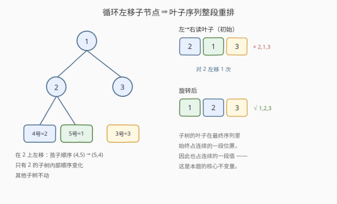
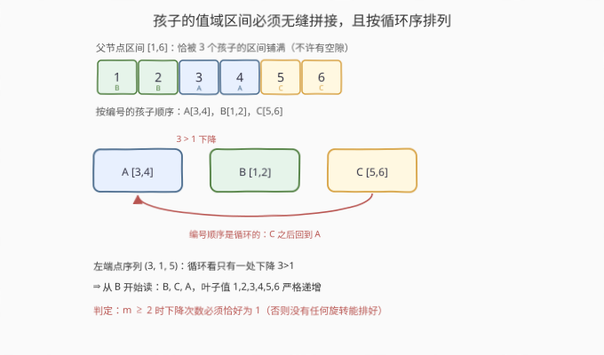
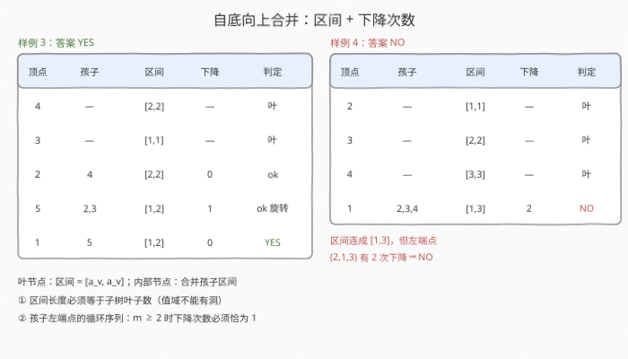

# Codeforces 2244F 安雅爱树 题解

## 1. 题目概述

- **标题 / 题号**：安雅爱树（Codeforces 2244F，英文名 Anya Loves Trees!）
- **链接**：https://codeforces.com/problemset/problem/2244/F
- **来源**：Codeforces Round 1109 (Div. 3) · Problem F（UTC 2026-07-14）
- **难度**：$\ast 1700$
- **限制**：时间 2 s / 内存 512 MB
- **标签**：树、DFS、贪心、动态规划（官方标签：dfs and similar, dp, greedy, trees）

**题意**：给定以 $1$ 为根的有根树，$n$ 个点；每个点的孩子按**编号升序**从左到右排列。全部 $k$ 个叶子上恰好写着 $1 \sim k$ 的一个排列。一次操作：任选一个点，把它的孩子列表**循环左移**一格（可对任意点做任意多次）。问能否让从左到右读出的叶子值严格递增，即恰为 $1,2,\dots,k$。

多测：第一行 $t$；每组三行——$n$、$p_2,\dots,p_n$、$a_1,\dots,a_n$（内点 $a_i=0$，叶子 $a_i>0$）。每组输出 `YES` 或 `NO`。

**约束**：

- $1 \le t \le 10^4$，$\sum n \le 2\cdot 10^5$
- $1 \le n \le 2\cdot 10^5$，$1 \le p_i \le n$：$p_i$ 是 $i$ 的父亲，**不保证** $p_i < i$
- $0 \le a_i \le n$，所有正值恰为 $1\sim k$ 的排列

## 2. 示例与观察
官方样例（输入 / 输出原样）：

```text
输入
4
2
1
0 1
4
1 2 2
0 0 2 1
5
5 5 2 1
0 0 1 2 0
4
1 1 1
0 2 1 3

输出
YES
YES
YES
NO
```

第 2 组把 $2$ 的孩子左移一次即得 $1,2$；第 4 组根的孩子值 $2,1,3$，循环移位只有 $(2,1,3),(1,3,2),(3,2,1)$，都不递增。补一组自造边界（单点、星形且孩子顺序需旋转）：

```text
输入
2
1

0 1
3
1 1
0 3 1

输出
YES
YES
```

## 3. 解题思路

### 3.1 暴力思路

枚举每个内点的旋转量：若 $v$ 有 $m_v$ 个孩子，方案数是 $\prod_v m_v$，随 $n$ 指数增长（每点两个孩子已有 $2^{\Theta(n)}$ 种），$n = 2\cdot 10^5$ 时不可行。出路是找出**与具体旋转量无关**的不变量。

### 3.2 核心观察：子树叶子必是连续值域，旋转只是循环移位



1. **子树在序列中占连续一段**：旋转只改变孩子块的**拼接顺序**，不会把某棵子树的叶子打散，所以 $v$ 子树的叶子在最终序列里始终是连续一段位置。
2. **目标序列是 $1,2,\dots,k$**：最终必须严格递增且值恰为 $1\sim k$，位置段与值域段一一对应。

于是 $v$ 子树的叶子值必须恰构成整数区间 $[L_v,R_v]$，且 $R_v-L_v+1=$ 该子树叶子数，否则无解；区间可自底向上合并为 $L_v=\min_{u\in \text{ch}(v)}L_u$、$R_v=\max_u R_u$。

再看内部：旋转不改变孩子列表的**循环顺序**，只改变起点，故 $v$ 的孩子在最终序列中的次序必须是初始次序 $(c_1,\dots,c_m)$ 的某个**循环移位**；而拼接后整体递增，就要求这些孩子块按值域升序排列。

### 3.3 算法流程：孩子区间按值域「循环有序」



设 $v$ 的孩子按编号为 $c_1,\dots,c_m$，令 $\ell_i = L_{c_i}$。孩子块首尾相接，整段递增等价于「存在旋转使 $\ell$ 升序」，而循环序列能通过旋转变成升序**当且仅当它循环意义下恰好有一处下降**：

$$\text{desc}_v=\#\{\,i : \ell_i > \ell_{i+1}\,\}\ (\ell_{m+1}=\ell_1),\qquad m\ge 2 \Rightarrow \text{desc}_v = 1$$

区间两两不交（值互异）、并集又是连续区间，故按 $\ell$ 升序后**相邻区间必首尾相接**，拼起来正好是 $[L_v,R_v]$ 的完整递增序列。每个点只需两条判定：

$$\text{ok}_v=\bigl[R_v-L_v+1=\text{cnt}_v\bigr]\wedge\bigl[m_v<2\ \vee\ \text{desc}_v=1\bigr]$$

流程：建树 → 迭代求出「父先于子」的遍历序 → **逆序**自底向上算 $L,R,\text{cnt}$ 并判定 → 全部通过输出 `YES`。

### 3.4 示例演算



样例 3（$p_2=5,p_3=5,p_4=2,p_5=1$）：树形 $1\to5$，$5\to\{2,3\}$，$2\to4$，叶子是 $3$ 号（值 $1$）与 $4$ 号（值 $2$）。

- $3,4$ 号是叶子：区间 $[1,1]$、$[2,2]$；$2$ 号只有孩子 $4$：区间 $[2,2]$，长度 $1=$ 叶子数，下降 $0$；
- $5$ 号的孩子是 $2,3$：并集 $[1,2]$，长度 $2=$ 叶子数；左端点 $(2,1)$ 循环下降 $1$ 次（$2>1$），左移后顺序变为 $(3,2)$，读出 $1,2$；
- $1$ 号只有孩子 $5$：区间 $[1,2]$，下降 $0$ ✓ → `YES`。

样例 4：根的孩子是叶子 $2,3,4$，值 $2,1,3$，左端点 $(2,1,3)$ 有**两处**下降（$2>1$ 与环回时 $3>2$），任何循环移位都排不成升序 → `NO`。

## 4. 算法细节

1. **不能假设 $p_i<i$**：样例 3 就有 $p_2=5$。先用迭代 BFS 从根求出 `order`（父先于子），再逆序遍历；倒序枚举 $i=n\dots1$ 会错。
2. **孩子天然升序**：$i=2\to n$ 依次 `ch[p].push_back(i)`，每个 `ch[v]` 已按编号升序，无需再排序。
3. **连续性判定用长度**：`mx - mn + 1 == cnt`，配合排列性质（值互不重复）等价于「并集是完整区间」；差值转 `long long` 比较更稳妥。
4. **下降计数的循环下标**：比较 `L[ch[v][j]]` 与 `L[ch[v][(j+1)%m]]`；$m=1$ 时恒不下降，不要误判成 `desc != 1` 而输出 `NO`。
5. **迭代代替递归**：$n=2\cdot 10^5$ 的链会让递归爆栈，统一用显式 `order` 数组。
6. **多测清空**：每组重新分配 `ch/L/R/cnt`，不做跨组复用；$\sum n\le 2\cdot 10^5$ 保证总代价线性。
7. **I/O**：输入至多约 $4\cdot 10^5$ 个整数，C++ 用 `scanf/printf` 压常数（若用 `cin` 须 `ios::sync_with_stdio(false)`）；Python 一次性 `read().split()`。

## 5. 正确性证明

**引理 1（连续段）**：若存在合法操作序列使最终叶子序列为 $1,2,\dots,k$，则任意点 $v$ 的子树叶子值构成整数区间。

**证明**：归纳。根是整棵树，值为 $[1,k]$。设 $u$ 的叶子在最终序列占连续位置段 $[l,r]$，因序列递增其值即 $l,\dots,r$；$u$ 的任一孩子 $v$ 的叶子只是把 $u$ 的孩子块重新拼接，故占 $[l,r]$ 的连续子段，值也连续。∎

**引理 2（必要性）**：若整体可行，则每个内点 $v$ 满足 $R_v-L_v+1=\text{cnt}_v$，且 $m_v\ge2$ 时孩子左端点序列循环恰有一次下降。

**证明**：第一式由引理 1。可实现的顺序必是初始顺序的循环移位（旋转生成循环群），且该顺序下孩子块按值升序，否则拼接后不递增。互异元素组成的循环序列，只有其升序排列**恰是某个循环移位**时才恰有一处下降；否则至少两处下降。∎

**引理 3（充分性）**：若每个点都满足上述两条判定，则存在合法操作序列。

**证明**：对子树深度归纳。叶子平凡。设 $v$ 的孩子都已可排成各自区间的递增序列。因 $\text{desc}_v=1$，从下降点之后读起即按 $\ell$ 升序，对 $v$ 左移相应次数即可。由 $R_v-L_v+1=\text{cnt}_v$ 知并集覆盖 $[L_v,R_v]$ 且无空洞：若相邻两块 $[a,b]$、$[c,d]$ 有 $c>b+1$，则值 $b+1\in[L_v,R_v]$ 落在某个孩子区间内，按 $\ell$ 它应排在两者之间，矛盾。故区间首尾相接，拼接即得 $[L_v,R_v]$ 的递增序列。∎

**定理**：算法输出 `YES` 当且仅当可以做到。

**证明**：必要性由引理 2；充分性由引理 3（对根即得 $[1,k]$，正是目标序列）；算法正是逐点检查这两条判定。∎

## 6. 复杂度分析

- **时间**：每点被访问常数次，合并孩子时每条边恰算一次，$O(n)$；多测总 $O(\sum n)\le O(2\cdot 10^5)$。实测 $n=2\cdot10^5$ 随机树上 C++ 约 $20\sim80$ ms、Python 约 $0.45$ s（PyPy 更稳），远低于 2 s。
- **空间**：孩子表、`order/L/R/cnt` 各 $O(n)$，合计 $O(n)$，远低于 512 MB。

## 7. 参考代码

### C++17

```cpp
#include <cstdio>
#include <vector>
#include <algorithm>
#include <climits>
using namespace std;

int main() {
    int t;
    if (scanf("%d", &t) != 1) return 0;
    while (t--) {
        int n;
        scanf("%d", &n);
        vector<vector<int>> ch(n + 1);
        for (int i = 2; i <= n; i++) {
            int p;
            scanf("%d", &p);
            ch[p].push_back(i);              // i 递增枚举，孩子天然按编号升序
        }
        vector<int> a(n + 1);
        for (int i = 1; i <= n; i++) scanf("%d", &a[i]);

        // 迭代求出“父先于子”的遍历序 —— 不能假设 p_i < i
        vector<int> order;
        order.reserve(n);
        order.push_back(1);
        for (size_t i = 0; i < order.size(); i++)
            for (int u : ch[order[i]]) order.push_back(u);

        vector<int> L(n + 1), R(n + 1);
        vector<long long> cnt(n + 1);
        bool ok = true;
        for (int i = (int)order.size() - 1; i >= 0; i--) {   // 逆序 = 自底向上
            int v = order[i];
            if (ch[v].empty()) {                             // 叶子
                L[v] = R[v] = a[v];
                cnt[v] = 1;
                continue;
            }
            int mn = INT_MAX, mx = 0;
            long long c = 0;
            for (int u : ch[v]) {
                mn = min(mn, L[u]);
                mx = max(mx, R[u]);
                c += cnt[u];
            }
            L[v] = mn; R[v] = mx; cnt[v] = c;
            if ((long long)mx - mn + 1 != c) ok = false;     // 值域必须连续
            int m = (int)ch[v].size(), desc = 0;
            for (int j = 0; j < m; j++)
                if (L[ch[v][j]] > L[ch[v][(j + 1) % m]]) desc++;
            if (m >= 2 && desc != 1) ok = false;             // 循环序恰一次下降
        }
        puts(ok ? "YES" : "NO");
    }
    return 0;
}
```

### Python3

```python
import sys


def solve_case(n, par, a):
    ch = [[] for _ in range(n + 1)]
    for i in range(2, n + 1):
        ch[par[i]].append(i)                  # i 递增，孩子天然升序
    order = [1]
    for v in order:
        order.extend(ch[v])                   # 父先于子；不假设 p_i < i
    L = [0] * (n + 1)
    R = [0] * (n + 1)
    cnt = [0] * (n + 1)
    ok = True
    for v in reversed(order):                 # 自底向上
        if not ch[v]:
            L[v] = R[v] = a[v]
            cnt[v] = 1
            continue
        mn, mx, c = 10 ** 18, -1, 0
        for u in ch[v]:
            mn = min(mn, L[u]); mx = max(mx, R[u]); c += cnt[u]
        L[v], R[v], cnt[v] = mn, mx, c
        if mx - mn + 1 != c:                  # 值域必须连续
            ok = False
        m = len(ch[v])
        desc = sum(1 for j in range(m) if L[ch[v][j]] > L[ch[v][(j + 1) % m]])
        if m >= 2 and desc != 1:              # 循环序恰一次下降
            ok = False
    return ok


def main():
    d = list(map(int, sys.stdin.buffer.read().split()))
    pos, t, out = 1, d[0], []
    for _ in range(t):
        n = d[pos]; pos += 1
        par = [0, 0] + d[pos:pos + n - 1]; pos += n - 1
        a = [0] + d[pos:pos + n]; pos += n
        out.append("YES" if solve_case(n, par, a) else "NO")
    sys.stdout.write("\n".join(out) + "\n")


main()
```

## 8. 边界情况与易错点

1. **$n=1$**：根就是唯一叶子，$a_1=1$，代码走叶子分支、`ok` 保持真 → `YES`；注意此时没有 $p_i$ 行。
2. **单链**：每层 $m=1$，下降数恒 $0$，绝不能触发「`desc != 1` 就 NO」，这正是条件写成 `m >= 2 && desc != 1` 的原因。
3. **值域有洞**：某点的孩子区间若是 $[1,1]$ 与 $[3,3]$，长度和 $2$ 但 $3-1+1=3$，必须判 `NO`（值 $2$ 在别的子树里，拼不出连续递增段）。
4. **误以为可任意排列孩子**：只能循环移位，故 $(2,1,3)$ 的两处下降无解；若允许任意排列则只需区间连续，条件会弱很多。
5. **递归爆栈**：$2\cdot 10^5$ 的链用递归 DFS 会栈溢出，必须写迭代。
6. **多测开销**：$t$ 可达 $10^4$，每组都新建容器，不要用全局数组却不清理。
7. **输出格式**：`YES/NO` 任意大小写；题面里 `'YES"` 的多余引号是排版笔误，照常输出即可。

## 9. 验证记录

- **编译环境与命令**：`clang++ -std=c++17 -O2`（本机无 GNU g++，配 `codeforces/tools/include/bits/stdc++.h` 兼容头；正文代码只用标准库，可原样提交 GNU C++17）；Python 侧为 `Python 3.9.6`。
- **官方样例**：1 / 1 通过（按 Codeforces 标准 checker 的 token 比对，忽略空白与大小写）。
- **复核状态**：audited（2026-11-19 统一回归：编译 + 官方样例；写作期的随机对拍与暴力未重跑）。

## 相关题目与扩展

- [Codeforces 1528A Parsa's Humongous Tree](https://codeforces.com/problemset/problem/1528/A)：树上 DP，每个点在一段值域内选值，与本题「子树对应值域区间」同源。
- [Codeforces 1092F Tree with Maximum Cost](https://codeforces.com/problemset/problem/1092/F)：换根 DP，练「子树信息合并 + 自底向上」的迭代写法。
- [LeetCode 971. 翻转二叉树以匹配先序遍历](https://leetcode.cn/problems/flip-binary-tree-to-match-preorder-traversal/)：同样只允许受限地重排子节点，判定能否得到目标遍历序。
- [LeetCode 2471. 逐层排序二叉树所需的最少操作数目](https://leetcode.cn/problems/minimum-number-of-operations-to-sort-a-binary-tree-by-level/)：把「能否排好」升级为「最少交换次数」，可对照本题循环移位的代价。

**延伸思考**：若每层允许**任意**重排孩子，则只需「每个子树值域连续」；若操作改为「翻转子节点顺序」（reverse 而非旋转），条件会变成孩子值域序列可按正序或逆序交替拼接；若要求**最少操作次数**，则要数每个点的左移步数并考虑向上传播，难度显著上升。
