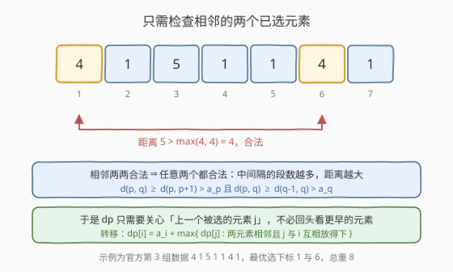
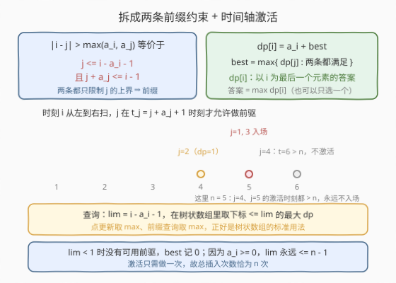
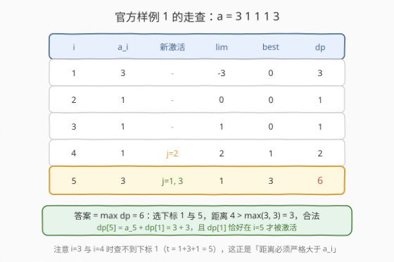

# Codeforces 2244G 尤拉与截止日期 题解

## 1. 题目概述

- **标题 / 题号**：尤拉与截止日期（Codeforces 2244G，英文名 Yura and Deadlines）
- **链接**：https://codeforces.com/problemset/problem/2244/G
- **来源**：Codeforces Round 1109 (Div. 3) · Problem G
- **难度**：$\ast 1900$
- **限制**：时间 2 s / 内存 512 MB
- **标签**：动态规划、数据结构、树状数组、前缀最大值、离线激活（官方标签：data structures, dp）

**题意**：有 $n$ 个作业排成一列，第 $i$ 个作业的权重为 $a_i$。Yura 要挑一个子集 $S$ 去完成，使得对任意两个被选的作业 $i \neq j$，都满足

$$|i - j| > \max(a_i, a_j),$$

即两个作业之间必须空出足够多的“其他作业”，否则他会分心。求所选作业的权重之和的最大值。

多测：第一行给出测试组数 $t$；每组先给 $n$，再给长度为 $n$ 的数组 $a$；对每组输出一个整数（最大总权重）。

**约束**：

- $1 \le t \le 10^4$
- $1 \le n \le 2 \times 10^5$，且所有测试的 $\sum n \le 2 \times 10^5$
- $0 \le a_i \le 10^9$
- 答案上界为 $2 \times 10^5 \times 10^9 = 2 \times 10^{14}$，必须用 64 位整数

## 2. 示例与观察
官方样例（输入 / 输出原样）：

```text
输入
3
5
3 1 1 1 3
3
2 1 2
7
4 1 5 1 1 4 1

输出
6
2
8
```

官方解释：

- 第 1 组最优选下标 $1$ 与 $5$：$|1-5| = 4 > \max(3,3) = 3$，总权重 $3+3=6$；
- 第 2 组：下标 $1,3$ 的距离只有 $2$，不满足 $2 > \max(2,2)=2$（注意是**严格大于**），所以只能选一个，答案是 $2$；
- 第 3 组最优选下标 $1$ 与 $6$：$|1-6| = 5 > \max(4,4) = 4$，总权重 $4+4=8$。

补一组自造样例（覆盖 $a_i=0$ 与“距离恰好等于阈值”的边界）：

```text
输入
2
4
0 1 0 1
3
0 0 0

输出
2
0
```

第 1 组：选下标 $2$ 与 $4$，距离 $2 > \max(1,1)=1$，总权重 $1+1=2$；下标 $1,3$ 之间虽然互不干扰，但再加 $4$ 就会冲突（$|3-4|=1 \le \max(0,1)$），所以不能贪心地全选零。第 2 组全零，怎么选总权重都是 $0$。

## 3. 解题思路

### 3.1 暴力思路

枚举所有子集、再对每个子集检查所有点对：$O(2^n n^2)$，$n = 2\times10^5$ 时是天方夜谭。稍好的是“链式 DP”：把被选作业排成一列，令 $f(i)$ 表示**以 $i$ 结尾**的最优总权重，则

$$f(i) = a_i + \max_{j < i,\ |i-j| > \max(a_i,a_j)} f(j).$$

枚举 $j$ 需要 $O(n)$，总复杂度 $O(n^2) \approx 4\times10^{10}$ 次比较，在 2 s 内差了两个数量级——瓶颈全在“每个 $i$ 都扫一遍所有 $j$”，把它换成**一次前缀查询**即可。

### 3.2 核心观察：只需检查相邻，且是两条前缀约束



**第一层化简**：条件只需对“排序后**相邻**的两个已选元素”成立。因为若相邻对都合法，取任意两个被选的 $i_p < i_q$，距离是各段间距之和，而每一段都比它两端的 $a$ 更大：

$$d(i_p, i_q) \ge d(i_p, i_{p+1}) > a_{i_p}, \qquad d(i_p, i_q) \ge d(i_{q-1}, i_q) > a_{i_q}.$$

两式合并即得 $d(i_p,i_q) > \max(a_{i_p}, a_{i_q})$。于是“检查所有点对”退化成“检查相邻点对”，DP 的转移只需要看**上一个被选元素**。

**第二层化简**：把 $|i-j| > \max(a_i, a_j)$ 在 $j < i$ 时按两种情形拆开：

$$i - j > a_i \iff j \le i - a_i - 1, \qquad i - j > a_j \iff j + a_j \le i - 1.$$

两条都是“某个关于 $j$ 的量 $\le$ 某个只与 $i$ 有关的上界”，也就是**前缀约束**。于是 $j$ 对 $i$ 可用，等价于同时满足

$$\underbrace{j \le i - a_i - 1}_{\text{位置前缀}}, \qquad \underbrace{j + a_j \le i - 1}_{\text{激活时刻已到}}.$$

### 3.3 算法流程：时间轴激活 + 树状数组前缀最大值



第二条约束 $j + a_j \le i - 1$ 可以看成“$j$ 要等到时刻 $t_j = j + a_j + 1$ 之后才有资格做前驱”。既然如此，就按 $i$ 从左到右扫，用**时间轴激活**的办法维护一个只含合法前驱的集合：

1. 预处理：对每个 $j$，记 $t_j = j + a_j + 1$；若 $t_j \le n$，把 $j$ 放进 `bucket[t_j]`（$t_j > n$ 的 $j$ 永远不会被用到，直接丢弃）；
2. 建一棵**前缀最大值树状数组** `bit`，初值全 $0$（$0$ 表示“可以不选任何前驱”，对应只选 $i$ 自己）；
3. 对 $i = 1,2,\dots,n$：
   - 先把 `bucket[i]` 里的每个 $j$ 执行 `bit.update(j, dp[j])`，即“$j$ 在时刻 $i$ 正式入场”；
   - 令 $\text{lim} = i - a_i - 1$，若 $\text{lim} \ge 1$，取 `best = bit.query(lim)`（下标 $\le \text{lim}$ 的最大 $dp$）；否则 `best = 0`；
   - $dp[i] = a_i + \text{best}$，并 `ans = max(ans, dp[i])`；
4. 输出 `ans`。

树状数组的两个操作正好对得上：**点更新取 max**（每个点只入场一次，天然单调）与**前缀查询取 max**，各 $O(\log n)$。

### 3.4 示例演算



对 $a = [3,1,1,1,3]$（$n=5$），激活时刻为 $t_1 = 5,\ t_2 = 4,\ t_3 = 5,\ t_4 = 6,\ t_5 = 9$；其中 $t_4$ 与 $t_5$ 都大于 $n=5$，这两个 $j$ 永远不会入场，直接丢弃：

| $i$ | $a_i$ | 本时刻新激活的 $j$ | $\text{lim} = i - a_i - 1$ | `best` | $dp[i]$ |
|-----|-------|--------------------|-----------------------------|--------|---------|
| 1 | 3 | 无 | $-3$ | 0 | 3 |
| 2 | 1 | 无 | $0$ | 0 | 1 |
| 3 | 1 | 无 | $1$ | 0 | 1 |
| 4 | 1 | $j=2$ | $2$ | 1 | 2 |
| 5 | 3 | $j=1,3$ | $1$ | 3 | **6** |

关键在最后一行：$i=5$ 时下标 $1$ 恰好入场（$t_1 = 1+3+1 = 5$），于是 $dp[5] = a_5 + dp[1] = 3+3 = 6$。反过来，$i=4$ 时虽然 $\text{lim}=2$ 覆盖了下标 $1$，但下标 $1$ 还没入场，所以只能接到 $j=2$ 上——这正好对应“$|4-1| = 3$ 并不大于 $\max(3,1) = 3$”。最终答案 $6$，与官方一致。

## 4. 算法细节

1. **下标从 1 开始**：树状数组的 `update/query` 都以 $1$ 为基，位置 $i$ 直接当下标用，$0$ 保留为“空前驱”的哨兵，省掉大量 $\pm1$ 的换算错误。
2. **`lim` 可能为负、`t_j` 可能很大**：$i - a_i - 1$ 在 $a_i$ 较大时是负数，必须先判 `lim >= 1` 再查询（负数直接当下标是坑）；反过来 $t_j = j + a_j + 1$ 中 $a_j$ 可达 $10^9$，必须先判 `t <= n` 再存桶。两者都建议用 `long long` 计算，判完再转 `int`。另外因为 $a_i \ge 0$，恒有 $\text{lim} \le n-1 < n$，无需担心查询上界。
3. **桶的大小取 $n+2$**：只对 $t_j \le n$ 的 $j$ 建桶，既不会越界，也避免为“永不激活”的点浪费空间；用 `vector<vector<int>>` 分桶是 $O(n)$ 的，比把所有 $j$ 按 $t_j$ 排序再扫描（$O(n\log n)$）更快也更短。
4. **树状数组做前缀 max**：`update(i, v)` 沿 $i \to i + \text{lowbit}(i)$ 上推取 max，`query(i)` 沿 $i \to i - \text{lowbit}(i)$ 下退取 max；因为每个位置只会被激活一次、且值是 `dp[j]` 的最终值，更新的单调性天然满足，不需要“撤销/删除”能力。
5. **多测清零**：`bucket`、`dp`、`bit` 必须每组重建（本题直接局部构造即可）；所有测试的 $\sum n \le 2\times10^5$，所以整体重建的开销仍是线性的，不会退化。
6. **`ans` 初值取 0**：$a_i \ge 0$，空集与单元素都合法，`ans` 从 $0$ 开始并随 `dp[i]` 更新，$n=1$、全零等情形都能自然覆盖。
7. **I/O 与空输入**：C++ 关同步 + `cin.tie(nullptr)`，Python 用 `sys.stdin.buffer.read().split()` 一次读完；两者都判了“读不到 $t$ 就直接返回”，本地对拍喂空文件也不会崩。

## 5. 正确性证明

**引理 1（相邻即全局）**：若被选集合按位置排序为 $i_1 < i_2 < \dots < i_k$，且对每个 $p$ 都有 $i_{p+1} - i_p > \max(a_{i_p}, a_{i_{p+1}})$，则对任意 $p < q$ 都有 $i_q - i_p > \max(a_{i_p}, a_{i_q})$。

**证明**：因 $q \ge p+1$，有 $i_q - i_p \ge i_{p+1} - i_p > a_{i_p}$；同理 $q \ge p+1$ 且 $p \le q-1$ 给出 $i_q - i_p \ge i_q - i_{q-1} > a_{i_q}$。两句合并即 $i_q - i_p > \max(a_{i_p},a_{i_q})$。∎

**引理 2（转移等价）**：对 $j < i$，$|i-j| > \max(a_i,a_j)$ 当且仅当 $j \le i - a_i - 1$ 且 $j + a_j \le i - 1$。

**证明**：$|i-j| = i-j$。$i-j > a_i \iff j < i-a_i \iff j \le i-a_i-1$（整数），$i-j > a_j \iff j+a_j < i \iff j+a_j \le i-1$；而 $i-j > \max(a_i,a_j)$ 等价于两条同时成立。∎

**引理 3（查询正确）**：扫描到 $i$ 时，位置 $j$ 被 `update` 过当且仅当 $t_j = j + a_j + 1 \le i$，且写入的就是最终的 $dp[j]$；没被写过的位置保持初值 $0$（哨兵）。因此 $\text{bit.query}(i-a_i-1)$ 恰好返回 $\max\{0\} \cup \{dp[j] : j \le i-a_i-1,\ j+a_j \le i-1\}$。

**证明**：$j$ 在时刻 $t_j$ 被 `update` 一次，且 $t_j \le i \iff j+a_j+1 \le i \iff j+a_j \le i-1$。前缀查询按树状数组的标准区间分解覆盖 $[1, \text{lim}]$，因此返回的正是该区间内已入场位置的最大值；未入场位置初值为 $0$，与“不选前驱”等价。由引理 2，这恰是全部合法前驱的集合。∎

**引理 4（DP 语义）**：对每个 $i$，`dp[i]` 等于所有“以 $i$ 为最后一个被选元素”的合法子集的最大总权重。

**证明**：对 $i$ 归纳。$i=1$ 时无前驱，`dp[1] = a_1`。设更小下标的 $dp$ 都正确。任取以 $i$ 结尾的合法子集，去掉 $i$ 后的最后元素 $j$ 必满足引理 2（引理 1 说明只需查相邻对），剩余部分以 $j$ 结尾合法，权重 $\le dp[j]$，故原权重 $\le dp[i]$；反之取使 $dp[j]$ 最大的合法 $j$（或空集）把 $i$ 接上，由引理 2 仍合法、权重恰为 $dp[i]$，等号可达。∎

**定理**：算法输出 $\max_i dp[i]$，等于题面所求的最大总权重。

**证明**：任何合法非空子集都有一个最后元素 $i$，由引理 4 其权重 $\le dp[i] \le \max_i dp[i]$；而取到 $\max_i dp[i]$ 的那个子集本身合法，故上界可达。空集权重为 $0$，而 $a_i \ge 0$ 保证 $\max_i dp[i] \ge 0$，所以空集不会更优。∎

## 6. 复杂度分析

- **时间**：每组 $O(n \log n)$。建桶与读入 $O(n)$；每个 $j$ 至多一次 `update`（$O(\log n)$）；每个 $i$ 至多一次 `query`（$O(\log n)$）。总计 $O\left(\sum n \log n\right)$；$\sum n = 2\times10^5$ 时 `update` 与 `query` 各约 $3.6\times10^6$ 次循环迭代。
- **空间**：$O(n)$，需要存 $a$、$dp$、桶、树状数组各一份，$n = 2\times10^5$ 时约几 MB，远低于 512 MB。
- **实测**：最大数据（单组 $n=2\times10^5$）C++17 端到端 $0.14\sim0.34$ s、Python3 最坏 $0.61$ s，相对 2 s 时限余量 $3$ 倍以上。

## 7. 参考代码

### C++17

```cpp
#include <algorithm>
#include <iostream>
#include <vector>
using namespace std;

// 前缀最大值树状数组：单点取 max，前缀查询取 max
struct BITMax {
    int n;
    vector<long long> t;
    explicit BITMax(int n_) : n(n_), t(n_ + 1, 0) {}   // 0 表示「没有可用前驱」
    void update(int i, long long v) {
        for (; i <= n; i += i & -i) t[i] = max(t[i], v);
    }
    long long query(int i) const {
        long long r = 0;
        for (; i > 0; i -= i & -i) r = max(r, t[i]);
        return r;
    }
};

int main() {
    ios::sync_with_stdio(false);
    cin.tie(nullptr);
    int T;
    if (!(cin >> T)) return 0;
    while (T--) {
        int n;
        cin >> n;
        vector<long long> a(n + 1), dp(n + 1, 0);
        for (int i = 1; i <= n; ++i) cin >> a[i];

        // bucket[t] 存恰好在时刻 t 获得「可做前驱」资格的 j，t = j + a_j + 1
        vector<vector<int>> bucket(n + 2);
        for (int j = 1; j <= n; ++j) {
            long long t = (long long)j + a[j] + 1;
            if (t <= n) bucket[(int)t].push_back(j);
        }

        BITMax bit(n);
        long long ans = 0;
        for (int i = 1; i <= n; ++i) {
            for (int j : bucket[i]) bit.update(j, dp[j]);   // 激活前驱 j
            long long lim = (long long)i - a[i] - 1;        // 需要 j <= i - a_i - 1
            long long best = 0;
            if (lim >= 1) best = bit.query((int)min<long long>(lim, n));
            dp[i] = a[i] + best;
            ans = max(ans, dp[i]);
        }
        cout << ans << '\n';
    }
    return 0;
}
```

### Python3

```python
import sys


def main() -> None:
    data = sys.stdin.buffer.read().split()
    if not data:
        return
    pos = 0
    t = int(data[pos]); pos += 1
    out = []
    for _ in range(t):
        n = int(data[pos]); pos += 1
        a = [0] + [int(x) for x in data[pos:pos + n]]
        pos += n

        bucket = [[] for _ in range(n + 1)]
        for j in range(1, n + 1):
            tj = j + a[j] + 1            # 激活时刻
            if tj <= n:
                bucket[tj].append(j)

        tree = [0] * (n + 1)             # 前缀 max 树状数组
        dp = [0] * (n + 1)
        ans = 0
        for i in range(1, n + 1):
            for j in bucket[i]:
                v = dp[j]
                k = j
                while k <= n:
                    if tree[k] < v:
                        tree[k] = v
                    k += k & -k
            lim = i - a[i] - 1
            best = 0
            if lim >= 1:                 # a_i >= 0，故 lim <= n-1
                k = lim
                while k > 0:
                    if tree[k] > best:
                        best = tree[k]
                    k -= k & -k
            dp[i] = a[i] + best
            if dp[i] > ans:
                ans = dp[i]
        out.append(str(ans))
    sys.stdout.write("\n".join(out) + "\n")


main()
```

## 8. 边界情况与易错点

1. **严格大于的 $\pm1$**：题面是 $|i-j| > \max(a_i,a_j)$，落到代码是 `lim = i - a_i - 1` 与 `t_j = j + a_j + 1`。若漏掉这两个 $\pm 1$（写成 `i - a_i`、`j + a_j`），样例第 2 组会输出 $4$ 而不是 $2$——因为距离恰为 $2$ 会被误判为合法。
2. **`lim` 为负**：$a_i$ 接近 $10^9$ 时 `lim` 是大负数，必须先判 `lim >= 1`；若直接 `query(lim)`，C++ 里强转后行为依赖实现，Python 里 `while k > 0` 虽不出错但语义混乱，属可读性陷阱。
3. **$n = 1$**：没有前驱，`dp[1] = a_1`，答案即 $a_1$；全零数组答案为 $0$（不是 `-inf`、也不是未初始化的随机值），`ans` 初值取 $0$ 即可。
4. **激活时刻超过 $n$**：$t_j = j + a_j + 1$ 可能远大于 $n$（例如 $a_j = 10^9$），这类 $j$ 永远不会成为任何 $i \le n$ 的前驱，直接丢弃，**不要**往 `bucket` 里塞导致越界。
5. **多测重置**：`bucket`、`tree`、`dp` 每组都必须重新分配/清零；忘记清空会让上一组的前驱“复活”，表现为答案偏大且只在多组连续时出错。
6. **溢出**：答案可达 $2\times10^{14}$，`dp`、`ans` 必须是 `long long`（Python 天然无溢出）；`i + a_i + 1` 也建议用 `long long` 计算。
7. **`a_i = 0` 的连锁**：$a_i=0$ 的作业几乎不产生排斥力，但也不能无脑全选——它仍会与邻居的 $a$ 比较，§2 自造样例的第 1 组就是这种情形。
8. **空输入 / 读入失败**：本地对拍喂空文件时 `if (!(cin >> T)) return 0;` 与 `if not data: return` 可避免未定义行为；每组答案后记得换行。

## 9. 验证记录

- **编译环境与命令**：`clang++ -std=c++17 -O2`（本机无 GNU g++，配 `codeforces/tools/include/bits/stdc++.h` 兼容头；正文代码只用标准库，可原样提交 GNU C++17）；Python 侧为 `Python 3.9.6`。
- **官方样例**：1 / 1 通过（按 Codeforces 标准 checker 的 token 比对，忽略空白与大小写）。
- **复核状态**：audited（2026-11-19 统一回归：编译 + 官方样例；写作期的随机对拍与暴力未重跑）。

## 相关题目与扩展

- [LeetCode 1235. 规划兼职工作](https://leetcode.cn/problems/maximum-profit-in-job-scheduling/)：加权区间调度，同样是“选不相交的若干区间使权重最大”，DP 形式也是“最后一个元素 + 前驱前缀最优”。
- [LeetCode 300. 最长递增子序列](https://leetcode.cn/problems/longest-increasing-subsequence/)：$O(n\log n)$ 做法同样是“按顺序扫描 + 数据结构维护前缀最优”，把这里的树状数组换成贪心 + 二分。
- [Codeforces 474E. Pillars](https://codeforces.com/problemset/problem/474/E)：转移形如 $|a_i - a_j| \ge d$ 的 DP + 值域线段树，与本题“把转移条件转成区间查询”的套路完全一致。

**延伸思考**：

1. **输出具体方案**：再开一个 `pre[i]`，在 `dp[i]` 被更新时记下取到 `best` 的那个 $j$（树状数组查询时顺便带出下标即可），最后从 $\arg\max dp$ 沿 `pre` 回溯；因为每个 $j$ 只入场一次，记录的 `pre` 一定是最终值，不会失效。
2. **条件改成非严格**：若题面是 $|i-j| \ge \max(a_i,a_j)$，则两条约束变成 $j \le i - a_i$ 与 $j + a_j \le i$，只需把 `lim` 与 $t_j$ 的 $\pm1$ 去掉；这是本题最容易改错的变体。
3. **要求恰好选 $k$ 个**：加入一维计数，`dp[k][i]`，树状数组也要开 $k$ 层，复杂度 $O(nk\log n)$；$k$ 较大时需要换成分层的“分治 + 单调结构”。
4. **距离阈值改成 $a_i + a_j$**：此时 $i-j > a_i + a_j \iff j + a_j \le i - a_i - 1$，两条约束合并成一条，只需把树状数组建在压缩后的 $j+a_j$ 上做前缀 max，比本题还简单。可见拆不拆得成“两条独立前缀”完全取决于阈值能否分离，这类结构分析比套数据结构更重要。

