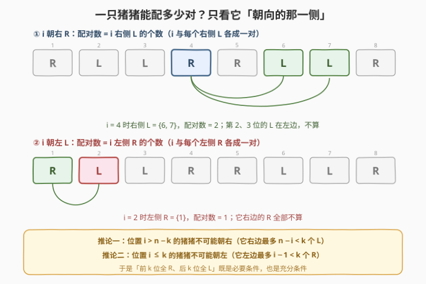
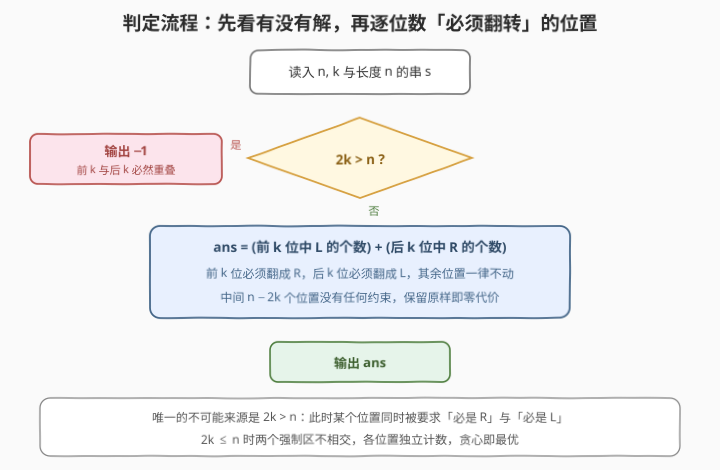
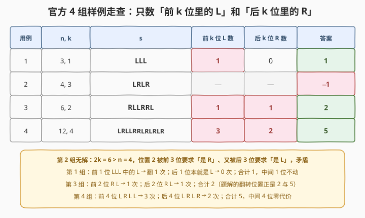

# Codeforces 2245A 谁来监视猪猪守卫 题解

## 1. 题目概述

- **标题 / 题号**：谁来监视猪猪守卫（Codeforces 2245A，英文名 Who Watches the Watchpig?）
- **链接**：https://codeforces.com/problemset/problem/2245/A
- **来源**：Spectral::Cup 2026 Round 3 (Codeforces Round 1110, Div. 1 + Div. 2) · Problem A
- **难度**：800（500 分）
- **限制**：时间 1 s / 内存 256 MB
- **标签**：贪心、字符串、前缀后缀计数

**题意**：$n$ 只猪猪排成一排，编号 $1 \sim n$，每只猪猪朝向 `L`（左）或 `R`（右）。若 $x < y$、$x$ 朝右、$y$ 朝左，就称 $(x,y)$ 是一个**望猪对**。给定 $k$（$1 \le k < n$），一只猪猪**安全**当且仅当它至少属于 $k$ 个望猪对。你可以翻转任意多只猪猪的朝向，求让**所有**猪猪都安全所需的最小翻转次数；办不到则输出 $-1$。多测：第一行 $t$，每组先给 $n, k$，再给一行长度为 $n$ 的 `L`/`R` 串，逐组输出一行答案。

**约束**：

- $1 \le t \le 500$，单组 $1 \le k < n \le 100$，串长恰为 $n$ 且只含 `L`、`R`；
- 单组答案落在 $[-1, n]$，中间量全部是 $O(n)$ 的小整数，`int` 足够；
- 数据规模允许单组 $O(n^2)$，但本题存在 $O(n)$ 的贪心正解；
- 总读入量不足 $60$ KB，瓶颈完全在 I/O 而非计算。

## 2. 示例

官方 4 组样例（输入 / 输出原样）：

```text
输入：
4
3 1
LLL
4 3
LRLR
6 2
RLLRRL
12 4
LRLLRRLRLRLR

输出：
1
-1
2
5
```

逐组含义：

| 组 | $n, k$ | 原串 | 结论 |
|----|--------|------|------|
| 1 | $3,1$ | `LLL` | 把第 $1$ 位翻成 `R`，得 `RLL`，两个望猪对 $(1,2)$、$(1,3)$ 已覆盖全部三只，代价 $1$ |
| 2 | $4,3$ | `LRLR` | 前 $3$ 位要全 `R`、后 $3$ 位要全 `L`，位置 $2,3$ 被两个强制区同时要求，无解 |
| 3 | $6,2$ | `RLLRRL` | 翻第 $2$、$5$ 位得 `RRLRLL`，代价 $2$ |
| 4 | $12,4$ | `LRLLRRLRLRLR` | 翻第 $1,3,4,10,12$ 位得 `RRRRRRLRLLLL`，代价 $5$ |

## 3. 解题思路

### 3.1 暴力思路

直接枚举终态：$2^n$ 种串，每种花 $O(n^2)$ 统计每个位置的配对数再判安全，总复杂度 $O(2^n n^2)$。$n = 100$ 时完全不可行；即便只枚举「翻哪些位置」也是 $2^n$ 量级。指数级枚举说明我们必须找到安全条件的**结构**，而不是逐串试。

### 3.2 核心观察：配对数只由「单侧」决定



望猪对的形态被钉死为「左边一个 `R`、右边一个 `L`」。于是同一只猪猪的两种朝向，贡献来源完全不同：

- 若 $i$ 朝 `R`，它只能充当对里的**左端点**，与每个位于其右侧的 `L` 各成一望猪对，配对数恰为**右侧 `L` 的个数**；
- 若 $i$ 朝 `L`，它只能充当**右端点**，与每个位于其左侧的 `R` 各成一望猪对，配对数恰为**左侧 `R` 的个数**。

也就是说，一只猪猪的安全与否，只由它**朝向的那一侧**里异向猪猪的个数决定，另一侧的内容与它无关。这条「单侧性」把问题一刀切成两个互不影响的方向，于是立刻得到两条硬性推论：

- 位置 $i > n-k$ 的猪猪**不可能**朝 `R`：它右边一共只有 $n-i < k$ 个位置，配对数 $\le n-i < k$。故**最后 $k$ 位必须全为 `L`**；
- 位置 $i \le k$ 的猪猪**不可能**朝 `L`：它左边一共只有 $i-1 \le k-1$ 个位置，配对数 $< k$。故**前 $k$ 位必须全为 `R`**。

两个强制区一旦确定，答案就出来了。而且它们反过来也充分：若前 $k$ 位全 `R`、后 $k$ 位全 `L`，则任意朝 `R` 的 $i$ 必满足 $i \le n-k$，它右边那 $k$ 个后缀位置全是 `L`，配对数 $\ge k$；任意朝 `L` 的 $i$ 必满足 $i \ge k+1$，它左边那 $k$ 个前缀位置全是 `R`，配对数 $\ge k$。

> 💡 **中间段为什么可以随便？** 因为安全条件只引用「前 $k$ 位」与「后 $k$ 位」这两段。中间 $n-2k$ 个位置既不被别人当强制来源，也没有自己的额外要求，保持原样即零代价——这正是「最小翻转」能逐位独立相加的原因。

由此得到本题的全部答案：若 $2k > n$，两个强制区必然重叠，重叠位置被同时要求「必是 `R`」和「必是 `L`」，输出 $-1$；否则

$$\text{ans} = \#\{i \le k : s_i = \texttt{L}\} + \#\{i > n-k : s_i = \texttt{R}\}$$

即**前 $k$ 位里 `L` 的个数**加上**后 $k$ 位里 `R` 的个数**。

### 3.3 算法流程



1. 读入 $t$，对每组读入 $n, k$ 与串 $s$；
2. 若 $2k > n$，直接输出 `-1` 并进入下一组（不要继续计数）；
3. 否则令 `ans = 0`，扫描 $i \in [0, k)$：若 $s_i = $ `L`，`ans` 加一；
4. 扫描 $i \in [n-k, n)$：若 $s_i = $ `R`，`ans` 加一；
5. 输出 `ans`，进入下一组。两段扫描互不重叠（$2k \le n$ 保证），无需去重。

整体不构造终态串、不维护任何跨组状态，每组恰好一趟线性扫描。

### 3.4 示例演算



| 组 | $n,k$ | 前 $k$ 位 | 其中的 `L` | 后 $k$ 位 | 其中的 `R` | 答案 |
|----|-------|-----------|------------|-----------|------------|------|
| 1 | $3,1$ | `L` | 1 | `L` | 0 | 1 |
| 2 | $4,3$ | `LRL` | — | `RLR` | — | $-1$ |
| 3 | $6,2$ | `RL` | 1 | `RL` | 1 | 2 |
| 4 | $12,4$ | `LRLL` | 3 | `LRLR` | 2 | 5 |

第 4 组的终态可以显式写出来核对：原串 `LRLLRRLRLRLR`，翻转第 $1,3,4$ 位（变 `R`）与第 $10,12$ 位（变 `L`），得到 `RRRRRRLRLLLL`。此时位置 $1 \sim 6$ 朝右，右侧至少 $5$ 个 `L`；位置 $7 \sim 12$ 朝左，左侧至少 $6$ 个 `R`，$k = 4$ 全部满足。第 2 组则展示了「看起来只差一点」却必然无解的情形：$2k = 6 > n = 4$，位置 $2,3$ 同时落在前 $3$ 位与后 $3$ 位里。

## 4. 算法细节

1. **判定式是 $2k > n$，不是 $\ge$**。$n = 2k$ 恰好是「前半 `R`、后半 `L`」的临界合法情形，例如 $n=4,k=2$ 的 `LLLL` 答案是 $2$（终态 `RRLL`），写成 $\ge$ 会把它误判成无解。
2. **先判无解再计数**：$2k > n$ 时两个强制区重叠，逐位相加会把同一位置重复计入（还会给出一个「看似合理」的错误数值），所以必须提前 `continue`。
3. **下标一致性**：C++ 用 0-indexed，前 $k$ 位是 $[0,k)$、后 $k$ 位是 $[n-k,n)$；若改写成 1-indexed 的 $[1,k]$ 与 $[n-k+1,n]$，注意串下标别错位一格。
4. **多测无需清空**：本题不存在数组或累加器跨组复用，`ans` 必须**在循环内**重新置 $0$（写在循环外累加是最常见的 WA）。
5. **不要真去构造终态**：只需要计数。若顺手把中间段也改成某种固定模式，会额外增加翻转次数，破坏最优性。
6. **答案范围**：最大 $2k \le n \le 100$，`int` 足够，不必开 `long long`；`-1` 单独分支输出，不要混进加法。
7. **I/O**：$t \le 500$，输出至多 $500$ 行。C++ 关同步 + `'\n'`；Python 用 `sys.stdin.buffer.read().split()` 一次读完、`join` 一次写出，可把耗时压到 $25$ ms 量级。

## 5. 正确性证明

**引理 1（配对归属）**：设终态为 $T$。若 $T_i = $ `R`，则 $i$ 所属望猪对的个数等于 $i$ 右侧 `L` 的个数；若 $T_i = $ `L`，则等于 $i$ 左侧 `R` 的个数。

**证明**：望猪对 $(x,y)$ 要求 $x < y$、$T_x = $ `R`、$T_y = $ `L`。固定的 $i$ 在其中只能扮演两种角色之一：作为 $x$ 时必须有 $T_i = $ `R`，此时对子由「$i$ 与其右侧某个 `L`」唯一确定，共右侧 `L` 的个数个；作为 $y$ 时必须有 $T_i = $ `L`，此时对子由「$i$ 与其左侧某个 `R`」唯一确定，共左侧 `R` 的个数个。两种角色互斥，故计数即为上述单侧异向个数。∎

**引理 2（前 $k$ 位必须全为 `R`）**：任意使所有猪猪安全的终态 $T$ 都满足 $T_1 = T_2 = \cdots = T_k = $ `R`。

**证明**：反设存在 $i \le k$ 且 $T_i = $ `L`。$i$ 左侧的位置只有 $i-1 \le k-1$ 个，故左侧 `R` 的个数 $\le k-1 < k$，由引理 1 知 $i$ 属于的望猪对少于 $k$ 个，与「所有猪猪安全」矛盾。∎

**引理 3（后 $k$ 位必须全为 `L`）**：任意使所有猪猪安全的终态 $T$ 都满足 $T_{n-k+1} = \cdots = T_n = $ `L`。

**证明**：反设存在 $i > n-k$ 且 $T_i = $ `R`。$i$ 右侧的位置只有 $n-i < k$ 个，故右侧 `L` 的个数 $\le n-i < k$，由引理 1 知 $i$ 不安全，矛盾。∎

**推论 1（$2k > n$ 必然无解）**：若 $2k > n$，则不存在使所有猪猪安全的终态。

**证明**：$2k > n$ 时区间 $[1,k]$ 与 $[n-k+1,n]$ 必相交，取交集中位置 $i$：引理 2 要求 $T_i = $ `R`，引理 3 要求 $T_i = $ `L`，矛盾。∎

**引理 4（充分性）**：若 $2k \le n$，构造 $T^*$ 为「前 $k$ 位 `R`、后 $k$ 位 `L`、中间任意」，则 $T^*$ 中所有猪猪安全。

**证明**：任取位置 $i$。若 $T^*_i = $ `R`，因后 $k$ 位全 `L` 故必有 $i \le n-k$，于是位置 $n-k+1, \ldots, n$ 共 $k$ 个全 `L` 的位置都严格在 $i$ 右侧，配对数 $\ge k$。若 $T^*_i = $ `L`，因前 $k$ 位全 `R` 故必有 $i \ge k+1$，于是位置 $1, \ldots, k$ 共 $k$ 个全 `R` 的位置都严格在 $i$ 左侧，配对数 $\ge k$。两种情况都安全，$T^*$ 合法。∎

**定理（算法最优）**：对任意合法输入，算法输出等于最小翻转次数；当且仅当 $2k > n$ 时输出 $-1$。

**证明**：若 $2k > n$，由推论 1 不存在可行终态，输出 $-1$ 正确。若 $2k \le n$，任取可行终态 $T$：由引理 2，每个 $i \le k$ 且 $s_i = $ `L` 的位置在 $T$ 中必须是 `R`，贡献至少一次翻转；由引理 3，每个 $i > n-k$ 且 $s_i = $ `R` 的位置在 $T$ 中必须是 `L`，也贡献至少一次翻转。两段在 $2k \le n$ 时不相交，故翻转数 $\ge$ `ans`。另一方面取 $T^*$ 为「前 $k$ 位 `R`、后 $k$ 位 `L`、中间等于 $s$」，它在这些位置各翻一次、中间不动，翻转数恰为 `ans`，且由引理 4 可行。下界可达，故 `ans` 即最小值。∎

## 6. 复杂度分析

- **时间**：每组 $O(n)$（两段扫描合计最多 $n$ 次比较），总计 $O\left(\sum n\right) \le 5 \times 10^4$ 次常数操作。C++ 实测 $7.4$ ms（含进程启动），Python 实测 $25.6$ ms，相对 $1$ s 时限余量超过 $100$ 倍。
- **空间**：$O(n)$ 用于存一行字符串，其余为 $O(1)$ 额外变量；Python 一次性读入全部输入的缓冲区约 $60$ KB。
- **对照时限**：即使把 $t$ 放大到 $10^5$、$n$ 放大到 $1000$，$O(\sum n)$ 的读入输出也只需几百毫秒，算法本身不是瓶颈。

## 7. 参考代码

### C++17

```cpp
#include <bits/stdc++.h>
using namespace std;

int main() {
    ios::sync_with_stdio(false);
    cin.tie(nullptr);

    int t;
    if (!(cin >> t)) return 0;                 // 空输入防护
    while (t--) {
        int n, k;
        string s;
        cin >> n >> k >> s;
        if (2 * k > n) {                       // 两个强制区重叠 → 无解
            cout << -1 << "\n";
            continue;
        }
        int ans = 0;
        for (int i = 0; i < k; ++i)            // 前 k 位必须是 R
            if (s[i] == 'L') ++ans;
        for (int i = n - k; i < n; ++i)        // 后 k 位必须是 L
            if (s[i] == 'R') ++ans;
        cout << ans << "\n";
    }
    return 0;
}
```

### Python3

```python
import sys


def main() -> None:
    data = sys.stdin.buffer.read().split()
    if not data:                                # 空输入防护
        return
    t = int(data[0])
    pos = 1
    out = []
    for _ in range(t):
        n = int(data[pos])
        k = int(data[pos + 1])
        s = data[pos + 2].decode()
        pos += 3
        if 2 * k > n:                           # 强制区重叠，无解
            out.append("-1")
            continue
        ans = s[:k].count("L") + s[n - k:].count("R")
        out.append(str(ans))
    sys.stdout.write("\n".join(out) + "\n")


main()
```

## 8. 边界情况与易错点

1. **$2k = n$ 的临界**：两个强制区刚好把串切成两半，既不重叠也不留中间段。例如 $n=4,k=2$、`LLLL` 答案为 $2$，终态 `RRLL`；把判据写成 $2k \ge n$ 就会误判为 $-1$。
2. **$2k > n$ 一律无解**：如 $n=4,k=3$ 的 `LRLR` 输出 $-1$。此时无论原串多「接近」目标都不可能成功，不要试图输出 $n$ 或 $0$。
3. **全 `R` / 全 `L` 串**：全 `R` 时前缀不需要动、只有后 $k$ 位要翻，答案恰为 $k$（如 $n=6,k=2$ 的 `RRRRRR` 输出 $2$）；全 `L` 对称地输出 $k$。
4. **$k = 1$ 的最小规模**：$n=2$ 时只有 `RL` 输出 $0$，`LR` 输出 $2$，`LL` 与 `RR` 输出 $1$。这是检验下标是否错位的最快用例。
5. **`ans` 定义在循环外**：多测时累加器未清零会持续膨胀，是最典型的 WA；`ans` 必须写在内层 `while`/`for` 里。
6. **`-1` 与「答案 $0$」混淆**：`ans = 0` 是合法结果（如 `RRLL`），只有 $2k > n$ 才输出 $-1$；不要用 `ans` 的初值或哨兵值表示无解。
7. **输出格式**：每组恰好一行整数，组间不留空行；`-1` 是减号加一，别写成 `- 1`。

## 相关题目与扩展

- [Codeforces 313B I.O.U.](https://codeforces.com/problemset/problem/313/B)：同样用「前缀计数」把「区间内有多少对相邻相等」压成 $O(1)$ 查询，可与本题的单侧计数对照。
- [Codeforces 1791D Distinct Split](https://codeforces.com/problemset/problem/1791D)：前缀 / 后缀两侧独立统计再合并，正是本题「前 $k$ 位 + 后 $k$ 位」的同一骨架。
- [Codeforces 2245B Delete and Concatenate](https://codeforces.com/problemset/problem/2245/B)：同场下一题，贪心结构相似，都是在字符串上找「必须付出的代价」。
- [LeetCode 1758. 生成交替二进制字符串的最少操作数](https://leetcode.cn/problems/minimum-changes-to-make-alternating-string/)：求最少翻转次数使整串满足一个全局结构，思路同属「先确定唯一候选终态，再数差异」。

**延伸思考**：

1. **阈值逐位不同**：若第 $i$ 只猪猪的要求是 $k_i$ 个而非统一的 $k$，条件变成「$i$ 右侧 `L` 数 $\ge k_i$（当 `R`）」的逐位约束，前缀/后缀边界变为 $\max$ 扫描，仍是 $O(n)$ 但需要维护后缀 `L` 的可用量。
2. **要求恰好 $k$ 个**：把「至少」改成「恰好」后，可行域不再是单纯的前缀 + 后缀，而是一条带状区域（右侧 `L` 数被上下界同时卡住），贪心需要额外判断中间段能否容纳剩余配额。
3. **输出字典序最小的终态**：本题中间段可任选，字典序最小化只需把中间段尽量填 `L`（`L` 小于 `R`），其余强制区不变，仍为 $O(n)$。
4. **环上版本**：把第 $n$ 只与第 $1$ 只视作相邻，望猪对改为环序 $x \prec y$，则结论变成「存在长度为 $2k$ 的窗口」而非固定的前缀 + 后缀，需要枚举断点或做滑动窗口。
