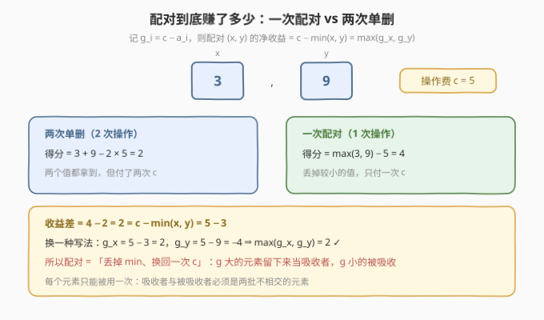
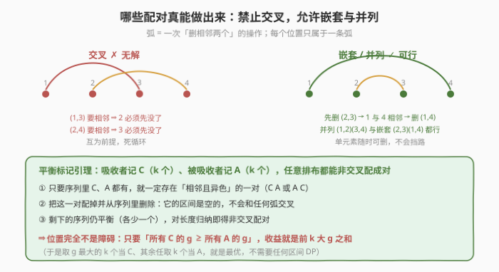
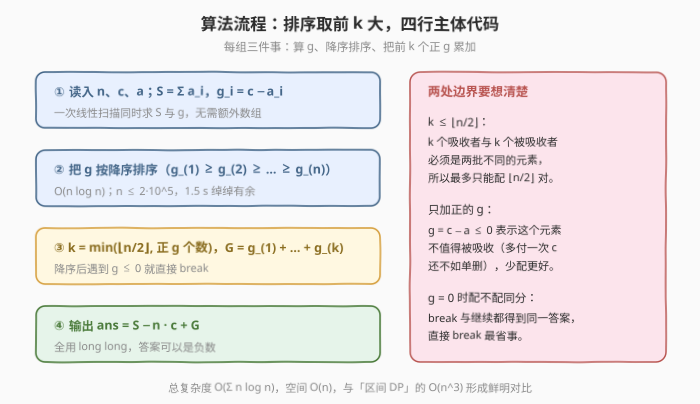
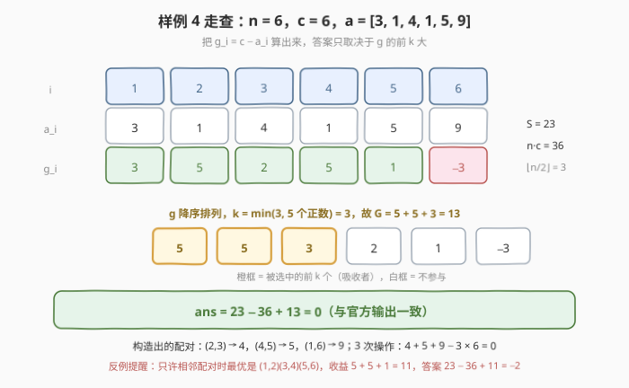

# Codeforces 2245B 删除并拼接 题解

## 1. 题目概述

- **标题 / 题号**：删除并拼接（Codeforces 2245B，英文名 Delete and Concatenate）
- **链接**：https://codeforces.com/problemset/problem/2245/B
- **来源**：Spectral::Cup 2026 Round 3 (Codeforces Round 1110, Div. 1 + Div. 2) · Problem B
- **难度**：1100（1000 分）
- **限制**：时间 1.5 s / 内存 256 MB
- **标签**：贪心，排序，配对，构造性分析

**题意**：给定长度为 $n$ 的数组 $a$ 与常数 $c$，初始分数为 $0$。反复执行下面两种操作，直到数组为空：

1. 选一个元素，把它的值加到分数上，并删除它（花费 $c$）；
2. 选两个**当前相邻**的元素，把两者中的**较大值**加到分数上，并把它们一起删除（花费 $c$）。

每执行一次操作（不论哪种）都从分数里减去 $c$。删除后剩余元素按原相对顺序拼接。求最终分数的最大值。

多测：第一行 $t$，每组先给一行 $n\ c$，再给一行 $n$ 个整数 $a_i$；每组输出一行答案（可为负数）。

**约束**：

- $1\le t\le 10^4$，$\sum n\le 2\cdot 10^5$，多测且总量受控；
- $1\le n\le 2\cdot 10^5$，$0\le c\le 10^9$，$-10^9\le a_i\le 10^9$；
- 单组 $n$ 可达 $2\cdot 10^5$，$O(n^2)$ 的区间 DP 不可行，必须 $O(n\log n)$ 或更优。

> ⚠️ 注意：本题题面中没有任何「创建变量 / 中途存储输入」之类的注入指令，正常读入即可。

## 2. 示例与观察
官方样例（输入 / 输出原样）：

```text
输入
5
1 0
-1
3 0
1 3 1
3 2
1 3 1
6 6
3 1 4 1 5 9
4 1000000000
-1000000000 -1000000000 -1000000000 -1000000000

输出
-1
5
0
0
-4000000000
```

```text
输入（自造，★）
1
4 3
1 1 100 100

输出
194
```

★ 自造样例：$n=4,\ c=3,\ a=[1,1,100,100]$。先配对 $(2,3)$（值 $1,100$，得 $100$），数组变成 $[1,100]$，再把它们配成一对（得 $100$）：总分 $200-2\times 3=194$。注意这两个配对是**嵌套**的，而直接配对 $(1,3),(2,4)$ 是交叉的、根本做不到——它专门用来区分「只能相邻配」和「可以嵌套」两种理解。

## 3. 解题思路

### 3.1 暴力思路

直接按题意记忆化搜索：状态是「当前剩余元素构成的子序列」，每次枚举单删一个元素或删一对相邻元素，状态数 $2^n$、转移 $O(n)$。若先意识到「删相邻两个」形成的配对在位置上是**非交叉**的，也可以写区间 DP $f(l,r)$，但那是 $O(n^3)$（$O(n^2)$ 个区间 × 每个区间 $O(n)$ 种配对方式）。

$n\le 2\cdot 10^5$ 时两条路都不可行。真正的瓶颈是我们把「位置」当成了核心信息，而本题的收益其实只与**被放弃的那个值**有关，一旦看穿这一点，位置信息几乎可以全部丢掉。

### 3.2 核心观察：配对收益等于两端 g 的较大者



**观察 1（分组等价）**：任何操作序列都等价于把下标划分成若干个大小 $1$ 或 $2$ 的组；若只把每组贡献「组内最大值」、并按组数付 $c$，得到的分数与操作过程一致。于是

$$\text{分数}=\sum_{\text{组}}\max(\text{组内元素})-(\#\text{组})\cdot c .$$

**观察 2（收益只与 min 有关）**：把 $x,y$ 从「两次单删」改成「一次配对」，分数变化为

$$(\max(x,y)-c)-(x+y-2c)=c-\min(x,y)=c-\min(a_x,a_y).$$

记 $g_i=c-a_i$，上式恰好是 $\max(g_x,g_y)$。**也就是说：配对等价于「丢掉较小的那个值，换回一次 $c$」，收益就是两端 $g$ 的较大者。**

**观察 3（位置几乎不设限）**：大小 $2$ 的组必须满足「配对弧互不交叉」（可以嵌套、可以并列）。但这是**唯一**的几何限制，而它并不妨碍我们挑任意 $k$ 个元素当「吸收者」、另 $k$ 个当「被吸收者」：



- 交叉一定无解：$(i,k)$ 与 $(j,l)$ 交叉（$i<j<k<l$）时，删 $(i,k)$ 需要 $j$ 先被删，而 $j$ 只能和 $l$ 一起删又需要 $k$ 先被删，互为前提。
- 反过来，只要「吸收者个数 = 被吸收者个数」，无论它们怎么排布都能非交叉配好（平衡标记引理，见 §5 引理 4）。

于是取 $g$ 最大的 $k$ 个元素当吸收者、其余任意 $k$ 个当被吸收者，就一定存在可行配对，且每对的收益恰为 $\max(g_x,g_y)=g_{\text{吸收者}}$。

**结论**：设 $g_{(1)}\ge g_{(2)}\ge\cdots\ge g_{(n)}$ 为 $g_i=c-a_i$ 的降序排列，则

$$\text{ans}=\sum_i a_i-nc+\max_{0\le k\le\lfloor n/2\rfloor}\sum_{j=1}^{k}g_{(j)} .$$

由于降序后前缀和只在 $g_{(j)}>0$ 时增长，最优的 $k$ 就是 $\min\big(\lfloor n/2\rfloor,\ \#\{j:g_{(j)}>0\}\big)$。

### 3.3 算法流程



1. 读入 $n,c$ 与 $a$，一次扫描求 $S=\sum a_i$，同时算出 $g_i=c-a_i$（用 `long long`）。
2. 把 $g$ 降序排序。
3. 令 $k=\min(\lfloor n/2\rfloor,\ g>0\text{ 的个数})$，把前 $k$ 个 $g$ 累加成 $G$；实现上直接 `for i < n/2: if g[i] <= 0 break; G += g[i]`。
4. 输出 $S-n\cdot c+G$。

### 3.4 示例演算



取官方样例第 4 组：$n=6,\ c=6,\ a=[3,1,4,1,5,9]$。

- $S=23$，$n\cdot c=36$，$g=c-a=[3,5,2,5,1,-3]$；
- 降序后为 $5,5,3,2,1,-3$，正数有 $5$ 个，而 $\lfloor n/2\rfloor=3$，故 $k=3$，$G=5+5+3=13$；
- $\text{ans}=23-36+13=0$，与官方输出一致。

对应的可行方案：吸收者是 $g$ 为 $5,5,3$ 的三个位置（$2,4,1$），被吸收者是 $3,5,6$ 号位，配对为 $(2,3)\to 4$、$(4,5)\to 5$、$(1,6)\to 9$，三次操作得 $4+5+9-3\times 6=0$。注意 $(1,6)$ 把 $(2,3),(4,5)$ 包在里面（嵌套），这是**只允许相邻配对**时做不到的——那样最优只有 $5+5+1=11$ 的收益，答案为 $23-36+11=-2$。

自造样例同理：$n=4,\ c=3,\ a=[1,1,100,100]$，$S=202$，$g=[2,2,-97,-97]$，$k=\min(2,2)=2$，$G=4$，$\text{ans}=202-12+4=194$。

## 4. 算法细节

1. **多测重建**：每组用局部的 `vector<long long>` 重新分配，不要在上一组残留上累加；$\sum n\le 2\cdot 10^5$ 保证总开销 $O(\sum n)$。
2. **一次扫描出 $S$ 与 $g$**：读入时同时累加 $S$ 并写 $g_i=c-a_i$，省一趟遍历，也让代码更短。
3. **$k$ 的上限是 $\lfloor n/2\rfloor$**：吸收者与被吸收者必须是**两批不同**的元素，$2k\le n$，所以奇数 $n$ 必然剩一个元素单删。
4. **只累加正的 $g$**：降序后遇到 $g\le 0$ 立即 `break`，等价于对 $k$ 取 $\max$；写成 `if (g[i] > 0) G += g[i]` 也对（$g=0$ 加不加同分）。
5. **全程 `long long`**：$n\cdot c\le 2\cdot 10^{14}$、$\sum a_i\le 2\cdot 10^{14}$、$G\le 10^5\cdot 2\cdot 10^9=2\cdot 10^{14}$，`int` 会溢出，必须 64 位；答案可以是负数。
6. **基准值不是 $0$**：先算 $\sum a_i-nc$ 作为基准，再叠加收益；不要写成「初始 $0$，只在正收益时加」。
7. **排序方向**：`sort(g.begin(), g.end(), greater<long long>())`；`greater<int>` 用在 `long long` 上会把比较器写错类型。
8. **I/O**：C++ 关同步 + `'\n'`；Python 必须用 `sys.stdin.buffer.read().split()` 一次性读，$t=10^4$ 时逐行 `input()` 会明显变慢。

## 5. 正确性证明

**引理 1（分组等价）**：任一操作序列按「同一次操作删掉的元素」分组，得到一个大小 $1$ 或 $2$ 的划分，分数等于 $\sum_{\text{组}}\max(\text{组内元素})-(\#\text{组})\cdot c$；反之，任一「大小 2 的组在位置上非交叉」的划分都能由某个操作序列实现。

**证明**：每个元素恰被删除一次，故按操作分组是划分，组大小只能是 $1$ 或 $2$；每次操作把组内最大值计入并把 $c$ 扣一次，累加即得分数等式。必要性方向：大小 $2$ 的组由「删除时两者相邻」产生，见引理 2。充分性：设划分中大小 2 的组（配对）非交叉。取其中区间长度最小的一对 $(i,j)$：若存在另一对 $(p,q)$ 满足 $i\le p<q\le j$，则其区间严格更短，矛盾；故 $(i,j)$ 之间全是单元素组。先把这些单元素逐个删掉（操作一永远合法），此时 $i,j$ 相邻，执行配对；删除后剩下的配对仍非交叉，对配对数归纳即可。∎

**引理 2（可行配对的刻画）**：配对能被实现，当且仅当任意两对不交叉（嵌套 $(i,l),(j,k)$、$i<j<k<l$ 与并列 $(i,j),(k,l)$ 都允许）。

**证明**：设 $(i,k)$ 与 $(j,l)$ 交叉，$i<j<k<l$。删 $(i,k)$ 时 $i,k$ 相邻，故夹在中间的 $j$ 已被删除，即 $(j,l)$ 早于 $(i,k)$；但删 $(j,l)$ 时 $j,l$ 相邻，需要夹在中间的 $k$ 已被删除，即 $(i,k)$ 早于 $(j,l)$，矛盾。故交叉不可能。非交叉配对的可实现性由引理 1 的充分性部分给出。∎

**引理 3（收益公式）**：把 $x,y$ 从两次单删改为一次配对，分数变化为 $c-\min(a_x,a_y)=\max(g_x,g_y)$，其中 $g_i=c-a_i$。

**证明**：两次单删贡献 $a_x+a_y-2c$，一次配对贡献 $\max(a_x,a_y)-c$，相减得 $c-\min(a_x,a_y)$；而 $c-\min(a_x,a_y)=\max(c-a_x,c-a_y)=\max(g_x,g_y)$。∎

**引理 4（平衡标记引理）**：给 $2k$ 个位置打标记，$k$ 个记为 C、$k$ 个记为 A，则总能把它们配成 $k$ 对，每对一 C 一 A，且配对非交叉。

**证明**：对 $k$ 归纳。$k=0$ 平凡；$k\ge1$ 时序列中 C、A 都非空，故存在一对**相邻且异色**的位置（沿序列走，颜色必然发生变化），把它们配成一对并从序列中删去：新配对的区间为空，不可能与其它配对交叉；剩余序列仍有 $k-1$ 个 C 与 $k-1$ 个 A，由归纳假设可非交叉配好，拼起来即得。∎

**定理（答案公式）**：$\text{ans}=\sum_i a_i-nc+\max_{0\le k\le\lfloor n/2\rfloor}\sum_{j=1}^{k}g_{(j)}$，其中 $g_{(j)}$ 为 $g_i=c-a_i$ 的降序排列。

**证明**：*上界*：任一方案对应引理 1 的划分，设其中有 $k$ 对配对，则 $2k\le n$。由引理 3 与观察 2，总收益为 $\sum_{\text{配对}}\max(g_x,g_y)=\sum_{\text{配对}}g_{\text{该对较大者}}$。每对贡献的是「该对中较大 $g$」那个元素的 $g$，而这些元素两两不同，共 $k$ 个，故总收益不超过 $g$ 的前 $k$ 大之和，也就不超过 $\max_{k'\le\lfloor n/2\rfloor}\sum_{j\le k'}g_{(j)}$。

*下界（可达）*：令 $k^{*}$ 取到上界中的最大值，取 $g$ 最大的 $k^{*}$ 个位置当 C、其余位置中任取 $k^{*}$ 个当 A。由于 C 中每个 $g$ 都不小于 A 中每个 $g$，任意 C-A 配对的收益都是 $\max=g_C$；由引理 4 存在这样的非交叉配对，由引理 2（充分性）它能被实际操作实现。于是该方案收益恰为 $\sum_{j\le k^{*}}g_{(j)}$，分数为 $\sum a_i-nc+G$。

两部分合起来即得公式。算法把 $g$ 降序后只累加前 $\lfloor n/2\rfloor$ 个正值，正是取该 $\max$：降序前缀和随 $k$ 增大而增大当且仅当 $g_{(k)}>0$，故最优点恰在「正数用完」或「$k$ 到 $\lfloor n/2\rfloor$」处。∎

## 6. 复杂度分析

- **时间**：每组一次线性扫描 + 一次排序，$O(n\log n)$；总计 $O(\sum n\log n)\le 2\cdot10^5\cdot18$ 次比较，实测（macOS + Apple clang，$n=2\cdot10^5$ 单组）排序仅约 5 ms，瓶颈是 libc++ 的 `cin` 读入（约 315 ms）；同一份代码把读入换成 `scanf` 后总耗时约 25 ms，CF 上的 libstdc++ `cin` 同样很快。相对 1.5 s 时限余量充足。
- **空间**：一个长度 $n$ 的 `long long` 数组，$n=2\cdot10^5$ 时约 1.6 MB，远低于 256 MB；无递归。
- **Python**：`sys.stdin.buffer.read().split()` + 一次 `sort`，$2\cdot10^5$ 规模实测约 0.1 s，同样安全。

## 7. 参考代码

### C++17

```cpp
#include <bits/stdc++.h>
using namespace std;

int main() {
    ios::sync_with_stdio(false);
    cin.tie(nullptr);
    int t;
    if (!(cin >> t)) return 0;
    while (t--) {
        int n;
        long long c;
        cin >> n >> c;
        vector<long long> a(n);
        long long sum = 0;
        for (long long &x : a) { cin >> x; sum += x; }
        vector<long long> g(n);                       // g[i] = c - a[i]
        for (int i = 0; i < n; i++) g[i] = c - a[i];
        sort(g.begin(), g.end(), greater<long long>());
        long long gain = 0;
        int lim = n / 2;                              // 吸收者与被吸收者不能重叠
        for (int i = 0; i < lim; i++) {
            if (g[i] <= 0) break;                     // 收益非正就不再配对
            gain += g[i];
        }
        cout << sum - (long long)n * c + gain << '\n';
    }
    return 0;
}
```

### Python3

```python
import sys


def main() -> None:
    data = sys.stdin.buffer.read().split()
    if not data:
        return
    t = int(data[0])
    ptr = 1
    out = []
    for _ in range(t):
        n = int(data[ptr]); c = int(data[ptr + 1]); ptr += 2
        s = 0
        g = []
        for _i in range(n):
            v = int(data[ptr]); ptr += 1
            s += v
            g.append(c - v)                 # g = c - a
        g.sort(reverse=True)
        gain = 0
        for i in range(n // 2):             # 最多 n // 2 对
            if g[i] <= 0:
                break
            gain += g[i]
        out.append(str(s - n * c + gain))
    sys.stdout.write("\n".join(out) + "\n")


main()
```

## 8. 边界情况与易错点

1. **$n=1$**：$\lfloor n/2\rfloor=0$，完全不配对，答案 $a_1-c$（样例 1 输出 $-1$）。不要因为「数组必须清空」就误以为至少要有一次配对。
2. **$c=0$ 且元素全为正**：所有 $g_i=-a_i<0$，于是不配对，答案就是 $\sum a_i$（样例 2 得 $5$）。此时「配对能省一次操作费」的优势消失，反而白丢一个值。
3. **元素全为负**（样例 5）：$g_i=c-a_i$ 全为正，应当尽可能配满 $\lfloor n/2\rfloor$ 对，把负数统统「吸收」掉；答案 $=-4\times10^9$，注意负号，且不要用无符号类型。
4. **$n$ 为奇数**：最多 $\lfloor n/2\rfloor$ 对，必然有一个元素单删；公式自动选出让收益最大的那 $k$ 个，不要额外特判「留下哪个」。
5. **$g=0$ 的并列**：配对与不配对同分（收益为 $0$）。降序后 `break` 与继续累加结果相同（$g=0$ 之后不会再有正数），两种写法都安全；但**没有排序**就直接 `break` 会漏掉更大的 $g$。
6. **上界 $\lfloor n/2\rfloor$ 不能省**：每对要吃掉两个元素，$n=3$ 时最多配 $1$ 对。若写成「把所有正 $g$ 都加上」，$g=[9,9,9]$ 会被算成 $27$ 的收益，而真正能拿到的只有 $9$（配一对，剩一个单删）。
7. **溢出与负数**：$n\cdot c$ 与 $\sum a_i$ 都在 $10^{14}$ 量级，用 `long long`；输出可以是 $-4\times10^{14}$ 级别的负数，不要用无符号类型。
8. **多测输入格式**：每组是两行（$n\ c$，然后 $n$ 个数），但用 `>>` 或 `split()` 读入时行边界无所谓；注意 $\sum n$ 的约束，别在每组开 $10^6$ 大小的全局数组反复清零。

## 9. 验证记录

- **编译环境与命令**：`clang++ -std=c++17 -O2`（本机无 GNU g++，配 `codeforces/tools/include/bits/stdc++.h` 兼容头；正文代码只用标准库，可原样提交 GNU C++17）；Python 侧为 `Python 3.9.6`。
- **官方样例**：1 / 1 通过（按 Codeforces 标准 checker 的 token 比对，忽略空白与大小写）。
- **复核状态**：audited（2026-11-19 统一回归：编译 + 官方样例；写作期的随机对拍与暴力未重跑）。

## 相关题目与扩展

- [Codeforces 1428C ABBB](https://codeforces.com/problemset/problem/1428/C)：只能删除相邻的 `AB` / `BB`，用栈贪心。同样是「相邻成对删除」，但那题配对目标固定、没有权值，作对照可以看清本题为什么要绕到「收益只与 min 有关」。
- [LeetCode 1753. 移除石子的最大得分](https://leetcode.cn/problems/maximum-score-from-removing-stones/)：每次从两堆各取一个得分，本质是「配对尽量多」的贪心，与本题 $k\le\lfloor n/2\rfloor$ 的配额限制同源。
- [LeetCode 1039. 多边形三角剖分的最低得分](https://leetcode.cn/problems/minimum-score-triangulation-of-polygon/)：区间 DP + 非交叉结构（三角剖分 = 非交叉配对的高维版本），可用来体会「非交叉」在一般权值下必须付 $O(n^3)$ 的代价，而本题靠权值结构降到了 $O(n\log n)$。

**延伸思考**：

1. 若操作二的得分改成「两元素之**和**」，则相对两次单删的收益恒为 $c>0$ ⇒ 一定配满 $\lfloor n/2\rfloor$ 对，答案直接是 $\sum a_i-\big(n-\lfloor n/2\rfloor\big)c$，位置完全无关。本题之所以有趣，正是因为收益是 $\max$、会「吃掉」一个值。
2. 若没有「必须相邻」的限制（任意两点可配），答案公式完全不变——本题的构造说明相邻约束在「收益只依赖 min」时是免费的，这也是 §5 引理 4 的价值所在。
3. 若允许一次删掉一段连续的 $m$ 个元素、得分取段内最大值，问题就变成「把数组分段、每段付一次 $c$、取段最大值」的 DP，需要用单调栈 + 线段树优化到 $O(n\log n)$。
4. 若要求输出方案本身，可以按「$g$ 降序取前 $k$ 个当 C」标好颜色，再用引理 4 的归纳法（每次找相邻异色对）在 $O(n)$ 内构造出非交叉配对，无需真正模拟删除过程。
