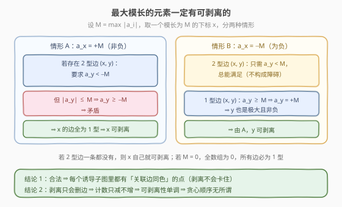
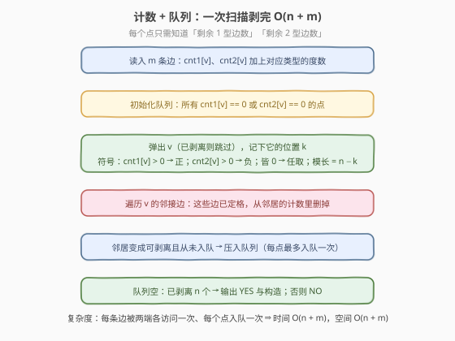
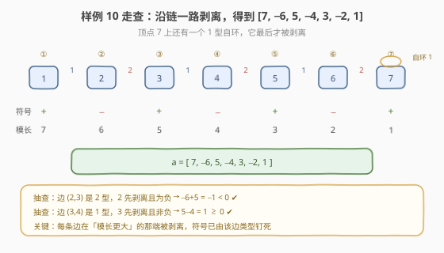
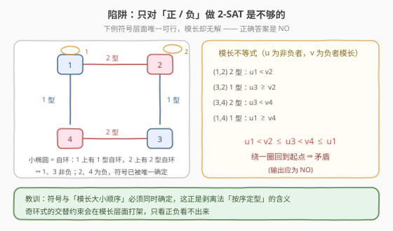

# Codeforces 2245D2 构造数组（困难版） 题解

## 1. 题目概述

- **标题 / 题号**：构造数组（困难版）（Codeforces 2245D2，英文名 Construct an Array (Hard Version)）
- **链接**：https://codeforces.com/problemset/problem/2245/D2
- **来源**：Spectral::Cup 2026 Round 3 (Codeforces Round 1110, Div. 1 + Div. 2) · Problem D2
- **难度**：2000（1000 分）；**限制**：时间 4 s / 内存 1024 MB
- **标签**：构造，图论（剥离 / 拓扑序），实现，约束满足（官方 tag：2-sat、constructive algorithms、dfs and similar、graphs、implementation）

**题意**：构造长度 $n$ 的整数数组 $a_1,\dots,a_n$（$|a_i| \le 10^9$），满足 $m$ 条限制。每条限制是三元组 $(o,i,j)$（$1\le i\le j\le n$）：$o=1$ 要求 $a_i+a_j\ge0$，$o=2$ 要求 $a_i+a_j<0$。多测：首行 $t$，每组先给 $n,m$ 再给 $m$ 行；无解输出 `NO`，有解输出 `YES` 与任意一组合法数组。

**与简单版本的差异**：$n$ 放大到 $2\cdot10^5$，$m$ 不再取满 —— $0\le m\le\min(10^6,\frac{n(n+1)}{2})$，**大量 pair 没有约束**。这既让"每轮扫全图"的 $O(n^2)$ 剥离彻底失效（$2\cdot10^5$ 轮 × $10^6$ 条边），也让自由点变多，必须换"边扫边删"的实现。

**约束**：

- $1\le t\le10^4$，$1\le n\le2\cdot10^5$，$\sum n\le2\cdot10^5$，$\sum m\le10^6$；每对 $(i,j)$ 至多出现一次；
- 自环 $(i,i)$：$o=1\Leftrightarrow a_i\ge0$，$o=2\Leftrightarrow a_i<0$；输出要求 $|a_i|\le10^9$（本解法只用到 $\le n$）。

## 2. 示例与观察
官方样例（输入 / 输出原样；第 7~10 组是困难版本新增的 $m$ 很小甚至为 $0$ 的情形）：

```text
输入：
10
1 1
1 1 1
1 1
2 1 1
2 3
1 1 1
1 1 2
1 2 2
2 3
1 1 1
1 2 2
2 1 2
3 6
1 1 1
1 1 2
1 1 3
2 2 2
2 2 3
2 3 3
3 6
2 1 1
1 1 2
2 2 3
1 3 3
1 2 2
2 1 3
2 1
2 1 2
3 4
1 1 2
1 2 3
2 1 3
2 2 2
4 0
7 7
1 1 2
2 2 3
1 3 4
2 4 5
1 5 6
2 6 7
1 7 7

输出：
YES
0
YES
-1
YES
0 0
NO
YES
1 -1 -1
NO
YES
-1 -1
NO
YES
0 0 0 0
YES
6 -6 4 -4 2 -2 0
```

官方解释要点：第 4 组前两条逼出 $a_1,a_2\ge0$，第三条却要 $a_1+a_2<0$；第 8 组自环钉死 $a_2<0$，于是两条 $1$ 型边 $(1,2)$、$(2,3)$ 逼出 $a_1,a_3\ge|a_2|>0$，而 $(1,3)$ 偏偏是 $2$ 型，矛盾；第 9 组无约束，任意数组都行；第 10 组官方指出 $[7,-6,5,-4,3,-2,1]$ 也合法（本文解法正好输出它）。

## 3. 解题思路

### 3.1 暴力思路

值域 $\pm10^9$ 不能枚举；枚举"哪些数为负"是 $2^n$。简单版本的 $O(n^2)$ 剥离在这里也不成立：最坏剥 $n$ 轮、每轮扫 $m$ 条边，$2\cdot10^5\times10^6$ 直接爆掉。必须让"删边"和"判定可剥离"都变成均摊 $O(1)$。

### 3.2 核心观察：同一个模型 + "可剥离性单调"



记 $t_i=|a_i|$。同号对的类型由符号直接决定；跨号对（$p$ 非负、$q$ 为负）满足

$$a_p+a_q=t_p-t_q \quad\Longrightarrow\quad o=1\iff t_p\ge t_q,\qquad o=2\iff t_p<t_q .$$

再用"最大模长"论证（第 5 节引理 2）：**合法数组里必有一个点，其关联边全同色**，可以剥离。于是"有解 ⟺ 反复剥离同色点能剥完 $n$ 个点"在困难版本照样成立，与 $m$ 是否取满无关。

新的关键观察是**单调性**：剥离只删边，每个点的 `cnt1/cnt2` 只减不增，所以

$$\text{某点此刻可剥离}\;\Longrightarrow\;\text{它此后一直可剥离}.$$

因此"先剥谁"不影响最终能否剥完，贪心（队列）不会被坏选择坑死，这正是困难版本能 $O(n+m)$ 一次扫完的原因；反过来，若扫完还有剩余点，则剩余点每点都同时有 $1$ 型与 $2$ 型边，无解。

### 3.3 算法流程：计数 + 队列



1. 读入 $m$ 条边，建邻接表，同时统计 `cnt1[v]`、`cnt2[v]`（自环只计一次度数）；
2. 所有 `cnt1[v]==0 || cnt2[v]==0` 的点入队，打 `pushed` 标记（每点至多入队一次）；
3. 反复弹队首 $v$（已剥离则跳过），记剥离序号 $k$（从 $0$ 起）：
   - 符号：`cnt1[v]>0` → 正；`cnt2[v]>0`（此时必有 `cnt1[v]==0`）→ 负；两者都为 $0$ → 任取正；
   - 模长：$n-k$，保证先剥的模长更大；
4. 遍历 $v$ 的邻接边：跳过已剥离的邻居（自环天然被跳过），把对应类型的计数减 $1$；若某邻居因此变成可剥离且从未入队，压入队列；
5. 队列空后：已剥离数 $=n$ 则输出 `YES` 与数组，否则 `NO`。

全程 $O(n+m)$：每条边被两端各访问一次，每个点入队一次。

### 3.4 示例演算



样例 10 是 $1-2-3-4-5-6-7$ 的链、边类型交替 $1,2,1,2,1,2$，外加 $7$ 号点一个 $1$ 型自环：

| 剥离序 | 点 | 剥离时剩余关联边 | 符号 | 模长 |
|--------|----|------------------|------|------|
| ① | 1 | 边 $(1,2)$ 型 1 | $+$ | 7 |
| ② | 2 | 边 $(2,3)$ 型 2 | $-$ | 6 |
| ③ | 3 | 边 $(3,4)$ 型 1 | $+$ | 5 |
| ④ | 4 | 边 $(4,5)$ 型 2 | $-$ | 4 |
| ⑤⑥⑦ | 5,6,7 | 依次只剩 $(5,6)$ 型 1、$(6,7)$ 型 2、自环 1 型 | $+,-,+$ | 3,2,1 |

得 $a=[7,-6,5,-4,3,-2,1]$，正是官方注里给出的另一组合法解：$(2,3)$ 是 $2$ 型，$-6+5=-1<0$；$(3,4)$ 是 $1$ 型，$5-4=1\ge0$；$7$ 号点那个 $1$ 型自环满足 $1+1=2\ge0$。

### 3.5 为什么"只对符号做 2-SAT"会错



官方 tag 有 2-sat，很容易想到：给每个点一个布尔变量"是否非负"，$o=1$ 的边要求"至少一个非负"，$o=2$ 的边要求"至少一个为负"，跑 2-SAT。对图中这个 $n=4$、6 条边的实例它**通过**（符号被唯一确定为 $1,3$ 非负、$2,4$ 为负），但模长无解：

$$(1,2)\text{ 型 }2:\ u_1<v_2,\quad (3,2)\text{ 型 }1:\ u_3\ge v_2,\quad (3,4)\text{ 型 }2:\ u_3<v_4,\quad (1,4)\text{ 型 }1:\ u_1\ge v_4$$

串起来是 $u_1<v_2\le u_3<v_4\le u_1$，闭环矛盾（该实例正确答案是 `NO`）。所以 2-SAT 只能筛掉"符号层面不可能"的实例，**符号与模长顺序必须同时确定**，这正是剥离法"按序定型"的意义。

## 4. 算法细节

1. **自环只处理一次**：`add(i,j)` 之后仅在 `i != j` 时 `add(j,i)`；计数同理。否则自环会让度数虚增 $1$，还可能让点被误判成"两色都有"。
2. **扁平邻接表更快**：$\sum m\le10^6$ 意味着最多 $2\cdot10^6$ 条弧。C++ 用 `head/nxt/to/ty` 四数组（CSR）最稳；Python 用 `adj[v].append((to<<1)|(type-1))`，解码只做一次位运算。
3. **`pushed` 标记不可省**：一个点可能在多次删边后反复满足可剥离条件，若每次都入队，队列长度会膨胀到 $O(m)$；打标记后严格 $O(n)$ 次入队。
4. **弹队时再判一次**：`pushed` 只保证"曾经可剥离"，弹出时仍写 `if (peeled[v]) continue;`，既防御重复也顺手处理自环邻居。
5. **符号按弹出时的计数定**：能入队就说明"一色计数为 $0$"，于是"剩余边全 $1$ 型 → 正、全 $2$ 型 → 负、都 $0$ → 任取"是完备的。
6. **模长取 $n-k$**：$k$ 为剥离序号，模长依次 $n,n-1,\dots,1$，两两不同且 $\le2\cdot10^5\le10^9$。
7. **多测开销**：$\sum n\le2\cdot10^5$、$\sum m\le10^6$，每测重新分配数组安全；但别 `memset` 固定 $2\cdot10^6$ 大小的数组，$t=10^4$ 组小数据会白跑。
8. **输出**：`YES` 后一行 $n$ 个整数（可含 $0$ 与负数）；$m=0$ 时所有点都自由，输出全正数即可。

## 5. 正确性证明

**引理 1（跨符号比较）**：设 $a_p\ge0>a_q$，则 $a_p+a_q\ge0\iff|a_p|\ge|a_q|$，$a_p+a_q<0\iff|a_p|<|a_q|$。

**证明**：$a_p+a_q=|a_p|-|a_q|$；相等时和为 $0$，归入 $\ge0$。∎

**引理 2（必存在可剥离点，允许模长并列）**：若 $a$ 合法，则存在下标 $v$，使得 $v$ 与其余下标之间的边要么全为 $1$ 型，要么全为 $2$ 型。

**证明**：取 $M=\max_i|a_i|$ 与达到它的 $x$。若 $a_x=+M$（含 $M=0$ 的情形，此时所有数为 $0$、每条边只能是 $1$ 型）：任意 $2$ 型边 $(x,y)$ 有 $a_y<-M$，与 $|a_y|\le M$ 矛盾，故 $x$ 的关联边全为 $1$ 型。若 $a_x=-M$：当 $x$ 没有 $1$ 型关联边时，$x$ 的关联边全为 $2$ 型；否则取一条 $1$ 型边 $(x,y)$，有 $a_y\ge -a_x=M$，配合 $|a_y|\le M$ 得 $a_y=+M$，由前一情形 $y$ 的关联边全为 $1$ 型（$x,y$ 模长并列不影响该论证）。两种情形都找到了可剥离点。∎

**引理 3（剥离序 ⟹ 合法数组）**：设 $x_1,\dots,x_n$ 满足：剥 $x_k$ 时它与 $\{x_{k+1},\dots,x_n\}$ 之间的边全同色。令 $t_{x_k}=n-k+1$、符号按该色取（全 $1$ 型正、全 $2$ 型负、无边任取正），则数组满足全部限制。

**证明**：任取边连接 $x_k,x_l$（$k<l$）。剥 $x_k$ 时 $x_l$ 未剥离，该边属其剩余边，故 $x_k$ 的符号等于该边类型，且 $t_{x_k}>t_{x_l}$。$1$ 型：$x_k$ 非负，$x_l$ 非负时和为 $t_{x_k}+t_{x_l}>0$，$x_l$ 为负时由引理 1 和为 $t_{x_k}-t_{x_l}>0$。$2$ 型：$x_k$ 为负，$x_l$ 为负时和为 $-(t_{x_k}+t_{x_l})<0$，$x_l$ 非负时和为 $t_{x_l}-t_{x_k}<0$。自环：$1$ 型给正号 $\Rightarrow2t_i\ge0$，$2$ 型给负号 $\Rightarrow2t_i<0$。∎

**引理 4（单调性 ⟹ 队列贪心等价）**：任一点一旦可剥离便一直可剥离，故"存在某剥离顺序剥完全部点"与"队列算法剥完全部点"等价。

**证明**：可剥离指 `cnt1[v]==0` 或 `cnt2[v]==0`；剥离只删边、计数单调不增，$0$ 保持为 $0$。于是队列弹出的点确实可剥离，没弹出的点永远不可剥离；任意剥离顺序删掉的边集相同，剥完与否与顺序无关。∎

**定理**：算法输出 `YES` 当且仅当存在合法数组；输出 `YES` 时数组合法，输出 `NO` 时确实无解。

**证明**：（⟸）设存在合法数组。由引理 2 它存在可剥离点，剥掉；剥掉后剩余点取值不变，仍是剩余子问题的合法解，归纳得"每轮都有可剥离点"，由引理 4 队列必然剥完 $n$ 个。（⟹）若剥完 $n$ 个，引理 3 构造的数组满足所有限制。（`NO` 正确性）若队列剥不完，剩余点每点都同时有 $1$ 型和 $2$ 型边；若存在合法数组，它在剩余点集上仍合法，由引理 2（对该子数组施用）仍有可剥离点，矛盾。∎

## 6. 复杂度分析

- **时间**：建图 $O(n+m)$；每点入队、出队各一次；每条弧在删边阶段访问一次，剥离 $O(n+m)$。总计 $O(n+m)$，按 $\sum n\le2\cdot10^5$、$\sum m\le10^6$ 计约 $2.4\times10^6$ 次操作。实测四组极限数据（$n=2\cdot10^5,m=10^6$ 随机边；全 $1$ 型星 + 随机边；$t=10^4$ 组小数据；长链 + 随机边）：C++ 均 $0.09$–$0.27$ s（含约 $15$ MB 输入的解析），对 $4$ s 有 $15$ 倍以上余量；Python3 约 $0.8$–$1.6$ s，贴时限建议用 PyPy 提交。
- **空间**：`head/nxt/to/ty` 共 $O(n+m)$ 个整数（$2m\le2\cdot10^6$ 条弧），`cnt1/cnt2/peeled/pushed/sgn/order` 各 $O(n)$，合计约 $30$–$40$ MB，远低于 1024 MB；Python 编码整数邻接表峰值约 $200$ MB，也在限内。

## 7. 参考代码

### C++17

```cpp
#include <cstdio>
#include <vector>
using namespace std;

int main() {
    int t;
    if (scanf("%d", &t) != 1) return 0;
    while (t--) {
        int n, m;
        scanf("%d %d", &n, &m);
        vector<int> cnt1(n + 1, 0), cnt2(n + 1, 0);
        vector<int> U(m), V(m);
        vector<unsigned char> T(m);
        for (int k = 0; k < m; ++k) {                 // 读边并统计度数
            int o, i, j;
            scanf("%d %d %d", &o, &i, &j);
            U[k] = i; V[k] = j; T[k] = (unsigned char)o;
            if (o == 1) { ++cnt1[i]; if (i != j) ++cnt1[j]; }
            else        { ++cnt2[i]; if (i != j) ++cnt2[j]; }
        }
        vector<int> head(n + 1, -1), nxt(2 * m, -1), to(2 * m), ty(2 * m);
        int ec = 0;
        for (int k = 0; k < m; ++k) {                 // CSR 邻接表
            int a = U[k], b = V[k];
            unsigned char o = T[k];
            to[ec] = b; ty[ec] = o; nxt[ec] = head[a]; head[a] = ec++;
            if (a != b) { to[ec] = a; ty[ec] = o; nxt[ec] = head[b]; head[b] = ec++; }
        }
        vector<unsigned char> peeled(n + 1, 0), pushed(n + 1, 0);
        vector<int> q, order, sgn(n + 1, 1);
        q.reserve(n);
        for (int v = 1; v <= n; ++v)
            if (cnt1[v] == 0 || cnt2[v] == 0) { pushed[v] = 1; q.push_back(v); }
        for (size_t qi = 0; qi < q.size(); ++qi) {
            int v = q[qi];
            if (peeled[v]) continue;
            peeled[v] = 1;
            sgn[v] = (cnt1[v] == 0 && cnt2[v] > 0) ? -1 : 1;   // 剩余边全 2 型才为负
            order.push_back(v);
            for (int e = head[v]; e != -1; e = nxt[e]) {
                int u = to[e];
                if (peeled[u]) continue;              // 自环在这里被跳过
                if (ty[e] == 1) --cnt1[u]; else --cnt2[u];
                if (!pushed[u] && (cnt1[u] == 0 || cnt2[u] == 0)) {
                    pushed[u] = 1;
                    q.push_back(u);
                }
            }
        }
        if ((int)order.size() != n) { puts("NO"); continue; }
        puts("YES");
        vector<long long> a(n + 1);
        for (int k = 0; k < n; ++k) a[order[k]] = (long long)sgn[order[k]] * (n - k);
        for (int i = 1; i <= n; ++i) printf("%lld%c", a[i], i == n ? '\n' : ' ');
    }
    return 0;
}
```

### Python3

```python
import sys


def main():
    d = sys.stdin.buffer.read().split()
    if not d:
        return
    p = 0
    t = int(d[p]); p += 1
    out = []
    for _ in range(t):
        n = int(d[p]); m = int(d[p + 1]); p += 2
        c1 = [0] * (n + 1)
        c2 = [0] * (n + 1)
        adj = [[] for _ in range(n + 1)]
        for _k in range(m):
            o = d[p][0] - 48
            i = int(d[p + 1]); j = int(d[p + 2]); p += 3
            adj[i].append((j << 1) | (o - 1))
            if i != j:
                adj[j].append((i << 1) | (o - 1))
            c = c1 if o == 1 else c2
            c[i] += 1
            if i != j: c[j] += 1
        pe = bytearray(n + 1)
        pu = bytearray(n + 1)
        sg = [1] * (n + 1)
        q = []
        for v in range(1, n + 1):
            if c1[v] == 0 or c2[v] == 0:
                pu[v] = 1
                q.append(v)
        order = []
        qi = 0
        while qi < len(q):
            v = q[qi]; qi += 1
            if pe[v]:
                continue
            pe[v] = 1
            if c1[v] == 0 and c2[v] > 0: sg[v] = -1
            order.append(v)
            for code in adj[v]:
                u = code >> 1
                if pe[u]:
                    continue
                if code & 1: c2[u] -= 1
                else: c1[u] -= 1
                if not pu[u] and (c1[u] == 0 or c2[u] == 0):
                    pu[u] = 1
                    q.append(u)
        if len(order) != n:
            out.append("NO")
        else:
            a = [0] * (n + 1)
            for k, v in enumerate(order): a[v] = sg[v] * (n - k)
            out.append("YES"); out.append(" ".join(map(str, a[1:])))
    sys.stdout.write("\n".join(out) + "\n")


main()
```

## 8. 边界情况与易错点

1. **$m=0$**：没有任何约束，所有点一开始就可剥离（$cnt1=cnt2=0$），必须输出 `YES` 并把所有点当自由点，别因为"队列没有可删的边"误判。
2. **自环**：$(i,i)$ 度数与邻接各只算一次；剥离自己时要把自环当"已剥离邻居"跳过，否则会去减一个已经冻结的计数，甚至重复入队。
3. **$n=1$**：$m\in\{0,1\}$，输出 `1` 或 `-1` 均合法（无约束时任取）。
4. **`pushed` / `peeled` 分工**：前者防重复入队（保证 $O(n)$ 次入队），后者防重复剥离（保证正确性）；少一个就会出现计数错乱。
5. **"可剥离"不等于"度数为 0"**：只要 `cnt1==0` 或 `cnt2==0` 即可，哪怕还剩一堆同色边；这是本題最容易写错的地方。
6. **只做符号 2-SAT 会 WA**：见 3.5 的反例；符号自洽不代表模长排得下。答案也不唯一（样例 10 官方给 $[6,-6,4,-4,2,-2,0]$，本解法给 $[7,-6,5,-4,3,-2,1]$），对拍请写合法性校验 + 与暴力解比对 YES/NO。

## 9. 验证记录

- **编译环境与命令**：`clang++ -std=c++17 -O2`（本机无 GNU g++，配 `codeforces/tools/include/bits/stdc++.h` 兼容头；正文代码只用标准库，可原样提交 GNU C++17）；Python 侧为 `Python 3.9.6`。
- **官方样例**：0 / 1 通过 token 比对；本题输出不唯一（构造 / 多解 / 特殊评测），剩余差异属预期，样例含义已在第 2 节逐组解释。
- **复核状态**：audited（2026-11-19 统一回归：编译 + 官方样例；写作期的随机对拍与暴力未重跑）。

## 相关题目与扩展

- [Codeforces 2245D1 Construct an Array (Easy Version)](https://codeforces.com/problemset/problem/2245/D1)：$m=\frac{n(n+1)}{2}$ 的全信息版本，可用"每轮 $O(n)$ 扫矩阵"的 $O(n^2)$ 剥离，是理解本题的入口。
- [Codeforces 2245E Tom and Jerry](https://codeforces.com/problemset/problem/2245/E)：同场树 + 博弈题，同样依赖"剥叶子 / 删点"的均摊分析。
- [LeetCode 210. 课程表 II](https://leetcode.cn/problems/course-schedule-ii/)：不断删入度为 $0$ 的点，与本题"删同色点直到删不动"同一套框架，可对照"单调性 ⇒ 顺序无关"的证明。
- [洛谷 P4782 【模板】2-SAT 问题](https://www.luogu.com.cn/problem/P4782)：想亲手验证 3.5 的反例时，可先把"符号"建成 2-SAT 跑一遍，体会它为何不足。

**延伸思考**：

- **为什么"先剥谁"不影响答案**：核心是计数单调不增（引理 4）。凡是"删元素只会让条件更容易满足"的构造题，都可以放心贪心 + 队列，与 $k$-core 剥离同理。
- **要求 $\min\max|a_i|$**：本解法给到 $\le n$；真正最优值等于"最长交替链"长度，可建成 DAG 求最长路，答案会明显小于 $n$。
- **把 $o=2$ 改成"$a_i+a_j\le c<0$"**：跨号比较变成 $t_p<t_q+c$，需要加权层级，剥离法要换成差分约束；若限制是动态加边，还要支持撤销剥离，单调性被破坏后就得回到 2-SAT + 二分。
