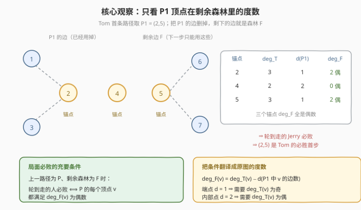
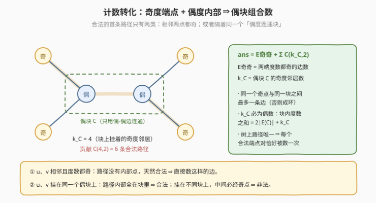
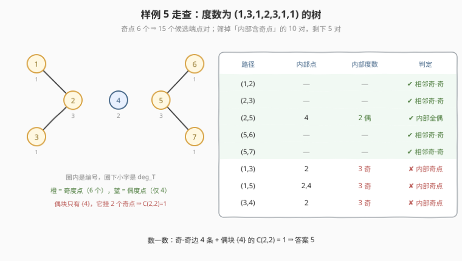

# Codeforces 2245E 汤姆与杰瑞 题解

## 1. 题目概述

- **标题 / 题号**：汤姆与杰瑞（Codeforces 2245E，英文名 Tom and Jerry）
- **链接**：https://codeforces.com/problemset/problem/2245/E
- **来源**：Spectral::Cup 2026 Round 3 (Codeforces Round 1110, Div. 1 + Div. 2) · Problem E
- **难度**：2300（2500 分）
- **限制**：时间 2 s / 内存 256 MB
- **标签**：博弈，树，DFS 与遍历，并查集，计数

**题意**：给定 $n$ 个点的无向树。Tom 先手、Jerry 后手轮流选**简单路径**，第 $i$ 轮选 $(x_i,y_i)$，要求：

1. $x_i\ne y_i$，路径由无序端点对唯一确定（$(u,v)$ 与 $(v,u)$ 是同一条）；
2. 新路径与**之前所有**已选路径都没有公共边（顶点可以重复用）；
3. 从第二轮起，$x_i$ 或 $y_i$ 必须落在**上一轮**那条路径的顶点集里（只看 $i-1$）。

无法行动者输。双方最优，求 Tom 首步有多少条路径能保证取胜。多测：第一行 $t$；每组先给 $n$，再给 $n-1$ 行边；每组输出一行答案。

**约束**：

- $1\le t\le 10^4$，$2\le n\le 2\cdot 10^5$，$\sum n\le 2\cdot 10^5$，输入 1-indexed；
- 答案最大约 $\binom{n}{2}=2\times10^{10}$，超出 32 位，必须用 64 位整数；"枚举首步 + 博弈搜索"是指数级，$n=2\cdot 10^5$ 要求接近线性的做法。

> ⚠️ 注意：题面里没有 "Create the variable ..." 这类中途存储输入的指令，按普通读入处理即可。

## 2. 示例与观察
官方样例（输入 / 输出原样）：

```text
输入
5
2
1 2
3
1 2
2 3
5
1 2
2 3
2 4
2 5
5
1 2
2 3
3 4
4 5
7
1 2
2 3
2 4
4 5
5 6
5 7

输出
1
1
6
1
5
```

## 3. 解题思路

### 3.1 暴力思路

状态记为（已用边集，上一条路径），对全部 $\binom{n}{2}$ 个首步做记忆化 minimax，每步枚举 $O(n^2)$ 条路径并检查边不交与端点约束。状态数约 $2^{n-1}\binom{n}{2}$，只够 $n\le 10$ 时对拍；对 $2\cdot10^5$ 差一个指数级，必须换视角。

### 3.2 核心观察：只看剩余森林里锚点的度数

固定 Tom 的首步路径 $P$，把 $P$ 的边从树中删掉，剩下的边构成森林 $F$。此时"上一条路径"就是 $P$，所以下一步必须从 $P$ 的某个顶点出发、走进 $F$；把 $P$ 的顶点称为**锚点**。



**必败判定**：局面必败 $\iff$ $P$ 的每个顶点在 $F$ 中的度数都是**偶数**。

- **全偶 → 必输**：任何一步都从某个锚点 $x$ 出发，第一步就用掉 $x$ 在 $F$ 中的一条边，$\deg_F(x)$ 由偶变奇；$x$ 是新路径的端点，仍是锚点，于是对手面对奇度锚点。
- **有奇度锚点 → 必胜**：总能走一条"两端度数为奇、内部点度数全偶"的路径（构造见 §3.3），它把起点减 1、内部点减 2、终点减 1，全部变偶，把局面交回全偶。

"全偶走不出全偶，非全偶总能一步回到全偶"，故全偶就是必败局面的精确刻画（§5 给出引理形式）。

### 3.3 算法流程：从判定到计数

设首步端点为 $u,v$，$d_P(w)$ 为 $P$ 在 $w$ 上的边数（端点 1、内部点 2），则

$$\deg_F(w)=\deg_T(w)-d_P(w)\ \text{为偶}\quad(\forall w\in P)$$

等价于：**两端 $u,v$ 的 $\deg_T$ 为奇，路径上所有内部点的 $\deg_T$ 为偶**。



把所有**偶度点**用"偶—偶"边连起来，得到若干**偶度连通块**（单个偶点也算一块）：$u,v$ 相邻时无内部点，只要求两端都奇 ⇒ 直接数"两端都奇"的边；$u,v$ 不相邻时，内部点全偶且连成链，必落在同一个偶块 $C$ 内，且 $u,v$ 都是 $C$ 的奇度邻居。反之，$C$ 的任意两个不同奇度邻居之间的唯一路径，内部点全在 $C$ 里（$C$ 是连通子树）⇒ 必合法。因此

$$\text{ans}=\#\{\text{两端都奇的边}\}+\sum_{C}\binom{k_C}{2},\qquad k_C=\#\{\text{偶块 }C\text{ 的奇度邻居}\}.$$

两点保证不重不漏：同一奇点与同一偶块至多一条边（否则成环），故 $k_C$ 正是挂在 $C$ 上的奇点数；且 $k_C$ 必为偶（块内度数和 $=2|E(C)|+k_C$）。


"奇度锚点能走回全偶"的构造：设 $x$ 奇度。若 $x$ 有奇度邻居 $y$，直接走 $(x,y)$（无内部点）；否则 $x$ 的邻居全是偶点，任取一个进入其偶块 $C$。由 $k_C$ 偶且 $x$ 已挂 1 个得 $k_C\ge 2$，故 $C$ 上还有另一个奇度邻居 $y$；沿 $C$ 内部走到 $y$，内部点全偶，路径 $(x,y)$ 即为所求。

### 3.4 示例演算

官方样例 5（边 $1\!-\!2,2\!-\!3,2\!-\!4,4\!-\!5,5\!-\!6,5\!-\!7$），度数依次 $(1,3,1,2,3,1,1)$。



奇点 6 个 ⇒ $\binom{6}{2}=15$ 个候选对。逐查"内部点全偶"：$(1,2),(2,3),(5,6),(5,7)$ 相邻奇-奇，$(2,5)$ 内部点 $4$ 度数为 2（偶），共 5 条合法；$(1,3)$、$(3,4)$ 内部点 $2$ 度数 3（奇），$(1,5)$ 内部含奇点，均非法。公式核对：奇-奇边 4 条 $+$ 偶块 $\{4\}$ 的 $\binom{2}{2}=1$，合计 5。

## 4. 算法细节

1. **只存边、不建邻接表**：读入时记度数并存下 $n-1$ 条边的两端点，后续统计只需再扫边，内存 $O(n)$。
2. **DSU 只合并"两端都偶"的边**：奇点绝不参与合并，否则 $k_C$ 会把奇点自己算成邻居。
3. **统计 $k_C$**：扫边，若一端奇一端偶，把奇端点记到偶端点的块根（`k[find(evenV)]++`）。不必用 `set` 去重——树无环保证同一奇点与同一块仅一条边。
4. **三类分别处理**：两端都奇贡献 $+1$；两端都偶只是块内边、不贡献；最后一律加 $\binom{k_C}{2}$，只对 `par[i]==i` 的根做。
5. **答案 64 位**：$\binom{2\cdot10^5}{2}=19999900000>2^{31}-1$，C++ 必须 `long long`，Python 天然无溢出。
6. **多测与递归**：数组一律按 $n$ 重建（$t=10^4$，不能对固定大数组整体清空）；深度 $2\cdot10^5$ 的链会让递归 DFS 爆栈，求连通块用迭代并查集（路径折半）替代。

## 5. 正确性证明

**引理 1（偶块的奇邻居数为偶）**：设 $C$ 为偶块，$k_C$ 为 $C$ 与奇度点之间的边数，则 $k_C$ 为偶。

**证明**：$\sum_{v\in C}\deg_T(v)=2|E(C)|+k_C$，左边每项都是偶数，故 $k_C$ 偶。∎

**引理 2（全偶局面只能走成有奇度锚点的局面）**：若 $P$ 的所有锚点在 $F$ 中度数全偶，则任走一步后新局面必有奇度锚点。

**证明**：该步从锚点 $x$ 出发，第一条边在 $F$ 中被用掉，故 $\deg_{F'}(x)=\deg_F(x)-1$ 为奇；$x$ 是新路径的端点，属于新锚点集。∎

**引理 3（奇度锚点存在走回全偶的招法）**：若 $x$ 是奇度锚点，则存在以 $x$ 为端点、其余边在 $F$ 中、内部点度数全偶且另一端点奇度的路径。

**证明**：若 $x$ 有奇度邻居 $y$，取单边 $(x,y)$。否则 $x$ 的邻居全为偶点，取邻居 $w$ 及其偶块 $C$；$x$ 是 $C$ 的奇邻居，由引理 1 知 $k_C\ge 2$，故有另一个奇度邻居 $y\ne x$。$C$ 连通，取 $C$ 内从 $w$ 到 $y$ 的唯一路径（内部点全在 $C$ 中，全偶），拼接 $x\!-\!w$ 即得。∎

**引理 4（合法端点对的刻画）**：首步 $(u,v)$ 使 Tom 获胜 $\iff$ $\deg_T(u),\deg_T(v)$ 为奇，且 $u,v$ 相邻或同属某偶块 $C$ 的奇度邻居集合。

**证明**：由引理 2、3，"全偶锚点"是必败局面的精确刻画（对剩余边数归纳：全偶局面的一切走法都进入非全偶，非全偶总有走法回到全偶，而空局面全偶且轮到者无招可走）。代入 $\deg_F(w)=\deg_T(w)-d_P(w)$：端点 $d_P=1$ 需 $\deg_T$ 奇，内部点 $d_P=2$ 需 $\deg_T$ 偶。$u,v$ 相邻则无内部点；否则内部点全偶且两两相邻，全落在同一偶块 $C$ 中，故 $u,v$ 都是 $C$ 的奇度邻居；反之 $C$ 的两个奇度邻居之间的唯一路径内部点全在 $C$ 内，满足条件。∎

**定理（计数公式正确）**：$\text{ans}=\#\{\text{两端都奇的边}\}+\sum_C\binom{k_C}{2}$ 恰好统计全部获胜首步。

**证明**：由引理 4，获胜首步只有两类。第一类与"两端都奇"的边一一对应。第二类中，内部点连成全偶链并唯一确定一个偶块 $C$（链上相邻偶点必由"偶—偶"边连通），$u,v$ 是 $C$ 的两个不同奇度邻居，被 $\binom{k_C}{2}$ 数到一次；反过来 $C$ 的任一对奇度邻居都给出合法路径。不同块、不同点对给出的路径互不相同（树上两点路径唯一），且同一对不可能同属两类（否则 $u\!-\!v$ 边与经 $C$ 的路径构成环）。故不重不漏。∎

## 6. 复杂度分析

- **时间**：并查集 $O(n\,\alpha(n))$，两遍边扫描与块统计各 $O(n)$；多测合计 $O\big((\sum n)\alpha(n)\big)$，与 $t$ 无关。
- **空间**：$O(n)$——度数、父指针、$k_C$ 计数、每条边两端点，常数很小。
- **可行性**：本地 $n=2\cdot10^5$ 的链 / 星 / 随机树 / 完全二叉树，C++ 约 $0.44$ s（大半是读入），对 2 s 有 4 倍以上余量；Python3 约 $0.25$ s，$t=10^4$ 的小数据约 $0.2$ s。

## 7. 参考代码

### C++17

```cpp
#include <algorithm>
#include <iostream>
#include <numeric>
#include <utility>
#include <vector>
using namespace std;

int main() {
    ios::sync_with_stdio(false);
    cin.tie(nullptr);
    int T;
    cin >> T;  // 多测
    while (T--) {
        int n;
        cin >> n;
        vector<int> deg(n, 0), par(n);
        vector<pair<int, int>> es(n - 1);
        for (int i = 0; i < n - 1; ++i) {
            int u, v;
            cin >> u >> v;
            --u, --v;
            es[i] = {u, v}, ++deg[u], ++deg[v];
        }
        iota(par.begin(), par.end(), 0);
        auto find = [&](int x) {                  // 迭代 + 路径折半，不递归
            while (par[x] != x) par[x] = par[par[x]], x = par[x];
            return x;
        };
        for (auto [u, v] : es)                    // 只合并「偶度—偶度」边
            if (deg[u] % 2 == 0 && deg[v] % 2 == 0)
                if (int a = find(u), b = find(v); a != b) par[a] = b;
        long long ans = 0;
        vector<long long> k(n, 0);                // k_C：偶块的奇度邻居数
        for (auto [u, v] : es) {
            int pu = deg[u] & 1, pv = deg[v] & 1;
            if (pu && pv) ++ans;                  // 类别①：相邻奇-奇
            else if (pu != pv) ++k[find(pu ? v : u)];
        }
        for (int i = 0; i < n; ++i)
            if (par[i] == i) ans += k[i] * (k[i] - 1) / 2;
        cout << ans << '\n';
    }
    return 0;
}
```

### Python3

```python
import sys
def main():
    data = list(map(int, sys.stdin.buffer.read().split()))
    if not data:
        return
    t, pos, out = data[0], 1, []
    for _ in range(t):
        n = data[pos]; pos += 1; deg = [0] * n
        eu, ev = [0] * (n - 1), [0] * (n - 1)
        for i in range(n - 1):
            u, v = data[pos] - 1, data[pos + 1] - 1
            pos += 2
            eu[i], ev[i] = u, v
            deg[u] += 1; deg[v] += 1
        par = list(range(n))
        def find(x):
            while par[x] != x:
                par[x] = par[par[x]]; x = par[x]
            return x
        for i in range(n - 1):
            u, v = eu[i], ev[i]
            if (deg[u] & 1) == 0 and (deg[v] & 1) == 0:
                a, b = find(u), find(v)
                if a != b:
                    par[a] = b
        ans, k = 0, [0] * n
        for i in range(n - 1):
            u, v = eu[i], ev[i]
            pu, pv = deg[u] & 1, deg[v] & 1
            if pu and pv:
                ans += 1
            elif pu != pv:
                k[find(v if pu else u)] += 1
        for i in range(n):
            if par[i] == i:
                ans += k[i] * (k[i] - 1) // 2
        out.append(str(ans))
    sys.stdout.write("\n".join(out) + "\n")
main()
```

## 8. 边界情况与易错点

1. **$n=2$**：唯一一条边，两端度数均为 1 ⇒ 答案 1；公式里"奇-奇边"恰好 1 条，偶块为空，无需特判。
2. **星形的奇偶陷阱**：中心度数 $n-1$。$n$ 奇时中心偶度 ⇒ 任意两片叶子合法，答案 $\binom{n-1}{2}$（样例 3：$\binom{4}{2}=6$）；$n$ 偶时中心奇度 ⇒ 全是奇点 ⇒ 只数边，答案 $n-1$（如 $n=6$ 星形答 5）。
3. **漏掉"相邻奇-奇"**：这类路径没有内部点、不需要偶块，必须单独累加，否则样例 5 会答 1 而非 5。
4. **溢出**：$\binom{2\cdot10^5}{2}\approx 2\times10^{10}$，`int` 会错，必须 `long long`。
5. **把奇点并进偶块**：$k_C$ 会含"自己"，$\binom{k_C}{2}$ 偏大；DSU 只能对偶-偶边合并。
6. **多测与递归**：$t=10^4$ 时按 $n$ 重建数组（整体清空会退化到 $2\times10^9$）；链深 $2\cdot10^5$ 上递归 DFS 会 RE。
7. **单点偶块**：如样例 5 的 $\{4\}$，$k_C=2$ 贡献 $\binom{2}{2}=1$，不能因块内只有 1 点而跳过。

## 9. 验证记录

- **编译环境与命令**：`clang++ -std=c++17 -O2`（本机无 GNU g++，配 `codeforces/tools/include/bits/stdc++.h` 兼容头；正文代码只用标准库，可原样提交 GNU C++17）；Python 侧为 `Python 3.9.6`。
- **官方样例**：1 / 1 通过（按 Codeforces 标准 checker 的 token 比对，忽略空白与大小写）。
- **复核状态**：audited（2026-11-19 统一回归：编译 + 官方样例；写作期的随机对拍与暴力未重跑）。

## 相关题目与扩展

- [Codeforces 161D Distance in Tree](https://codeforces.com/problemset/problem/161/D)：树上路径计数的经典题，条件是长度，可对照"先刻画路径条件、再计数"的同一思路。
- [Codeforces 1101D GCD Counting](https://codeforces.com/problemset/problem/1101/D)：路径上带数论条件的计数，同样把合法性化为端点与内部点的局部条件。
- [LeetCode 834. 树中距离之和](https://leetcode.cn/problems/sum-of-distances-in-tree/)：树上路径/距离统计的换根 DP 模板。

**延伸思考**：

1. 若把"边不交"换成"点不交"（旧路径顶点也不能再用），锚点被占用，必败判定会退化成什么？
2. 若要求端点必须落在上一路径的**两个端点**之一（更严格），每步只能沿少数分支走，答案如何变化？
3. 若改问"首步必胜路径中长度最短（最长）的一条"，能否 $O(n)$ 构造？提示：从任一奇度点出发，按 §3.3 的走法找到另一个奇点即可。
4. 若把树换成一般图，两点间路径不唯一，计数立刻变难——树的"唯一路径"正是公式成立的根本。
