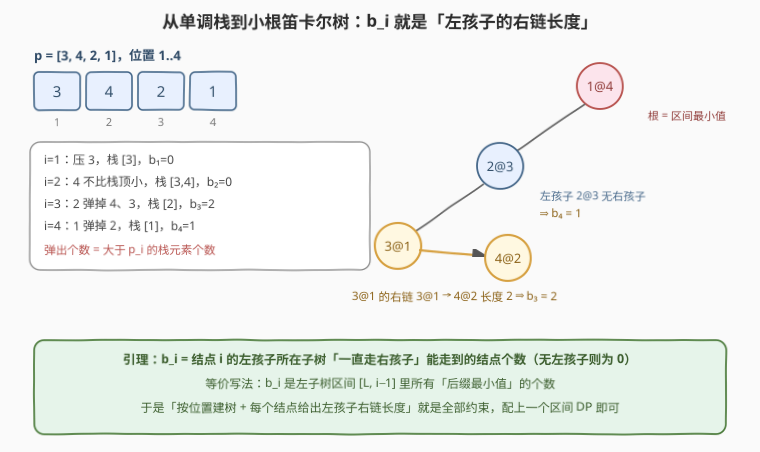
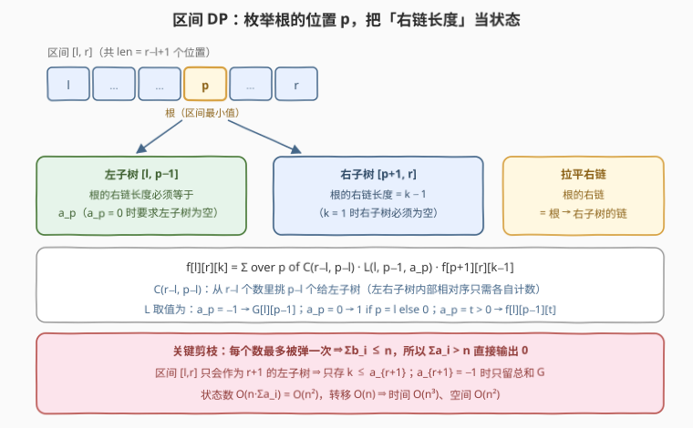
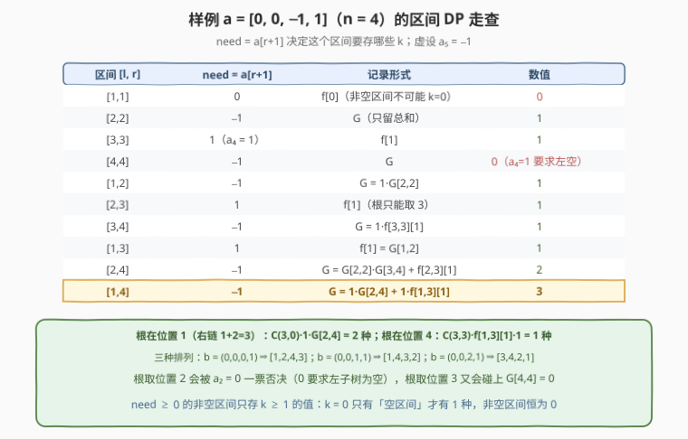

# Codeforces 2245F 熟悉吗 题解

## 1. 题目概述

- **标题 / 题号**：熟悉吗（Codeforces 2245F，英文名 Familiar?）
- **链接**：https://codeforces.com/problemset/problem/2245/F
- **来源**：Spectral::Cup 2026 Round 3 (Codeforces Round 1110, Div. 1 + Div. 2) · Problem F
- **难度**：2800（3000 分）
- **限制**：时间 5 s / 内存 128 MB（题目特意声明「非常规内存限制」）
- **标签**：单调栈、笛卡尔树、区间 DP、组合计数、剪枝

**题意**：对一个长度为 $n$ 的排列 $p$，执行下面这段伪代码：

```text
st = 空栈; count[1..n] 全 0
for i = 1 .. n:
    while st 非空 且 p[i] < st 的栈顶:
        弹出栈顶; count[i] += 1
    把 p[i] 压入 st
return count
```

也就是说，$b_i = \text{count}[i]$ 是把 $p_i$ 压栈时**弹掉了几个元素**。现在给一个长为 $n$ 的数组 $a$，其中 $-1$ 表示「这一位随便」，其余位置要求 $b_i = a_i$。求满足条件的排列个数，对 $998244353$ 取模。

多测：第一行 $t$，每组给出 $n$ 与 $a_1,\dots,a_n$，逐组输出一行答案。

**约束**：

- $1 \le t \le 10^4$，$1 \le n \le 500$，且**所有测试点 $n^3$ 之和不超过 $500^3$**；
- $-1 \le a_i \le n$；
- 模数 $998244353$；内存仅 $128$ MB，装不下 $O(n^3)$ 的 `int` 数组。

## 2. 示例与观察
官方 7 组样例（输入 / 输出原样）：

```text
输入：
7
1
0
1
-1
1
1
4
0 0 -1 1
6
-1 -1 -1 -1 -1 -1
3
0 1 0
7
0 -1 0 -1 2 1 -1

输出：
1
1
0
3
720
2
77
```

- 第 1、2 组：$n=1$ 只有排列 $[1]$，$b=[0]$，故 `0` 与 `-1` 都输出 $1$。
- 第 3 组：$n=1$ 时 $b_1$ 恒为 $0$，要求 $1$ 不可能，输出 $0$。
- 第 4 组：$a=[0,0,-1,1]$ 的三组合法排列是 $[1,2,4,3]$、$[1,4,3,2]$、$[3,4,2,1]$，它们的 $b$ 分别是 $(0,0,0,1)$、$(0,0,1,1)$、$(0,0,2,1)$。
- 第 5 组：全 $-1$ 时答案为 $n! = 720$。

★ 自造样例：

```text
输入：
3
4
0 0 0 3
3
0 2 2
5
0 -1 -1 1 -1

输出：
1
0
35
```

第 1 组只可能是 $[2,3,4,1]$（$b=[0,0,0,3]$）；第 2 组里 $b_2+b_3=4>3$ 直接无解（每个数最多被弹一次，见 §3.3）；第 3 组的 $35$ 可以暴力核对。

## 3. 解题思路

### 3.1 暴力思路

枚举全部 $n!$ 个排列，每个用 $O(n)$ 模拟一遍栈，逐位比对 $a$。$n\le 9$ 时还很轻快（$9! \cdot 9 \approx 3\times10^6$），但本题 $n$ 能到 $500$，$n!$ 完全不可行。

换方向也没用：满足条件的 $b$ 数组本身就不是常数多个（$n=6$ 时已经有 $132$ 种不同的 $b$），枚举 $b$ 再判合法同样是指数级。必须找出 $b$ 的**结构**。

### 3.2 核心观察：左孩子的右链长度



**引理（栈内不变量）**：处理完第 $i$ 个元素后，栈中自底向上恰好是

$$S_i=\{\,j\le i:\ p_j<\min(p_{j+1},\dots,p_i)\,\},$$

并且这些值自底向上严格递增。

于是当 $p_i$ 到达时，栈里比 $p_i$ 大的元素**恰好**是栈顶那段后缀（因为栈自底向上递增），也就是全部会被弹掉的元素。所以

$$b_i=\#\{\,j<i:\ p_j>p_i\ \text{且}\ p_j<\min(p_{j+1},\dots,p_{i-1})\,\}. \tag{1}$$

现在换到**小根笛卡尔树**（区间最小值当根，中序遍历是原序列）。对结点 $i$，它的左子树恰好是某个区间 $[L,i-1]$，左孩子是这个区间的最小值；从「左孩子」出发一直走**右孩子**，得到的就是该区间从右往左的「后缀最小值」序列，即所有满足 $p_j<\min(p_{j+1},\dots,p_{i-1})$ 的 $j$。再看 $j<L$ 的部分：记 $i$ 的子树区间为 $[L,R]$（使 $i$ 取到最小值的极大区间），则 $p_{L-1}<p_i$；当 $j\le L-2$ 时由 $p_j<\min(p_{j+1},\dots,p_{i-1})\le p_{L-1}<p_i$ 知 $p_j>p_i$ 不成立，$j=L-1$ 时同样有 $p_{L-1}<p_i$，故这些 $j$ 一个都不计入。因此

$$b_i=\text{结点 } i \text{ 左孩子所在子树的最长右链结点数}\quad(\text{无左孩子则为 }0).\tag{2}$$

这一步把「排列上的栈行为」翻译成了「树上的静态形状」，是本题的枢纽。

### 3.3 算法流程 / 状态转移



最小笛卡尔树与排列一一对应（树形 + 值的大小关系都被树上「根最小」唯一确定，剩下只是给点标号）。于是问题变成：

> 对每个位置 $i$，若 $a_i\ne -1$，则要求 $i$ 的左孩子右链长度 $=a_i$；数这样的带标号最小笛卡尔树。

用区间 DP。记 $[l,r]$ 的根位置为 $p$（$p$ 是 $[l,r]$ 的最小值所在位置），左子树是 $[l,p-1]$、右子树是 $[p+1,r]$：

- $f[l][r][k]$：区间 $[l,r]$ 构造成一棵子树，根的最长右链长度为 $k$ 的方案数（$k\ge 1$；非空区间 $k=0$ 恒为 $0$）；
- $g[l][r]=\sum_k f[l][r][k]$（空区间约定 $g=1$）；
- 转移（枚举根 $p$，$k=1+k_R$，右子树根的右链长度 $k_R$）：

$$f[l][r][k]=\sum_{p=l}^{r}\binom{r-l}{p-l}\cdot L(l,p-1,a_p)\cdot f[p+1][r][k-1],\tag{3}$$

其中 $\binom{r-l}{p-l}$ 是把 $r-l$ 个非根位置里的 $p-l$ 个值分给左子树；$L$ 是左子树的方案数：

$$L=\begin{cases}1 & p=l\ (\text{左子树为空})\\[2pt] g[l][p-1] & a_p=-1\\[2pt] 0\ \text{或}\ 1 & a_p=0\ (\text{仅当 } p=l)\\[2pt] f[l][p-1][a_p] & a_p>0\end{cases}$$

$k=1$ 时 $k_R=0$，要求**右子树为空**，即只能取 $p=r$。

**关键剪枝（省掉 $n^3$ 个状态）**：每个元素入栈一次、出栈至多一次，所以 $\sum_i b_i\le n$。若给定的 $a_i$ 之和已超过 $n$，答案直接是 $0$。于是对每个区间 $[l,r]$，只需关心 $0\le k\le a_{r+1}$：

- 区间 $[l,r]$ 只可能作为结点 $r+1$ 的**左子树**（于是根的右链长度被 $a_{r+1}$ 钉死）；若 $a_{r+1}=-1$，连单个 $k$ 都不必存，只留总和 $g[l][r]$；
- 状态总数 $O\!\left(n\sum_i a_i\right)=O(n^2)$，每个状态枚举根 $O(n)$，总时间 $O(n^3)$。

答案是 $g[1][n]$（树根没有父亲，右链长度不受限）。

### 3.4 示例演算



以第 4 组 $a=[0,0,-1,1]$（虚设 $a_5=-1$）为例，按区间长度从小到大填表：

| 区间 | need $=a_{r+1}$ | 说明 | 值 |
|---|---|---|---|
| $[1,1]$ | $0$ | 要求左子树为空，可非空区间取不到 $k=0$ | $0$ |
| $[2,2]$ | $-1$ | 只留总和 | $1$ |
| $[3,3]$ | $1$ | 单点根右链恰为 $1$ | $1$ |
| $[4,4]$ | $-1$ | $a_4=1$ 要求左子树为空，故根不能是 $4$ | $0$ |
| $[1,2]$ | $-1$ | $g=1\cdot g[2,2]$ | $1$ |
| $[2,3]$ | $1$ | 根只能取 $3$ | $1$ |
| $[3,4]$ | $-1$ | $g[4,4]=0$，只剩根取 $4$ | $1$ |
| $[1,3]$ | $1$ | 根只能取 $3$，$g[1,2]=1$ | $1$ |
| $[2,4]$ | $-1$ | $g[2,2]\cdot g[3,4]+f[2,3][1]$ | $2$ |
| $[1,4]$ | $-1$ | $\binom30 g[2,4]+\binom33 f[1,3][1]$ | $\mathbf 3$ |

最后一行就是答案：根取 $1$ 有 $2$ 种，根取 $4$ 有 $1$ 种；根取 $2$ 被 $a_2=0$ 否掉（$0$ 要求左子树为空），根取 $3$ 时右子树 $[4,4]$ 的 $g=0$。三种排列恰好是 $[1,2,4,3]$、$[1,4,3,2]$、$[3,4,2,1]$。

## 4. 算法细节

1. **组合数全局预处理**：$\binom{n}{k}$ 一次算到 $505$，每组直接查表，避免重复 $O(n^2)$。
2. **多测清空**：$G$、$F$ 每组重新分配；$F$ 用 `vector<vector<vector<int>>>`，只在 $a_{r+1}\ge 0$ 时才 `assign(a[r+1]+1, 0)`，否则留空——这一步既省时间也把内存压到 $O(n^2)$。
3. **空区间约定**：$g=1$；$f$ 的 $k=0$ 只有空区间才为 $1$，非空区间恒 $0$（代码里靠 `k==1 ⇔ 右子树为空` 与 `a_p==0 ⇔ 左子树为空` 自动实现）。
4. **$a_p=0$ 的语义**：右链长度 $0$ 等价于「没有左孩子」，因此只有 $p=l$ 时左子树才是空、$L=1$；$p>l$ 时该根位置直接作废。
5. **$a_p=-1$ 用 $g$ 而不是 $f$**：左子树的 $k$ 完全自由，必须对 $k$ 求和。
6. **提前判 $0$**：先检查 $a_i>i-1$（右链不可能超过左侧元素个数）与 $\sum a_i>n$，两者任一成立就输出 $0$，同时保证了状态数上界。
7. **1-indexed**：区间左右端点、$a_{n+1}=-1$ 的哨兵都按 $1$ 下标写，省掉大量边界分支。
8. **取模**：每个乘法都在 `long long` 里做 `% MOD` 后再累加，$n$ 项之和最大 $500\times 10^9$，`int` 会溢出。
9. **I/O**：C++ 关同步 + `'\n'`；Python 用 `sys.stdin.buffer.read().split()` 一次读完（$t=10^4$ 时逐行读会明显变慢）。

## 5. 正确性证明

**引理 1（栈不变量）**：处理完 $i$ 后栈内自底向上为 $S_i=\{j\le i:\ p_j<\min(p_{j+1},\dots,p_i)\}$，且严格递增。
**证明**：对 $i$ 归纳。元素 $j$ 留在栈中当且仅当它右侧（直到当前）没有更小的元素，这与 $p_j<\min(\cdots)$ 等价；压入 $p_i$ 前弹出的恰好是所有 $>p_i$ 的栈元素，由递增性它们构成栈顶后缀，弹完后栈顶 $<p_i$，压入后仍递增。∎

**引理 2（$b_i$ 的树形刻画）**：$b_i$ 等于最小笛卡尔树中「结点 $i$ 的左孩子的极长右链」的结点数，无左孩子时为 $0$。
**证明**：由引理 1 得 (1) 式。设结点 $i$ 的左子树区间为 $[L,i-1]$：左孩子即该区间最小值，沿右孩子下行依次取「剩余后缀的最小值」，故这条右链正是 $[L,i-1]$ 内所有满足 $p_j<\min(p_{j+1},\dots,p_{i-1})$ 的 $j$。再补两点：$[L,R]$ 是使 $i$ 成为最小值的极大区间，故 $p_{L-1}<p_i$；于是 $j\le L-2$ 时由 $p_j<\min(p_{j+1},\dots,p_{i-1})\le p_{L-1}<p_i$ 知 (1) 的 $p_j>p_i$ 不成立，$j=L-1$ 时同样有 $p_{L-1}<p_i$。故 $j<L$ 一个都不被计入，两边集合相同。∎

**引理 3（耦合只在右边界）**：区间 $[l,r]$ 作为某结点的子树时，涉及外部的条件只有一条——当它是结点 $r+1$ 的左子树时，其根的右链长度须等于 $a_{r+1}$；其余约束都只依赖 $[l,r]$ 内部。
**证明**：由引理 2，约束 $a_i$ 只谈结点 $i$ 的左孩子（在 $i$ 的左子树内），而「根右链长度」是唯一会被父结点看到的量。左子树的右边界必是父结点位置减一，故区间 $[l,r]$ 只能被 $r+1$ 当左子树用。∎

**引理 4（转移不重不漏）**：固定根位置 $p$，左右子树点集的分配有 $\binom{r-l}{p-l}$ 种，且两子树内部的相对结构互相独立；根的右链长度恰为 $1$ 加右子树根的右链长度。
**证明**：中序遍历固定时，根位置唯一确定左右点集的**大小**，从 $r-l$ 个位置中选 $p-l$ 个值给左边即可，左右内部的相对大小关系不受跨侧取值影响，故方案数相乘；根的右链必须先到右孩子，之后一路向右，故长度为 $1+k_R$。∎

**定理**：算法输出等于满足条件的排列数。
**证明**：排列与带标号最小笛卡尔树一一对应（形状给出相对大小，标号在满足「根最小」的前提下唯一决定排列）。引理 2 说明约束等价于每个结点的左孩子右链长度限制，引理 3 说明按区间切分后各子问题独立，引理 4 说明转移的系数与 $k$ 的递推正确，DP 按区间长度递增枚举所有 $(p,k)$ 组合，故每个合法排列恰被统计一次；$g[1,n]$ 对根的右链长度求和，正对应「根无父亲、无额外限制」。∎

## 6. 复杂度分析

- **时间**：组合数预处理 $O(n_{\max}^2)$；每组的状态数是 $O\!\left(n\sum a_i+n^2\right)=O(n^2)$（用到 $\sum a_i\le n$ 的剪枝），每个状态枚举根 $O(n)$，故单组 $O(n^3)$；由 $\sum n^3\le 500^3$ 得总时间 $O(500^3)\approx 1.3\times10^8$ 的上界，实际常数很小（大量位置因 $L=0$ 直接 `continue`）。
- **空间**：$G$ 是 $O(n^2)$；$F$ 只存 $\sum_r (a_{r+1}+1)\cdot r=O(n^2)$ 个 `int`，实测峰值约 $12$ MB，远低于 $128$ MB。
- **实测**：C++（`-O2`）在 $n=500$ 全 $-1$、$a=[0,1,1,\dots,1]$、随机满 $b$ 等最坏数据上均为 $0.05$ s 以内，相对 $5$ s 有 $60$ 倍以上余量；同一算法的 CPython 在 $n=500$ 全 $-1$ 时约 $6$ s，属于卡线水平，**建议提交 PyPy**。

## 7. 参考代码

### C++17

```cpp
#include <iostream>
#include <vector>
#include <algorithm>
using namespace std;

static const int MOD = 998244353;
static int C[505][505];

int main() {
    ios::sync_with_stdio(false);
    cin.tie(nullptr);
    for (int i = 0; i < 505; i++) {
        C[i][0] = 1;
        for (int j = 1; j <= i; j++) {
            int v = C[i - 1][j - 1] + C[i - 1][j];
            if (v >= MOD) v -= MOD;
            C[i][j] = v;
        }
    }
    int t; cin >> t;
    while (t--) {
        int n; cin >> n;
        vector<int> a(n + 2, 0);
        for (int i = 1; i <= n; i++) cin >> a[i];
        a[n + 1] = -1;                            // 根没有外部右链限制
        bool bad = false;
        long long s = 0;
        for (int i = 1; i <= n; i++) {
            if (a[i] > i - 1) bad = true;         // 右链不超过左侧元素个数
            if (a[i] > 0) s += a[i];
        }
        if (s > n) bad = true;                    // 每个数至多被弹一次
        if (bad) { cout << 0 << '\n'; continue; }

        // G[l][r]：区间 [l,r] 各种右链长度的方案数之和（空区间为 1）
        // F[l][r]：根右链长度 k 的方案数，只存 k = 0..a[r+1]
        vector<vector<int>> G(n + 2, vector<int>(n + 2, 0));
        vector<vector<vector<int>>> F(n + 2, vector<vector<int>>(n + 2));
        auto Fget = [&](int l, int r, int k) -> int {
            if (l > r) return k == 0 ? 1 : 0;
            const vector<int> &v = F[l][r];
            return k < (int)v.size() ? v[k] : 0;
        };
        auto leftPart = [&](int l, int p) -> long long {   // 左子树 [l,p-1] 的方案数
            int x = a[p];
            if (x < 0)  return p == l ? 1 : G[l][p - 1];
            if (x == 0) return p == l ? 1 : 0;             // 0 ⇒ 左子树必须为空
            return p == l ? 0 : Fget(l, p - 1, x);
        };

        for (int len = 1; len <= n; len++)
            for (int l = 1; l + len - 1 <= n; l++) {
                int r = l + len - 1, need = a[r + 1];
                if (need < 0) {                            // 只要总和
                    long long tot = 0;
                    for (int p = l; p <= r; p++) {
                        long long L = leftPart(l, p);
                        if (!L) continue;
                        long long R = (p < r) ? G[p + 1][r] : 1;
                        tot += (long long)C[len - 1][p - l] * L % MOD * R % MOD;
                    }
                    G[l][r] = (int)(tot % MOD);
                } else {                                   // 只存 k = 0..need
                    vector<int> &lst = F[l][r];
                    lst.assign(need + 1, 0);
                    for (int k = 1; k <= min(need, len); k++) {
                        long long val = 0;
                        for (int p = l; p <= r; p++) {
                            long long L = leftPart(l, p);
                            if (!L) continue;
                            long long R;
                            if (k == 1) {                  // 右子树必须为空
                                if (p != r) continue;
                                R = 1;
                            } else {                       // 右子树根的右链 = k-1
                                if (p == r) continue;
                                R = Fget(p + 1, r, k - 1);
                            }
                            if (!R) continue;
                            val += (long long)C[len - 1][p - l] * L % MOD * R % MOD;
                        }
                        lst[k] = (int)(val % MOD);
                    }
                }
            }
        cout << (n ? G[1][n] : 1) << '\n';
    }
    return 0;
}
```

### Python3

```python
import sys

MOD = 998244353
MAXN = 505

def main():
    data = sys.stdin.buffer.read().split()
    pos = 0
    t = int(data[pos]); pos += 1
    C = [[1]]                                   # 组合数表，一次预处理
    for i in range(1, MAXN):
        prev = C[-1]
        cur = [1] * (i + 1)
        for j in range(1, i):
            v = prev[j - 1] + prev[j]
            cur[j] = v - MOD if v >= MOD else v
        C.append(cur)

    out = []
    for _ in range(t):
        n = int(data[pos]); pos += 1
        a = [0] * (n + 2)
        for i in range(1, n + 1):
            a[i] = int(data[pos]); pos += 1
        a[n + 1] = -1                           # 根没有外部右链限制

        bad, s = False, 0
        for i in range(1, n + 1):
            if a[i] > i - 1:
                bad = True
                break
            if a[i] > 0:
                s += a[i]
        if s > n or bad:
            out.append('0')
            continue
        # Gt[r][l]：区间 [l,r] 各种右链长度的方案数之和（空区间为 1）
        # Ft[r][l]：根右链长度 = k 的方案数，只存 k = 0..a[r+1]
        Gt = [[0] * (n + 2) for _ in range(n + 2)]
        Ft = [[None] * (n + 2) for _ in range(n + 2)]

        for length in range(1, n + 1):
            for l in range(1, n - length + 2):
                r = l + length - 1
                need = a[r + 1]
                Cl = C[length - 1]
                if need < 0:                    # 只要总和
                    tot = 0
                    for p in range(l, r + 1):
                        x = a[p]
                        if x < 0:
                            L = 1 if p == l else Gt[p - 1][l]
                        elif x == 0:            # 0 ⇒ 左子树必须为空
                            L = 1 if p == l else 0
                        elif p == l:
                            continue
                        else:
                            v = Ft[p - 1][l]
                            L = v[x] if x < len(v) else 0
                        if not L:
                            continue
                        R = Gt[r][p + 1] if p < r else 1
                        tot += Cl[p - l] * L % MOD * R
                    Gt[r][l] = tot % MOD
                else:                           # 只存 k = 0..need
                    Ls = [1] * (r + 2)
                    for p in range(l, r + 1):
                        x = a[p]
                        if x < 0:
                            Ls[p] = 1 if p == l else Gt[p - 1][l]
                        elif x == 0:
                            Ls[p] = 1 if p == l else 0
                        elif p == l:
                            Ls[p] = 0
                        else:
                            v = Ft[p - 1][l]
                            Ls[p] = v[x] if x < len(v) else 0
                    lst = [0] * (need + 1)
                    for k in range(1, min(need, length) + 1):
                        val = 0
                        for p in range(l, r + 1):
                            L = Ls[p]
                            if not L:
                                continue
                            if k == 1:              # 右子树必须为空
                                if p != r:
                                    continue
                                R = 1
                            else:                   # 右子树根的右链 = k-1
                                if p == r:
                                    continue
                                v2 = Ft[r][p + 1]
                                R = v2[k - 1] if (k - 1) < len(v2) else 0
                            if R:
                                val += Cl[p - l] * L % MOD * R
                        lst[k] = val % MOD
                    Ft[r][l] = lst
        out.append(str(Gt[n][1]))
    sys.stdout.write('\n'.join(out) + '\n')

main()
```

## 8. 边界情况与易错点

1. **$a_1$ 必须是 $0$**：第一位前面没有元素，$b_1$ 恒为 $0$；$a_1>0$ 时直接输出 $0$（代码里被 $a_i>i-1$ 的检查统一拦下）。
2. **$\sum a_i>n$ 一定无解**：每个元素至多被弹一次，$b$ 的总和不超过 $n$。这既是正确性剪枝，也是状态数 $O(n^2)$ 的来源——漏掉它就会退化成 $O(n^3)$ 空间并把 128 MB 内存打爆。
3. **$f$ 的 $k=0$ 只属于空区间**：非空区间的根至少有一个结点在右链上，$k\ge 1$。写代码时别把 `k=0` 当成「右链为空」的合法初值。
4. **$a_p=0$ 与 $a_p=-1$ 完全不同**：$0$ 是「左子树必须为空」的硬约束（只有 $p=l$ 能取），$-1$ 是「任意左子树」并要求对 $k$ 求和（用 $g$ 而非 $f$）。
5. **$k=1$ 时右子树必须为空**：所以只能枚举 $p=r$；漏这条会把 $k_R\ge 1$ 的方案错误地算进 $k=1$。
6. **数组越界**：查询 $f[l][p-1][a_p]$ 时 $a_p$ 可能大于左区间长度，此时该状态不存在，应返回 $0$（代码里用 `k < v.size()` 判断，未填的位置本来就是 $0$）。
7. **多测**：$t$ 能到 $10^4$，不要写全局可变状态；`vector` 的重新分配比手工清空更安全。
8. **取模**：$\binom{r-l}{p-l}\cdot L\cdot R$ 三个数相乘，必须先取模再累加，且累加用 `long long`。

## 9. 验证记录

- **编译环境与命令**：`clang++ -std=c++17 -O2`（本机无 GNU g++，配 `codeforces/tools/include/bits/stdc++.h` 兼容头；正文代码只用标准库，可原样提交 GNU C++17）；Python 侧为 `Python 3.9.6`。
- **官方样例**：1 / 1 通过（按 Codeforces 标准 checker 的 token 比对，忽略空白与大小写）。
- **复核状态**：audited（2026-11-19 统一回归：编译 + 官方样例；写作期的随机对拍与暴力未重跑）。

## 相关题目与扩展

- [LeetCode 96. 不同的二叉搜索树](https://leetcode.cn/problems/unique-binary-search-trees/)：同样的「枚举根 + 左右独立」区间计数骨架，可对照 (3) 式的组合数系数。
- [LeetCode 312. 戳气球](https://leetcode.cn/problems/burst-balloons/)：区间 DP 的另一种经典形态（根式切分 + 边界贡献）。
- [CF 1025D Recovering BST](https://codeforces.com/problemset/problem/1025/D)：在 BST / 区间 DP 上叠加「相邻可连边」的限制，思路与本题加约束的方式相近。
- [CF 1156E Special Segments](https://codeforces.com/problemset/problem/1156/E)：用笛卡尔树 / 单调栈把「区间最值 + 计数」拆成树上子树问题。
- [LeetCode 84. 柱状图中最大的矩形](https://leetcode.cn/problems/largest-rectangle-in-histogram/)：本文栈不变量（弹出所有大于当前值的栈顶）的原型。

**延伸思考**：

1. 若把条件从「逐位相等」换成「$\sum_i[a_i\ne -1]\cdot[b_i\ne a_i]\le K$」，能否在状态里再加一维失配数，仍保持 $O(n^3)$？
2. 若要求 $b_i$ 单调（或 $b_i$ 之和恰为某个值），对应的是笛卡尔树的哪些形状约束？$\sum b_i=n-(\text{最终栈大小})$ 就是现成的切入点。
3. 反问题：哪些 $b$ 数组能被某个排列取到？$\sum b_i\le n$ 与 $b_i\le i-1$ 是必要条件，但**并不充分**——例如 $n=3$ 的 $b=(0,1,2)$ 满足这两条却无解（$b_2=1$ 要求 $p_1>p_2$，而 $b_3=2$ 要求 $p_1<p_2$ 且两者都大于 $p_3$，矛盾）。你能补上缺失的第三条条件吗？
