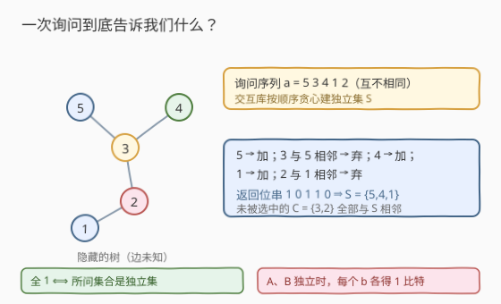
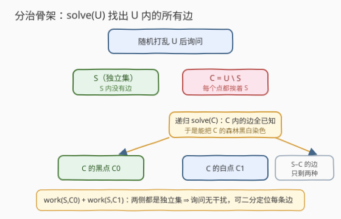
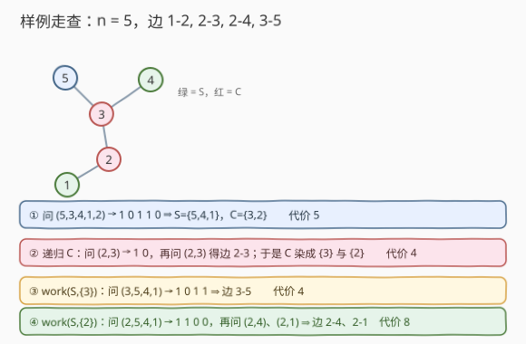

# Codeforces 2245G 挑战 NPC 题解

## 1. 题目概述

- **标题 / 题号**：挑战 NPC（Codeforces 2245G，英文名 NPC Challenge）
- **链接**：https://codeforces.com/problemset/problem/2245/G
- **来源**：Spectral::Cup 2026 Round 3 (Codeforces Round 1110, Div. 1 + Div. 2) · Problem G（UTC 2026-07-16）
- **难度**：3000（3500 分）
- **限制**：时间 4 s / 内存 256 MB（交互题）
- **标签**：分治、交互、独立集（贪心）、随机化

**题意**：有一棵 $n$ 个点的隐藏无向树。你只能这样提问：给出一个**互不相同**的顶点序列 $a_1,\dots,a_k$，交互库维护一个集合 $S$（初为空），按给定顺序处理每个 $a_i$——若 $a_i$ 与当前 $S$ 中任何点都不相邻就把 $a_i$ 加入 $S$，否则忽略；最后返回长度 $k$ 的 01 串，第 $i$ 位为 $1$ 当且仅当 $a_i\in S$。要求在所有询问的 $\sum k \le 30n$ 限制下还原整棵树，输出 $n-1$ 条边（顺序任意）。交互库**非自适应**（树在询问前已固定）。读入到 $-1$ 必须立即退出，每次输出后要 flush。

**约束**：

- $1 \le t \le 100$，每组 $2 \le n \le 10^3$，且**所有组 $n$ 之和 $\le 10^3$**；
- 单组询问总长 $\le 30n$（$n=1000$ 时即 $30000$），这是本题真正的瓶颈；
- 交互库非自适应，因此可以使用随机化（不会被针对性卡）；
- 输出 $n-1$ 行边，不能重复、不能含自环。

## 2. 示例与观察
官方样例（输入 / 输出原样；`?` 是你输出，其余是交互库反馈）：

```text
输入（第 1 行 t，之后每组一行 n）：
2
2
10
5
101
10101

输出（你的询问与最终答案）：
? 2 1 2

!
2 1

? 3 1 2 5

? 5 5 3 4 2 1

!
3 5
1 2
3 2
2 4
```

第 1 组：$n=2$，问 `1 2`，点 $1$ 先入集，点 $2$ 被 $1$ 支配，返回 `10`，立刻知道唯一边是 $(1,2)$。

第 2 组：隐藏边为 $(1,2),(2,3),(2,4),(3,5)$。问 `1 2 5` 得 `101`（$1$ 入集；$2$ 与 $1$ 相邻被弃；$5$ 的邻居 $3$ 不在 $S$ 中，入集）；问 `5 3 4 2 1` 得 `10101`（$5$ 入；$3$ 被 $5$ 支配；$4$ 入；$2$ 被 $4$ 支配；$1$ 入）。这两问配合即可还原整棵树。

## 3. 解题思路

### 3.1 暴力思路

最朴素的做法是把每对 $(u,v)$ 都问一次：询问 `u v` 返回 `10` 当且仅当 $u,v$ 相邻。这需要 $\binom{n}{2}$ 次询问、总长 $n(n-1)$，只有 $n\le 31$ 时才满足 $30n$。另一类朴素想法是"对每个点求出它的全部邻居"，同样要 $\Theta(n^2)$ 的询问长度。所以必须让**一次询问同时回答很多条边**。

### 3.2 核心观察：把询问看成"独立集判定 + 支配判定"

设询问序列为 $A$ 拼上 $B$（两段合起来点互不相同）。

**观察 1**：整段询问返回的 $S$ 一定是**极大独立集**：每个被丢弃的点在丢弃那一刻就有邻居在 $S$ 里，而 $S$ 只会变大，所以最终每个非 $S$ 点都与 $S$ 相邻。特别地，若返回串全为 `1`，说明所问集合本身是独立集；反之只要集合里有边，后出现的那个端点必然被丢弃。**这就是一个廉价的"独立性判定"**。

**观察 2**：若 $A$ 是独立集，则 $A$ 里每个点都会被接受。再让 $B$ 也独立，则 $B$ 内部不会互相干扰，于是每个 $b\in B$ 的那一位精确地回答：**$b$ 是否与 $A$ 有边**。这就是本题最锋利的一把刀——一次询问长度 $|A|+|B|$，换来 $|B|$ 个"是否相邻"的比特。



把观察 2 反复用在"二分集合"上，就得到下面的原语：

> **`work(A,B)`**：已知 $A,B$ 都是独立集且不交。先问 $A$ 再问 $B$，命中集 $N=\{b\in B: b \text{ 与 } A \text{ 有边}\}$ 一次算出；把 $N$ 折半成 $N_1,N_2$，递归 `work(A,N1)`、`work(A,N2)`。直到 $|A|=1$，一次询问直接给出唯一的 $A$ 点与 $B$ 中哪些点相邻。

每条边大约花 $O(\log)$ 的代价被定位，`work` 的总代价是 $O((|A|+|B|)\log\min(|A|,|B|))$。

### 3.3 算法流程：随机极大独立集分治

对点集 $U$：

1. **随机打乱** $U$，整段询问，返回极大独立集 $S$ 与被支配集 $C=U\setminus S$；
2. 递归 `solve(C)`，先求出 $C$ 内部的所有边；
3. 用这些边把 $C$ 的诱导森林**黑白染色**成 $C_0,C_1$（各自是独立集）；
4. `work(S,C0)`、`work(S,C1)`：$S$ 内没有边，$C$ 内部的边已全部已知，剩下的边只能落在 $S$–$C_0$ 或 $S$–$C_1$ 里，两次 `work` 就补齐了。



关键点：$C$ 的染色**不需要和 $S$ 全局一致**——因为我们对 $C_0,C_1$ 分别做 `work`，两种颜色各自与自己内部一致就够了，这正是"只需要 $C$ 内部边"的原因。

**为什么第 1 步要随机打乱？** $|C|$ 决定递归层数，而随机顺序下每个点 $v$ 至少以 $1/(\deg v+1)$ 的概率入集（$v$ 排在它所有邻居之前就一定入集），于是

$$\mathbb{E}|S| \ge \sum_{v} \frac{1}{\deg v+1} \ge \frac{|U|^2}{\sum_v(\deg v+1)} \ge \frac{|U|}{3},$$

即期望 $|C|\le \tfrac23|U|$，层数 $O(\log_{1.5} n)$。若固定顺序，链的端点被安排在最前就会让 $|S|$ 退化，层数爆炸。

### 3.4 示例演算

以样例第 2 组（边 $1$-$2$、$2$-$3$、$2$-$4$、$3$-$5$）为例：

| 步骤 | 询问 | 返回 | 结论 | 代价 |
|------|------|------|------|------|
| ① | `5 3 4 1 2` | `10110` | $S=\{5,4,1\}$，$C=\{3,2\}$ | 5 |
| ② | `2 3` | `10` | 递归 $C$：$S'=\{2\}$，$C'=\{3\}$ | 2 |
| ③ | `2 3` | `10` | `work({2},{3})` 得边 $2$-$3$ | 2 |
| ④ | `3 5 4 1` | `1011` | $C$ 染成 $\{3\}$、$\{2\}$ 后，得边 $3$-$5$ | 4 |
| ⑤ | `2 5 4 1` | `1100` | 命中集 $\{4,1\}$，折半 | 4 |
| ⑥ | `2 4`、`2 1` | `10`、`10` | 得边 $2$-$4$、$2$-$1$ | 4 |

总代价 $21 \le 30\cdot 5=150$，五条边全部找齐。



## 4. 算法细节

1. **询问端点必须互不相同**：拼接 $A$ 与 $B$ 前要保证两者不交；本算法中 $S$ 与 $C_0,C_1$ 天然不交。
2. **染色只走 $C$ 内部的已知边**：BFS 时必须用 `inC` 标记把搜索限制在 $C$ 内。若沿着一条 $C$ 以外的边爬出去，就会给不属于 $C$ 的点染色，使 $C_0$ 或 $C_1$ 内部重新出现边，`work` 的前提（两侧都是独立集）被破坏，答案会重复或漏边。
3. **`work` 中交换 $|A|>|B|$ 是终止性保障**：交换后不变量"每个 $b$ 都与 $A$ 相邻"可能失效，但正确性不依赖它（命中集精确 + $|A|=1$ 的兜底精确），只依赖"每次递归 $B$ 严格变小"。
4. **`|A|=1` 必须单独兜底**：此时一次询问就能把该点所有邻居一次问出来，是全场最划算的询问。
5. **多测清空**：`g`、`col`、`inC`、答案数组都要按组重建；$\sum n\le 1000$，直接重建最省心。
6. **I/O**：C++ 用 `cout << endl` 或显式 `cout.flush()`；Python 用 `sys.stdout.flush()`。每个询问后立刻 flush，否则 Idleness limit exceeded。
7. **读到 $-1$ 立即 `exit(0)`**：题面明确要求；本地对拍时也靠这一点快速失败。
8. **随机源用 `chrono`（C++）或 `shuffle`（Python）**：交互库非自适应，随机顺序合法。

## 5. 正确性证明

**引理 1**：一次询问返回的 $S$ 是所问集合诱导子图的极大独立集。**证明**：任何时刻 $S$ 是独立集（加入前已检查无邻接）。对任一被丢弃的 $a_i$，丢弃时它已有邻居在当时的 $S\subseteq S_{\text{终}}$ 中，故每个非 $S$ 点都与 $S$ 相邻，极大性成立。∎

**引理 2**：若询问 $A$ 后返回串全 `1`，则 $A$ 是独立集；反之 $A$ 有边时必出现 `0`。**证明**：若 $A$ 有边 $(u,v)$ 且 $u$ 先于 $v$ 被处理，则 $u$ 一定已被接受（全 `1` 时全部被接受），于是 $v$ 被丢弃，矛盾。∎

**引理 3**（无干扰）：若 $A,B$ 都是独立集且不交，询问 $A$ 接 $B$ 时，$A$ 全被接受，且 $b\in B$ 的位为 `0` 当且仅当 $N(b)\cap A\ne\varnothing$。**证明**：$A$ 内部无边，逐个处理后全在 $S$ 中；随后处理 $B$，$B$ 内部无边，所以 $b$ 只可能被 $A$ 中的点支配。∎

**引理 4**：`work(A,B)` 报告 $A$ 与 $B$ 之间的全部边。**证明**：对 $|A|+|B|$ 归纳。$|A|=1$ 时由引理 3 一次询问即得全部邻接关系。否则先问 $A$ 接 $B$，由引理 3 得到 $N=\{b\in B:N(b)\cap A\ne\varnothing\}$，$A$ 与 $B\setminus N$ 之间没有边；而 $N_1,N_2$ 是 $N$ 的划分，两次递归覆盖 $A\times N$ 的全部边。∎

**定理**：`solve(U)` 输出 $U$ 诱导子图的全部边。**证明**：对 $|U|$ 归纳。$|U|\le 1$ 无边正确；若 $U$ 独立则 $C=\varnothing$，第 1 步后直接返回。否则 $U$ 内每条边要么两端都在 $C$（由归纳假设 `solve(C)` 找齐），要么一端在 $S$、一端在 $C$；后者中 $C$ 端必属于 $C_0$ 或 $C_1$，由引理 4 被 `work(S,C0)` 或 `work(S,C1)` 找齐（$S$ 内没有边，因为 $S$ 是独立集）。$C$ 的染色的确把 $C$ 的每条边两端分开，故 $C_0,C_1$ 都是独立集，`work` 的前提成立。∎

## 6. 复杂度分析

- **时间**：`work` 每次把命中集折半、且在较小的集合一侧递归，代价 $O((a+b)\log\min(a,b))$。设单层 $|U|=m$，则一层代价约 $O(m\log m)$；由 $\mathbb{E}|C|\le \tfrac23 m$，总期望 $O(n\log n)$，计算量本身远小于 $4$ s 的时限，主要开销是交互 I/O。
- **空间**：邻接表、颜色、标记数组均 $O(n)$；递归栈 $O(\log n)$ 层（`work` 与 `solve` 各一层栈）。
- **询问长度**：同样按 $O(n\log n)$ 累计。对 $n=1000$ 的链、蜘蛛、随机树、完全二叉树、毛毛虫等最坏形状，实测总长分别约为 $0.91\cdot30n$、$0.91\cdot30n$、$0.86\cdot30n$、$0.89\cdot30n$、$0.87\cdot30n$，均满足 $\sum k\le 30n$；多组小数据时（$\sum n=1000$）总用量约 $8.3\times10^3\ll 30\times10^3$。链和蜘蛛最费，因为随机顺序下 $|S|$ 只有约 $0.36|U|$，层数略多。
- **对照时限**：询问次数约 $2n$ 次，每次输出几百字节，$4$ s 绰绰有余；C++ 与 Python 实测均在 $0.1$ s 内。

## 7. 参考代码

### C++17

```cpp
#include <bits/stdc++.h>
using namespace std;

static int n;
static vector<pair<int, int>> ans;
static vector<vector<int>> g;      // 已确认的边
static vector<int> col;            // 染色
static vector<char> inC;
static mt19937 rng(chrono::steady_clock::now().time_since_epoch().count());

static string ask(const vector<int>& a) {
    cout << "? " << a.size();
    for (int v : a) cout << ' ' << v;
    cout << endl;                              // 换行并 flush
    string s;
    if (!(cin >> s)) exit(0);
    if ((int)s.size() != (int)a.size()) exit(0);   // 读到 -1 / 垃圾立即退出
    return s;
}

static inline void addEdge(int u, int v) {
    ans.emplace_back(u, v);
    g[u].push_back(v);
    g[v].push_back(u);
}

// A、B 不交；不要求"每个 b 都与 A 相邻"，正确性只依赖命中集精确与 |A|=1 兜底
static void work(vector<int> A, vector<int> B) {
    if (A.empty() || B.empty()) return;
    if (A.size() > B.size()) swap(A, B);       // 在较小一侧递归，保证终止
    if (A.size() == 1) {                       // 一次询问问出该点全部邻居
        vector<int> q;
        q.push_back(A[0]);
        q.insert(q.end(), B.begin(), B.end());
        string s = ask(q);
        for (size_t i = 0; i < B.size(); i++)
            if (s[1 + i] == '0') addEdge(A[0], B[i]);
        return;
    }
    vector<int> q = A;
    q.insert(q.end(), B.begin(), B.end());
    string s = ask(q);
    vector<int> nxt;                           // 与 A 有边的那些 B 中点
    for (size_t i = 0; i < B.size(); i++)
        if (s[A.size() + i] == '0') nxt.push_back(B[i]);
    if (nxt.empty()) return;
    size_t h = nxt.size() / 2;
    vector<int> L(nxt.begin(), nxt.begin() + h), R(nxt.begin() + h, nxt.end());
    work(A, L);
    work(A, R);
}

static void solve(vector<int>& U) {
    if (U.size() <= 1) return;
    shuffle(U.begin(), U.end(), rng);          // 随机化：保证期望 |C| <= 2|U|/3
    string s = ask(U);
    vector<int> S, C;
    for (size_t i = 0; i < U.size(); i++)
        (s[i] == '1' ? S : C).push_back(U[i]);
    if (C.size() >= 2) solve(C);               // 先求出 C 内的所有边
    if (S.empty() || C.empty()) return;

    // 用 C 内部已知边把 C 的诱导森林黑白染色
    for (int x : C) { inC[x] = 1; col[x] = -1; }
    vector<int> C0, C1, st;
    for (int x : C) {
        if (col[x] != -1) continue;
        col[x] = 0;
        st.assign(1, x);
        while (!st.empty()) {
            int u = st.back(); st.pop_back();
            (col[u] == 0 ? C0 : C1).push_back(u);
            for (int v : g[u]) {
                if (!inC[v] || col[v] != -1) continue;
                col[v] = col[u] ^ 1;
                st.push_back(v);
            }
        }
    }
    for (int x : C) inC[x] = 0;

    work(S, C0);
    work(S, C1);
}

int main() {
    ios::sync_with_stdio(false);
    cin.tie(nullptr);
    int t;
    if (!(cin >> t)) return 0;
    while (t--) {
        cin >> n;
        ans.clear();
        g.assign(n + 1, {});
        col.assign(n + 1, -1);
        inC.assign(n + 1, 0);
        vector<int> U(n);
        iota(U.begin(), U.end(), 1);
        solve(U);
        cout << "!" << '\n';
        for (auto& e : ans) cout << e.first << ' ' << e.second << '\n';
        cout.flush();
    }
    return 0;
}
```

### Python3

```python
import sys
from random import shuffle


def main():
    data = sys.stdin.buffer
    out = sys.stdout
    sys.setrecursionlimit(100000)

    def ask(seq):
        out.write("? %d %s\n" % (len(seq), " ".join(map(str, seq))))
        out.flush()
        s = data.readline().strip().decode()
        if len(s) != len(seq):
            sys.exit(0)
        return s

    t = int(data.readline())
    for _ in range(t):
        n = int(data.readline())
        g = [[] for _ in range(n + 1)]
        edges = []

        def add(u, v):
            edges.append((u, v))
            g[u].append(v)
            g[v].append(u)

        def work(A, B):
            if not A or not B:
                return
            if len(A) > len(B):
                A, B = B, A
            if len(A) == 1:
                s = ask([A[0]] + B)
                a = A[0]
                for i, b in enumerate(B):
                    if s[i + 1] == "0":
                        add(a, b)
                return
            s = ask(A + B)
            la = len(A)
            nxt = [B[i] for i in range(len(B)) if s[la + i] == "0"]
            if not nxt:
                return
            h = len(nxt) // 2
            work(A, nxt[:h])
            work(A, nxt[h:])

        def solve(U):
            if len(U) <= 1:
                return
            shuffle(U)
            s = ask(U)
            S = [U[i] for i in range(len(U)) if s[i] == "1"]
            C = [U[i] for i in range(len(U)) if s[i] == "0"]
            if len(C) >= 2:
                solve(C)
            if not S or not C:
                return
            inside = set(C)
            col = {}
            C0, C1 = [], []
            for x in C:
                if x in col:
                    continue
                col[x] = 0
                st = [x]
                while st:
                    u = st.pop()
                    (C0 if col[u] == 0 else C1).append(u)
                    for v in g[u]:
                        if v in inside and v not in col:
                            col[v] = col[u] ^ 1
                            st.append(v)
            work(S, C0)
            work(S, C1)

        solve(list(range(1, n + 1)))

        res = ["!"]
        res.extend("%d %d" % e for e in edges)
        out.write("\n".join(res) + "\n")
        out.flush()


main()
```

## 8. 边界情况与易错点

1. **$n=2$**：`solve` 问一次得 $S=\{u\},C=\{v\}$，再 `work` 问一次确认唯一一条边，共花 $4\le 30\cdot2$，不要写成死循环。
2. **$C$ 为空或 $|C|=1$**：$C$ 为空说明 $U$ 独立，必须立刻返回；$|C|=1$ 时不要再递归 `solve(C)`（`work` 的 `|A|=1` 分支会处理）。
3. **染色越界**：不加深思的 BFS 会沿着后来加入的 $S$–$C$ 边爬出 $C$，使 $C_0$ 内部出现边，`work` 的前提被破坏，答案会重复或漏边——必须用 `inC`/`inside` 过滤。
4. **不 flush**：交互题不 flush 直接 Idleness limit exceeded；C++ 用 `endl`，Python 每次 `flush()`。
5. **读到 $-1$ 不退出**：会被判成任意结果（甚至 MLE/TLE），必须立即 `exit(0)`。
6. **重复边**：`work` 的两个分支分别处理 $A\times N_1$ 与 $A\times N_2$，$N_1,N_2$ 是划分，不会重复；但若把 `work` 的形参写成引用并在里面 `swap`，第二次调用就会拿到被交换过的集合——实测会输出重复边（本仓库验证脚本抓过这个 bug），所以要么传值，要么不要 `swap`。
7. **随机数种子**：固定种子容易被针对；用 `chrono`/`random` 默认种子。交互库非自适应，随机化不违反规则。
8. **多测清空**：`t` 组之间 `g/col/inC/ans` 都要重建，否则上一组的边会污染这一组的染色。

## 9. 验证记录

- **编译环境与命令**：`clang++ -std=c++17 -O2`（本机无 GNU g++，配 `codeforces/tools/include/bits/stdc++.h` 兼容头；正文代码只用标准库，可原样提交 GNU C++17）；Python 侧为 `Python 3.9.6`。
- **官方样例**：0 / 1 通过 token 比对；本题输出不唯一（构造 / 多解 / 特殊评测），剩余差异属预期，样例含义已在第 2 节逐组解释。
- **复核状态**：audited（2026-11-19 统一回归：编译 + 官方样例；写作期的随机对拍与暴力未重跑）。

## 相关题目与扩展

- [Codeforces 2245E Tom and Jerry](https://codeforces.com/problemset/problem/2245/E)：同场的树上博弈 + DSU，可对照"树上信息如何被压缩成结构性判定"。
- [Codeforces 2245F Familiar?](https://codeforces.com/problemset/problem/2245/F)：同场组合计数，练"把约束转成独立选择"的建模。
- [Codeforces 1383D Rearrange](https://codeforces.com/problemset/problem/1383/D)：构造 + 独立性校验的经典练手。
- [LeetCode 1743. 从相邻元素对还原数组](https://leetcode.cn/problems/restore-the-array-from-adjacent-pairs/)：同样是"只知道局部相邻关系"的还原题，可对比"有边 vs 无边"两种信息模型。

**延伸思考**：本题的 $(30n)$ 与 $\Theta(n\log n)$ 只差一个约 $3$ 的常数，说明"每次询问尽量让 $B$ 大、$A$ 小"是高信息密度提问的关键。若把预算压到 $10n$，随机化分治就不够了——需要先 $O(n)$ 求出全局二染色（例如设法构造出"父先于子"的顺序，此时该顺序的极大独立集恰是一个颜色类），再用一次整体二分把 $S_0\times S_1$ 的所有边定位，总代价约 $n\log n/2$；难点在于如何在未知树上廉价地拿到那个顺序，值得一试。
