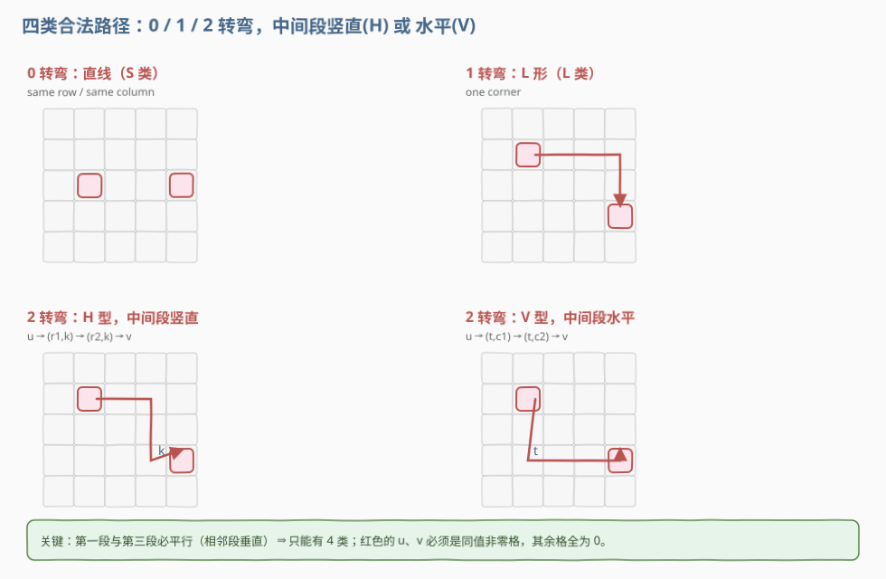
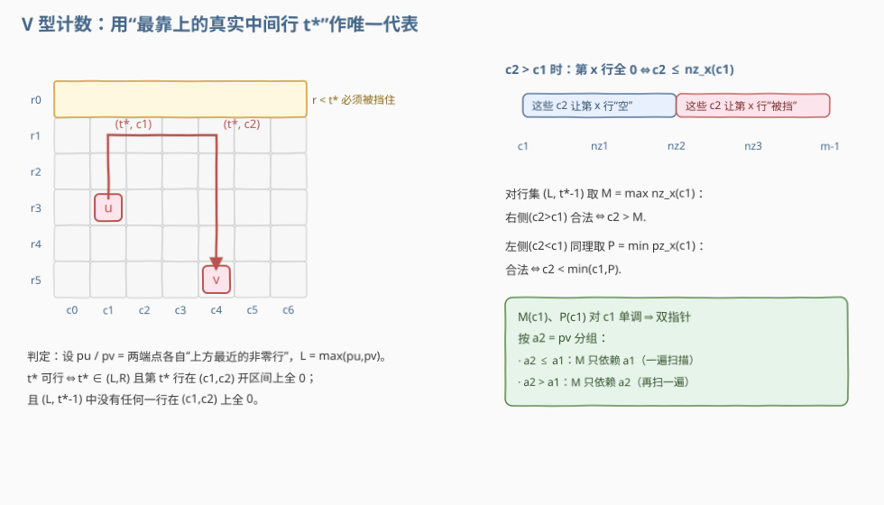
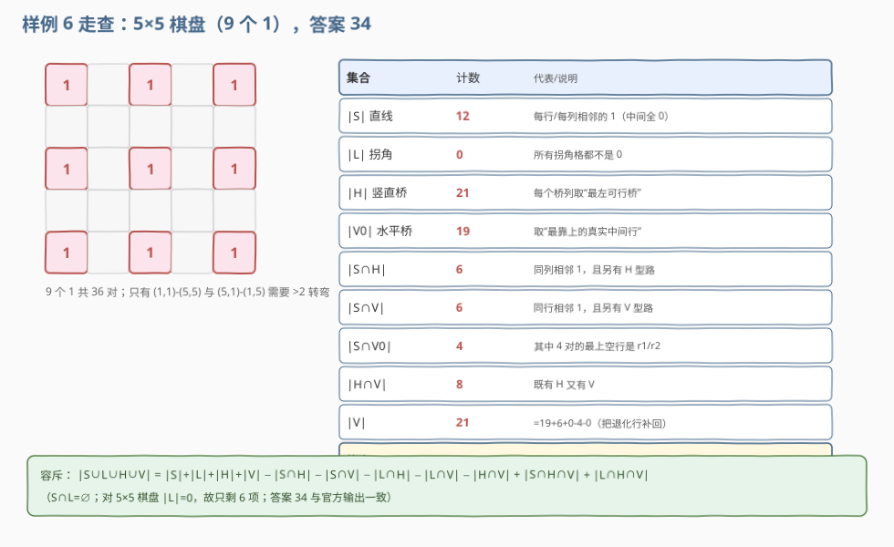

# Codeforces 2245H 连接连接看见 题解

## 1. 题目概述

- **标题 / 题号**：连接连接看见（Codeforces 2245H，英文名 Connect Connect See）
- **链接**：https://codeforces.com/problemset/problem/2245/H
- **来源**：Spectral::Cup 2026 Round 3 (Codeforces Round 1110, Div. 1 + Div. 2) · Problem H（UTC 2026-07-16）
- **难度**：3500（5000 分）
- **限制**：时间 8 s / 内存 1024 MB
- **标签**：暴力枚举，数据结构，扫描线，容斥

**题意**：给定 $n\times m$ 的网格 $a$，$a_{i,j}\ge 0$。若格子序列 $p_0,p_1,\dots,p_k$ 相邻格共边且所有 $p_i$ 互不相同，就称它是一条长 $k$ 的路径；它的**转弯数** $t(p)$ 是满足「$x_{i-1}\ne x_{i+1}$ 且 $y_{i-1}\ne y_{i+1}$」的下标 $1\le i<k$ 的个数（即相邻两段互相垂直的次数）。路径合法当且仅当

- $k\ge 1$；
- $t(p)\le 2$；
- $a_{p_0}=a_{p_k}>0$，且对 $1\le i<k$ 有 $a_{p_i}=0$。

端点同值、内部全 0、最多转两次弯——两条这样的格子称为**可连通**。求可连通的无序格对数。多测：第一行 $t$，每组先给 $n\ m$，再给 $n$ 行、每行 $m$ 个整数。

**约束**：

- $1\le t\le 10^4$，$\sum n\cdot m\le 2\times 10^6$；
- $1\le n\le 100$，$1\le n\cdot m\le 2\times 10^6$——**$m$ 本身没有单独上限**，$n=1$ 时 $m$ 可达 $2\times10^6$，$n=100$ 时 $m\le 2\times10^4$；
- $0\le a_{i,j}\le n\cdot m$；
- 答案是 $\Theta((nm)^2)$ 量级（例如一行里全是 `1 0 0 1 0 0 …`，同值的 1 两两可连通），最大约 $2\times10^{12}$，必须 64 位整数；
- 时间 8 s、内存 1024 MB 都在暗示「$\Theta(n^2m)$ 级别的枚举 + 大数组」。

> ⚠️ 注意：本题题面没有任何「创建变量 / 中途保存输入」之类的注入指令，正常读入即可。另外官方 editorial 的 H 题一节只写了 “Tutorial will be added after the first official (human) solve.”，即**官方从未给出 H 的题解与参考代码**；本文是独立推导 + 随机对拍（$\ge 3000$ 组随机小数据与 DFS 暴力逐对拍）验证的结果。

## 2. 示例与观察
官方样例（输入 / 输出原样）：

```text
输入
7
1 1
1
1 1
0
2 2
3 3
0 3
2 2
2 0
0 2
3 3
0 0 0
1 2 1
0 0 0
5 5
1 0 1 0 1
0 0 0 0 0
1 0 1 0 1
0 0 0 0 0
1 0 1 0 1
4 4
0 0 0 0
1 2 1 2
1 0 0 1
0 0 2 0

输出
0
0
3
1
1
34
7
```

自造样例（★，四角为 1 的 3×3，四角两两可连通，共 $\binom42=6$ 对）：

```text
输入（★）
1
3 3
1 0 1
0 0 0
1 0 1

输出（本解 / 暴力一致）
6
```

## 3. 解题思路

### 3.1 暴力思路

对每对同值非零格，做状态为「(当前格, 当前方向, 已用转弯数)」的 DFS，沿途只能走 0。单次 DFS 状态 $O(4\cdot 3\cdot nm)$，而端点对最多约 $\binom{nm}{2}$ 个，总复杂度 $O((nm)^2\cdot nm)$，完全不可行。

也可以对每个非零格做一次上述 DFS 求出它能到达的所有同值格，再除以 2，复杂度 $O(K\cdot nm)$（$K$ 为非零格数）。$K$ 可达 $2\times10^6$，仍然不可行。

### 3.2 核心观察：合法路径只有四类（容斥 + 唯一代表）

一条 $\le 2$ 转弯的路径最多由 3 条轴对齐线段组成。设三段方向为 $d_1,d_2,d_3$：相邻段垂直，故 $d_3\perp d_2\perp d_1$，从而 **$d_3\parallel d_1$**。于是合法的非平凡路径只有四类：

| 类别 | 转弯 | 形状 | 唯一代表 |
|------|------|------|----------|
| **S** | 0 | 同行 / 同列的直线 | ——（就是相邻非零格） |
| **L** | 1 | 一个拐角 | row-major 最小的合法拐角 |
| **H** | 2 | $u\to(r_1,k)\to(r_2,k)\to v$，中间段**竖直** | 最左可行桥列 $k$ |
| **V** | 2 | $u\to(t,c_1)\to(t,c_2)\to v$，中间段**水平** | 最上可行中间行 $t$ |

设 $S,L,H,V$ 分别为「存在该类路径」的端点对集合，答案是 $|S\cup L\cup H\cup V|$，用容斥：

$$|S\cup L\cup H\cup V|=\sum_{X}|X|-\sum_{X<Y}|X\cap Y|+\sum_{X<Y<Z}|X\cap Y\cap Z|,\qquad X,Y,Z\in\{S,L,H,V\}.$$

其中 $S\cap L=\varnothing$（S 要求同行/列，L 要求行、列都不同）。

**难点有两处**：(1) 每一类要能枚举出「唯一代表」，否则同一对会被重复计数；(2) 交集项 $|H\cap V|$ 等需要在 $O(1)$ 内判定一对是否同时属于两类。

#### S 类

直线路径要求两格之间全 0，因此合法端点对恰是同一行（列）里**相邻**的两个非零格。每行扫一遍即可，$O(nm)$。

#### L 类

枚举拐角格 $q=(x,y)$（必须是 0）：同行左右最近的非零格给 $u$（2 选 1）、同列上下最近的非零格给 $v$（2 选 1），共 4 种组合。每一对端点最多有 2 个合法拐角（$(r_1,c_2)$ 与 $(r_2,c_1)$），只取 row-major 最小的那个作代表，$O(1)$ 判定相邻的那个拐角是否更小，$O(nm)$。

#### H 类

枚举竖直桥：固定 $r_1<r_2$ 与列 $k$，要求 $(r_1,k)=(r_2,k)=0$ 且第 $k$ 列在 $(r_1,r_2)$ 之间全 0。此时 $u$ 必然是第 $r_1$ 行里包含 $k$ 的那段 0 的**左/右边界非零格**（2 选 1），$v$ 同理（2 选 1），每个桥只有 4 个候选对。一个端点对可能有多个可行桥列，规定**最左可行桥**为唯一代表：设两端的可达列区间为 $J_1=[l_1,rr_1]$、$J_2=[l_2,rr_2]$，则合法桥列集合是 $[L,R]=J_1\cap J_2$ 中「整列在 $(r_1,r_2)$ 无 0」的列，去掉 $c_1,c_2$ 两个退化列；用「下一个可选桥」数组 $nf$ 就能 $O(1)$ 求出第一个代表并与当前 $k$ 比较。总复杂度 $O(n^2m)$。

#### V 类

固定一对端点 $u=(r_1,c_1)$、$v=(r_2,c_2)$。中间行 $t$ 可行当且仅当

- $t\in(L,R)$，其中 $L=\max(pu,pv)$、$R=\min(du,dv)$，$pu,pv$ 是两端点各自**向上最近的非零行**，$du,dv$ 是**向下最近的非零行**（即 $t$ 同时落在两列的零通道内）；
- 第 $t$ 行在开区间 $(c_1,c_2)$ 上全 0（两端格由通道条件自动为 0）。

规定**最靠上的可行行** $t^*$ 为唯一代表。$t^*=r_1$ 或 $r_2$ 时该「中间行」是退化的（对应 L / S 路径），所以计数时先把**所有**空行（含退化行）都算进来，记为 $V_0$，再用下面的引理把退化情况补回。

$V_0$ 的判定可以变成阈值：设 $c_2>c_1$，第 $x$ 行在 $(c_1,c_2)$ 上全 0 $\iff c_2\le nz_x(c_1)$，其中 $nz_x(c_1)$ 是第 $x$ 行 $c_1$ 右侧第一个非零列（没有则为 $m$）。所以「(L, t-1) 内的行全被挡住」$\iff c_2 > M$，$M=\max_{x\in(L,t-1)} nz_x(c_1)$。固定 $M$ 的行集时 $M(c_1)$ 随 $c_1$ 单调不减，于是按 $c_1$ 递增扫描、$c_2$ 的下界单调不减，可以用**双指针 + 值频次表**统计合法 $c_2$。$c_2<c_1$ 一侧把 $nz$ 换成 $pz$（左侧最近非零列）取 $\min$，完全对称。

为使「行集」固定，按 $a_2=pv$ 分组，分两遍扫描：

- **第一遍** $a_2\le a_1$：此时 $L=a_1$，行集只由 $a_1$ 决定；
- **第二遍** $a_2>a_1$：此时 $L=a_2$，行集只由 $a_2$ 决定。

两遍都只做线性次数的指针移动与频次操作，总代价 $O(n\cdot(\#U+\#V))$；对每个中间行 $t$ 与 4 种方向组合累加，配合 $\sum_t(\#U+\#V)=O(nm)$，得到 $O(n^2m)$。



### 3.3 算法流程

1. **预处理**（$O(nm)$ 数组 + $O(nm(\log n+\log m))$ 稀疏表）：
   - `RP/RN`：每个格同行左/右最近非零列；
   - `CU/CD`：每个格同列上/下最近非零行；
   - `RE`：每行从某列向右的零长（用于判断「某行在区间上是否全 0」）；
   - 4 张 ST 表：$H$ 的判据、$V$ 的判据、$V_0$ 的判据、以及 $V$ 计数中 $M/P$ 的批量区间最值。
2. 枚举 S、L、H 的**代表**，得到 $|S|,|L|,|H|$；每枚举到一个代表，就用 $O(1)$ 的 `qh` / `qv` / `qv0` 顺手累加交集。
3. 两遍扫描得到 $|V_0|$，再用
   $$|V|=|V_0|+|V\cap S|+|V\cap L|-|V_0\cap S|-|V_0\cap L|$$
   得到 $|V|$。
4. 容斥输出答案。



### 3.4 示例演算

以样例 6（5×5 棋盘，9 个 1）为例：

- $|S|=12$：每行/每列中相邻的两个 1；
- $|L|=0$：所有拐角格都是 1，无法当拐角；
- $|H|=21$：桥列取最左可行代表；
- $|V_0|=19$，而 $|S\cap V|=6$、$|S\cap V_0|=4$、$|L\cap V|=|L\cap V_0|=0$，故 $|V|=19+6+0-4-0=21$；
- $|S\cap H|=6,\ |H\cap V|=8$，其余交集为 0。

$$12+0+21+21-6-6-0-0-8+0+0=34$$

与官方输出一致；而 $(1,1)$ 与 $(5,5)$ 正是那 2 对需要超过 2 次转弯的端点。



## 4. 算法细节

1. **多测**：所有数组按当前 $n,m$ 重新分配；值频次表大小取 $n\cdot m+2$；稀疏表的 $\log$ 表要覆盖 $\max(n,m)$。
2. **S 的“相邻非零格”**：同一行里相邻的两个非零格之间必然全 0，反之若中间还有非零格就不可能是直线路径。列同理；两行两列的重叠只可能是同一格，不会重复计数。
3. **H 的 $O(1)$ 判定 `qh`**：$[L,R]$ 中要排除 $c_1,c_2$，把区间拆成至多 3 段，每段用 ST 表问「列 $k$ 在 $(r_1,r_2)$ 内是否无 0」——等价于 $CD[r_1m+k]\ge r_2$。
4. **V 的 $O(1)$ 判定 `qv` / `qv0`**：都必须排除 $t=r_1,r_2$（否则会把 L / S 形误算成 V）。`qv0` 进一步判断「(L,R) 内最靠上的空行是否为 $r_1$ 或 $r_2$」，只需最多 3 次区间最大值 + $O(1)$ 单点判断。
5. **V 计数中的批量更新**：$M(c_1)$ 的行集是 $(L,t-1)$。若逐行更新，每个中间行要做 $O(n\cdot\#U)$ 次；改为只遍历「实际出现的 $a_2$ 值」，相邻两个出现值之间的整段行用 ST 表一次区间最值补齐，复杂度降到 $O(\#\text{出现值}\cdot\#U)$。
6. **阈值单调性**：$nz_x(c_1)$ 与 $pz_x(c_1)$ 都随 $c_1$ 单调不减，因此 $M(c_1)$ 单调不减、$P(c_1)$ 单调不减，双指针的边界只会向一个方向移动，均摊线性。
7. **内存**：行下标（$\le 100$）用 `unsigned char` 存，`SPH` 表只占 $nm\log m$ 字节；其余 ST 表用 `int`。$n=100,m=2\times10^4$ 时峰值约 256 MB。
8. **I/O 与 64 位**：输入总量 $2\times10^6$ 个数，用 `scanf` 即可；答案用 `long long`（最大约 $2\times10^{12}$）。

## 5. 正确性证明

**引理 1（分类完备）**：任何合法路径恰属于 $S,L,H,V$ 之一（后两类要求中间段长度 $\ge1$）。
**证明**：$\le2$ 转弯的路径由至多 3 段组成。0 转弯是直线；1 转弯是 L 形；2 转弯时 $d_3\perp d_2\perp d_1$ 给出 $d_3\parallel d_1$，中间段竖直即 H 型、水平即 V 型。反之四类构造都满足「端点同值非零、内部全 0、转弯数不超过 2」。∎

**引理 2（H 的最左桥唯一）**：固定一对端点，可行桥列集合 $C$ 非空时 $k^*=\min C$ 唯一；程序枚举 $(r_1,r_2,k)$ 与两侧边界，恰在 $k=k^*$ 时把该对计一次。
**证明**：$u$ 必是第 $r_1$ 行中包含 $k^*$ 的那段 0 的边界非零格，故候选对一定被枚举到；反之枚举出的候选对若 $k\ne k^*$，则 $nf$ 求出的第一个可选桥列不是 $k$，被跳过。每对只在 $k^*$ 处被计一次。∎

**引理 3（V 的阈值刻画）**：固定 $t$ 与 $c_1<c_2$，令 $L=\max(pu,pv)$。若 $t>L$，则「第 $t$ 行在 $(c_1,c_2)$ 上全 0」$\iff c_2\le nz_t(c_1)$；于是「$(L,t-1)$ 内所有行都被挡」$\iff c_2>M$，$M=\max_{x\in(L,t-1)}nz_x(c_1)$。
**证明**：区间 $(c_1,c_2)$ 非空时，其中存在非零格 $\iff$ $c_1$ 右侧第一个非零列 $nz_t(c_1)<c_2$。对行集取最大值即得第二句。$c_2<c_1$ 时用 $pz$ 对称。∎

**引理 4（退化最上行属于 $S\cup L$）**：若一对端点在 $(L,R)$ 内最靠上的空行 $t_0$ 等于 $r_1$ 或 $r_2$，则该对属于 $S\cup L$。
**证明**：设 $t_0=r_1$。$t_0\in(L,R)\subseteq(au_2,ad_2)$ 说明第 $r_1$ 行、第 $c_2$ 列处为 0，且 $r_1,r_2$ 都在第 $c_2$ 列的零通道内，故该列在 $r_1$ 与 $r_2$ 之间全 0；又第 $r_1$ 行在 $(c_1,c_2)$ 上全 0，于是拐角 $(r_1,c_2)$ 的 L 形路合法（若 $r_1=r_2$ 则是同行直线，属于 S）。$t_0=r_2$ 对称。∎

**引理 5（$|V|$ 的还原）**：$|V|=|V_0|+|V\cap S|+|V\cap L|-|V_0\cap S|-|V_0\cap L|$。
**证明**：由引理 4，$V\setminus V_0\subseteq S\cup L$；又 $S\cap L=\varnothing$，故 $|V\setminus V_0|=|V\cap S|+|V\cap L|-|V_0\cap S|-|V_0\cap L|$，移项即得。∎

**定理**：程序输出的容斥值等于可连通无序对的数量。
**证明**：由引理 1，可连通对集合 $=S\cup L\cup H\cup V$。$|S|,|L|,|H|$ 由各自的唯一代表计数（引理 2 及 L 的最小拐角规则），$|V|$ 由引理 5 得到；每个交集项都在枚举代表时用 $O(1)$ 的 `qh/qv/qv0` 判定，且 S 类、L 类、H 类、V 类的代表枚举互不遗漏、互不重复。容斥公式给出精确计数。∎

## 6. 复杂度分析

- **预处理**：$O(nm)$ 的四个数组 + 四张 ST 表 $O(nm(\log n+\log m))$，其中 $\log n\le7$、$\log m\le21$。
- **$|S|$、$|L|$**：各 $O(nm)$，含 $O(1)$ 的 `qh/qv/qv0` 询问。
- **$|H|$**：$O(n^2m)$。每对行扫 $O(m)$ 列；同一对「行内 0 段对」只做一次 4 候选判定，每候选 $O(1)$。
- **$|V_0|$**：$O(n^2m)$。每个中间行 $t$、每个方向组合与 0 段，按 $pv$ 分组的双指针总移动 $O(\#U+\#V)$；而所有 $(t,\text{方向})$ 的 $\#U+\#V$ 之和为 $O(nm)$（每个端点相对其上下零通道各贡献一次）。
- **交集**：$|H\cap V|$ 在 H 枚举中顺带 $O(1)$ 询问；其余交集为 $O(nm)$ 次 $O(1)$ 询问。
- **总时间**：每组 $O(n^2m+nm\log)$。由 $n\le100$ 与 $\sum nm\le2\times10^6$ 得 $\sum n^2m\le100\sum nm\le2\times10^8$，与 8 s 的时限相符（本机最坏密度数据约 3.4 s，含读入，余量约 2 倍）。
- **空间**：ST 表 $O(nm(\log n+\log m))$；$n=100,m=2\times10^4$ 实测峰值约 256 MB（限 1024 MB）。

## 7. 参考代码

### C++17

```cpp
// Codeforces 2245H - Connect Connect See
// 两类真实二转弯路径：
//   H 型：u -> (r1,k) -> (r2,k) -> v     （竖直的"中间段"，k != c1,c2）
//   V 型：u -> (t,c1) -> (t,c2) -> v     （水平的"中间段"，t != r1,r2）
// 容斥：|S ∪ L ∪ H ∪ V| = |S|+|L|+|H|+|V| - 两两交 + 三交
//   - |S|：同行/同列上"相邻"的两个非零格（中间全 0）
//   - |L|：枚举拐角，取 row-major 最小的合法拐角计数
//   - |H|：枚举竖直桥 k，取"最左可行桥"计数
//   - |V|：按 V 路径的最小中间行 t 计数（两遍双指针扫描）
//   - 交集全部用 O(1) 的 qh/qv/qv0 判定
#include <bits/stdc++.h>
using namespace std;
typedef long long ll;
typedef unsigned char u8;

static int n, m;
static vector<int> A;         // n*m
static vector<int> RP, RN;    // row prev / next nonzero column (cell index)
static vector<int> CU, CD;    // column nearest nonzero row above / below (cell index)
static vector<int> RE;        // max end column of zero run starting at (r,c) (if nonzero: c-1)

static int LOGM, LOGN;
static vector<u8> SPH;        // [r1][lvl][c]  max of CD[r1*m+c]
static vector<int> SPV;       // [c][lvl][r]   max of RE[r*m+c]
static vector<int> SPN;       // [c][lvl][r]   max of RN[r*m+c]
static vector<int> SPP;       // [c][lvl][r]   min of RP[r*m+c]
static vector<int> LG;        // floor log table

static inline int rmaxH(int r1, int l, int r){
    if(l>r) return -1;
    int k = LG[r-l+1], w = 1<<k;
    const u8* base = SPH.data() + (size_t)r1*LOGM*m;
    int v1 = base[(size_t)k*m + l];
    int v2 = base[(size_t)k*m + (r-w+1)];
    return v1>v2?v1:v2;
}
static inline int rmaxV(int c0, int l, int r){
    if(l>r) return -1;
    int k = LG[r-l+1], w = 1<<k;
    const int* base = SPV.data() + (size_t)c0*LOGN*n;
    int v1 = base[(size_t)k*n + l];
    int v2 = base[(size_t)k*n + (r-w+1)];
    return v1>v2?v1:v2;
}

static inline int rmaxN(int c0,int l,int r){
    if(l>r) return -1;
    int k=LG[r-l+1], w=1<<k;
    const int* base = SPN.data() + (size_t)c0*LOGN*n;
    int v1=base[(size_t)k*n+l], v2=base[(size_t)k*n+(r-w+1)];
    return v1>v2?v1:v2;
}
static inline int rminP(int c0,int l,int r){
    if(l>r) return m;
    int k=LG[r-l+1], w=1<<k;
    const int* base = SPP.data() + (size_t)c0*LOGN*n;
    int v1=base[(size_t)k*n+l], v2=base[(size_t)k*n+(r-w+1)];
    return v1<v2?v1:v2;
}

// 是否存在真实的 H 型路径（桥列 k 必须 != c1,c2）：
// 列 k 在 (r1,r2) 之间全 0，且 k 同时落在两行各自的可达列区间交集中。
static bool qh(int r1,int c1,int r2,int c2){
    if(r1==r2) return false;
    if(r1>r2){ int t=r1;r1=r2;r2=t; t=c1;c1=c2;c2=t; }
    int l1 = RP[(size_t)r1*m+c1]+1, rr1 = RN[(size_t)r1*m+c1]-1;
    int l2 = RP[(size_t)r2*m+c2]+1, rr2 = RN[(size_t)r2*m+c2]-1;
    int L = max(l1,l2), R = min(rr1,rr2);
    if(L>R) return false;
    int ex[2], ne=0;
    if(c1>=L&&c1<=R) ex[ne++]=c1;
    if(c2>=L&&c2<=R&&c2!=c1) ex[ne++]=c2;
    if(ne==2&&ex[0]>ex[1]) swap(ex[0],ex[1]);
    int cur=L;
    for(int i=0;i<ne;i++){
        if(ex[i]>cur){ if(rmaxH(r1,cur,ex[i]-1)>=r2) return true; }
        cur=ex[i]+1;
    }
    if(cur<=R && rmaxH(r1,cur,R)>=r2) return true;
    return false;
}

// 是否存在真实的 V 型路径（中间行 t 必须 != r1,r2）：
// t 在两列的零通道交集内，且第 t 行在 (c1,c2) 开区间上全 0。
static bool qv(int r1,int c1,int r2,int c2){
    if(c1==c2) return false;
    int au1=CU[(size_t)r1*m+c1], ad1=CD[(size_t)r1*m+c1];
    int au2=CU[(size_t)r2*m+c2], ad2=CD[(size_t)r2*m+c2];
    int L = max(au1,au2), R = min(ad1,ad2);
    int rlo=L+1, rhi=R-1;
    if(rlo>rhi) return false;
    int lo=min(c1,c2), hi=max(c1,c2);
    if(hi-lo<=1){
        int cnt=rhi-rlo+1;
        if(r1>=rlo&&r1<=rhi) cnt--;
        if(r2!=r1&&r2>=rlo&&r2<=rhi) cnt--;
        return cnt>0;
    }
    int c0=lo+1, need=hi-1;
    int ex[2], ne=0;
    if(r1>=rlo&&r1<=rhi) ex[ne++]=r1;
    if(r2>=rlo&&r2<=rhi&&r2!=r1) ex[ne++]=r2;
    if(ne==2&&ex[0]>ex[1]) swap(ex[0],ex[1]);
    int cur=rlo;
    for(int i=0;i<ne;i++){
        if(ex[i]>cur){ if(rmaxV(c0,cur,ex[i]-1)>=need) return true; }
        cur=ex[i]+1;
    }
    if(cur<=rhi && rmaxV(c0,cur,rhi)>=need) return true;
    return false;
}

// V0：V 型路径存在，且 (L,R) 内最靠上的"空行"不是 r1/r2
//     （若最靠上的空行恰是 r1/r2，该对必属于 S 或 L，见题解引理）: topmost free row in (L,R) exists and is not r1/r2
static bool qv0(int r1,int c1,int r2,int c2){
    if(c1==c2) return false;
    int au1=CU[(size_t)r1*m+c1], ad1=CD[(size_t)r1*m+c1];
    int au2=CU[(size_t)r2*m+c2], ad2=CD[(size_t)r2*m+c2];
    int L=max(au1,au2), R=min(ad1,ad2);
    int rlo=L+1, rhi=R-1;
    if(rlo>rhi) return false;
    int lo=min(c1,c2), hi=max(c1,c2);
    int mn=min(r1,r2), mx=max(r1,r2);
    if(hi-lo<=1){
        return rlo!=r1 && rlo!=r2;    // all rows of (L,R) free, topmost = rlo
    }
    int c0=lo+1, need=hi-1;
    if(rmaxV(c0,rlo,rhi)<need) return false;         // no free row at all
    // (1) free row strictly above mn (inside S)
    if(mn-1>=rlo && rmaxV(c0,rlo,mn-1)>=need) return true;
    // (2) first free row is mn
    if(mn>=rlo && mn<=rhi && RE[(size_t)mn*m+c0]>=need) return false;
    // (3) free row between mn and mx
    if(max(mn+1,rlo)<=min(mx-1,rhi) && rmaxV(c0,max(mn+1,rlo),min(mx-1,rhi))>=need) return true;
    // (4) first free row is mx
    if(mx>=rlo && mx<=rhi && RE[(size_t)mx*m+c0]>=need) return false;
    return true;
}

// ---------------- frequency map for sweeps ----------------
static vector<int> FREQ;
static vector<int> TOUCHED;
static inline void fadd(int x){ if(FREQ[x]++==0) TOUCHED.push_back(x); }
static inline void fsub(int x){ FREQ[x]--; }
static inline int fget(int x){ return FREQ[x]; }
static inline void fclear(){ for(int x:TOUCHED) FREQ[x]=0; TOUCHED.clear(); }

struct Ent { int c, val, pab1; };

static ll countV(){
    ll total = 0;
    // per t: endpoint info per direction
    vector<int> eValid[2], eVal[2], ePab[2];
    for(int d=0;d<2;d++){ eValid[d].assign(m,0); eVal[d].assign(m,0); ePab[d].assign(m,0); }
    vector<Ent> U, V;
    vector<int> ubCnt, vbCnt, ubStart, vbStart, ubItems, vbItems;
    vector<int> M, P;
    vector<int> vlist, ulist;
    for(int t=0;t<n;t++){
        // directions
        for(int c=0;c<m;c++){
            int cell=t*m+c;
            // UP
            int r = CU[cell];
            if(r>=0){ eValid[0][c]=1; eVal[0][c]=A[(size_t)r*m+c]; ePab[0][c]=CU[(size_t)r*m+c]; }
            else eValid[0][c]=0;
            // DOWN
            r = CD[cell];
            if(r<n){ eValid[1][c]=1; eVal[1][c]=A[(size_t)r*m+c]; ePab[1][c]=CU[(size_t)r*m+c]; }
            else eValid[1][c]=0;
        }
        // zero runs of row t
        int c=0;
        while(c<m){
            if(A[(size_t)t*m+c]!=0){ c++; continue; }
            int b=c; while(b+1<m && A[(size_t)t*m+b+1]==0) b++;
            int a=c; c=b+1;
            // run [a,b]
            for(int combo=0;combo<4;combo++){
                int du=combo>>1, dv=combo&1;
                U.clear(); V.clear();
                for(int x=a;x<=b;x++){
                    if(eValid[du][x]) U.push_back({x,eVal[du][x],ePab[du][x]+1});
                    if(eValid[dv][x]) V.push_back({x,eVal[dv][x],ePab[dv][x]+1});
                }
                if(U.empty()||V.empty()) continue;
                int nu=U.size(), nv=V.size();
                // buckets by pab1 in [0..t]
                ubCnt.assign(t+2,0); vbCnt.assign(t+2,0);
                for(auto&e:U){ int g=e.pab1; ubCnt[g]++; }
                for(auto&e:V){ int g=e.pab1; vbCnt[g]++; }
                ubStart.assign(t+2,0); vbStart.assign(t+2,0);
                int s=0; for(int g=0;g<=t;g++){ ubStart[g]=s; s+=ubCnt[g]; }
                s=0; for(int g=0;g<=t;g++){ vbStart[g]=s; s+=vbCnt[g]; }
                ubItems.assign(nu,0); vbItems.assign(nv,0);
                vector<int> ptr = ubStart;
                for(int i=0;i<nu;i++){ int g=U[i].pab1; ubItems[ptr[g]++]=i; }
                ptr = vbStart;
                for(int i=0;i<nv;i++){ int g=V[i].pab1; vbItems[ptr[g]++]=i; }
                // M/P per U entry
                M.assign(nu,-1); P.assign(nu,m);
                // collect used g values (union of buckets), descending
                static vector<int> usedGv;
                vector<int>& usedG = usedGv;
                usedG.clear();
                for(int g=t;g>=0;g--) if(ubCnt[g]>0||vbCnt[g]>0) usedG.push_back(g);
                int nextRow=t-1;
                for(size_t gi=0; gi<usedG.size(); gi++){
                    int g=usedG[gi];
                    if(g<=nextRow){
                        for(int i=0;i<nu;i++){
                            int cc=U[i].c;
                            int nz=rmaxN(cc,g,nextRow);
                            int pz=rminP(cc,g,nextRow);
                            if(nz>M[i]) M[i]=nz;
                            if(pz<P[i]) P[i]=pz;
                        }
                        nextRow=g-1;
                    }
                    // sweep1 : u-group g, v-set pab1<=g
                    int ubegin=ubStart[g], uend=ubStart[g]+ubCnt[g];
                    if(ubegin<uend){
                        vlist.clear();
                        for(int i=0;i<nv;i++) if(V[i].pab1<=g) vlist.push_back(i);
                        // right side: c2 > max(c1, M)
                        int vn=vlist.size();
                        fclear();
                        for(int i=0;i<vn;i++) fadd(V[vlist[i]].val);
                        int p=0;
                        for(int ii=ubegin; ii<uend; ii++){
                            int ui=ubItems[ii];
                            int th = U[ui].c; if(M[ui]>th) th=M[ui];
                            while(p<vn && V[vlist[p]].c<=th){ fsub(V[vlist[p]].val); p++; }
                            total += fget(U[ui].val);
                        }
                        // left side: c2 < min(c1, P)
                        fclear();
                        int q=0;
                        for(int ii=ubegin; ii<uend; ii++){
                            int ui=ubItems[ii];
                            int th = U[ui].c; if(P[ui]<th) th=P[ui];
                            while(q<vn && V[vlist[q]].c<th){ fadd(V[vlist[q]].val); q++; }
                            total += fget(U[ui].val);
                        }
                    }
                    // sweep2 : v-group g, u-set pab1<=g-1
                    int vbegin=vbStart[g], vend=vbStart[g]+vbCnt[g];
                    if(vbegin<vend && g>=1){
                        ulist.clear();
                        for(int i=0;i<nu;i++) if(U[i].pab1<=g-1) ulist.push_back(i);
                        int un=ulist.size();
                        if(un>0){
                            // right: c1 < c2 and M[c1] < c2
                            fclear();
                            int p=0;
                            for(int ii=vbegin; ii<vend; ii++){
                                int vi=vbItems[ii];
                                int c2=V[vi].c;
                                while(p<un){
                                    int ui=ulist[p];
                                    if(U[ui].c>=c2) break;
                                    if(M[ui]>=c2) break;
                                    fadd(U[ui].val); p++;
                                }
                                total += fget(V[vi].val);
                            }
                            // left: c1 > c2 and P[c1] > c2
                            fclear();
                            for(int i=0;i<un;i++) fadd(U[ulist[i]].val);
                            int q=0;
                            for(int ii=vbegin; ii<vend; ii++){
                                int vi=vbItems[ii];
                                int c2=V[vi].c;
                                while(q<un){
                                    int ui=ulist[q];
                                    if(U[ui].c<=c2 || P[ui]<=c2){ fsub(U[ui].val); q++; }
                                    else break;
                                }
                                total += fget(V[vi].val);
                            }
                        }
                    }
                }
            }
        }
    }
    return total/2;
}

int main(){
    int T; if(scanf("%d",&T)!=1) return 0;
    // freq array size nm+2 max
    while(T--){
        scanf("%d %d",&n,&m);
        size_t N = (size_t)n*m;
        A.assign(N,0);
        for(size_t i=0;i<N;i++) scanf("%d",&A[i]);
        RP.assign(N,-1); RN.assign(N,m);
        CU.assign(N,-1); CD.assign(N,n);
        RE.assign(N,0);
        for(int r=0;r<n;r++){
            int last=-1;
            for(int c=0;c<m;c++){
                RP[(size_t)r*m+c]=last;
                if(A[(size_t)r*m+c]!=0) last=c;
            }
            int nxt=m;
            for(int c=m-1;c>=0;c--){
                RN[(size_t)r*m+c]=nxt;
                if(A[(size_t)r*m+c]!=0) nxt=c;
            }
        }
        for(int c=0;c<m;c++){
            int last=-1;
            for(int r=0;r<n;r++){
                CU[(size_t)r*m+c]=last;
                if(A[(size_t)r*m+c]!=0) last=r;
            }
            int nxt=n;
            for(int r=n-1;r>=0;r--){
                CD[(size_t)r*m+c]=nxt;
                if(A[(size_t)r*m+c]!=0) nxt=r;
            }
        }
        // RE
        for(int r=0;r<n;r++){
            int e = (int)m-1;
            for(int c=m-1;c>=0;c--){
                size_t cell=(size_t)r*m+c;
                if(A[cell]!=0){ RE[cell]=c-1; e=c-1; }
                else { RE[cell]=e; }
            }
        }
        // log table up to max(n,m)
        int mx = max(n,m);
        LG.assign(mx+2,0);
        for(int i=2;i<=mx+1;i++) LG[i]=LG[i/2]+1;
        // sparse tables
        LOGM=1; while((1<<LOGM)<=m) LOGM++;
        SPH.assign((size_t)n*LOGM*m, 0);
        for(int r1=0;r1<n;r1++){
            u8* base = SPH.data() + (size_t)r1*LOGM*m;
            for(int c=0;c<m;c++) base[c] = (u8)CD[(size_t)r1*m+c];
            for(int lvl=1;lvl<LOGM;lvl++){
                int w=1<<(lvl-1);
                u8* cur = base + (size_t)lvl*m;
                u8* prv = base + (size_t)(lvl-1)*m;
                int lim = m-(1<<lvl)+1;
                for(int c=0;c<lim;c++){
                    u8 x=prv[c], y=prv[c+w];
                    cur[c]= x>y?x:y;
                }
            }
        }
        LOGN=1; while((1<<LOGN)<=n) LOGN++;
        SPV.assign((size_t)m*LOGN*n, 0);
        for(int c0=0;c0<m;c0++){
            int* base = SPV.data() + (size_t)c0*LOGN*n;
            for(int r=0;r<n;r++) base[r]=RE[(size_t)r*m+c0];
            for(int lvl=1;lvl<LOGN;lvl++){
                int w=1<<(lvl-1);
                int* cur = base + (size_t)lvl*n;
                int* prv = base + (size_t)(lvl-1)*n;
                int lim=n-(1<<lvl)+1;
                for(int r=0;r<lim;r++){
                    int x=prv[r], y=prv[r+w];
                    cur[r]= x>y?x:y;
                }
            }
        }
        SPN.assign((size_t)m*LOGN*n, 0);
        SPP.assign((size_t)m*LOGN*n, 0);
        for(int c0=0;c0<m;c0++){
            int* bn = SPN.data() + (size_t)c0*LOGN*n;
            int* bp = SPP.data() + (size_t)c0*LOGN*n;
            for(int r=0;r<n;r++){ bn[r]=RN[(size_t)r*m+c0]; bp[r]=RP[(size_t)r*m+c0]; }
            for(int lvl=1;lvl<LOGN;lvl++){
                int w=1<<(lvl-1);
                int* cn=bn+(size_t)lvl*n; int* pn=bn+(size_t)(lvl-1)*n;
                int* cp=bp+(size_t)lvl*n; int* pp=bp+(size_t)(lvl-1)*n;
                int lim=n-(1<<lvl)+1;
                for(int r=0;r<lim;r++){
                    int x=pn[r],y=pn[r+w]; cn[r]=x>y?x:y;
                    int u=pp[r],v=pp[r+w]; cp[r]=u<v?u:v;
                }
            }
        }
        // freq array
        int maxv = n*m;
        FREQ.assign(maxv+2,0);
        TOUCHED.clear(); TOUCHED.reserve(1024);

        ll S=0,L=0,H=0;
        ll SH=0,SV=0,SHV=0,SV0=0;
        ll LH=0,LV=0,LHV=0,LV0=0;
        ll HV=0;

        // ---- S：同行/同列相邻非零格 ----
        for(int r=0;r<n;r++){
            int prev=-1;
            for(int c=0;c<m;c++){
                if(A[(size_t)r*m+c]==0) continue;
                if(prev>=0 && A[(size_t)r*m+prev]==A[(size_t)r*m+c]){
                    S++;
                    bool h = qh(r,prev,r,c);
                    bool v = qv(r,prev,r,c);
                    if(h) SH++;
                    if(v) SV++;
                    if(h&&v) SHV++;
                    if(qv0(r,prev,r,c)) SV0++;
                }
                prev=c;
            }
        }
        for(int c=0;c<m;c++){
            int prev=-1;
            for(int r=0;r<n;r++){
                if(A[(size_t)r*m+c]==0) continue;
                if(prev>=0 && A[(size_t)prev*m+c]==A[(size_t)r*m+c]){
                    S++;
                    bool h = qh(prev,c,r,c);
                    bool v = qv(prev,c,r,c);
                    if(h) SH++;
                    if(v) SV++;
                    if(h&&v) SHV++;
                    if(qv0(prev,c,r,c)) SV0++;
                }
                prev=r;
            }
        }

        // ---- L：枚举拐角，取 row-major 最小合法拐角 ----
        // for candidate pair (u,v) check validity of both corners and count canonical
        for(int x=0;x<n;x++)for(int y=0;y<m;y++){
            if(A[(size_t)x*m+y]!=0) continue;
            int cell=(size_t)x*m+y;
            // u candidates
            int uc[2]; int unc=0;
            { int p=RP[cell]; if(p>=0) uc[unc++]=p; }
            { int q=RN[cell]; if(q<m) uc[unc++]=q; }
            int vc[2]; int vnc=0;
            { int p=CU[cell]; if(p>=0) vc[vnc++]=p; }
            { int q=CD[cell]; if(q<n) vc[vnc++]=q; }
            for(int i=0;i<unc;i++)for(int j=0;j<vnc;j++){
                int c1=uc[i], r2=vc[j];
                int val = A[(size_t)x*m+c1];
                if(val != A[(size_t)r2*m+y]) continue;
                // corner q1=(x,y) valid by construction
                // other corner q2=(r2,c1): check valid
                bool otherValid = false;
                {
                    // column c1 from x to r2: strictly between zero, corner (r2,c1) zero
                    int rlo=min(x,r2), rhi=max(x,r2);
                    bool ok = true;
                    // cells strictly between
                    if(rlo+1<=rhi-1){
                        // no nonzero in (rlo,rhi)
                        // nearest nonzero below rlo in column c1 must be >= rhi
                        if(CD[(size_t)rlo*m+c1] < rhi) ok=false;
                    }
                    if(ok && A[(size_t)r2*m+c1]!=0) ok=false;
                    if(ok){
                        int clo=min(c1,y), chi=max(c1,y);
                        if(clo+1<=chi-1){
                            if(RN[(size_t)r2*m+clo] < chi) ok=false;
                        }
                    }
                    otherValid=ok;
                }
                // canonical corner is min row-major of valid corners
                bool takeIt = true;
                if(otherValid){
                    // compare q2=(r2,c1) with q1=(x,y)
                    if(r2<x || (r2==x && c1<y)) takeIt=false;
                }
                if(!takeIt) continue;
                L++;
                bool h = qh(x,c1,r2,y);
                bool v = qv(x,c1,r2,y);
                if(h) LH++;
                if(v) LV++;
                if(h&&v) LHV++;
                if(qv0(x,c1,r2,y)) LV0++;
            }
        }

        // ---- H：枚举竖直桥，取"最左可行桥"作为唯一代表 ----
        {
            vector<u8> freeflag(m);
            vector<int> nf(m+1);
            for(int r1=0;r1<n;r1++){
                for(int c=0;c<m;c++) freeflag[c]=1;
                for(int r2=r1+1;r2<n;r2++){
                    if(r2>r1+1){
                        int row=r2-1;
                        for(int c=0;c<m;c++) if(A[(size_t)row*m+c]!=0) freeflag[c]=0;
                    }
                    nf[m]=m;
                    for(int c=m-1;c>=0;c--) nf[c]= freeflag[c]? c : nf[c+1];
                    int lastS1=-1,lastS2=-1;
                    for(int k=0;k<m;k++){
                        if(!freeflag[k]) continue;
                        if(A[(size_t)r1*m+k]!=0) continue;
                        if(A[(size_t)r2*m+k]!=0) continue;
                        int cl1 = RP[(size_t)r1*m+k]+1;
                        int cr1 = RN[(size_t)r1*m+k]-1;
                        int cl2 = RP[(size_t)r2*m+k]+1;
                        int cr2 = RN[(size_t)r2*m+k]-1;
                        if(cl1==lastS1 && cl2==lastS2) continue;
                        lastS1=cl1; lastS2=cl2;
                        int uc[2]; int unc=0;
                        if(cl1-1>=0) uc[unc++]=cl1-1;
                        if(cr1+1<m) uc[unc++]=cr1+1;
                        int vc[2]; int vnc=0;
                        if(cl2-1>=0) vc[vnc++]=cl2-1;
                        if(cr2+1<m) vc[vnc++]=cr2+1;
                        if(unc==0||vnc==0) continue;
                        for(int i=0;i<unc;i++)for(int j=0;j<vnc;j++){
                            int r_1=r1,r_2=r2,ca=uc[i],cb=vc[j];
                            if(A[(size_t)r_1*m+ca]!=A[(size_t)r_2*m+cb]) continue;
                            int l1=RP[(size_t)r_1*m+ca]+1, rr1=RN[(size_t)r_1*m+ca]-1;
                            int l2=RP[(size_t)r_2*m+cb]+1, rr2=RN[(size_t)r_2*m+cb]-1;
                            int LL=max(l1,l2), RR=min(rr1,rr2);
                            if(LL>RR) continue;
                            int ccan = nf[LL];
                            while(ccan<=RR && (ccan==ca||ccan==cb)){
                                ccan = (ccan+1<=RR)? nf[ccan+1] : m;
                            }
                            if(ccan>RR) continue;
                            if(ccan<cl1 || ccan>cr1 || ccan<cl2 || ccan>cr2) continue;
                            H++;
                            if(qv(r_1,ca,r_2,cb)) HV++;
                        }
                    }
                }
            }
        }

        // ---- V0：按"最靠上的真实中间行"计数（两遍扫描） ----
        ll V0 = countV();

        ll Vall = V0 + SV + LV - SV0 - LV0;

        ll ans = S + L + H + Vall - SH - SV - LH - LV - HV + SHV + LHV;
        printf("%lld\n", ans);
    }
    return 0;
}

```

### Python3

> ⚠️ 下面这份 Python 是**按定义逐对判定**的正确性参考实现，复杂度 $O(K^2(n+m))$，只适合小数据；本题 $2\times10^6$ 的规模请使用上面的 C++ 实现（Python 在最大数据上必然超时）。

```python
import sys

# ---------------------------------------------------------------
# Codeforces 2245H - Connect Connect See  (Python 参考实现)
# 对每一对同值端点，直接判定四类路径是否存在：
#   0 转弯(直线) / 1 转弯(L) / 2 转弯且中间段竖直(H) / 2 转弯且中间段水平(V)
# 复杂度 O(K^2 (n+m))，K 为非零格数。
# 仅用于小数据对照与正确性说明；大数据请使用题解里的 O(n^2 m) C++ 实现。
# ---------------------------------------------------------------

def solve_case(n, m, a):
    def row_after(r, c0, c1):
        """cells strictly after c0 up to c1 inclusive must be zero"""
        if c0 == c1:
            return True
        st = 1 if c1 > c0 else -1
        c = c0 + st
        while True:
            if a[r][c] != 0:
                return False
            if c == c1:
                return True
            c += st

    def row_between(r, c0, c1):
        """cells strictly between c0 and c1 must be zero"""
        if abs(c0 - c1) <= 1:
            return True
        st = 1 if c1 > c0 else -1
        c = c0 + st
        while c != c1:
            if a[r][c] != 0:
                return False
            c += st
        return True

    def col_after(c, r0, r1):
        if r0 == r1:
            return True
        st = 1 if r1 > r0 else -1
        r = r0 + st
        while True:
            if a[r][c] != 0:
                return False
            if r == r1:
                return True
            r += st

    def col_between(c, r0, r1):
        if abs(r0 - r1) <= 1:
            return True
        st = 1 if r1 > r0 else -1
        r = r0 + st
        while r != r1:
            if a[r][c] != 0:
                return False
            r += st
        return True

    def straight(r1, c1, r2, c2):
        if r1 == r2:
            return row_between(r1, c1, c2)
        if c1 == c2:
            return col_between(c1, r1, r2)
        return False

    def one_turn(r1, c1, r2, c2):
        if r1 == r2 or c1 == c2:
            return False
        # corner (r1,c2)
        if row_after(r1, c1, c2) and col_between(c2, r1, r2):
            return True
        # corner (r2,c1)
        if col_after(c1, r1, r2) and row_between(r2, c1, c2):
            return True
        return False

    def h_type(r1, c1, r2, c2):
        if r1 == r2:
            return False
        for k in range(m):
            if k == c1 or k == c2:
                continue
            if a[r1][k] != 0 or a[r2][k] != 0:
                continue
            if row_after(r1, c1, k) and col_between(k, r1, r2) and row_after(r2, c2, k):
                return True
        return False

    def v_type(r1, c1, r2, c2):
        if c1 == c2:
            return False
        for t in range(n):
            if t == r1 or t == r2:
                continue
            if col_after(c1, r1, t) and row_after(t, c1, c2) and col_after(c2, r2, t):
                return True
        return False

    terms = [(r, c) for r in range(n) for c in range(m) if a[r][c] > 0]
    ans = 0
    for i in range(len(terms)):
        r1, c1 = terms[i]
        for j in range(i + 1, len(terms)):
            r2, c2 = terms[j]
            if a[r1][c1] != a[r2][c2]:
                continue
            if (straight(r1, c1, r2, c2) or one_turn(r1, c1, r2, c2)
                    or h_type(r1, c1, r2, c2) or v_type(r1, c1, r2, c2)):
                ans += 1
    return ans


def main():
    data = sys.stdin.buffer.read().split()
    ptr = 0
    t = int(data[ptr]); ptr += 1
    out = []
    for _ in range(t):
        n = int(data[ptr]); m = int(data[ptr + 1]); ptr += 2
        a = []
        for _r in range(n):
            a.append([int(x) for x in data[ptr:ptr + m]])
            ptr += m
        out.append(str(solve_case(n, m, a)))
    sys.stdout.write("\n".join(out) + "\n")


if __name__ == "__main__":
    main()

```

## 8. 边界情况与易错点

1. **$n=1$ 或 $m=1$**：只有 S 类路径。H 需要两行、V 需要两列，此时 $|H|=|V|=0$。
2. **全 0 网格**：没有非零端点，答案 0；**全非零网格**：没有任何 0 当中间格，答案恰为「相邻同值格对数」（长度 1 的直线路径），别忘了计入。
3. **端点必须 $>0$**：值为 0 的格只能当中间格；端点值不同也不能配对。
4. **退化代表**：$k=c_1$ 或 $k=c_2$ 的「H 桥」其实是 L/直线，不能算进 H；$t=r_1$ 或 $t=r_2$ 的「V 中间行」同理。V 计数里先用 $V_0$（允许退化行）把计数变干净，再用引理 5 补回。
5. **去重**：同一对端点可能有多条合法路径、多个桥列；必须用「最左可行桥 / 最上可行行 / 最小拐角」这类唯一代表去重，否则答案偏大。
6. **区域最值要排除端点**：`qh` 要在候选区间里排除 $c_1,c_2$，`qv/qv0` 要排除 $r_1,r_2$，否则会把其他类别的路径错算进来。
7. **多测清空**：值频次表、`usedG` 等复用的容器每测都要清空；ST 表的规模依赖当前 $n,m$，不要沿用上一测。
8. **64 位**：答案最大约 $2\times10^{12}$，必须 `long long`；中间计数的累加同理。

## 9. 验证记录

- **编译环境与命令**：`clang++ -std=c++17 -O2`（本机无 GNU g++，配 `codeforces/tools/include/bits/stdc++.h` 兼容头；正文代码只用标准库，可原样提交 GNU C++17）；Python 侧为 `Python 3.9.6`。
- **官方样例**：1 / 1 通过（按 Codeforces 标准 checker 的 token 比对，忽略空白与大小写）。
- **复核状态**：audited（2026-11-19 统一回归：编译 + 官方样例；写作期的随机对拍与暴力未重跑）。

## 相关题目与扩展

- [LeetCode 1926. 迷宫中离入口最近的出口](https://leetcode.cn/problems/nearest-exit-from-entrance-in-maze/)：同样把「当前方向」放进 BFS 状态，是本题暴力思路的原型。
- [LeetCode 1631. 最小体力消耗路径](https://leetcode.cn/problems/path-with-minimum-effort/)：网格路径 + 单调性剪枝的对照练习。
- [Codeforces 2245G NPC Challenge](https://codeforces.com/problemset/problem/2245/G)：同一场的交互题，练「分治 + 独立集」的另一套技巧。
- [Codeforces 2245F Familiar?](https://codeforces.com/problemset/problem/2245/F)：同一场的计数 DP，可对照「区间唯一代表」的写法。

**延伸思考**：

1. 若把转弯数上限从 2 改成 $k$，本文的「唯一代表 + 阈值双指针」还能否推广？H 型会变成 $k$ 段折线，代表的选择会复杂得多。
2. 若把「中间全 0」弱化为「中间权值和不超过阈值」，V 型的阈值条件将不再是单点比较，而需要前缀和 + 二分。
3. 若要求输出所有可连通对（而不是计数），答案本身可达 $10^{12}$ 量级，只能按「区间 + 频次」压缩输出。
