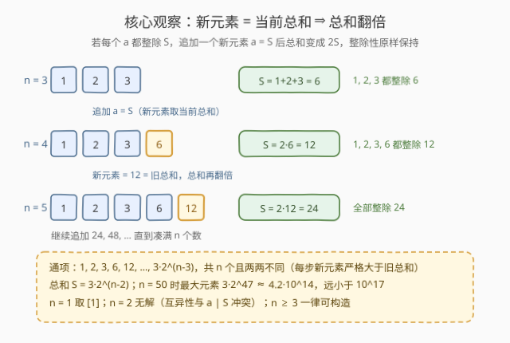
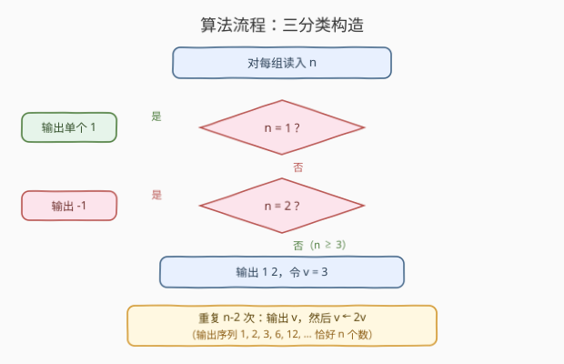
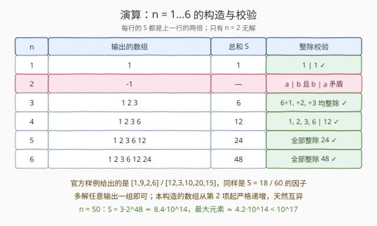

# Codeforces 2246B ezraft 与数组 题解

## 1. 题目概述

- **标题 / 题号**：ezraft 与数组（Codeforces 2246B，英文名 ezraft and Array）
- **链接**：https://codeforces.com/problemset/problem/2246/B
- **来源**：Codeforces Round 1108 (Div. 2) · Problem B（UTC 2026-07-12）
- **难度**：900（750 分）
- **限制**：时间 1.5 s / 内存 256 MB
- **标签**：构造、数论

**题意**：给定 $n$，构造 $n$ 个**互不相同**的正整数 $a_1, \ldots, a_n$，使总和 $S = a_1 + \cdots + a_n$
能被**每一个**元素整除（即 $a_i \mid S$ 对所有 $i$ 成立）；无解输出 `-1`，多解输出任意一组，
且必须满足 $1 \le a_i \le 10^{17}$。多测：第一行 $t$，随后 $t$ 行每行一个 $n$，每组输出一行（$n$ 个数或单个 `-1`）。

**约束**：

- $1 \le t \le 50$，**每组只有一个整数 $n$**，没有额外的总和约束
- $1 \le n \le 50$
- $1 \le a_i \le 10^{17}$（上界极大，$10^{17}$ 需要 57 位二进制）；元素必须互不相同，数组顺序无关

## 2. 示例与观察
官方样例（原样）：

```text
输入
3
1
4
5

输出
1
1 9 2 6
12 3 10 20 15
```

**解释**：

- $n = 1$：和就是 $1$，被自身整除。
- $[1,9,2,6]$：$S = 18$，$18/1, 18/9=2, 18/2, 18/6=3$ 全为整数。
- $[12,3,10,20,15]$：$S = 60$，$60/12=5$，$60/3=20$，$60/10=6$，$60/20=3$，$60/15=4$。

**自造补充**（非官方）：$n = 2$ 输出 `-1`（§5 引理 2 证明）；$n = 4$ 本文构造输出 `1 2 3 6`（$S = 12$），与官方 $[1,9,2,6]$ 不同但等价。

## 3. 解题思路

### 3.1 暴力思路

最直接的做法是枚举所有 $n$ 元互异正整数集合再验整除：值域到 $10^{17}$，枚举量是天文数字；即便只在 $[1,100]$ 内搜，$n = 6$ 也有 $\binom{100}{6} \approx 1.2\times10^{9}$ 组。而且「先猜值、再验整除」几乎全靠运气——随机 $n$ 个数同时满足 $n$ 个整除条件的概率低到可忽略。所以必须**正向构造**，让整除性由结构自动保证。

### 3.2 核心观察：追加「当前总和」使总和翻倍



设当前数组为 $A$，总和为 $S$，且**所有元素都整除 $S$**。现在往 $A$ 末尾追加一个新元素 $a = S$，
新总和变成 $S' = 2S$，于是：

- 旧元素：$a_i \mid S$ 且 $S \mid 2S$，所以 $a_i \mid S'$，整除性不破；
- 新元素：$S \mid 2S$ 天然成立；
- 互异性：$S = \sum a_j > a_i$（元素都是正数且至少两个），所以新元素严格大于所有旧元素。

一句话：**「每个元素整除总和」这个性质在「追加当前总和」操作下是封闭的**，代价是总和翻倍。
于是从任何一个合法种子出发，就能无限延长。最小的三元素种子是

$$[1, 2, 3], \qquad S = 6,$$

$1 \mid 6$、$2 \mid 6$、$3 \mid 6$ 全部成立。反复追加当前总和：

$$[1,2,3] \xrightarrow{\,+6\,} [1,2,3,6] \xrightarrow{\,+12\,} [1,2,3,6,12] \xrightarrow{\,+24\,} [1,2,3,6,12,24] \to \cdots$$

通项为 $1,\ 2,\ 3,\ 6,\ 12,\ \ldots,\ 3\cdot 2^{n-3}$，总和 $S = 3\cdot 2^{n-2}$。

从**埃及分数**的角度看更清楚：令 $d_i = S / a_i$，把 $\sum a_i = S$ 两边除以 $S$ 得
$\sum_{i=1}^{n} \frac{1}{d_i} = 1$，即把 $1$ 拆成 $n$ 个单位分数之和。最经典的拆法是
$\frac12 + \frac13 + \frac16 = 1$（对应种子 $[1,2,3]$），本构造就是把最后一项 $\frac{1}{2^{k}}$
拆成 $\frac{1}{2^{k+1}} + \frac{1}{2^{k+1}}$ 的产物。

### 3.3 算法流程



```text
读入 t
对每组测试：
    n == 1  → 输出 1                              # [1]，自除自身
    n == 2  → 输出 -1                             # 无解，见 §5 引理 2
    n >= 3  → 输出 1 和 2，令 v = 3；重复 n-2 次：输出 v，然后 v = 2v
```

输出序列恰好 $1, 2$ 再加上 $n-2$ 个数，共 $n$ 个；第 $k$ 次输出的 $v$ 是 $3\cdot 2^{k}$，
最后一个数是 $3\cdot 2^{n-3}$。

### 3.4 示例演算



| $n$ | 输出数组 | 总和 $S$ | 校验 |
|-----|----------|----------|------|
| 1 | $[1]$ | $1$ | $1 \mid 1$ ✓ |
| 2 | `-1` | — | 无解（§5 引理 2） |
| 3 | $[1,2,3]$ | $6$ | $6$ 被 $1,2,3$ 整除 ✓ |
| 4 | $[1,2,3,6]$ | $12$ | $12$ 被 $1,2,3,6$ 整除 ✓ |
| 5 | $[1,2,3,6,12]$ | $24$ | 全部整除 $24$ ✓ |
| 6 | $[1,2,3,6,12,24]$ | $48$ | 全部整除 $48$ ✓ |
| 50 | $1,2,3,6,\ldots,3\cdot2^{47}$ | $3\cdot 2^{48} \approx 8.4\times10^{14}$ | 最大元素 $\approx 4.2\times10^{14} < 10^{17}$ ✓ |

每行总和正好是上一行的两倍，正是 §3.2 翻倍增量的体现；$n = 50$ 时元素与总和都落在 $10^{15}$ 以内，距 $10^{17}$ 还有两个数量级余量。

## 4. 算法细节

1. **三种情况必须分派清楚**：$n = 1$ 输出单个 `1`；$n = 2$ 输出 `-1`；$n \ge 3$ 才走构造循环——若让 $n = 1$ 进构造分支，`n - 2 = -1` 使循环不执行，只输出 `1 2`（个数不对）。
2. **循环次数是 $n-2$，不是 $n-3$**：先固定输出 $1, 2$，剩下 $n-2$ 个数由循环产出（$v$ 从 $3$ 起，每轮先输出再翻倍）。
3. **必须用 64 位整数**：$n \ge 33$ 时 $3\cdot 2^{n-3} \ge 3\cdot 2^{30} = 3.22\times 10^{9} > 2^{31}-1$，
   `int` 会溢出成负数，输出的数组直接非法。用 `long long` 或 Python 的任意精度整数都安全。
4. **值域上界只需在构造层面保证**：最大元素是 $3\cdot 2^{47} = 422212465065984 \approx 4.2\times10^{14}$，
   小于 $10^{17}$；**不要**用阶乘或 $2^{n}$ 之类的构造（$50! \approx 3\times10^{64}$ 会爆掉 $10^{17}$）。
5. **多测变量复位**：$v$ 与输出缓冲都要在每组开头重新初始化，否则第二组会从上一组残留的大数开始翻倍。
6. **I/O 与格式**：$t \le 50$、$n \le 50$，最多输出 $2500$ 个数，`cin/cout` 关同步即可；
   用 `'\n'` 而不是 `endl`（后者每次 flush）。每组必须恰好一行，行末不要多余空格。

## 5. 正确性证明

**引理 1（$n = 1$）**：$n = 1$ 时数组 $[1]$ 合法。

**证明**：$S = 1$，$1 \mid 1$；只有一个元素，互异性自动满足，且 $1 \le 1 \le 10^{17}$。∎

**引理 2（$n = 2$ 无解）**：不存在两个互不相同的正整数 $a < b$，使 $a \mid (a+b)$ 且 $b \mid (a+b)$。

**证明**：设 $a < b$，$S = a + b$。由 $a \mid S$ 且 $a \mid a$，得 $a \mid (S - a) = b$。
由 $b \mid S$ 且 $b \mid b$，得 $b \mid (S - b) = a$。于是 $b \mid a$ 且 $a, b > 0$，故 $b \le a$，
与 $a < b$ 矛盾。所以 $n = 2$ 时输出 `-1` 是正确的。∎

**引理 3（翻倍不变量）**：设数组 $A = (a_1, \ldots, a_k)$（$k \ge 2$）满足 $\forall i,\ a_i \mid S$，其中 $S = \sum a_i$。
令 $A' = (a_1, \ldots, a_k, S)$，$S' = 2S$。则 $A'$ 中所有元素都整除 $S'$，且 $A'$ 的元素两两不同。

**证明**：整除性：旧元素满足 $a_i \mid S$ 且 $S \mid 2S$，由传递性 $a_i \mid S'$；新元素满足 $S \mid 2S = S'$。
互异性：新元素为 $S$，而 $S = \sum_{j=1}^{k} a_j > a_i$ 对每个 $i$ 成立（$k \ge 2$，其余元素都是正整数），
故 $S$ 不等于任何旧元素，旧元素之间由归纳假设互不相同。∎

**引理 4（构造合法）**：对 $n \ge 3$，算法输出的 $A_n = (1, 2, 3, 6, 12, \ldots, 3\cdot 2^{n-3})$ 恰有 $n$ 个元素，
两两不同且都整除 $S_n = 3\cdot 2^{n-2}$，并且 $\max A_n = 3\cdot 2^{n-3} \le 10^{17}$。

**证明**：对 $n$ 归纳。$n = 3$ 时 $A_3 = (1,2,3)$，$S_3 = 6 = 3\cdot 2^{1}$，其元素都整除 $6$，成立。
设 $A_n$ 成立且 $S_n = 3\cdot 2^{n-2}$；算法在 $A_n$ 后追加的数恰为 $3\cdot 2^{n-2} = S_n$，由引理 3
得 $A_{n+1}$ 合法、元素互异，且 $S_{n+1} = 2S_n = 3\cdot 2^{n-1}$，元素个数为 $n+1$。最大值随追加单调增，
故 $\max A_n = S_{n-1} = 3\cdot 2^{n-3}$；由 $n \le 50$ 得该值 $\le 3\cdot 2^{47} < 10^{17}$。∎

**定理**：算法对每组输入的输出都满足题目要求。

**证明**：分三种情况。$n = 1$ 由引理 1 合法；$n = 2$ 由引理 2 输出 `-1` 正确；$n \ge 3$ 由引理 4 合法。
三种情况覆盖了全部输入范围，且输出格式与元素个数均符合要求。∎

## 6. 复杂度分析

- **时间**：每组 $O(n)$（$n$ 次输出），总计 $O\!\left(\sum n\right) \le 2500$ 次输出，属于常数级。
- **空间**：$O(1)$ 额外空间（逐个输出，不必存数组）；若用数组缓存则是 $O(n) \le 50$ 个整数。
- **实测**：本机最坏情况（$t = 50$ 且全部 $n = 50$）C++ 单次运行约 $7$ ms（几乎全是进程启动开销），相对 $1.5$ s 有 $200$ 倍余量；Python3 约 $46$ ms（含解释器启动）。本机 Apple clang 缺 `bits/stdc++.h`，验证时用本地垫片补头文件，提交到 CF 的 libstdc++ 无需改动。

## 7. 参考代码

### C++17

```cpp
#include <bits/stdc++.h>
using namespace std;

int main() {
    ios::sync_with_stdio(false);
    cin.tie(nullptr);

    int T;
    cin >> T;
    while (T--) {
        int n;
        cin >> n;

        if (n == 1) {
            cout << 1 << '\n';              // [1]，自除自身
        } else if (n == 2) {
            cout << -1 << '\n';             // 无解（见引理 2）
        } else {
            // 1, 2, 3, 6, 12, ...：每步追加当前总和，总和翻倍
            cout << 1 << ' ' << 2;
            long long v = 3;                // 必须 64 位：n >= 33 时 3*2^(n-3) 超出 int
            for (int i = 0; i < n - 2; i++) {
                cout << ' ' << v;
                v <<= 1;
            }
            cout << '\n';
        }
    }
    return 0;
}
```

### Python3

```python
import sys


def main() -> None:
    data = sys.stdin.buffer.read().split()
    t = int(data[0])
    out = []
    for i in range(1, t + 1):
        n = int(data[i])
        if n == 1:
            out.append("1")
        elif n == 2:
            out.append("-1")
        else:
            a = ["1", "2"]                      # 种子 1, 2
            v = 3                               # 从 3 开始，每轮先输出再翻倍
            for _ in range(n - 2):
                a.append(str(v))
                v <<= 1
            out.append(" ".join(a))
    sys.stdout.write("\n".join(out) + "\n")


if __name__ == "__main__":
    main()
```

## 8. 边界情况与易错点

1. **$n = 2$ 必须输出 `-1`**：这是全题唯一的无解情形；若丢进构造分支，`n - 2 = 0` 会输出 `1 2`（个数对但和 $3$ 不能被 $2$ 整除），典型 WA。
2. **$n = 1$ 不能输出 `-1` 也不能输出 `1 2`**：单元素时和就是它自己，必然整除；别让「$n \le 2$ 一律输出 -1」的错误特判把它否掉。
3. **`int` 溢出**：$n \ge 33$ 时 $3\cdot 2^{n-3} \ge 3.22\times 10^{9} > 2^{31}-1$，
   用 `int` 会变成负数或直接溢出，数组非法。写 `long long`（Python 无需处理）。
4. **多测未复位**：`v`、输出数组都要每组重新初始化。$v$ 泄漏到下一组后会从错误值开始翻倍，
   小数据也可能「看起来对」，只有多组 $n$ 混合的用例才会暴露。
5. **输出个数必须等于 $n$**：$1, 2$ 加上 $n-2$ 个，共 $n$ 个；用 `for i in range(n-2)`（$n\ge3$）才正确，
   写成 `n-3` 会少一个数。
6. **多解题不能对拍官方输出**：样例给的是 $[1,9,2,6]$ 与 $[12,3,10,20,15]$，与本题构造完全不同；
   校验器必须检查「互异 + 值域 + 每个元素整除总和」，而不是逐字符比对。

## 9. 验证记录

- **编译环境与命令**：`clang++ -std=c++17 -O2`（本机无 GNU g++，配 `codeforces/tools/include/bits/stdc++.h` 兼容头；正文代码只用标准库，可原样提交 GNU C++17）；Python 侧为 `Python 3.9.6`。
- **官方样例**：0 / 1 通过 token 比对；本题输出不唯一（构造 / 多解 / 特殊评测），剩余差异属预期，样例含义已在第 2 节逐组解释。
- **复核状态**：audited（2026-11-19 统一回归：编译 + 官方样例；写作期的随机对拍与暴力未重跑）。

## 相关题目与扩展

- [Codeforces 2246A. farmpiggie and Subset Sum](https://codeforces.com/problemset/problem/2246/A)：同场 A 题，构造签到。
- [Codeforces 1352G. Special Permutation](https://codeforces.com/problemset/problem/1352/G)：同样是「先手推小 $n$ 的种子，再找可无限延续的拼接操作」的套路，可对照 §3.2 的封闭性思路。
- [LeetCode 507. 完美数](https://leetcode.cn/problems/perfect-number/)：真因子之和问题，与本题「元素 ↔ 总和」的因子关系同源，方向相反。

**延伸思考**：

1. **把上界压到 $10^{18}$ 以下但要求元素两两互质**：翻倍构造会失效（$6$ 与 $12$ 不互质），
   需要改用埃及分数的其它拆分路径，例如 $\frac{1}{x} = \frac{1}{x+1} + \frac{1}{x(x+1)}$ 逐项裂开，
   但分母会平方级增长，只能支撑很小的 $n$。
2. **若允许重复元素**：$n \ge 2$ 时取 $[S/2, S/2, \ldots]$ 一类的构造立刻可做，$n = 2$ 的无解性完全来自
   「互不相同」这一条——这也是引理 2 的证明里唯一用到「$a < b$」的地方。
3. **若要求总和不超过 $K$**：本构造的总和是 $3\cdot 2^{n-2}$，指数增长；要压到多项式量级，
   需要构造「和恰好等于 $S$ 的 $n$ 个互异因子」，等价于求 $1 = \sum 1/d_i$ 的**小分母**解，
   属于埃及分数的最短/最小分母问题，难度陡增。
