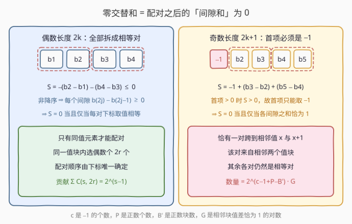
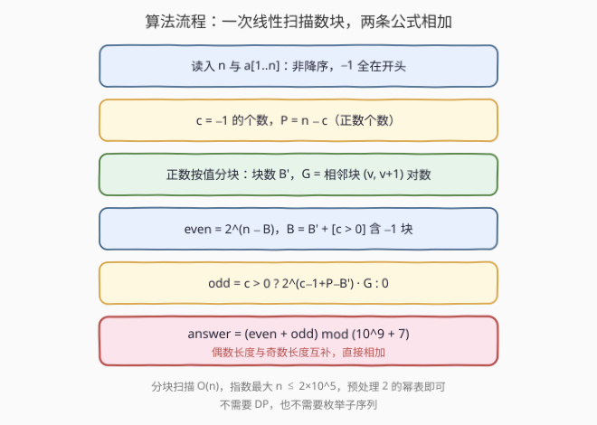
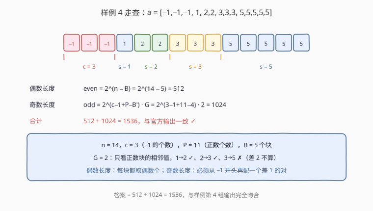

# Codeforces 2246C 0mar 与交替和 题解

## 1. 题目概述

- **标题 / 题号**：0mar 与交替和（Codeforces 2246C，英文名 0mar and Alternating Sums）
- **链接**：https://codeforces.com/problemset/problem/2246/C
- **来源**：Codeforces Round 1108 (Div. 2) · Problem C（UTC 2026-07-12）
- **难度**：1400（Div. 2 C，1500 分）
- **限制**：时间 2 s / 内存 256 MB
- **标签**：组合数学、动态规划、数学

**题意**：长度 $k$ 的数组 $b$ 的交替和定义为 $S(b)=\sum_{i=1}^{k}(-1)^{i+1}b_i=b_1-b_2+b_3-\cdots$。给定长度 $n$ 的**非降序**数组 $a$，每个元素要么是 $-1$，要么是 $[1,10^9]$ 内的正整数。统计所有下标子序列 $1\le i_1<i_2<\cdots<i_k\le n$（$k\ge 0$，**空子序列也算一个**）中满足 $a_{i_1}-a_{i_2}+a_{i_3}-\cdots=0$ 的个数，对 $10^9+7$ 取模，多测。

> ⚠️ 关键读法：$-1$ 是**参与运算的真实数值**，不是通配符。样例 1 里 $[-1,1,2]$ 的交替和是 $-1-1+2=0$，按字面算术成立；若把 $-1$ 当占位符，样例 1 的答案会变成 4 而非 6。

**约束**：

- $1\le t\le 10^4$，$1\le n\le 2\cdot 10^5$，$\sum n\le 2\cdot 10^5$；$a$ 非降序。
- $a_i=-1$ 或 $1\le a_i\le 10^9$；因 $-1$ 小于所有正整数，所有 $-1$ 必然构成一段前缀。
- 答案取模 $10^9+7$；值域 $10^9$ 使"以和为下标"的 DP 不可能。

## 2. 示例与观察
官方样例（4 组）：

```text
输入：
4
5
-1 1 1 2 3
3
1 2 3
4
1 3 5 7
14
-1 -1 -1 1 2 2 3 3 3 5 5 5 5 5

输出：
6
1
1
1536
```

- 第 1 组的 6 个零交替和子序列即 $[]$、$[a_2,a_3]=[1,1]$、$[a_1,a_2,a_4]=[-1,1,2]$、$[a_1,a_3,a_4]=[-1,1,2]$、$[a_1,a_4,a_5]=[-1,2,3]$、$[a_1,a_2,a_3,a_4,a_5]$。
- 第 2、3 组既无相等元素也无"$-1$ + 差 1 的对"，只剩空子序列；第 4 组是本篇公式的完整检验：$512+1024=1536$。

补一组自造样例（★），答案已与暴力对拍：

```text
输入（★自造）：
3
5
-1 -1 1 1 2
4
-1 1 2 3
4
-1 4 4 5

输出（★自造，本解计算）：
8
3
4
```

- 第一组块为 $\{-1\times2\},\{1\times2\},\{2\}$，$B=3$，even $=2^{5-3}=4$，$G=1$，odd $=2^{2-1+3-2}\cdot1=4$，合计 8。
- 第二组 $\{-1\},\{1\},\{2\},\{3\}$：even $=2^{4-4}=1$，$G=2$，odd $=2^{0+3-3}\cdot2=2$，合计 3；第三组 $\{-1\},\{4\times2\},\{5\}$：even $=2$，odd $=2$，合计 4。

## 3. 解题思路

### 3.1 暴力思路

枚举 $2^n$ 个子序列、逐个求交替和是 $O(n2^n)$，$n=2\cdot10^5$ 时连 $n=30$ 都过不去。想用 DP 记"长度奇偶 + 当前交替和"，转移 $O(1)$，但和的范围达 $\pm2\cdot10^{14}$——值域 $10^9$ 直接判死刑：只要状态里留着"和"的数值，就无解。

出路只有一条：**利用 $a$ 非降序**，让"和为 0"极不自由，把计数从"和"上彻底剥离。

### 3.2 核心观察：把交替和改写成"间隙和"



子序列继承非降序性，记其值 $b_1\le b_2\le\cdots\le b_k$，按长度奇偶改写：

**偶数长度 $2m$**：$S=-(b_2-b_1)-(b_4-b_3)-\cdots-(b_{2m}-b_{2m-1})\le0$，每个括号是非负间隙，故 $S=0$ 当且仅当**每一对都相等**。

**奇数长度 $2m+1$**：$S=b_1+(b_3-b_2)+(b_5-b_4)+\cdots+(b_{2m+1}-b_{2m})$，间隙非负且 $b_1\ge-1$，故 $S=0$ 必须 $b_1=-1$ 且"间隙和为 1"；间隙是非负整数，所以**恰好一个间隙为 1、其余为 0**。

于是合法子序列只有两种形态：(a) 一串"相等对"；(b) 一个 $-1$ 打头 + 一串相等对，其中恰好一对跨了 1 的差。再看它们落在哪些位置：把非降序数组按值切成**值块**（极大同值段），则相等对必在同一值块内；差 1 对的两个值形如 $x$ 与 $x+1$，只能来自**相邻**两个值块，且这两块的值恰为 $x,x+1$。

### 3.3 算法流程与计数公式



记 $c$ 为 $-1$ 的个数，$P=n-c$。正数部分按值分块：共 $B'$ 块，第 $b$ 块大小 $s_b$、值 $v_1<v_2<\cdots<v_{B'}$。再记 $G=\#\{b: v_{b+1}=v_b+1\}$，$B=B'+[c>0]$。

**区间计数子结论**：区间内若第 $b$ 块含 $k_b\ge1$ 个元素，选偶数个并按子序列顺序两两配成相等对的方案数是

$$\prod_b\left(\binom{k_b}{0}+\binom{k_b}{2}+\cdots\right)=\prod_b 2^{k_b-1}=2^{\text{区间长度}-\text{区间内值块数}}.$$

于是偶数长度的答案直接是 $\text{even}=2^{\,n-B}$。

奇数长度：选一个 $-1$ 作首项，选一个差 1 对 $(u,w)$（$u$ 在块 $b$、$w$ 在块 $b+1$，$v_{b+1}=v_b+1$），其余相等对分成两段——$u$ 之前的落在 $(i,u)$，$w$ 之后的落在 $(w,n]$，互相独立。对首项位置与 $u$ 求和：$\sum_{j=1}^{c}2^{(c-j)-[c-j>0]}=2^{c-1}$，$\sum_{r=0}^{s_b-1}2^{r-[r>0]}=2^{s_b-1}$，再乘前面各块得 $2^{\,c-1+\sum_{b'\le b}s_{b'}-b}$；对 $w$ 求和得 $2^{\sum_{b'\ge b+1}s_{b'}-(B'-b)}$。两个指数相加时 $b$ 恰好抵消，得到与块无关的 $2^{\,c-1+P-B'}$。故

$$\text{even}=2^{\,n-B},\qquad \text{odd}=[c>0]\cdot G\cdot 2^{\,c-1+P-B'},\qquad \text{answer}=(\text{even}+\text{odd})\bmod (10^9+7).$$

算法只需一次线性扫描：数出 $c$、扫正数部分分块并统计 $B'$ 与 $G$，然后套公式。

### 3.4 示例演算



样例 4 的 $a=[-1,-1,-1,1,2,2,3,3,3,5,5,5,5,5]$，值块为 $\{-1\times3\},\{1\},\{2\times2\},\{3\times3\},\{5\times5\}$：

| 量 | 取值 | 说明 |
|---|---|---|
| $n$ / $c$ / $P$ | 14 / 3 / 11 | 3 个 $-1$，11 个正数 |
| $B$ / $B'$ | 5 / 4 | $B$ 含 $-1$ 块，odd 只用 $B'$ |
| $G$ | 2 | $1\to2$、$2\to3$ 算；$3\to5$ 差 2 不算 |
| even | $2^{14-5}=512$ | 每块内部取偶数个 |
| odd | $2^{3-1+11-4}\cdot2=2^9\cdot2=1024$ | $-1$ 打头 + 恰一个差 1 对 |
| 答案 | $512+1024=1536$ | 与官方输出一致 |

样例 1 同样一步到位：块为 $\{-1\},\{1\times2\},\{2\},\{3\}$，$n=5,c=1,P=4,B=4,B'=3,G=2$，even $=2^{1}=2$，odd $=2^{0+4-3}\cdot2=4$，合计 6，与题面列出的 6 条子序列一一对应。

## 4. 算法细节

1. **数 $c$ 与分块**：$-1$ 是前缀，`while (c < n && a[c] == -1) ++c;` 即可；正数部分用双指针 `i, j`（`j` 走到第一个不等于 `a[i]` 处），用 `prev` 存上一块的值，边扫边判 `a[i] == prev + 1` 累加 $G$，无需存块数组。
2. **$G$ 只看正数块**：$-1$ 块与首块 $1$ 的差是 $2$，$3\to5$ 也是差 $2$，都不能算。
3. **指数范围**：$0\le n-B\le n$，$0\le c-1+P-B'=n-B'-1\le n$（$P\ge B'$，$c\ge1$），故幂表预处理到 $2\cdot10^5$ 即可，无需每次快速幂。
4. **$B$ 与 $B'$ 的区别**：even 用 $B=B'+[c>0]$（$-1$ 自成块），odd 用 $B'$；混用是最常见的公式性错误。
5. **$c=0$ 的特判**：odd 必须直接置 0，否则算出 $2^{-1}$；$c=n$ 时 $B'=G=0$，odd 自然为 0。
6. **多测**：$\sum n\le2\cdot10^5$，幂表全局只建一次；本题无跨测状态需要清空。
7. **溢出与 I/O**：$a_i\le10^9$ 用 `int`，`pw` 与乘法用 `long long`（$G\cdot pw\le2\cdot10^5\times10^9<2^{63}$）；`cin` 关同步、输出 `'\n'`。

## 5. 正确性证明

**引理 1（零交替和子的配对形态）**：设子序列各值为 $b_1\le\cdots\le b_k$。若 $k=2m$，$S=0$ 当且仅当 $b_{2j-1}=b_{2j}$ 对每个 $j$ 成立；若 $k=2m+1$，$S=0$ 当且仅当 $b_1=-1$ 且间隙 $b_3-b_2,\dots,b_{2m+1}-b_{2m}$ 中恰有一个为 1、其余为 0。

**证明**：偶数情形 $S=-\sum_{j}(b_{2j}-b_{2j-1})$，由非降序各间隙 $\ge0$，故 $S\le0$ 且 $S=0$ 等价于每个间隙为 0。奇数情形 $S=b_1+\sum_{j}(b_{2j+1}-b_{2j})$，间隙为非负整数，$b_1>0\Rightarrow S>0$，故须 $b_1=-1$，此时 $S=0$ 等价于间隙和为 1，而非负整数和为 1 当且仅当恰有一个 1。∎

**引理 2（区间相等对计数）**：区间内第 $b$ 块有 $k_b\ge1$ 个元素时，把其中若干元素按子序列顺序配成相等对的方案数为 $\prod_b2^{k_b-1}$。

**证明**：配对要求同值，各块独立；块内选 $2r$ 个后配对方式由下标顺序唯一确定，方案数 $\sum_r\binom{k_b}{2r}=2^{k_b-1}$。各块相乘即得。∎

**引理 3（奇数长度总数）**：$\text{odd}=[c>0]\cdot G\cdot2^{\,c-1+P-B'}$。

**证明**：由引理 1，奇数长度解 = 一个 $-1$ 首项 + 恰一个差 1 对 + 其余相等对；差 1 对必取自相邻值块 $b,b+1$ 且 $v_{b+1}=v_b+1$，这样的块对共 $G$ 个。固定块对、首项下标 $i$ 与差 1 对 $(u,w)$ 后，$u$ 前与 $w$ 后的相等对互不影响，由引理 2 分别为 $2^{|(i,u)|-\#\text{块}}$ 与 $2^{|(w,n]|-\#\text{块}}$。对 $i,u$ 求和得 $2^{\,c-1+\sum_{b'\le b}s_{b'}-b}$，对 $w$ 求和得 $2^{\sum_{b'\ge b+1}s_{b'}-(B'-b)}$，相乘指数相加为 $c-1+P-B'$，与 $b$ 无关；乘 $G$ 即得，$c=0$ 时无首项可选。∎

**定理**：答案 $=2^{\,n-B}+[c>0]\cdot G\cdot2^{\,c-1+P-B'}\pmod{10^9+7}$。

**证明**：所有子序列按长度奇偶分成互不相交的两类：偶数类由引理 1、2 得 $2^{n-B}$，奇数类由引理 1、3 得 $[c>0]\,G\,2^{c-1+P-B'}$。两类相加即答案。∎

## 6. 复杂度分析

- **时间与空间**：每个测试用例一次 $O(n)$ 扫描（数 $c$ + 正数分块），加一次性 $O(2\cdot10^5)$ 幂表预处理，总计 $O(\sum n+\max n)$；空间为幂表 $O(2\cdot10^5)$ 与输入数组 $O(n)$，远低于 $256\text{ MB}$。
- **常数与实测**：无排序、无快速幂、无取模热点。在 $t=1,n=2\cdot10^5$（全不同 / 双元素块 / 全 $-1$）与 $t=10^4,\sum n=2\cdot10^5$ 四类极限数据上，C++17 最慢 $0.22\text{ s}$、Python3 最慢 $0.12\text{ s}$（含启动与读入），对 $2\text{ s}$ 时限余量在 9 倍以上。

## 7. 参考代码

### C++17

```cpp
#include <bits/stdc++.h>
using namespace std;
static const long long MOD = 1000000007LL;

int main() {
    ios::sync_with_stdio(false);
    cin.tie(nullptr);
    int T;
    if (!(cin >> T)) return 0;
    const int LIM = 200005;                 // 2 的幂表，指数最大为 n
    vector<long long> pw(LIM + 1);
    pw[0] = 1;
    for (int i = 1; i <= LIM; ++i) pw[i] = pw[i - 1] * 2 % MOD;

    while (T--) {
        int n;
        cin >> n;
        vector<int> a(n);
        for (auto &x : a) cin >> x;
        int c = 0;                          // -1 构成前缀
        while (c < n && a[c] == -1) ++c;
        int P = n - c;                      // 正数个数
        int Bp = 0, G = 0, prev = 0;        // 正数块数；相邻块值差恰为 1 的对数
        for (int i = c; i < n;) {
            int j = i;
            while (j < n && a[j] == a[i]) ++j;
            if (Bp > 0 && a[i] == prev + 1) ++G;
            prev = a[i]; ++Bp; i = j;
        }
        int B = Bp + (c > 0);               // 含 -1 块的总块数
        long long even = pw[n - B];         // 偶数长度：每块取偶数个
        long long odd = c > 0 ? pw[c - 1 + P - Bp] * G % MOD : 0;
        cout << (even + odd) % MOD << '\n';
    }
    return 0;
}
```

### Python3

```python
import sys

MOD = 10**9 + 7


def main():
    it = iter(map(int, sys.stdin.buffer.read().split()))
    t = next(it)
    out = []
    for _ in range(t):
        n = next(it)
        a = [next(it) for _ in range(n)]
        c = 0
        while c < n and a[c] == -1:
            c += 1
        P = n - c
        Bp = G = 0; prev = 0; i = c
        while i < n:
            j = i
            while j < n and a[j] == a[i]:
                j += 1
            if Bp > 0 and a[i] == prev + 1:
                G += 1
            prev = a[i]; Bp += 1; i = j
        B = Bp + (1 if c > 0 else 0)
        even = pow(2, n - B, MOD)
        odd = pow(2, c - 1 + P - Bp, MOD) * G % MOD if c > 0 else 0
        out.append((even + odd) % MOD)
    sys.stdout.write("\n".join(map(str, out)) + "\n")


main()
```

## 8. 边界情况与易错点

1. **把 $-1$ 当通配符**：$-1$ 是真实值。用样例 1 自检：按通配符理解得 4，正确答案是 6。
2. **空子序列**：长度 0 也计入（和为 0），它已被 even 的"每块取 0 个"统计，不要额外 $+1$ 或 $-1$。
3. **$c=0$ 不能套 odd 公式**：$c-1=-1$ 是非法指数，必须先判 `c > 0`，此时 odd 为 0。
4. **$B$ 与 $B'$ 混用**：even 指数是 $n-B$（含 $-1$ 块），odd 指数是 $c-1+P-B'$；写成 $n-B'$ 会少减一个块、答案偏大。
5. **差 2 的相邻块不算 $G$**：$3\to5$、$-1\to1$ 都差 2，只有 $v_{b+1}=v_b+1$ 才提供"间隙 1"。
6. **$n=1$ 与全 $-1$**：$a=[-1]$ 或 $a=[x>0]$ 答案都是 1；$c=n$ 时 $B=1,B'=G=0$，答案 $2^{n-1}$，分块循环不会进入。
7. **多测规模**：$t\le10^4$ 但 $\sum n\le2\cdot10^5$，必须按"每组线性"实现，别每组重建 $2\cdot10^5$ 的幂表（会到 $2\cdot10^9$ 量级）。

## 9. 验证记录

- **编译环境与命令**：`clang++ -std=c++17 -O2`（本机无 GNU g++，配 `codeforces/tools/include/bits/stdc++.h` 兼容头；正文代码只用标准库，可原样提交 GNU C++17）；Python 侧为 `Python 3.9.6`。
- **官方样例**：1 / 1 通过（按 Codeforces 标准 checker 的 token 比对，忽略空白与大小写）。
- **复核状态**：audited（2026-11-19 统一回归：编译 + 官方样例；写作期的随机对拍与暴力未重跑）。

## 相关题目与扩展

- [LeetCode 1911. 最大子序列交替和](https://leetcode.cn/problems/maximum-alternating-subsequence-sum/)：同样讨论交替和子序列，但那题求"最大"，按长度奇偶两状态 DP 即可；本题求"计数为 0"，必须借助排序结构才能压掉状态。
- [Codeforces 1538C. Number of Pairs](https://codeforces.com/problemset/problem/1538/C)：排序后按"配对/双指针"统计下标对，与本题"值块内配对、相邻块跨 1"的分解同源。
- [Codeforces 2246B. ezraft and Array](https://codeforces.com/problemset/problem/2246/B)：同场前一题，同样是"有序结构上找不变量、答案写成闭式"的套路。

**延伸思考**：

1. 若把 $-1$ 换成负常数 $x$（数组仍非降序），偶数长度条件不变；奇数长度变成"首项 $=x$ 且间隙和 $=-x$"，答案中 $G$ 换成"相邻块值差恰为 $-x$ 的对数"。
2. 若要求交替和等于 $K>0$：偶数长度不可能（$S\le0$）；奇数长度需首项 $-1$ 且间隙和为 $K+1$，要把 $K+1$ 拆成若干可由相邻值差实现的部分，计数升级为一次小规模卷积/背包。
3. 若去掉非降序条件，配对结构消失，问题退化为一般数组的零和子序列计数（子集和计数、#P 型），本题可解性完全来自排序带来的"间隙非负"。
