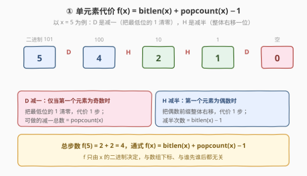
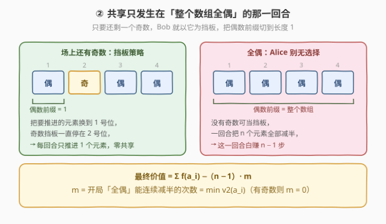
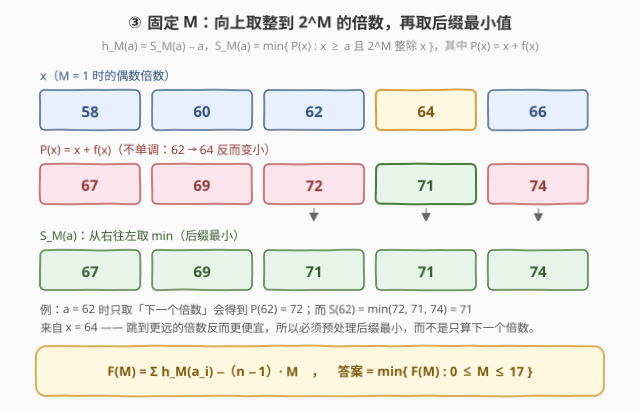
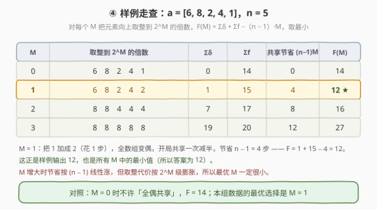

# Codeforces 2246D diss_quack 与数组游戏 题解

## 1. 题目概述

- **标题 / 题号**：diss_quack 与数组游戏（Codeforces 2246D，英文名 diss_quack and Array Game）
- **链接**：https://codeforces.com/problemset/problem/2246/D
- **来源**：Codeforces Round 1108 (Div. 2) · Problem D（UTC 2026-07-12）
- **难度**：1900（Div. 2 D，1750 分）
- **限制**：时间 2 s / 内存 256 MB
- **标签**：位运算、暴力枚举、博弈、贪心

**题意**：给定长度 $n$ 的数组 $a$，对局分两段。

1. **开局**：Alice 可任选下标做任意次「加一」，每次算 1 步。
2. **对局**（Bob 先手、双方交替）：Bob 每回合交换任意两个下标（允许 $i=j$，即不动）；Alice 每回合若 $a_1$ 为偶数，就把**最长的全偶前缀**整体除以 2，否则把 $a_1$ 减 1。任何元素变成 0 就立即删除并重排下标，数组为空时游戏结束。

Alice 最小化自己的总步数（开局加一 + 对局回合数），Bob 最大化它，求双方最优时的步数。多测。

**约束**：

- $1\le t\le 10^4$，$1\le n\le 10^5$，$\sum n\le 10^5$，$1\le a_i\le 10^5$
- 每个元素至多 $\mathrm{bitlen}+\mathrm{popcount}-1\le 34$ 步，答案 $\le 3.4\times10^6$；但枚举 $M$ 的中间量可达 $n\cdot2^{17}$，必须用 `long long`
- 时间 2 s 允许 $O\!\left(2^{17}+\sum n\log A\right)$

## 2. 示例与观察
官方样例（4 组）：

```text
输入：
4
3
1 2 3
4
2 2 2 2
5
6 8 2 4 1
8
1 3 5 7 9 11 13 15

输出：
6
5
12
35
```

第 3 组是主演案例：把开头的 $1$ 加成 $2$（1 步）后全偶，一次减半同时推进 5 个元素，总 12 步。第 4 组全是奇数，答案 35 反而小于 $\sum f=37$：全部加 1 变偶（8 步）换来 $n-1=7$ 步共享，且 $15\to16,7\to8,11\to12$ 让这些元素自身代价合计下降 3 步，净赚 2 步。

补充一组自造样例（★）：

```text
输入（★自造）：
3
1
15
2
1 1
3
65536 65536 65536

输出（★）：
6
2
19
```

$[15]$ 加一到 $16$ 只需 1 步、$f(16)=5$，总 6 步优于 $f(15)=7$；$[1,1]$ 各 1 步共 2 步；$[65536,65536,65536]$ 三者都是 $2^{16}$、$\mathrm{v2}=16$、$f=17+1-1=17$，$\sum f=51$ 省 $2\times16=32$ 得 19。

## 3. 解题思路

### 3.1 暴力思路

直接模拟：Bob 每回合枚举 $\binom n2+1$ 种交换，Alice 的行动被规则完全锁死。但状态随每个元素的进度指数增长，再叠加 Alice 开局任意的加一，$n=10^5$ 无从下手。出路是把对局闭式化：每个元素都有一条固定操作链，唯一有悬念的是「能否共用一次减半」。

### 3.2 核心观察：单元素代价链 + 挡板博弈



**观察 1**：奇偶完全决定下一步——奇数只能减一（把最低位的 1 清零），偶数只能减半（右移一位），最高位的 1 减一后元素消失。于是

$$f(x)=\#D+\#H=\operatorname{popcount}(x)+\bigl(\operatorname{bitlen}(x)-1\bigr)=\operatorname{bitlen}(x)+\operatorname{popcount}(x)-1 .$$

**观察 2**：只有「当前活着的元素全为偶数」时，才会被同一次减半一起处理。



- **挡板**：只要场上有奇数 $o$，Bob 就把它固定在 2 号位，把要推进的元素换到 1 号位——该元素为奇则减一，为偶则全偶前缀被 $o$ 截断成长为 1。挡板自身不推进，直到它是最后剩下的元素，那时减半只作用于它，也不共享。
- **全偶**：Alice 没得选，一回合把 $n$ 个元素一起减半，只花 1 步，白赚 $n-1$ 步。

设 $m=\min_i\operatorname{v2}(a_i)$（有奇数则 $m=0$）。前 $m$ 回合必然全偶且 $n$ 个元素都在场，这份节省谁也改不了；第 $m$ 回合后 $\mathrm{v2}$ 最小者变奇数，Bob 立刻拿它当挡板，之后不再有共享。于是

$$V(a)=\sum_i f(a_i)-(n-1)m .$$

### 3.3 算法流程：枚举 $M$ + 倍数上的后缀最小



Alice 的加一等价于先选定最终数组 $b_i\ge a_i$、再付代价 $\sum(b_i-a_i)$，于是答案就是

$$\min_{b_i\ge a_i}\Bigl[\sum_i\bigl(b_i-a_i+f(b_i)\bigr)-(n-1)\nu(b)\Bigr]$$

其中 $\nu(b)=\min_i\operatorname{v2}(b_i)$，数组含奇数时约定 $\nu=0$。

固定 $M=\nu(b)$ 后约束变成「$b_i$ 全是 $2^M$ 的倍数」，各元素**互相独立**。记 $P(x)=x+f(x)$，预处理

$$S_M(a)=\min\{P(x):x\ge a,\ 2^M\mid x\},\quad h_M(a)=S_M(a)-a,\quad F(M)=\sum_i h_M(a_i)-(n-1)M,$$

答案即 $\min_{0\le M\le17}F(M)$。$P$ 并不单调（$P(62)=72>P(64)=71$，跳到更远的倍数反而更便宜），所以要在倍数序列上从右往左取**后缀最小**；查询下标 $k=\lceil a/2^M\rceil$ 就得到 $S_M(a)$，$O(1)$。

### 3.4 示例演算



$a=[6,8,2,4,1]$，$n=5$：

| $M$ | 取整后的数组 | $\sum\delta$ | $\sum f$ | 共享节省 $(n-1)M$ | $F(M)$ |
|---|---|---|---|---|---|
| 0 | 6 8 2 4 1 | 0 | 14 | 0 | 14 |
| 1 | 6 8 2 4 2 | 1 | 15 | 4 | **12** |
| 2 | 8 8 4 4 4 | 7 | 17 | 8 | 16 |
| 3 | 8 8 8 8 8 | 19 | 20 | 12 | 27 |

$M=1$ 只把 $1$ 加成 $2$（1 步），却换来 5 元素共享（省 4 步），$F(1)=1+15-4=12$，与官方输出一致。再验第 4 组 $[1,3,5,\dots,15]$：$M=0$ 得 36，$M=1$ 得 $8+34-7=35$，$M=2$ 又回到 36，故答案 35。

## 4. 算法细节

1. **只预处理一次**：$P$ 表与后缀最小表与数据无关，在 `main` 开头建好；每组只做 $O(18n)$ 求和，否则 $t=10^4$ 必超时。
2. **$\mathrm{bitlen}$**：C++ 用 `32 - __builtin_clz(x)`，Python 用 `x.bit_length()`；不要用 `log2`，$x=2^k$ 处会因精度错一位。
3. **上取整下标**：`idx = (a + (1 << M) - 1) >> M`；写成 `a >> M` 会查到 $\le a$ 的倍数，$h_M$ 变成非正数。
4. **$M$ 的上界**：$a_i<2^{17}$，$M\ge17$ 时每个元素至少加到 $131072$（$\delta\ge31072$），收益远不能抵，所以 $M\le16$ 就够，循环到 17 只是保险。
5. **$x$ 的上界 $A2=2^{17}$**：$P(x)\ge x$，而 $M=0$ 已有候选 $P(a)\le100034$，故 $x>A2$ 不可能最优；同时 $A2$ 正是 $M\le17$ 时各元素的「下一个倍数」。
6. **溢出与 I/O**：求和用 `long long`；C++ 用 `scanf`，Python 用 `sys.stdin.buffer.read().split()` 一次读入。
7. **不要模拟交换**：挡板引理已把博弈压成「有没有共享」一个比特，$O(n^2)$ 的模拟纯属浪费。

## 5. 正确性证明

**引理 1（单元素代价）**：把 $x$ 消到 0 恰需 $\operatorname{popcount}(x)$ 次减一与 $\operatorname{bitlen}(x)-1$ 次减半，即 $f(x)$ 步。

**证明**：对 $x$ 归纳。$x=1$ 时一次减一，$1=1+1-1$。$x$ 为偶数时先减半得 $x/2$，$\mathrm{popcount}$ 不变、$\mathrm{bitlen}$ 减 1。$x>1$ 为奇数时先减一再减半得 $x\gg1$，而 $\operatorname{popcount}(x)=1+\operatorname{popcount}(x\gg1)$、$\operatorname{bitlen}(x)-1=\operatorname{bitlen}(x\gg1)$，两次操作正好对上。∎

**引理 2（挡板）**：只要场上还有奇数，Bob 能让此后每回合至多只有 1 个元素被减半。

**证明**：取奇数 $o$ 置于 2 号位且永不推进（$n=1$ 时它独自推进，显然不共享）。推进 $t$ 时把 $t$ 换到 1 号位：$t$ 为奇则只能减一；$t$ 为偶时因 $a_2=o$ 为奇数，全偶前缀长度只能是 1。2 号位始终不变，其余元素逐个推进到被删除；最后只剩 $o$，长度 1，减半也只作用于它。∎

**引理 3（全偶必共享，连续恰好 $m$ 次）**：全偶回合 Alice 必然整体减半；从 $a$ 出发这样的回合恰连续发生 $m=\min_i\operatorname{v2}(a_i)$ 次（有奇数则 $m=0$），且这 $m$ 回合中 $n$ 个元素全在场。

**证明**：全偶时最长全偶前缀就是整个数组。减半后仍全偶 $\iff$ 所有 $\operatorname{v2}\ge2$，归纳得第 $k$ 回合全偶 $\iff k<m$。正偶数减半不会得 0，故元素都在场。∎

**定理 1**：固定数组时 $V(a)=\sum_i f(a_i)-(n-1)m$。

**证明**：总操作数为 $\sum_i f(a_i)$（引理 1）。某回合同时减半 $k$ 个元素，相当于用 1 步抵掉 $k$ 次减半操作，节省 $k-1$（减一回合 $k=1$，无节省）；设总节省为 $S$，总步数 $=\sum_i f(a_i)-S$。
**任何走法都不超过**：由引理 3，前 $m$ 回合必为全偶、每回合省 $n-1$，故 $S\ge m(n-1)$。
**Bob 能保证达到**：前 $m$ 回合无可干预（全偶），此后改用引理 2 的挡板策略，再无「多元素同减半」，$S=m(n-1)$。
两向夹逼即得。∎

**定理 2**：答案 $=\min_{0\le M\le17}F(M)$，且该式对「松弛后」的 $F$ 也成立。

**证明**：先证松弛不改最小值：在 $M$ 处可行的 $b$ 满足 $\nu(b)\ge M$，其真实代价 $\le$ 该 $b$ 在 $F(M)$ 中对应的项，故 $F(M)\ge$ 答案；取最优 $b^*$ 与 $M^*=\nu(b^*)$，则 $F(M^*)\le$ 答案，夹逼得 $\min_M F(M)=$ 答案。
再证实现正确：$S_M(a)$ 是 $2^M$ 倍数序列上的后缀最小，在 $k=\lceil a/2^M\rceil$ 处查询恰好覆盖所有 $\ge a$ 的倍数，故 $h_M(a)=\min_{x\ge a,\,2^M\mid x}\bigl(x-a+f(x)\bigr)$，各元素独立求和即 $F(M)$。枚举上界也安全：$P(x)\ge x>A2$ 必有更便宜的 $x\le A2$，而 $M>17$ 时 $\delta\ge2^{17}-10^5$ 远超任何节省。∎

## 6. 复杂度分析

- **预处理** $O(2^{17})$：$P$ 表 $2^{17}$ 项，后缀最小 $\sum_{M=0}^{17}2^{17-M}<2\cdot2^{17}$。
- **单组** $O(18n)$、额外空间 $O(1)$；总计 $O\!\left(2^{17}+18\sum n\right)\approx4\times10^6$ 次运算。
- **实测**：最大数据 C++ 约 10 ms（时限 2 s，余量 200 倍以上），Python3 约 0.3 s；空间约 1.5 MB（含表），远低于 256 MB。

## 7. 参考代码

### C++17

```cpp
#include <cstdio>
#include <vector>
#include <algorithm>
#include <climits>
using namespace std;

static const int A2 = 1 << 17;            // 131072 > max a_i
static int Pv[A2 + 1];

int main() {
    // P(x) = x + f(x), f(x) = bitlen(x) + popcount(x) - 1
    for (int x = 1; x <= A2; ++x) {
        int bl = 32 - __builtin_clz((unsigned)x);
        int pc = __builtin_popcount((unsigned)x);
        Pv[x] = x + bl + pc - 1;
    }
    const int MAXM = 17;
    vector<vector<int>> suf(MAXM + 1);
    for (int M = 0; M <= MAXM; ++M) {
        int step = 1 << M, cnt = A2 >> M;   // 倍数 k*step, k = 0..cnt
        suf[M].assign(cnt + 2, INT_MAX);
        for (int k = cnt; k >= 0; --k)      // suf[M][k] = min_{j>=k} P(j*step)
            suf[M][k] = min(suf[M][k + 1], Pv[k * step]);
    }
    int t;
    if (scanf("%d", &t) != 1) return 0;
    while (t--) {
        int n;
        scanf("%d", &n);
        vector<int> a(n);
        for (int i = 0; i < n; ++i) scanf("%d", &a[i]);
        long long ans = LLONG_MAX;
        for (int M = 0; M <= MAXM; ++M) {
            int step = 1 << M;
            const vector<int> &s = suf[M];
            long long tot = 0;
            for (int x : a) {
                int idx = (x + step - 1) >> M;      // ceil(x / 2^M)
                tot += (long long)s[idx] - x;       // h_M(x)
            }
            tot -= (long long)(n - 1) * M;          // 共享节省
            ans = min(ans, tot);
        }
        printf("%lld\n", ans);
    }
    return 0;
}
```

### Python3

```python
import sys


def main():
    data = sys.stdin.buffer.read().split()
    A2 = 1 << 17                       # 131072 > max a_i
    P = [0] * (A2 + 1)
    for x in range(1, A2 + 1):
        P[x] = x + x.bit_length() + bin(x).count("1") - 1

    # suf[M][k] = min(P(j * 2^M)) for j >= k
    suf = []
    for M in range(18):
        step = 1 << M
        cnt = A2 >> M
        arr = [0] * (cnt + 1)
        best = 1 << 30
        for k in range(cnt, -1, -1):
            v = P[k * step]
            if v < best:
                best = v
            arr[k] = best
        suf.append(arr)

    pos = 0
    t = int(data[pos]); pos += 1
    out = []
    for _ in range(t):
        n = int(data[pos]); pos += 1
        a = list(map(int, data[pos:pos + n])); pos += n
        ans = 1 << 60
        for M in range(18):
            step = 1 << M
            arr = suf[M]
            tot = 0
            for x in a:
                tot += arr[(x + step - 1) >> M] - x
            tot -= (n - 1) * M
            if tot < ans:
                ans = tot
        out.append(str(ans))
    sys.stdout.write("\n".join(out) + "\n")


main()
```

## 8. 边界情况与易错点

1. **$n=1$**：$(n-1)M=0$，答案就是 $h_0(a)$；「加到最近的 2 的幂」常常最优（$15\to16$ 得 6 而非 7）。把 $M$ 从 1 开始循环会算错。
2. **全 1 数组**：$m=0$，答案恰为 $n$；共享项为 0，不能因此返回 `INF`。
3. **全偶但只含一个 $2$**：如 $[2,4,6]$，$m=1$，答案 $9-2=7$；$M=2$ 强行抬到 4 的倍数反而更贵（10）。
4. **$a_i$ 贴近 $10^5$**：$A2$ 必须取 $2^{17}=131072$，否则 $M=0$ 时「加到 $131072$」这个候选被漏掉，边界数据会 WA。
5. **多测性能**：表只建一次；$t=10^4$ 且每组 $n=10$ 时若无脑重建表必然 TLE。
6. **溢出**：$F(M)$ 的中间量可达 $10^{10}$，必须 `long long`，尽管答案本身只有 $3.4\times10^6$。
7. **别在固定 $M$ 时枚举 $x$**：$M=17$ 时单个元素要试十几万个数，$O(n\cdot2^M)$ 直接爆炸，必须用后缀最小。

## 9. 验证记录

- **编译环境与命令**：`clang++ -std=c++17 -O2`（本机无 GNU g++，配 `codeforces/tools/include/bits/stdc++.h` 兼容头；正文代码只用标准库，可原样提交 GNU C++17）；Python 侧为 `Python 3.9.6`。
- **官方样例**：1 / 1 通过（按 Codeforces 标准 checker 的 token 比对，忽略空白与大小写）。
- **复核状态**：audited（2026-11-19 统一回归：编译 + 官方样例；写作期的随机对拍与暴力未重跑）。

## 相关题目与扩展

- [Codeforces 2246A 农场小猪与子集和](https://codeforces.com/problemset/problem/2246/A)：同场签到题，构造 + 不变量。
- [Codeforces 2246B ezraft 与数组](https://codeforces.com/problemset/problem/2246/B)：同场 B 题，构造 + 数论。
- [LeetCode 1342. 将数字变成 0 的操作次数](https://leetcode.cn/problems/number-of-steps-to-reduce-a-number-to-zero/)：偶数除 2、奇数减 1，正是本题单元素代价 $f(x)$ 的原型。
- [LeetCode 397. 整数替换](https://leetcode.cn/problems/integer-replacement/)：同一条操作链，但要自己选「奇数时加一还是减一」，是本题 Alice 开局加一的前身。
- [LeetCode 1611. 使整数变为 0 的最少操作次数](https://leetcode.cn/problems/minimum-one-bit-operations-to-make-integers-zero/)：另一种按位消去的代价模型，可与 $f$ 的推导对照。

**延伸思考**：若 Bob 每回合只能交换**相邻**两个元素，挡板引理还成立吗（挡板能否长期驻留 2 号位）？若 Alice 每回合可以**自选**全偶前缀长度（而非取最长），她能把共享做得更彻底，答案会怎么变？再把「加一」换成 $x\to x+k$ 花 1 步，最优 $M$ 的取舍就变成一次按 $2^M$ 分层的背包式选择。
