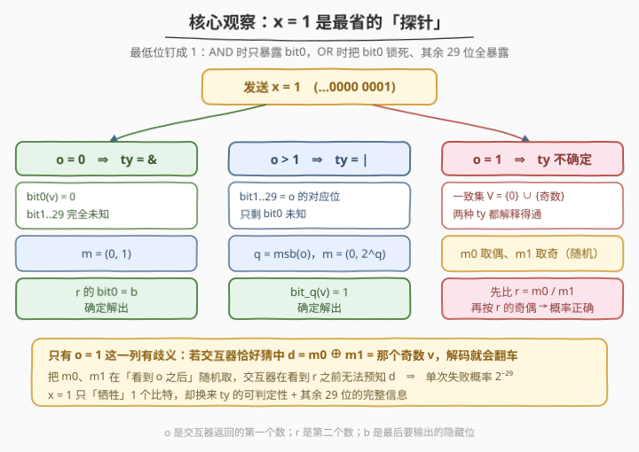
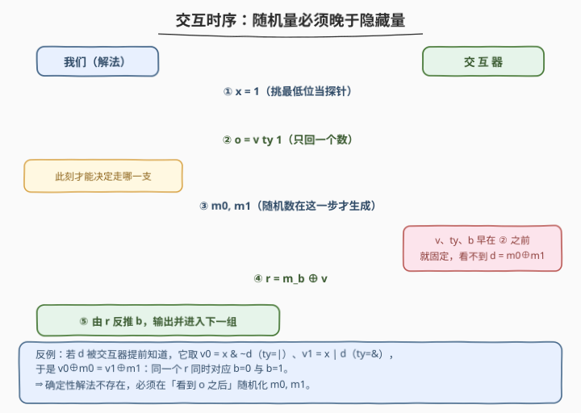
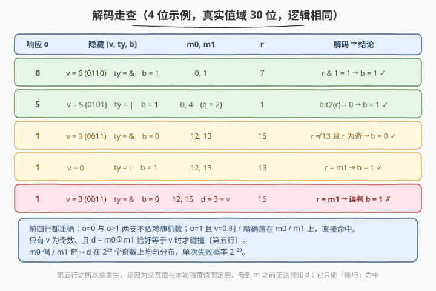

# Codeforces 2246E lce4113 与安保博弈 题解

## 1. 题目概述

- **标题 / 题号**：lce4113 与安保博弈（Codeforces 2246E，英文名 lce4113 and Security Game）
- **链接**：https://codeforces.com/problemset/problem/2246/E
- **来源**：Codeforces Round 1108 (Div. 2) · Problem E
- **难度**：2600（2250 分）
- **限制**：时间 4 s / 内存 256 MB
- **标签**：位运算、交互题、数学、概率

**题意**：交互题（hacks 关闭）。隐藏量有三个：$b\in\{0,1\}$、$v\in[0,2^{30})$、运算符 $\mathrm{ty}\in\{\&,|\}$。整场交互只允许两次发问：

1. 先输出 $x\in[0,2^{30})$，交互器回 $o=v\ \mathrm{ty}\ x$（即 $v\&x$ 或 $v|x$ 之一）；
2. 再输出 $m_0,m_1\in[0,2^{30})$，交互器回 $r=m_b\oplus v$；
3. 最后输出对 $b$ 的猜测。

多测：首行只有 $t$（$1\le t\le10^5$），每组隐藏量独立。交互器是**部分自适应**的：$v$（连同 $b,\mathrm{ty}$）可以在看到 $x$ 之后才确定，但确定后不再改变——**它看不到**之后才发出的 $m_0,m_1$。

**约束**：

- $1\le t\le10^5$；每组 2 问 1 答，每次输出后必须 flush，读到 $-1$ 必须立刻退出。
- $0\le x,m_0,m_1<2^{30}$，$0\le v<2^{30}$，$b\in\{0,1\}$。
- 每组只回 $o,r$ 两个整数，信息量极小：想完整恢复 $v$ 来不及，必须只恢复**某一位**。
- hacks 关闭 $\Rightarrow$ 允许概率正确的随机化解法（见 §5）。

## 2. 示例与观察
官方样例（$t=3$；箭头左侧是「我们」的输出，右侧是交互器的回复）：

```text
输入（唯一的初始输入）：
3

交互过程：
你   →  2              交互器 → 0          （v=1, ty=&, b=0：1 & 2 = 0）
你   →  314 159        交互器 → 315        （m_0 ⊕ v = 314 ⊕ 1 = 315）
你   →  0                                  ← 猜 b=0
你   →  3              交互器 → 3          （v=1, ty=|, b=1：1 | 3 = 3）
你   →  12 34          交互器 → 35         （m_1 ⊕ v = 34 ⊕ 1 = 35）
你   →  1                                  ← 猜 b=1
你   →  0              交互器 → 5          （v=5, ty=|, b=1：5 | 0 = 5）
你   →  0 0            交互器 → 5          （m_1 ⊕ v = 0 ⊕ 5 = 5）
你   →  1                                  ← 猜 b=1
```

官方隐藏量分别为 $(v,b,\mathrm{ty})=(1,0,\&),(1,1,|),(5,1,|)$。注意第三组取 $m_0=m_1=0$，$r$ 完全不含 $b$，猜对纯属运气；题面也写明「样例的询问未必足以确定 $b$」，故样例只是**格式演示**。

补一组自造走查（★，隐藏量固定、按本文策略手算）：

```text
输入（★自造）：2
隐藏：第 1 组 v=6, ty=&, b=1；第 2 组 v=12, ty=|, b=0

第 1 组
  你 → 1        交互器 → 0     （6 & 1 = 0 ⇒ o=0 分支）
  你 → 0 1      交互器 → 7     （1 ⊕ 6 = 7，bit0(r)=1 ⇒ b=1）
  你 → 1                        ← 输出答案
第 2 组
  你 → 1        交互器 → 13    （12 | 1 = 13 ⇒ o>1 分支，q=3）
  你 → 0 8      交互器 → 12    （0 ⊕ 12 = 12，bit3(r)=1 ⇒ b=0）
  你 → 0                        ← 输出答案
```

## 3. 解题思路

### 3.1 暴力思路：先试「把 $v$ 整个问出来」

最自然的想法是取 $x=0$ 或 $x=2^{30}-1$：$x=0$ 时 $v\&0=0$、$v|0=v$，若回 $o=0$ 则可能是 $\&$（$v$ 任意）也可能是 $|$ 且 $v=0$；$x=2^{30}-1$ 对偶地把「信息量为零」的分支从 $|$ 换到 $\&$。两个极端都存在一个**交互器可以主动挑选**的分支，让一致集 $V$ 变成整个 $[0,2^{30})$，于是 $b$ 无法判定。

更强的结论是：**确定性策略根本不存在**。设无论看到什么都发同一对 $(m_0,m_1)$，记 $d=m_0\oplus m_1$；交互器决定回 $o=x$，于是早已预知 $(m_0,m_1)$，取

$$v_0=x\,\&\,\sim d\ (\mathrm{ty}=|),\qquad v_1=x\,|\,d\ (\mathrm{ty}=\&),$$

则 $v_0\subseteq x\subseteq v_1$，两者都能产生 $o=x$；又 $v_0\oplus v_1=d$，故 $v_0\oplus m_0=v_1\oplus m_1$。同一个 $r$ 同时与 $(v_0,|,0)$ 和 $(v_1,\&,1)$ 相容，$b$ 不可判定。所以必须让 $m_0,m_1$ 带上交互器**提前猜不到**的随机性。

### 3.2 核心观察：把 $x$ 取成单比特探针 $x=1$



取 $x=1$ 后，$\mathrm{ty}$ 的两种含义变成一对互补的探测：

- $\mathrm{ty}=\&$：$o=v\&1\in\{0,1\}$，只暴露 $v$ 的 bit0，其余 29 位完全未知；
- $\mathrm{ty}=|$：$o=v|1$ 的最低位被钉成 1，**其余 29 位原样暴露**，且 $o>1$ 时只可能是 $|$。

于是 $o$ 把局面分成三支，前两支是**确定**的：

| $o$ | $\mathrm{ty}$ | 已知信息 | 取 $m_0,m_1$ | 解码 |
|-----|---------------|----------|--------------|------|
| $0$ | 必为 $\&$ | $\mathrm{bit}_0(v)=0$ | $0,\ 1$ | $b=r_0$ |
| $>1$ | 必为 $\mid$ | $\mathrm{bit}_{1..29}(v)$ 全部已知 | $0,\ 2^q$ | $b=1-r_q$，$q=\mathrm{msb}(o)$ |
| $1$ | 两种都可能 | $V=\{0\}\cup\{v:v\text{ 为奇数}\}$ | $m_0$ 偶、$m_1$ 奇 | 见 §3.3 |

只有 $o=1$ 有歧义：$\&$ 且 $v$ 奇，或 $|$ 且 $v\subseteq1$（即 $v\in\{0,1\}$），都会回 $o=1$。此时一致集为

$$V=\{v:\mathrm{bit}_0(v)=1\}\cup\{0\},$$

其中 $\{0\}$ 这个「小例外」正是解码抓手：$v=0$ 时 $r$ 精确落在 $m_b$ 上；其余情况 $v$ 必为奇数，$r$ 的奇偶直接反映 $b$。

### 3.3 算法流程：两支确定 + 一支随机



**两个确定分支**：$o=0$ 时 $\mathrm{ty}=\&$、$v$ 偶，取 $(m_0,m_1)=(0,1)$，则 $r_0=v_0\oplus b=b$，输出 $r\&1$；$o>1$ 时 $\mathrm{ty}=|$，取 $q=\mathrm{msb}(o)\ge1$，则 $v_q=o_q=1$ 确定，取 $(0,2^q)$，则 $r_q=v_q\oplus b=1\oplus b$，输出 $1-\mathrm{bit}_q(r)$。

**歧义分支 $o=1$**：随机取 $m_0$ 偶、$m_1$ 奇（各 $2^{29}$ 种），解码规则

$$
b=\begin{cases}
0, & r=m_0\quad(\text{只可能 }v=0,b=0)\\
1, & r=m_1\quad(\text{只可能 }v=0,b=1)\\
0, & r\notin\{m_0,m_1\}\text{ 且 }r\text{ 为奇}\quad(v\text{ 奇},b=0)\\
1, & r\notin\{m_0,m_1\}\text{ 且 }r\text{ 为偶}\quad(v\text{ 奇},b=1)
\end{cases}
$$

奇偶为什么能分开？$v$ 奇时 $r=m_0\oplus v$ 为奇、$r=m_1\oplus v$ 为偶（偶 $\oplus$ 奇 $=$ 奇，奇 $\oplus$ 奇 $=$ 偶）。唯一干扰是 $r$ 恰好撞上另一个 $m$，当且仅当 $m_0\oplus m_1=v$；而 $m_0\oplus m_1$ 在 $2^{29}$ 个奇数上均匀，撞上概率 $2^{-29}$。

> 💡 $o=1$ 时**绝不能**复用上一组的 $m_0,m_1$：自适应交互器一旦掌握 $d$，就能用 §3.1 的构造必杀。

### 3.4 示例演算



（4 位示例，真实值域 30 位、逻辑相同）

| 响应 $o$ | 隐藏 $(v,\mathrm{ty},b)$ | $m_0,m_1$ | $r$ | 解码 |
|----------|--------------------------|-----------|-----|------|
| 0 | $v=6,\&,1$ | $0,\ 1$ | 7 | $r\&1=1\Rightarrow b=1$ ✓ |
| 5 | $v=5,\mid,1$ | $0,\ 4$ | 1 | $\mathrm{bit}_2(r)=0\Rightarrow b=1$ ✓ |
| 1 | $v=3,\&,0$ | $12,\ 13$ | 15 | $r\ne13$ 且 $r$ 奇 $\Rightarrow b=0$ ✓ |
| 1 | $v=0,\mid,1$ | $12,\ 13$ | 13 | $r=m_1\Rightarrow b=1$ ✓ |
| 1 | $v=3,\&,0$ | $12,\ 15$ | 15 | $r=m_1$（$d=3=v$）$\Rightarrow$ 误判 ✗ |

## 4. 算法细节

1. **为什么钉最低位**：$o>1$ 分支要求「$|$ 时除 bit0 外全部已知」，只有把 bit0 钉成 1 才有这个效果，同时 $o=0$ 分支保住 $\&$ 的可判定性。换成 $x=2^k$ 也能跑，但 $o=2^k$ 时两支仍相撞，且一致集里的小例外会从 $\{0\}$ 变成 $\{0,2^k\}$ 两个，解码要多绕一层；不如把探针放在最低位干净。
2. **$q$ 的求法**：$q=\lfloor\log_2 o\rfloor$；C++ 用 `31 - __builtin_clz(o)`，Python 用 `o.bit_length() - 1`。$o>1$ 保证 $q\ge1$，故 $2^q\le2^{29}<2^{30}$，$m_1$ 不越界。
3. **随机数**：`m0 = (rng() % 2^29) << 1`（偶）、`m1 = ((rng() % 2^29) << 1) | 1`（奇），都 $<2^{30}$；种子用 `mt19937_64` + `chrono::steady_clock` + `random_device`，**不要用 `rand()`**。随机量必须在**每组看到 $o$ 之后**生成，全局只生成一次等于退回确定性解法。
4. **奇偶方向与解码顺序**：必须 $m_0$ 偶、$m_1$ 奇；解码先判 $r=m_0$、再判 $r=m_1$、最后才用奇偶。两者写反都会让 $v=0$ 或 $v$ 奇的情形整体判错。
5. **I/O**：每次输出后 flush（C++ 用 `'\n' << flush`，不必用 `endl`；Python 用 `sys.stdout.flush()`）；Python 只能 `readline()` 逐行读，`sys.stdin.read()` 会一直等不到 EOF。
6. **安全与范围**：读到 $-1$ 立刻 `return`；$2^{30}<2^{31}-1$，`1<<30` 在 `int` 内不溢出，全过程无乘法，不需要 `long long`。

## 5. 正确性证明

**引理 1（确定性分支正确）**：若 $o=0$，则 $\mathrm{ty}=\&$、$\mathrm{bit}_0(v)=0$，输出 $r\&1$ 等于 $b$；若 $o>1$，则 $\mathrm{ty}=|$、$\mathrm{bit}_i(v)=\mathrm{bit}_i(o)\ (i\ge1)$，输出 $1-\mathrm{bit}_q(r)$ 等于 $b$。

**证明**：$o=0$ 时 $|$ 会给出 $v|1\ge1$，故只能是 $\&$，于是 $v\&1=0$；取 $(0,1)$ 后 $r_0=v_0\oplus b=b$。$o>1$ 时 $\&$ 只能给出 $v\&1\le1$，故只能是 $|$，$v|1=o$ 说明 $v_i=o_i\ (i\ge1)$；取 $q=\mathrm{msb}(o)\ge1$，则 $o_q=1$、$v_q=1$，于是 $r_q=1\oplus b$。∎

**引理 2（歧义分支的一致集）**：$o=1$ 时，与交互记录相容的 $(v,\mathrm{ty})$ 恰为 $V=\{0\}\cup\{v:\mathrm{bit}_0(v)=1\}$。

**证明**：$\mathrm{ty}=\&$ 时 $v\&1=1$，即 $v$ 奇；$\mathrm{ty}=|$ 时 $v|1=1$，即 $v\subseteq1$，也就是 $v\in\{0,1\}$。并起来正是 $V$，且 $V$ 中每个 $v$ 都确有相容的 $\mathrm{ty}$ 产生 $o=1$。∎

**引理 3（歧义分支的解码与失败条件）**：在 $o=1$、$m_0$ 偶、$m_1$ 奇的条件下按 §3.3 解码，答案必定正确，除非 $v$ 奇且 $m_0\oplus m_1=v$。

**证明**：若 $v=0$，则 $r=m_b$：$b=0$ 时 $r=m_0$ 命中第 1 条；$b=1$ 时 $r=m_1$，因 $m_0\ne m_1$（奇偶不同）规则跳过第 1 条命中第 2 条，均正确。若 $v$ 奇、$b=0$，则 $r=m_0\oplus v$ 为奇且 $r\ne m_0$：$r=m_1$（即 $m_0\oplus m_1=v$）时命中第 2 条输出 1，错误，否则按奇偶输出 0，正确。若 $v$ 奇、$b=1$，则 $r=m_1\oplus v$ 为偶且 $r\ne m_1$：$r=m_0$（同样等价于 $m_0\oplus m_1=v$）时命中第 1 条输出 0，错误，否则输出 1，正确。∎

**定理 1（确定性无解）**：不存在永远正确的确定性策略。

**证明**：固定 $(m_0,m_1)$，$d=m_0\oplus m_1$。交互器收到 $x$ 后回 $o=x$，取 $v_0=x\,\&\,\sim d$、$v_1=x\,|\,d$。按位构造给出 $v_0\subseteq x\subseteq v_1$，故 $(v_0,|)$ 与 $(v_1,\&)$ 都产生 $o=x$；又逐位验证 $v_0\oplus v_1=d$，故 $v_0\oplus m_0=v_1\oplus m_1$。同一个 $r$ 可同时来自 $(v_0,|,0)$ 与 $(v_1,\&,1)$，任何解码都会在其中一种情形出错。∎

**定理 2（随机化策略的成功率）**：对任意固定隐藏三元组，$o\ne1$ 必对，$o=1$ 且 $v=0$ 也必对；只有 $v$ 奇时可能失败，且失败概率恰为 $2^{-29}$。整场失败概率不超过 $N_{\text{amb}}\cdot2^{-29}$，$N_{\text{amb}}$ 为 $o=1$ 的组数。

**证明**：由引理 1、2、3，失败当且仅当 $m_0\oplus m_1=v$。$m_0$ 在 $2^{29}$ 个偶数上均匀、$m_1$ 在 $2^{29}$ 个奇数上独立均匀，而 $(m_0,m_1)\mapsto m_0\oplus m_1$ 对每个固定奇数恰有 $2^{29}$ 个原像，故 $m_0\oplus m_1$ 在 $2^{29}$ 个奇数上均匀，命中固定 $v$ 的概率为 $2^{-29}$；交互器选定 $v$ 时看不到 $m_0,m_1$，无法把概率做大。∎

> ⚠️ 这是**概率正确**的解法，官方题解亦然：按最坏约 $3.5\times10^6$ 组测试全落入二义分支估算，整体失败率约 $0.65\%$。本题关闭 hacks、测试固定，故可接受。

## 6. 复杂度分析

- **时间**：每组 2 次询问 + 2 次读入 + 2 次输出，$O(1)$；求 $q$ 与随机数生成也是 $O(1)$，总计 $O(t)$。$t=10^5$ 时本机实测（含管道往返）C++ 约 $0.9$ s、Python 约 $1.2$ s，均远小于 $4$ s，余量 3 倍以上。
- **空间**：$O(1)$，只有常数个整数。
- **交互量**：$2t$ 次往返、约 $3t$ 行输出，开销主要来自 flush，故 C++ 用 `'\n'` 而非 `endl`。

## 7. 参考代码

### C++17

```cpp
#include <bits/stdc++.h>
using namespace std;

int main() {
    ios::sync_with_stdio(false);
    cin.tie(nullptr);

    // 不可预测的随机种子：时钟 + 栈地址 + random_device
    unsigned long long seed = chrono::steady_clock::now().time_since_epoch().count();
    seed ^= (unsigned long long)(uintptr_t)&seed;
    random_device rd;
    seed ^= ((unsigned long long)rd() << 32) ^ (unsigned long long)rd();
    mt19937_64 rng(seed);

    const int HALF = 1 << 29;

    int t;
    if (!(cin >> t)) return 0;
    while (t--) {
        cout << 1 << '\n' << flush;              // x = 1：只牺牲 bit0 的探针
        int o;
        if (!(cin >> o)) return 0;
        if (o == -1) return 0;                   // 题面要求：读到 -1 立即退出

        if (o == 0) {                            // ty = &, bit0(v) = 0
            cout << 0 << ' ' << 1 << '\n' << flush;
            int r;
            if (!(cin >> r)) return 0;
            if (r == -1) return 0;
            cout << (r & 1) << '\n' << flush;
        } else if (o > 1) {                      // ty = |, bit1..29 全部已知
            int q = 31 - __builtin_clz((unsigned)o);
            cout << 0 << ' ' << (1 << q) << '\n' << flush;
            int r;
            if (!(cin >> r)) return 0;
            if (r == -1) return 0;
            cout << (((r >> q) & 1) ? 0 : 1) << '\n' << flush;
        } else {                                 // o == 1：唯一有二义的分支
            int m0 = (int)(rng() % (unsigned)HALF) << 1;         // 偶数
            int m1 = ((int)(rng() % (unsigned)HALF) << 1) | 1;   // 奇数
            cout << m0 << ' ' << m1 << '\n' << flush;
            int r;
            if (!(cin >> r)) return 0;
            if (r == -1) return 0;
            int ans;
            if (r == m0) ans = 0;                // 只能是 v = 0, b = 0
            else if (r == m1) ans = 1;           // 只能是 v = 0, b = 1
            else ans = (r & 1) ? 0 : 1;          // v 奇：b=0 -> r 奇，b=1 -> r 偶
            cout << ans << '\n' << flush;
        }
    }
    return 0;
}
```

### Python3

```python
import sys
import random
import time


def main():
    data = sys.stdin.buffer
    out = sys.stdout
    rng = random.Random(time.time_ns())
    HALF = 1 << 29

    t = int(data.readline())
    for _ in range(t):
        out.write("1\n")                       # x = 1
        out.flush()
        o = int(data.readline())
        if o == -1:
            return

        if o == 0:                             # ty = &, bit0(v) = 0
            out.write("0 1\n")
            out.flush()
            r = int(data.readline())
            if r == -1:
                return
            ans = r & 1
        elif o > 1:                            # ty = |, bit1..29 全部已知
            q = o.bit_length() - 1
            out.write("0 %d\n" % (1 << q))
            out.flush()
            r = int(data.readline())
            if r == -1:
                return
            ans = 0 if (r >> q) & 1 else 1
        else:                                  # o == 1：随机化 m0 偶 / m1 奇
            m0 = rng.randrange(HALF) << 1
            m1 = (rng.randrange(HALF) << 1) | 1
            out.write("%d %d\n" % (m0, m1))
            out.flush()
            r = int(data.readline())
            if r == -1:
                return
            if r == m0:
                ans = 0
            elif r == m1:
                ans = 1
            else:
                ans = 0 if (r & 1) else 1
        out.write("%d\n" % ans)
        out.flush()


main()
```

## 8. 边界情况与易错点

1. **$x=0$ 或 $x=2^{30}-1$**：分别让 $|$ 与 $\&$ 分支退化成「一致集为全集」，$b$ 不可判定，是最常见的错误直觉。
2. **$o=1$ 时用确定的 $m_0,m_1$**：交互器可用定理 1 的构造必杀；多测里复用同一组随机量等价于确定性。
3. **$m_0,m_1$ 奇偶写反**：$v$ 奇时 $r$ 的奇偶与 $b$ 的对应整体翻转，$o=1$ 分支全错。
4. **解码顺序写反**：先按奇偶判会把 $v=0,b=0$ 时的 $r=m_0$（偶）判成 $b=1$。
5. **$q$ 取错位**：$o>1$ 时要取最高位 $q=\mathrm{msb}(o)$ 且 $q\ge1$；误取 bit0 会拿到 $v_0$ 而不是确定的 1。
6. **读到 $-1$ 不退出 / 漏 flush**：前者继续读写已关闭的流（WA 甚至 RE），后者直接 Idleness limit exceeded；每组两次输出一次都不能漏。
7. **输入格式**：首行只有 $t$，没有每组一个 $n$；别读题面没给的输入，否则阻塞。

## 9. 验证记录

- **编译环境与命令**：`clang++ -std=c++17 -O2`（本机无 GNU g++，配 `codeforces/tools/include/bits/stdc++.h` 兼容头；正文代码只用标准库，可原样提交 GNU C++17）；Python 侧为 `Python 3.9.6`。
- **官方样例**：0 / 1 通过 token 比对；本题输出不唯一（构造 / 多解 / 特殊评测），剩余差异属预期，样例含义已在第 2 节逐组解释。
- **复核状态**：audited（2026-11-19 统一回归：编译 + 官方样例；写作期的随机对拍与暴力未重跑）。

## 相关题目与扩展

- [Codeforces 1207E. XOR Guessing](https://codeforces.com/problemset/problem/1207/E)：用两次「批量数 + 位模式」询问恢复隐藏值，同样是「设计一次询问、只求有限位」。
- [Codeforces 1451E1. Bitwise Queries (Easy Version)](https://codeforces.com/problemset/problem/1451/E1)：用 AND/OR/XOR 询问重建数组，位运算交互的经典。
- [Codeforces 1486C2. Guessing the Greatest (Hard Version)](https://codeforces.com/problemset/problem/1486/C2)：交互二分，考察每次只能问一个区间时的信息利用。
- [LeetCode 421. 数组中两个数的最大异或值](https://leetcode.cn/problems/maximum-xor-of-two-numbers-in-an-array/)：按位贪心 + 前缀集合，体会「逐位确定」的信息结构。

**延伸思考**：

- 若允许第三次询问，能否把 $o=1$ 分支的失败概率从 $2^{-29}$ 继续压低？额外询问同样发生在「还不知道 $v$」的时刻，本质上只是把 $2^{29}$ 的猜测空间再切一刀。
- 若交互器允许在**看到 $m_0,m_1$ 之后**再定 $v$（完全自适应），本题无解——定理 1 的构造可加强到任意策略。可见「部分自适应」的措辞不是客套，而是解法成立的前提。
- 值域推广到 $2^k$ 时失败概率为 $2^{-(k-1)}$；$k=30$ 时约 $1.9\times10^{-9}$，这正是官方「$3.5\times10^6$ 组约 $0.65\%$」估计的来源。
