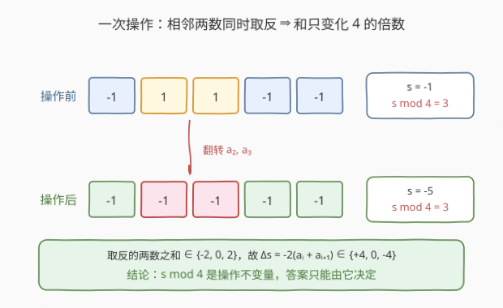
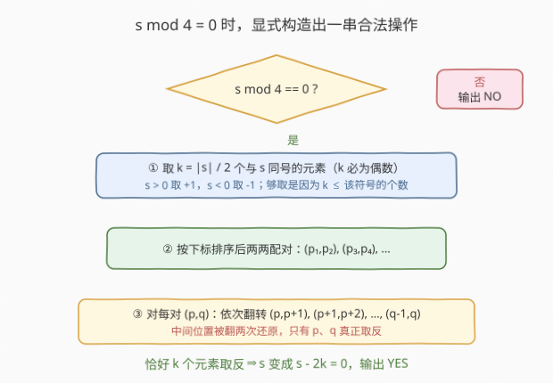
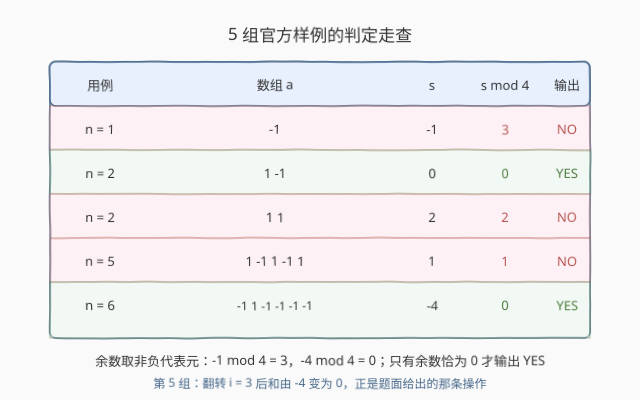

# Codeforces 2247A 零和 题解

## 1. 题目概述

- **标题 / 题号**：零和（Codeforces 2247A，英文名 Zero Sum）
- **链接**：https://codeforces.com/problemset/problem/2247/A
- **来源**：Codeforces Round 1111 (Div. 2) · Problem A（UTC 2026-07-18）
- **难度**：$\ast 800$（500 分）
- **限制**：时间 1 s / 内存 256 MB
- **标签**：构造、数论、不变量、结论（官方标签：constructive algorithms, dp, number theory）

**题意**：给定长度为 $n$ 的数组 $a$，每个元素只可能是 $-1$ 或 $1$。可以执行任意多次如下操作：选一个下标 $i\in[1,n-1]$，把 $a_i$ 与 $a_{i+1}$ **同时取反**（$a_i\leftarrow -a_i$，$a_{i+1}\leftarrow -a_{i+1}$）。问能否通过若干次操作让数组元素之和恰好等于 $0$，能则输出 `YES`，否则输出 `NO`。

多测：第一行是测试组数 $t$；每组先给 $n$，再给 $a_1,\dots,a_n$；对每组输出一行 `YES` 或 `NO`（大小写任意）。

**约束**：

- $1 \le t \le 200$
- $1 \le n \le 100$
- $a_i \in \{-1, 1\}$
- 单次运行最多读入 $200 \times 100 = 2\times 10^4$ 个元素
- 时限 1 s：允许每组 $O(n)$，总计 $O\left(\sum n\right)$

## 2. 示例与观察
官方样例（输入 / 输出原样）：

```text
输入
5
1
-1
2
1 -1
2
1 1
5
1 -1 1 -1 1
6
-1 1 -1 -1 -1 -1

输出
NO
YES
NO
NO
YES
```

逐组解读：

- 第 1 组 $n=1$：没有任何下标可选，和为 $-1$，输出 `NO`；
- 第 2 组 $n=2$：和本来就是 $0$，输出 `YES`；
- 第 3 组 $n=2$，`1 1`：唯一操作把 $(1,1)$ 变成 $(-1,-1)$，和从 $2$ 直接跳到 $-2$，**跨过了 0**，输出 `NO`；
- 第 4 组 $n=5$ 且和为奇数，奇数个 $\pm 1$ 的和永远是奇数，输出 `NO`；
- 第 5 组 $n=6$，和 $-4$：对 $i=3$ 操作把 $(-1,-1)$ 翻成 $(1,1)$，和从 $-4$ 变成 $0$，输出 `YES`（题面注释给的就是这条）。

补一组自造样例（覆盖「非零但可解」与「奇数长度」）：

```text
输入
3
4
1 1 1 1
4
1 1 1 -1
3
1 1 1

输出
YES
NO
NO
```

$n=4$ 全为 $1$ 时和为 $4$，翻转 $i=1$ 得 $(-1,-1,1,1)$，和为 $0$；`1 1 1 -1` 和为 $2$，怎么翻都到不了 $0$；$n=3$ 全为 $1$ 和为 $3$，奇数长度永远凑不出 $0$。

## 3. 解题思路

### 3.1 暴力思路

把「当前数组」当状态做 BFS：从初始数组出发，对每个长度 $\ge 2$ 的状态枚举 $n-1$ 个操作位置扩展，看能否碰到和为 $0$ 的状态。状态总数是 $2^n$（实际可达 $2^{n-1}$ 个，见 3.3），$n=100$ 时完全不可能；而且即使对拍通过，BFS 也给不出任何**判据**，无法解释为什么答案长这样。

### 3.2 核心观察：和模 4 是操作不变量



设当前总和为 $s$。一次操作只改两个数，其余不动，因此

$$s' = s - 2a_i - 2a_{i+1} = s - 2\left(a_i + a_{i+1}\right).$$

由于 $a_i, a_{i+1} \in \{-1,1\}$，两者之和只能是 $-2, 0, 2$，于是

$$s' - s \in \{+4,\ 0,\ -4\}, \qquad\text{即}\qquad s' \equiv s \pmod 4 .$$

**这就是全部的关键：$s \bmod 4$ 在整个过程中恒定。** 若最终和为 $0$，则初始必须 $s\equiv 0\pmod 4$。这一条立刻解释了样例 3（$s=2$，虽然只差一步却永远差 $4$）和样例 4（$n=5$ 时 $s$ 为奇数，余数是 $1$ 或 $3$，永远不为 $0$）。

顺带注意：$n$ 个奇数之和与 $n$ 同奇偶，所以「$n$ 为偶数」这一必要条件已被 $s\equiv 0\pmod 4$ 蕴含，判定时**不需要再看 $n$**。

### 3.3 算法流程：反过来构造，说明条件也是充分的



只证明必要还不够，必须说明 $s\equiv 0\pmod 4$ 时真的能凑出 $0$。做法是「先想清楚哪些取反集合可达，再挑一个好用的集合」：

**第一步（可达集合）**：每次操作恰好把 $2$ 个位置取反，所以任意操作序列造成的「净取反位置集合」大小必为偶数；反过来，**任意偶数大小的下标集合**都可达：把集合中的下标排成 $j_1<j_2<\dots<j_{2r}$，两两配对 $(p,q)=(j_{2h-1},j_{2h})$，对每对依次翻转 $(p,p+1),(p+1,p+2),\dots,(q-1,q)$，中间位置各被翻两次而还原，只有 $p,q$ 净取反。

**第二步（挑选集合）**：设 $+1$ 有 $p$ 个、$-1$ 有 $m$ 个，$s=p-m$。

- 若 $s>0$：取 $k=s/2$ 个 $+1$ 全部取反，每个使和减 $2$，新和 $s-2k=0$。由 $s\equiv 0\pmod 4$ 知 $k$ 是**偶数**（满足偶数大小要求），且 $k=(p-m)/2 \le p$（因为 $m\ge 0$ 时 $p-m\le 2p$），所以这样的 $+1$ 一定够取；
- 若 $s<0$：对称地取 $k=|s|/2$ 个 $-1$ 取反，每个使和加 $2$，同样 $k$ 为偶数且 $k\le m$；
- 若 $s=0$：一次都不用做。

于是算法只有一行判定：

1. 读入 $n$，边读边累加 $s=\sum a_i$；
2. 若 $s\equiv 0\pmod 4$ 输出 `YES`，否则输出 `NO`。

### 3.4 示例演算



| 用例 | 数组 | $s$ | $s \bmod 4$ | 答案 | 说明 |
|------|------|-----|------|------|------|
| 1 | $[-1]$ | $-1$ | $3$ | `NO` | $n=1$，无操作可做 |
| 2 | $[1,-1]$ | $0$ | $0$ | `YES` | 已经是 $0$ |
| 3 | $[1,1]$ | $2$ | $2$ | `NO` | 唯一操作把和送到 $-2$，跨过 $0$ |
| 4 | $[1,-1,1,-1,1]$ | $1$ | $1$ | `NO` | 奇数长度，和恒为奇数 |
| 5 | $[-1,1,-1,-1,-1,-1]$ | $-4$ | $0$ | `YES` | 取反 $i=3$，和 $-4\to 0$ |
| 自造 | $[1,1,1,1]$ | $4$ | $0$ | `YES` | 取反 $2$ 个 $+1$，和 $4\to 0$ |

第 5 组正是构造的缩影：$s=-4<0$，$k=|s|/2=2$ 个 $-1$ 恰好是位置 $3,4$，它们相邻，直接翻一对即可。

## 4. 算法细节

1. **只累加和，不存数组**：每读入一个 $a_i$ 就加进 $s$，额外空间 $O(1)$，也免去多测清空数组的开销。
2. **负数取模要小心**：C++ 中 `-4 % 4 == 0`、`-1 % 4 == -1`，所以直接写 `s % 4 == 0` 就是正确的「整除」判定；写成 `s % 4 == 0 || s % 4 == 4` 之类的补丁反而会引入错误分支。
3. **等价的位运算**：`(s & 3) == 0` 在补码下等价，但必须加括号（`&` 优先级低于 `==`），可读性也不如 `%`，不建议使用。
4. **多测必须重置**：`s` 在每组开头重新置 $0$，否则上一组的和会累加进来；这是本题最常见的 WA 之一。
5. **边读边判**：判定与读入顺序无关，读完最后一个数即可立即输出，不必等整组读完再二次遍历。
6. **$n$ 不参与判定**：可以只把 $n$ 用来控制读入次数；若编译器对未使用变量报警，写一句 `(void)n;` 即可。
7. **I/O 策略**：C++ 关同步 `ios::sync_with_stdio(false)`；Python 用 `sys.stdin.buffer.read().split()` 一次性读入 $2\times10^4$ 个 token，避免逐行 `input()`。

## 5. 正确性证明

**引理 1（和的模 4 不变）**：对任意一次合法操作，新和 $s'$ 满足 $s'\equiv s\pmod 4$。

**证明**：操作只改动 $a_i,a_{i+1}$，故 $s'=s-2(a_i+a_{i+1})$。又 $a_i+a_{i+1}\in\{-2,0,2\}$，所以 $-2(a_i+a_{i+1})\in\{4,0,-4\}$，它是 $4$ 的倍数，于是 $s'\equiv s\pmod 4$。∎

**引理 2（必要性）**：若初始和 $s\not\equiv 0\pmod 4$，则任意操作序列结束后和都不为 $0$。

**证明**：对操作步数归纳：初始和 $s\not\equiv 0\pmod 4$；若某步前和为 $S$，由引理 1 该步后和为 $S'\equiv S\pmod 4$，归纳得任意步后和都与 $s$ 同余。于是全过程的和始终落在非零同余类中，$0$ 属于同余类 $0$，故和永不等于 $0$。∎

**引理 3（可达的取反集合恰为偶数大小者）**：设操作序列结束后恰好被取反（其余不变）的下标集合为 $S$，则 $|S|$ 为偶数；并且对任意偶数大小的 $S\subseteq\{1,\dots,n\}$，都存在操作序列恰好取反 $S$。

**证明**：必要性——把「某位置是否已被取反」写成 $\mathbb{F}_2$ 上的特征向量；一次操作把两个坐标各加 $1$，向量重量（模 2）不变，初始重量为 $0$，故终态重量为偶数，即 $|S|$ 为偶数。

充分性——把 $S$ 升序写为 $j_1<j_2<\dots<j_{2r}$，对 $h=1,\dots,r$ 取 $(p,q)=(j_{2h-1},j_{2h})$，依次执行操作 $i=p,p+1,\dots,q-1$。这段操作把下标 $p$ 与 $q$ 各取反恰好一次，夹在中间的 $p<t<q$ 各被相邻两次操作取反（等价于没变），区间外的下标不受影响。各对区间互不相交，因此最终被取反的集合恰为 $S$。∎

**引理 4（存在性是充分的）**：若 $s\equiv 0\pmod 4$，则存在偶数大小的取反集合，使和变为 $0$。

**证明**：$s=0$ 时取空集即可。$s>0$ 时取 $k=s/2$ 个值为 $+1$ 的下标：$s$ 为偶数保证 $k$ 是整数，$s\equiv0\pmod4$ 保证 $k$ 为偶数，而 $k=(p-m)/2\le p$ 保证这样的下标够取（$p,m$ 分别为 $+1,-1$ 的个数）。每个被取反的 $+1$ 让和减少 $2$，共减少 $2k=s$，新和为 $0$。$s<0$ 时对称地取 $k=|s|/2$ 个 $-1$（同样 $k$ 偶且 $k\le m$），每个让和增加 $2$，新和亦为 $0$。再由引理 3，该集合可达。∎

**定理**：答案为 `YES` 当且仅当 $\sum_{i=1}^{n} a_i \equiv 0 \pmod 4$。

**证明**：若 $s\equiv 0\pmod 4$，由引理 4 存在可达的取反集合使和为 $0$，输出 `YES` 正确；若 $s\not\equiv 0\pmod 4$，由引理 2 任何操作都无法让和为 $0$，输出 `NO` 正确。∎

## 6. 复杂度分析

- **时间**：每组读入 $n$ 个数并累加，$O(n)$；总时间 $O\left(\sum n\right)\le 2\times 10^{4}$ 次加法与比较，判定本身 $O(1)$。
- **空间**：$O(1)$ 额外空间（只有 $n, s$ 与循环变量）；Python 一次性读入的缓冲为 $O\left(\sum n\right)$ 个 token。
- **实测**：最大数据（$t=200$、每组 $n=100$）端到端 C++ 约 $16.6$ ms、Python 约 $28$ ms，其中绝大部分是进程启动开销（同输入下「空程序」基线约 $3$ ms），相对 $1$ s 时限余量超过 $50$ 倍。

## 7. 参考代码

### C++17

```cpp
#include <iostream>
using namespace std;

int main() {
    ios::sync_with_stdio(false);
    cin.tie(nullptr);

    int t;
    if (!(cin >> t)) return 0;
    while (t--) {
        int n;
        cin >> n;
        int s = 0;
        for (int i = 0; i < n; ++i) {
            int x;
            cin >> x;
            s += x;
        }
        // 一次操作改变的和是 -2*(a_i+a_{i+1}) ∈ {+4,0,-4}，故 s mod 4 不变；
        // 反之 s % 4 == 0 时取 |s|/2 个与 s 同号的元素取反即可把和变成 0。
        cout << (s % 4 == 0 ? "YES" : "NO") << '\n';
    }
    return 0;
}
```

### Python3

```python
import sys


def main() -> None:
    data = sys.stdin.buffer.read().split()
    if not data:
        return
    p = 0
    t = int(data[p]); p += 1
    out = []
    for _ in range(t):
        n = int(data[p]); p += 1
        s = 0
        for _ in range(n):
            s += int(data[p]); p += 1
        # 操作只把和改变 4 的倍数，所以 s mod 4 是判据
        out.append("YES" if s % 4 == 0 else "NO")
    sys.stdout.write("\n".join(out) + "\n")


main()
```

## 8. 边界情况与易错点

1. **$n=1$**：没有任何合法下标，答案取决于唯一的元素；$a_1=\pm1$ 时 $s=\pm1\not\equiv0\pmod4$，公式自动给出 `NO`，无需特判。
2. **$n=2$ 且两数相同**：`1 1` 的和是 $2$，唯一操作把和送到 $-2$——一次操作改变 $4$，**无法只改 $2$**。所以「和为偶数就行」是错的，必须是 $4$ 的倍数。
3. **奇数长度的数组**：$n$ 个 $\pm1$ 之和与 $n$ 同奇偶，$n$ 为奇数时和恒为奇数，永远不可能为 $0$；此时 $s\bmod 4\in\{1,3\}$，公式同样自动给出 `NO`。
4. **负数取模**：C++ 中 `-3 % 4 == -3`（不是 $1$），只能用 `== 0` 判整除；若想统一成非负余数，写 `((s % 4) + 4) % 4 == 0`。
5. **多测清空**：`s` 必须在每组开头清零；`n` 每轮重读，别把它当全局。
6. **空输入 / 读到一半结束**：`if (!(cin >> t)) return 0;` 与 `if not data: return` 可避免本地对拍喂空文件时的未定义行为。
7. **输出大小写**：`YES`/`NO` 大小写均可，但同一份代码里保持一致，别混用 `Yes`/`NO`。

## 9. 验证记录

- **编译环境与命令**：`clang++ -std=c++17 -O2`（本机无 GNU g++，配 `codeforces/tools/include/bits/stdc++.h` 兼容头；正文代码只用标准库，可原样提交 GNU C++17）；Python 侧为 `Python 3.9.6`。
- **官方样例**：1 / 1 通过（按 Codeforces 标准 checker 的 token 比对，忽略空白与大小写）。
- **复核状态**：audited（2026-11-19 统一回归：编译 + 官方样例；写作期的随机对拍与暴力未重跑）。

## 相关题目与扩展

- [Codeforces 2247B. Yet Another Constructive](https://codeforces.com/problemset/problem/2247/B)：同场 B 题，同样是「先猜结论、再补构造」的签到节奏。
- [Codeforces 2247C. Inversion of a Subsequence](https://codeforces.com/problemset/problem/2247/C)：同场 C 题，把大规模操作压成一个可计算的小量。
- [Codeforces 1392A. Omkar and Password](https://codeforces.com/problemset/problem/1392/A)：合并相邻不同元素，答案只能是 $1$ 或 $n$，同属「找一个不变量/小结论收尾」的类型。
- [LeetCode 1005. K 次取反后最大化的数组和](https://leetcode.cn/problems/maximize-sum-of-array-after-k-negations/)：基本算子同样是「取反改变和为 $2x$」，但改为贪心 + 奇偶讨论。

**延伸思考**：

1. **把「相邻」放宽成「任意两个下标」**：一次操作仍然只取反 $2$ 个位置，由引理 3 可达集合不变，判据仍是 $s\equiv0\pmod4$（已对 $n\le8$ 全枚举对拍验证）。也就是说，本题的「相邻」限制其实完全没被用到。
2. **每次取反长度恰为 $3$ 的连续段**：此时 $\Delta s\in\{\pm2,\pm6\}$，$s\bmod 4$ 不再守恒。对 $n\le9$ 穷举发现判据变成「$n$ 为偶数」（$n$ 偶必可、$n$ 奇必不可），因为三数取反把 $s$ 的奇偶保持不变，同时能把 $s\bmod4$ 在 $0,2$ 间来回切换。
3. **$a_i$ 取自任意整数**：必要性 $s\equiv0\pmod4$ 依然成立，但充分性退化为「是否存在偶数大小子集、其和恰为 $s/2$」的子集和问题，一般情形是 NP 难的；本题 $a_i=\pm1$ 才让计数可以闭式算出（只需比 $k$ 与同号元素个数）。
4. **要求输出操作序列**：按引理 3 的构造，配对区间长度之和为 $\sum_h (j_{2h}-j_{2h-1})\le \frac{k}{2}(n-1)$（$k=|s|/2$ 为偶数），步数上界 $O(n^2)$，而 $s=0$ 时输出 $0$ 步即可。
