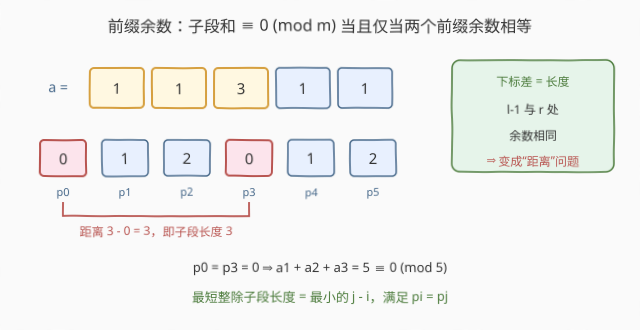
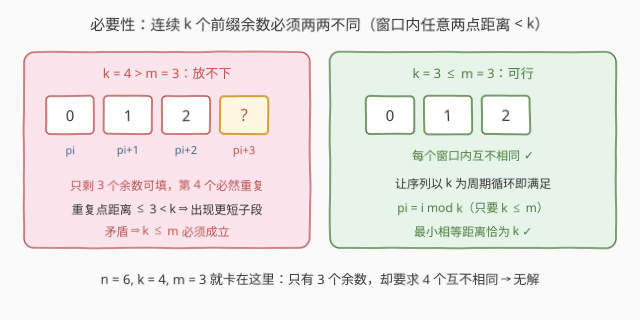
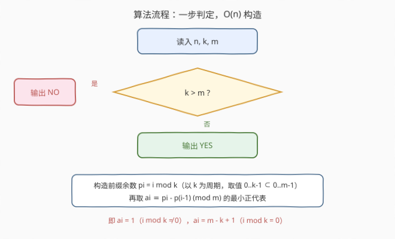
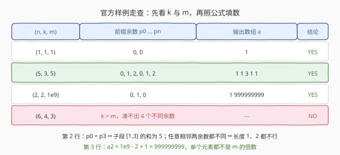

# Codeforces 2247B 又一个构造 题解

## 1. 题目概述

- **标题 / 题号**：又一个构造（Codeforces 2247B，英文名 Yet Another Constructive）
- **链接**：https://codeforces.com/problemset/problem/2247/B
- **来源**：Codeforces Round 1111 (Div. 2) · Problem B
- **难度**：$\ast 900$（750 分）
- **限制**：时间 1.5 s / 内存 256 MB
- **标签**：构造、前缀和、同余、鸽笼原理（官方标签：constructive algorithms）

**题意**：给定 $n, k, m$，构造一个长度为 $n$ 的**正整数**数组 $a$（$1 \le a_i \le 10^{18}$），使得「和能被 $m$ 整除的非空子段」的**最短长度恰好为 $k$**：

- 存在 $1 \le l \le r \le n$，$r-l+1 = k$，且 $\sum_{i=l}^{r} a_i$ 是 $m$ 的倍数；
- 不存在长度 $< k$ 的子段，其和是 $m$ 的倍数。

有解输出 `YES` 并在下一行输出 $n$ 个整数；无解输出 `NO`。多测：第一行 $t$，之后每组一行 $n,k,m$。

**约束**：

- $1 \le t \le 10^{4}$，$\sum n \le 2 \times 10^{5}$
- $1 \le k \le n \le 2 \times 10^{5}$
- $1 \le m \le 10^{9}$
- $1 \le a_i \le 10^{18}$，答案字符串大小写任意
- 输出总量 $O(\sum n)$：判定必须 $O(1)$，构造必须严格 $O(n)$

## 2. 示例与观察
官方样例（输入 / 输出原样）：

```text
输入
4
1 1 1
5 3 5
2 2 1000000000
6 4 3

输出
YES
1
YES
9 17 14 23 11
YES
500000000 500000000
NO
```

逐组解读：

- 第 1 组 $(n,k,m)=(1,1,1)$：唯一非空子段长 $1$，和为 $1$，被 $1$ 整除，最短长度 $=1=k$；
- 第 2 组 $(5,3,5)$：$9+17+14=40$ 是 $5$ 的倍数，而长度 $1,2$ 的子段和分别为 $9,17,14,23,11$ 与 $26,31,37,34$，都不被 $5$ 整除；
- 第 3 组 $(2,2,10^9)$：两个 $5\times10^{8}$ 各自不被 $10^9$ 整除，和恰好为 $10^9$；
- 第 4 组 $(6,4,3)$：无解，这正是本文判定条件的边界（$k=4>m=3$）。

注意第 2、3 组的答案**不唯一**。本文的构造对这两组分别给出 `1 1 3 1 1` 与 `1 999999999`，同样是合法解——读完第 3 节可以逐位核对。

补一组自造样例（覆盖 $k=m$、$k=n$、$m>k$ 与无解四种情形）：

```text
输入
4
6 3 3
3 3 6
7 4 7
4 4 2

输出
YES
1 1 1 1 1 1
YES
1 1 4
YES
1 1 1 4 1 1 1
NO
```

## 3. 解题思路

### 3.1 暴力思路

$a_i$ 的取值上界是 $10^{18}$，直接枚举数组毫无可能。退一步只看**模 $m$ 的余数**（见 3.2，每个余数都对应合法的正整数值），枚举所有余数序列再逐段判合法性，复杂度 $O(m^{n} \cdot n^{2})$；即便 $n=6,m=3$ 也只有 $3^{6}=729$ 条序列，只够用来对拍，无法回答 $n=2\times10^{5}$ 的情形。暴力给不出**判据**，这是构造题的第一道坎。

### 3.2 核心观察：最短整除子段长度 = 最近的一对相等前缀余数



令 $p_0 = 0$、$p_i = \left(\sum_{j=1}^{i} a_j\right) \bmod m$ 为前缀和的余数。子段 $(l, r]$ 的和满足

$$\sum_{j=l+1}^{r} a_j \equiv p_r - p_l \pmod m,$$

所以「该子段和是 $m$ 的倍数」$\iff p_l = p_r$，而子段长度恰好是 $r - l$。于是问题被**完全翻译**成余数语言：

> 构造 $p_0, p_1, \dots, p_n \in \{0,1,\dots,m-1\}$，$p_0 = 0$，使得相等元素之间的**最小下标差恰为 $k$**。

这一步之后，$a_i$ 只需按 $a_i \equiv p_i - p_{i-1} \pmod m$ 还原：取 $d = (p_i - p_{i-1}) \bmod m$，令 $a_i = d$（$d>0$）或 $a_i = m$（$d=0$）。这是同余类里的最小正代表，满足 $1 \le a_i \le m \le 10^{9} \le 10^{18}$，与值域限制毫无冲突。**余数序列可行 $\iff$ 原问题可行。**

接下来先看「什么时候无解」。取下标 $0,1,\dots,k-1$ 这 $k$ 个位置：其中任意两点距离 $\le k-1 < k$，而题目要求最短长度恰为 $k$，所以这 $k$ 个余数必须**两两不同**。然而余数总共只有 $m$ 个。



由鸽笼原理立刻得到**必要条件 $k \le m$**。样例 4（$n=6,k=4,m=3$）正是死在这里：$4$ 个互不相同的余数要从 $\{0,1,2\}$ 里挑，绝无可能。

### 3.3 算法流程：让余数以 $k$ 为周期循环



$k \le m$ 时取 $p_i = i \bmod k$（$0 \le i \le n$），取值落在 $\{0,\dots,k-1\} \subseteq \{0,\dots,m-1\}$，合法。由于周期为 $k$，$p_i = p_j \iff i \equiv j \pmod k$：所有相等点的距离都是 $k$ 的倍数，最小者是 $k$；又因为 $k \le n$，$p_0 = p_k = 0$ 这一对**确实存在**，故最小下标差恰为 $k$。

再还原 $a_i$：$p$ 的步长几乎总是 $+1$，只有跨越周期时从 $k-1$ 跌回 $0$，于是

$$a_i = \begin{cases} m - k + 1, & i \bmod k = 0,\\ 1, & i \bmod k \ne 0. \end{cases}$$

三种退化形态都与直觉一致：$k = 1$ 时全部 $a_i = m$，单元素即 $m$ 的倍数，最短长度 $1$；$k = m$ 时 $m-k+1 = 1$，数组全为 $1$，长度 $k$ 的段和恰为 $m$；$k = n$ 时 $p_n = p_0$，最短距离只能是 $n$。

判定与构造都只有一行核心逻辑：**`k > m` 输出 `NO`，否则按上式填 $n$ 个数**。

### 3.4 示例演算



以 $(n,k,m) = (5,3,5)$ 为例，$m-k+1 = 3$：

| 下标 $i$ | 1 | 2 | 3 | 4 | 5 |
|----------|---|---|---|---|---|
| $i \bmod k$ | 1 | 2 | 0 | 1 | 2 |
| $p_i$ | 1 | 2 | 0 | 1 | 2 |
| $a_i$ | 1 | 1 | 3 | 1 | 1 |

逐长度核对（$5$ 的倍数即 $\equiv 0 \pmod 5$）：

| 长度 | 各子段和 | 是否有 $5$ 的倍数 |
|------|----------|------------------|
| 1 | 1, 1, 3, 1, 1 | 无 |
| 2 | 2, 4, 4, 2 | 无 |
| 3 | 5, 5, 5 | **有**（$a_1{+}a_2{+}a_3=5$） |

所以最短长度恰为 $3 = k$。注意每个长度 $k$ 的窗口都恰好包含**一个** $k$ 的倍数下标，窗口和恒为 $(k-1)\cdot 1 + (m-k+1) = m$，这就是构造的全部秘密。

## 4. 算法细节

1. **判定与构造解耦**：可行性只取决于 $k$ 与 $m$ 的大小关系，$n$ 只决定输出多少个元素。判定 $O(1)$、构造 $O(n)$，没有任何隐藏的二次开销。
2. **不必真的存下 $p$**：$p$ 的规律是「每 $k$ 个一轮」，直接由下标算出 $a_i$，额外空间 $O(1)$。想写显式还原版也行：`d = (p[i] - p[i-1] + m) % m; a[i] = d ? d : m;`——差值 $d=0$ 时**不能**输出 $0$（要求正整数），要输出 $m$。
3. **类型统一用 `long long`**：$m - k + 1$ 与 $m$ 都可到 $10^{9}$，虽然 `int` 装得下，但与 $n$（$2\times10^{5}$）混算、以及跨平台 `int` 假设都容易出岔子；统一 `long long` 最省心。
4. **前缀余数有 $n+1$ 项**：$p_0,\dots,p_n$ 共 $n+1$ 个，$a_i \equiv p_i - p_{i-1}$，漏掉 $p_0$ 会让 $a_1$ 直接错位。至于把「大值」放在 $i \bmod k = 0$ 还是 $i \bmod k = 1$，二者只是同一循环序列的轮换，实测两种写法给出的最短长度都恰为 $k$，选一种并全程一致即可。
5. **多测互不干扰**：每组只依赖本组的 $n,k,m$，不需要清空数组；千万不要把上一组的答案缓存下来复用。
6. **I/O 与输出格式**：C++ 关同步 + `'\n'`（不要 `endl` 逐行 flush）；Python 一次性 `join` 后写出，避免 $2\times10^{5}$ 次 `print`。`YES` 之后**必须**紧跟恰好 $n$ 个整数并换行，`NO` 只占一行，不要多输出空行（多测会整体错位）。

## 5. 正确性证明

**引理 1（同余刻画）**：对任意数组 $a$，其最短整除子段长度等于 $\min\{\,j-i : 0 \le i < j \le n,\ p_i = p_j\,\}$（集合为空时视为 $+\infty$）。

**证明**：子段 $(i, j]$ 的和为 $S$，则 $S \equiv p_j - p_i \pmod m$，故 $m \mid S \iff p_i = p_j$；又该子段长度正是 $j-i$。于是「整除子段」与「相等前缀余数对」一一对应且长度一致，两边取下确界即得。∎

**引理 2（必要性）**：若存在好数组，则 $k \le m$。

**证明**：考虑 $p_0, p_1, \dots, p_{k-1}$ 这 $k$ 个值（$k \le n$ 保证这些下标都存在）。任取 $0 \le i < j \le k-1$，有 $j - i \le k-1 < k$。若 $p_i = p_j$，由引理 1 就存在长度 $j-i < k$ 的整除子段，与「最短长度为 $k$」矛盾；故这 $k$ 个余数两两不同。它们都取自只有 $m$ 个元素的集合 $\{0,\dots,m-1\}$，由鸽笼原理 $k \le m$。∎

**引理 3（构造合法）**：设 $k \le m$，按 3.3 定义 $a_1,\dots,a_n$，则 $1 \le a_i \le 10^{18}$，且最短整除子段长度恰为 $k$。

**证明**：值域方面，$a_i \in \{1,\ m-k+1\}$，由 $1 \le k \le m$ 得 $1 \le m-k+1 \le m \le 10^{9} \le 10^{18}$，合法。任一长度 $k$ 的窗口含 $k$ 个连续下标，其中**恰好一个**是 $k$ 的倍数，故窗口和 $= (k-1)\cdot 1 + (m-k+1) = m$，被 $m$ 整除，存在性成立。

再取任一长度 $L < k$ 的窗口：连续 $L \le k-1$ 个整数中 $k$ 的倍数至多一个。

- 若不含：窗口和 $= L$，而 $1 \le L \le k-1 \le m-1$，故 $0 < L < m$，不被 $m$ 整除；
- 若含一个：窗口和 $= (L-1)\cdot 1 + (m-k+1) = m - (k-L)$，由 $1 \le L \le k-1$ 得 $1 \le m-k+1 \le m-(k-L) \le m-1$，同样不被 $m$ 整除。

所以不存在长度 $<k$ 的整除子段，最短长度恰为 $k$。∎

**定理**：好数组存在 $\iff k \le m$。

**证明**：必要性由引理 2；充分性由引理 3 给出的显式构造（其对应的前缀余数为 $p_i = i \bmod k$，与 3.3 一致）。故算法输出 `YES`/`NO` 均正确。∎

## 6. 复杂度分析

- **时间**：每组判定 $O(1)$，构造与输出 $O(n)$，总计 $O\left(\sum n\right) \le 2\times10^{5}$ 次赋值与输出，无排序、无哈希。
- **空间**：$O(1)$ 额外空间（逐个计算逐个输出，不必存数组）；Python 用 `join` 时中间列表为 $O(n)$，仍在 $2\times10^{5}$ 量级。
- **实测**：$t=10^{4}$、$\sum n = 2\times10^{5}$ 的极限输入，C++17 端到端约 $30$ ms（`/usr/bin/time` 三次均 $0.03$ s），Python3 约 $75$ ms（其中约 $20$ ms 是解释器启动）。相对 $1.5$ s 时限余量仍在 $20$ 倍以上，`cout` 逐个数输出完全够用，无需手写快写。

## 7. 参考代码

### C++17

```cpp
#include <iostream>
using namespace std;

int main() {
    ios::sync_with_stdio(false);
    cin.tie(nullptr);

    int t;
    if (!(cin >> t)) return 0;
    while (t--) {
        long long n, k, m;
        cin >> n >> k >> m;
        if (k > m) {                       // 长度为 k 的窗口要放 k 个互不相同的余数，只有 m 个余数可用
            cout << "NO\n";
            continue;
        }
        cout << "YES\n";
        for (long long i = 1; i <= n; ++i) {
            // 前缀余数取 i mod k：周期 k ⇒ 最小相等距离恰为 k
            long long v = (i % k == 0) ? (m - k + 1) : 1LL;
            cout << v << (i == n ? '\n' : ' ');
        }
    }
    return 0;
}
```

### Python3

```python
import sys


def main() -> None:
    data = sys.stdin.buffer.read().split()
    if not data:
        return
    p = 0
    t = int(data[p]); p += 1
    out = []
    for _ in range(t):
        n = int(data[p]); k = int(data[p + 1]); m = int(data[p + 2]); p += 3
        if k > m:                        # 鸽笼：k 个互不相同的余数放不进 m 个抽屉
            out.append("NO")
            continue
        out.append("YES")
        big = m - k + 1                  # 倍数位置上的值，k = 1 时恰好为 m
        out.append(" ".join(str(big if i % k == 0 else 1) for i in range(1, n + 1)))
    sys.stdout.write("\n".join(out) + "\n")


main()
```

## 8. 边界情况与易错点

1. **$m = 1$**：只有余数 $0$，任意两个前缀余数都相等，最短长度恒为 $1$，故只有 $k = 1$ 有解。公式在 $k=1$ 时给出 $m-k+1 = 1$，全员输出 $1$，正确；$k>1$ 走 `NO` 分支，同样正确。
2. **$k = 1$**：所有 $a_i = m$，任意单元素都是 $m$ 的倍数，最短长度 $1$，且不可能更短。
3. **$k = n$**：$p_n = p_0 = 0$，最短距离只能是 $n$；此时数组形如 $1,\dots,1,m-n+1$（最后一个位置放大值），任何短子段都不被 $m$ 整除。
4. **$m \gg k$**：$m-k+1$ 接近 $10^{9}$，仍远小于 $10^{18}$；不要误以为需要大数或 `__int128`。
5. **`k > m` 时只输出一行**：多输出一个空行或一个空的数组行，会让后续所有测试组错位，表现为「前几组对、后面全错」。
6. **不要按 $m$ 开数组**：$m$ 可达 $10^{9}$ 而 $t$ 可达 $10^{4}$，任何 $O(m)$ 的建表或清空都会直接 TLE / MLE。本题只需下标算术，空间 $O(1)$。
7. **空输入与超大输出**：本地对拍可能喂空文件，`if (!(cin >> t)) return 0;` 与 `if not data: return` 可避免未定义行为；$2\times10^{5}$ 个数字用 `endl` 或逐次 `print` 会明显变慢，务必用 `'\n'` 与 `join`。

## 9. 验证记录

- **编译环境与命令**：`clang++ -std=c++17 -O2`（本机无 GNU g++，配 `codeforces/tools/include/bits/stdc++.h` 兼容头；正文代码只用标准库，可原样提交 GNU C++17）；Python 侧为 `Python 3.9.6`。
- **官方样例**：0 / 1 通过 token 比对；本题输出不唯一（构造 / 多解 / 特殊评测），剩余差异属预期，样例含义已在第 2 节逐组解释。
- **复核状态**：audited（2026-11-19 统一回归：编译 + 官方样例；写作期的随机对拍与暴力未重跑）。

## 相关题目与扩展

- [Codeforces 2247A. Zero Sum](https://codeforces.com/problemset/problem/2247/A)：同场 A 题，同样是「先找不变量/判据，再补构造」的签到节奏。
- [LeetCode 974. 和可被 K 整除的子数组](https://leetcode.cn/problems/subarray-sums-divisible-by-k/)：本题前缀余数刻画的**计数版**，用哈希表统计同余前缀。
- [LeetCode 1590. 使数组和能被 P 整除](https://leetcode.cn/problems/make-sum-divisible-by-p/)：求「最短」可删子数组，同样是前缀余数取最近相等位置。
- [Codeforces 577B. Modulo Sum](https://codeforces.com/problemset/problem/577/B)：鸽笼原理直接给出 $n>m$ 时必有解，可与本文引理 2 对照。

**延伸思考**：

1. **把条件放宽成「最短整除子段长度 $\ge k$」**：判据仍是 $k \le m$，本文构造的最小距离恰为 $k$，无需修改即可复用。
2. **额外要求 $a_i$ 两两不同**：判定只依赖余数，而同余类内可加 $m$ 的倍数错开。每个余数有约 $10^{18}/m \ge 10^{9}$ 个可用代表，$n \le 2\times10^{5}$ 一定够，结论不变，只是要小心分配。
3. **给定 $n,m$，问「最短长度恰为 $k$ 的数组个数」**：难点在于排除距离 $<k$ 的重复，需要 DP 记录「最近 $k-1$ 个余数互不相同」的状态集合，状态数随 $k$ 指数增长，只有 $m$ 很小时可做。
