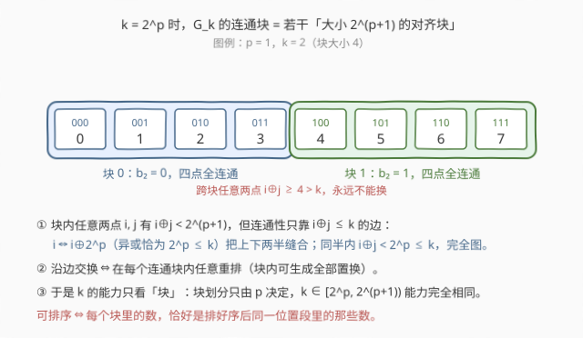
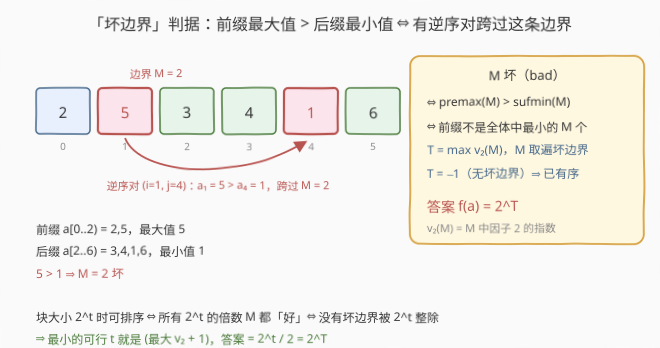
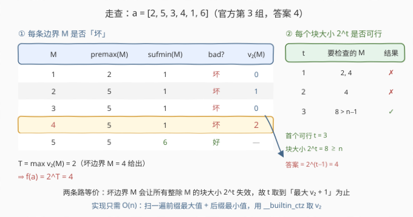

# Codeforces 2247D1 XOR 排序（简单版） 题解
## 1. 题目概述

- **标题 / 题号**：XOR 排序（简单版）（Codeforces 2247D1，英文名 XOR Sorting (Easy Version)）
- **链接**：https://codeforces.com/problemset/problem/2247/D1
- **来源**：Codeforces Round 1111 (Div. 2) · Problem D1（UTC 2026-07-18）
- **难度**：$\ast 1500$（1500 分）
- **限制**：时间 2 s / 内存 256 MB
- **标签**：位运算、贪心、连通块、结论（官方标签：bitmasks, greedy）

**题意**：给定长度 $m$ 的正整数数组 $b$，下标从 $0$ 开始。若可以用如下操作任意多次地把 $b$ 变成非降序，就称 $b$ 能 **$k$-排序**：选两个下标 $0\le i<j\le m-1$ 满足 $i\oplus j\le k$（限制作用在**下标**上，与元素值无关），交换 $b_i,b_j$。定义 $f(b)$ 为使 $b$ 能 $k$-排序的最小非负整数 $k$。

给定长度 $n$ 的数组 $a$，本版本 $q=0$（没有修改），只需输出 $f(a)$ 这一个值。

多测：第一行 $t$ 组；每组第一行 $n$ 与 $q$（本版本 $q=0$），第二行 $a_0,\dots,a_{n-1}$；每组输出 $q+1=1$ 个整数——$f(a)$。

**约束**：

- $1\le t\le 10^4$，$1\le n\le 10^6$，$\sum n\le 10^6$
- 本版本 $q=0$（$q$ 这一项恒为 $0$）
- $1\le a_i\le 10^9$，下标 $0$-based
- 时限 2 s：需要 $O(n)$ 或 $O(n\log n)$，$O(n^2)$ 的建图连 $n=10^4$ 都过不去

## 2. 示例与观察
官方样例（输入 / 输出原样）：

```text
输入
3
3 0
2 3 4
2 0
1000000000 999999999
6 0
2 5 3 4 1 6

输出
0
1
4
```

逐组解读：第 1 组已有序，$f=0$。第 2 组只需交换相邻下标 $(0,1)$，而 $0\oplus1=1$ 是最小的非零异或，故 $f=1$。第 3 组 $k=4$ 时下标 $0\sim5$ 全在一个连通块（$0\oplus4=4\le4$ 把 $0,4$ 相连）可任意重排；而 $k\le3$ 时下标被切成 $\{0,1,2,3\}$ 与 $\{4,5\}$ 两块，后者装着 $\{1,6\}$ 却该装 $\{5,6\}$，永远换不对。

补一组自造样例（覆盖 $n=1$、已排序、完全逆序、只有相邻两对错位）：

```text
输入
5
1 0
7
5 0
1 2 3 4 5
8 0
8 7 6 5 4 3 2 1
4 0
2 1 4 3
6 0
4 1 3 2 5 6

输出
0
0
4
1
2
```

`[2,1,4,3]` 的两处错位都在 $k=1$ 的块内；完全逆序的 $8$ 个数要靠 $k=4$；`[4,1,3,2,5,6]` 需要 $k=2$。

## 3. 解题思路

### 3.1 暴力思路

对某个固定的 $k$ 判定：把下标看成图 $G_k$ 的点，对所有 $i<j$ 且 $i\oplus j\le k$ 连边，然后判每个连通块里的元素多重集是否正确——建图 $O(n^2)$。再对 $k=0,1,2,\dots$ 逐个试，最坏要做 $n$ 次，总复杂度 $O(n^3)$ 量级。即使只看 $\log n$ 个候选 $k$，也是 $O(n^2\log n)$，$n=10^6$ 完全不可行。暴力唯一的用处是对拍。

### 3.2 核心观察：$k$ 的全部能力 = 一个「对齐分块」的划分



**第一层事实（图论）**：允许的交换是图 $G_k$ 的边，作用是**换位**（transposition）。交换永远不出连通块；反过来，在同一个连通块内沿一棵生成树做换位，就能生成该块上的**整个对称群**——块内任意重排都可行。所以

$$b \text{ 能 } k\text{-排序} \iff \text{每个连通块内的元素多重集} = \text{排序后同一位置段的多重集}.$$

**第二层事实（结构）**：设 $2^p\le k<2^{p+1}$（$k\ge 1$）。把下标按 $\lfloor i/2^{p+1}\rfloor$ 分组，每组是长度 $2^{p+1}$ 的对齐块（最后一块可能不满）。

- **跨块无边**：不同块的两点异或至少 $2^{p+1}>k$，条件不成立。
- **块内连通**：同块两点若第 $p$ 位相同，则 $i\oplus j<2^p\le k$，直接相连；若第 $p$ 位不同，则 $i$ 先连到 $i\oplus 2^p$（异或恰为 $2^p\le k$），再接到 $j$。于是整块连成一片。

所以 $G_k$ 的连通块**就是**大小 $2^{p+1}$ 的对齐块。特别地：

- $k=0$ 时没有任何合法交换（$i<j\Rightarrow i\oplus j>0$），只有本来就排好序才行；
- 块划分只由 $p$ 决定，所以 $k\in[2^p,2^{p+1})$ 的能力**完全相同**；又可行性与 $k$ 单调，故
$$\boxed{\ \text{答案要么是 }0，\text{要么是 }2 \text{ 的幂}\ }$$
$k$ 只看最高位，这就是答案必为 $2$ 的幂的原因。

### 3.3 算法流程：坏边界 + 因子 2 的指数



块大小 $2^t$（$t\ge 1$，对应 $k=2^{t-1}$）可行 $\iff$ 每个对齐块内多重集正确。把「每个块」翻译成「每条对齐边界」：令

$$\mathrm{premax}(M)=\max_{i<M}a_i,\qquad \mathrm{sufmin}(M)=\min_{i\ge M}a_i ,\qquad 1\le M\le n-1 .$$

称 $M$ 是**坏边界**，若 $\mathrm{premax}(M)>\mathrm{sufmin}(M)$，即存在逆序对 $i<M\le j$、$a_i>a_j$ 跨过它。则

- $M$ 好 $\iff$ 前缀 $a[0..M)$ 恰好是全体元素中**最小的 $M$ 个**（所有前缀元素都不大于所有后缀元素）；
- 块大小 $2^t$ 可行 $\iff$ 所有满足 $2^t\mid M$、$M<n$ 的边界 $M$ 都是好的（块条件与「前缀是前 $M$ 小」在差集上互推）。

于是坏边界 $M$ 会否决掉所有满足 $2^t\mid M$ 的层，即 $t\le v_2(M)$ 的全部层（$v_2(M)$ 是 $M$ 中因子 $2$ 的指数）。记

$$T=\max\{\,v_2(M)\ :\ 1\le M<n,\ M \text{ 是坏边界}\,\},$$

则最小可行层是 $T+1$，块大小 $2^{T+1}$，答案 $k=2^{T}$；若没有坏边界（数组本身有序），答案 $0$。

实现只有三行扫描：

1. 从右往左求后缀最小值数组；
2. 从左往右维护前缀最大值，同时检查 $M=1,2,\dots,n-1$ 是否坏；
3. 对坏边界取 $T=\max(T,v_2(M))$，输出 $T<0\ ?\ 0:2^T$。

### 3.4 示例演算



对 $a=[2,5,3,4,1,6]$（$n=6$）：

| $M$ | 前缀 $a[0..M)$ | $\mathrm{premax}$ | $\mathrm{sufmin}$ | 坏? | $v_2(M)$ |
|-----|------|------|------|------|------|
| 1 | 2 | 2 | 1 | 坏 | 0 |
| 2 | 2,5 | 5 | 1 | 坏 | 1 |
| 3 | 2,5,3 | 5 | 1 | 坏 | 0 |
| 4 | 2,5,3,4 | 5 | 1 | **坏** | **2** |
| 5 | 2,5,3,4,1 | 5 | 6 | 好 | — |

$T=2$（唯一的来源是 $M=4$），答案 $2^T=4$。换个角度验算：块大小 $2^1=2$ 要检查 $M=2,4$（都坏，失败）；$2^2=4$ 要检查 $M=4$（坏，失败）；$2^3=8>n-1$ 没有需要检查的边界（整段一个块，恒可行），首个可行层 $t=3$，答案 $2^{t-1}=4$，一致。

## 4. 算法细节

1. **$v_2$ 用 `__builtin_ctz`**：`M & -M` 取 lowbit 后再取指数也行，但 `__builtin_ctz((unsigned)M)` 一步到位；$M\ge1$ 时不会触发「参数为 $0$ 未定义」的坑。
2. **前缀最大值初值取 $0$**：$a_i\ge1$，$0$ 等价于 $-\infty$，不必特判第一个元素。
3. **只扫 $M=1..n-1$**：$M=0$（空前缀）与 $M=n$（空后缀）恒好，不参与统计；`sufmin[n] = INT_MAX` 只是让递推有个 $+\infty$ 起点，顺手也让 $M=n$ 自动合法。
4. **$T$ 初值 $-1$**：区分「没有坏边界」（输出 $0$）与「$T=0$」（输出 $1$）这两种截然不同的情况。
5. **不会溢出**：$M<n\le10^6<2^{20}$，故 $T\le19$，`1 << T` 在 `int` 内安全；若把 $n$ 放宽到 $10^9$ 级别则应改用 `1LL << T`。
6. **多测复用数组 + I/O**：`a`、`sufmin` 用全局静态数组，每组只覆盖用到的段，避免 $10^4$ 组各分配一次；$10^6$ 个数的读入是主要开销，用 `scanf`（或关同步的 `cin`）即可。
7. **本版本 $q=0$**：读到 $q$ 后不必处理任何修改；若按「$q+1$ 个输出」写循环，恰好只输出初始状态那一个数。

## 5. 正确性证明

**引理 1（连通块结构与块内自由）**：对任意 $k$，$G_k$ 每个连通块内可实现任意置换；且当 $2^p\le k<2^{p+1}$（$p\ge0$）时，$G_k$ 的连通块恰为 $\{\,i:\lfloor i/2^{p+1}\rfloor=b\,\}$ 这种对齐块，而 $k=0$ 时每个点各自成块。

**证明**：第一部分：块上取一棵生成树，树上每条边是一次合法换位；沿路径滑动可以把左端元素搬到最右端，递归即得整个对称群 $S_c$ 都可达。第二部分：跨块两点异或 $\ge2^{p+1}>k$，无边；同块内若 $i,j$ 第 $p$ 位相同则 $i\oplus j<2^p\le k$ 直接相连，若第 $p$ 位不同则借道 $i\oplus2^p$（异或恰为 $2^p\le k$）相连，故整块连通；$k=0$ 时任何 $i<j$ 都有 $i\oplus j>0$，无边。∎

**引理 2（边界判据）**：对 $t\ge1$，块大小 $2^t$ 可行 $\iff$ 所有满足 $2^t\mid M$ 且 $1\le M<n$ 的边界 $M$ 都是好的。

**证明**：记 $C_b$ 为第 $b$ 块 $[b2^t,\min((b+1)2^t,n))$。若每个 $C_b$ 的多重集都等于排序后同段，则对任一 $M=b2^t$，前缀 $[0,M)$ 是若干个正确块的并，其多重集等于排序后前 $M$ 个，即前缀好（其所有元素不大于所有后缀元素）；而「前缀好」直接给出 $\mathrm{premax}(M)\le\mathrm{sufmin}(M)$。反向：若所有这样的 $M$ 都满足 $\mathrm{premax}(M)\le\mathrm{sufmin}(M)$，取相邻两条边界 $M_1=b2^t$、$M_2=(b+1)2^t$，前缀 $[0,M_1)$ 与 $[0,M_2)$ 分别等于排序后的前 $M_1$、前 $M_2$ 个，相减得 $C_b$ 的多重集等于排序后 $[M_1,M_2)$ 段。∎

**引理 3（坏边界的刻画）**：$M\in[1,n-1]$ 坏 $\iff$ 前缀 $a[0..M)$ 的多重集不是全体中最小的 $M$ 个。

**证明**：若前缀里每个元素都不大于后缀里每个元素（即 $\mathrm{premax}\le\mathrm{sufmin}$），排序后前 $M$ 个恰为前缀元素。反之若存在 $i<M\le j$、$a_i>a_j$，则前缀含 $a_i$ 而不含更小的 $a_j$，其多重集不可能等于最小的 $M$ 个。∎

**定理**：设 $T=\max\{v_2(M):M \text{ 坏}\}$（空集时 $T=-1$），则 $f(a)=0$（$T=-1$），否则 $f(a)=2^{T}$。

**证明**：先看 $T=-1$：此时没有坏边界，对每个 $M=j$ 有 $\mathrm{premax}(j)\ge a_{j-1}$、$\mathrm{sufmin}(j)\le a_j$，于是 $a_{j-1}\le a_j$，数组已排序，$k=0$ 可行且最优，$f=0$。

设 $T\ge0$，先证 $k=2^T$ 可行。此时 $p=T$，块大小 $2^{T+1}$；由引理 2 只需每条 $2^{T+1}$ 的倍数边界都非坏。若 $2^{T+1}\mid M$ 则 $v_2(M)\ge T+1>T$，与 $T$ 的定义（坏边界 $v_2$ 的最大值）矛盾，故这样的 $M$ 都非坏，可行。

再证任何 $k'<2^T$ 都不可行。$k'=0$ 时由 $T\ge0$ 知存在坏边界（数组未排序），不可行。$k'>0$ 时设 $2^p\le k'<2^{p+1}$，则 $p\le T-1$，块大小 $2^{p+1}\le2^T$。取达到最大值的坏边界 $M^\ast$（$v_2(M^\ast)=T$），则 $2^{p+1}\mid M^\ast$，由引理 2 该层不可行，故 $k'$ 不可行。综上 $f(a)=2^T$。∎

## 6. 复杂度分析

- **时间**：后缀最小值 $O(n)$ + 前缀最大值扫描 $O(n)$ = $O(n)$；总时间 $O\left(\sum n\right)\le10^6$ 次比较与取 $v_2$。
- **空间**：$O(n)$（数组与后缀最小值两个 `int` 数组，$n=10^6$ 时约 $8$ MB），无递归与额外数据结构。
- **实测**：$t=1$、$n=10^6$ 的随机数据，C++17 端到端 $0.09$ s，Python3 $0.38\sim0.40$ s，相对 $2$ s 时限余量约 $4\sim20$ 倍；其中相当一部分是读入开销。

## 7. 参考代码

### C++17

```cpp
#include <bits/stdc++.h>
using namespace std;

static const int MAXN = 1000005;
static int a[MAXN];
static int sufmin_[MAXN];

int main() {
    int t;
    if (scanf("%d", &t) != 1) return 0;
    while (t--) {
        int n, q;
        scanf("%d %d", &n, &q);              // 本版本保证 q = 0，不必处理修改
        for (int i = 0; i < n; ++i) scanf("%d", &a[i]);
        sufmin_[n] = INT_MAX;                // 空后缀的最小值取 +inf
        for (int i = n - 1; i >= 0; --i)
            sufmin_[i] = min(a[i], sufmin_[i + 1]);
        int T = -1;                          // -1 表示不存在坏边界
        int premax = 0;                      // a[i] >= 1，0 充当 -inf
        for (int M = 1; M < n; ++M) {        // 边界 M：前缀 a[0..M)，后缀 a[M..n)
            premax = max(premax, a[M - 1]);
            if (premax > sufmin_[M]) {       // 有逆序对跨过 M，M 是坏边界
                int v = __builtin_ctz((unsigned)M);   // v2(M)
                if (v > T) T = v;
            }
        }
        printf("%d\n", T < 0 ? 0 : (1 << T));
    }
    return 0;
}
```

### Python3

```python
import sys


def main() -> None:
    data = sys.stdin.buffer.read().split()
    if not data:
        return
    pos = 0
    t = int(data[pos]); pos += 1
    out = []
    for _ in range(t):
        n = int(data[pos]); pos += 2          # 第二个数是 q，本版本恒为 0
        a = [int(x) for x in data[pos:pos + n]]
        pos += n
        INF = 1 << 60
        suf = [INF] * (n + 1)                 # suf[M] = min(a[M:])
        for i in range(n - 1, -1, -1):
            w = suf[i + 1]
            suf[i] = a[i] if a[i] < w else w
        T = -1
        premax = 0
        for M in range(1, n):
            v = a[M - 1]
            if v > premax:
                premax = v
            if premax > suf[M]:               # 坏边界
                c = (M & -M).bit_length() - 1  # v2(M)
                if c > T:
                    T = c
        out.append(str(0 if T < 0 else 1 << T))
    sys.stdout.write("\n".join(out) + "\n")


main()
```

## 8. 边界情况与易错点

1. **$n=1$**：循环 $M=1..0$ 不执行，$T=-1$，答案 $0$——一个元素永远已排好序，别在这里对空后缀数组越界访问。
2. **$M=n$ 与 $M=0$**：$M=n$ 的后缀为空、$M=0$ 的前缀为空，两者都不是坏边界；若把它们卷进统计，`__builtin_ctz(0)` 是**未定义行为**（常见表现是返回寄存器里的随机值），会莫名 WA 或 RE。
3. **全部元素相同**：任何边界都是好的，$T=-1$，答案 $0$；不要因为「有多组相等」就误判成需要交换。
4. **完全逆序**：所有 $M\in[1,n-1]$ 都坏，$T=\lfloor\log_2(n-1)\rfloor$，答案 $2^{\lfloor\log_2(n-1)\rfloor}$（$n=8$ 给 $4$，$n=6$ 给 $4$）。这是答案的最大可能值，可用来做手造极限测试。
5. **只有相邻一对错位**：如 `[2,1,4,3]`，坏边界是 $M=1,3$，$v_2$ 都是 $0$，$T=0$，答案 $1$——对应 $k=1$ 只能交换「下标只差最低位」的对。
6. **$1<<T$ 与多测清零**：本题 $n\le10^6$ 保证 $T\le19$，`int` 安全（$n\le10^9$ 的加强版须用 `1LL << T`）；`T`、`premax` 每组重初始化，`sufmin_[n]` 每组重设 `INT_MAX`，否则上一组残留会毒化本组最后的边界。
7. **$q$ 的处理**：本版本 $q=0$，但输入里仍然有 $q$ 这一项，必须读掉；别写成「读 $n$ 后直接读数组」，否则整组数据错位。

## 9. 验证记录

- **编译环境与命令**：`clang++ -std=c++17 -O2`（本机无 GNU g++，配 `codeforces/tools/include/bits/stdc++.h` 兼容头；正文代码只用标准库，可原样提交 GNU C++17）；Python 侧为 `Python 3.9.6`。
- **官方样例**：1 / 1 通过（按 Codeforces 标准 checker 的 token 比对，忽略空白与大小写）。
- **复核状态**：audited（2026-11-19 统一回归：编译 + 官方样例；写作期的随机对拍与暴力未重跑）。

## 相关题目与扩展

- [Codeforces 2247D2. XOR Sorting (Hard Version)](https://codeforces.com/problemset/problem/2247/D2)：同题的动态版本（$q\le10^6$），本文的「坏边界 + $v_2$」结论仍然是核心，只是要在线维护「每层还剩几条坏边界」，用线段树维护块内 $\min/\max$ 即可做到 $O((n+q)\log n)$。
- [Codeforces 500B. New Year Permutation](https://codeforces.com/problemset/problem/500/B)：把「哪些下标能交换」直接给成 $0/1$ 矩阵，做法是并查集 + 每个连通块内排序，与本篇引理 1（连通块内任意重排）完全同源。
- [LeetCode 1202. 交换字符串中的元素](https://leetcode.cn/problems/smallest-string-with-swaps/)：同一思想的字符版——并查集求连通块，块内按字典序重排。
- [Codeforces 1363B. Subsequence Hate](https://codeforces.com/problemset/problem/1363/B)：把「合法串」化成前缀/后缀计数再枚举断点，与本篇把块条件化成「前后缀极值判据」的转化手法同型。

**延伸思考**：

1. **把限制换成 $i+j\le k$**：连通块会退化成前缀区间 $[0,k]$ 之类，答案不再是「$2^T$」而是恰好等于某个坏边界本身，题目从位运算题变成二分题——可以拿来对比「为什么异或恰好给出分块结构」。
2. **只允许 $i\oplus j=k$ 的交换**：图变成一堆匹配（每层一个完美匹配），能力急剧下降，判定退化为「沿 $O(\log n)$ 个匹配做并查集」，答案往往不是 $2$ 的幂，是一个有意思的反例。
3. **要求输出交换方案 / 最少交换次数**：块内最少交换次数由块内置换的环数决定，与引理 1 的生成树构造无关。
4. **把 $a_i$ 放开到 $0$ 或负数**：所有结论只用到「比较」与「可重复」，$a_i\ge1$ 只是为了能用 $0$ 当 $-\infty$。
