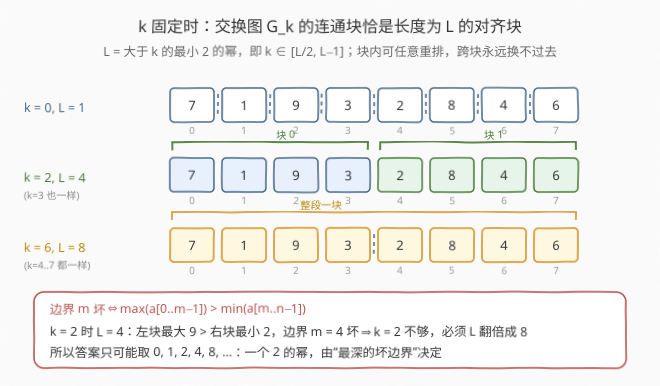
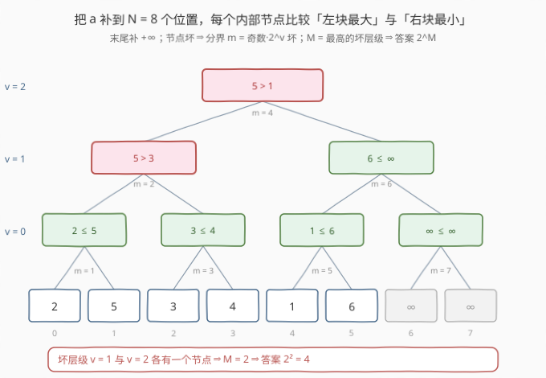
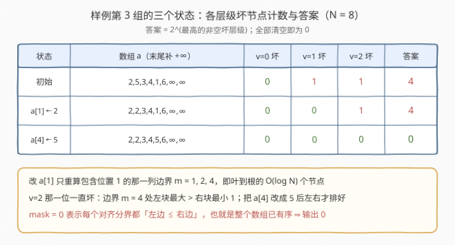

# Codeforces 2247D2 XOR 排序（困难版） 题解
## 1. 题目概述

- **标题 / 题号**：XOR 排序（困难版）（Codeforces 2247D2，英文名 XOR Sorting (Hard Version)）
- **链接**：https://codeforces.com/problemset/problem/2247/D2
- **来源**：Codeforces Round 1111 (Div. 2) · Problem D2
- **难度**：$\ast 2000$（1250 分）
- **限制**：时间 2 s / 内存 256 MB
- **标签**：位运算、线段树、贪心、结论（官方标签：bitmasks, data structures, greedy）

**题意**：给定长度为 $n$ 的正整数数组 $a$（**下标从 0 开始**）。对非负整数 $k$，称数组 $b$ 可以 **$k$-排序**，如果可以通过任意多次下面的操作把它变成非降序：

1. 选下标 $0\le i<j\le m-1$ 且 $i\oplus j\le k$（限制的是**下标**的异或，不是元素值）；
2. 交换 $b_i,b_j$。

记 $f(b)$ 为最小的 $k$ 使 $b$ 可以 $k$-排序。现在给出 $a$，并进行 $q$ 次**持久**的单点赋值 $a_i\leftarrow x$；要求输出初始状态以及每次赋值之后的 $f(a)$，共 $q+1$ 个整数。多测。

> 与简单版（D1）的唯一区别：D1 中 $q=0$，D2 中 $q\le 10^6$。

**约束**：

- $1\le t\le 10^4$，$\sum n\le 10^6$，$\sum q\le 10^6$
- $1\le n\le 10^6$，$0\le q\le 10^6$，$1\le a_i,x\le 10^9$
- 0-indexed；答案一定 $\le 2^{19}=524288$
- 时限 2 s：需要每组 $O(n+q\log n)$，逐次重算的 $O(nq)$ 不可行

## 2. 示例与观察
官方样例（输入 / 输出原样，每组输出占一行）：

```text
输入
3
2 0
1 2
2 1
1000000000 999999999
1 1000000000
6 2
2 5 3 4 1 6
1 2
4 5

输出
0
1 0
4 4 0
```

逐组解读：

- 第 1 组 $[1,2]$ 已经有序，$f=0$。
- 第 2 组 $[10^9,10^9-1]$：只需交换下标 $0,1$，而 $0\oplus1=1$，所以 $f=1$；赋值后两数相等，$f=0$。
- 第 3 组 $[2,5,3,4,1,6]$：可用交换 $(0,1)$ 与 $(0,4)$ 排好，下标异或分别是 $1$ 和 $4$，所以 $f=4$；把 $a_1$ 改成 $2$ 后仍是 $4$；再把 $a_4$ 改成 $5$ 后整个数组有序，$f=0$。

补一组自造样例（覆盖「一次赋值让答案变小」）：

```text
输入
1
4 2
3 1 2 4
2 3
0 1

输出
2 1 0
```

$[3,1,2,4]$ 需要 $k=2$；把 $a_2$ 改成 $3$ 后 $k=1$ 足够（交换下标 $0,1$）；再把 $a_0$ 改成 $1$ 后数组有序，答案为 $0$。

## 3. 解题思路

### 3.1 暴力思路

固定 $k$ 后，可达的排列由「交换图」$G_k$ 决定：顶点是下标，$i\oplus j\le k$ 时连边，一次交换就是沿边做换位。于是 $b$ 能 $k$-排序，当且仅当每个连通块内的元素多重集与「排序后该块应含的多重集」相同。朴素做法对每个 $k$ 建图（$O(n^2)$ 条边）再判连通块，或者每次更新后重算前缀最大值 / 后缀最小值，单次 $O(n)$。$q=10^6$ 时总复杂度 $O(nq)=10^{12}$，必然超时；而且 $k$ 的取值从 $0$ 一路试上去也不现实。

### 3.2 核心观察：连通块是「对齐的 2 的幂块」，答案由最深的坏边界决定



**第一步：看清 $G_k$ 的连通块。** 设 $L$ 是**大于 $k$ 的最小 2 的幂**（$k=0$ 时 $L=1$）。注意 $k\in[L/2,L-1]$ 时 $L$ 不变。

- 若 $i\oplus j\le k<L$，则 $i,j$ 的二进制在第 $\log_2 L$ 位及以上完全相同，故 $i,j$ 落在同一个 $L$ 对齐块 $[cL,(c+1)L)$ 里。所以**不同块之间没有边**。
- 块内是连通的：$k\ge L/2$，下半块 $[cL,cL+L/2)$ 内任意两数异或 $<L/2\le k$，构成团；上半块的每个 $x+L/2$ 又与 $x$ 有边（异或恰为 $L/2\le k$）。

于是 **$G_k$ 的连通块就是 $[0,n-1]$ 与各个 $L$ 块的交**，块内可以任意重排。

**第二步：什么分块才能排好序？** 称 $m\in[1,n-1]$ 为一个「边界」，若 $\max(a[0..m-1])\le\min(a[m..n-1])$ 则称 $m$ 是**好边界**，否则是**坏边界**（等价于存在跨越 $m$ 的逆序对 $i<m\le j,\ a_i>a_j$）。可以证明：**按长度 $L$ 分块能排好序，当且仅当所有 $L$ 的倍数边界都是好边界**。直观上，坏边界就是「元素必须被换过去、但分块不允许」的那一刀。

**第三步：答案的形状。** 设坏边界集合为 $B$。$L=2^s$ 可行 $\iff$ 没有 $m\in B$ 被 $L$ 整除 $\iff$ 对所有 $m\in B$ 有 $s>v_2(m)$。于是最小的可行 $L$ 是 $2^{M+1}$，最小的 $k$ 是

$$f(a)=2^{M},\qquad M=\max_{m\in B} v_2(m),$$

其中 $v_2(m)$ 是 $m$ 中因子 $2$ 的个数；$B=\emptyset$（数组已有序）时 $f(a)=0$。**答案只可能是 $0$ 或 $2$ 的幂。**

### 3.3 算法流程：补成 2 的幂 + 线段树按层维护



把 $a$ 补到 $N=2^K\ge n$ 个位置，空位填 $+\infty$（比 $10^9$ 大的哨兵）。这样每个 $L$ 块都完整对齐，任意边界 $m$ 的 $v_2$ 恰好等于「以 $m$ 为分界、把某个对齐块对半劈开」的那一层。

对每个内部节点 $u$（它覆盖一个对齐块，左右孩子长度都是 $2^v$），称 $u$ **无序**当且仅当
$$\max(\text{左孩子})>\min(\text{右孩子}).$$
$u$ 无序 $\Rightarrow$ 它自己的分界 $m$（奇数 $\times2^v$）是坏边界；反过来不成立（见引理 4 的说明）。真正需要的是整段性质的等价：

$$\text{所有 }2^t\text{ 的倍数边界都是好边界}\iff\text{第 }t,t+1,\dots,K-1\text{ 层的节点全部有序}.$$

因此只要维护「每个层级有多少个无序节点」，答案就是**最高**的非空层级 $M$ 对应的 $2^M$（一个无序节点都没有则输出 $0$）。用一个计数数组 `cnt[v]` 加一个 `mask`（第 $v$ 位表示 `cnt[v]>0`）即可，答案取 `mask` 的最高位。

单点赋值只改变从叶子 $i$ 到根的 $O(\log N)$ 个节点的 `max/min`，于是每次更新：先沿路径**撤销**旧的「无序」标记（此时孩子还是旧值），再改叶子、自底向上重算并按新值重新打标记。

### 3.4 示例演算



以样例第 3 组 $a=[2,5,3,4,1,6]$（补成 $N=8$：$2,5,3,4,1,6,+\infty,+\infty$）为例，各层的无序节点数：

| 状态 | $v=0$ | $v=1$ | $v=2$ | 最高坏层 $M$ | 答案 |
|------|------|------|------|------|------|
| 初始 $[2,5,3,4,1,6]$ | 0 | 1 | 1 | 2 | 4 |
| $a_1\leftarrow 2$ | 0 | 0 | 1 | 2 | 4 |
| $a_4\leftarrow 5$ | 0 | 0 | 0 | — | 0 |

初始时根节点左块最大值 $5>$ 右块最小值 $1$；$v=1$ 层覆盖 $[0..3]$ 的节点也满足 $5>3$。两层都坏，最高层 $M=2$，答案 $2^2=4$。把 $a_1$ 改成 $2$ 只让 $m=1,2$ 变好，$m=4$ 仍然坏（$4>1$），答案不变；把 $a_4$ 改成 $5$ 后所有层都有序，答案变成 $0$。

## 4. 算法细节

1. **补位用 $+\infty$**：空位必须填比所有 $a_i$ 都大的哨兵（取 $2\times10^9$）。若填 $0$ 或 $-1$，$m=n$ 一类边界会出现「前缀最大 $>0=$ 后缀最小」，凭空造出坏边界。
2. **循环下标就是层号 $v$**：从叶子 $i$ 往上走，`path[0]` 是父亲（孩子长 $1$，$v=0$），`path[1]` 是祖父（$v=1$），依次类推，不必额外求 $\log_2$。
3. **更新必须两趟**：先按**旧值**撤销路径上每个节点的无序标记，再改叶子并自底向上重算。若先改叶子，旧标记就再也取不回来，`cnt` 会永久偏大。
4. **`cnt + mask` 代替 multiset**：`cnt[v]` 从 $0$ 变 $1$ 时置位、从 $1$ 变 $0$ 时清位，$O(1)$；答案用 `31 - __builtin_clz(mask)` 取最高位，直接得到 $2^M$。
5. **多测复用全局数组**：`mx/mn` 是全局静态数组，每组都会把 $[N,2N)$ 的叶子全部赋值、再把 $[1,N)$ 的内部节点全部重算一遍，所以**不需要**清空；但 `cnt[]` 必须每组清零。
6. **$n=1$ 时 $N=1$**：没有内部节点，`path` 为空，答案恒为 $0$，代码天然正确，不用特判。
7. **I/O 要自己写**：$\sum n,\sum q$ 都到 $10^6$，输入接近 $30$ MB；用 `fread/fwrite` 的整数读写，输出也攒进缓冲区。
8. **答案不会溢出**：$M\le 19$，$2^M\le 524288$，`int` 足够；但 $+\infty=2\times10^9$ 也仍在 `int` 范围内，全程可以用 `int`。

## 5. 正确性证明

**引理 1（连通块）**：设 $k\ge0$，$L$ 为大于 $k$ 的最小 2 的幂。则 $G_k$ 的连通块恰为各 $L$ 块与 $[0,n-1]$ 的交。

**证明**：若 $i\oplus j\le k<L$，则 $i,j$ 在 $\ge\log_2 L$ 的位上相同，故同属一个 $L$ 块；不同块之间没有边。块内连通：由 $k\ge L/2$，块的下半部分两两异或 $<L/2\le k$ 构成团，上半部分的 $x+L/2$ 与下半的 $x$ 有边（异或 $=L/2\le k$），故整个块连通；被 $n$ 截断的最后一块是某个块的区间前缀，仍含完整的下半部分（或只含下半的一部分，此时是团），结论不变。∎

**引理 2（分块可排序判据）**：设 $L=2^t$ 且 $k\in[L/2,L-1]$。数组 $a$ 能 $k$-排序，当且仅当每个 $L$ 的倍数边界 $m\in[1,n-1]$ 都是好边界。

**证明**：由引理 1，连通块就是 $L$ 块且块内连通；连通图上各边的换位生成块内整个对称群，所以可达排列恰为「块内任意重排」。

（$\Leftarrow$）若每个 $m=cL$ 处都有 $\max(a[0..m-1])\le\min(a[m..n-1])$，则对任意 $c'<c''$，块 $c'$ 的任意元素 $\le$ 块 $c''$ 的任意元素：由 $m=c''L$ 处的好边界性，前缀（含块 $c'$）的最大值 $\le$ 后缀（含块 $c''$）的最小值。于是各块内部排序后拼接即为全局非降序，块内重排足够。

（$\Rightarrow$）若块内重排就能排好，则每块的多重集恰等于排序后占据这些位置的多重集；于是 $c'<c''$ 时块 $c'$ 的任何元素都不大于块 $c''$ 的任何元素，特别地 $m=cL$ 处前缀最大 $\le$ 后缀最小，每个 $L$ 的倍数边界都是好边界。∎

**引理 3（答案公式）**：设 $B$ 为坏边界集合。若 $B=\emptyset$ 则 $f(a)=0$；否则 $f(a)=2^{M}$，其中 $M=\max_{m\in B}v_2(m)$。

**证明**：$B=\emptyset$ 时 $k=0$ 可行（数组已有序）。否则对任意 $k\ge1$，记 $L$ 为大于 $k$ 的最小 2 的幂；由引理 2，$k$ 可行 $\iff$ 没有 $m\in B$ 被 $L$ 整除。而 $L=2^s$ 整除 $m$ 当且仅当 $s\le v_2(m)$，故 $k$ 可行 $\iff s>\max_{m\in B}v_2(m)=M$。使 $s$ 最小可取 $s=M+1$，即 $L=2^{M+1}$，而映射到该 $L$ 的最小 $k$ 是 $L/2=2^M$。更小的 $k$ 对应的 $L'\le2^M$ 会整除那个达到 $M$ 的坏边界，由引理 2 不可行。∎

**引理 4（线段树刻画）**：补成 $N=2^K$ 后，对 $0\le t\le K$，$2^t$ 的所有倍数边界都是好边界 $\iff$ 第 $t,t+1,\dots,K-1$ 层的内部节点全部有序。从而「最高的无序节点层号」$M'$ 等于引理 3 中的 $M$。

**证明**：先证补位安全：新增边界 $m\in[n,N-1]$ 的前缀最大 $\le10^9$，后缀至少含一个 $+\infty$，故全是好边界；$m<n$ 的边界两侧都不含补位，好坏不变。所以 $B$ 不变。

（$\Rightarrow$）设节点 $u$ 在第 $v\ge t$ 层、分界为 $m$（$m$ 是 $2^t$ 的倍数）。$u$ 的左孩子是前缀 $[0,m-1]$ 的子区间，右孩子是后缀 $[m,n-1]$ 的子区间，故 $\max(\text{左})\le\max(a[0..m-1])\le\min(a[m..n-1])\le\min(\text{右})$，$u$ 有序。

（$\Leftarrow$）反设存在坏边界 $m$（$2^t\mid m$），取 $i<m\le j$ 且 $a_i>a_j$。把下标按长度 $2^t$ 分块，设 $i,j$ 分别在块 $p<q$；取包含块 $p,q$ 的**最小对齐块组** $G$（大小为 $2^t\cdot2^s$，对应第 $t+s-1$ 层的一个节点）。由最小性，$p,q$ 落在 $G$ 的两半，于是 $G$ 无序，与「第 $t$ 层及以上全有序」矛盾。注意这里也说明了「单个节点无序」与「它自己的分界坏」只是单向关系，必须靠整段等价性取最值。

最后证 $M'=M$：一方面每个无序节点（第 $v$ 层）自己的分界就是 $v_2=v$ 的坏边界，故 $M'\le M$；另一方面取坏边界 $m$ 使 $v_2(m)=M$，则「$2^M$ 的所有倍数边界都好」不成立，由上面的等价性第 $M$ 层及以上必有无序节点，故 $M'\ge M$。∎

**定理（算法正确性）**：程序对初始数组与每次赋值后的数组，输出的都是 $f(a)$。

**证明**：初始建树时，每个内部节点的 `max/min` 与有序性都由真实数组算出，`mask` 即最高的无序层，由引理 3、4 输出 $=2^{M}=f(a)$；若无无序节点，由引理 4 取 $t=0$ 得所有边界都是好边界，即 $B=\emptyset$，输出 $0$ 也符合引理 3。

对更新，只有从叶子 $i$ 到根的 $O(\log N)$ 个节点的 `max/min` 会改变（其余节点的子树不含 $i$），程序恰好撤销并重算、且仅重算这些节点的标记，因此 `mask` 始终等于真实的最高无序层，再由引理 3、4 输出正确。∎

## 6. 复杂度分析

- **时间**：建树 $O(N)=O(n)$（$N<2n$）；单次赋值沿叶子到根访问 $O(\log N)$ 个节点、两趟共 $O(\log n)$；总计 $O\left(\sum n+\sum q\log n\right)$，约 $4\times10^7$ 次节点访问，$2$ s 绰绰有余。
- **空间**：`mx/mn` 各 $2N\le2^{21}$ 个 `int`，约 $16$ MB；加上读写缓冲，实测峰值约 $24$ MB。
- **实测**：$n=q=10^6$ 的极限数据，C++（`-std=c++17 -O2`，本机 Apple clang 21）约 $0.24$ s（多次运行 $0.20\sim0.31$ s），相对 $2$ s 仍有 $6$ 倍以上余量；$t=10^4$ 组小数据的版本约 $0.06$ s。

## 7. 参考代码

### C++17

```cpp
#include <bits/stdc++.h>
using namespace std;

// ---------- 快速整数读写（输入约 30 MB，必须自己缓冲） ----------
namespace io {
char ib[1 << 16]; int il = 0, ip = 0;
inline int gc() {
    if (ip == il) { il = (int)fread(ib, 1, 1 << 16, stdin); ip = 0; if (il <= 0) return -1; }
    return ib[ip++];
}
inline int readInt() {                      // 读一个非负整数
    int c = gc();
    while (c >= 0 && c < '0') c = gc();
    int x = 0;
    while (c >= '0') { x = x * 10 + (c - '0'); c = gc(); }
    return x;
}
char ob[1 << 24]; int ol = 0;
inline void flushOut() { fwrite(ob, 1, ol, stdout); ol = 0; }
inline void putChar(char c) { if (ol > (1 << 24) - 16) flushOut(); ob[ol++] = c; }
inline void putInt(int x) {
    char t[12]; int l = 0;
    do { t[l++] = char('0' + x % 10); x /= 10; } while (x);
    while (l) ob[ol++] = t[--l];
}
}  // namespace io

static const int MAXN = 1 << 20;          // 补到 2 的幂后 N <= 2^20
static const int INF = 2000000000;        // 补位哨兵：> 1e9 且不溢出 int
static int mx[2 * MAXN], mn[2 * MAXN];    // 每个节点的最大 / 最小值

int main() {
    int t = io::readInt();
    while (t-- > 0) {
        int n = io::readInt(), q = io::readInt();
        int N = 1, K = 0;
        while (N < n) N <<= 1, ++K;
        for (int i = 0; i < N; ++i) {               // 补成 N = 2^K
            int v = (i < n) ? io::readInt() : INF;
            mx[N + i] = mn[N + i] = v;
        }
        for (int u = N - 1; u >= 1; --u) {          // 建树
            mx[u] = max(mx[u << 1], mx[u << 1 | 1]);
            mn[u] = min(mn[u << 1], mn[u << 1 | 1]);
        }
        int cntBad[21] = {0};       // 第 v 层的无序节点个数
        unsigned mask = 0;          // 第 v 位 = (cntBad[v] > 0)
        for (int d = 0; d < K; ++d) {               // 深度 d 的节点，孩子长 2^v
            int v = K - 1 - d;
            for (int u = 1 << d; u <= (1 << (d + 1)) - 1; ++u)
                if (mx[u << 1] > mn[u << 1 | 1]) {
                    ++cntBad[v];
                    mask |= 1u << v;
                }
        }
        io::putInt(mask ? (1 << (31 - __builtin_clz(mask))) : 0);
        for (int j = 0; j < q; ++j) {
            int i = io::readInt(), x = io::readInt();
            int path[21], pc = 0;   // path[tt] 的层号恰为 tt
            for (int u = (N + i) >> 1; u; u >>= 1) path[pc++] = u;
            for (int tt = 0; tt < pc; ++tt) {       // 第一趟：按旧值撤销标记
                int u = path[tt];
                if (mx[u << 1] > mn[u << 1 | 1] && --cntBad[tt] == 0)
                    mask &= ~(1u << tt);
            }
            mx[N + i] = mn[N + i] = x;
            for (int tt = 0; tt < pc; ++tt) {       // 第二趟：重算并重新打标记
                int u = path[tt];
                mx[u] = max(mx[u << 1], mx[u << 1 | 1]);
                mn[u] = min(mn[u << 1], mn[u << 1 | 1]);
                if (mx[u << 1] > mn[u << 1 | 1] && cntBad[tt]++ == 0)
                    mask |= 1u << tt;
            }
            io::putChar(' ');
            io::putInt(mask ? (1 << (31 - __builtin_clz(mask))) : 0);
        }
        io::putChar('\n');
    }
    io::flushOut();
    return 0;
}
```

### Python3

```python
import sys
from array import array


def main() -> None:
    data = sys.stdin.buffer.read().split()
    if not data:
        return
    p = 0
    t = int(data[p]); p += 1
    INF = 2000000000
    out = []
    for _ in range(t):
        n = int(data[p]); q = int(data[p + 1]); p += 2
        N, K = 1, 0
        while N < n:
            N <<= 1
            K += 1
        mx = array('i', [0]) * (2 * N)      # 节点最大值
        mn = array('i', [0]) * (2 * N)      # 节点最小值
        for i in range(N):
            v = int(data[p]) if i < n else INF
            if i < n:
                p += 1
            mx[N + i] = mn[N + i] = v
        for u in range(N - 1, 0, -1):
            mx[u] = max(mx[u << 1], mx[u << 1 | 1])
            mn[u] = min(mn[u << 1], mn[u << 1 | 1])
        cnt = [0] * (K + 1)
        mask = 0
        for d in range(K):
            v = K - 1 - d
            for u in range(1 << d, 1 << (d + 1)):
                if mx[u << 1] > mn[u << 1 | 1]:
                    cnt[v] += 1
                    mask |= 1 << v
        ans = [str(0 if mask == 0 else 1 << (mask.bit_length() - 1))]
        for _ in range(q):
            i = int(data[p]); x = int(data[p + 1]); p += 2
            path = []
            u = (N + i) >> 1
            while u:
                path.append(u)
                u >>= 1
            for tt, u in enumerate(path):
                if mx[u << 1] > mn[u << 1 | 1]:
                    cnt[tt] -= 1
                    if cnt[tt] == 0:
                        mask &= ~(1 << tt)
            mx[N + i] = mn[N + i] = x
            for tt, u in enumerate(path):
                mx[u] = max(mx[u << 1], mx[u << 1 | 1])
                mn[u] = min(mn[u << 1], mn[u << 1 | 1])
                if mx[u << 1] > mn[u << 1 | 1]:
                    if cnt[tt] == 0:
                        mask |= 1 << tt
                    cnt[tt] += 1
            ans.append(str(0 if mask == 0 else 1 << (mask.bit_length() - 1)))
        out.append(" ".join(ans))
    sys.stdout.write("\n".join(out) + "\n")


main()
```

## 8. 边界情况与易错点

1. **数组已有序**：`mask = 0`，必须输出 $0$；不要写成 $2^{\text{最高层}}$ 之类的默认值。
2. **重复元素**：无序判定用严格大于 `>`，不是 `>=`。全相等时每个节点都「有序」，答案 $0$。
3. **补位哨兵**：填 $+\infty$（$2\times10^9$）；填 $0$ 或 $-1$ 会造出「前缀最大 $>0$」的假坏边界，答案偏大。
4. **$n=1$**：$N=1$、没有内部节点，`mask` 恒为 $0$，输出 $0$；更新时 `path` 为空，只改叶子，不会越界。
5. **更新的两趟顺序**：先撤销、再重算，否则 `cnt` 只增不减，小数据即可拍出错误。
6. **`cnt[]` 多测清零**：`mx/mn` 会被完整覆盖，但 `cnt` 与 `mask` 必须每组重新初始化。
7. **输入规模**：$3\times10^6$ 个整数、约 $30$ MB；C++ 用 `fread` 缓冲（或关同步的 `cin`），Python 用 `sys.stdin.buffer.read().split()`。
8. **Python 预期超时**：同构的 Python3 实现在 $n=q=10^6$ 时本机约 $22$ s（时限 $2$ s），且 `split()` 解析的峰值内存约 $200$ MB，仅建议用于小数据对拍或理解算法；C++ 才是本题的提交语言。

## 9. 验证记录

- **编译环境与命令**：`clang++ -std=c++17 -O2`（本机无 GNU g++，配 `codeforces/tools/include/bits/stdc++.h` 兼容头；正文代码只用标准库，可原样提交 GNU C++17）；Python 侧为 `Python 3.9.6`。
- **官方样例**：1 / 1 通过（按 Codeforces 标准 checker 的 token 比对，忽略空白与大小写）。
- **复核状态**：audited（2026-11-19 统一回归：编译 + 官方样例；写作期的随机对拍与暴力未重跑）。

## 相关题目与扩展

- [Codeforces 2247D1. XOR Sorting (Easy Version)](https://codeforces.com/problemset/problem/2247/D1)：$q=0$，用本文的公式做一次 $O(n)$ 扫描（前缀最大 / 后缀最小 / 求 $v_2$ 最大值）即可，是 D2 的静态热身。
- [Codeforces 2247C. Inversion of a Subsequence](https://codeforces.com/problemset/problem/2247/C)：同场题，同样把「大规模操作」收缩成少量可统计的量。
- [LeetCode 493. 翻转对](https://leetcode.cn/problems/reverse-pairs/)：逆序对计数，与本文「坏边界 = 被逆序对跨越的分界」的视角一致。
- [Codeforces 61E. Enemy is weak](https://codeforces.com/problemset/problem/61/E)：三元逆序对，练习逆序对与数据结构结合。

**延伸思考**：

1. **为什么答案只能是 $0$ 或 $2$ 的幂？** 因为 $G_k$ 的分块只随「大于 $k$ 的最小 2 的幂」变化，$k$ 在 $[L/2,L-1]$ 内图完全相同，取最小就是 $L/2$。
2. **把异或换成 $|i-j|\le k$**：$k\ge1$ 时相邻下标之间都有边，整张图直接连通，答案只剩 $0$ 或 $1$；更有意思的是只允许 $|i-j|=k$，此时连通块是模 $k$ 的同余类，需要重新推出判据。
3. **把单点赋值换成区间赋值**：节点 `max/min` 的变化不再是 $O(\log n)$ 条路径，需要线段树 beats 或分块来维护每层的无序计数。
4. **要求输出具体操作序列**：块内连通，沿生成树的边做换位就能排好每块（步数与块内元素个数同阶，常数取决于树的形状），还可以追问最少交换次数。
