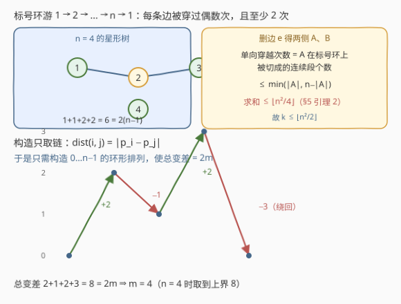
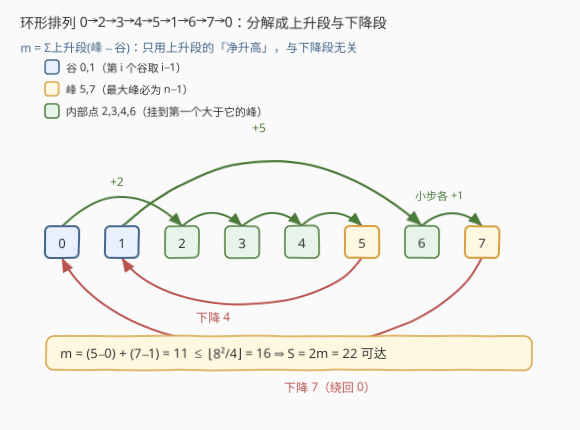
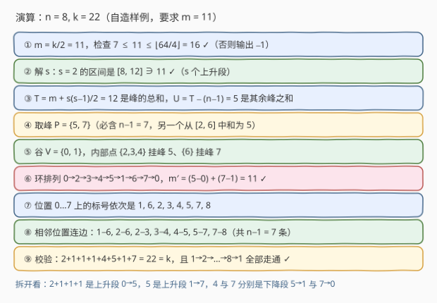

# Codeforces 2247E 构建一棵树 题解

## 1. 题目概述

- **标题 / 题号**：构建一棵树（Codeforces 2247E，英文名 Build a Tree）
- **链接**：https://codeforces.com/problemset/problem/2247/E
- **来源**：Codeforces Round 1111 (Div. 2) · Problem E
- **难度**：2300（本题 3000 分）
- **限制**：时间 2 s / 内存 256 MB
- **标签**：构造、树、双指针

**题意**：给定 $n,k$，构造一棵 $n$ 个点的树，使"标号环游"的树上距离和

$$S=\sum_{i=1}^{n}\operatorname{dist}\big(i,\ (i \bmod n)+1\big)=k .$$

第 $i$ 项就是 $\operatorname{dist}(i,i+1)$，$i=n$ 时绕回 $1$，所以这 $n$ 项正好是标号环上全部 $n$ 条相邻对。无解输出 `-1`；否则输出 $n-1$ 条边，顺序任意、树任选。多测，每组独立。

**约束**：

- $1\le t\le 10^{4}$；$2\le n\le 2\cdot10^{5}$；$0\le k\le n^{2}$；$\sum n\le 2\cdot10^{5}$
- $k$ 可达 $n^{2}=4\cdot10^{10}$，必须 64 位整数；$\sum n$ 的上界要求单组 $O(n)$，不能对 $k$ 做任何规模的循环

## 2. 示例

```text
输入
5
2 2
4 6
5 10
5 14
100 8347

输出
1 2
1 4
1 3
1 2
3 2
3 4
4 1
5 3
-1
-1
```

逐组核对：$n=2$ 唯一可行值就是 $2$；$n=4,k=6$ 输出菊花（$1+2+2+1$）；$n=5,k=10$ 输出 $1-4-3-2$ 再加边 $3-5$（$3+1+1+2+3$）；$n=5,k=14$ 超过上界 $\lfloor 25/2\rfloor=12$ 无解；$n=100,k=8347$ 超过上界 $5000$ 无解。**自造样例** $n=8,k=22$ 的输出是链 $1-6-2-3-4-5-7-8$，完整演算见 §3.4。

## 3. 解题思路

### 3.1 暴力思路

标号树共有 $n^{n-2}$ 棵，$n\le 2\cdot10^{5}$ 时完全不可枚举（$n=8$ 已有 $262144$ 棵，只够拿去对拍）。另一种直觉是"先给一棵树，再逐条边把 $S$ 调大 $1$"，但 $k$ 可达 $2\cdot10^{10}$，最坏要调整 $O(k)$ 次，必然超时。所以必须**先刻画 $k$ 的可行范围，再对范围内任意 $k$ 一次性算出构造参数**。

### 3.2 核心观察：闭合游走 + 路径化



**观察 1（偶数与下界）**：把 $1\to2\to\cdots\to n\to1$ 看成树上一条**闭合游走**。删掉任一条边 $e$ 后树分两侧，游走既要回到起点，从一侧穿到另一侧的次数必成对出现，故 $e$ 被穿过的总次数是偶数；又因游走经过全部 $n$ 个点，$e$ 两侧都有顶点，故 $e$ 至少被穿 $2$ 次。于是

$$k=\sum_{e}\big(\text{边 } e \text{ 的穿越次数}\big)\ \text{为偶数},\qquad k\ge 2(n-1).$$

**观察 2（单向计数）**：令 $m=k/2$，对每条边只数"单向穿越次数" $w_e$，则 $m=\sum_e w_e$。设删掉 $e$ 后一侧的点集为 $A_e$，则 $w_e$ 恰是 $A_e$ 在标号环 $1,2,\dots,n$ 上被切成的**连续段个数**。

**观察 3（构造只用链）**：若树是一条链、点 $i$ 在链上的位置为 $p_i$（$p$ 是 $0..n-1$ 的排列），则 $\operatorname{dist}(i,j)=|p_i-p_j|$，问题化为

> 求 $0,1,\dots,n-1$ 的**环形排列** $p_1,\dots,p_n$，使 $\sum_{i=1}^{n}|p_i-p_{i+1}|=2m$（约定 $p_{n+1}=p_1$）。

"造树"就此变成"排一排数"。§5 将证明任意树的 $m\le\lfloor n^{2}/4\rfloor$，而链恰好能取满上界，所以链不是权宜之计，而是最优载体。

### 3.3 构造：峰谷交替的环形排列



把环形排列切成**极大单调段**：上升段（谷 $\to$ 峰）与下降段（峰 $\to$ 谷）交替。所有上升段的升高之和等于所有下降段的下降之和，记作 $M$，则 $2m=\sum|p_i-p_{i+1}|=2M$，即

$$m=\sum_{\text{上升段}}(\text{峰}-\text{谷}).$$

**只要控制"峰减谷"之和，下降段长什么样都不影响 $m$。** 于是按上升段个数 $s$ 参数化构造：

- 谷取 $0,1,\dots,s-1$（第 $i$ 个谷就是 $i-1$）；
- 峰取 $p_1<p_2<\dots<p_s$，其中**最大的峰必须是 $n-1$**（它无处可升，只能当峰）；
- 其余数（内部点）挂到"第一个比它大的峰"所在的上升段，段内升序；
- 环形排列取 $0\to(\text{块}_1)\to p_1\to 1\to(\text{块}_2)\to p_2\to\cdots\to p_s\to 0$。

每个上升段从谷 $i-1$ 升到峰 $p_i$，净升高 $p_i-(i-1)$，于是一步到位：

$$m=\sum_{i=1}^{s}\big(p_i-(i-1)\big)=\sum_{i=1}^{s}p_i-\frac{s(s-1)}{2}.$$

**每个 $s$ 覆盖哪些 $m$？** $p_s=n-1$ 固定，另外 $s-1$ 个峰是 $[s,n-2]$ 中互不相同的数，其和 $U$ 可取遍一段连续整数；把 $U$ 的上下界代入即得

$$m\in\Big[(s-1)^{2}+(n-1),\ (s-1)(n-s-1)+(n-1)\Big].$$

两端点都随 $s$ 递增，且相邻区间**首尾相接**：$s$ 增 $1$ 时左端点增 $2s-1$，而 $\mathrm{hi}(s)-\mathrm{lo}(s)=(s-1)(n-2s)\ge 2s-2$（因 $s+1\le\lfloor n/2\rfloor$ 时 $n-2s\ge 2$），故 $\mathrm{lo}(s+1)\le\mathrm{hi}(s)+1$。$s=1$ 给出 $[n-1,n-1]$，$s=\lfloor n/2\rfloor$ 的右端点正是 $\lfloor n^{2}/4\rfloor$，故

$$k\ \text{可行}\iff k\ \text{为偶数且}\ 2(n-1)\le k\le \Big\lfloor \frac{n^{2}}{2}\Big\rfloor .$$

**算法流程**：

1. 判掉奇数 $k$、$k<2(n-1)$、$k>\lfloor n^{2}/2\rfloor$，输出 `-1`；
2. $m=k/2$；由 $\mathrm{lo}(s)=(s-1)^{2}+n-1$ 单调，用 $\sqrt{m-n+1}$ 一步定位 $s$，夹到 $[1,\lfloor n/2\rfloor]$ 后用 while 修正浮点误差；
3. $T=m+\frac{s(s-1)}{2}$ 为峰的总和，$U=T-(n-1)$ 为另外 $s-1$ 个峰之和，从大到小贪心填出；
4. 峰升序排序，内部点 $x$ 挂到第一个满足 $p_i>x$ 的峰（峰指针只增不减，$O(n)$）；
5. 按上式写出每个位置上的**标号**（逆排列），再输出相邻位置之间的边。

### 3.4 示例演算



取 $n=8,k=22$，则 $m=11\in[7,16]$，故可行，且落在 $s=2$ 的区间 $[8,12]$。

- $T=11+\frac{2\cdot1}{2}=12$，另一个峰 $U=12-(8-1)=5$，峰集合 $P=\{5,7\}$；谷 $V=\{0,1\}$，内部点 $\{2,3,4,6\}$，其中 $\{2,3,4\}$ 挂峰 $5$、$\{6\}$ 挂峰 $7$。
- 环排列 $0\to2\to3\to4\to5\to1\to6\to7\to0$，检查 $m'=(5-0)+(7-1)=11$ ✓。
- 位置 $0..7$ 上的标号依次为 $1,6,2,3,4,5,7,8$，相邻位置连边得到链 $1-6-2-3-4-5-7-8$。
- 校验：$2+1+1+1+4+5+1+7=22=k$ ✓。对照样例第 4 组：$n=5,k=14$ 时 $m=7>\lfloor 25/4\rfloor=6$，直接判无解，与官方输出一致。

## 4. 算法细节

1. **范围判定用 64 位**：C++ 里 `n*n/4` 必须让 `n` 是 `long long`，否则先溢出成 `int` 再除；Python 用 `//` 天然下取整。
2. **$s$ 的定位**：$\mathrm{lo}(s)$ 单调，先取 $s=\lfloor\sqrt{m-n+1}\rfloor+1$，再 `while` 下调保证 $(s-1)^{2}+n-1\le m$、上调保证不越界，最后用区间端点复核一次兜底。
3. **峰集合贪心**：从最大空位往下填。设还要放 $i$ 个数、上界 `hi`、剩余和 `rem`，则这一位取 $x=\min(\texttt{hi},\texttt{rem}-\text{minRest})$，minRest 是余下 $i-1$ 个数的最小可能和；填完令 `hi` $=x-1$。$O(s)$，天然保证互不相同且落在 $[s,n-2]$。
4. **内部点归属**：$x$ 从 $s$ 扫到 $n-1$（跳过峰），峰指针 $j$ 只增不减，总 $O(n)$。
5. **输出的是链**：先算出 `seq`（每个位置的值），再用逆排列 `inv[位置]=标号`，最后对每个 $x$ 输出 `(inv[x], inv[x+1])`；标号从 $1$ 开始，别把位置当标号输出。
6. **多测清空**：所有数组按当前 $n$ 现场分配、跨组不复用；输出行数必须恰好 $n-1$。
7. **I/O**：总输出 $O(\sum n)=2\cdot10^{5}$ 行，用 `printf`/`'\n'`（不要 `endl`）并关同步；Python 用 `sys.stdin.buffer.read().split()` 加一次性 `join`。
8. **奇数 $n$**：$\lfloor n^{2}/2\rfloor$ 与 $2\lfloor n^{2}/4\rfloor$ 在 $n$ 为奇数时都等于 $(n^{2}-1)/2$，写哪个都对，但别用浮点比较。

## 5. 正确性证明

**引理 1**：$k$ 必为偶数且 $k\ge 2(n-1)$。**证明**：见观察 1——闭合游走对每条边的穿越次数成对出现，且每条边两侧都有顶点故至少被穿 $2$ 次。∎

**引理 2**：任意 $n$ 点树都有 $m=k/2\le\lfloor n^{2}/4\rfloor$。**证明**：由观察 2，$w_e\le\min(|A_e|,|B_e|)$。取树的重心 $c$（每个连通块 $\le n/2$），记 $A_e^{\ast}$ 为删掉 $e$ 后不含 $c$ 的那侧，则 $|A_e^{\ast}|\le n/2$，故 $w_e\le|A_e^{\ast}|$。而顶点 $x$ 恰好属于 $d(c,x)$ 个 $A_e^{\ast}$（即 $x$ 到 $c$ 路径上的边数），于是

$$m=\sum_e w_e\le\sum_e |A_e^{\ast}|=\sum_x\operatorname{dist}(c,x).$$

以 $c$ 为根，子树大小为 $s_1,\dots,s_t$，有 $\sum s_i=n-1$、$s_i\le n/2$；子树内深度和不超过 $s_i(s_i-1)/2$（链取到），故

$$\sum_x\operatorname{dist}(c,x)\le\sum_i\frac{s_i(s_i+1)}{2}=\frac{\sum_i s_i^{2}+(n-1)}{2}\le\Big\lfloor\frac{n^{2}}{4}\Big\rfloor,$$

最后一步：$s_i\le n/2$ 下 $\sum s_i^{2}$ 的最大值在 $n$ 偶数时为 $(n/2)^{2}+(n/2-1)^{2}$、$n$ 奇数时为两个 $((n-1)/2)^{2}$，代入即得。∎

**引理 3**：$m=\sum_{\text{上升段}}(\text{峰}-\text{谷})$。**证明**：上升段内各步之和为 $\text{峰}-\text{谷}$，下降段内为 $\text{谷}-\text{峰}$；环闭合使上升段升高总和等于下降段下降总和 $M$，故总变差 $=2M$，即 $m=M$。∎

**引理 4**：对固定 $s$，§3.3 的构造是合法环形排列，且能实现区间 $[(s-1)^{2}+n-1,(s-1)(n-s-1)+n-1]$ 中**每一个**整数 $m$。**证明**：合法性——谷取 $0..s-1$，峰与内部点互异且都 $\ge s$，块内升序（内部点满足 $i-1<x<p_i$），块间由峰降到下一个谷（$p_i\ge s>i$），最大峰 $n-1$ 回到 $0$，故恰是 $0..n-1$ 的环形排列且上升段严格递增。取值——$m=\sum p_i-\frac{s(s-1)}{2}$，而 $s-1$ 个互不相同的数取自连续区间 $[s,n-2]$，其和可取遍最小和到最大和之间的一切整数。∎

**定理**：算法输出合法，且**当且仅当** $k$ 为偶数、$2(n-1)\le k\le\lfloor n^{2}/2\rfloor$ 时输出满足要求的树。**证明**：必要性由引理 1、2。充分性：$\mathrm{lo}(s)=(s-1)^{2}+n-1$ 递增，$\mathrm{hi}(s)=(s-1)(n-s-1)+n-1$ 在 $s\le n/2$ 上递增，且 $s\le n/2-1$ 时 $\mathrm{hi}(s)\ge s^{2}+n-2=\mathrm{lo}(s+1)-1$（因 $n-s-1\ge s+1$），故这些区间覆盖 $[n-1,\lfloor n^{2}/4\rfloor]$ 且无空洞；于是任意可行 $m$ 都能选到某个 $s$ 与峰集合，由引理 4 得到合法排列。最后把环排列转成链，$\operatorname{dist}(i,i+1)=|p_i-p_{i+1}|$，总和恰为 $2m=k$。∎

## 6. 复杂度分析

- **时间**：定位 $s$ 为 $O(1)$（开方加常数次修正）；峰集合贪心 $O(s)\le O(n)$；内部点分配、序列生成、输出各 $O(n)$。单组 $O(n)$，总 $O(\sum n)\le 2\cdot10^{5}$。
- **空间**：`seq / inv / isPeak / blocks` 共 $O(n)$，与 $\sum n$ 同阶，远低于 256 MB。
- **对照时限**：实测 C++ 在 $n=2\cdot10^{5}$ 的极端数据上约 $20$ ms（含 $2\cdot10^{5}$ 行输出），$t=10^{4}$、$\sum n=2\cdot10^{5}$ 的多测数据同样约 $20$ ms，相对 2 s 有百倍余量；Python3 约 $0.1\sim0.2$ s，也在时限内。

## 7. 参考代码

### C++17

```cpp
#include <bits/stdc++.h>
using namespace std;
typedef long long ll;

int main() {
    int t;
    if (scanf("%d", &t) != 1) return 0;
    while (t--) {
        ll n, k;
        scanf("%lld %lld", &n, &k);
        if (k % 2 != 0) { printf("-1\n"); continue; }
        ll m = k / 2;
        if (m < n - 1 || m > n * n / 4) { printf("-1\n"); continue; }
        // 上升段个数 s：区间 [(s-1)^2+n-1, (s-1)(n-s-1)+n-1] 随 s 单调递增
        ll s = (ll)sqrtl((long double)(m - (n - 1))) + 1;
        if (s < 1) s = 1;
        if (s > n / 2) s = n / 2;
        while (s > 1 && (s - 1) * (s - 1) + (n - 1) > m) s--;
        while (s < n / 2 && s * s + (n - 1) <= m) s++;
        if (!((s - 1) * (s - 1) + (n - 1) <= m && m <= (s - 1) * (n - s - 1) + (n - 1))) {
            printf("-1\n");
            continue;
        }
        // 峰集合：必含 n-1，另取 s-1 个 [s, n-2] 中互不相同的数，总和为 T
        ll rem = m + s * (s - 1) / 2 - (n - 1);
        vector<int> pk;
        pk.reserve(s);
        ll lo = s, hi = n - 2;
        for (ll i = s - 1; i >= 1; i--) {
            ll minRest = (i - 1) * lo + (i - 1) * (i - 2) / 2;   // 余下 i-1 个数的最小可能和
            ll x = min(hi, rem - minRest);
            pk.push_back((int)x);
            rem -= x;
            hi = x - 1;
        }
        pk.push_back((int)(n - 1));
        sort(pk.begin(), pk.end());
        vector<char> isPeak(n + 1, 0);
        for (int p : pk) isPeak[p] = 1;
        vector<vector<int>> blocks(s);            // 每个上升段里的内部点
        int j = 0;
        for (ll x = s; x <= n - 1; x++) {
            if (isPeak[x]) continue;
            while (pk[j] < x) j++;                // 挂到第一个大于它的峰
            blocks[j].push_back((int)x);
        }
        vector<int> seq;                          // seq[i] = 第 i+1 个标号所在位置
        seq.reserve(n);
        for (ll i = 0; i < s; i++) {
            seq.push_back((int)i);                // 谷 i
            for (int x : blocks[i]) seq.push_back(x);
            seq.push_back(pk[i]);                 // 峰 p_i
        }
        vector<int> inv(n);                       // inv[位置] = 标号
        for (int i = 0; i < n; i++) inv[seq[i]] = i + 1;
        for (int x = 0; x + 1 < n; x++) printf("%d %d\n", inv[x], inv[x + 1]);
    }
    return 0;
}
```

### Python3

```python
import sys
from math import isqrt

def main():
    data = sys.stdin.buffer.read().split()
    if not data:
        return
    t = int(data[0])
    pos = 1
    out = []
    for _ in range(t):
        n = int(data[pos]); k = int(data[pos + 1]); pos += 2
        if k & 1:
            out.append("-1")
            continue
        m = k >> 1
        if m < n - 1 or m > n * n // 4:
            out.append("-1")
            continue
        # 上升段个数 s
        s = min(max(isqrt(m - (n - 1)) + 1, 1), n // 2)
        while s > 1 and (s - 1) * (s - 1) + (n - 1) > m:
            s -= 1
        while s < n // 2 and s * s + (n - 1) <= m:
            s += 1
        if not ((s - 1) * (s - 1) + (n - 1) <= m <= (s - 1) * (n - s - 1) + (n - 1)):
            out.append("-1")
            continue
        # 峰集合：必含 n-1，另取 s-1 个 [s, n-2] 中互不相同的数，总和为 T
        rem = m + s * (s - 1) // 2 - (n - 1)
        pk = []
        hi = n - 2
        for i in range(s - 1, 0, -1):
            min_rest = (i - 1) * s + (i - 1) * (i - 2) // 2
            x = min(hi, rem - min_rest)
            pk.append(x)
            rem -= x
            hi = x - 1
        pk.append(n - 1)
        pk.sort()
        is_peak = bytearray(n + 1)
        for p in pk:
            is_peak[p] = 1
        blocks = [[] for _ in range(s)]
        j = 0
        for x in range(s, n):
            if is_peak[x]:
                continue
            while pk[j] < x:
                j += 1
            blocks[j].append(x)
        seq = []
        for i in range(s):
            seq.append(i)
            seq.extend(blocks[i])
            seq.append(pk[i])
        inv = [0] * n
        for i, v in enumerate(seq):
            inv[v] = i + 1
        out.extend("%d %d" % (inv[x], inv[x + 1]) for x in range(n - 1))
    sys.stdout.write("\n".join(out) + "\n")

main()
```

## 8. 边界情况与易错点

1. **$k$ 为奇数**：穿越次数都成对，奇数必无解（如 $n=3,k=5$），这是最容易漏的判据。
2. **$k<2(n-1)$**：含 $k=0$ 等。最小可行值是 $2(n-1)$（任意菊花都能达到），更小一律 `-1`。
3. **上界不是 $n(n-1)$ 也不是 $n^{2}$**：是 $\lfloor n^{2}/2\rfloor$。$n=5$ 上界 $12$（样例第 4 组 $k=14$ 无解），$n=100$ 上界 $5000$（第 5 组 $k=8347$ 无解）。
4. **$n=2$**：只有 $k=2$ 可行，输出唯一的边 `1 2`；此时 $s=1$、内部点为空，代码不能输出 $0$ 条边或越界。
5. **$k=2(n-1)$**：$m=n-1$，$s=1$，构造退化成"$0$ 升到 $n-1$ 再回 $0$"，内部点全挂在唯一峰 $n-1$ 上，正好是最小解。
6. **$k=\lfloor n^{2}/2\rfloor$**：$s=\lfloor n/2\rfloor$，$n$ 偶数时内部点为空。若贪心把 $n-1$ "降下去"丢了，构造立刻失效，所以必须先把 $n-1$ 钉成峰。
7. **溢出**：$n^{2}=4\cdot10^{10}$、$T$ 可达 $2\cdot10^{10}$ 量级，C++ 全程 `long long`；不要用浮点比较 $n^{2}/2$。

## 相关题目与扩展

- [CF 1092F Tree with Maximum Cost](https://codeforces.com/problemset/problem/1092/F)：换根求 $\sum_i\operatorname{dist}(r,i)$，正是引理 2 里的核心量。
- [CF 1294F Three Paths on a Tree](https://codeforces.com/problemset/problem/1294/F)：树上路径与距离和的最值，同样是"把距离和拆到边上"。
- [CF 1338B Edge Weight Assignment](https://codeforces.com/problemset/problem/1338/B)：按距离奇偶填边权，与引理 1 的奇偶计数同源。
- [LeetCode 834. 树中距离之和](https://leetcode.cn/problems/sum-of-distances-in-tree/)：$\sum_e a_e(n-a_e)$ 的换根 DP 模板。

**延伸思考**：

1. 若把"标号环上相邻"换成任意给定置换 $\pi$，即要求 $\sum_i\operatorname{dist}(i,\pi(i))=k$，环游不再闭合，奇偶性约束消失，可行范围与构造都会完全不同。
2. 若还要求输出**直径最小**的合法树，链就太长了：$k$ 接近下界时菊花型能把直径压到 $2$，可以想想在 $\sum_e w_e=m$ 约束下如何权衡直径与 $m$。
3. "环形排列的最大总变差"是经典结论 $\max\sum|p_i-p_{i+1}|=2\lfloor n^{2}/4\rfloor$，最优解就是本文 $s=\lfloor n/2\rfloor$ 的小大交替；本题相当于要求这个经典构造在**每个中间取值**上都能落地。
