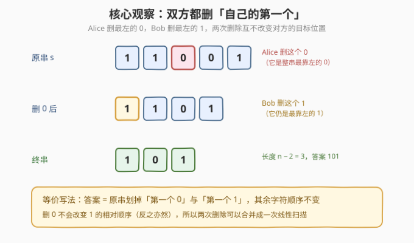
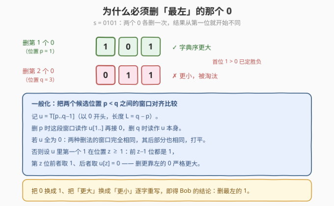
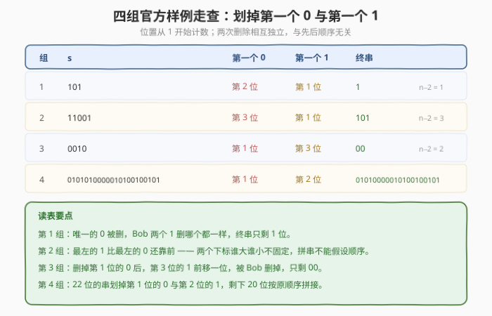

# Codeforces 2248A 你删我也删 题解

## 1. 题目概述

- **标题 / 题号**：你删我也删（Codeforces 2248A，英文名 You Delete, I Delete）
- **链接**：https://codeforces.com/problemset/problem/2248/A
- **来源**：Codeforces Round 1113 (Div. 2) · Problem A
- **难度**：800
- **限制**：时间 1 s / 内存 256 MB
- **标签**：贪心，博弈，字符串

**题意**：给定一个长度为 $n$ 的 01 串 $s$，保证它至少含一个 `0`、至少一个 `1`。两人按固定顺序各删一个字符：Alice 先删掉 $s$ 中的某一个 `0`，Bob 再在删完后的串里删掉某一个 `1`。Alice 希望最终串的字典序尽量**大**，Bob 希望尽量**小**，双方都按最优策略行动，求最终串。多测：第一行是组数 $t$，随后每组一行只给字符串（**不额外给出长度 $n$**），逐组输出一行答案。

**约束**：

- $1 \le t \le 100$
- $3 \le n \le 100$，$n$ 由字符串长度直接给出
- $s$ 只由 `0` / `1` 组成，且保证至少一个 `0`、至少一个 `1` —— 两人的"可删字符"都一定存在
- 终串长度恒为 $n - 2 \ge 1$，不会为空
- 删除针对"某一次出现"而不是"字符种类"：重复的 `0`（或 `1`）可以删任意一个
- 时限 1 s 非常宽松，即使 $O(n^3)$ 的 minimax 枚举也能通过

## 2. 示例

官方样例（输入 / 输出原样）：

```text
输入：
4
101
11001
0010
0101010000010100100101

输出：
1
101
00
01010000010100100101
```

逐组解释：

| 组 | $s$ | 第一个 0 | 第一个 1 | 终串 | 说明 |
|----|-----|----------|----------|------|------|
| 1 | `101` | 第 2 位 | 第 1 位 | `1` | 只有唯一的 `0` 可删，Bob 两个 `1` 删哪个都一样 |
| 2 | `11001` | 第 3 位 | 第 1 位 | `101` | 两个 `0` 删哪个都得到 `1101`，Bob 再删最左的 `1` |
| 3 | `0010` | 第 1 位 | 第 3 位 | `00` | 删掉第 1 位的 `0` 后，唯一的 `1` 被 Bob 删掉 |
| 4 | `0101010000010100100101` | 第 1 位 | 第 2 位 | `01010000010100100101` | 22 位划掉两位，剩 20 位按原顺序拼接 |

自造一组"多个相同字符"的对照数据（标注为自造，用来体会"第一个"的选取）：

```text
输入：
2
111000
0101

输出：
1100
01
```

`111000` 里三个 `0` 完全对称，Alice 删哪个都得到 `11100`，Bob 再删最左的 `1` 得 `1100`；`0101` 删掉第一个 `0`（第 1 位）与第一个 `1`（第 2 位）后只剩 `01`。

## 3. 解题思路

### 3.1 暴力思路

Alice 的候选动作就是"删哪个 `0`"，至多 $n$ 种；Bob 的候选动作是"删哪个 `1`"，也至多 $n$ 种。对 Alice 的每个选择，Bob 会在所有"可删的 1"里挑出使结果字典序最小的那一个；Alice 再在自己的所有选择里挑终值最大的那一个 —— 这就是标准的两层 minimax：

$$\text{ans} = \max_{\text{Alice 删的 0}} \min_{\text{Bob 删的 1}} \text{结果串}$$

逐层枚举、每次用字符串比较定优劣，单个测例 $O(n^3)$，在 $n \le 100$、$t \le 100$ 下约 $10^7$ 量级的字符比较，跑得动，是完全合法的做法。

但暴力只回答了"是多少"，没有回答"为什么"。一旦把 $n$ 放大到 $10^5$（多测求和），$O(n^3)$ 立刻失效。下面的贪心把它压到 $O(n)$，并证明它恰好等于 minimax 值。

### 3.2 核心观察：双方都删"自己最左边的那一个"



两个关键点，本质是同一个"左移"直觉 —— **删除等价于把被删位置右侧的字符整体左移一格**：

1. **删最左的 `0` 让字典序最大**。删得越靠左，后面的 `1` 就越早被"提前"进前缀；而第一个 `0` 的左边没有任何 `1` 能被提前，它是最划算的那次删除。
2. **删最左的 `1` 让字典序最小**。对称地，Bob 希望把 `0` 尽量往前推，删掉最左的 `1` 能让右侧字符（尤其 `0`）整体左移最多。

于是终值 = 原串划掉「第一个 `0`」与「第一个 `1`」。更妙的是这两次删除**互不干扰**：删掉一个 `0` 不会改变任何 `1` 之间的相对顺序，所以删完第一个 `0` 之后，"最左的 `1`"仍然是原串里那个最左的 `1`。因此答案可以一次性构造出来，甚至不需要真的先删再删。

### 3.3 算法流程



上图画的是"为什么必须是最左"。设有两个同为 `0` 的位置 $p < q$，记 $u = T[p..q-1]$（以 `0` 开头，长度 $L = q-p$）。删 $p$ 时这段窗口读作 $u[1..]$ 再接 `0`，删 $q$ 时读作 $u$ 本身：若 $u$ 全 `0` 则两者相同；否则在 $u$ 中第一个 `1` 的位置 $z$ 上，前者取 `1`、后者取 `0`，删 $p$ 严格更大。

据此，算法只有一次线性扫描：

1. 读入 $t$；
2. 每组读入字符串 $s$（**不读 $n$**，长度用 `s.size()`）；
3. 维护两个布尔标记 `took0` / `took1`，表示"第一个 `0` / 第一个 `1` 是否已经划掉"；
4. 从左到右遍历 $s$：遇到 `0` 且 `took0` 未置位 → 置位并跳过；遇到 `1` 且 `took1` 未置位 → 置位并跳过；其余字符按原顺序追加到答案；
5. 输出答案，进入下一组。

第 4 步之所以可以"一次扫描同时做完两次删除"，正是因为两次删除互不影响（见 3.2 与引理 4）。实现上也可以先求两个下标再拼接，两种写法都对，后者的 Python 版更短。

### 3.4 示例演算



以 $s = \texttt{11001}$ 为例走一遍扫描：

| 下标 | 0 | 1 | 2 | 3 | 4 |
|------|---|---|---|---|---|
| 字符 | 1 | 1 | 0 | 0 | 1 |
| 判定 | 第一个 `1` → 划掉 | 保留 | 第一个 `0` → 划掉 | 保留 | 保留 |
| 追加 | — | 1 | — | 0 | 1 |

保留下来的是下标 1、3、4 的字符，拼成 `101`，与官方输出一致。

再看 $s = \texttt{0010}$：第一个 `0` 在下标 0、第一个 `1` 在下标 2，划掉它们后剩 `00`。注意第一组 `101` 只留下 1 个字符，说明终串长度为 $n-2$ 的下界（$n=3$ 时）会出现，代码不能假设答案至少两位。

## 4. 算法细节

1. **不要读 $n$**：输入每行只有一个字符串。若按习惯先 `cin >> n`，会把这个数字串（`0`/`1` 组成）当成长度、再错位读入后续数据，整组直接崩掉。
2. **多测重置标记**：`took0` / `took1` 必须写在 while 循环体内部，每组重新初始化；它们一旦提到循环外，第二组开始就会"一个都不删"。
3. **两种写法等价，选一种写死**：
   - 单次扫描 + 两个布尔（C++ 版），天然 $O(n)$，不需要处理下标偏移；
   - `find` 两次 + 切片拼接（Python 版），注意 $p_0$ 与 $p_1$ 的先后顺序**不固定**（`11001` 里 `1` 在最前），必须用 $\min/\max$ 归一化后再拼接。
4. **不要用 `erase` 连删**：如果先 `s.erase(s.find('0'), 1)` 再用旧的 `find('1')` 结果当下标，删掉靠前的字符后后一个下标会整体左移 1，容易错删或越界。
5. **只删各一个**：不要写成循环删掉所有 `0`；也不要把"第一个 `0`"和"第二个 `0`"一起删 —— 终串长度必须恰好是 $n-2$。
6. **I/O 与输出**：`cin/cout` 加 `ios::sync_with_stdio(false)` 后每组只有一次输出；用 `'\n'` 而不是 `endl`。Python 用 `sys.stdin.buffer.read().split()` 一次读完、`"\n".join` 一次写出。
7. **不做多余特判**：题面已保证 $s$ 同时含 `0` 与 `1`、且 $n \ge 3$，所以不需要判断"是否有的删"，也不需要处理空答案。

## 5. 正确性证明

**引理 1（窗口比较）**：设 $T$ 为 01 串，$p < q$ 是两处**同为字符 $c$** 的位置，$L = q-p$，$u = T[p..q-1]$。则删 $p$ 与删 $q$ 得到的结果满足：

- 若 $c = \texttt{0}$：删 $p$ 的串 $\ge$ 删 $q$ 的串；当 $u$ 含 `1` 时严格大于。
- 若 $c = \texttt{1}$：删 $p$ 的串 $\le$ 删 $q$ 的串；当 $u$ 含 `0` 时严格小于。

**证明**：两次删除在位置 $[0,p)$ 上完全相同。从位置 $p$ 起，删 $p$ 的串读到 $T[p+1..n-1]$，删 $q$ 的串读到 $T[p..q-1]$ 再接 $T[q+1..n-1]$。两者的差异只可能在前 $L$ 个字符内，即比较
$$v = T[p+1..q] = u[1..] \ \Vert\ c \quad \text{与} \quad u .$$

- $c = \texttt{0}$：$u$ 以 `0` 开头。若 $u$ 全为 `0`，则 $v = u$（$L$ 个 `0`），后续部分也相同，两串相等。否则设 $z \ge 1$ 是 $u$ 中第一个 `1` 的位置，则 $u[0..z-1]$ 全为 `0`，而 $v$ 的第 $z-1$ 位是 $u[z] = \texttt{1}$、$u$ 的第 $z-1$ 位是 `0`，且第 $0..z-2$ 位两者相同（都是 `0`），故 $v > u$。
- $c = \texttt{1}$：$u$ 以 `1` 开头。若 $u$ 全为 `1`，则 $v = u$。否则设 $z \ge 1$ 是 $u$ 中第一个 `0` 的位置，则 $v$ 的第 $z-1$ 位是 $u[z] = \texttt{0}$、$u$ 的第 $z-1$ 位是 `1`，前面全相同，故 $v < u$。

两种情形合起来：同一个字符有两处出现时，删靠左的那一处在该字符对应的方向上一定不劣（窗口里存在相反字符时严格更优）。∎

**引理 2（Alice 的最优首步）**：在所有"删掉一个 `0`"的选择里，删最左的 `0` 得到的串字典序最大。

**证明**：设 `0` 的位置依次为 $q_1 < q_2 < \dots < q_m$。对任意 $k \ge 2$，在引理 1 中取 $c = \texttt{0}$、$p = q_1$、$q = q_k$，得"删 $q_1$ 的串 $\ge$ 删 $q_k$ 的串"。故 $q_1$ 使结果最大。∎

**引理 3（Bob 的最优应对）**：对任意 01 串 $T$，Bob 所有"删掉一个 `1`"的结果里字典序最小的是删掉 $T$ 中最左的 `1`。

**证明**：与引理 2 相同，取引理 1 的 $c = \texttt{1}$ 分支即可。∎

**引理 4（两次删除独立）**：设原串 $s$ 中最左的 `0` 在位置 $a$、最左的 `1` 在位置 $b$。则删掉 $a$ 后，剩下串中最左的 `1` 仍是原来位置 $b$ 的字符；删掉 $b$ 后，剩下串中最左的 `0` 仍是原来位置 $a$ 的字符。

**证明**：一次删除只去掉一个字符，其余字符之间的先后关系不变。删掉 $a$（一个 `0`）后，所有 `1` 都还在、且相互顺序与 $s$ 中一致，故最靠左的 `1` 仍是 $b$ 处那个。另一半对称（删掉 $b$ 后所有 `0` 都还在）。∎

**定理**：设 $s$ 中最左的 `0` 在位置 $a$、最左的 `1` 在位置 $b$，则双方最优博弈的终值恰为"$s$ 去掉 $a$、$b$ 两个字符后按原序拼成的串"。

**证明**：Alice 的任一动作是删掉某个 `0`（位置 $q_k$），得到 $T_k$。由引理 3，Bob 的最优应对是删掉 $T_k$ 中最左的 `1`；由引理 4，那个 `1` 正是 $s$ 中位置 $b$ 的字符。于是 Bob 应对后得到的 $U_k$，恰是把 $s$ 中位置 $q_k$ 的 `0` 与位置 $b$ 的 `1` 一起划掉所得的串。

再把 $s$ 去掉 $b$ 记作 $U$。因为 $b$ 处是 `1`，$U$ 中的 `0` 与 $s$ 中的 `0` 一一对应，所以 $\{U_k\}$ 恰好是"$U$ 删掉一个 `0`"的全部可能结果。由引理 2（对 $U$ 使用），其中最大者在删 $U$ 中最左的 `0` 时取得；而 $U$ 中最左的 `0` 就是 $s$ 中位置 $a$ 的字符（引理 4）。因此
$$\max_{k} \min_{\text{Bob}} \;=\; \max_k U_k \;=\; U \text{ 去掉 } a \text{ 处字符} \;=\; s \text{ 去掉 } a, b .$$
∎

## 6. 复杂度分析

- **时间**：每组一次线性扫描，$O(n)$；总计 $O\!\left(\sum n\right) \le 100 \times 100 = 10^4$ 次字符操作。本机实测（C++17 -O2，满规模 $t=100$、$n=100$ 随机数据）含进程启动共约 4 ms，纯计算不到 1 ms，距 1 s 时限有 200 倍以上余量。
- **空间**：答案缓冲 $O(n)$，其余只有两个布尔标记，$O(1)$；Python 版一次性读入全部 token，约 $O(\sum n)$ 字节，几十 KB 量级。
- **对照时限**：即便把规模放大到 $n = 10^5$、$t = 10^4$，$O(\sum n)$ 的算法也在百毫秒内完成，瓶颈完全落在 I/O 而不是计算。

## 7. 参考代码

### C++17

```cpp
#include <bits/stdc++.h>
using namespace std;

int main() {
    ios::sync_with_stdio(false);
    cin.tie(nullptr);

    int t;
    if (!(cin >> t)) return 0;              // 空输入防护
    while (t--) {
        string s;
        cin >> s;                           // 题面不给 n，长度就是 s.size()
        string ans;
        ans.reserve(s.size());
        bool took0 = false, took1 = false;  // 第一个 '0' / 第一个 '1' 是否已划掉
        for (char c : s) {
            if (c == '0' && !took0) { took0 = true; continue; }
            if (c == '1' && !took1) { took1 = true; continue; }
            ans.push_back(c);               // 其余字符按原顺序保留
        }
        cout << ans << '\n';
    }
    return 0;
}
```

### Python3

```python
import sys


def main() -> None:
    data = sys.stdin.buffer.read().split()
    if not data:
        return
    t = int(data[0])
    out = []
    for i in range(1, t + 1):
        s = data[i].decode()
        p0 = s.find('0')          # 题面保证存在，不会是 -1
        p1 = s.find('1')
        lo, hi = min(p0, p1), max(p0, p1)   # 两个下标的先后顺序不固定
        out.append(s[:lo] + s[lo + 1:hi] + s[hi + 1:])
    sys.stdout.write("\n".join(out) + "\n")


main()
```

## 8. 边界情况与易错点

1. **两个下标顺序不定**：`11001` 里最左的 `1` 在最左的 `0` 之前；`0010` 里正好相反。任何"先删 `0` 再找 `1`"却沿用旧下标的写法都会错位。
2. **输入不含 $n$**：多读一个整数会把下一组字符串当成整数吃掉，尤其在 `t` 较大时表现为"后面全部错位"。
3. **$n = 3$ 时答案只有 1 位**：`001` / `010` / `100` 的正确输出都是 `0`，`011` / `101` / `110` 都是 `1`。不要加"答案为空就输出 …"之类的特判。
4. **只删各一个**：若误写成"删掉所有 `0`"，终串长度会不足 $n-2$；若误删两个 `0`，同样长度错、内容错。
5. **多测标记未重置**：把 `took0/took1` 提到循环外，第一组之后就再也不删字符，答案会变成整串。
6. **越界删除**：`erase` 版本里若某组恰好没有 `0`（题面保证不会，但改题/自造数据时会），`find` 返回 `npos`，`erase(npos,1)` 会抛异常。用扫描法天然免疫。
7. **输出格式**：每组恰好一行、行间无空行；`cout << ans << '\n'`，不要用 `endl`，也不要在行首尾加空格。

## 相关题目与扩展

- [Codeforces 1155A Reverse a Substring](https://codeforces.com/problemset/problem/1155/A)：一次反转使字典序变大，同属"一次操作 + 字典序最优"的签到套路。
- [Codeforces 1670A Prof. Slim](https://codeforces.com/problemset/problem/1670/A)：靠一次符号翻转把负数推到前面、正数推到后面，与本题"把想要的字符尽量提前"是同一个直觉。
- [LeetCode 2038. 如果相邻两个颜色均相同则删除当前颜色](https://leetcode.cn/problems/remove-colored-pieces-if-both-neighbors-are-the-same-color/)：双方轮流删自己颜色的字符，胜负只取决于可删次数。
- [Codeforces 1506A Strange Table](https://codeforces.com/problemset/problem/1506/A)：纯下标换算的 Div. 3 签到题，可对比本题"下标顺序不固定"的坑。

**延伸思考**：

1. **先手互换**：若规则改成 Bob 先删 `1`、Alice 再删 `0`，终值完全不变 —— 由引理 4，两次删除互不改变对方"最左"的位置，所以终值 = 划掉第一个 `0` 与第一个 `1`，与顺序无关（已用小规模全枚举验证）。
2. **各删 $k$ 轮**：双方交替进行 $k$ 轮（Alice 每轮删一个 `0`、Bob 每轮删一个 `1`），猜想终值是"划掉原串前 $k$ 个 `0` 与前 $k$ 个 `1`"。$k = 2$ 已对 $n \le 10$ 全枚举验证；一般 $k$ 还需证明"Bob 的最左删除算子单调"，因此这里只作为猜想提出。
3. **字母表变大**：删哪个不再是简单的"最左/最右"。例如 $T = \texttt{121}$，Bob 要删一个 `1` 取字典序最小，删**最右**的 `1` 得 `12`、删最左的得 `21`，最优是前者 —— 结论正好反过来。判据要回到引理 1 的窗口比较 $u$ 与 $u[1..] \Vert c$，看 $c$ 与窗口内字符的相对大小关系，不能再无脑取第一个。
