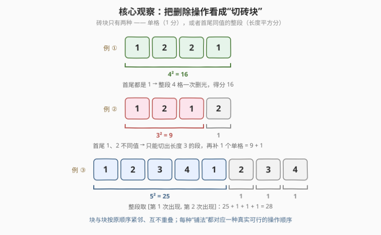
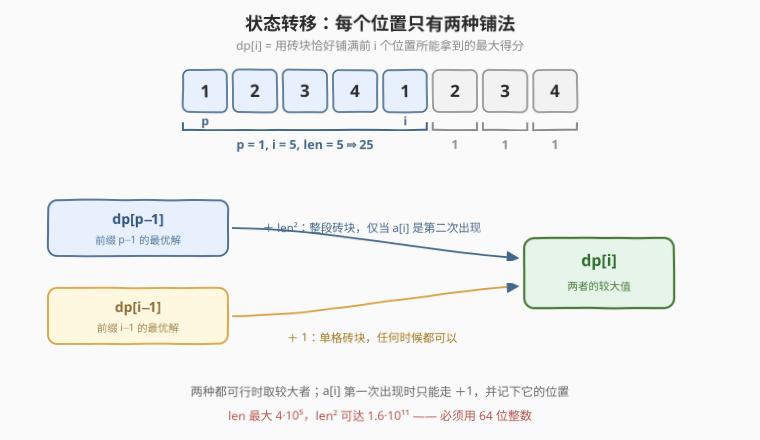
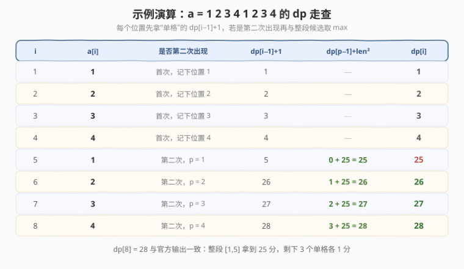

# Codeforces 2248C 最大化分数 题解

## 1. 题目概述

- **标题 / 题号**：最大化分数（Codeforces 2248C，英文名 Maximize the Score）
- **链接**：https://codeforces.com/problemset/problem/2248/C
- **来源**：Codeforces Round 1113 (Div. 2) · Problem C（UTC 2026-08-01）
- **难度**：1300
- **限制**：时间 2 s / 内存 256 MB
- **标签**：动态规划，贪心

**题意**：给定长度为 $2n$ 的数组 $a$，其中 $1 \sim n$ 的每个整数**恰好出现两次**。初始得分为 $0$，只要数组非空就重复：选一个当前仍出现的数 $x$；设它在当前数组中最左、最右出现位置为 $l, r$（只剩一次时 $l=r$）；得分加上 $(r-l+1)^2$；删掉当前数组的 $a_l,\dots,a_r$，其余元素按原顺序拼接并从 $1$ 重新编号。求删空时的最大得分。多测：第一行组数 $t$，每组先给 $n$、再给一行 $2n$ 个整数，逐组输出一行答案。

**约束**：

- $1 \le t \le 10^4$，$1 \le n \le 2 \cdot 10^5$，且所有测试的 $n$ 之和 $\le 2 \cdot 10^5$
- $1 \le a_i \le n$，每个值恰好出现两次
- 答案上界 $(2n)^2 = 1.6 \cdot 10^{11}$，**必须用 64 位整数**
- 2 s 时限 + 总和 $2 \cdot 10^5$，要求 $O(\sum n)$，不能真去模拟"删元素"

## 2. 示例与观察
官方样例（输入 / 输出原样）：

```text
输入：
6
1
1 1
2
1 2 1 2
2
1 2 2 1
3
1 1 2 3 3 2
3
1 2 3 3 2 1
4
1 2 3 4 1 2 3 4

输出：
4
10
16
20
36
28
```

逐组说明：①`1 1` 整段长 2 → $4$；②`1 2 1 2` 先删 $1$（段长 3）再删剩下的 $2$ → $9+1=10$；③`1 2 2 1` 删 $1$ 整段长 4 → $16$；④`1 1 2 3 3 2` 先删 $1$（段长 2）再删 $2$（段长 4）→ $4+16=20$；⑤`1 2 3 3 2 1` 删 $1$ 整段长 6 → $36$；⑥`1 2 3 4 1 2 3 4` 删 $2$ 得段长 5，剩 3 个单元素 → $25+3=28$。

自造三组（标注为自造，用来看清"同样的 $n$ 差距可以很大"）：

```text
输入：
3
3
1 2 3 1 2 3
2
1 1 2 2
4
4 1 3 4 2 1 3 2

输出：
18
8
32
```

`1 2 3 1 2 3` 最长整段只有 4（$16$），剩两个单元素 → $18$；`1 1 2 2` 两个对子互不相交 → $4+4=8$；`4 1 3 4 2 1 3 2` 里最长的段是 $1$ 或 $3$（长 5，贪心得 $25+3=28$），但正解是删 $4$、$2$ 两段各长 4 → $16+16=32$，**这条数据专门打掉"每次选最长区间"的贪心**。

## 3. 解题思路

### 3.1 暴力思路

每步最多 $n$ 个候选 $x$、至多 $n$ 步，枚举操作序列是 $n!$ 级别。能落地的暴力只有状压：用 $2n$ 位掩码记录"哪些位置还活着"，对掩码记忆化搜索，每次枚举一个仍有元素存活的值并算出它当前占据的段，单组 $O(2^{2n} \cdot n)$。$n \le 4$ 勉强能跑，$n = 2 \cdot 10^5$ 完全不可能 —— 暴力给不出结构，但能用来对拍：本文的 $O(n)$ 做法已与状压暴力比过 $n \le 5$ 的全部 113400 组数据。

### 3.2 核心观察：把操作看成"切砖块"



**观察 1（删掉的是一段原始区间）**：选中的数 $x$ 在原数组中的两次出现在 $l_x < r_x$，则该次操作删掉的恰好是"当前仍存活、且原下标落在 $[l_x, r_x]$ 内"的全部元素。理由：删除只改变下标、不改变剩余元素的相对顺序，原数组中夹在 $l_x,r_x$ 之间的存活元素当前必然仍排在 $x$ 的两次出现之间，反之亦然；若 $x$ 只剩一次出现则 $l_x=r_x$，退化为删一个点。**观察 2（按操作分组）**：把 $2n$ 个位置按"被哪次操作删掉"分成 $S_1,\dots,S_k$，总分就是 $\sum_t |S_t|^2$；由观察 1，每组 $S_t$ 的**最左、最右位置上的数相等**（正是该次的 $x$）。**观察 3（只需看连续切分）**：存在一种最优策略使每个 $S_t$ 都是原数组里连续的一段（第 5 节引理 4、5）。于是问题变成纯粹的"切砖块"：

> 把 $[1,2n]$ 切成若干段连续砖块，每块要么是**单格**（1 分），要么是某个值 $v$ 从**第一次出现到第二次出现**的整段（得分 = 块长的平方），求总得分最大值。

上图是三种典型切法：`1 2 2 1` 首尾同值，直接整段拿走 16 分；`1 2 1 2` 首尾是 $1$ 和 $2$，整段砖块切不出来，只能"长 3 的一段 + 一个单格"；`1 2 3 4 1 2 3 4` 最划算的是 $[1,5]$（$5^2=25$）再加 3 个单格。

> 💡 "单格"这种砖块不能省：某个值的两次出现可能被别的操作拆散，剩下的那一次只能单独成段、贡献 $1$ 分。

### 3.3 算法流程 / 状态转移



设 $dp[i]$ 为"用砖块恰好铺满前缀 $[1,i]$"的最大得分，$dp[0]=0$。扫到位置 $i$（$a_i=v$）时只有两种选择：

1. **单格砖块**：$[i,i]$ 独立成块，$dp[i] \leftarrow dp[i-1]+1$（永远可用）。
2. **整段砖块**：若 $i$ 是 $v$ 的**第二次**出现，设第一次出现在 $p$，则 $[p,i]$ 可整块拿走：
$$dp[i] \leftarrow dp[p-1] + (i-p+1)^2 .$$

两者取较大值。因为"每个值恰好出现两次"，整段砖块**只有一种起点**（该值第一次出现的位置），所以每个位置只要 $O(1)$ 次转移，整组 $O(n)$。流程：读入 $n$ 与 $2n$ 个元素 → 开 `first[v]`（初始 0）与 `dp[0]=0` → 对 $i=1\dots 2n$：先做 `dp[i]=dp[i-1]+1`；若 `first[a[i]]!=0` 用 `dp[first[a[i]]-1]+len*len` 更新，否则记 `first[a[i]]=i` → 输出 `dp[2n]`。

### 3.4 示例演算



以 $a=[1,2,3,4,1,2,3,4]$（$n=4$）为例，关键是第 5 步：整段 $[1,5]$ 一次给到 25 分，远高于"5 个单格"的 5 分。

| $i$ | $a_i$ | 情况 | $dp[i-1]+1$ | $dp[p-1]+len^2$ | $dp[i]$ |
|-----|-------|------|-------------|-----------------|---------|
| 1 | 1 | 首次，$first[1]=1$ | 1 | — | **1** |
| 2 | 2 | 首次，$first[2]=2$ | 2 | — | **2** |
| 3 | 3 | 首次，$first[3]=3$ | 3 | — | **3** |
| 4 | 4 | 首次，$first[4]=4$ | 4 | — | **4** |
| 5 | 1 | 第二次，$p=1$ | 5 | $0+25=25$ | **25** |
| 6 | 2 | 第二次，$p=2$ | 26 | $1+25=26$ | **26** |
| 7 | 3 | 第二次，$p=3$ | 27 | $2+25=27$ | **27** |
| 8 | 4 | 第二次，$p=4$ | 28 | $3+25=28$ | **28** |

第 6 步之后两条转移只差 0 或 1，取谁都一样，最终 $dp[8]=28$，与官方第 6 组输出一致。

## 4. 算法细节

1. **多测必须重建 `first`**：按值域开（大小 $n+1$），在每组测试内部重新构造。提到循环外或多组复用，会把上一组的"第一次出现位置"带进本组。
2. **只记录第一次出现**：每个值恰好两次，`first[v]` 写一次即可；第二次出现时才是整段砖块的候选，之后不必再更新。
3. **答案用 `long long`，长度是 `i-p+1`**：块长最大 $2n=4\cdot10^5$，平方 $1.6\cdot10^{11}$，`int` 会溢出；$p,i$ 都是 1-indexed 闭区间端点，少加 1 会让样例第 3 组从 16 掉到 9。
4. **单格转移无条件做、整体取 max**：先用 `dp[i-1]+1` 打底，再决定要不要用整段；写成 `min` 或"能整段就整段"会漏掉更优的混合切法（第 8 节第 2 条有反例）。
5. **不要真的删元素**：算法只在原数组上扫一遍，不维护动态数组，避免 `erase` 带来的 $O(n^2)$。
6. **I/O**：`cin/cout` 加 `ios::sync_with_stdio(false)`；Python 用 `sys.stdin.buffer.read().split()` 一次读完再切片，避免 $10^4$ 组数据下 `input()` 的逐行开销。

## 5. 正确性证明

**引理 1（删除集合）**：某一时刻选中 $x$（原始位置 $l_x<r_x$），该次操作删掉的是"当前存活且原下标在 $[l_x,r_x]$ 内"的全部元素。

**证明**：删掉的是当前数组中 $x$ 最左与最右出现之间的所有位置。删除只做拼接、不改变剩余元素相对顺序，故原下标在 $[l_x,r_x]$ 之间的存活元素当前仍在 $x$ 的两次出现之间；反之 $x$ 两次出现之间也不可能有原下标越界的元素。$x$ 只剩一次出现时两边都退化为单点。∎

**引理 2（第一步即整段）**：若第一步选 $x$，则删掉完整的原始区间 $[l_x,r_x]$，得 $(r_x-l_x+1)^2$；删后数组等于 $a$ 去掉 $[l_x,r_x]$ 再拼接（记作 $T_x$），后续就是同一游戏在 $T_x$ 上继续，故
$$\mathrm{OPT}(a)=\max_{x}\left\{(r_x-l_x+1)^2+\mathrm{OPT}(T_x)\right\}.$$

**证明**：第一步时所有元素都存活，由引理 1 删掉的正是整个 $[l_x,r_x]$；删完后剩余元素相对顺序与原数组一致，"选值、删当前极左极右之间"的规则完全不变，故后续恰是 $T_x$ 上的同一游戏。∎

**引理 3（铺法刻画）**：设 $g[i]$ 为前缀 $[1,i]$ 的最优铺法得分（砖块为单格或"某值第一次到第二次出现的整段"），则 $g$ 就是 3.3 的 $dp$。

**证明**：铺法的最后一块要么是单格 $[i,i]$（贡献 1），要么是整段 $[p,i]$（$p$ 为 $a_i$ 第一次出现，贡献 $(i-p+1)^2$），两种情形互斥且穷尽，正是转移式；每值只出现两次故整段起点唯一。归纳即得。∎

**引理 4（单步不等式）**：对任意满足 $a[l]=a[r]$ 的区间 $[l,r]$（长 $L=r-l+1$），令 $T$ 为 $a$ 去掉 $[l,r]$ 后拼接的数组，则 $g(a)\ \ge\ L^2+g(T)$。

**证明**：取 $T$ 的任意一种铺法并搬回 $a$：单格砖块不会"跨接缝"；整段砖块 $[u,v]$ 仅在 $u\le l-1$ 且 $v\ge r+1$ 时跨接缝，而砖块互不重叠，跨接缝者必须同时含接缝两侧相邻位置，故**至多一块**。

**情形一（无跨接缝）**：该铺法即 $[1,l-1]$ 的铺法接 $[r+1,2n]$ 的铺法。在 $a$ 上取"$[1,l-1]$ 铺法 + 整块 $[l,r]$ + $[r+1,2n]$ 铺法"，得分恰为 $g(T)+L^2$。**情形二（唯一跨接缝砖块 $[u,v]$）**：其余砖块落在 $[1,u-1]$ 与 $[v+1,2n]$；记 $X=v-u+1$，它在 $T$ 中块长为 $X-L$，该铺法在 $T$ 中得 $g([1,u-1])+(X-L)^2+g([v+1,2n])$。改在 $a$ 上取"$[1,u-1]$ 铺法 + 整块 $[u,v]$（合法，$a[u]=a[v]$）+ $[v+1,2n]$ 铺法"，得分
$$g([1,u-1])+X^2+g([v+1,2n])\ \ge\ g([1,u-1])+(X-L)^2+L^2+g([v+1,2n]),$$
最后一步用了 $X\ge L \Rightarrow X^2-(X-L)^2=L(2X-L)\ge L^2$。

两种情形都给出 $g(a)\ge L^2+g(T)$，对 $T$ 的最优铺法取等号即得结论。∎

**引理 5（可达性）**：$g(a)$ 能被真实操作达到。**证明**：取达到 $g(a)$ 的铺法。先按从左到右顺序处理所有整段砖块：处理 $[p,i]$ 时块内元素都还存活（砖块互不重叠且此前只删过整段砖块），而 $a[p]=a[i]$，由引理 1 该次操作正好删掉整块，得 $(i-p+1)^2$。再处理剩下的单格元素：任取一个元素操作，它删掉 $k\ge1$ 个元素得 $k^2\ge k$，故删空剩余部分的总分不小于单格砖块个数之和。故总分 $\ge$ 铺法得分。∎

**定理**：最大得分等于 $g(a)=dp[2n]$。**证明**：对数组长度归纳证明 $\mathrm{OPT}(a)\le g(a)$（允许某些值只出现一次的一般数组；空数组显然）。任取策略，第一步选 $x$，由引理 2 得分 $=(r_x-l_x+1)^2+(\text{后续})$，后续是 $T_x$ 上的合法策略，由归纳 $\le \mathrm{OPT}(T_x)\le g(T_x)$；由引理 4 又有 $g(a)\ge (r_x-l_x+1)^2+g(T_x)$，故该策略得分 $\le g(a)$，即 $\mathrm{OPT}\le g$。反向由引理 5 得 $\mathrm{OPT}\ge g$。∎

## 6. 复杂度分析

- **时间**：每组一次线性扫描、转移 $O(1)$，合计 $O(\sum n)\le 2\cdot10^5$ 次操作。
- **空间**：`first`、`dp`、输入数组各 $O(n)$；单组峰值为 $2\cdot10^5$ 个 `int` 加 $4\cdot10^5$ 个 `long long`，几 MB 量级，远小于 256 MB。
- **对照时限**：本机实测（macOS，clang -O2，含进程启动与读入，5 次取最小）单组 $n=2\cdot10^5$ 全嵌套数据约 $0.50$ s，其中绝大部分是 libc++ 的 `cin` 解析开销（换成 `getchar` 读入后连读文件在内只要 $5\sim8$ ms），$t=10^4$、$\sum n=2\cdot10^5$ 约 $0.29$ s；Python3 同数据约 $0.17\sim0.19$ s。相对 2 s 至少有 4 倍余量。

## 7. 参考代码

### C++17

```cpp
#include <bits/stdc++.h>
using namespace std;

int main() {
    ios::sync_with_stdio(false);
    cin.tie(nullptr);

    int t;
    if (!(cin >> t)) return 0;              // 空输入防护
    while (t--) {
        int n;
        cin >> n;
        int m = 2 * n;
        vector<int> a(m);
        for (int i = 0; i < m; ++i) cin >> a[i];

        vector<int> first(n + 1, 0);        // 每组重建：first[v] = v 第一次出现的 1-indexed 位置
        vector<long long> dp(m + 1, 0);
        for (int i = 1; i <= m; ++i) {
            int v = a[i - 1];
            dp[i] = dp[i - 1] + 1;          // 单格砖块：[i,i]，得分 1
            if (first[v]) {                 // 第二次出现，可以整段成块
                long long len = i - first[v] + 1;
                dp[i] = max(dp[i], dp[first[v] - 1] + len * len);
            } else {
                first[v] = i;
            }
        }
        cout << dp[m] << '\n';
    }
    return 0;
}
```

### Python3

```python
import sys


def main() -> None:
    data = sys.stdin.buffer.read().split()
    if not data:
        return
    t = int(data[0])
    ptr = 1
    out = []
    for _ in range(t):
        n = int(data[ptr]); ptr += 1
        m = 2 * n
        a = data[ptr:ptr + m]; ptr += m
        first = {}                      # 值 -> 第一次出现的 1-indexed 位置
        dp = [0] * (m + 1)
        for i in range(1, m + 1):
            v = a[i - 1]
            dp[i] = dp[i - 1] + 1       # 单格砖块
            p = first.get(v)
            if p is None:
                first[v] = i
            else:
                cand = dp[p - 1] + (i - p + 1) ** 2
                if cand > dp[i]:
                    dp[i] = cand
        out.append(str(dp[m]))
    sys.stdout.write("\n".join(out) + "\n")


main()
```

## 8. 边界情况与易错点

1. **$n=1$**：只有 `1 1`，答案 $2^2=4$；此时单格转移给 2、整段转移给 $0+4=4$，取 max 正确。
2. **"每次选最长区间"是错的**：反例 $a=[4,1,3,4,2,1,3,2]$，最长段是 $1$ 或 $3$（长 5），贪心得 $25+1+1+1=28$；正解是 $4$ 的 $[1,4]$ 与 $2$ 的 $[5,8]$ 各 16，共 $32$。这是本题要 DP 而非纯贪心的原因。
3. **漏掉单格砖块**：只考虑整段会让 `dp` 铺不满前缀（如 `1 2 1 2` 的最后一个位置），必须无条件先做 `dp[i]=dp[i-1]+1`。
4. **溢出**：`len*len` 用 `int` 算 $4\cdot10^5\times4\cdot10^5$ 会溢出成负数，`long long` 必须参与乘法（先把 `len` 声明为 `long long`）。
5. **多测未清 `first`**：第二组起会把上一组的位置当成"第一次出现"，`p-1` 还可能变成负数下标。
6. **`len` 少算 1**：闭区间长度是 `i-p+1`，写成 `i-p` 时样例第 3 组会输出 9 而不是 16；同理 `dp` 下标要用 `p-1` 而不是 `p`。
7. **真的去模拟删除**：用 `vector::erase` 逐次删除会退化到 $O(n^2)$，$n=2\cdot10^5$ 直接超时。

## 9. 验证记录

- **编译环境与命令**：`clang++ -std=c++17 -O2`（本机无 GNU g++，配 `codeforces/tools/include/bits/stdc++.h` 兼容头；正文代码只用标准库，可原样提交 GNU C++17）；Python 侧为 `Python 3.9.6`。
- **官方样例**：1 / 1 通过（按 Codeforces 标准 checker 的 token 比对，忽略空白与大小写）。
- **复核状态**：audited（2026-11-19 统一回归：编译 + 官方样例；写作期的随机对拍与暴力未重跑）。

## 相关题目与扩展

- [Codeforces 1107E Vasya and Binary String](https://codeforces.com/problemset/problem/1107/E)：删一段同色得"长度平方"型收益，但段可任意组合，需要区间 DP。
- [LeetCode 546. 移除盒子](https://leetcode.cn/problems/remove-boxes/)：连续 $k$ 个同色盒子得 $k^2$ 分，与本题得分形式同源，是"平方型收益"的经典代表。
- [Codeforces 1132F Clear the String](https://codeforces.com/problemset/problem/1132/F)：每次删一个连续同色段，区间 DP 入门题，可对照本题"一维前缀 DP"的差异。

**延伸思考**：

1. **得分改成段长而不是平方**：总分恒为 $2n$（段长之和固定），问题退化成"随便删"，答案与数组无关 —— 说明本题难度全来自平方的凸性。
2. **每个值出现 $k>2$ 次**：整段砖块不再唯一（任意两次出现都可能成段），一维前缀 DP 的转移会变成 $O(k)$ 个候选；"每个值两次"正是本题 1300 分的关键简化。
3. **与括号匹配的联系**：把每个值的两次出现连成弦，本题等于"在弦图上找最大权的连续切分"。`1 2 1 2` 这种交叉结构无法整段成块（样例 2 与 3 的差距），`1 2 2 1` 这种嵌套结构可以 —— 这个直觉可推广到括号序列类问题。
