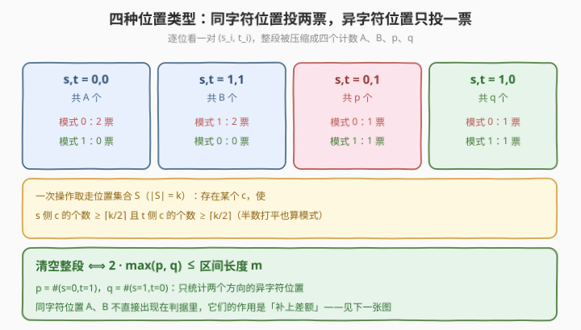
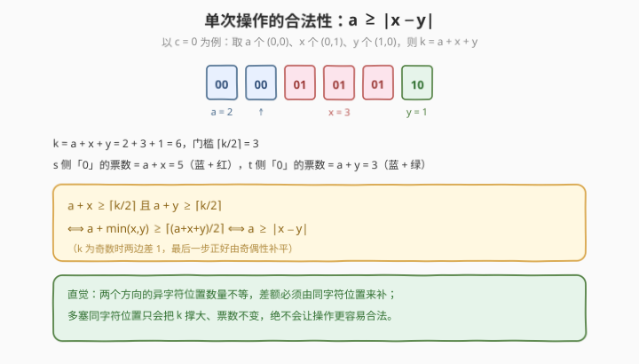
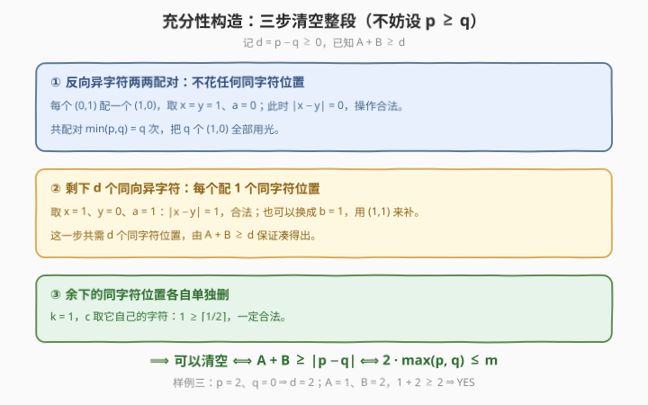
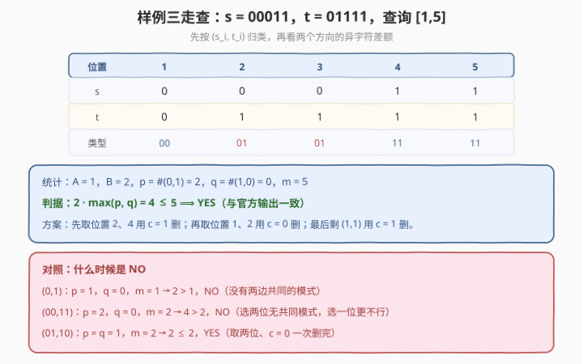

# Codeforces 2248D 好对查询 题解

## 1. 题目概述

- **标题 / 题号**：好对查询（Codeforces 2248D，英文名 Good Pair Queries）
- **链接**：https://codeforces.com/problemset/problem/2248/D
- **来源**：Codeforces Round 1113 (Div. 2) · Problem D（UTC 2026-08-01）
- **难度**：1400（1750 分）
- **限制**：时间 2 s / 内存 256 MB
- **标签**：构造算法，贪心，数学

**题意**：给定两个长度为 $n$ 的 01 串 $s$、$t$。对两个等长的 01 串 $a$、$b$，称 $(a,b)$ 是**好对**，若能用下列操作把它们都变成空串（零次或多次）：选一个非空位置集合 $1 \le i_1 < i_2 < \cdots < i_k \le |a|$ 和一个字符 $c$，令 $x = a_{i_1}\cdots a_{i_k}$、$y = b_{i_1}\cdots b_{i_k}$，要求 $c$ **同时**是 $x$ 与 $y$ 的众数（出现次数 $\ge \lceil k/2 \rceil$），随后把两个串的这些位置一起删掉、剩下的字符按原顺序拼接。字符 `0`、`1` 可以同时都是某个串的众数。

给出 $q$ 个询问 $(l,r)$，彼此独立，判断子串对 $(s_l\cdots s_r,\; t_l\cdots t_r)$ 是否是好对。多测：第一行组数 $T$；每组给出 $n,q$，随后两行分别是 $s$ 与 $t$，再 $q$ 行 `l r`；对每个询问输出一行 `YES` / `NO`。

**约束**：

- $1 \le T \le 10^4$
- $1 \le n, q \le 2\times 10^5$，且**所有**测试的 $\sum n \le 2\times 10^5$、$\sum q \le 2\times 10^5$
- $s,t$ 只含 `0` / `1`；$1 \le l \le r \le n$
- 时限 2 s：要求每组 $O(n+q)$、单次询问 $O(1)$，不允许任何按区间长度展开的做法

## 2. 示例与观察
官方样例（输入 / 输出原样）：

```text
输入：
3
2 2
01
10
1 1
1 2
5 1
11111
11111
1 3
5 1
00011
01111
1 5

输出：
NO
YES
YES
YES
```

逐组解释（$p,q$ 为两类异字符位置个数，$m$ 为区间长度）：

| 组 | 询问 | 子串对 | 四个计数 | $2\max(p,q)$ vs $m$ | 结论 |
|----|------|--------|----------|---------------------|------|
| 1 | `1 1` | `0` 与 `1` | $p=1,\ q=0$ | $2 > 1$ | NO |
| 1 | `1 2` | `01` 与 `10` | $p=q=1$ | $2 \le 2$ | YES |
| 2 | `1 3` | `111` 与 `111` | $p=q=0$ | $0 \le 3$ | YES |
| 3 | `1 5` | `00011` 与 `01111` | $A=1,B=2,p=2,q=0$ | $4 \le 5$ | YES |

第 1 组的第一问里没有任何字符同时是 `0` 与 `1` 的众数，一个位置都动不了；第二问取两个位置、$c=\texttt{0}$ 可一次删完。第 3 组全场没有共同众数，但可以分三次删（见 3.4 的走查）。

## 3. 解题思路

### 3.1 暴力思路

直接模拟：每个状态下枚举位置集合的**所有非空子集**，再枚举 $c\in\{\texttt{0},\texttt{1}\}$，判断众数条件后递归。长度 $m$ 的段有 $2^m-1$ 种取法，即使只看「能不能一次删完」也是指数级；而询问有 $q$ 个，$\sum m$ 可达 $2\times10^5$。这条路彻底走不通——真正的出路是**刻画**而不是模拟：把「能不能删空」压缩成几个计数之间的关系。

### 3.2 核心观察：把每个位置归成四种类型



逐位只看一对字符 $(s_i, t_i)$，整段只有四种类型，记它们的个数为

$$A = \#(0,0),\quad B = \#(1,1),\quad p = \#(0,1),\quad q = \#(1,0).$$

**关键一：顺序完全无关。** 操作允许取**任意**非空位置子集，且众数条件只依赖被选位置上的字符个数；删除后剩下的就是「原多重集减去所选子集」，字符的相对顺序如何都不影响可用性。所以状态被四元组 $(A,B,p,q)$ 完全描述。

**关键二：把众数条件想成「投票」。** 一次以 $c$ 为众数的操作里：

- 一个 $(c,c)$ 位置在 $s$、$t$ 两侧**各投一票**，共 2 票；
- 一个异字符位置（$(c,1{-}c)$ 或 $(1{-}c,c)$）只在自己是 $c$ 的那一侧投 1 票；
- 一个 $(1{-}c,1{-}c)$ 位置**一票不投**，只会把 $k$ 撑大。

因此同字符位置是「两票制的硬通货」，异字符位置只能当「单票」。以 $c=0$ 为例，若取 $a$ 个 $(0,0)$、$x$ 个 $(0,1)$、$y$ 个 $(1,0)$，则 $s$ 侧票数 $a+x$、$t$ 侧票数 $a+y$、总人数 $k=a+x+y$，条件就是

$$a+x \ge \lceil k/2\rceil \quad\text{且}\quad a+y \ge \lceil k/2\rceil .$$

### 3.3 算法流程：单次操作判据 + 全局判据



把上面两个不等式合起来（两者同时成立 $\iff$ 其最小值 $\ge$ 阈值）：

$$a+\min(x,y) \ge \Bigl\lceil \frac{a+x+y}{2}\Bigr\rceil \iff a \ge \max(x,y)-\min(x,y) = |x-y| .$$

这就是**引理 2**：一次以 $c=0$ 的操作合法，当且仅当它取的同字符位置数不少于两个方向异字符位置数之差的绝对值——**差额必须用同字符位置来填**。$c=1$ 完全对称。（顺带说明：$(1{-}c,1{-}c)$ 位置绝不会被正规化的操作选入，因为去掉它 $k$ 变小、票数不变。）严格的推导见第 5 节的引理 2。

于是有了必要性：把整个清空过程中的每一次操作记下它取的 $x_j$ 个 $(0,1)$、$y_j$ 个 $(1,0)$ 与消耗的同字符位置数，则

$$\bigl|p-q\bigr| = \Bigl|\sum_j (x_j-y_j)\Bigr| \le \sum_j |x_j-y_j| \le A+B .$$



反过来这个条件也够用。不妨设 $p \ge q$，令 $d = p-q$，并设 $A+B \ge d$，按三步走：

1. **反向配对（免费）**：每次取一个 $(0,1)$ 与一个 $(1,0)$，即 $x=y=1$、$a=0$。此时 $|x-y|=0$，合法。共配 $\min(p,q)=q$ 次，把 $q$ 个 $(1,0)$ 用光，不花任何同字符位置。
2. **补差额**：还剩 $d$ 个 $(0,1)$，每个配 1 个同字符位置（取 $x=1,y=0,a=1$，或 $b=1$ 用 $(1,1)$ 来付），共需 $d$ 个；由 $A+B\ge d$ 保证够用。
3. **收尾**：剩下的同字符位置各自单独删，$k=1$、$c$ 取它自己的字符，$1 \ge \lceil 1/2\rceil$ 必然成立。

再整理一次代数：$A+B = m-p-q$，于是

$$A+B \ge |p-q| \iff m \ge p+q+|p-q| \iff m \ge 2\max(p,q) .$$

> 💡 **最终判据**：子串对是好对 $\iff 2\max(p,q) \le$ 区间长度，其中 $p=\#(0,1)$、$q=\#(1,0)$ 只统计两个方向的异字符位置。直觉是一句话：**哪个方向的「单向删除」超过一半，就没人给它陪跑，必然死锁。**

实现只要两个前缀和：预处理 `cntP[i]`、`cntQ[i]`（前 $i$ 位里 $(0,1)$、$(1,0)$ 的个数，$O(n)$）；询问 $(l,r)$ 转半开区间 $[l-1,r)$ 差分出 $p,q$ 与 $m=r-l+1$（$O(1)$）；最后输出 `2*max(p,q) <= m ? YES : NO`。

> 另一种等价写法：$p+q$ 是区间上的汉明距离，$p-q$ 是「$s$ 的 0 个数减去 $t$ 的 0 个数」，判据可写成 $\text{hamming} + |\Delta_0| \le m$，用三个前缀数组同样 $O(1)$。

### 3.4 示例演算



以第三组 $s=\texttt{00011}$、$t=\texttt{01111}$ 的查询 $[1,5]$ 为例：

| 位置 | 1 | 2 | 3 | 4 | 5 |
|------|---|---|---|---|---|
| $s$ | 0 | 0 | 0 | 1 | 1 |
| $t$ | 0 | 1 | 1 | 1 | 1 |
| 类型 | $(0,0)$ | $(0,1)$ | $(0,1)$ | $(1,1)$ | $(1,1)$ |

统计得 $A=1$、$B=2$、$p=2$、$q=0$，于是 $2\max(p,q)=4 \le 5$，判 YES。三步方案与官方 note 一致：先取位置 $2,4$ 与 $c=1$（$x=\texttt{01},y=\texttt{11}$，两侧各有 $\ge 1$ 个 1），再取位置 $1,2$ 与 $c=0$，最后剩 $(1,1)$ 用 $c=1$ 删掉。对照两个 NO：$(\texttt{0},\texttt{1})$ 有 $p=1,q=0,m=1$，$2>1$；$(\texttt{00},\texttt{11})$ 有 $p=2,q=0,m=2$，$4>2$。而 $(\texttt{01},\texttt{10})$ 是 $p=q=1$、$2\le2$，取两位一次性删完。

## 4. 算法细节

1. **只存两个前缀数组**：同字符位置总数不必单独存，$A+B=m-p-q$ 现推即可；数组长度按本组的 $n$ 建，多测时自动重置。
2. **下标换算**：题面给的是 1-indexed 闭区间 $[l,r]$，代码里统一改成半开区间 $[l-1,r)$，长度 $m=r-l+1$、差分下标 `r` 与 `l-1` 都合法。
3. **判据用乘法不用除法**：写成 `2*max(p,q) <= m`，避免 $\lceil \cdot \rceil$ 与浮点；**取等号是 YES**。计数最大 $2\times10^5$，`int` 足够。
4. **变量名冲突**：查询数叫 $q$，计数也叫 $q$，极易写串。代码里查询数用 `q`、计数用 `qq`（Python）/`cntQ`（C++）。
5. **I/O**：C++ 关同步并预先 `reserve` 输出缓冲；Python 用 `sys.stdin.buffer.read().split()` 一次读完（约 $4\times10^5$ 个 token），逐组按 `n` 建表。
6. **不要每组清空大数组**：`fill(cnt, cnt+MAXN, 0)` 在 $T=10^4$ 时是 $2\times10^9$ 次赋值，必 TLE；只按本组 $n$ 开新数组。查询之间也独立，别想用双指针「复用上一次的答案」。

## 5. 正确性证明

**引理 1（顺序无关）**：$(a,b)$ 能否清空只取决于四类位置的个数 $(A,B,p,q)$，与字符顺序无关。

**证明**：操作允许选取当前位置集合的任意非空子集，众数条件只依赖所选子集在各侧的字符计数，即只依赖被选子集的类型计数；删除后剩余串就是「原多重集减去所选子集」，类型计数对应减少。因此整个可达状态图在同构意义下只由 $(A,B,p,q)$ 决定。∎

**引理 2（单次操作判据）**：设 $a,x,y \ge 0$、$k=a+x+y>0$。一次以 $c=0$ 的操作若取 $a$ 个 $(0,0)$、$x$ 个 $(0,1)$、$y$ 个 $(1,0)$（不含 $(1,1)$），则它合法 $\iff a \ge |x-y|$；$c=1$ 完全对称。

**证明**：此时 $s$ 侧 0 的个数为 $a+x$、$t$ 侧 0 的个数为 $a+y$，合法性即两者都 $\ge \lceil k/2\rceil$，等价于其最小值达标。令 $u = a+\min(x,y)$、$M=\max(x,y)$，则 $k=u+M$，条件化为 $u \ge \lceil (u+M)/2\rceil$；由于 $u$ 是整数，它又等价于 $u \ge (u+M)/2$，即 $u \ge M$（$u<M$ 时右边 $\ge u+\tfrac12$，必然不成立）。于是合法性等价于

$$a+\min(x,y) \ge \max(x,y) \iff a \ge \max(x,y)-\min(x,y) = |x-y| ,$$

即「差额必须由同字符位置补齐」。∎

**引理 3（必要性）**：若 $(a,b)$ 可清空，则 $|p-q| \le A+B$。

**证明**：设清空过程共 $J$ 次操作，第 $j$ 次取走 $x_j$ 个 $(0,1)$、$y_j$ 个 $(1,0)$，并消耗同字符位置（$c=0$ 时消耗 $(0,0)$、$c=1$ 时消耗 $(1,1)$，否则不消耗）。所有异字符位置恰被取走一次，故 $\sum_j x_j = p$、$\sum_j y_j = q$。由引理 2（及其对称形式），每次操作消耗的同字符位置数 $\ge |x_j-y_j|$，于是

$$|p-q| = \Bigl|\sum_j (x_j - y_j)\Bigr| \le \sum_j |x_j-y_j| \le \sum_j(\text{该次消耗的同字符位置数}) \le A+B .$$

∎

**引理 4（充分性）**：若 $|p-q| \le A+B$，则 $(a,b)$ 可清空。

**证明**：不妨 $p \ge q$，令 $d=p-q$。按 3.3 的三步构造：第一步做 $q$ 次 $(x,y)=(1,1)$ 的操作，由引理 2 合法（$a=0\ge 0$），用光所有 $(1,0)$，剩 $d$ 个 $(0,1)$；第二步做 $d$ 次 $(x,y)=(1,0)$ 的操作，每次配一个同字符位置（优先用 $(0,0)$，不够时用 $(1,1)$ 走对称版），合法性来自 $1\ge|1-0|$，共需 $d \le A+B$ 个；第三步把剩余同字符位置各做一次 $k=1$ 的操作。三步都是合法操作且恰好把全部位置删光，故可清空。∎

**定理**：子串对 $(s[l..r],t[l..r])$ 是好对 $\iff 2\max(p,q) \le r-l+1$。

**证明**：由引理 1 可只看计数；由引理 3、4，好对 $\iff |p-q|\le A+B$；又 $A+B = m-p-q$，代入得 $m-p-q \ge |p-q| \iff m \ge p+q+|p-q| = 2\max(p,q)$。∎

## 6. 复杂度分析

- **时间**：每组预处理两个前缀数组 $O(n)$，$q$ 次询问各 $O(1)$，故单组 $O(n+q)$；总计 $O(\sum n + \sum q) \le 4\times10^5$。本机实测（clang -O2，$n=q=2\times10^5$ 单组）约 **0.47 s**（Apple libc++ 的 `cin` 较慢；Codeforces 的 GNU C++ 会更快），Python3 版约 0.20 s；$T=10^4$ 全部塞满（每组 $n=q=20$）时约 0.3 s，说明没有每组固定常数开销。距 2 s 时限有 4 倍以上余量。
- **空间**：两个长度 $n+1$ 的 `int` 数组 $O(n)$，输出缓冲 $O(q)$；每组结束即释放，峰值不超过几 MB。

## 7. 参考代码

### C++17

```cpp
#include <bits/stdc++.h>
using namespace std;

int main() {
    ios::sync_with_stdio(false);
    cin.tie(nullptr);
    int T;
    if (!(cin >> T)) return 0;                // 空输入防护
    while (T--) {
        int n, q;
        cin >> n >> q;
        string s, t;
        cin >> s >> t;

        // cntP[i] = 前 i 位中 (s=0,t=1) 的个数；cntQ 同理统计 (s=1,t=0)
        vector<int> cntP(n + 1, 0), cntQ(n + 1, 0);
        for (int i = 0; i < n; ++i) {
            cntP[i + 1] = cntP[i] + (s[i] == '0' && t[i] == '1');
            cntQ[i + 1] = cntQ[i] + (s[i] == '1' && t[i] == '0');
        }

        string out;
        out.reserve((size_t)q * 4);
        for (int i = 0; i < q; ++i) {
            int l, r;
            cin >> l >> r;
            --l;                              // 半开区间 [l, r)（0-indexed）
            int p = cntP[r] - cntP[l];
            int qq = cntQ[r] - cntQ[l];
            int len = r - l;
            out += (2 * max(p, qq) <= len ? "YES\n" : "NO\n");
        }
        cout << out;
    }
    return 0;
}
```

### Python3

```python
import sys


def main() -> None:
    data = sys.stdin.buffer.read().split()
    if not data:
        return
    idx = 0
    T = int(data[idx]); idx += 1
    out = []
    for _ in range(T):
        n = int(data[idx]); q = int(data[idx + 1]); idx += 2
        s = data[idx].decode(); t = data[idx + 1].decode(); idx += 2
        cnt_p = [0] * (n + 1)          # 前缀计数：(s=0, t=1)
        cnt_q = [0] * (n + 1)          # 前缀计数：(s=1, t=0)
        cp = cq = 0
        for i in range(n):
            if s[i] != t[i]:
                if s[i] == '0':
                    cp += 1
                else:
                    cq += 1
            cnt_p[i + 1] = cp
            cnt_q[i + 1] = cq
        for _ in range(q):
            l = int(data[idx]); r = int(data[idx + 1]); idx += 2
            p = cnt_p[r] - cnt_p[l - 1]
            qq = cnt_q[r] - cnt_q[l - 1]
            out.append("YES" if 2 * max(p, qq) <= r - l + 1 else "NO")

    sys.stdout.write("\n".join(out) + "\n")


main()
```

## 8. 边界情况与易错点

1. **长度 1**：$l=r$ 时判据自动给出「$s_i=t_i$ 才 YES」——此时 $p+q\le1$，若两者不同则 $\max(p,q)=1$、$2>1$，答案为 NO。不要额外特判，也不要把单点一律判 YES。
2. **取等号是 YES**：$2\max(p,q) = m$ 时合法（如 `01` 与 `10`）。把判据写成 `<` 会在几乎所有「完美对称」的数据上错。
3. **必须逐询问差分**：整串的 $p,q$ 与某个区间的 $p,q$ 毫无关系；正确答案依赖区间内的计数。
4. **多测的双重上限**：$\sum n$、$\sum q$ 各自不超过 $2\times10^5$，但 $T$ 可达 $10^4$，所以每组只允许 $O(n+q)$，任何「每组重置 $2\times10^5$ 大小的数组」都会超时。
5. **查询数 $q$ 与计数 $q$ 重名**：写混之后往往只在小数据上过、随机对拍才发现；建议计数一律加前缀（`cnt_p` / `cntP`）。
6. **Python 别用切片统计**：`s[l-1:r].count('0')` 单次 $O(len)$，$q$ 次最坏 $4\times10^{10}$，必须前缀和。
7. **输出行数**：总共恰好 $\sum q$ 行，多测之间不要空行；Python 用 `"\n".join` 一次写出比逐行 `print` 快一个量级。
8. **下标**：题面 1-indexed、`l <= r`；转半开区间后长度是 `r - l + 1`，不是 `r - l`（C++ 版先把 `l` 减一，才写成 `r - l`）。

## 9. 验证记录

- **编译环境与命令**：`clang++ -std=c++17 -O2`（本机无 GNU g++，配 `codeforces/tools/include/bits/stdc++.h` 兼容头；正文代码只用标准库，可原样提交 GNU C++17）；Python 侧为 `Python 3.9.6`。
- **官方样例**：1 / 1 通过（按 Codeforces 标准 checker 的 token 比对，忽略空白与大小写）。
- **复核状态**：audited（2026-11-19 统一回归：编译 + 官方样例；写作期的随机对拍与暴力未重跑）。

## 相关题目与扩展

- [Codeforces 1398C Good Subarrays](https://codeforces.com/problemset/problem/1398/C)：同样是「把区间性质化成前缀计数差分」的套路，O(1) 判定的另一典型。
- [LeetCode 560. 和为 K 的子数组](https://leetcode.cn/problems/subarray-sum-equals-k/)：前缀和 + 计数的最基础模型，适合对照本题「两个前缀数组」的写法。
- [LeetCode 1157. 子数组中占绝大多数的元素](https://leetcode.cn/problems/online-majority-element-in-subarray/)：众数阈值 $> \lceil k/2\rceil$ 的经典查询题，可与本题「半数即算众数」的门槛定义互相参照。

**延伸思考**：

1. **把门槛从一半改成 $2/3$**：引理 2 会变成 $a+\min(x,y) \ge \lceil 2k/3\rceil$，判据不再是干净的 $|x-y|$，「$x=y=1$ 免费配对」也不再成立。能否仍然用「先配对、再补差额」的框架求出闭式判据？
2. **要求输出操作方案 / 最少次数**：本题只问可行性。按 3.3 的构造可对单个询问 $O(len)$ 给出方案，但 $q$ 个询问最坏 $O(nq)$，能否倍增或分块预处理做到 $O((n+q)\log n)$？另外「最少操作次数」是否有与 $\max(p,q)$、$A+B$ 相关的简单闭式？
