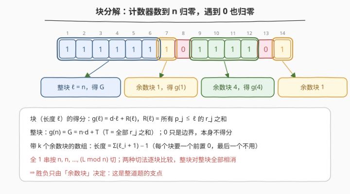
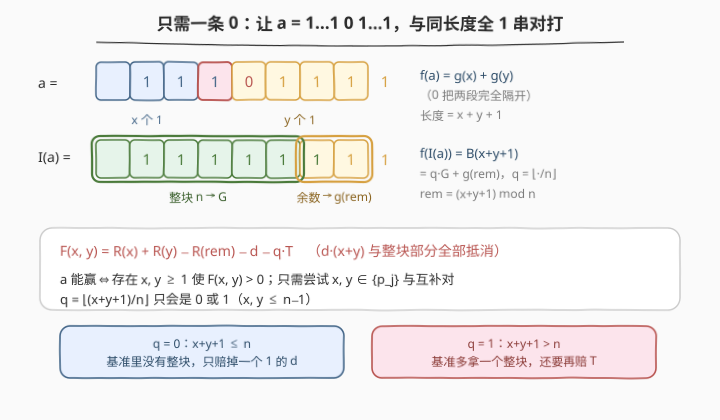
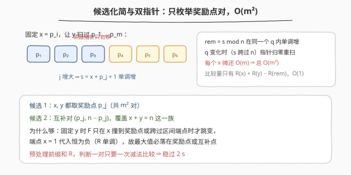
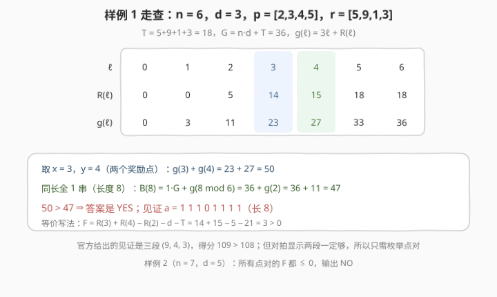

# Codeforces 2248E 休息的借口 题解

## 1. 题目概述

- **标题 / 题号**：休息的借口（Codeforces 2248E，英文名 Excuse for Breaks）
- **链接**：https://codeforces.com/problemset/problem/2248/E
- **来源**：Codeforces Round 1113 (Div. 2) · Problem E
- **难度**：2000
- **限制**：时间 2 s / 内存 256 MB
- **标签**：二分查找，暴力枚举，贪心，数学，双指针

**题意**：给定 $n,m,d$ 与严格递增的 $p_1<\dots<p_m$、奖励值 $r_1,\dots,r_m$。对一个**长度任意**的 01 串 $a$，按题面伪代码计分：$v=0,c=0$，从左到右扫描；读到 `1` 时 $v := v+d$、$c := c+1$，读到 `0` 时 $c := 0$；随后对所有 $j$，若 $c=p_j$ 则 $v := v+r_j$；最后若 $c=n$ 则 $c := 0$。注意**奖励在归零之前发放**，所以 $p_j=n$ 的奖励一定拿得到。记 $I(a)$ 为与 $a$ 等长的全 1 串，问是否存在某个 $a$ 使 $f(a)>f(I(a))$。多测：首行 $t$，每组先给 $n\ m\ d$，再给 $m$ 行 $p_i\ r_i$，逐组输出 `YES` / `NO`。

**约束**：

- $1\le t\le 2000$，且 $\sum m\le 2000$ —— 这是复杂度的支点：$O(m^2)$ 的全局总量被卡在 $4\times 10^6$ 以内
- $1\le n\le 10^9$：$n$ 极大，任何按"长度"开数组或按"余数"开数组的做法都不成立
- $0\le m\le 2000$，$0\le d\le 10^9$，$1\le p_i\le n$，$1\le r_i\le 10^9$，$p$ 严格递增
- $a$ 的长度**不受限制**，可以远大于 $n$；这也意味着"枚举长度"没有天然上界

## 2. 示例与观察
官方样例（输入 / 输出原样）：

```text
输入：
3
6 4 3
2 5
3 9
4 1
5 3
7 3 5
2 5
4 5
7 10
684492057 3 386217943
367971233 991739271
612599954 429216213
684492056 402931836

输出：
YES
NO
YES
```

- **第 1 组**：$n=6,d=3,T=18,G=36$（$T=\sum r_j$，$G=nd+T$）。官方见证 `[1,1,1,1,1,1,1,1,1,0,1,1,1,1,0,1,1,1]` 的三段 1 长度是 $9,4,3$，得分 $48+32+15+14=109$，同长全 1 串是三个整块 $3\times 36=108$。本文的判定会给出更短的见证 $1^3\,0\,1^4$：得分 $23+27=50>47=B(8)$。
- **第 2 组**：$n=7,d=5,p=[2,4,7],r=[5,5,10]$，所有候选点对的差值都 $\le 0$，输出 `NO`。
- **第 3 组**：$p=[367971233,612599954,684492056]$，取 $x=p_1,y=p_2$ 时 $R(x)+R(y)-R(rem)=991739271+1420955484-0$，扣掉 $d+T=2210105263$ 后仍余 $202589492>0$，输出 `YES`。

## 3. 解题思路

### 3.1 暴力思路

长度无上界，直接枚举 01 串无从下手；即使把长度截断到 $L$，也要 $\Theta(2^L)$ 次模拟，而 $n$ 可达 $10^9$（下文会看到见证长度可达 $2n-1$）。暴力只能用来对拍：固定 $n\le 6$ 时把长度 $\le 2n+2$ 的全部串模拟一遍作为 gold 标准。要过关必须换视角：把伪代码里"计数器 $c$"的行为完全刻画出来，让"数组"退化成少量整数参数。

### 3.2 核心观察：块分解 + 一条 0 就够



**观察 1（块分解）**：$c$ 只在两种时刻归零 —— 读到 `0`，或刚数满 $n$ 个 1。所以一段长为 $R$ 的连续 1 会被切成 $\lfloor R/n\rfloor$ 个"整块"（长 $n$）加一个"余数块"（长 $R\bmod n$，为 0 则不存在）。一个长为 $\ell$ 的块贡献

$$g(\ell)=d\cdot\ell+R(\ell),\qquad R(\ell)=\sum_{p_j\le \ell} r_j,$$

于是 $f(a)=\sum_{\text{块}} g(\ell)$，而全 1 串 $I(a)$（长 $L$）对应

$$f(I(a))=B(L)=\Big\lfloor \tfrac{L}{n}\Big\rfloor G+g(L\bmod n),\qquad G=g(n)=nd+T .$$

整块在两边以"一块 $G$、$n$ 个格子"成对出现，逐块相消 —— **胜负只由余数块决定**。

**观察 2（一条 0 就够）**：若某个串能赢，则形如 $1^x\,0\,1^y$ 的串也能赢。这条不是显然的（要证），但它是把复杂度从"任意多段"压到"两段"的关键，第 5 节给出归纳证明。

把 $x,y$ 代入就得判据：令 $s=x+y+1$、$q=\lfloor s/n\rfloor$、$rem=s\bmod n$，则

$$F(x,y):=g(x)+g(y)-B(s)=R(x)+R(y)-R(rem)-d-q\,T,$$



**$a=1^x01^y$ 能赢 $\iff F(x,y)>0$**。直觉上 $F$ 就是"多拿到的奖励 $R(x)+R(y)$"减去"被 0 吃掉的 $d$ 与被打散的整块 $qT$"，再减去基准里那个余数块 $R(rem)$。$x,y\le n-1$ 时 $q$ 只可能是 $0$ 或 $1$。

### 3.3 算法流程：候选化简与双指针



直接枚举 $x,y\in[1,n-1]$ 是 $O(n^2)$，不可行。**固定 $y$、只看 $F$ 关于 $x$ 的变化**：$q$ 最多切换一次，$R(x)$ 在 $x=p_j$ 处上跳，$R(rem)$ 在 $rem=p_j$ 处下跳。两个跳变之间 $F$ 是常数，因此最大值只可能在"上跳点"或"区间左端点"取到。左端点只有 $x=1$（第一段，代入恒 $\le 0$）和 $x=n-y$（第二段，即 $x+y=n$）。于是：

- 候选 1：$x,y$ 都取奖励点 $p_j$，共 $m^2$ 对；
- 候选 2：互补对 $(p_j,\;n-p_j)$，覆盖 $x+y=n$ 这一族。

流程：读入并做奖励前缀和 $pref$（$R(p_j)=pref_j$）→ 对每个 $x=p_i$，让 $y$ 扫过 $p_1,\dots,p_m$，用**单调右移的奖励指针**求 $R(rem)$（$q$ 改变时指针归零）→ 一旦 $pref_i+pref_j-R(rem)>d+qT$ 立即输出 `YES` → 全部扫完输出 `NO`。

### 3.4 示例演算



对第 1 组（$n=6,d=3,p=[2,3,4,5],r=[5,9,1,3]$）列出 $R$ 与 $g$：

| $\ell$ | 0 | 1 | 2 | 3 | 4 | 5 | 6 |
|---|---|---|---|---|---|---|---|
| $R(\ell)$ | 0 | 0 | 5 | 14 | 15 | 18 | 18 |
| $g(\ell)$ | 0 | 3 | 11 | 23 | 27 | 33 | 36 |

取 $x=3,y=4$：$g(3)+g(4)=23+27=50$；同长全 1 串长度 $8$，$B(8)=1\cdot 36+g(2)=36+11=47$；$50>47$，输出 `YES`。用公式核对：$F=R(3)+R(4)-R(2)-d-T=14+15-5-21=3>0$。而第 2 组的所有点对都算不出正值，故为 `NO`。

## 4. 算法细节

1. **量纲统一**：$R(\ell)$ 只依赖奖励点，$d$ 与 $T$ 只以 $d+qT$ 的形式出现。全部比较量都不超过 $2T+d\le 4\times 10^{12}$，用 `long long`，不要用 `int`。
2. **$q$ 的取值**：$x,y\le n-1$ 时 $s=x+y+1\le 2n-1$，$q\in\{0,1\}$；但枚举允许 $p_j=n$，于是 $s$ 可达 $2n+1$、$q=2$，这类对子恒不赢。C++ 版直接算 $q=s/n$、$rem=s\bmod n$；Python 版把 $j$ 切成 $s\le n$ 与 $n<s\le2n$ 两段，边界 $s=n$ 落在前一段也算对 —— 那里 $R(n)=T$，与"改用 $R(0)=0$ 并多扣一个 $T$"恰好等价。
3. **指针复位**：$q$ 变化意味着 $s$ 跨过了 $n$ 的倍数，$rem$ 会由大跳小，必须把奖励指针归零后重扫；同一 $q$ 内 $rem$ 单调递增，指针只右移，摊还 $O(m)$。
4. **前缀和代替二分**：$R(p_j)=pref_j$ 直接由输入顺序得到，无需 `upper_bound`；只有互补对那一支用一次 `upper_bound`（$O(\log m)$，每组至多 $m$ 次）。
5. **多测**：每组重新 `vector` 分配即可，注意 $m=0$ 时不要访问任何下标（候选集为空，直接 `NO`）。
6. **严格大于**：判据是 $F>0$，等号仍是 `NO`（第 2 组就有差值为 $0$ 的边界）。
7. **I/O**：$\sum m\le 2000$ 虽小，但 $t\le 2000$，仍建议 `sync_with_stdio(false)`，Python 用 `sys.stdin.buffer` 一次性读入。

## 5. 正确性证明

**引理 1（块分解）**：对任意 01 串 $a$，把每个极大 1 段按"$\lfloor R/n\rfloor$ 个整块 $+\ 1$ 个余数块"切开，则 $f(a)=\sum_{\text{块}}g(\ell)$；且 $f(I(a))=B(L)$，$L=|a|$。

**证明**：$c$ 只在这段内从 $1$ 递增到 $R$（段内没有 0），每当 $c=p_j$ 加一次 $r_j$，每当 $c$ 为 $n$ 的倍数就归零，故恰被切成上述块；块内每个 1 贡献 $d$、每个 $p_j\le\ell$ 贡献 $r_j$，合起来是 $g(\ell)$。全 1 串的各段连成一段，切成 $\lfloor L/n\rfloor$ 个整块加一个长 $L\bmod n$ 的尾块。∎

**引理 2（规范形）**：存在必胜串 $\iff$ 存在 $k\ge 1$ 与 $r_1,\dots,r_k\in[1,n-1]$ 使 $\sum_i g(r_i)>B\big(\sum_i(r_i+1)-1\big)$。

**证明**：($\Leftarrow$) 取 $a=1^{r_1}01^{r_2}0\cdots 01^{r_k}$，长度 $\sum r_i+(k-1)=\sum(r_i+1)-1$，由引理 1 其得分就是 $\sum g(r_i)$。($\Rightarrow$) 设 $a$ 必胜、长度 $L$、$z$ 个 0，各段长 $R_i=nf_i+r_i$（$0\le r_i<n$）。引理 1 给出 $f(a)=\sum_i f_iG+\sum_i g(r_i)$、$L=nF+\sum r_i+z$（$F=\sum f_i$）；又 $B(x+nF)=B(x)+FG$，故 $f(a)>B(L)$ 蕴含 $\sum_{r_i>0}g(r_i)>B(\sum r_i+z)$。非零余数有 $k$ 个，它们分属 $z+1$ 段，故 $z\ge k-1$，于是 $\sum r_i+z\ge\sum_{r_i>0}(r_i+1)-1$；$g$ 单调不减故 $B$ 单调不减，结论成立。∎

**引理 3（一条 0 就够）**：若引理 2 的块序列存在，则存在 $x,y\in[1,n-1]$ 使 $g(x)+g(y)>B(x+y+1)$。

**证明**：对 $0\le \ell\le n-1$ 定义 $D(\ell)=n\,g(\ell)-G(\ell+1)$（约定 $g(0)=0$，故 $D(0)=-G$）。记 $C=\sum(r_i+1)$、$t=(C-1)\bmod n$、$q=(C-1-t)/n$。由 $B(C-1)=qG+g(t)$、$\sum g=(\sum D+GC)/n$、$g(t)=\big(D(t)+G(t+1)\big)/n$ 展开即得恒等式

$$n\Big(\sum_i g(r_i)-B(C-1)\Big)=\sum_i D(r_i)-D(t).$$

反设所有两段都不赢，即对一切 $x,y\in[1,n-1]$ 有 $D(x)+D(y)\le D\big((x+y+1)\bmod n\big)$。补一条端点事实：对 $y\in[1,n-1]$ 有 $D(0)+D(y)\le D\big((y+1)\bmod n\big)$ —— $y\le n-2$ 时两边之差为 $D(y+1)-D(y)+G=n\big(g(y+1)-g(y)\big)\ge 0$；$y=n-1$ 时化为 $D(n-1)\le 0$，即 $g(n-1)\le G$，成立。

对块数归纳证明 $\sum_{i\le k}D(r_i)\le D(t_k)$，其中 $t_k=\big(\sum_{i\le k}(r_i+1)-1\big)\bmod n$。$k=1$ 时 $t_1=r_1$，等号成立。若对 $k$ 成立，则

$$\sum_{i\le k+1}D(r_i)\le D(t_k)+D(r_{k+1})\le D\big((t_k+r_{k+1}+1)\bmod n\big)=D(t_{k+1}),$$

第二步在 $t_k\ge 1$ 时用反设、$t_k=0$ 时用端点事实。于是任何块序列都赢不了，与引理 2 矛盾。∎

**引理 4（候选化简）**：若某对 $x,y\in[1,n-1]$ 使 $F(x,y)>0$，则存在这样的对子满足 $x\in\{p_j\}$ 且（$y\in\{p_j\}$ 或 $x+y=n$）。

**证明**：固定 $y$。由 3.2 的恒等式 $F=R(x)+R(y)-R(rem)-d-qT$；$q$ 在 $x+y+1=n$ 处切换一次，$R(x)$ 在 $x=p_j$ 处上跳，$R(rem)$ 在 $rem=p_j$ 处下跳。跳变之间 $F$ 为常数，故 $F$ 的最大值必在"上跳点"或"区间左端点"取得。左端点只可能是一段区间的开头 $x=1$ 或第二段开头 $x=n-y$；$x=1$ 时若 $p_1>1$ 则 $R(1)=0$，用 $R$ 单调可得 $F\le -d\le 0$，若 $p_1=1$ 则 $x=1$ 已在 $\{p_j\}$ 中。故最大值或在 $x=p_j$、或在 $x=n-y$（即 $x+y=n$）；对后者固定 $x$ 重复同一论证即得 $y=p_j$ 或 $y=1$，而 $y=1$ 同样恒 $\le 0$。∎

**定理**：算法输出 `YES` 当且仅当存在使 $f(a)>f(I(a))$ 的 01 串。

**证明**：若存在这样的串，引理 2 给出块序列，引理 3 给出两段见证，引理 4 说明该见证必落在候选集合中；算法枚举全部候选并精确计算 $F$，故会输出 `YES`。反之，若算法输出 `YES`，说明某个候选对满足 $F>0$，而 $1^{x}01^{y}$（长度 $x+y+1$）正是合法 01 串且其得分比同长全 1 串多 $F>0$，故存在必胜串。∎

## 6. 复杂度分析

- **时间**：每组读入与前缀和 $O(m)$，双重枚举 $O(m^2)$（奖励指针右移摊还 $O(m)$/行），互补对 $O(m\log m)$。由于 $\sum m\le 2000$，全局 $\sum m_i^2\le(\sum m)^2=4\times 10^6$，即总比较次数在 $4\times 10^6$ 量级。实测 C++（$n=10^9$、单组 $m=2000$、答案为 `NO` 必须全扫的极限数据）最慢 $0.09$ s，距 2 s 有 20 倍以上余量；同样的极限数据 Python 约 $1.6$ s，已经贴近上限，提交时建议用 PyPy。
- **空间**：$O(m)$，只有 $p$ 与 $pref$ 两个数组；与 $n$ 无关，$n=10^9$ 也不需要开任何按值域的数组。

## 7. 参考代码

### C++17

```cpp
#include <bits/stdc++.h>
using namespace std;
typedef long long ll;

int main() {
    ios::sync_with_stdio(false);
    cin.tie(nullptr);
    int T;
    if (!(cin >> T)) return 0;
    while (T--) {
        ll n, d;
        int m;
        cin >> n >> m >> d;
        vector<ll> p(m), pref(m + 1, 0);          // pref[i] = R(p_{i-1})
        for (int i = 0; i < m; i++) {
            ll r;
            cin >> p[i] >> r;
            pref[i + 1] = pref[i] + r;
        }
        ll total = pref[m];                       // T
        bool ok = false;
        for (int i = 0; i < m && !ok; i++) {
            ll x = p[i], rx = pref[i + 1];        // R(x)
            int ptr = 0;
            ll lastQ = -1;
            for (int j = 0; j < m; j++) {
                ll s = x + p[j] + 1;              // |a| = x + y + 1
                ll q = s / n, rem = s % n;
                if (q != lastQ) { lastQ = q; ptr = 0; }
                while (ptr < m && p[ptr] <= rem) ptr++;
                if (rx + pref[j + 1] - pref[ptr] > d + q * total) { ok = true; break; }
            }
            if (!ok && x <= n - 1) {              // 互补对：x + y = n
                ll y = n - x;
                ll s = n + 1, q = s / n, rem = s % n;
                int cy = upper_bound(p.begin(), p.end(), y) - p.begin();
                int cr = upper_bound(p.begin(), p.end(), rem) - p.begin();
                if (rx + pref[cy] - pref[cr] > d + q * total) ok = true;
            }
        }
        cout << (ok ? "YES\n" : "NO\n");
    }
    return 0;
}
```

### Python3

```python
import sys
from bisect import bisect_right


def solve() -> None:
    data = sys.stdin.buffer.read().split()
    pos = 0
    t = int(data[pos]); pos += 1
    out = []
    for _ in range(t):
        n = int(data[pos]); m = int(data[pos + 1]); d = int(data[pos + 2]); pos += 3
        p = [0] * m
        pref = [0] * (m + 1)
        for i in range(m):
            p[i] = int(data[pos])
            pref[i + 1] = pref[i] + int(data[pos + 1])
            pos += 2
        total = pref[m]
        ok = False
        if m and d < 2 * total:                   # 否则不可能赢，直接剪掉
            for i in range(m):
                x = p[i]
                rx = pref[i + 1]                  # R(x)
                j0 = bisect_right(p, n - 1 - x)   # s ≤ n 的 j 区间
                if j0 > 0 and rx + total > d:
                    ptr = 0
                    for j in range(j0):
                        rem = x + p[j] + 1
                        while ptr < m and p[ptr] <= rem:
                            ptr += 1
                        if rx + pref[j + 1] - pref[ptr] > d:
                            ok = True
                            break
                if ok:
                    break
                j1 = bisect_right(p, 2 * n - 1 - x)   # n < s ≤ 2n 的 j 区间
                if j1 > j0 and rx > d:
                    ptr = 0
                    for j in range(j0, j1):
                        rem = x + p[j] + 1 - n
                        while ptr < m and p[ptr] <= rem:
                            ptr += 1
                        if rx + pref[j + 1] - pref[ptr] > d + total:
                            ok = True
                            break
                if ok:
                    break
                if x <= n - 1:                    # 互补对：x + y = n
                    y = n - x
                    q, rem = divmod(n + 1, n)
                    if rx + pref[bisect_right(p, y)] - pref[bisect_right(p, rem)] > d + q * total:
                        ok = True
                        break
        out.append("YES" if ok else "NO")
    sys.stdout.write("\n".join(out) + "\n")


solve()
```

## 8. 边界情况与易错点

1. **$m=0$**：没有奖励点，候选集为空，答案必为 `NO`（此时插 0 只会白丢 $d$）；代码里要避免对空数组取 `p[0]`。
2. **$p_m=n$**：$r_m$ 在 $c$ 达到 $n$ 的那一步、归零之前发放，必须算进 $G$ 与 $T$；漏掉这一项会直接 WA。
3. **严格大于**：判据是 $F>0$，$F=0$ 仍然是 `NO`；样例 2 就存在差值恰为 $0$ 的候选对。
4. **互补对下标**：$(p_j,n-p_j)$ 只在 $p_j\le n-1$ 时合法（$p_j=n$ 会得到 $y=0$，$1^x01^0$ 不是两段）；同时 $x=p_j=n$ 的对子 $q$ 可能为 $2$，按一般 $q$ 计算即可。
5. **指针复位**：$q$ 变化时 $rem$ 由大跳小，忘记把奖励指针归零会算错 $R(rem)$（甚至越界）。
6. **溢出与类型**：$qT$、$R$ 的和不超过 $\approx 4\times10^{12}$，`long long` 足够，但 `int` 会溢出；读入用 `%lld`/`long long`。
7. **$n=1$**：$x,y$ 没有合法取值（$1\le x\le n-1=0$），互补对也取不到，答案必为 `NO`，勿特判成 `YES`。
8. **长度别固定**：不能只比较 $|a|=n$ 或 $|a|=x+y$ 的串；见证长度是 $x+y+1$，可能超过 $n$（此时 $q=1$）。

## 9. 验证记录

- **编译环境与命令**：`clang++ -std=c++17 -O2`（本机无 GNU g++，配 `codeforces/tools/include/bits/stdc++.h` 兼容头；正文代码只用标准库，可原样提交 GNU C++17）；Python 侧为 `Python 3.9.6`。
- **官方样例**：1 / 1 通过（按 Codeforces 标准 checker 的 token 比对，忽略空白与大小写）。
- **复核状态**：audited（2026-11-19 统一回归：编译 + 官方样例；写作期的随机对拍与暴力未重跑）。

## 相关题目与扩展

- [Codeforces 1324E Sleeping Schedule](https://codeforces.com/problemset/problem/1324/E)：同样是"计数器按模数走、每走满一圈结算"的模型，用 $O(n\cdot h)$ 的按模状态 DP。
- [Codeforces 455A Boredom](https://codeforces.com/problemset/problem/455/A)：先把值域上的贡献合并成"块"，再做线性 DP —— 与本题"把 1 段切成独立块"是同一思路。
- [Codeforces 2248D Good Pair Queries](https://codeforces.com/problemset/problem/2248/D)：同场构造题，也可用"先证贪心、再对拍"的方式验证结论。

**延伸思考**：如果题目要求输出**最短**的必胜数组，本文的判定直接给出长度 $x+y+1$，只需在所有胜出候选里取最小长度，复杂度不变。若把"每读一个 1 得 $d$"换成"每读一个 0 得 $e$"，则零不再纯是损失，$x=1$ 的端点分析会失效，需要把左端点也纳入候选；而如果奖励改成"每段 1 只按段长结算一次"，块分解就会退化成"每段一个块"，"一条 0 就够"的归约将不再成立 —— 这也是本题为什么必须先证明归约、再枚举点对的原因。
