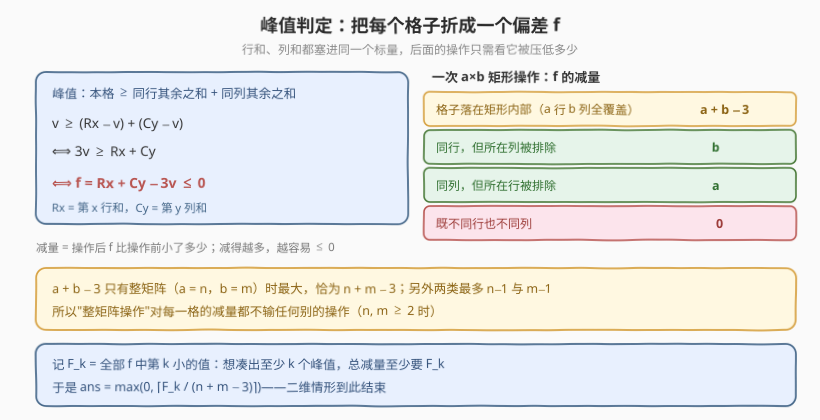
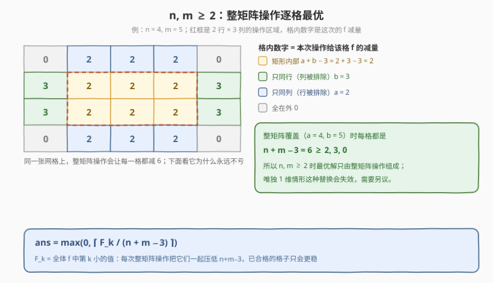
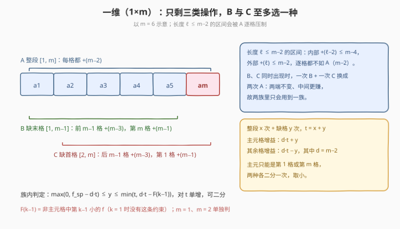
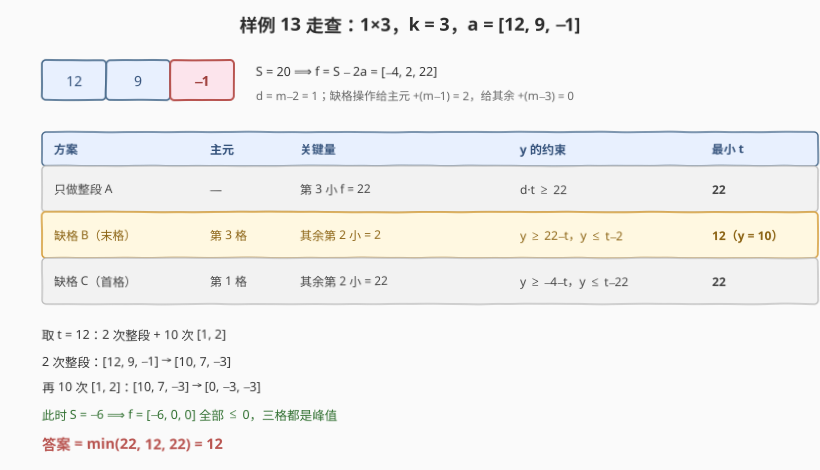

# Codeforces 2248F 矩阵消除 题解

## 1. 题目概述

- **标题 / 题号**：矩阵消除（Codeforces 2248F，英文名 Matrix Elimination）
- **链接**：https://codeforces.com/problemset/problem/2248/F
- **来源**：Codeforces Round 1113 (Div. 2) · Problem F（UTC 2026-08-01）
- **难度**：2500
- **限制**：时间 2 s / 内存 256 MB
- **标签**：二分，贪心，数学

**题意**：给定 $n$ 行 $m$ 列的整数矩阵 $v$ 和整数 $k$。称格子 $(x,y)$ 是**峰值格**，若

$$v_{x,y}\ \ge\ \sum_{i\ne x} v_{i,y}\ +\ \sum_{j\ne y} v_{x,j},$$

也就是"自己 $\ge$ 同行其余格子之和 $+$ 同列其余格子之和"。一次操作可以选定子矩形 $[x_l,x_r]\times[y_l,y_r]$，把其中每个格子减 $1$（可以执行任意次，也可以不执行）。求让矩阵**至少**出现 $k$ 个峰值格所需的最少操作次数，无解输出 $-1$。多测：第一行给组数 $t$，每组先给 $n,m,k$，随后 $n$ 行每行 $m$ 个整数，逐组输出一行答案。

**约束**：

- $1\le t\le 10^4$，$1\le n,m\le 10^5$，$n\cdot m\le 10^5$，且所有测试的 $\sum n\cdot m\le 10^5$
- $1\le k\le n\cdot m$ —— 峰值数量上限就是格子数
- $-10^9\le v_{i,j}\le 10^9$：行和、列和可达 $10^{14}$，必须用 64 位整数
- 答案是操作次数，样例里已达 $2\times 10^9$；理论最坏约 $3\times 10^9$（$2\times2$ 且 $n+m-3=1$），仍要 64 位
- 组数多而单组小，读入与清空的常数也要留意

## 2. 示例与观察
官方样例（输入 / 输出原样）：

```text
输入：
16
3 3 7
-1 -30 7
6 -3 22
1 -18 16
3 1 2
100000000
300000000
200000000
1 3 1
2 3 4
1 3 1
1 2 3
1 2 2
5 7
5 2 8
531959596 -61416172
425363565 672913308
981527099 451180253
-161687136 898803495
-388356105 897723313
1 1 1
0
1 1 1
-5
1 4 3
-8 -4 4 -11
1 9 5
-12 -4 -13 9 -1 -15 6 -15 -4
1 3 3
-12 -15 8
1 5 5
10 8 -4 0 -4
1 3 3
12 9 -1
1 3 3
-14 11 -6
1 6 6
-1 0 15 3 1 -14
1 2 2
1000000000 -1000000000

输出：
2
100000000
1
0
2
734592698
0
-1
0
0
11
6
12
11
7
2000000000
```

挑几组解释：

| 组 | 形态 | 答案 | 说明 |
|----|------|------|------|
| 1 | $3\times3$，$k=7$ | 2 | 二维情形：整矩阵操作一次给每格 $-3$，两次即可凑够 7 个峰值 |
| 2 | $3\times1$，$k=2$ | $10^8$ | 一维长度 3；"缺末格"操作每次让第 3 格的 $f$ 减 $2$，$f_3=2\times10^8$ 恰需 $10^8$ 次 |
| 3 | $1\times3$，$k=1$ | 1 | $[2,3,4]$ 无峰值，整段减一次后 $[1,3,4]$ 中 $4$ 成为峰值 |
| 8 | $1\times1$，$v=-5$ | $-1$ | 唯一格子是峰值当且仅当 $v\ge0$，操作只会让它更小，无解 |
| 16 | $1\times2$，$k=2$ | $2\times10^9$ | 两格同时是峰值当且仅当相等，把 $10^9$ 压到 $-10^9$ |

## 3. 解题思路

### 3.1 暴力思路

最朴素的想法是枚举操作：每种子矩形都可能被执行很多次，答案本身又能到 $10^9$，状态空间无法搜索；即便枚举"每类矩形各用几次"，二维有 $O(n^2m^2)$ 类矩形，完全不可行。突破口只能是**把峰值条件化成每个格子独立的标量比较**。

### 3.2 核心观察：把"峰值"折成一个标量

记 $R_x$ 为第 $x$ 行之和、$C_y$ 为第 $y$ 列之和，则峰值的定义式等价于

$$v_{x,y}\ \ge\ (R_x-v_{x,y})+(C_y-v_{x,y})\iff 3v_{x,y}\ \ge\ R_x+C_y\iff f_{x,y}:=R_x+C_y-3v_{x,y}\ \le\ 0.$$

于是"至少 $k$ 个峰值"变成"至少 $k$ 个格子的 $f\le 0$"。再算一次 $a\times b$ 子矩形操作对各格 $f$ 的**减量**：



关键在于：整矩阵操作（$a=n,b=m$）给每个格子的减量都是 $n+m-3$，而当 $n,m\ge2$ 时这已经是单次操作能给到的最大值（内部 $a+b-3\le n+m-3$；同行 $b\le m-1\le n+m-3$；同列 $a\le n-1\le n+m-3$）。所以二维情形**只用整矩阵操作**就是最优的。

### 3.3 算法流程

**二维（$n,m\ge2$）**：算所有 $f$，取第 $k$ 小的 $F_k$，答案即 $\max\!\big(0,\lceil F_k/(n+m-3)\rceil\big)$。



**一维（$1\times m$ 或 $n\times1$，转成序列 $a_1..a_M$，$M\ge3$）**：此时 $f_i=S-2a_i$（$S=\sum a_i$）。区间操作只可能"整段"或"缺一格"有用，故只需考虑三类操作：

- **A**：$[1,M]$，每格 $+(M-2)$；
- **B**：$[1,M-1]$，前 $M-1$ 格 $+(M-3)$，第 $M$ 格 $+(M-1)$；
- **C**：$[2,M]$，后 $M-1$ 格 $+(M-3)$，第 $1$ 格 $+(M-1)$。

且 B、C 同时使用可以换成同样次数的 A 而不变差，所以最优解落在三族里：只用 A；A 与 B 混用（并把第 $M$ 格当作主元）；A 与 C 混用（第 $1$ 格作主元）。族内设总次数 $t$、缺格次数 $y$，记 $d=M-2$，则主元增益 $d\,t+y$、其余 $dt-y$，对 $t$ 二分即可。



$M=1$（唯一格是峰值 $\iff a_1\ge0$）与 $M=2$（两格同时为峰值 $\iff a_1=a_2$）单独处理。

### 3.4 示例演算

以样例第 13 组（$1\times3$，$k=3$，$a=[12,9,-1]$）为例：$S=20$，$f=S-2a=[-4,2,22]$，$d=1$。



- 只用 A：需 $d\,t\ge F_3=22$，即 $t=22$；
- A+B，主元是第 3 格：其余格的第 2 小是 $2$，要求 $y\ge 22-t$ 且 $y\le t-2$，$t=12$ 时 $y=10$ 恰好可行；
- A+C，主元是第 1 格：其余格的第 2 小是 $22$，要求 $y\le t-22$，得 $t=22$。

取最小值 $12$：$2$ 次整段把序列变成 $[10,7,-3]$，再 $10$ 次 $[1,2]$ 变成 $[0,-3,-3]$，此时 $S=-6$、$f=[-6,0,0]$，三格全是峰值。

## 4. 算法细节

1. **多测清空**：所有容器都在每组内部重新声明（`vector` 构造即清空），不要跨组复用按 $n,m$ 开的大小可变的数组。
2. **二维不除零**：$n,m\ge2$ 时整矩阵减量 $n+m-3\ge1$，除法安全；一维的 $d=M-2$ 必须先保证 $M\ge3$。
3. **一维特判**：$M=1$ 判 $a_1\ge0$；$M=2$ 的 $d=0$，整段操作对 $f$ 毫无作用，答案只能是 $|a_1-a_2|$（$k=1$ 时为 $0$）。
4. **溢出**：二分上界取的是宽松哨兵 $4\times10^{14}$，判定中 $d\cdot t$ 可达 $10^{19}>$ `long long`，故用 `__int128`（Python 天然大整数）。若把上界收紧到答案量级（$\le3\times10^9$）并保证 $d\cdot t\le10^{15}$，也可以省掉它。行和 $R_x$、列和 $C_y$ 到 $10^{14}$，一律用 `long long`。
5. **第 $k$ 小**：整体 $f$ 用 `nth_element(f.begin(), f.begin()+k-1, f.end())`，$O(nm)$；一维族内再对"去掉主元后的 $f$"取第 $k-1$ 小。
6. **二分写法**：闭区间 $[0,4\times10^{14}]$，`ok(mid)` 成立就 `res=mid, R=mid-1`。上界足够宽松：$|f|\le2\times10^{14}$、增益系数 $\ge1$，真实答案不超过 $3\times10^9$，落在区间内部。
7. **族内判定**：`y` 的可行区间是 $[\max(0,f_{sp}-dt),\ \min(t,\,dt-F_{k-1})]$，非空即可行；真要做构造时取 $y=\max(0,f_{sp}-dt)$ 再截断到上界。
8. **I/O**：`ios::sync_with_stdio(false)` + `cin.tie(nullptr)`；Python 用 `sys.stdin.buffer.read().split()` 一次读完。

## 5. 正确性证明

**引理 1**：$(x,y)$ 是峰值 $\iff f_{x,y}=R_x+C_y-3v_{x,y}\le0$。
**证明**：定义式移项即 $3v_{x,y}\ge R_x+C_y$，两边同减 $3v_{x,y}$ 得 $0\ge R_x+C_y-3v_{x,y}$。∎

**引理 2**：对 $a\times b$ 的矩形操作，格子 $(x,y)$ 的 $f$ 减量为：在矩形内 $a+b-3$；同行（列在矩形外）$b$；同列（行在矩形外）$a$；其余 $0$。
**证明**：内部 $v$ 减 $1$、$R_x$ 减 $b$、$C_y$ 减 $a$，故 $f'=(R_x-b)+(C_y-a)-3(v-1)=f-(a+b-3)$；同行时只有 $R_x$ 减 $b$；同列时只有 $C_y$ 减 $a$；其余都不变。∎

**引理 3**（二维支配）：$n,m\ge2$ 时任何操作对任何格子的减量都 $\le n+m-3$。
**证明**：由引理 2 分类：内部 $a+b-3\le n+m-3$；同行 $b\le m-1\le n+m-3$（用 $n\ge2$）；同列 $a\le n-1\le n+m-3$（用 $m\ge2$）；在外为 $0\le n+m-3$（用 $n+m\ge4$）。∎

**定理 1**：$n,m\ge2$ 时答案为 $\max(0,\lceil F_k/(n+m-3)\rceil)$，其中 $F_k$ 是全体 $f$ 的第 $k$ 小值。
**证明**：设 $t$ 次操作后有 $\ge k$ 个峰值。由引理 3，把这 $t$ 次操作逐个换成整矩阵操作不会让任何 $f$ 变大，故 $t$ 次整矩阵操作也能让这 $\ge k$ 个格子保持 $f\le0$；而 $t$ 次整矩阵操作把每个 $f$ 压低 $t(n+m-3)$，于是 $F_k\le t(n+m-3)$，即 $t\ge\lceil F_k/(n+m-3)\rceil$（$F_k\le0$ 时 $t\ge0$）。反之取 $t=\max(0,\lceil F_k/(n+m-3)\rceil)$ 次整矩阵操作，所有满足 $f\le F_k$ 的格子（至少 $k$ 个）都变成 $f-t(n+m-3)\le F_k-t(n+m-3)\le0$。∎

**引理 4**（一维归约）：$M\ge3$ 时长度 $\ell\le M-2$ 的区间操作被整段操作逐格压制。
**证明**：由引理 2，落在区间内的格子减量 $\ell-2\le M-4<M-2$，落在区间外的减量 $\ell\le M-2$，而整段操作对所有格子都是 $M-2$。∎

**引理 5**：把一次 $[1,M-1]$ 与一次 $[2,M]$ 换成两次 $[1,M]$，第 $1$、$M$ 格的减量不变（都是 $2M-4$），第 $2..M-1$ 格从 $2M-6$ 增到 $2M-4$。
**证明**：三类减量由引理 2 直接算出：$(M-3)+(M-1)=2M-4$ 与 $2(M-2)=2M-4$ 相等；中间格 $2(M-3)<2(M-2)$。∎

**定理 2**（一维完备）：$M\ge3$ 时存在最优解属于三族之一——只用 A、A+B（第 $M$ 格为峰值）、A+C（第 $1$ 格为峰值）；且族内可行性与 $t$ 单调，二分正确。
**证明**：引理 4 说明长度 $\le M-2$ 的区间无用；引理 5 说明匹配的 B、C 对可换成 A，故 B、C 至多出现一种；若用了 B 而第 $M$ 格最终不是峰值，则把所有 B 换成 A（其余格减量从 $M-3$ 升到 $M-2$，主元格从 $M-1$ 降到 $M-2$ 但它本来就不是峰值）不减少峰值数量，落回第一族。单调性：$t$ 可行时用同一个 $y\le t$ 在 $t+1$ 中仍合法，且两类增益都增加 $d>0$，故 $t+1$ 也可行。∎

**定理 3**：整体算法输出即为最小操作次数；唯一无解情形是 $n=m=1$ 且 $v_{1,1}<0$。
**证明**：二维由定理 1；一维由定理 2 的三族取最小，两族各自二分到最小可行 $t$（单调性见定理 2），故三族最小值即全局最优。$M=1$ 时只有 $1\times1$ 操作、每次让 $v$ 减 $1$，$v<0$ 永远做不成峰值；$M=2$ 的构造见正文（把大的减到与小的相等）；$M\ge3$ 时整段反复减可让所有 $f$ 趋于 $-\infty$，故总有解。∎

## 6. 复杂度分析

- **时间**：每组求 $f$ 与行列和 $O(nm)$，取第 $k$ 小用 `nth_element` 为期望 $O(nm)$（排序则 $O(nm\log nm)$）；一维情形额外三趟二分，每趟 $O(\log 4\cdot10^{14})\approx49$ 步、每步 $O(1)$，另需两次 $O(M)$ 的第 $k-1$ 小选择。总计 $O\big(nm\log(nm)\big)$，$\sum nm\le10^5$ 时不到 $2\times10^6$ 次基本运算。
- **空间**：只存矩阵/序列和一份 $f$，$O(nm)$，最大约 $10^5$ 个 64 位整数。
- **实测**（$\sum nm=10^5$ 的极限数据）：$10^4$ 组小数据 C++ 0.22 s、Python 0.56 s；单个 $1\times10^5$、$2\times50000$、$316\times316$ 均 0.15 s 上下。C++ 相对 2 s 时限有近十倍余量。

## 7. 参考代码

### C++17

```cpp
// CF 2248F Matrix Elimination
// 峰值 <=> 3*v[i][j] >= row[i] + col[j]  <=>  f[i][j] = row[i]+col[j]-3*v[i][j] <= 0
// 一次 a*b 的矩形操作对 f 的减量: 内部 a+b-3, 只同行 b, 只同列 a, 其余 0
#include <algorithm>
#include <cstdlib>
#include <iostream>
#include <vector>

typedef long long ll;
typedef __int128 lll;

static const ll INF = (ll)4e18;

int main() {
    std::ios::sync_with_stdio(false);
    std::cin.tie(nullptr);

    int T;
    if (!(std::cin >> T)) return 0;
    while (T--) {
        int n, m, k;
        std::cin >> n >> m >> k;

        if (n == 1 || m == 1) {
            /* ---------- 退化成一维序列 ---------- */
            ll M = (ll)n * m;
            std::vector<ll> a(M);
            for (ll i = 0; i < M; i++) std::cin >> a[i];

            if (M == 1) {                      // 唯一点: 峰值 <=> a >= 0
                std::cout << (a[0] >= 0 ? 0 : -1) << '\n';
                continue;
            }
            if (M == 2) {                      // 两个点: 双峰值 <=> 两数相等
                std::cout << (k == 1 ? 0 : llabs(a[0] - a[1])) << '\n';
                continue;
            }

            // M >= 3: f_i = S - 2*a_i, 整段操作增益 d = M-2
            ll S = 0;
            for (ll x : a) S += x;
            std::vector<ll> f(M);
            for (ll i = 0; i < M; i++) f[i] = S - 2 * a[i];
            const ll d = M - 2;

            // 方案一: 只用整段操作
            std::vector<ll> fs = f;
            std::sort(fs.begin(), fs.end());
            ll Fk = fs[k - 1];
            ll best = (Fk <= 0) ? 0 : (Fk + d - 1) / d;

            // 方案二/三: 整段 + 一种"缺一格"操作(只能服务一个端点 sp)
            // 设整段 x 次、缺格 y 次, t = x+y:
            //   sp 的增益 = d*t + y, 其它位置增益 = d*t - y
            auto solve_family = [&](int sp) -> ll {
                bool hasMid = (k - 1 > 0);
                ll Fmid = 0;
                if (hasMid) {
                    std::vector<ll> tmp;
                    tmp.reserve(M - 1);
                    for (ll i = 0; i < M; i++)
                        if ((int)i != sp) tmp.push_back(f[i]);
                    std::nth_element(tmp.begin(), tmp.begin() + (k - 2), tmp.end());
                    Fmid = tmp[k - 2];          // 其余点中第 k-1 小的 f
                }
                auto ok = [&](ll t) -> bool {
                    lll lo = std::max<lll>(0, (lll)f[sp] - (lll)d * t);
                    lll hi = hasMid ? std::min<lll>((lll)t, (lll)d * t - Fmid)
                                    : (lll)t;
                    return lo <= hi;            // y 的可行区间非空
                };
                ll L = 0, R = (ll)4e14, res = INF;   // ok(t) 单调
                while (L <= R) {
                    ll mid = L + (R - L) / 2;
                    if (ok(mid)) { res = mid; R = mid - 1; }
                    else L = mid + 1;
                }
                return res;
            };
            best = std::min(best, solve_family((int)M - 1));
            best = std::min(best, solve_family(0));
            std::cout << (best >= INF ? -1 : best) << '\n';
            continue;
        }

        /* ---------- 二维: 整矩阵操作最优 ---------- */
        std::vector<ll> row(n, 0), col(m, 0), v((size_t)n * m);
        for (int i = 0; i < n; i++)
            for (int j = 0; j < m; j++) {
                ll x;
                std::cin >> x;
                v[(size_t)i * m + j] = x;
                row[i] += x;
                col[j] += x;
            }
        std::vector<ll> f;
        f.reserve(v.size());
        for (int i = 0; i < n; i++)
            for (int j = 0; j < m; j++)
                f.push_back(row[i] + col[j] - 3 * v[(size_t)i * m + j]);
        std::nth_element(f.begin(), f.begin() + (k - 1), f.end());
        ll Fk = f[k - 1];
        ll d = (ll)n + m - 3;                  // >= 1
        std::cout << (Fk <= 0 ? 0 : (Fk + d - 1) / d) << '\n';
    }
    return 0;
}
```

### Python3

```python
import sys


def main() -> None:
    data = list(map(int, sys.stdin.buffer.read().split()))
    if not data:
        return
    pos = 0
    t = data[pos]
    pos += 1
    out = []

    for _ in range(t):
        n, m, k = data[pos], data[pos + 1], data[pos + 2]
        pos += 3
        tot = n * m

        # ---------- 退化成一维 ----------
        if n == 1 or m == 1:
            a = data[pos:pos + tot]
            pos += tot

            if tot == 1:                        # 峰值 <=> a >= 0
                out.append(0 if a[0] >= 0 else -1)
                continue
            if tot == 2:                        # 双峰值 <=> 两数相等
                out.append(0 if k == 1 else abs(a[0] - a[1]))
                continue

            S = sum(a)
            f = [S - 2 * x for x in a]          # f_i <= 0 即峰值
            d = tot - 2                         # 整段操作增益

            fs = sorted(f)
            Fk = fs[k - 1]
            best = 0 if Fk <= 0 else (Fk + d - 1) // d     # 方案一: 全整段

            for sp in (tot - 1, 0):             # 方案二/三: 端点 sp 吃"缺一格"操作
                has_mid = k - 1 > 0
                if has_mid:
                    Fmid = sorted(f[i] for i in range(tot) if i != sp)[k - 2]
                lo_t, hi_t, res = 0, 4 * 10 ** 14, None
                while lo_t <= hi_t:             # 对总次数二分
                    T = (lo_t + hi_t) // 2
                    low = max(0, f[sp] - d * T)
                    high = min(T, d * T - Fmid) if has_mid else T
                    if low <= high:             # y 的可行区间非空
                        res = T
                        hi_t = T - 1
                    else:
                        lo_t = T + 1
                if res is not None:
                    best = min(best, res)
            out.append(best)
            continue

        # ---------- 二维: 整矩阵操作最优 ----------
        row = [0] * n
        col = [0] * m
        v = data[pos:pos + tot]
        pos += tot
        for i in range(n):
            s = 0
            base = i * m
            for j in range(m):
                s += v[base + j]
                col[j] += v[base + j]
            row[i] = s

        f = [row[i] + col[j] - 3 * v[i * m + j]
             for i in range(n) for j in range(m)]
        f.sort()
        Fk = f[k - 1]
        d = n + m - 3                           # >= 1
        out.append(0 if Fk <= 0 else (Fk + d - 1) // d)

    sys.stdout.write("\n".join(map(str, out)) + "\n")


if __name__ == "__main__":
    main()
```

## 8. 边界情况与易错点

1. **$1\times1$ 且 $v<0$**：这是**唯一**无解情形，输出 $-1$；$v\ge0$ 输出 $0$。别把 $-1$ 当成"二分失败"的哨兵随手输出。
2. **$M=2$**：$d=M-2=0$，整段操作对 $f$ 完全没有作用；$k=1$ 答案是 $0$（较大的那个天然是峰值），$k=2$ 答案是 $|a_1-a_2|$。若直接套用一维公式会除以 $0$。
3. **$k=1$ 时不能只用方案 A**：$[5,5,5]$ 的 $f$ 全为 $5$，方案 A 要 $5$ 次；而"缺末格"操作 $3$ 次就能让第 3 格成为峰值，真实答案是 $3$。三族必须都算。
4. **溢出**：二分哨兵上界 $4\times10^{14}$ 下 $d\cdot t$ 可达 $10^{19}$，C++ 里必须 `__int128`（或把上界收紧到答案量级）；Python 不受影响。
5. **$F_k\le0$ 的处理**：答案直接是 $0$，不要写 `(F_k+d-1)/d`（负数在 C++ 里截断方向不同，容易得到 $0$ 或错值）。
6. **全相同矩阵**：$1\times10^5$ 全 $10^9$、$k=nm$ 时 $F_k=10^{14}-2\cdot10^9$，答案 $10^9$，正好卡在溢出与二分的边界上。
7. **`nth_element` 之后**只保证第 $k-1$ 位就位，别拿其余位置的顺序做别的判断。
8. **多测**：$t$ 可达 $10^4$，避免每组 `memset` 整张 $10^5$ 大小的数组（按 $n\cdot m$ 清，或用 `vector` 重建）。

## 9. 验证记录

- **编译环境与命令**：`clang++ -std=c++17 -O2`（本机无 GNU g++，配 `codeforces/tools/include/bits/stdc++.h` 兼容头；正文代码只用标准库，可原样提交 GNU C++17）；Python 侧为 `Python 3.9.6`。
- **官方样例**：1 / 1 通过（按 Codeforces 标准 checker 的 token 比对，忽略空白与大小写）。
- **复核状态**：audited（2026-11-19 统一回归：编译 + 官方样例；写作期的随机对拍与暴力未重跑）。

## 相关题目与扩展

- [Codeforces 2248E. Excuse for Breaks](https://codeforces.com/problemset/problem/2248/E)：同场的二分 + 贪心题，可对照本题"判定函数单调性"的写法。
- [Codeforces 2248G. No Balance Left](https://codeforces.com/problemset/problem/2248/G)：同场压轴，位掩码 + 数论，思路差异较大，适合对照"把条件折成标量"的两种不同做法。
- [LeetCode 2536. 子矩阵元素加 1](https://leetcode.cn/problems/increment-submatrices-by-one/)：子矩阵批量 $+1$ 的二维差分模板，是本题操作的"反向"版本。
- [LeetCode 1292. 元素和小于等于阈值的正方形的最大边长](https://leetcode.cn/problems/maximum-side-length-of-a-square-with-sum-less-than-or-equal-to-threshold/)：二维前缀和 + 二分，练"二维上如何把判定做到 $O(nm)$"。

**延伸思考**：若把操作改成"子矩形加 $1$"，峰值条件变成"越大越难满足"，答案结构会如何翻转？若要求峰值格恰好 $k$ 个（而非至少 $k$ 个），一维三族里"多出来的峰值"是否还能靠整段操作压回去？再进一步：若要求 $k$ 个峰值在矩阵中连通，二维"整矩阵操作支配一切"的结论是否仍然成立？
