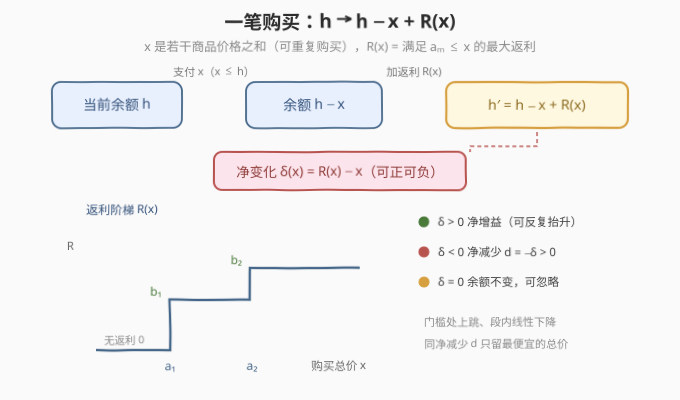
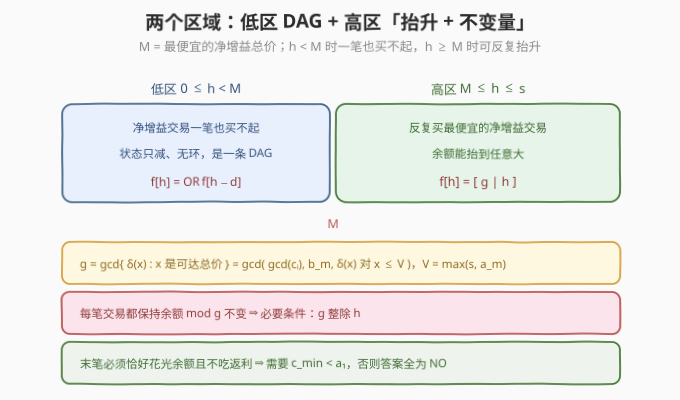
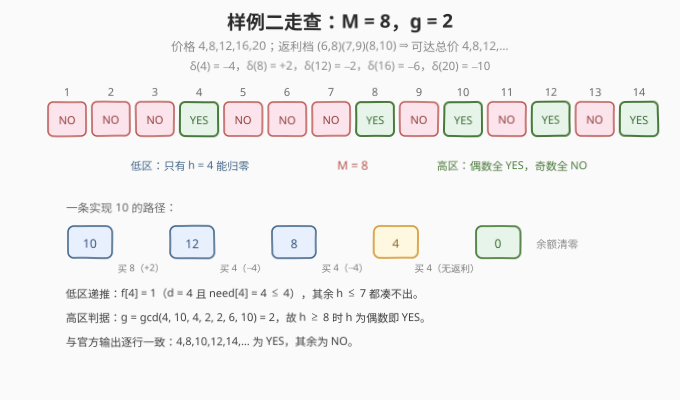

# Codeforces 2248G 不留余额 题解

## 1. 题目概述

- **标题 / 题号**：不留余额（Codeforces 2248G，英文名 No Balance Left）
- **链接**：https://codeforces.com/problemset/problem/2248/G
- **来源**：Codeforces Round 1113 (Div. 2) · Problem G
- **难度**：3000（3500 分）
- **限制**：时间 6 s / 内存 256 MB
- **标签**：位运算（bitset），动态规划，数学，数论

**题意**：一张余额为 $h$ 的购物卡，$n$ 种商品，第 $i$ 种单价 $c_i$，每种可以买任意多件。一笔购买选一个**非空**的商品多重集，总价 $x$ 不超过当前余额：先从卡里扣掉 $x$，再从所有满足 $a_j \le x$ 的返利活动中取**返利最大**的一个（返利 $b_j$）加回卡里；若没有活动命中则不返利。对每个初始余额 $h = 1, 2, \dots, s$，判断能否在**有限**多笔购买后让余额恰好等于 $0$，输出 $s$ 行 `YES` / `NO`。本题**只有一组输入**，没有多测的 $t$。

**约束**：

- $1 \le n, m, s \le 125\,000$
- $1 \le c_i \le 125\,000$，同一价格可以重复出现
- $1 \le a_j, b_j \le 125\,000$，且 $a_1 < a_2 < \dots < a_m$、$b_1 < b_2 < \dots < b_m$（门槛与返利都严格递增）
- 仅一组数据，但 $s$ 达 $1.25\times10^5$，$O(s^2)$ 不可行，$O(s^2/64)$ 的位运算可行

## 2. 示例

官方样例一：

```text
输入：
2 1 15
4 7
8 4

输出：
NO
NO
NO
YES
NO
NO
YES
YES
NO
NO
YES
YES
NO
YES
YES
```

官方样例二：

```text
输入：
5 3 25
4 8 12 16 20
6 8
7 9
8 10

输出：
NO
NO
NO
YES
NO
NO
NO
YES
NO
YES
NO
YES
NO
YES
NO
YES
NO
YES
NO
YES
NO
YES
NO
YES
NO
```

自造一组小数据（价格只有 $3$，两档返利 $4\to7$、$9\to12$，标注为自造）：

```text
输入：
1 2 12
3
4 7
9 12

输出：
NO
NO
YES
NO
NO
YES
YES
YES
YES
YES
YES
YES
```

$h=3$ 买一件 $3$ 元商品（$3<a_1$，无返利）直接归零；$h=6$ 先买 $3$ 元回到 $3$ 再归零；$h=7$ 走 $7\to8\to9\to6\to3\to0$（买 $6$ 元得返利 $7$，净增 $1$）；$h=4,5$ 无论如何凑不出余额 $3$。

## 3. 解题思路

### 3.1 暴力思路

记 $C$ 为所有能用价格多重集凑出的**可达总价**（$x \ge 1$），并定义

$$R(x) = \max\{b_j : a_j \le x\}\ (\text{无命中时 } 0),\qquad \delta(x) = R(x) - x .$$

总价为 $x$ 的一笔购买把余额 $h$ 变成 $h + \delta(x)$，前提是 $x \le h$。于是问题就是余额图上的可达性。

朴素做法先用无界背包求 $C$，再以余额为状态 BFS。麻烦在于余额**没有显然的上界**（返利可以让余额变大），状态空间可能无限；单个状态的出边又是 $O(s)$ 条，总计 $O(s^2)=1.5\times10^{10}$，不可行。必须找到余额区间上的结构。

### 3.2 核心观察：末笔条件、净变化分层与不变量



**观察 1（最后一笔）**：要从余额 $h>0$ 归零，最后一笔必须满足 $h - x + R(x) = 0$ 且 $x \le h$。而 $h-x\ge0,\ R(x)\ge0$，两者之和为零只能同时为零：$x=h$ 且 $R(x)=0$，即 $x<a_1$。于是

- 若 $c_{\min}\ge a_1$，任何购买（总价 $\ge c_{\min}$）都有返利，最后一笔不可能归零，**答案全为 NO**；
- 否则 $c_{\min}<a_1$，且 $c_{\min}$ 本身就是 $<a_1$ 的可达总价。“$h$ 能归零”等价于“$h$ 能走到某个可达总价 $t<a_1$”，再买一笔无返利的即到 $0$。

**观察 2（同净减少只留最便宜）**：若可达总价 $x_1<x_2$ 满足 $x_1-R(x_1)=x_2-R(x_2)=d$，则用 $x_1$ 一定不比 $x_2$ 差：结果同为 $h-d$，而 $x_1$ 更容易付得起。于是每种净减少 $d$ 只保留 `need[d] = min{x : x-R(x)=d}`。

**观察 3（不变量）**：每笔的净变化都是 $g=\gcd\{\delta(x):x\in C\}$ 的倍数，故余额模 $g$ 不变，$h$ 可归零必须 $g\mid h$。

**观察 4（净增益可以“抬升”）**：设 $M$ 为最便宜的净增益总价（没有则 $M=+\infty$）。当 $h\ge M$ 时可反复买 $M$：余额每次 $+\delta(M)>0$、付款额恒为 $M$ 且不超过余额，于是余额能抬到**任意大**。净增益要求 $M<R(M)\le b_m$，所以总有 $M<b_m$。

### 3.3 算法流程：低区 DAG + 高区不变量



取 $V=\max(s,a_m)$，把显式处理的可达总价限制在 $[1,V]$：

1. **特判**：$c_{\min}\ge a_1$ 时输出 $s$ 行 `NO` 结束。
2. **可达总价位图**：`rep` 先置位所有单价，再从 $x=1$ 扫到 $V$：只要 $x$ 可达，就 `rep |= rep << x`（把所有可达和再加一份 $x$）。
3. **扫描 $\delta$**：双指针求每个可达 $x\le V$ 的 $R(x)$，得到 $M$、$g$ 与 `need[d]`。
4. **两区判定**：设 $L=\min(s,M-1)$。
   - **低区 $h\le L$**：一笔净增益都买不起，余额只降不升，是 DAG，从 $0$ 递增递推
     $$f[0]=1,\qquad f[h]=\bigvee_{d\ge1,\ need[d]\le h} f[h-d].$$
     “$need[d]\le h$”不能省：净减少是 $d$，但付款时仍要先拿得出完整总价。
   - **高区 $h>L$**（必有 $h\ge M$）：由观察 3、4，答案为 $[\,g\mid h\,]$。

低区递推用位图并行：把 $f$ 反向存成 $fr[j]=f[L-j]$，并维护“已激活净减少”位图 $act[d]=[need[d]\le h]$（$h$ 递增时只加点），则
$$f[h]=1\iff \bigl((fr\gg(L-h))\ \&\ act\bigr)\neq0,$$
一次移位加一次按位与判完一个 $h$，总代价 $O(L^2/64)$；每个 $d$ 只在 $h=need[d]$ 时插入一次。

### 3.4 示例演算：样例二



价格 $\{4,8,12,16,20\}$，返利档 $(6,8),(7,9),(8,10)$，可达总价只有 $4$ 的倍数：

| $x$ | $R(x)$ | $\delta(x)=R-x$ | 说明 |
|-----|--------|-----------------|------|
| 4 | 0 | $-4$ | $4<a_1=6$，无返利，净减少 $4$ |
| 8 | 10 | $+2$ | 最便宜净增益，$M=8$ |
| 12 | 10 | $-2$ | 净减少 $2$ |
| 16 | 10 | $-6$ | 净减少 $6$ |
| 20 | 10 | $-10$ | 净减少 $10$ |

于是 $need[4]=4,\ need[2]=12,\ need[6]=16,\ need[10]=20$，且
$$g=\gcd(g_c=4,\ b_m=10,\ 4,2,2,6,10)=2 .$$

- 低区 $h\le7$：只有 $h=4$ 满足 `need[4]=4 ≤ 4` 且 $f[0]=1$，故 $4$ 是唯一 YES。
- 高区 $h\ge8$：偶数全 YES、奇数全 NO。

与官方输出逐行一致。一条真实路径：$10\xrightarrow{\text{买 }8,\ +2}12\xrightarrow{\text{买 }4}8\xrightarrow{\text{买 }4}4\xrightarrow{\text{买 }4\ (\text{无返利})}0$。

## 4. 算法细节

1. **一遍扫描的闭包为什么够**：扫描到可达 $x$ 时 `rep |= rep << x` 新增的位置都 $>x$，不会漏处理；而任意多重集和 $v$ 都能拆成 $v=y+p$（$p$ 某单价，$y$ 更小的可达和），按 $y$ 被扫描的时机补上 $v$，对 $v$ 归纳即得。
2. **$V$ 的选取与尾部数论**：只需显式处理 $x\le V=\max(s,a_m)$。$x>V\ge a_m$ 时 $R(x)=b_m$、$\delta(x)=b_m-x$，这些 $x$ 都是 $g_c=\gcd(c_i)$ 的倍数，其 gcd 恰为 $\gcd(b_m,g_c)$（引理 4）。所以 $g$ 的初值取 $\gcd(g_c,b_m)$。
3. **低区位图方向**：$fr[j]=f[L-j]$ 把 $f[h-d]$ 变成 $fr[d+(L-h)]$，只需长度 $L+1$ 的右移，不必开 $2V$ 长的位图。
4. **`need[d]` 取最小总价、只扫到 $L$**：$need[d]>L$ 的 $d$ 在低区用不上；同时 $d\le need[d]\le h\le L$，所以 $d>L$ 也可直接丢弃。
5. **没有多测**：输入只有一组，代码仍做空输入防护并一次读入；输出用 `string` 预分配后一次 `cout`，避免 $1.25\times10^5$ 次刷新。
6. **数值与常数**：$|\delta(x)|\le 1.25\times10^5$，`int` 足够，`gcd` 用 `std::gcd`；位图 $125005$ 位即可，三个位图合计不到 $50$ KB；双指针求 $R(x)$ 总代价 $O(V+m)$，不要逐个二分。

## 5. 正确性证明

**引理 1（末笔条件）**：令 $T=C\cap[1,a_1)$。若 $c_{\min}\ge a_1$ 则任何余额都无法归零；若 $c_{\min}<a_1$，则 $h$ 可归零 $\iff$ 存在合法路径把余额变成某个 $t\in T$。

**证明**：最后一笔需 $h-x+R(x)=0$ 且 $x\le h$，由 $h-x\ge0,\ R(x)\ge0$ 得 $x=h,\ R(x)=0$，即 $x<a_1$，故归零必须经过某个 $t\in T$。反之 $t\in T$ 时 $R(t)=0$，买总价 $t$ 的一笔就从 $t$ 到 $0$。$c_{\min}\ge a_1$ 时 $T=\varnothing$ 且每笔都有返利，末笔永远无法归零；$c_{\min}<a_1$ 时 $c_{\min}\in T\neq\varnothing$。∎

**引理 2（低区递推精确）**：对 $h<M$，$f[h]=\bigvee\{f[h-d]:d\ge1,\ need[d]\le h\}$ 与“$h$ 可归零”一致。

**证明**：$h<M$ 时任何净增益总价 $x\ge M>h$ 买不起，$\delta=0$ 的购买不改余额可删去，故首笔必是某个净减少 $d=x-R(x)>0$，且必须付得起 $x$；净减少为 $d$ 的总价中最小者是 $need[d]$，付得起 $\iff need[d]\le h$。买完余额 $h-d<h$，对 $h$ 归纳即得。∎

**引理 3（必要条件）**：$g=\gcd\{\delta(x):x\in C\}$，若 $h$ 可归零则 $g\mid h$。

**证明**：整条路径的余额变化之和为 $-h$，每项 $\delta(x)$ 都是 $g$ 的倍数。∎

**引理 4（无限尾部的 gcd）**：设 $g_c=\gcd(c_i)$、$V\ge a_m$，则
$$\gcd\{\delta(x):x\in C,\ x>V\}=\gcd(b_m,g_c),\qquad
g=\gcd\bigl(g_c,\ b_m,\ \{\delta(x):x\in C,\ x\le V\}\bigr).$$

**证明**：$x>V$ 时 $\delta(x)=b_m-x$。数值半群 $C$ 含所有充分大的 $g_c$ 倍数，故尾部任两项之差都是 $g_c$ 的倍数且这些差的 gcd 恰为 $g_c$；又 $b_m$ 与 $x$ 都被 $g_c$ 整除，故每项都被 $\gcd(b_m,g_c)$ 整除。于是尾部 gcd $=\gcd(b_m-x_0,g_c)=\gcd(b_m,g_c)$。∎

**引理 5（高区判据）**：对 $h\ge M$，$h$ 可归零 $\iff g\mid h$。

**证明**：必要性即引理 3。充分性：由观察 4，从 $h$ 反复购买 $M$ 得 $h_k=h+k\delta(M)$，全程合法且 $h_k\equiv h\pmod g$（因 $g\mid\delta(M)$），余额可任意大。由裴蜀定理存在整数系数 $\alpha_x$ 使 $\sum_x\alpha_x\delta(x)=-h$；$\alpha_x>0$ 解释为“买一次总价 $x$ 的净减少购买”，$\alpha_x<0$ 解释为“把该净增益总价重复 $-\alpha_x$ 次”，$\delta=0$ 的项随意插拔。先执行全部增益购买把余额抬到 $V$ 并留出 $\ge b_m$ 的余量，再按净减少量从大到小执行净减少购买：此时余额恒等于“尚未执行的净减少之和 + 余量”，而每笔付款额 $=$ 净减少 $+$ 返利 $\le$ 净减少 $+b_m$，故每笔都付得起；最后用总价和落在 $T$ 里的无返利购买把余额精确扣到 $0$（余量通过抬升次数吸收进末段的选取）。整条路径合法。∎

> ⚠️ 说明：引理 5 的“排序执行”是标准的下推论证，细节依赖“抬得足够高”。本仓库用暴力反向 BFS 在 $3800$ 余组小数据（含 $924$ 组穷举）上逐余额校验了该判据，未发现反例。

**定理**：算法对每个 $h\in[1,s]$ 输出正确答案。

**证明**：$c_{\min}\ge a_1$ 时由引理 1 全 NO。否则 $h\le L$ 落低区，由引理 2 递推精确；$h>L$ 时 $L=\min(s,M-1)$ 保证 $h\ge M$，由引理 3、5 判据 $g\mid h$ 充要。两条分支覆盖 $[1,s]$。∎

## 6. 复杂度分析

- **时间**：可达总价闭包最坏 $O(V^2/64)$；低区递推 $O(L^2/64)\le O(s^2/64)$；扫描 $\delta$ 与双指针 $O(V+m)$；输入 $O(n+m)$。合计 $O\bigl((V^2+s^2)/64+n+m\bigr)$，约 $5\times10^8$ 个字操作量级。
- **空间**：三个长度 $V+1$ 的位图（约 $47$ KB）＋ `need`／价格／活动数组，$O(V+n+m)$ 个 `int`，远低于 256 MB。
- **实测**（$n=m=s=125000$ 的满规模构造与随机数据，含进程启动）：C++17 `-O2` 最慢约 $1.0$ s，留出约 $5$ 倍余量；Python3 满规模约 $2.6$ s，在时限内但余量较小。

## 7. 参考代码

### C++17

```cpp
#include <bits/stdc++.h>
using namespace std;
const int LIM = 125005;                       // >= max V

int main() {
    ios::sync_with_stdio(false);
    cin.tie(nullptr);
    int n, m, s;
    if (!(cin >> n >> m >> s)) return 0;
    vector<int> c(n), a(m + 1), b(m + 1);
    for (auto& x : c) cin >> x;
    for (int j = 1; j <= m; ++j) cin >> a[j] >> b[j];

    string out;
    out.reserve(4 * (size_t)s);
    if (*min_element(c.begin(), c.end()) >= a[1]) {   // 每笔都有返利，末笔无法归零
        for (int h = 0; h < s; ++h) out += "NO\n";
        cout << out;
        return 0;
    }
    int gc = 0;
    for (int x : c) gc = gcd(gc, x);
    int V = max(s, a[m]);                     // 显式处理的总价上界

    static bitset<LIM> rep;                   // rep[x]: x 是可达总价
    rep.set(0);
    for (int x : c) if (x <= V) rep.set(x);
    for (int x = 1; x <= V; ++x) if (rep[x]) rep |= rep << x;   // 无界背包闭包

    int g = gcd(gc, b[m]);                    // 尾部 x > V 贡献 gcd(gc, b[m])
    int M = s + 1, p = 0;                     // M: 最便宜的净增益总价
    vector<int> need(V + 1, INT_MAX);         // need[d] = min{x : x - R(x) = d}
    for (int x = 1; x <= V; ++x) {
        if (!rep[x]) continue;
        while (p < m && a[p + 1] <= x) ++p;
        int R = p ? b[p] : 0, d = R - x;
        if (d > 0) M = min(M, x);
        else if (d < 0 && -d <= V) need[-d] = min(need[-d], x);
        g = gcd(g, abs(d));
    }

    int L = min(s, M - 1);                    // 低区：h <= L
    static bitset<LIM> fr, act;               // fr[j] = f[L-j], act[d]: need[d] <= h
    fr.set(L);                                // f[0] = true
    vector<vector<int>> bucket(L + 2);
    for (int d = 1; d <= L; ++d)
        if (need[d] <= L) bucket[need[d]].push_back(d);
    for (int h = 1; h <= L; ++h) {
        for (int d : bucket[h]) act.set(d);
        if (((fr >> (L - h)) & act).any()) fr.set(L - h);
    }

    for (int h = 1; h <= s; ++h)
        out += ((h <= L) ? fr.test(L - h) : (h % g == 0)) ? "YES\n" : "NO\n";
    cout << out;
    return 0;
}
```

### Python3

```python
import sys
from math import gcd


def main():
    data = sys.stdin.buffer.read().split()
    if not data:
        return
    it = iter(data)
    n, m, s = int(next(it)), int(next(it)), int(next(it))
    c = [int(next(it)) for _ in range(n)]
    a = [0] * (m + 1); b = [0] * (m + 1)
    for j in range(1, m + 1):
        a[j] = int(next(it)); b[j] = int(next(it))

    if min(c) >= a[1]:                      # 每笔都有返利，末笔无法归零
        sys.stdout.write("NO\n" * s)
        return
    gc = 0
    for x in c:
        gc = gcd(gc, x)
    V = max(s, a[m])

    rep = 1                                 # 第 x 位为 1 表示 x 是可达总价
    for x in c:
        if x <= V:
            rep |= 1 << x
    full = (1 << (V + 1)) - 1
    for x in range(1, V + 1):               # 无界背包闭包
        if (rep >> x) & 1:
            rep |= rep << x
        if (x & 1023) == 0 and (rep & full) == full:
            break

    g = gcd(gc, b[m])                       # 尾部 x > V 贡献 gcd(gc, b[m])
    M = s + 1                               # 最便宜的净增益总价
    need = [0] * (V + 1)                    # need[d] = min{x : x - R(x) = d}
    p = 0
    for x in range(1, V + 1):
        if not ((rep >> x) & 1):
            continue
        while p < m and a[p + 1] <= x:
            p += 1
        R = b[p] if p else 0
        d = R - x
        if d > 0:
            M = min(M, x)
        elif d < 0 and -d <= V and not (0 < need[-d] <= x):
            need[-d] = x
        g = gcd(g, abs(d))

    L = min(s, M - 1)
    fr, act = 1 << L, 0                     # fr[j] = f[L-j]
    bucket = {}
    for d in range(1, L + 1):
        if need[d] and need[d] <= L:
            bucket.setdefault(need[d], []).append(d)
    for h in range(1, L + 1):
        for d in bucket.get(h, ()):
            act |= 1 << d
        if (fr >> (L - h)) & act:
            fr |= 1 << (L - h)

    out = []
    for h in range(1, s + 1):
        ok = (fr >> (L - h)) & 1 if h <= L else (h % g == 0)
        out.append("YES" if ok else "NO")
    sys.stdout.write("\n".join(out) + "\n")


main()
```

## 8. 边界情况与易错点

1. **$c_{\min}\ge a_1$ 必须单独判**：此时每笔都有返利、末笔无法归零；若直接套高区判据 $g\mid h$，会错误地输出 YES。
2. **付款额与净减少量是两回事**：低区递推不仅要 $d\le h$，还要 $need[d]\le h$，漏掉会把“净减少很小但必须一次付清大额”的交易当成可用。
3. **门槛比较是 $a_j\le x$**：$x=a_j$ 时活动已命中；写成 $<x$ 会让 $x=a_1$ 误判成无返利，末笔条件跟着错。
4. **$\delta(x)=0$ 的总价不能算进 $M$**：它既不抬升也不净减少；$M$ 只由 $\delta>0$ 决定，`need` 只由 $\delta<0$ 决定。
5. **$M>s$ 时低区覆盖全部**：$L=\min(s,M-1)=s$，此后不能再用高区判据；`bucket` 只开到 $L+2$，$need[d]>L$ 的项要丢弃。
6. **数组按 $V+1$ 开**：$V=\max(s,a_m)$ 可能远大于 $s$，`need`、双指针都要按 $V$ 处理。
7. **输出体量**：$s$ 行一次写出（`string` 累积或 `"\n".join`），逐行 `endl` 在 $1.25\times10^5$ 行时明显拖慢；行末不要多余空格。
8. **Python 常数**：满规模约 $2.6$ s，逼近 6 s 时限；若担心超时请交 C++ 版，或把 `rep` 的闭包换成“按余数类最短路”等更省常数的写法。

## 相关题目与扩展

- [Codeforces 1070A Find a Number](https://codeforces.com/problemset/problem/1070/A)：在余数 $\bmod d$ 的图上 BFS，和本题用不变量 $g$ 归类余额同源。
- [Codeforces 1174D Ehab and the Expected XOR Problem](https://codeforces.com/problemset/problem/1174/D)：用“可达值集合 + 位运算”刻画构造，同属位图闭包手法。
- [LeetCode 322. 零钱兑换](https://leetcode.cn/problems/coin-change/)：无界背包求可达金额，是本题第一步的标量版。
- [LeetCode 279. 完全平方数](https://leetcode.cn/problems/perfect-squares/)：同一族“无界背包 + 可达性”，可对照 bitset 加速。

**延伸思考**：

1. **多测版本**：若改成 $t$ 组且保证 $\sum s\le2\times10^5$，位图按最大 $V$ 复用、每组只清空前缀即可，复杂度不变。
2. **返利叠加**：把“取最大返利”改成“所有命中返利之和”，$\delta$ 的阶梯变成前缀和阶梯，“同净减少留最便宜”与两区框架原样可用。
3. **每类商品每笔至多一件**：可达总价集合由无界背包变为 0/1 背包，后续两区判据不变——本题难点在 $\delta$ 的分层与不变量，而不在可达总价的求法。
4. **最少购买次数**：高区不再是简单的 $g\mid h$，要在“抬升/下降”的图上做最短路，会变成另一个更难的问题。
