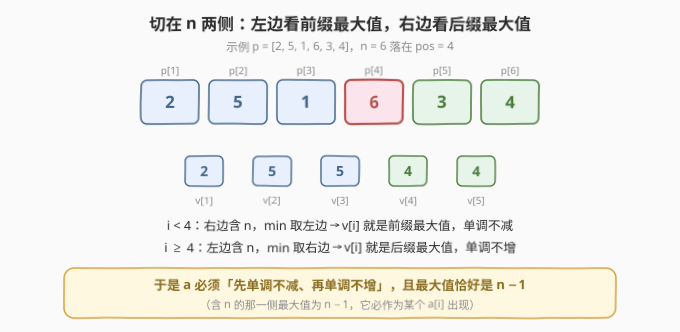
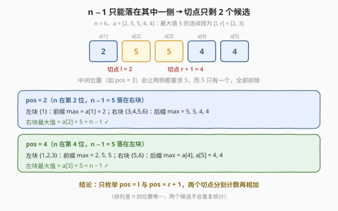

# Codeforces 2249B 排列切割 题解

## 1. 题目概述

- **标题 / 题号**：排列切割（Codeforces 2249B，英文名 Permutation Cuts）
- **链接**：https://codeforces.com/problemset/problem/2249/B
- **来源**：Codeforces Round 1112 (Div. 1) · Problem B
- **难度**：1700
- **限制**：时间 4 s / 内存 256 MB
- **标签**：组合数学，计数，实现，单调性

**题意**：给定 $n$ 与长度 $n-1$ 的数组 $a$。对长度为 $n$ 的排列 $p$ 定义

$$v_i=\min\left(\max_{1\le j\le i}p_j,\ \max_{i+1\le j\le n}p_j\right),\qquad 1\le i\le n-1,$$

也就是「在第 $i$ 与第 $i+1$ 个位置之间切一刀，取左右两段最大值的较小者」。求满足 $v_i=a_i$（对每个 $i$）的排列个数，答案对 $998\,244\,353$ 取模。多测：第一行 $t$，每组先给 $n$，再给一行 $n-1$ 个整数；每组输出一行答案。

**约束**：

- $1\le t\le 10^4$，多测；
- $2\le n\le 10^6$，$1\le a_i\le n$；
- $\sum n\le 10^6$：单组可以到 $10^6$，切点/取值都不允许枚举，只能 $O(n)$ 扫描。

## 2. 示例与观察
官方样例（输入 / 输出原样）：

```text
输入
11
2
1
3
2 2
3
1 1
4
2 3 2
5
3 3 4 2
2
2
3
1 2
4
3 3 3
5
4 4 4 4
4
2 1 2
6
3 3 5 5 5

输出
2
2
0
0
2
0
2
4
12
0
8
```

```text
输入（自造，★）
1
5
2 4 4 1

输出
2
```

★ 自造样例：$n=5$、$a=[2,4,4,1]$，$n-1=4$ 的连续段是 $[2,3]$，两个候选切点是 $pos=2$ 与 $pos=4$，各贡献 1，答案 2（对应排列 $[2,5,3,4,1]$ 与 $[2,4,3,5,1]$）。它专门检验「$n-1$ 在右块」这一支。

## 3. 解题思路

### 3.1 暴力思路

枚举全部 $n!$ 个排列，逐个算 $v$ 与 $a$ 比对，复杂度 $O(n!\cdot n)$：$n\le 8$ 尚可，$n=10^6$ 毫无希望。换 DP 也不行——只要把「哪些值已被使用」当状态，状态数就是 $2^n$ 级别。

瓶颈在于我们一开始就想同时决定「值」和「位置」。但 $v_i=a_i$ 的约束其实是**逐位置的局部约束**：一旦确定 $n$ 的位置，第 $i$ 个位置要么被钉死成某个具体值，要么只是一个「必须小于某值」的上界。确定了这些身份，剩下就是一次可以逐位贪心的独立计数，完全没有跨位置耦合。

### 3.2 核心观察：以 n 为界，切点只剩两个



**观察 1（$n$ 把排列劈成两半）**：设 $n$ 的位置为 $pos$。当 $i<pos$ 时右半段 $[i+1,n]$ 必含 $n$，故 $\max_{j>i}p_j=n$，于是 $v_i=\min(\text{左半段前缀最大值},\,n)=\text{前缀最大值}$；当 $i\ge pos$ 时左半段含 $n$，同理 $v_i=\max_{j>i}p_j$（后缀最大值）。因此 $a_1,\dots,a_{pos-1}$ 必须**单调不减**，$a_{pos},\dots,a_{n-1}$ 必须**单调不增**。

**观察 2（最大值必为 $n-1$）**：两侧都非空，$n$ 只在一边，另一边最大值 $\le n-1$，所以 $v_i\le n-1$ 恒成立。而含 $n-1$ 的那一块最大值恰为 $n-1$，它就是 $a_{pos-1}$（$n-1$ 在左块）或 $a_{pos}$（在右块）。故合法的 $a$ 必须满足 $\max a=n-1$。

**观察 3（切点只有两个候选）**：设 $l,r$ 是 $n-1$ 在 $a$ 中首次、末次出现的位置（由观察 1，$[l,r]$ 内全是 $n-1$）。$n-1$ 只可能在左块或右块之一，所以 $pos-1$ 与 $pos$ 中**恰有一个**落在 $[l,r]$：落在 $pos-1$ 给出 $pos=r+1$，落在 $pos$ 给出 $pos=l$。取中间位置会让两侧都要求 $n-1$，而 $n-1$ 只有一个，全部非法。



于是答案 $=$（$n$ 放在 $l$ 的方案数）$+$（$n$ 放在 $r+1$ 的方案数）。

### 3.3 算法流程：钉死位与自由位


固定 $pos$ 后按观察 1 逐位置翻译约束：

- **左块**（$i\le pos-1$，要求前缀最大值恰为 $a_i$）：$a_i>a_{i-1}$（$i=1$ 视 $a_0=0$）$\Rightarrow p_i=a_i$；$a_i=a_{i-1}\Rightarrow p_i<a_i$；$a_i<a_{i-1}\Rightarrow$ 无解。
- **右块**（$i\ge pos+1$，要求位置 $i$ 起的后缀最大值为 $a_{i-1}$）：$i=n\Rightarrow p_n=a_{n-1}$；$a_{i-1}>a_i\Rightarrow p_i=a_{i-1}$；$a_{i-1}=a_i\Rightarrow p_i<a_i$；$a_{i-1}<a_i\Rightarrow$ 无解。

把「只能是某值」的位置叫**钉死位**，把「必须小于 $b$」的位置叫**自由位（上界 $b$）**。若同一数值被两个位置钉死，该切点直接无解。剩下的事情是纯组合：把 $1..n-1$ 互不相同地分给 $n-1$ 个位置，一部分位置固定、一部分位置带上界。

**贪心**：自由位按上界 $b$ 从小到大处理。轮到上界 $b$ 的位置时，可用值 = 小于 $b$ 的值，扣掉被钉死占用的，再扣掉已分配给上界更小自由位的（它们都 $<$ 各自上界 $\le b$，必在其中）：

$$K(b)=(b-1)-\#\{\text{钉死值}<b\}-\#\{\text{上界更小的自由位}\}.$$

上界同为 $b$ 的 $f$ 个位置依次有 $K,K-1,\dots,K-f+1$ 种选择，乘起来即可。任何一步 $\le 0$ 说明值不够用，该切点贡献 0。

### 3.4 示例演算

![n = 6，a = [3,3,5,5,5] 的逐步走查](../../../images/cf2249b_walkthrough.svg)

以官方样例最后一组 $n=6$、$a=[3,3,5,5,5]$ 为例。$n-1=5$ 的连续段是 $[3,5]$，故 $pos\in\{3,6\}$。

- $pos=3$：左块位置 $1,2$，右块位置 $4,5,6$。钉死位：位置 $1\to3$（$a_1>a_0$）、位置 $6\to5$（后缀只有 $p_6$）；自由位：位置 $2$ 上界 3，位置 $4,5$ 上界 5。按上界升序：$b=3$ 时 $K=2-0-0=2$；$b=5$ 时 $K=4-1-1=2$，两个位置贡献 $2\cdot1=2$。合计 $2\times2=4$。
- $pos=6$：左块位置 $1..5$，右块为空。钉死位：位置 $1\to3$、位置 $3\to5$（$a_3>a_2$）；自由位同上。计数完全对称，贡献 4。

答案 $4+4=8$，与官方输出一致。

## 4. 算法细节

1. **多测分配**：每组用 `assign(n+2, 0)` 重建 `a`、`forcedCnt`、`boundCnt`，总代价 $O(\sum n)$；不要用「只清用过的下标」那种写法，容易漏清。
2. **读入时顺手判非法**：出现 $a_i\ge n$ 直接输出 0（因为 $v_i\le n-1$）；不存在 $a_i=n-1$ 也输出 0。两条都在 $O(n)$ 读入里完成。
3. **边界位置的身份**：左块 $i=1$ 规定 $a_0=0$，所以 $a_1$ 必是钉死位；右块 $i=n$ 必钉死为 $a_{n-1}$；$pos=l=1$ 时左块为空、$pos=r+1=n$ 时右块为空，循环范围自然为空，不必特判。
4. **查重只在同一候选内部**：两个候选切点的钉死集合不同，跨候选比较会误杀。先按切点各自建表、各自判重。
5. **负因子先判后乘**：$K$ 可能 $\le 0$，必须 `if (avail <= 0) return 0;` 之后再乘；先乘后判在 C++ 里会得到负余数。
6. **类型**：$K\le n\le10^6$，乘积用 `long long` 逐步取模；两个候选的贡献都 $<$ MOD，相加后再取模一次即可。
7. **只算两个切点**：对 $pos=1..n$ 各扫一遍是 $O(n^2)$，必须用引理 2 把候选压到 2 个。
8. **I/O**：C++ 关同步 + `'\n'`；Python 用 `sys.stdin.buffer.read().split()`，$t$ 可达 $10^4$，逐行 `input()` 会明显变慢。

## 5. 正确性证明

**引理 1**：设 $p$ 合法，$pos$ 为 $n$ 的位置。则 $i<pos$ 时 $v_i=\max_{j\le i}p_j$，$i\ge pos$ 时 $v_i=\max_{j>i}p_j$。因此 $a$ 在 $[1,pos-1]$ 上单调不减、在 $[pos,n-1]$ 上单调不增。

**证明**：$i<pos$ 时右半段含 $n$，其最大值为 $n$，故 $v_i=\min(\text{左半段最大值},n)=\text{左半段最大值}=\max_{j\le i}p_j$；$i\ge pos$ 时左半段含 $n$，对称得 $v_i=\max_{j>i}p_j$。单调性来自「前缀最大值单调不减、后缀最大值单调不增」。∎

**引理 2**：若存在合法排列，则 $\max a=n-1$；记 $l,r$ 为 $n-1$ 在 $a$ 中首次、末次出现的下标，则合法 $pos$ 只能是 $l$ 或 $r+1$。

**证明**：由引理 1 的单调性，$a_l=\dots=a_r=n-1$，且 $[l,r]$ 恰是全部取值为 $n-1$ 的下标。$n-1$ 只在左块或右块之一，若在左块则左块最大值为 $n-1=a_{pos-1}$，若在右块则 $a_{pos}=n-1$；由于 $n$ 只出现一次，$pos-1$ 与 $pos$ 不能同时落在 $[l,r]$。若 $pos-1\in[l,r]$ 而 $pos\notin[l,r]$，由 $pos-1\le r$ 得 $pos\le r+1$，又 $pos\ge l+1$ 且 $pos\notin[l,r]$ 迫使 $pos>r$，故 $pos=r+1$；若 $pos\in[l,r]$ 而 $pos-1\notin[l,r]$，由 $pos-1\le r$ 与 $pos-1\notin[l,r]$ 得 $pos-1<l$，即 $pos\le l$，又 $pos\ge l$，故 $pos=l$。∎

**引理 3**：固定 $pos$。若 $v_i=a_i$ 对所有 $i$ 成立，则 3.3 的每条局部规则都成立；反之，若局部规则成立且被钉死的值互不相同，则对任意一组满足上界的互异取值都有 $v_i=a_i$。

**证明**（必要性）：左块 $a_i=v_i=\max_{j\le i}p_j$：$a_i>a_{i-1}$ 时 $p_i$ 必须是新出现的最大值，即 $p_i=a_i$；$a_i=a_{i-1}$ 时 $p_i\le a_i$ 且 $a_i$ 已在 $i$ 之前出现，由值互异 $p_i\neq a_i$，故 $p_i<a_i$；$a_i<a_{i-1}$ 与单调性矛盾。右块对称（$i=n$ 时后缀只有 $p_n$，故 $p_n=a_{n-1}$）。

（充分性）：左块对 $i$ 归纳证 $\max_{j\le i}p_j=a_i$。$i=1$ 时 $p_1=a_1$ 成立；$i>1$ 时若 $a_i>a_{i-1}$，则 $p_i=a_i>a_{i-1}=$ 前缀最大值（归纳假设），新前缀最大值为 $a_i$；若 $a_i=a_{i-1}$，则 $p_i<a_i$，前缀最大值仍为 $a_i$。右块自右向左同理。再由引理 1 得 $v_i=a_i$。∎

**引理 4**：给定互异的钉死值与自由位上界，满足条件的赋值个数等于贪心乘积 $P=\prod_j\big((b_j-1)-F(b_j)-j\big)$（$j$ 从 0 起，$F(b)$ 为钉死值 $<b$ 的个数，$b_j$ 为第 $j$ 个自由位的上界，按上界升序排列）。

**证明**：第 $j$ 个自由位之前已填了 $j$ 个自由值与全部钉死值；已填的自由值都 $<b_j$（每个小于自己的上界，而后者 $\le b_j$）。故可用值恰为 $[1,b_j-1]$ 中扣除 $F(b_j)$ 个钉死值与 $j$ 个已用自由值，共 $(b_j-1)-F(b_j)-j$ 个。任何合法赋值在该位置取的值必属此集合，故总数不超过 $P$；反过来，按该顺序逐位在可用集合中任选，选出的值互异且满足全部上界，故每个选择序列给出一个合法赋值且不同序列给出不同赋值，总数不少于 $P$。若某个因子 $\le 0$，可用集合为空，个数为 0。∎

**定理**：算法输出的数值就是满足条件的排列个数。

**证明**：由引理 2，合法排列的 $pos$ 必为 $l$ 或 $r+1$，且 $n$ 的位置唯一，两类排列不交，故总数等于两个切点贡献之和。对固定 $pos$，由引理 3，满足 $v_i=a_i$ 的排列与「满足局部规则的互异取值」一一对应（位置与取值一旦确定，排列唯一）；再由引理 4，后者个数就是贪心乘积 $P$。算法对两个切点分别算出该乘积，遇到单调性被破坏、钉死值冲突、可用值不足（因子 $\le0$）时返回 0。当 $\max a\ne n-1$ 或存在 $a_i\ge n$ 时，由引理 1、2 知无解，算法输出 0。∎

**推论**：若 $a$ 全为 $n-1$，答案为 $2\cdot(n-2)!$（样例 $n=4,5,6$ 分别为 $4,12,48$，$n=2$ 时为 $2$）。

**证明**：此时 $[l,r]=[1,n-1]$，两个候选为 $pos=1$ 与 $pos=n$。以 $pos=n$ 为例，唯一钉死值是 $a_1=n-1$，其余 $n-2$ 个位置都是上界 $n-1$ 的自由位，$K=n-2$，乘积 $(n-2)!$；$pos=1$ 对称。∎

## 6. 复杂度分析

- **时间**：每个候选切点做三次线性扫描（左块身份、右块身份、按上界累计），常数 2 个候选，故单组 $O(n)$、总计 $O(\sum n)\le 10^6$。实测（macOS + Apple clang，$t=10^4$、$\sum n=10^6$ 的极限数据）C++ 约 750 ms、Python3 约 880 ms，其中绝大部分是 libc++ 的 `cin` 开销——同一份代码换 `fread` 快读后 C++ 仅约 20 ms；单组 $n=10^6$ 同理（1.2 s / 20 ms）。相对 4 s 时限余量充足。
- **空间**：每组三个长度 $O(n)$ 的 `int` 数组，$n=10^6$ 时约 12 MB，远低于 256 MB；无递归、无大数运算。

## 7. 参考代码

### C++17

```cpp
#include <bits/stdc++.h>
using namespace std;

static const long long MOD = 998244353;

int n;
vector<int> a;          // 1-indexed，a[1..n-1]
vector<int> forcedCnt;  // forcedCnt[v]：被钉死为 v 的位置个数
vector<int> boundCnt;   // boundCnt[b]：自由位中上界为 b 的位置个数

long long calc(int pos) {                       // n 恰在位置 pos 时的方案数
    for (int i = 1; i <= n; i++) { forcedCnt[i] = 0; boundCnt[i] = 0; }
    for (int i = 1; i <= pos - 1; i++) {        // 左块：前缀最大值 = a[i]
        if (i == 1 || a[i] > a[i - 1]) forcedCnt[a[i]]++;
        else if (a[i] == a[i - 1]) boundCnt[a[i]]++;
        else return 0;
    }
    for (int i = pos + 1; i <= n; i++) {        // 右块：i 起的后缀最大值 = a[i-1]
        if (i == n) forcedCnt[a[n - 1]]++;
        else if (a[i - 1] > a[i]) forcedCnt[a[i - 1]]++;
        else if (a[i - 1] == a[i]) boundCnt[a[i]]++;
        else return 0;
    }
    for (int v = 1; v <= n; v++) if (forcedCnt[v] > 1) return 0;  // 同一值钉死两次
    long long res = 1, freeBefore = 0;
    int forcedBefore = 0;                       // 值 < b 的钉死位置个数
    for (int b = 1; b <= n; b++) {
        int fb = boundCnt[b];
        if (fb) {
            long long K = (long long)(b - 1) - forcedBefore - freeBefore;
            for (int t = 1; t <= fb; t++) {     // 同上界的 f 个位置做下降幂
                long long avail = K - (t - 1);
                if (avail <= 0) return 0;
                res = res * (avail % MOD) % MOD;
            }
            freeBefore += fb;
        }
        forcedBefore += forcedCnt[b];
    }
    return res;
}

int main() {
    ios::sync_with_stdio(false);
    cin.tie(nullptr);
    int t;
    if (!(cin >> t)) return 0;
    while (t--) {
        cin >> n;
        a.assign(n + 1, 0);
        forcedCnt.assign(n + 2, 0);
        boundCnt.assign(n + 2, 0);
        int l = 0, r = 0;
        bool bad = false;
        for (int i = 1; i <= n - 1; i++) {
            cin >> a[i];
            if (a[i] >= n) bad = true;          // v[i] <= n-1 恒成立
            if (a[i] == n - 1) { if (!l) l = i; r = i; }
        }
        if (bad || !l) { cout << 0 << '\n'; continue; }
        cout << (calc(l) + calc(r + 1)) % MOD << '\n';   // 只有两个候选切点
    }
    return 0;
}
```

### Python3

```python
import sys

MOD = 998244353


def main() -> None:
    data = sys.stdin.buffer.read().split()
    if not data:
        return
    t = int(data[0])
    ptr = 1
    out = []

    for _ in range(t):
        n = int(data[ptr]); ptr += 1
        a = [0] * (n + 1)                       # 1-indexed
        l = r = 0
        bad = False
        for i in range(1, n):
            v = int(data[ptr]); ptr += 1
            a[i] = v
            if v >= n:                          # v[i] <= n-1 恒成立
                bad = True
            if v == n - 1:
                if l == 0:
                    l = i
                r = i
        if bad or l == 0:                       # 最大值必须是 n-1
            out.append("0")
            continue

        total = 0
        for pos in (l, r + 1):                  # 只有两个候选切点
            forced = [0] * (n + 1)
            bound = [0] * (n + 1)
            ok = True
            for i in range(1, pos):             # 左块：前缀最大值 = a[i]
                if i == 1 or a[i] > a[i - 1]:
                    forced[a[i]] += 1
                elif a[i] == a[i - 1]:
                    bound[a[i]] += 1
                else:
                    ok = False
                    break
            if ok:
                for i in range(pos + 1, n + 1):  # 右块：后缀最大值 = a[i-1]
                    if i == n:
                        forced[a[n - 1]] += 1
                    elif a[i - 1] > a[i]:
                        forced[a[i - 1]] += 1
                    elif a[i - 1] == a[i]:
                        bound[a[i]] += 1
                    else:
                        ok = False
                        break
            if not ok:
                continue

            res = 1
            free_before = 0
            forced_before = 0
            for b in range(1, n + 1):
                fc = forced[b]
                if fc > 1:                      # 同一值钉死两次
                    res = 0
                    break
                fb = bound[b]
                if fb:
                    K = (b - 1) - forced_before - free_before
                    for tt in range(fb):        # 同上界的位置做下降幂
                        avail = K - tt
                        if avail <= 0:
                            res = 0
                            break
                        res = res * avail % MOD
                    if res == 0:
                        break
                    free_before += fb
                forced_before += fc
            total += res
        out.append(str(total % MOD))

    sys.stdout.write("\n".join(out) + "\n")


main()
```

## 8. 边界情况与易错点

1. **$n=2$**：$a$ 只有一个元素。$a=[1]$ 输出 2（$[1,2]$、$[2,1]$ 都合法）；$a=[2]$ 输出 0——注意 $a_i$ 允许取到 $n$，但这种数据一定无解，必须在读入时判掉。
2. **全为 $n-1$**：答案是 $2\cdot(n-2)!$，不要误以为是 $n!$ 或 $2(n-1)!$；样例 $n=4,5,6$ 给出 $4,12,48$，可用来自检。
3. **非单峰或最大值不对**：$n=4,a=[2,1,2]$（先减后增）、$n=3,a=[1,1]$（$\max a\neq n-1$）都必须输出 0。前者不靠特判——局部规则在单调性被破坏时直接返回 0。
4. **同一个值两侧都被钉死**：$n=4,a=[2,3,2]$ 输出 0。这既是「$n-1$ 不能同时在两侧」的一般化，也是查重必须做的原因。
5. **值不够用**：钉死值太多或上界太小时 $K\le 0$，立刻返回 0，不要用 `max(0, ...)` 掩盖（那等于允许重复用值）。
6. **两个候选不能混**：$l$ 和 $r+1$ 的钉死集合不同，必须各自清空、各自判重、各自计数，最后才相加取模。
7. **下标**：$a$ 用 1-indexed；右块 $i=n$ 处要取 $a_{n-1}$，$n\ge2$ 保证存在；$pos=r+1\le n$、$pos=l\ge1$ 恒成立。

## 9. 验证记录

- **编译环境与命令**：`clang++ -std=c++17 -O2`（本机无 GNU g++，配 `codeforces/tools/include/bits/stdc++.h` 兼容头；正文代码只用标准库，可原样提交 GNU C++17）；Python 侧为 `Python 3.9.6`。
- **官方样例**：1 / 1 通过（按 Codeforces 标准 checker 的 token 比对，忽略空白与大小写）。
- **复核状态**：audited（2026-11-19 统一回归：编译 + 官方样例；写作期的随机对拍与暴力未重跑）。

## 相关题目与扩展

- [Codeforces 1366E Two Arrays](https://codeforces.com/problemset/problem/1366/E)：把序列切成若干段、每段最小值被指定，数切法；与本题「切点 + 段极值」是同一套语言，做法也是对每个 $b_i$ 数可选切点。
- [Codeforces 1748E Yet Another Array Counting Problem](https://codeforces.com/problemset/problem/1748/E)：要求所有区间的「最左最大值位置」与原数组一致，本质是按笛卡尔树/区间最值结构计数，与本题用前缀/后缀最大值刻画结构同源。
- [LeetCode 903. DI 序列的有效排列](https://leetcode.cn/problems/valid-permutations-for-di-sequence/)：给定相邻大小关系模式统计排列数，同样是「先定结构、再按位置配值」的计数。

**延伸思考**：

1. 若把 $v_i$ 的 $\min$ 换成 $\max$，即 $v_i=\max(\text{左段最大},\text{右段最大})$，答案恒为（若 $a_i$ 全等于 $n$ 则 $n!$，否则 0）——这是本题的「退化版」，可以作为对照理解为什么 $\min$ 才产生丰富结构。
2. 本题计数只用到「上界」这一种约束。若把约束换成「值必须落在区间 $[l_i,r_i]$」的任意区间族，同样的贪心不再成立，需要按右端点排序后做组合计数或容斥，是这类题的常见加强。
3. 若要求输出方案本身（构造一个合法排列），可以沿用同一套局部规则，把自由位按上界从小到大贪心填当前最小的可用值；由于引理 4 的因子恒正时必然存在合法解，构造与计数可以共用一次扫描。
